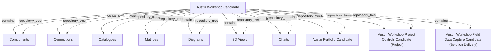

# G186/fig5-3 · 多个候选架构

类型：`decomposition-or-organization-model`。承接图 5-2，作者用第二张截图说明“多个架构项目可以各有独立的候选容器”：四个候选并列存在，互不覆盖；括号里的 Portfolio / Project / Solution Delivery 把容器与第 3 章的四种架构目的对应起来。

英文 PDF 物理页：[52]。本页为架构语义分析，原文与原图分别保留。

## 原图与可编辑图


[完整 JSON](fig5-3.json) · [可编辑 Mermaid](fig5-3.mmd) · [仅关系图](fig5-3.relations.mmd) · [层级分解图](fig5-3.hierarchy.mmd)

图形重建表达语义，不复制源图布局。虚线表示解释、矩阵映射或分组关系，不自动表示不确定性的概率。



## 架构分析

第一行是根“Austin Workshop Candidate”，带“−”表示已展开，下面列出七类视角文件夹（组件、连接、目录、矩阵、图、三维视图、图表）。七类视角之后，回到与根相同的缩进层级，依次是三个独立的候选容器：Austin Portfolio Candidate、Austin Workshop Project Controls Candidate (Project)、Austin Workshop Field Data Capture Candidate (Solution Delivery)。后三者都带“+”，表示折叠；它们不是第一个候选的子项。

- 本图有 11 个具名或隐含元素、10 条关系和 10 条包含/分组记录。
- 包含/分组树最大深度为 1；根节点为 奥斯汀工作坊候选。
- 本图没有可直接确认为人员直属汇报的关系；视觉上下位置、能力分解和治理职责分别读取。
- 11个可见标签完整；纠正原版3个候选架构被误放成根级，补3条实际导航父子边。
- 3个候选子架构与Components等在相同缩进；三者折叠，独立容器支持不干扰其他架构师的探索，不表示三者流程顺序。

### 如何用于项目

- 按父项展开所有直接子项，检查同层粒度、重叠和缺项。
- 保留组成、分类、能力分解与组织汇报的区别；将示例名称替换为已确认的项目对象。

### 结构所表达的逻辑

- 图中一共有四个候选架构容器：工作坊候选、组合候选、项目控制候选、现场数据采集候选。
- 只有第一个“奥斯汀工作坊候选”展开，展示七类视角；其余三个折叠，内容不可见。
- 三个额外候选的括号标注了它们的架构目的：Portfolio、Project、Solution Delivery，与图 3-3 的四种目的中的后三种对应。
- 四个候选在树中并列，说明它们是各自独立的容器，而不是同一候选的四个版本或四个阶段。
- 正文强调这种独立容器让架构师可以自由探索潜在未来，而不影响其他架构师的工作。
- 七类视角在每个容器内重复出现，说明“状态/项目容器 × 视角类型”是存储库的固定组织方式。
- 图中没有目标/现状状态，也没有过渡；这一页只讲并行候选。

## 上下级与包含

两层：顶层是四个并列的候选容器；第一个容器（Austin Workshop Candidate）下挂七个视角文件夹。其余三个容器折叠，子项未显示。

|父项|子项|层级类型|依据与解释|
|---|---|---|---|
|奥斯汀工作坊候选|组件|repository_tree|由树控件缩进和分支线编码的导航父级，不是框内空间包含或企业业务组成。|
|奥斯汀工作坊候选|连接|repository_tree|由树控件缩进和分支线编码的导航父级，不是框内空间包含或企业业务组成。|
|奥斯汀工作坊候选|目录|repository_tree|由树控件缩进和分支线编码的导航父级，不是框内空间包含或企业业务组成。|
|奥斯汀工作坊候选|矩阵|repository_tree|由树控件缩进和分支线编码的导航父级，不是框内空间包含或企业业务组成。|
|奥斯汀工作坊候选|图|repository_tree|由树控件缩进和分支线编码的导航父级，不是框内空间包含或企业业务组成。|
|奥斯汀工作坊候选|三维视图|repository_tree|由树控件缩进和分支线编码的导航父级，不是框内空间包含或企业业务组成。|
|奥斯汀工作坊候选|图表|repository_tree|由树控件缩进和分支线编码的导航父级，不是框内空间包含或企业业务组成。|
|奥斯汀工作坊候选|奥斯汀组合候选|repository_tree|其缩进及左侧树分支与Components等7类一致，属于Austin Workshop Candidate下的子架构节点。|
|奥斯汀工作坊候选|奥斯汀工作坊项目控制候选（项目）|repository_tree|其缩进及左侧树分支与Components等7类一致，属于Austin Workshop Candidate下的子架构节点。|
|奥斯汀工作坊候选|奥斯汀工作坊现场数据采集候选（解决方案交付）|repository_tree|其缩进及左侧树分支与Components等7类一致，属于Austin Workshop Candidate下的子架构节点。|

## 全部元素与角色

|元素ID|原文名称|类型|含义|直接父项|深度|
|---|---|---|---|---|---|
|c_workshop|Austin Workshop Candidate|architecture|工作坊架构的候选容器。|—||
|c_workshop_components|Components|group|组件视图文件夹。|奥斯汀工作坊候选|1|
|c_workshop_connections|Connections|group|连接视图文件夹。|奥斯汀工作坊候选|1|
|c_workshop_catalogues|Catalogues|group|目录视图文件夹。|奥斯汀工作坊候选|1|
|c_workshop_matrices|Matrices|group|矩阵视图文件夹。|奥斯汀工作坊候选|1|
|c_workshop_diagrams|Diagrams|group|图视图文件夹。|奥斯汀工作坊候选|1|
|c_workshop_3d_views|3D Views|group|三维视图文件夹。|奥斯汀工作坊候选|1|
|c_workshop_charts|Charts|group|图表文件夹。|奥斯汀工作坊候选|1|
|c_portfolio|Austin Portfolio Candidate|architecture|组合目的的候选架构容器。|奥斯汀工作坊候选|1|
|c_project_controls|Austin Workshop Project Controls Candidate (Project)|architecture|项目目的的候选架构容器。|奥斯汀工作坊候选|1|
|c_field_data|Austin Workshop Field Data Capture Candidate (Solution Delivery)|architecture|解决方案交付目的的候选架构容器。|奥斯汀工作坊候选|1|

## 全部关系

灰色点线只表示父子包含；“+/−”表示折叠/展开。图中没有语义箭头，也没有表示候选之间比较或竞争的连线；四个候选的并列关系由同一缩进层级表达。

|主体|语义关系|客体|显式线/隐式|原文标签|依据|
|---|---|---|---|---|---|
|奥斯汀工作坊候选|contains|组件|显式连线||软件树控件的分支表示存储库导航层级，不表示企业实体组成、流程或人员汇报。|
|奥斯汀工作坊候选|contains|连接|显式连线||软件树控件的分支表示存储库导航层级，不表示企业实体组成、流程或人员汇报。|
|奥斯汀工作坊候选|contains|目录|显式连线||软件树控件的分支表示存储库导航层级，不表示企业实体组成、流程或人员汇报。|
|奥斯汀工作坊候选|contains|矩阵|显式连线||软件树控件的分支表示存储库导航层级，不表示企业实体组成、流程或人员汇报。|
|奥斯汀工作坊候选|contains|图|显式连线||软件树控件的分支表示存储库导航层级，不表示企业实体组成、流程或人员汇报。|
|奥斯汀工作坊候选|contains|三维视图|显式连线||软件树控件的分支表示存储库导航层级，不表示企业实体组成、流程或人员汇报。|
|奥斯汀工作坊候选|contains|图表|显式连线||软件树控件的分支表示存储库导航层级，不表示企业实体组成、流程或人员汇报。|
|奥斯汀工作坊候选|contains|奥斯汀组合候选|显式连线||源截图同级树分支显示该候选架构在Austin Workshop Candidate之下；这是容器导航，不把子项目合并为同一个架构。|
|奥斯汀工作坊候选|contains|奥斯汀工作坊项目控制候选（项目）|显式连线||源截图同级树分支显示该候选架构在Austin Workshop Candidate之下；这是容器导航，不把子项目合并为同一个架构。|
|奥斯汀工作坊候选|contains|奥斯汀工作坊现场数据采集候选（解决方案交付）|显式连线||源截图同级树分支显示该候选架构在Austin Workshop Candidate之下；这是容器导航，不把子项目合并为同一个架构。|

## 本轮语义修正

- 软件树控件的分支表示存储库导航层级，不表示企业实体组成、流程或人员汇报。
- 软件树控件的分支表示存储库导航层级，不表示企业实体组成、流程或人员汇报。
- 软件树控件的分支表示存储库导航层级，不表示企业实体组成、流程或人员汇报。
- 软件树控件的分支表示存储库导航层级，不表示企业实体组成、流程或人员汇报。
- 软件树控件的分支表示存储库导航层级，不表示企业实体组成、流程或人员汇报。
- 软件树控件的分支表示存储库导航层级，不表示企业实体组成、流程或人员汇报。
- 软件树控件的分支表示存储库导航层级，不表示企业实体组成、流程或人员汇报。
- 源截图同级树分支显示该候选架构在Austin Workshop Candidate之下；这是容器导航，不把子项目合并为同一个架构。
- 源截图同级树分支显示该候选架构在Austin Workshop Candidate之下；这是容器导航，不把子项目合并为同一个架构。
- 源截图同级树分支显示该候选架构在Austin Workshop Candidate之下；这是容器导航，不把子项目合并为同一个架构。

## 误读检查

- 不要把后三个候选读成第一个候选的子项；它们与第一个候选同级，只是缩进在中文 PNG 中被破坏。
- 不要把四个候选理解为同一架构的四个版本；它们是不同架构项目/不同目的的候选容器。
- 括号中的 Portfolio、Project、Solution Delivery 是目的标签，不是 ADM 阶段。
- 折叠的候选不代表为空；截图只是没有展开它们。
- 中文 PNG 的层级错位会让人误以为“奥斯汀组合候选”是根的子项，应以英文原图为准。

## 原文证据

### [PDF 第 51 页](../../../documents/G186.md#page-51)

> In practice, transition and candidate states create the most complexity in an EA Repository. Conceptually exploring gaps is easy; only look at what changed between the current and target states. Consider the four characteristics of the EA Landscape: breadth, depth, time, and recency. Now mix in multiple states. Now mix in that as time progresses the architecture can change. Now mix in that different Architecture Projects can work on the same subject at different times and different levels of detail. Variability is the nub of the information management problem. To be able to see the best set of required changes, the Practitioner must ruthlessly minimize the information maintained, and maximize the use of decision records.
> Figure 5-2 is a screenshot from an EA Repository. A common current state description of the architecture is maintained in the repository. This common current state is periodically updated and used as the basis of all gap analysis. The governance test is that the current state reasonably represents what is. The repository also contains a consolidated target state and several transition states. When Architecture Projects come to a close, their architecture descriptions are moved into the consolidated target state. As the current state, the consolidated target is used in all gap analysis. While there is variance between transition states in the consolidated target, the Practitioner is in a position to assess whether the current project is moving towards the Enterprise’s preference.
### [PDF 第 52 页](../../../documents/G186.md#page-52)

> and analysis to support the decisions/questions at hand only to the extent necessary and nothing more. These Practitioners understand and execute with the notion that more detailed work would come from another architecture cycle, post-decision to discuss implementation. Figure 5-3 has separate architectures for an Architecture Project exploring a Portfolio, Project, and Solution Delivery.
> Figure 5-2 and Figure 5-3 provide an example. Different EA modeling and analytic software, or even a different approach in an EA tool, would have different screenshots. The essential component is ensuring that the EA Repository supports different states, and provides flexibility for an architect to explore a potential future without impacting any other architect’s work.

## 来源与分析状态

所有元素/关系均有来源定位；未把历史解释重命名为本轮逐线视觉确认。源图与语义图是两种视图，布局不证明汇报或因果。

源 PDF SHA-256：`ed1c26faba5023a8d1b32b0ec893d75a3bb1d7a6508e99fa56ded079585d922a`。

源图记录：[原始解释与转录](../../../figures/G186/fig5-3.json)。

```json
{
  "quality": {
    "graph_integrity": "checked",
    "semantic_analysis": "typed-graph-and-context-analysis",
    "visual_review": "source-content-audited",
    "notice_zh": "所有元素/关系均有来源定位；未把历史解释重命名为本轮逐线视觉确认。源图与语义图是两种视图，布局不证明汇报或因果。"
  },
  "source_uncertainty": {
    "confidence": "high",
    "uncertainties_zh": [
      "四个候选容器之上是否还有一个未显示的共同父节点，无法从截图中确认；按顶层并列处理。",
      "三个额外候选的展开状态均为折叠（+），无法看到它们内部的视角结构。",
      "“Project Controls”与“Field Data Capture”是示例项目名，正文未解释其具体内容。"
    ],
    "analyzed_from": [
      "英文 PDF 第 52 页图 5-3 截图（220 dpi）及 2×2 放大分块",
      "英文 PDF 第 52 页正文",
      "中文稿 G186e_实践者方法_按TOGAF_ADM开发企业架构.md 第 592–614 行及标签对照表 L598–L613",
      "figs/g186e_fig5-3_en.png 与 figs/zh/g186e_fig5-3_zh.png"
    ],
    "date": "2026-10-31"
  },
  "source_conflicts": []
}
```
