# G186/fig5-4 · 建模与分析工具中的参考材料

类型：`decomposition-or-organization-model`。作者用这张截图说明参考库应把参考材料作为“离散架构”保存，而不是散落文档：每个参考架构/图谱都有自己的容器，架构师可以把“候选或目标中如何使用参考架构”与基础参考材料逐项比较。

英文 PDF 物理页：[53]。本页为架构语义分析，原文与原图分别保留。

## 原图与可编辑图


[完整 JSON](fig5-4.json) · [可编辑 Mermaid](fig5-4.mmd) · [仅关系图](fig5-4.relations.mmd) · [层级分解图](fig5-4.hierarchy.mmd)

图形重建表达语义，不复制源图布局。虚线表示解释、矩阵映射或分组关系，不自动表示不确定性的概率。

```mermaid
flowchart TB
  %% Semantic reconstruction; see original source image for exact layout.
  n0["Reference Architecture"]
  n1["Components"]
  n2["Connections"]
  n3["Catalogues"]
  n4["Matrices"]
  n5["Diagrams"]
  n6["3D Views"]
  n7["Charts"]
  n8["IT4IT Reference Atlas"]
  n9["APQC Cross-Industry Reference Atlas"]
  n10["APQC Upstream Reference Atlas"]
  n11["APQC Downstream Reference Atlas"]
  n12["Navigate: Information, Application &amp; APQC Reference Atlas"]
  n13["Navigate Logical Application Reference Atlas"]
  n14["Navigate: Information Reference Atlas"]
  n15["BPMN Training Atlas"]
  n0 -->|"contains"| n1
  n0 -->|"contains"| n2
  n0 -->|"contains"| n3
  n0 -->|"contains"| n4
  n0 -->|"contains"| n5
  n0 -->|"contains"| n6
  n0 -->|"contains"| n7
  n0 -->|"contains"| n8
  n0 -->|"contains"| n9
  n0 -->|"contains"| n10
  n0 -->|"contains"| n11
  n0 -->|"contains"| n12
  n0 -->|"contains"| n13
  n0 -->|"contains"| n14
  n0 -->|"contains"| n15
  n0 -.->|"repository_tree"| n1
  n0 -.->|"repository_tree"| n2
  n0 -.->|"repository_tree"| n3
  n0 -.->|"repository_tree"| n4
  n0 -.->|"repository_tree"| n5
  n0 -.->|"repository_tree"| n6
  n0 -.->|"repository_tree"| n7
  n0 -.->|"repository_tree"| n8
  n0 -.->|"repository_tree"| n9
  n0 -.->|"repository_tree"| n10
  n0 -.->|"repository_tree"| n11
  n0 -.->|"repository_tree"| n12
  n0 -.->|"repository_tree"| n13
  n0 -.->|"repository_tree"| n14
  n0 -.->|"repository_tree"| n15
```



## 架构分析

第一行是根“Reference Architecture”（已展开，带“−”），下面缩进七行视角文件夹：组件、连接、目录、矩阵、图、三维视图、图表。七行之后回到与根相同的层级，依次列出八个参考材料容器：IT4IT Reference Atlas、APQC Cross-Industry Reference Atlas、APQC Upstream Reference Atlas、APQC Downstream Reference Atlas、Navigate: Information, Application & APQC Reference Atlas、Navigate Logical Application Reference Atlas、Navigate: Information Reference Atlas、BPMN Training Atlas。八个条目都带“+”，表示折叠。

- 本图有 16 个具名或隐含元素、15 条关系和 15 条包含/分组记录。
- 包含/分组树最大深度为 1；根节点为 参考架构。
- 本图没有可直接确认为人员直属汇报的关系；视觉上下位置、能力分解和治理职责分别读取。
- 根节点及15子标签逐项核对，7种内容类型+8个参考Atlas；只有Reference Architecture展开，其他子项折叠。
- 保留Navigate与APQC各参考的独立实例，不合并相似名称；没有流程、依赖或优先级。
- 52–53页将其解释为可独立比较/复用的参考模型与架构示例，不是强制指定某工具或全部项目都需采用全部参考。

### 如何用于项目

- 按父项展开所有直接子项，检查同层粒度、重叠和缺项。
- 保留组成、分类、能力分解与组织汇报的区别；将示例名称替换为已确认的项目对象。

### 结构所表达的逻辑

- 参考库中的参考材料被组织成离散的架构容器，而不是普通文件；根容器名为 Reference Architecture。
- 每个容器同样带七类视角：组件、连接、目录、矩阵、图、三维视图、图表。
- 八个参考条目覆盖三类来源：IT4IT（一个）、APQC（跨行业/上游/下游三个）、Navigate（三个）、BPMN（一个培训图谱）。
- 正文说把参考架构作为离散架构维护，才能把“参考架构在当前候选或目标中的使用方式”与基础参考材料比较。
- 存续较久的存储库常出现多个相互重叠的参考架构：例如 APQC 流程分类框架、ERP 厂商的流程分类、系统集成商的流程分类、后来引入的 IT4IT。
- 参考材料是加速器：提供经过验证的起点，减少重新发明流程，并统一实践者的术语。
- 八个条目均折叠，截图没有展示任何参考架构的内部内容。

## 上下级与包含

两层：根（Reference Architecture）→ 七个视角文件夹 + 八个参考架构/图谱容器。八个容器与视角文件夹同级，均挂在根下；它们之间没有层级关系。

|父项|子项|层级类型|依据与解释|
|---|---|---|---|
|参考架构|组件|repository_tree|由树控件缩进和分支线编码的导航父级，不是框内空间包含或企业业务组成。|
|参考架构|连接|repository_tree|由树控件缩进和分支线编码的导航父级，不是框内空间包含或企业业务组成。|
|参考架构|目录|repository_tree|由树控件缩进和分支线编码的导航父级，不是框内空间包含或企业业务组成。|
|参考架构|矩阵|repository_tree|由树控件缩进和分支线编码的导航父级，不是框内空间包含或企业业务组成。|
|参考架构|图|repository_tree|由树控件缩进和分支线编码的导航父级，不是框内空间包含或企业业务组成。|
|参考架构|三维视图|repository_tree|由树控件缩进和分支线编码的导航父级，不是框内空间包含或企业业务组成。|
|参考架构|图表|repository_tree|由树控件缩进和分支线编码的导航父级，不是框内空间包含或企业业务组成。|
|参考架构|IT4IT 参考图谱|repository_tree|由树控件缩进和分支线编码的导航父级，不是框内空间包含或企业业务组成。|
|参考架构|APQC 跨行业参考图谱|repository_tree|由树控件缩进和分支线编码的导航父级，不是框内空间包含或企业业务组成。|
|参考架构|APQC 上游参考图谱|repository_tree|由树控件缩进和分支线编码的导航父级，不是框内空间包含或企业业务组成。|
|参考架构|APQC 下游参考图谱|repository_tree|由树控件缩进和分支线编码的导航父级，不是框内空间包含或企业业务组成。|
|参考架构|Navigate：信息、应用与 APQC 参考图谱|repository_tree|由树控件缩进和分支线编码的导航父级，不是框内空间包含或企业业务组成。|
|参考架构|Navigate 逻辑应用参考图谱|repository_tree|由树控件缩进和分支线编码的导航父级，不是框内空间包含或企业业务组成。|
|参考架构|Navigate：信息参考图谱|repository_tree|由树控件缩进和分支线编码的导航父级，不是框内空间包含或企业业务组成。|
|参考架构|BPMN 培训图谱|repository_tree|由树控件缩进和分支线编码的导航父级，不是框内空间包含或企业业务组成。|

## 全部元素与角色

|元素ID|原文名称|类型|含义|直接父项|深度|
|---|---|---|---|---|---|
|ref_arch_root|Reference Architecture|group|存放多个参考架构/图谱的根容器。|—||
|ra_components|Components|group|组件视图文件夹。|参考架构|1|
|ra_connections|Connections|group|连接视图文件夹。|参考架构|1|
|ra_catalogues|Catalogues|group|目录视图文件夹。|参考架构|1|
|ra_matrices|Matrices|group|矩阵视图文件夹。|参考架构|1|
|ra_diagrams|Diagrams|group|图视图文件夹。|参考架构|1|
|ra_3d_views|3D Views|group|三维视图文件夹。|参考架构|1|
|ra_charts|Charts|group|图表文件夹。|参考架构|1|
|ref_it4it|IT4IT Reference Atlas|artifact|IT4IT 参考架构。|参考架构|1|
|ref_apqc_cross|APQC Cross-Industry Reference Atlas|artifact|APQC 跨行业流程分类参考。|参考架构|1|
|ref_apqc_up|APQC Upstream Reference Atlas|artifact|APQC 上游参考图谱。|参考架构|1|
|ref_apqc_down|APQC Downstream Reference Atlas|artifact|APQC 下游参考图谱。|参考架构|1|
|ref_nav_ia|Navigate: Information, Application & APQC Reference Atlas|artifact|Navigate 的信息/应用/APQC 综合参考图谱。|参考架构|1|
|ref_nav_logical|Navigate Logical Application Reference Atlas|artifact|Navigate 逻辑应用参考图谱。|参考架构|1|
|ref_nav_info|Navigate: Information Reference Atlas|artifact|Navigate 信息参考图谱。|参考架构|1|
|ref_bpmn|BPMN Training Atlas|artifact|BPMN 培训参考材料。|参考架构|1|

## 全部关系

灰色点线只表示父子包含；“+/−”表示折叠/展开。图中没有语义箭头，八个参考条目之间的“重叠/引用”关系没有被画出，只能从正文得知。

|主体|语义关系|客体|显式线/隐式|原文标签|依据|
|---|---|---|---|---|---|
|参考架构|contains|组件|显式连线||软件树控件的分支表示存储库导航层级，不表示企业实体组成、流程或人员汇报。|
|参考架构|contains|连接|显式连线||软件树控件的分支表示存储库导航层级，不表示企业实体组成、流程或人员汇报。|
|参考架构|contains|目录|显式连线||软件树控件的分支表示存储库导航层级，不表示企业实体组成、流程或人员汇报。|
|参考架构|contains|矩阵|显式连线||软件树控件的分支表示存储库导航层级，不表示企业实体组成、流程或人员汇报。|
|参考架构|contains|图|显式连线||软件树控件的分支表示存储库导航层级，不表示企业实体组成、流程或人员汇报。|
|参考架构|contains|三维视图|显式连线||软件树控件的分支表示存储库导航层级，不表示企业实体组成、流程或人员汇报。|
|参考架构|contains|图表|显式连线||软件树控件的分支表示存储库导航层级，不表示企业实体组成、流程或人员汇报。|
|参考架构|contains|IT4IT 参考图谱|显式连线||软件树控件的分支表示存储库导航层级，不表示企业实体组成、流程或人员汇报。|
|参考架构|contains|APQC 跨行业参考图谱|显式连线||软件树控件的分支表示存储库导航层级，不表示企业实体组成、流程或人员汇报。|
|参考架构|contains|APQC 上游参考图谱|显式连线||软件树控件的分支表示存储库导航层级，不表示企业实体组成、流程或人员汇报。|
|参考架构|contains|APQC 下游参考图谱|显式连线||软件树控件的分支表示存储库导航层级，不表示企业实体组成、流程或人员汇报。|
|参考架构|contains|Navigate：信息、应用与 APQC 参考图谱|显式连线||软件树控件的分支表示存储库导航层级，不表示企业实体组成、流程或人员汇报。|
|参考架构|contains|Navigate 逻辑应用参考图谱|显式连线||软件树控件的分支表示存储库导航层级，不表示企业实体组成、流程或人员汇报。|
|参考架构|contains|Navigate：信息参考图谱|显式连线||软件树控件的分支表示存储库导航层级，不表示企业实体组成、流程或人员汇报。|
|参考架构|contains|BPMN 培训图谱|显式连线||软件树控件的分支表示存储库导航层级，不表示企业实体组成、流程或人员汇报。|

## 本轮语义修正

- 软件树控件的分支表示存储库导航层级，不表示企业实体组成、流程或人员汇报。
- 软件树控件的分支表示存储库导航层级，不表示企业实体组成、流程或人员汇报。
- 软件树控件的分支表示存储库导航层级，不表示企业实体组成、流程或人员汇报。
- 软件树控件的分支表示存储库导航层级，不表示企业实体组成、流程或人员汇报。
- 软件树控件的分支表示存储库导航层级，不表示企业实体组成、流程或人员汇报。
- 软件树控件的分支表示存储库导航层级，不表示企业实体组成、流程或人员汇报。
- 软件树控件的分支表示存储库导航层级，不表示企业实体组成、流程或人员汇报。
- 软件树控件的分支表示存储库导航层级，不表示企业实体组成、流程或人员汇报。
- 软件树控件的分支表示存储库导航层级，不表示企业实体组成、流程或人员汇报。
- 软件树控件的分支表示存储库导航层级，不表示企业实体组成、流程或人员汇报。
- 软件树控件的分支表示存储库导航层级，不表示企业实体组成、流程或人员汇报。
- 软件树控件的分支表示存储库导航层级，不表示企业实体组成、流程或人员汇报。
- 软件树控件的分支表示存储库导航层级，不表示企业实体组成、流程或人员汇报。
- 软件树控件的分支表示存储库导航层级，不表示企业实体组成、流程或人员汇报。
- 软件树控件的分支表示存储库导航层级，不表示企业实体组成、流程或人员汇报。

## 误读检查

- 不要把八个 Atlas 当成七类视角的子项；它们与视角文件夹同级，都挂在 Reference Architecture 根下。
- 不要把 APQC 的三个图谱理解为版本递进；它们是跨行业、上游、下游三个不同范围的参考图谱。
- 不要把“Reference Architecture”根节点当成某一个参考架构；它是一个存放多个参考架构的容器。
- 图中看不到参考架构之间的重叠关系；正文才说明 APQC、ERP 厂商、系统集成商、IT4IT 可能同时存在。
- 中文 PNG 的缩进错位与译名不统一会造成层级与名称误读；应以英文原图或标签表为准。

## 原文证据

### [PDF 第 52 页](../../../documents/G186.md#page-52)

> and analysis to support the decisions/questions at hand only to the extent necessary and nothing more. These Practitioners understand and execute with the notion that more detailed work would come from another architecture cycle, post-decision to discuss implementation. Figure 5-3 has separate architectures for an Architecture Project exploring a Portfolio, Project, and Solution Delivery.
> Figure 5-2 and Figure 5-3 provide an example. Different EA modeling and analytic software, or even a different approach in an EA tool, would have different screenshots. The essential component is ensuring that the EA Repository supports different states, and provides flexibility for an architect to explore a potential future without impacting any other architect’s work.
### [PDF 第 53 页](../../../documents/G186.md#page-53)

> same rigor as a novel approach. For example, the IT4IT Reference Architecture and APQC’s Process Classification Framework.[3] In both cases there is no need to invent a novel set of processes. This type of reference material provides a complete starter set, simplifies communication, and enables re-use within the EA team. Each Practitioner will use the same terms to describe a problem. Figure 5-4 provides an example of reference material available in an EA Repository to improve architecture development.
> Figure 5-4 is a screenshot showing different reference architectures, and reference models, as discrete architectures. Maintaining discrete architectures allows the architect to be able to compare how the reference architecture was used in the current candidate or target against the base reference material. In longer-lived repositories, it is common to find multiple overlapping reference architectures. Consider an organization that uses APQC’s Process Classification Framework as a base reference model. Should they implement a mainstream ERP, they will likely have work produced in the ERP vendor’s process classification and the system integrator’s process classification. Later, when the same organization adopts the IT4IT Reference Architecture, they will likely have another process classification.

## 来源与分析状态

所有元素/关系均有来源定位；未把历史解释重命名为本轮逐线视觉确认。源图与语义图是两种视图，布局不证明汇报或因果。

源 PDF SHA-256：`ed1c26faba5023a8d1b32b0ec893d75a3bb1d7a6508e99fa56ded079585d922a`。

源图记录：[原始解释与转录](../../../figures/G186/fig5-4.json)。

```json
{
  "quality": {
    "graph_integrity": "checked",
    "semantic_analysis": "typed-graph-and-context-analysis",
    "visual_review": "source-content-audited",
    "notice_zh": "所有元素/关系均有来源定位；未把历史解释重命名为本轮逐线视觉确认。源图与语义图是两种视图，布局不证明汇报或因果。"
  },
  "source_uncertainty": {
    "confidence": "high",
    "uncertainties_zh": [
      "八个参考图谱之间的重叠/引用关系在图中没有画出，只能据正文理解。",
      "“Reference Architecture”根节点与八个条目的父子关系由缩进判断；工具截图中层级线较淡。",
      "APQC 上游/下游图谱的具体范围图内没有说明，仅从名称推断。"
    ],
    "analyzed_from": [
      "英文 PDF 第 53 页图 5-4 截图（220 dpi）及 2×2 放大分块",
      "英文 PDF 第 52–53 页正文",
      "中文稿 G186e_实践者方法_按TOGAF_ADM开发企业架构.md 第 620–655 行及标签对照表 L630–L650",
      "figs/g186e_fig5-4_en.png 与 figs/zh/g186e_fig5-4_zh.png"
    ],
    "date": "2026-10-31"
  },
  "source_conflicts": []
}
```
