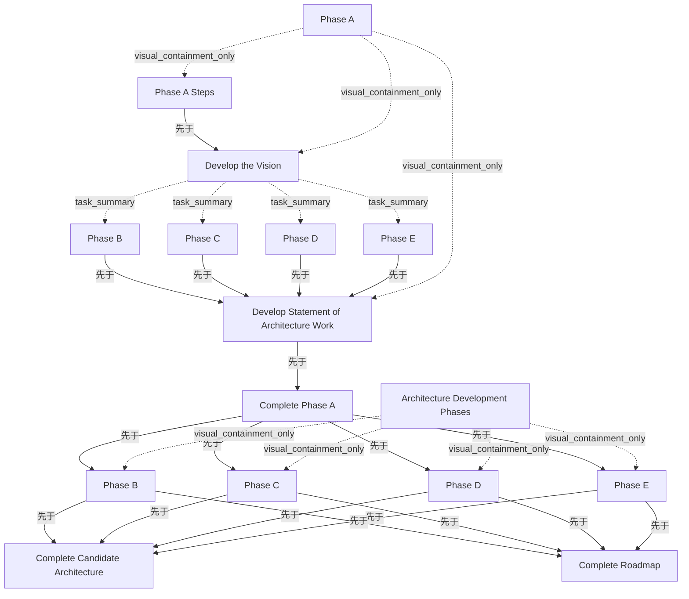

# G186/fig5-5 · 程式化的架构开发甘特图

类型：`mapping-or-assessment-matrix`。作者用一张“看起来像真实项目计划”的甘特图说明 ADM 不是一次走完的直线：第一轮先做 A 阶段步骤、制定愿景并并行启动 B–E，产出架构工作说明书后到达 10-22 里程碑；第二轮再从 B 到 E 重做一遍，最后同时完成候选架构与路线图。正文随后说，把这张程式化计划套到每种架构目的上，就会看到实践者在适当详细程度上不断重访所需阶段。

英文 PDF 物理页：[63]。本页为架构语义分析，原文与原图分别保留。

## 原图与可编辑图


[完整 JSON](fig5-5.json) · [可编辑 Mermaid](fig5-5.mmd) · [仅关系图](fig5-5.relations.mmd) · [层级分解图](fig5-5.hierarchy.mmd)

图形重建表达语义，不复制源图布局。虚线表示解释、矩阵映射或分组关系，不自动表示不确定性的概率。



## 架构分析

先看左侧任务表：行号 2–17，缩进表示汇总/子任务，最后一列是前置任务。右侧时间轴从 2015-09-27 到 11-15，每周一格，格内标 S/M/T/W/T/F/S。青绿色横条是任务工期；黑色方括号是汇总任务（Phase A、Develop the Vision、Architecture Development Phases）；带日期的菱形是里程碑（10-22、11-16）；蓝色折线把前置任务连到后续任务。读的顺序是先第一轮（09-27 起），再 10-22 之后的第二轮。

- 本图有 16 个具名或隐含元素、18 条关系和 11 条包含/分组记录。
- 包含/分组树最大深度为 2；根节点为 A 阶段、完成 A 阶段、架构开发阶段、完成候选架构、完成路线图。
- 本图没有可直接确认为人员直属汇报的关系；视觉上下位置、能力分解和治理职责分别读取。
- 与G184/fig10-3为同一张原图；16行逐行核对，修正4个Vision子任务父级和3个顶级里程碑父级。
- 拒绝4条不存在的Vision→B–E触发边及1条误判的里程碑间依赖；保留完整18条实际任务前置。
- 保留16/17前置文本截断和非打印日期估算，62–64页明确是并行/迭代示例，不是标准规定工期。

### 如何用于项目

- 先固定行、列所代表的维度及单元格含义，再登记有证据的映射或评分。
- 空白、无关系、未测量和不适用分别处理；颜色不自动等于优先级。

### 结构所表达的逻辑

- 第一轮：A 阶段步骤从 09-27 开始；10-02 起“制定愿景”与 B、C、D、E 四个阶段并行展开；B–E 全部结束后才编制架构工作说明书（前置 5,6,7,8），10-22 完成 A 阶段。
- 第二轮从 10-22 里程碑开始，B、C、D、E 再次并行启动（前置均为 10），说明阶段被重访而不是一次性通过。
- 两个终点里程碑都落在 11-16：完成候选架构、完成路线图；它们的前置都是第二轮的 B、C、D、E。
- Phase A 是汇总任务，跨度约 09-27–10-22；Architecture Development Phases 也是汇总任务，跨度约 10-22–11-15。
- Develop the Vision 是带汇总括号的粗体任务，其下没有展开子任务；它与 B–E 同时启动。
- 图中没有返工或反馈箭头；“迭代”是由两轮相同阶段的重复表达，而不是由回路连线表达。
- 正文把这张计划套到每种架构目的上，得出“持续重访所需阶段、并按适当详细程度开展”的结论。

## 上下级与包含

两层 WBS：Phase A（汇总）⊃ Phase A Steps、Develop the Vision、Phase B/C/D/E（第一轮）、Develop Statement of Architecture Work、Complete Phase A；Architecture Development Phases（汇总）⊃ Phase B/C/D/E（第二轮）、Complete Candidate Architecture、Complete Roadmap。里程碑是所在汇总任务的终点事件。

|父项|子项|层级类型|依据与解释|
|---|---|---|---|
|A 阶段|A 阶段步骤|visual_containment_only|保存原图解释中的包含；业务关系类型需要图例或正文进一步限定。|
|A 阶段|制定愿景|visual_containment_only|保存原图解释中的包含；业务关系类型需要图例或正文进一步限定。|
|制定愿景|B 阶段（第一轮）|task_summary|表中缩进显示第一轮B–E是Develop the Vision汇总行的子任务。|
|制定愿景|C 阶段（第一轮）|task_summary|表中缩进显示第一轮B–E是Develop the Vision汇总行的子任务。|
|制定愿景|D 阶段（第一轮）|task_summary|表中缩进显示第一轮B–E是Develop the Vision汇总行的子任务。|
|制定愿景|E 阶段（第一轮）|task_summary|表中缩进显示第一轮B–E是Develop the Vision汇总行的子任务。|
|A 阶段|编制架构工作说明书|visual_containment_only|保存原图解释中的包含；业务关系类型需要图例或正文进一步限定。|
|架构开发阶段|B 阶段（第二轮）|visual_containment_only|保存原图解释中的包含；业务关系类型需要图例或正文进一步限定。|
|架构开发阶段|C 阶段（第二轮）|visual_containment_only|保存原图解释中的包含；业务关系类型需要图例或正文进一步限定。|
|架构开发阶段|D 阶段（第二轮）|visual_containment_only|保存原图解释中的包含；业务关系类型需要图例或正文进一步限定。|
|架构开发阶段|E 阶段（第二轮）|visual_containment_only|保存原图解释中的包含；业务关系类型需要图例或正文进一步限定。|

## 全部元素与角色

|元素ID|原文名称|类型|含义|直接父项|深度|
|---|---|---|---|---|---|
|phase_a|Phase A|phase|第一轮的总括阶段，黑色汇总括号约 09-27–10-22。|—||
|phase_a_steps|Phase A Steps|process|第一轮最先执行的任务，约 09-27–10-02。|A 阶段|1|
|develop_vision|Develop the Vision|process|前置为 3；约 10-02–10-20；其起始处向下分出 B–E 的连接线。|A 阶段|1|
|phase_b_r1|Phase B|process|第一轮业务架构阶段，约 10-02–10-07。|制定愿景|2|
|phase_c_r1|Phase C|process|第一轮信息系统架构阶段，约 10-02–10-10。|制定愿景|2|
|phase_d_r1|Phase D|process|第一轮技术架构阶段，约 10-02–10-15。|制定愿景|2|
|phase_e_r1|Phase E|process|第一轮机会与解决方案阶段，约 10-02–10-20。|制定愿景|2|
|stmt_arch_work|Develop Statement of Architecture Work|process|前置 5,6,7,8；约 10-20–10-22。|A 阶段|1|
|complete_phase_a|Complete Phase A|event|前置 9；菱形里程碑，日期 10-22。|—||
|arch_dev_phases|Architecture Development Phases|phase|第二轮的汇总阶段，约 10-22–11-15。|—||
|phase_b_r2|Phase B|process|前置 10；约 10-22–10-29。|架构开发阶段|1|
|phase_c_r2|Phase C|process|前置 10；约 10-22–11-04。|架构开发阶段|1|
|phase_d_r2|Phase D|process|前置 10；约 10-22–11-10。|架构开发阶段|1|
|phase_e_r2|Phase E|process|前置 10；约 10-22–11-14。|架构开发阶段|1|
|complete_candidate_arch|Complete Candidate Architecture|event|前置 12,13,14,15（原图单元格被列宽截断）；菱形 11-16。|—||
|complete_roadmap|Complete Roadmap|event|前置 12,13,14,15；菱形 11-16，位于候选架构里程碑之后。|—||

## 全部关系

青绿色横条=任务工期；黑色方括号=汇总任务的时间跨度；菱形=里程碑（完成 A 阶段 10-22；完成候选架构/完成路线图 11-16）；蓝色折线=前置依赖（由前置任务连到后续任务）；左侧绿色竖线是工具的项目开始/当前日期标记，原图无文字说明。图中没有表示“返工”的箭头，迭代由第二轮任务表达。

|主体|语义关系|客体|显式线/隐式|原文标签|依据|
|---|---|---|---|---|---|
|A 阶段步骤|先于|制定愿景|显式连线||任务 4 的前置为 3；蓝色依赖线由 A 阶段步骤末端连到制定愿景起始。|
|B 阶段（第一轮）|先于|编制架构工作说明书|显式连线||任务 9 的前置为 5,6,7,8 之一。|
|C 阶段（第一轮）|先于|编制架构工作说明书|显式连线||任务 9 的前置之一。|
|D 阶段（第一轮）|先于|编制架构工作说明书|显式连线||任务 9 的前置之一。|
|E 阶段（第一轮）|先于|编制架构工作说明书|显式连线||任务 9 的前置之一；四条依赖在工具中汇入同一竖线。|
|编制架构工作说明书|先于|完成 A 阶段|显式连线||任务 10 的前置为 9。|
|完成 A 阶段|先于|B 阶段（第二轮）|显式连线||第二轮 B 阶段的前置为里程碑 10。|
|完成 A 阶段|先于|C 阶段（第二轮）|显式连线||第二轮 C 阶段的前置为 10。|
|完成 A 阶段|先于|D 阶段（第二轮）|显式连线||第二轮 D 阶段的前置为 10。|
|完成 A 阶段|先于|E 阶段（第二轮）|显式连线||第二轮 E 阶段的前置为 10；四者共用一条竖向干线。|
|B 阶段（第二轮）|先于|完成候选架构|显式连线||任务 16 的前置为 12,13,14,15 之一。|
|C 阶段（第二轮）|先于|完成候选架构|显式连线||任务 16 的前置之一。|
|D 阶段（第二轮）|先于|完成候选架构|显式连线||任务 16 的前置之一。|
|E 阶段（第二轮）|先于|完成候选架构|显式连线||任务 16 的前置之一。|
|B 阶段（第二轮）|先于|完成路线图|显式连线||任务 17 的前置为 12,13,14,15 之一。|
|C 阶段（第二轮）|先于|完成路线图|显式连线||任务 17 的前置之一。|
|D 阶段（第二轮）|先于|完成路线图|显式连线||任务 17 的前置之一。|
|E 阶段（第二轮）|先于|完成路线图|显式连线||任务 17 的前置之一。|

## 本轮否定的历史关系

以下旧解释保留用于追溯，不进入当前关系图、层级或知识图谱的有效边。

|旧记录|主体|旧关系|客体|否定依据|
|---|---|---|---|---|
|1|制定愿景|triggering|B 阶段（第一轮）|Develop the Vision为黑色汇总条，下方B–E起始同列但无从汇总条向下的依赖竖线；这是摘要包含与并行时间，不能生成触发关系。|
|2|制定愿景|triggering|C 阶段（第一轮）|Develop the Vision为黑色汇总条，下方B–E起始同列但无从汇总条向下的依赖竖线；这是摘要包含与并行时间，不能生成触发关系。|
|3|制定愿景|triggering|D 阶段（第一轮）|Develop the Vision为黑色汇总条，下方B–E起始同列但无从汇总条向下的依赖竖线；这是摘要包含与并行时间，不能生成触发关系。|
|4|制定愿景|triggering|E 阶段（第一轮）|Develop the Vision为黑色汇总条，下方B–E起始同列但无从汇总条向下的依赖竖线；这是摘要包含与并行时间，不能生成触发关系。|
|22|完成候选架构|sequence|完成路线图|第二轮B–E公共依赖线分别通向两个11-16里程碑；线干延伸不是候选架构→路线图的附加前置。|

## 甘特图任务表（按原图逐行转录，日期按周刻度估读）

```json
{
  "id": "t_gantt",
  "title_zh": "甘特图任务表（按原图逐行转录，日期按周刻度估读）",
  "columns": [
    "行号",
    "任务名称",
    "前置任务",
    "开始",
    "完成",
    "类型"
  ],
  "rows": [
    [
      "2",
      "Phase A",
      "—",
      "≈09-27",
      "≈10-22",
      "汇总任务"
    ],
    [
      "3",
      "Phase A Steps",
      "—",
      "≈09-27",
      "≈10-02",
      "任务"
    ],
    [
      "4",
      "Develop the Vision",
      "3",
      "≈10-02",
      "≈10-20",
      "汇总任务"
    ],
    [
      "5",
      "Phase B",
      "—",
      "≈10-02",
      "≈10-07",
      "任务"
    ],
    [
      "6",
      "Phase C",
      "—",
      "≈10-02",
      "≈10-10",
      "任务"
    ],
    [
      "7",
      "Phase D",
      "—",
      "≈10-02",
      "≈10-15",
      "任务"
    ],
    [
      "8",
      "Phase E",
      "—",
      "≈10-02",
      "≈10-20",
      "任务"
    ],
    [
      "9",
      "Develop Statement of Architecture Work",
      "5,6,7,8",
      "≈10-20",
      "≈10-22",
      "任务"
    ],
    [
      "10",
      "Complete Phase A",
      "9",
      "10-22（图上标注）",
      "10-22（图上标注）",
      "里程碑"
    ],
    [
      "11",
      "Architecture Development Phases",
      "—",
      "≈10-22",
      "≈11-15",
      "汇总任务"
    ],
    [
      "12",
      "Phase B",
      "10",
      "≈10-22",
      "≈10-29",
      "任务"
    ],
    [
      "13",
      "Phase C",
      "10",
      "≈10-22",
      "≈11-04",
      "任务"
    ],
    [
      "14",
      "Phase D",
      "10",
      "≈10-22",
      "≈11-10",
      "任务"
    ],
    [
      "15",
      "Phase E",
      "10",
      "≈10-22",
      "≈11-14",
      "任务"
    ],
    [
      "16",
      "Complete Candidate Architecture",
      "12,13,14,1…（源图截断）",
      "11-16（图上标注）",
      "11-16（图上标注）",
      "里程碑"
    ],
    [
      "17",
      "Complete Roadmap",
      "12,13,14,1…（源图截断）",
      "11-16（图上标注）",
      "11-16（图上标注）",
      "里程碑"
    ]
  ],
  "cell_legend": [
    "青绿条为任务，黑括号为汇总，菱形为里程碑；箭头为工具中的依赖。",
    "除精确标注的里程碑外日期皆按像素估读（约±1天）；前置栏截断文字不擅自补全。"
  ],
  "notes_zh": "2015年周刻度，行号2–17。第一轮B–E前置栏空白，起始同列且属于Vision汇总；没有从Vision起点下接的依赖线。第二轮B–E通过公共竖干同时接入候选架构与路线图里程碑，未见16→17额外依赖。"
}
```

## 本轮语义修正

- Develop the Vision为黑色汇总条，下方B–E起始同列但无从汇总条向下的依赖竖线；这是摘要包含与并行时间，不能生成触发关系。
- Develop the Vision为黑色汇总条，下方B–E起始同列但无从汇总条向下的依赖竖线；这是摘要包含与并行时间，不能生成触发关系。
- Develop the Vision为黑色汇总条，下方B–E起始同列但无从汇总条向下的依赖竖线；这是摘要包含与并行时间，不能生成触发关系。
- Develop the Vision为黑色汇总条，下方B–E起始同列但无从汇总条向下的依赖竖线；这是摘要包含与并行时间，不能生成触发关系。
- 第二轮B–E公共依赖线分别通向两个11-16里程碑；线干延伸不是候选架构→路线图的附加前置。

## 误读检查

- 不要把 B、C、D、E 读成串行：第一轮与第二轮中它们都同时启动、并行推进。
- 不要把 10-22 与 11-16 当成任务工期；它们是里程碑日期。
- 不要把两轮理解为“第一轮失败后重做”；正文说的是按目的与详细程度持续重访阶段。
- 这张图是程式化（stylized）计划，条形长度不是承诺工期；日期也只能按周刻度估读。
- 中文 SVG 把第 16/17 行的前置任务写成 11,12,13,14（应为 12,13,14,15），并把多条任务拉长到整周；不要据它计算工期或依赖。
- 中文 PNG 第 9 行任务名“发展/说明书/架构工作”是错译，正确为“编制架构工作说明书”。

## 原文证据

### [PDF 第 62 页](../../../documents/G186.md#page-62)

> As an example, see the stylized Gantt chart in Figure 5-5. This figure provides a process-oriented view of executing the ADM. The Gantt shows the inter-dependent nature of EA requires all ADM phases that develop a candidate architecture and test it for acceptance to be open simultaneously. The ADM phases stay open to address the information required; once it is provided they close. Also, regardless of where the Practitioner is in time or purpose or Architecture Project, if the Business Architecture is being developed the Practitioner is executing Phase B. Executing Phase B is all about addressing the stakeholder concerns from the perspective of the Business Architecture domain, identifying the gaps in the Business Architecture, and looking at impacts across the EA Landscape. The figure highlights that many of the steps in the ADM phases can be executed simultaneously. Good Practitioners will explore
### [PDF 第 63 页](../../../documents/G186.md#page-63)

> Consider the different purposes and a cascade through time as shown in Figure 4-1. When the plan in the stylized Gant chart in Figure 5-5 is applied to each purpose, it becomes clear that the Practitioner continually revisits the required phases, at the appropriate level of detail.
### [PDF 第 64 页](../../../documents/G186.md#page-64)

> All iteration is driven by the information needs of the current project. The process created is not dependent upon the work the EA Capability undertakes to produce, but the timing of completion. The essential question is when an EA Capability must deliver specific work products. Table 5-1 provides a summary of work products that are actively consumed by key Enterprise processes.
> The path to developing an Architecture to Support Strategy is a configured journey through the ADM. This path follows this journey:

## 来源与分析状态

所有元素/关系均有来源定位；未把历史解释重命名为本轮逐线视觉确认。源图与语义图是两种视图，布局不证明汇报或因果。

源 PDF SHA-256：`ed1c26faba5023a8d1b32b0ec893d75a3bb1d7a6508e99fa56ded079585d922a`。

源图记录：[原始解释与转录](../../../figures/G186/fig5-5.json)。

```json
{
  "quality": {
    "graph_integrity": "checked",
    "semantic_analysis": "typed-graph-and-context-analysis",
    "visual_review": "source-content-audited",
    "notice_zh": "所有元素/关系均有来源定位；未把历史解释重命名为本轮逐线视觉确认。源图与语义图是两种视图，布局不证明汇报或因果。"
  },
  "source_uncertainty": {
    "confidence": "medium",
    "uncertainties_zh": [
      "开始/完成日期是按周刻度（09-27 起，每周约 153 px）估读的，误差约 ±1 天；条形端点并不总落在日刻度上。",
      "第 16、17 行的前置任务在原图中被列宽截断，只能看到“12,13,14,1”；按任务编号补为 12,13,14,15，不能 100% 确认末位。",
      "第一轮 B–E 的前置列空白，工具中靠一条竖线连接；该竖线究竟表示“与制定愿景同时启动”还是“依赖制定愿景”，无法从截图完全确认。",
      "图中绿色竖线无标签，按工具惯例理解为项目开始/当前日期标记。",
      "工具界面的表头（Task Name、Predece…）、周刻度字母、滚动条等属于截图外观，未作为元素记录，其信息已体现在表格的列名与日期列中。",
      "“程式化（stylized）”意味着条形长度不是真实工期，正文也未给出具体日历。"
    ],
    "analyzed_from": [
      "英文 PDF 第 63 页图 5-5 截图（220 dpi）及 3×3 放大分块",
      "英文 PDF 第 63 页正文",
      "中文稿 G186e_实践者方法_按TOGAF_ADM开发企业架构.md 第 796–818 行及标签对照表 L800–L815",
      "figs/g186e_fig5-5_en.png、figs/zh/g186e_fig5-5_zh.png 与 figs/zh/g186e_fig5-5_zh.svg"
    ],
    "date": "2026-10-31"
  },
  "source_conflicts": []
}
```
