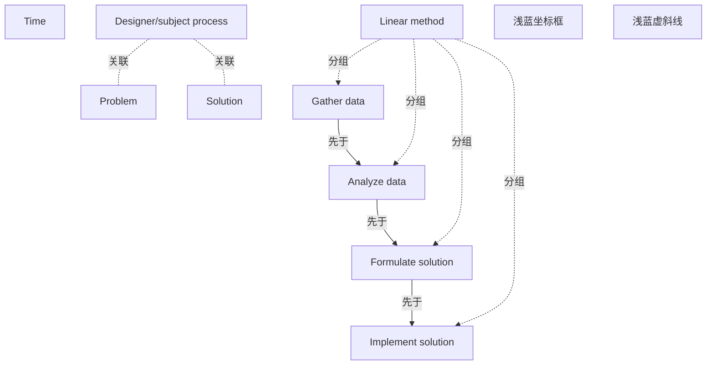

# G186/fig5-6 · 问题解决方法（源自 Conklin 的棘手问题）

类型：`analytical-view`。作者要破除“问题解决是带关卡的四步直线”这一直觉：常规模型（红）从收集数据一路降到实施，而真实的专业解题（绿）在问题与解决方案之间反复跳跃。图为 5.2.3 节“迭代”提供认知依据——所以 ADM 也要反复重访阶段，而不是一次通过。

英文 PDF 物理页：[63]。本页为架构语义分析，原文与原图分别保留。

## 原图与可编辑图


[完整 JSON](fig5-6.json) · [可编辑 Mermaid](fig5-6.mmd) · [仅关系图](fig5-6.relations.mmd) · [层级分解图](fig5-6.hierarchy.mmd)

图形重建表达语义，不复制源图布局。虚线表示解释、矩阵映射或分组关系，不自动表示不确定性的概率。



## 架构分析

先看两条轴：纵向从上方 Problem 到下方 Solution 表示讨论/工作重心在问题侧还是方案侧；横向 Time 箭头指向右。红色粗线是 Linear method：四个水平台阶（收集数据→分析数据→形成解决方案→实施解决方案），每段都比前一段更低，段与段之间垂直下落。绿色细线是 Designer/subject process：在问题与方案之间快速上下往复，没有稳定的平台。右上角图例明确给出这两条线的名称。

- 本图有 11 个具名或隐含元素、5 条关系和 4 条包含/分组记录。
- 包含/分组树最大深度为 1；根节点为 问题、解决方案、时间、线性方法、设计者/主体过程、浅蓝坐标框、浅蓝虚斜线。
- 本图没有可直接确认为人员直属汇报的关系；视觉上下位置、能力分解和治理职责分别读取。
- 包含分组后有 5 个连通分量；分离可能源于图例、并列分类或独立示例，未自动补边。
- 红色Linear method四阶段、绿色Designer/subject process、Problem/Solution/Time、2条图例样线完整；增补L形浅蓝坐标框及浅蓝虚斜线。
- 红线阶梯前进、绿线在问题/方案层反复波动；没有数值刻度或每个折点标签，不能读成实际实验数据或固定次数。
- 63页以Conklin复杂问题说明专业人员迭代解题与线性阶段模型的区别，图不提供效率优劣的数量结论。

### 如何用于项目

- 围绕作者目的读取本图实体、分组与连线，并用对应原文限定其含义。
- 把参考模型与项目事实分开，实际范围、约束、值和责任须有项目证据。

### 结构所表达的逻辑

- 线性方法（红）被画成四级台阶：Gather data → Analyze data → Formulate solution → Implement solution，每级只下降一次，不回退。
- 设计者/主体过程（绿）在 Problem 与 Solution 两个水平之间反复穿越，整个时间轴上都在摆动。
- 两条线的起点都在 Problem 侧、终点都在 Solution 侧，差别不在终点，而在过程是否往复。
- 图的含义是：线性模型适合解释流程与阶段关卡，但不代表人们实际解题的方式；真实解题需要不断在问题理解与方案尝试之间互相检验。
- 正文据此主张交互式地测试概念与潜在实现，反复考虑高层方向在执行上是否合理、执行在高层方向上是否合理。
- 浅蓝色 L 形框只是坐标轴边框，没有刻度；纵轴不是百分比或进度，只表示“更偏问题/更偏方案”。
- 图例是原图显式给出的，红/绿两色的含义不需要猜测。

## 上下级与包含

无包含层级：两条折线是并列的两种过程模型，四个步骤是红线上的四个阶段（不是四个独立框）。纵轴两端 Problem/Solution 是水平参照，不是上下级。

|父项|子项|层级类型|依据与解释|
|---|---|---|---|
|线性方法|收集数据|classified_under|红色曲线四个阶段注记，并非图例Linear method的视觉容器子节点。|
|线性方法|分析数据|classified_under|红色曲线四个阶段注记，并非图例Linear method的视觉容器子节点。|
|线性方法|形成解决方案|classified_under|红色曲线四个阶段注记，并非图例Linear method的视觉容器子节点。|
|线性方法|实施解决方案|classified_under|红色曲线四个阶段注记，并非图例Linear method的视觉容器子节点。|

## 全部元素与角色

|元素ID|原文名称|类型|含义|直接父项|深度|
|---|---|---|---|---|---|
|problem_level|Problem|concept|表示工作重心在问题侧。|—||
|solution_level|Solution|concept|表示工作重心在解决方案侧。|—||
|time_axis|Time|concept|时间从左向右。|—||
|linear_method|Linear method|concept|常规的带步骤关卡的问题解决模型。|—||
|gather_data|Gather data|process|线性方法第一步。|线性方法|1|
|analyze_data|Analyze data|process|线性方法第二步。|线性方法|1|
|formulate_solution|Formulate solution|process|线性方法第三步。|线性方法|1|
|implement_solution|Implement solution|process|线性方法第四步。|线性方法|1|
|designer_process|Designer/subject process|process|专业人员在问题与方案之间反复检验的实际过程。|—||
|plot_axes|浅蓝坐标框|axis|无刻度坐标框：上下为Problem/Solution，水平为Time；无数值量尺。|—||
|diagonal_guide|浅蓝虚斜线|guide|无箭头无标签的背景趋势引导线，不能作为第三种有命名方法或定量数据。|—||

## 全部关系

红色粗折线 = Linear method，水平段表示停留在某个步骤、垂直下落表示进入下一步；绿色细折线 = Designer/subject process，斜线在 Problem 与 Solution 之间往返。横向 Time 箭头表示时间方向；浅蓝色 L 形边框是坐标轴。图中没有表示因果或包含的箭头。

|主体|语义关系|客体|显式线/隐式|原文标签|依据|
|---|---|---|---|---|---|
|收集数据|先于|分析数据|显式连线||红色水平段之后垂直下落进入下一段；原图无箭头，方向由时间轴给出。|
|分析数据|先于|形成解决方案|显式连线||红线垂直下落进入第三段。|
|形成解决方案|先于|实施解决方案|显式连线||红线垂直下落进入第四段。|
|设计者/主体过程|关联|问题|thick||绿色折线在问题和方案层间反复波动，是示意曲线；没有独立连接到两标签的边。|
|设计者/主体过程|关联|解决方案|thick||绿色折线在问题和方案层间反复波动，是示意曲线；没有独立连接到两标签的边。|

## 本轮语义修正

- 绿色折线在问题和方案层间反复波动，是示意曲线；没有独立连接到两标签的边。
- 绿色折线在问题和方案层间反复波动，是示意曲线；没有独立连接到两标签的边。

## 误读检查

- 不要把绿色往复线读成“混乱/错误过程”；它代表设计者实际的解题过程，是作者肯定的对象。
- 不要把红色阶梯线读成推荐流程；它代表常规的线性模型，作者指出它不能反映真实解题。
- 纵向位置不是完成百分比或成熟度，只表示当前更关注问题还是更关注方案。
- 四个步骤名是红色水平段的标签，不是四个并列的阶段框；红线在它们之间是连续下降的。
- 中文 PNG 只译了一个步骤名，且把“实施解决方案”写成“实施方案”；不要据其中英混排判断原图用词。

## 原文证据

### [PDF 第 63 页](../../../documents/G186.md#page-63)

> Most of the normal problem-solving models provide linear approaches with step gates. The linear approach helps us understand the process, and may represent the business cycle stage gates. However, they do not represent how people actually solve problems. Figure 5-6 is derived from Jeff Conklin’s Wicked Problems & Social Complexity within Dialog Mapping [Conklin, 2005], and outlines a standard linear problem solving progression and how professionals typically address a problem. Testing the concept and potential implementation interactively is a best practice. Iteratively considering whether the high-level direction makes sense in terms of execution, and does execution make sense in terms of high-level direction?
> Figure 5-6: Problem Solving Approach (Derived from Conklin’s Wicked Problems)

## 来源与分析状态

所有元素/关系均有来源定位；未把历史解释重命名为本轮逐线视觉确认。源图与语义图是两种视图，布局不证明汇报或因果。

源 PDF SHA-256：`ed1c26faba5023a8d1b32b0ec893d75a3bb1d7a6508e99fa56ded079585d922a`。

源图记录：[原始解释与转录](../../../figures/G186/fig5-6.json)。

```json
{
  "quality": {
    "graph_integrity": "checked",
    "semantic_analysis": "typed-graph-and-context-analysis",
    "visual_review": "source-content-audited",
    "notice_zh": "所有元素/关系均有来源定位；未把历史解释重命名为本轮逐线视觉确认。源图与语义图是两种视图，布局不证明汇报或因果。"
  },
  "source_uncertainty": {
    "confidence": "high",
    "uncertainties_zh": [
      "绿色折线的往复次数与拐点无法逐一对应到语义（原图没有标注每一次跳动的原因）。",
      "纵轴没有刻度，Problem 与 Solution 只是两个水平参照，无法量化“偏向”程度。",
      "红线四段的水平长度不等，但原图未说明各步骤的相对时长是否有意为之。"
    ],
    "analyzed_from": [
      "英文 PDF 第 63 页图 5-6 截图（220 dpi）及 2×2 放大分块",
      "英文 PDF 第 63 页正文",
      "中文稿 G186e_实践者方法_按TOGAF_ADM开发企业架构.md 第 818–837 行及标签对照表 L824–L837",
      "figs/g186e_fig5-6_en.png 与 figs/zh/g186e_fig5-6_zh.png"
    ],
    "date": "2026-10-31"
  },
  "source_conflicts": []
}
```
