# G186/fig5-7 · 开发支持战略的架构的示例项目计划

类型：`architecture-evolution-or-plan`。示范第 5.2.4 节：开发支持战略的架构是穿越 ADM 的一次配置化旅程，路线是理解语境→开展评估与分析→确定达成目标状态的方法→最终确定架构愿景/目标状态；本图给出任务级计划样板，说明要迭代哪些阶段、先后如何。

英文 PDF 物理页：[65]。本页为架构语义分析，原文与原图分别保留。

## 原图与可编辑图


[完整 JSON](fig5-7.json) · [可编辑 Mermaid](fig5-7.mmd) · [仅关系图](fig5-7.relations.mmd) · [层级分解图](fig5-7.hierarchy.mmd)

图形重建表达语义，不复制源图布局。虚线表示解释、矩阵映射或分组关系，不自动表示不确定性的概率。

```mermaid
flowchart TB
  %% Semantic reconstruction; see original source image for exact layout.
  n0["Start Architecture Project"]
  n1["Understand Context"]
  n2["Partial Strategic Level Phase H"]
  n3["Partial Strategic Level Phase A"]
  n4["Specific for the Enterprise Capability:"]
  n5["Specific for the EA Capability:"]
  n6["Define Approach to Target State"]
  n7["Partial Strategy Level Phases B, C, and D"]
  n8["Phase B"]
  n9["Phase C"]
  n10["Phase C"]
  n11["Partial Strategy Level Phase A"]
  n12["Specific for the EA Capability:"]
  n13["Partial Strategy Level Phase E"]
  n14["Partial Strategic Level Phase G"]
  n15["Finalize Architecture Vision/Target State"]
  n16["Partial Strategic Level Phase F"]
  n17["Complete Architecture Project"]
  n18["Start Enterprise Context"]
  n19["Review any existing Roadmap"]
  n20["Understand/infer gaps"]
  n21["(Background) Request for Architecture Work"]
  n22["Complete Enterprise Context"]
  n23["Start Enterprise Capability"]
  n24["Goals, objectives, initiatives, competitive, and tactic analysis"]
  n25["Reaffirm planning horizon"]
  n26["Operating model"]
  n27["Existing governance and risk management model"]
  n28["Stakeholder and concern identification"]
  n29["Complete Enterprise Capability"]
  n30["Start Enterprise Capability"]
  n31["EA Capability model"]
  n32["Customized EA process model"]
  n33["Content model &amp; (industry) reference architectures"]
  n34["Approach to covering EA Landscape"]
  n35["Complete Enterprise Capability"]
  n36["Start Partial Strategic Phases B, C, and D"]
  n37["Define specification and work packages for each gap"]
  n38["Identify capabilities to improve"]
  n39["Create candidate organization model"]
  n40["Create candidate operating model"]
  n41["Define specification and work packages for each gap"]
  n42["Identify capabilities to improve"]
  n43["Create candidate organization model"]
  n44["Create candidate operating model"]
  n45["Define specification and work packages for each gap"]
  n46["Identify capabilities to improve"]
  n47["Create candidate organization model"]
  n48["Create candidate operating model"]
  n49["Populate requirements management (or EA Repository)"]
  n50["Complete Partial Strategic Phases B, C, and D"]
  n51["Start Partial Strategy Level Phase A"]
  n52["Develop Architecture Vision"]
  n53["Develop Architecture Definition"]
  n54["Reaffirm vision, definition, work package, operating model, and orga…"]
  n55["Revise EA governance model"]
  n56["Revise EA engagement Model"]
  n57["Complete Partial Strategy Level Phase A"]
  n58["Start Partial Phase E"]
  n59["Assess impact of differentiating processes"]
  n60["Identify options to close gaps"]
  n61["Complete Partial Phase E"]
  n62["Start Partial Phase G"]
  n63["Risk and compliance review"]
  n64["Finalize stakeholder matrix"]
  n65["Complete Partial Phase G"]
  n66["Start Partial Strategic Level Phase F"]
  n67["Complete roadmap"]
  n68["Define governance model"]
  n69["Complete architecture definition and specification"]
  n70["Complete Partial Strategic Level Phase F"]
  n0 -.->|"先于"| n1
  n1 -.->|"先于"| n6
  n6 -.->|"先于"| n15
  n15 -.->|"先于"| n17
  n2 -.->|"先于"| n3
  n3 -.->|"先于"| n7
  n7 -.->|"先于"| n11
  n11 -.->|"先于"| n13
  n13 -.->|"先于"| n14
  n14 -.->|"先于"| n16
  n16 -.->|"先于"| n17
  n1 -.->|"task_summary"| n2
  n1 -.->|"task_summary"| n3
  n3 -.->|"task_summary"| n4
  n3 -.->|"task_summary"| n5
  n6 -.->|"task_summary"| n7
  n7 -.->|"task_summary"| n8
  n7 -.->|"task_summary"| n9
  n7 -.->|"task_summary"| n10
  n6 -.->|"task_summary"| n11
  n11 -.->|"task_summary"| n12
  n6 -.->|"task_summary"| n13
  n6 -.->|"task_summary"| n14
  n15 -.->|"task_summary"| n16
  n2 -.->|"task_summary"| n18
  n2 -.->|"task_summary"| n19
  n2 -.->|"task_summary"| n20
  n2 -.->|"task_summary"| n21
  n2 -.->|"task_summary"| n22
  n4 -.->|"task_summary"| n23
  n4 -.->|"task_summary"| n24
  n4 -.->|"task_summary"| n25
  n4 -.->|"task_summary"| n26
  n4 -.->|"task_summary"| n27
  n4 -.->|"task_summary"| n28
  n4 -.->|"task_summary"| n29
  n5 -.->|"task_summary"| n30
  n5 -.->|"task_summary"| n31
  n5 -.->|"task_summary"| n32
  n5 -.->|"task_summary"| n33
  n5 -.->|"task_summary"| n34
  n5 -.->|"task_summary"| n35
  n7 -.->|"task_summary"| n36
  n8 -.->|"task_summary"| n37
  n8 -.->|"task_summary"| n38
  n8 -.->|"task_summary"| n39
  n8 -.->|"task_summary"| n40
  n9 -.->|"task_summary"| n41
  n9 -.->|"task_summary"| n42
  n9 -.->|"task_summary"| n43
  n9 -.->|"task_summary"| n44
  n10 -.->|"task_summary"| n45
  n10 -.->|"task_summary"| n46
  n10 -.->|"task_summary"| n47
  n10 -.->|"task_summary"| n48
  n7 -.->|"task_summary"| n49
  n7 -.->|"task_summary"| n50
  n11 -.->|"task_summary"| n51
  n11 -.->|"task_summary"| n52
  n11 -.->|"task_summary"| n53
  n11 -.->|"task_summary"| n54
  n12 -.->|"task_summary"| n55
  n12 -.->|"task_summary"| n56
  n11 -.->|"task_summary"| n57
  n13 -.->|"task_summary"| n58
  n13 -.->|"task_summary"| n59
  n13 -.->|"task_summary"| n60
  n13 -.->|"task_summary"| n61
  n14 -.->|"task_summary"| n62
  n14 -.->|"task_summary"| n63
  n14 -.->|"task_summary"| n64
  n14 -.->|"task_summary"| n65
  n16 -.->|"task_summary"| n66
  n16 -.->|"task_summary"| n67
  n16 -.->|"task_summary"| n68
  n16 -.->|"task_summary"| n69
  n16 -.->|"task_summary"| n70
```



## 架构分析

左侧自上而下读任务清单：粗体行是主线或阶段，缩进行是任务。右侧条形自左向右表示时间：深色粗横线是阶段汇总条，蓝色条是任务条，细黑箭头表示任务间的完成—开始依赖。先读四条主线：Understand Context → Define Approach to Target State → Finalize Architecture Vision/Target State → Complete Architecture Project；再读每条主线内的阶段顺序（H→A→B/C/D→A→E→G→F）。

- 本图有 71 个具名或隐含元素、11 条关系和 66 条包含/分组记录。
- 包含/分组树最大深度为 3；根节点为 启动架构项目、理解语境、确定达成目标状态的方法、最终确定架构愿景/目标状态、完成架构项目。
- 本图没有可直接确认为人员直属汇报的关系；视觉上下位置、能力分解和治理职责分别读取。
- 已读取PDF原始嵌入图的全部高分辨率分段；71行完整标签/可见截断、组层级、重复实例全部复核并提升为行级节点。
- 补充53行级节点、18个明确打印MM-DD日期；未给无年份日期补造年份。
- 审查所有任务条及连线区域，保存连通簇和完成端箭头特征；重合的逐对工具前置关系仍不可唯一确定，明确记录该源信息限制。
- 第38行确为第二个Phase C，未擅改Phase D；第49行尾部被列宽裁切，旧稿补全organization model不作为图上文字。
- 47–49行附近虚水平线属于不明UI标记，不能判定任务被删除。
- 第一组开始打印09-12，最后两个里程碑12-14；无年份和完整轴刻度，未估算所有任务日历日期。

### 如何用于项目

- 为每个演进状态/工作包登记前置条件、交付物、依赖和实际决策人。
- 时间轴表达计划顺序；架构范围、已批准计划和资源承诺须另有项目证据。

### 结构所表达的逻辑

- 计划共 71 行任务，四条主线是：Understand Context、Define Approach to Target State、Finalize Architecture Vision/Target State、Complete Architecture Project。
- 第一条主线先走部分战略层阶段 H（审查现有路线图、理解/推断差距、架构工作请求），再走阶段 A，并把阶段 A 分成“企业能力专属”和“EA 能力专属”两个语境。
- 第二条主线用阶段 B、C、D 为每个差距定义规格与工作包；原图在第 33、38 行重复标注 Phase C，没有出现 Phase D 小标题。
- B/C/D 完成后又出现第二次部分战略层阶段 A（制定愿景/定义、修订 EA 治理与参与模型），随后是 E、G，最后才进入 F（完成路线图、定义治理模型）。
- 阶段顺序不是 H→A→B→C→D→E→F→G 的教科书顺序，而是按目的配置、可迭代的旅程；同一字母的阶段会在不同时点重复出现。
- 条形为相对周尺度，原图只在少数条端标 MM-DD 日期，没有完整日历轴；不能据此推算实际工期。
- 第 47–49 行被一条横贯细虚线穿过，疑为删除线或审阅标记；第 49 行文字被列宽截断。

## 上下级与包含

三层：主线分组（Understand Context、Define Approach to Target State、Finalize Architecture Vision/Target State）→ 阶段分组（Phase H/A/B/C/D/E/F/G）→ 子分组（企业能力专属、EA 能力专属、Phase B/C）→ 任务。Complete Architecture Project 是底部里程碑。

|父项|子项|层级类型|依据与解释|
|---|---|---|---|
|理解语境|部分战略层阶段 H|task_summary|由源任务表缩进/分组逐行审查；同名任务以独立行号保留。|
|理解语境|部分战略层阶段 A|task_summary|由源任务表缩进/分组逐行审查；同名任务以独立行号保留。|
|部分战略层阶段 A|企业能力专属|task_summary|由源任务表缩进/分组逐行审查；同名任务以独立行号保留。|
|部分战略层阶段 A|EA 能力专属|task_summary|由源任务表缩进/分组逐行审查；同名任务以独立行号保留。|
|确定达成目标状态的方法|部分战略层阶段 B、C、D|task_summary|由源任务表缩进/分组逐行审查；同名任务以独立行号保留。|
|部分战略层阶段 B、C、D|阶段 B|task_summary|由源任务表缩进/分组逐行审查；同名任务以独立行号保留。|
|部分战略层阶段 B、C、D|阶段 C|task_summary|由源任务表缩进/分组逐行审查；同名任务以独立行号保留。|
|部分战略层阶段 B、C、D|阶段 C（原图重复）|task_summary|由源任务表缩进/分组逐行审查；同名任务以独立行号保留。|
|确定达成目标状态的方法|部分战略层阶段 A（第二次）|task_summary|由源任务表缩进/分组逐行审查；同名任务以独立行号保留。|
|部分战略层阶段 A（第二次）|EA 能力专属|task_summary|由源任务表缩进/分组逐行审查；同名任务以独立行号保留。|
|确定达成目标状态的方法|部分战略层阶段 E|task_summary|由源任务表缩进/分组逐行审查；同名任务以独立行号保留。|
|确定达成目标状态的方法|部分战略层阶段 G|task_summary|由源任务表缩进/分组逐行审查；同名任务以独立行号保留。|
|最终确定架构愿景/目标状态|部分战略层阶段 F|task_summary|由源任务表缩进/分组逐行审查；同名任务以独立行号保留。|
|部分战略层阶段 H|Start Enterprise Context|task_summary|由源任务表缩进/分组逐行审查；同名任务以独立行号保留。|
|部分战略层阶段 H|Review any existing Roadmap|task_summary|由源任务表缩进/分组逐行审查；同名任务以独立行号保留。|
|部分战略层阶段 H|Understand/infer gaps|task_summary|由源任务表缩进/分组逐行审查；同名任务以独立行号保留。|
|部分战略层阶段 H|(Background) Request for Architecture Work|task_summary|由源任务表缩进/分组逐行审查；同名任务以独立行号保留。|
|部分战略层阶段 H|Complete Enterprise Context|task_summary|由源任务表缩进/分组逐行审查；同名任务以独立行号保留。|
|企业能力专属|Start Enterprise Capability|task_summary|由源任务表缩进/分组逐行审查；同名任务以独立行号保留。|
|企业能力专属|Goals, objectives, initiatives, competitive, and tactic analysis|task_summary|由源任务表缩进/分组逐行审查；同名任务以独立行号保留。|
|企业能力专属|Reaffirm planning horizon|task_summary|由源任务表缩进/分组逐行审查；同名任务以独立行号保留。|
|企业能力专属|Operating model|task_summary|由源任务表缩进/分组逐行审查；同名任务以独立行号保留。|
|企业能力专属|Existing governance and risk management model|task_summary|由源任务表缩进/分组逐行审查；同名任务以独立行号保留。|
|企业能力专属|Stakeholder and concern identification|task_summary|由源任务表缩进/分组逐行审查；同名任务以独立行号保留。|
|企业能力专属|Complete Enterprise Capability|task_summary|由源任务表缩进/分组逐行审查；同名任务以独立行号保留。|
|EA 能力专属|Start Enterprise Capability|task_summary|由源任务表缩进/分组逐行审查；同名任务以独立行号保留。|
|EA 能力专属|EA Capability model|task_summary|由源任务表缩进/分组逐行审查；同名任务以独立行号保留。|
|EA 能力专属|Customized EA process model|task_summary|由源任务表缩进/分组逐行审查；同名任务以独立行号保留。|
|EA 能力专属|Content model & (industry) reference architectures|task_summary|由源任务表缩进/分组逐行审查；同名任务以独立行号保留。|
|EA 能力专属|Approach to covering EA Landscape|task_summary|由源任务表缩进/分组逐行审查；同名任务以独立行号保留。|
|EA 能力专属|Complete Enterprise Capability|task_summary|由源任务表缩进/分组逐行审查；同名任务以独立行号保留。|
|部分战略层阶段 B、C、D|Start Partial Strategic Phases B, C, and D|task_summary|由源任务表缩进/分组逐行审查；同名任务以独立行号保留。|
|阶段 B|Define specification and work packages for each gap|task_summary|由源任务表缩进/分组逐行审查；同名任务以独立行号保留。|
|阶段 B|Identify capabilities to improve|task_summary|由源任务表缩进/分组逐行审查；同名任务以独立行号保留。|
|阶段 B|Create candidate organization model|task_summary|由源任务表缩进/分组逐行审查；同名任务以独立行号保留。|
|阶段 B|Create candidate operating model|task_summary|由源任务表缩进/分组逐行审查；同名任务以独立行号保留。|
|阶段 C|Define specification and work packages for each gap|task_summary|由源任务表缩进/分组逐行审查；同名任务以独立行号保留。|
|阶段 C|Identify capabilities to improve|task_summary|由源任务表缩进/分组逐行审查；同名任务以独立行号保留。|
|阶段 C|Create candidate organization model|task_summary|由源任务表缩进/分组逐行审查；同名任务以独立行号保留。|
|阶段 C|Create candidate operating model|task_summary|由源任务表缩进/分组逐行审查；同名任务以独立行号保留。|
|阶段 C（原图重复）|Define specification and work packages for each gap|task_summary|由源任务表缩进/分组逐行审查；同名任务以独立行号保留。|
|阶段 C（原图重复）|Identify capabilities to improve|task_summary|由源任务表缩进/分组逐行审查；同名任务以独立行号保留。|
|阶段 C（原图重复）|Create candidate organization model|task_summary|由源任务表缩进/分组逐行审查；同名任务以独立行号保留。|
|阶段 C（原图重复）|Create candidate operating model|task_summary|由源任务表缩进/分组逐行审查；同名任务以独立行号保留。|
|部分战略层阶段 B、C、D|Populate requirements management (or EA Repository)|task_summary|由源任务表缩进/分组逐行审查；同名任务以独立行号保留。|
|部分战略层阶段 B、C、D|Complete Partial Strategic Phases B, C, and D|task_summary|由源任务表缩进/分组逐行审查；同名任务以独立行号保留。|
|部分战略层阶段 A（第二次）|Start Partial Strategy Level Phase A|task_summary|由源任务表缩进/分组逐行审查；同名任务以独立行号保留。|
|部分战略层阶段 A（第二次）|Develop Architecture Vision|task_summary|由源任务表缩进/分组逐行审查；同名任务以独立行号保留。|
|部分战略层阶段 A（第二次）|Develop Architecture Definition|task_summary|由源任务表缩进/分组逐行审查；同名任务以独立行号保留。|
|部分战略层阶段 A（第二次）|Reaffirm vision, definition, work package, operating model, and orga…|task_summary|由源任务表缩进/分组逐行审查；同名任务以独立行号保留。|
|EA 能力专属|Revise EA governance model|task_summary|由源任务表缩进/分组逐行审查；同名任务以独立行号保留。|
|EA 能力专属|Revise EA engagement Model|task_summary|由源任务表缩进/分组逐行审查；同名任务以独立行号保留。|
|部分战略层阶段 A（第二次）|Complete Partial Strategy Level Phase A|task_summary|由源任务表缩进/分组逐行审查；同名任务以独立行号保留。|
|部分战略层阶段 E|Start Partial Phase E|task_summary|由源任务表缩进/分组逐行审查；同名任务以独立行号保留。|
|部分战略层阶段 E|Assess impact of differentiating processes|task_summary|由源任务表缩进/分组逐行审查；同名任务以独立行号保留。|
|部分战略层阶段 E|Identify options to close gaps|task_summary|由源任务表缩进/分组逐行审查；同名任务以独立行号保留。|
|部分战略层阶段 E|Complete Partial Phase E|task_summary|由源任务表缩进/分组逐行审查；同名任务以独立行号保留。|
|部分战略层阶段 G|Start Partial Phase G|task_summary|由源任务表缩进/分组逐行审查；同名任务以独立行号保留。|
|部分战略层阶段 G|Risk and compliance review|task_summary|由源任务表缩进/分组逐行审查；同名任务以独立行号保留。|
|部分战略层阶段 G|Finalize stakeholder matrix|task_summary|由源任务表缩进/分组逐行审查；同名任务以独立行号保留。|
|部分战略层阶段 G|Complete Partial Phase G|task_summary|由源任务表缩进/分组逐行审查；同名任务以独立行号保留。|
|部分战略层阶段 F|Start Partial Strategic Level Phase F|task_summary|由源任务表缩进/分组逐行审查；同名任务以独立行号保留。|
|部分战略层阶段 F|Complete roadmap|task_summary|由源任务表缩进/分组逐行审查；同名任务以独立行号保留。|
|部分战略层阶段 F|Define governance model|task_summary|由源任务表缩进/分组逐行审查；同名任务以独立行号保留。|
|部分战略层阶段 F|Complete architecture definition and specification|task_summary|由源任务表缩进/分组逐行审查；同名任务以独立行号保留。|
|部分战略层阶段 F|Complete Partial Strategic Level Phase F|task_summary|由源任务表缩进/分组逐行审查；同名任务以独立行号保留。|

## 全部元素与角色

|元素ID|原文名称|类型|含义|直接父项|深度|
|---|---|---|---|---|---|
|prj_start|Start Architecture Project|event|事件：启动架构项目|—||
|understand_context|Understand Context|group|分组：理解语境|—||
|phase_h|Partial Strategic Level Phase H|phase|阶段：部分战略层阶段 H|理解语境|1|
|phase_a_context|Partial Strategic Level Phase A|phase|阶段：部分战略层阶段 A|理解语境|1|
|ent_capability_context|Specific for the Enterprise Capability:|group|分组：企业能力专属|部分战略层阶段 A|2|
|ea_capability_context|Specific for the EA Capability:|group|分组：EA 能力专属|部分战略层阶段 A|2|
|define_target_approach|Define Approach to Target State|group|分组：确定达成目标状态的方法|—||
|phases_bcd|Partial Strategy Level Phases B, C, and D|phase|原图写作 Partial Strategy Level Phases B, C, and D；中文稿标签表写作 Partial Strategic Level Phases B, C, and D（多一个 -ic）。|确定达成目标状态的方法|1|
|phase_b|Phase B|group|中文稿标签表以“Phase B / Phase C / Phase D”一行概括三个阶段，但原图没有 Phase D 小标题：第 38 行再次标注 Phase C。|部分战略层阶段 B、C、D|2|
|phase_c|Phase C|group|分组：阶段 C|部分战略层阶段 B、C、D|2|
|phase_c_repeat|Phase C|group|原图第 38 行再次标注 Phase C，未写成 Phase D；本分析按原样保留，不擅自改为 D。|部分战略层阶段 B、C、D|2|
|phase_a_second|Partial Strategy Level Phase A|phase|阶段：部分战略层阶段 A（第二次）|确定达成目标状态的方法|1|
|ea_capability_context_2|Specific for the EA Capability:|group|分组：EA 能力专属|部分战略层阶段 A（第二次）|2|
|phase_e|Partial Strategy Level Phase E|phase|原图写作 Partial Strategy Level Phase E；中文稿标签表写作 Partial Strategic Level Phase E（多一个 -ic）。|确定达成目标状态的方法|1|
|phase_g|Partial Strategic Level Phase G|phase|阶段：部分战略层阶段 G|确定达成目标状态的方法|1|
|finalize_vision|Finalize Architecture Vision/Target State|group|分组：最终确定架构愿景/目标状态|—||
|phase_f|Partial Strategic Level Phase F|phase|阶段：部分战略层阶段 F|最终确定架构愿景/目标状态|1|
|prj_complete|Complete Architecture Project|event|事件：完成架构项目|—||
|task_row_4|Start Enterprise Context|event|事件：Start Enterprise Context|部分战略层阶段 H|2|
|task_row_5|Review any existing Roadmap|process|流程：Review any existing Roadmap|部分战略层阶段 H|2|
|task_row_6|Understand/infer gaps|process|流程：Understand/infer gaps|部分战略层阶段 H|2|
|task_row_7|(Background) Request for Architecture Work|process|流程：(Background) Request for Architecture Work|部分战略层阶段 H|2|
|task_row_8|Complete Enterprise Context|event|事件：Complete Enterprise Context|部分战略层阶段 H|2|
|task_row_11|Start Enterprise Capability|event|事件：Start Enterprise Capability|企业能力专属|3|
|task_row_12|Goals, objectives, initiatives, competitive, and tactic analysis|process|流程：Goals, objectives, initiatives, competitive, and tactic analysis|企业能力专属|3|
|task_row_13|Reaffirm planning horizon|process|流程：Reaffirm planning horizon|企业能力专属|3|
|task_row_14|Operating model|process|流程：Operating model|企业能力专属|3|
|task_row_15|Existing governance and risk management model|process|流程：Existing governance and risk management model|企业能力专属|3|
|task_row_16|Stakeholder and concern identification|process|流程：Stakeholder and concern identification|企业能力专属|3|
|task_row_17|Complete Enterprise Capability|event|事件：Complete Enterprise Capability|企业能力专属|3|
|task_row_19|Start Enterprise Capability|event|事件：Start Enterprise Capability|EA 能力专属|3|
|task_row_20|EA Capability model|process|流程：EA Capability model|EA 能力专属|3|
|task_row_21|Customized EA process model|process|流程：Customized EA process model|EA 能力专属|3|
|task_row_22|Content model & (industry) reference architectures|process|流程：Content model & (industry) reference architectures|EA 能力专属|3|
|task_row_23|Approach to covering EA Landscape|process|流程：Approach to covering EA Landscape|EA 能力专属|3|
|task_row_24|Complete Enterprise Capability|event|事件：Complete Enterprise Capability|EA 能力专属|3|
|task_row_27|Start Partial Strategic Phases B, C, and D|event|事件：Start Partial Strategic Phases B, C, and D|部分战略层阶段 B、C、D|2|
|task_row_29|Define specification and work packages for each gap|process|流程：Define specification and work packages for each gap|阶段 B|3|
|task_row_30|Identify capabilities to improve|process|流程：Identify capabilities to improve|阶段 B|3|
|task_row_31|Create candidate organization model|process|流程：Create candidate organization model|阶段 B|3|
|task_row_32|Create candidate operating model|process|流程：Create candidate operating model|阶段 B|3|
|task_row_34|Define specification and work packages for each gap|process|流程：Define specification and work packages for each gap|阶段 C|3|
|task_row_35|Identify capabilities to improve|process|流程：Identify capabilities to improve|阶段 C|3|
|task_row_36|Create candidate organization model|process|流程：Create candidate organization model|阶段 C|3|
|task_row_37|Create candidate operating model|process|流程：Create candidate operating model|阶段 C|3|
|task_row_39|Define specification and work packages for each gap|process|流程：Define specification and work packages for each gap|阶段 C（原图重复）|3|
|task_row_40|Identify capabilities to improve|process|流程：Identify capabilities to improve|阶段 C（原图重复）|3|
|task_row_41|Create candidate organization model|process|流程：Create candidate organization model|阶段 C（原图重复）|3|
|task_row_42|Create candidate operating model|process|流程：Create candidate operating model|阶段 C（原图重复）|3|
|task_row_43|Populate requirements management (or EA Repository)|process|流程：Populate requirements management (or EA Repository)|部分战略层阶段 B、C、D|2|
|task_row_44|Complete Partial Strategic Phases B, C, and D|event|事件：Complete Partial Strategic Phases B, C, and D|部分战略层阶段 B、C、D|2|
|task_row_46|Start Partial Strategy Level Phase A|event|事件：Start Partial Strategy Level Phase A|部分战略层阶段 A（第二次）|2|
|task_row_47|Develop Architecture Vision|process|流程：Develop Architecture Vision|部分战略层阶段 A（第二次）|2|
|task_row_48|Develop Architecture Definition|process|流程：Develop Architecture Definition|部分战略层阶段 A（第二次）|2|
|task_row_49|Reaffirm vision, definition, work package, operating model, and orga…|process|流程：Reaffirm vision, definition, work package, operating model, and orga…|部分战略层阶段 A（第二次）|2|
|task_row_51|Revise EA governance model|process|流程：Revise EA governance model|EA 能力专属|3|
|task_row_52|Revise EA engagement Model|process|流程：Revise EA engagement Model|EA 能力专属|3|
|task_row_53|Complete Partial Strategy Level Phase A|event|事件：Complete Partial Strategy Level Phase A|部分战略层阶段 A（第二次）|2|
|task_row_55|Start Partial Phase E|event|事件：Start Partial Phase E|部分战略层阶段 E|2|
|task_row_56|Assess impact of differentiating processes|process|流程：Assess impact of differentiating processes|部分战略层阶段 E|2|
|task_row_57|Identify options to close gaps|process|流程：Identify options to close gaps|部分战略层阶段 E|2|
|task_row_58|Complete Partial Phase E|event|事件：Complete Partial Phase E|部分战略层阶段 E|2|
|task_row_60|Start Partial Phase G|event|事件：Start Partial Phase G|部分战略层阶段 G|2|
|task_row_61|Risk and compliance review|process|流程：Risk and compliance review|部分战略层阶段 G|2|
|task_row_62|Finalize stakeholder matrix|process|流程：Finalize stakeholder matrix|部分战略层阶段 G|2|
|task_row_63|Complete Partial Phase G|event|事件：Complete Partial Phase G|部分战略层阶段 G|2|
|task_row_66|Start Partial Strategic Level Phase F|event|事件：Start Partial Strategic Level Phase F|部分战略层阶段 F|2|
|task_row_67|Complete roadmap|process|流程：Complete roadmap|部分战略层阶段 F|2|
|task_row_68|Define governance model|process|流程：Define governance model|部分战略层阶段 F|2|
|task_row_69|Complete architecture definition and specification|process|流程：Complete architecture definition and specification|部分战略层阶段 F|2|
|task_row_70|Complete Partial Strategic Level Phase F|event|事件：Complete Partial Strategic Level Phase F|部分战略层阶段 F|2|

### 启动架构项目：属性

```json
{
  "source_row": 1,
  "row_type_literal": "项目里程碑",
  "is_complete_schedule": false,
  "calendar_year": null,
  "printed_milestone_date_mm_dd": "09-12"
}
```

### 理解语境：属性

```json
{
  "source_row": 2,
  "row_type_literal": "主线分组",
  "is_complete_schedule": false,
  "calendar_year": null
}
```

### 部分战略层阶段 H：属性

```json
{
  "source_row": 3,
  "row_type_literal": "阶段分组",
  "is_complete_schedule": false,
  "calendar_year": null
}
```

### 部分战略层阶段 A：属性

```json
{
  "source_row": 9,
  "row_type_literal": "阶段分组",
  "is_complete_schedule": false,
  "calendar_year": null
}
```

### 企业能力专属：属性

```json
{
  "source_row": 10,
  "row_type_literal": "子分组",
  "is_complete_schedule": false,
  "calendar_year": null
}
```

### EA 能力专属：属性

```json
{
  "source_row": 18,
  "row_type_literal": "子分组",
  "is_complete_schedule": false,
  "calendar_year": null
}
```

### 确定达成目标状态的方法：属性

```json
{
  "source_row": 25,
  "row_type_literal": "主线分组",
  "is_complete_schedule": false,
  "calendar_year": null
}
```

### 部分战略层阶段 B、C、D：属性

```json
{
  "source_row": 26,
  "row_type_literal": "阶段分组",
  "is_complete_schedule": false,
  "calendar_year": null
}
```

### 阶段 B：属性

```json
{
  "source_row": 28,
  "row_type_literal": "子分组",
  "is_complete_schedule": false,
  "calendar_year": null
}
```

### 阶段 C：属性

```json
{
  "source_row": 33,
  "row_type_literal": "子分组",
  "is_complete_schedule": false,
  "calendar_year": null
}
```

### 阶段 C（原图重复）：属性

```json
{
  "source_row": 38,
  "row_type_literal": "子分组",
  "is_complete_schedule": false,
  "calendar_year": null,
  "source_note_zh": "原图重复标注 Phase C（第 33、38 行同名）。"
}
```

### 部分战略层阶段 A（第二次）：属性

```json
{
  "source_row": 45,
  "row_type_literal": "阶段分组",
  "is_complete_schedule": false,
  "calendar_year": null
}
```

### EA 能力专属：属性

```json
{
  "source_row": 50,
  "row_type_literal": "子分组",
  "is_complete_schedule": false,
  "calendar_year": null
}
```

### 部分战略层阶段 E：属性

```json
{
  "source_row": 54,
  "row_type_literal": "阶段分组",
  "is_complete_schedule": false,
  "calendar_year": null
}
```

### 部分战略层阶段 G：属性

```json
{
  "source_row": 59,
  "row_type_literal": "阶段分组",
  "is_complete_schedule": false,
  "calendar_year": null
}
```

### 最终确定架构愿景/目标状态：属性

```json
{
  "source_row": 64,
  "row_type_literal": "主线分组",
  "is_complete_schedule": false,
  "calendar_year": null
}
```

### 部分战略层阶段 F：属性

```json
{
  "source_row": 65,
  "row_type_literal": "阶段分组",
  "is_complete_schedule": false,
  "calendar_year": null
}
```

### 完成架构项目：属性

```json
{
  "source_row": 71,
  "row_type_literal": "项目里程碑",
  "is_complete_schedule": false,
  "calendar_year": null,
  "printed_milestone_date_mm_dd": "12-14"
}
```

### Start Enterprise Context：属性

```json
{
  "source_row": 4,
  "row_type_literal": "任务",
  "is_complete_schedule": false,
  "calendar_year": null,
  "printed_milestone_date_mm_dd": "09-12"
}
```

### Review any existing Roadmap：属性

```json
{
  "source_row": 5,
  "row_type_literal": "任务",
  "is_complete_schedule": false,
  "calendar_year": null
}
```

### Understand/infer gaps：属性

```json
{
  "source_row": 6,
  "row_type_literal": "任务",
  "is_complete_schedule": false,
  "calendar_year": null
}
```

### (Background) Request for Architecture Work：属性

```json
{
  "source_row": 7,
  "row_type_literal": "任务",
  "is_complete_schedule": false,
  "calendar_year": null
}
```

### Complete Enterprise Context：属性

```json
{
  "source_row": 8,
  "row_type_literal": "任务",
  "is_complete_schedule": false,
  "calendar_year": null,
  "printed_milestone_date_mm_dd": "09-21"
}
```

### Start Enterprise Capability：属性

```json
{
  "source_row": 11,
  "row_type_literal": "任务",
  "is_complete_schedule": false,
  "calendar_year": null,
  "printed_milestone_date_mm_dd": "09-21"
}
```

### Goals, objectives, initiatives, competitive, and tactic analysis：属性

```json
{
  "source_row": 12,
  "row_type_literal": "任务",
  "is_complete_schedule": false,
  "calendar_year": null
}
```

### Reaffirm planning horizon：属性

```json
{
  "source_row": 13,
  "row_type_literal": "任务",
  "is_complete_schedule": false,
  "calendar_year": null
}
```

### Operating model：属性

```json
{
  "source_row": 14,
  "row_type_literal": "任务",
  "is_complete_schedule": false,
  "calendar_year": null
}
```

### Existing governance and risk management model：属性

```json
{
  "source_row": 15,
  "row_type_literal": "任务",
  "is_complete_schedule": false,
  "calendar_year": null
}
```

### Stakeholder and concern identification：属性

```json
{
  "source_row": 16,
  "row_type_literal": "任务",
  "is_complete_schedule": false,
  "calendar_year": null
}
```

### Complete Enterprise Capability：属性

```json
{
  "source_row": 17,
  "row_type_literal": "任务",
  "is_complete_schedule": false,
  "calendar_year": null,
  "printed_milestone_date_mm_dd": "10-05"
}
```

### Start Enterprise Capability：属性

```json
{
  "source_row": 19,
  "row_type_literal": "任务",
  "is_complete_schedule": false,
  "calendar_year": null,
  "printed_milestone_date_mm_dd": "10-05"
}
```

### EA Capability model：属性

```json
{
  "source_row": 20,
  "row_type_literal": "任务",
  "is_complete_schedule": false,
  "calendar_year": null
}
```

### Customized EA process model：属性

```json
{
  "source_row": 21,
  "row_type_literal": "任务",
  "is_complete_schedule": false,
  "calendar_year": null
}
```

### Content model & (industry) reference architectures：属性

```json
{
  "source_row": 22,
  "row_type_literal": "任务",
  "is_complete_schedule": false,
  "calendar_year": null
}
```

### Approach to covering EA Landscape：属性

```json
{
  "source_row": 23,
  "row_type_literal": "任务",
  "is_complete_schedule": false,
  "calendar_year": null
}
```

### Complete Enterprise Capability：属性

```json
{
  "source_row": 24,
  "row_type_literal": "任务",
  "is_complete_schedule": false,
  "calendar_year": null,
  "printed_milestone_date_mm_dd": "10-19"
}
```

### Start Partial Strategic Phases B, C, and D：属性

```json
{
  "source_row": 27,
  "row_type_literal": "任务",
  "is_complete_schedule": false,
  "calendar_year": null,
  "printed_milestone_date_mm_dd": "10-19"
}
```

### Define specification and work packages for each gap：属性

```json
{
  "source_row": 29,
  "row_type_literal": "任务",
  "is_complete_schedule": false,
  "calendar_year": null
}
```

### Identify capabilities to improve：属性

```json
{
  "source_row": 30,
  "row_type_literal": "任务",
  "is_complete_schedule": false,
  "calendar_year": null
}
```

### Create candidate organization model：属性

```json
{
  "source_row": 31,
  "row_type_literal": "任务",
  "is_complete_schedule": false,
  "calendar_year": null
}
```

### Create candidate operating model：属性

```json
{
  "source_row": 32,
  "row_type_literal": "任务",
  "is_complete_schedule": false,
  "calendar_year": null
}
```

### Define specification and work packages for each gap：属性

```json
{
  "source_row": 34,
  "row_type_literal": "任务",
  "is_complete_schedule": false,
  "calendar_year": null
}
```

### Identify capabilities to improve：属性

```json
{
  "source_row": 35,
  "row_type_literal": "任务",
  "is_complete_schedule": false,
  "calendar_year": null
}
```

### Create candidate organization model：属性

```json
{
  "source_row": 36,
  "row_type_literal": "任务",
  "is_complete_schedule": false,
  "calendar_year": null
}
```

### Create candidate operating model：属性

```json
{
  "source_row": 37,
  "row_type_literal": "任务",
  "is_complete_schedule": false,
  "calendar_year": null
}
```

### Define specification and work packages for each gap：属性

```json
{
  "source_row": 39,
  "row_type_literal": "任务",
  "is_complete_schedule": false,
  "calendar_year": null
}
```

### Identify capabilities to improve：属性

```json
{
  "source_row": 40,
  "row_type_literal": "任务",
  "is_complete_schedule": false,
  "calendar_year": null
}
```

### Create candidate organization model：属性

```json
{
  "source_row": 41,
  "row_type_literal": "任务",
  "is_complete_schedule": false,
  "calendar_year": null
}
```

### Create candidate operating model：属性

```json
{
  "source_row": 42,
  "row_type_literal": "任务",
  "is_complete_schedule": false,
  "calendar_year": null
}
```

### Populate requirements management (or EA Repository)：属性

```json
{
  "source_row": 43,
  "row_type_literal": "任务",
  "is_complete_schedule": false,
  "calendar_year": null
}
```

### Complete Partial Strategic Phases B, C, and D：属性

```json
{
  "source_row": 44,
  "row_type_literal": "任务",
  "is_complete_schedule": false,
  "calendar_year": null,
  "printed_milestone_date_mm_dd": "11-08"
}
```

### Start Partial Strategy Level Phase A：属性

```json
{
  "source_row": 46,
  "row_type_literal": "任务",
  "is_complete_schedule": false,
  "calendar_year": null,
  "printed_milestone_date_mm_dd": "11-08"
}
```

### Develop Architecture Vision：属性

```json
{
  "source_row": 47,
  "row_type_literal": "任务",
  "is_complete_schedule": false,
  "calendar_year": null,
  "source_note_zh": "附近细虚线为未解释的UI标记，未确认删除状态。"
}
```

### Develop Architecture Definition：属性

```json
{
  "source_row": 48,
  "row_type_literal": "任务",
  "is_complete_schedule": false,
  "calendar_year": null,
  "source_note_zh": "附近细虚线为未解释的UI标记，未确认删除状态。"
}
```

### Reaffirm vision, definition, work package, operating model, and orga…：属性

```json
{
  "source_row": 49,
  "row_type_literal": "任务",
  "is_complete_schedule": false,
  "calendar_year": null,
  "source_note_zh": "源单元格末尾在orga处截断，不能把organization model当可见字串。"
}
```

### Revise EA governance model：属性

```json
{
  "source_row": 51,
  "row_type_literal": "任务",
  "is_complete_schedule": false,
  "calendar_year": null
}
```

### Revise EA engagement Model：属性

```json
{
  "source_row": 52,
  "row_type_literal": "任务",
  "is_complete_schedule": false,
  "calendar_year": null
}
```

### Complete Partial Strategy Level Phase A：属性

```json
{
  "source_row": 53,
  "row_type_literal": "任务",
  "is_complete_schedule": false,
  "calendar_year": null,
  "printed_milestone_date_mm_dd": "11-15"
}
```

### Start Partial Phase E：属性

```json
{
  "source_row": 55,
  "row_type_literal": "任务",
  "is_complete_schedule": false,
  "calendar_year": null,
  "printed_milestone_date_mm_dd": "11-15"
}
```

### Assess impact of differentiating processes：属性

```json
{
  "source_row": 56,
  "row_type_literal": "任务",
  "is_complete_schedule": false,
  "calendar_year": null
}
```

### Identify options to close gaps：属性

```json
{
  "source_row": 57,
  "row_type_literal": "任务",
  "is_complete_schedule": false,
  "calendar_year": null
}
```

### Complete Partial Phase E：属性

```json
{
  "source_row": 58,
  "row_type_literal": "任务",
  "is_complete_schedule": false,
  "calendar_year": null,
  "printed_milestone_date_mm_dd": "11-25"
}
```

### Start Partial Phase G：属性

```json
{
  "source_row": 60,
  "row_type_literal": "任务",
  "is_complete_schedule": false,
  "calendar_year": null,
  "printed_milestone_date_mm_dd": "11-25"
}
```

### Risk and compliance review：属性

```json
{
  "source_row": 61,
  "row_type_literal": "任务",
  "is_complete_schedule": false,
  "calendar_year": null
}
```

### Finalize stakeholder matrix：属性

```json
{
  "source_row": 62,
  "row_type_literal": "任务",
  "is_complete_schedule": false,
  "calendar_year": null
}
```

### Complete Partial Phase G：属性

```json
{
  "source_row": 63,
  "row_type_literal": "任务",
  "is_complete_schedule": false,
  "calendar_year": null,
  "printed_milestone_date_mm_dd": "12-02"
}
```

### Start Partial Strategic Level Phase F：属性

```json
{
  "source_row": 66,
  "row_type_literal": "任务",
  "is_complete_schedule": false,
  "calendar_year": null,
  "printed_milestone_date_mm_dd": "12-02"
}
```

### Complete roadmap：属性

```json
{
  "source_row": 67,
  "row_type_literal": "任务",
  "is_complete_schedule": false,
  "calendar_year": null
}
```

### Define governance model：属性

```json
{
  "source_row": 68,
  "row_type_literal": "任务",
  "is_complete_schedule": false,
  "calendar_year": null
}
```

### Complete architecture definition and specification：属性

```json
{
  "source_row": 69,
  "row_type_literal": "任务",
  "is_complete_schedule": false,
  "calendar_year": null
}
```

### Complete Partial Strategic Level Phase F：属性

```json
{
  "source_row": 70,
  "row_type_literal": "任务",
  "is_complete_schedule": false,
  "calendar_year": null,
  "printed_milestone_date_mm_dd": "12-14"
}
```

## 全部关系

黑色汇总条、蓝色任务条、菱形日期与折线依赖分别保留。逐行节点及JSON的gantt_visual_transcription.connection_groups覆盖全部可见任务连接区域；重合连线的逐对前置/FS/FF/SS类型与滞后值在原截图无前置列，不作确定还原。历史阶段级边仅为阅读摘要，不宣称有直接实线。

|主体|语义关系|客体|显式线/隐式|原文标签|依据|
|---|---|---|---|---|---|
|启动架构项目|先于|理解语境|solid||旧关系是阶段/主线摘要，不对应截图中一根直接连接两个汇总条的箭头。实际行级连通簇另列；不能用此摘要断言全部任务完成—开始顺序。|
|理解语境|先于|确定达成目标状态的方法|solid||旧关系是阶段/主线摘要，不对应截图中一根直接连接两个汇总条的箭头。实际行级连通簇另列；不能用此摘要断言全部任务完成—开始顺序。|
|确定达成目标状态的方法|先于|最终确定架构愿景/目标状态|solid||旧关系是阶段/主线摘要，不对应截图中一根直接连接两个汇总条的箭头。实际行级连通簇另列；不能用此摘要断言全部任务完成—开始顺序。|
|最终确定架构愿景/目标状态|先于|完成架构项目|solid||旧关系是阶段/主线摘要，不对应截图中一根直接连接两个汇总条的箭头。实际行级连通簇另列；不能用此摘要断言全部任务完成—开始顺序。|
|部分战略层阶段 H|先于|部分战略层阶段 A|solid||旧关系是阶段/主线摘要，不对应截图中一根直接连接两个汇总条的箭头。实际行级连通簇另列；不能用此摘要断言全部任务完成—开始顺序。|
|部分战略层阶段 A|先于|部分战略层阶段 B、C、D|solid||旧关系是阶段/主线摘要，不对应截图中一根直接连接两个汇总条的箭头。实际行级连通簇另列；不能用此摘要断言全部任务完成—开始顺序。|
|部分战略层阶段 B、C、D|先于|部分战略层阶段 A（第二次）|solid||旧关系是阶段/主线摘要，不对应截图中一根直接连接两个汇总条的箭头。实际行级连通簇另列；不能用此摘要断言全部任务完成—开始顺序。|
|部分战略层阶段 A（第二次）|先于|部分战略层阶段 E|solid||旧关系是阶段/主线摘要，不对应截图中一根直接连接两个汇总条的箭头。实际行级连通簇另列；不能用此摘要断言全部任务完成—开始顺序。|
|部分战略层阶段 E|先于|部分战略层阶段 G|solid||旧关系是阶段/主线摘要，不对应截图中一根直接连接两个汇总条的箭头。实际行级连通簇另列；不能用此摘要断言全部任务完成—开始顺序。|
|部分战略层阶段 G|先于|部分战略层阶段 F|solid||旧关系是阶段/主线摘要，不对应截图中一根直接连接两个汇总条的箭头。实际行级连通簇另列；不能用此摘要断言全部任务完成—开始顺序。|
|部分战略层阶段 F|先于|完成架构项目|solid||旧关系是阶段/主线摘要，不对应截图中一根直接连接两个汇总条的箭头。实际行级连通簇另列；不能用此摘要断言全部任务完成—开始顺序。|

## 图 5-7 全部 71 行任务逐行转录

```json
{
  "id": "t_tasks",
  "title_zh": "图 5-7 全部 71 行任务逐行转录",
  "columns": [
    "#",
    "Task (English, as printed)",
    "Row type / 行类型",
    "Parent group (English)",
    "Note / 备注"
  ],
  "rows": [
    [
      "1",
      "Start Architecture Project",
      "项目里程碑",
      "",
      ""
    ],
    [
      "2",
      "Understand Context",
      "主线分组",
      "",
      ""
    ],
    [
      "3",
      "Partial Strategic Level Phase H",
      "阶段分组",
      "Understand Context",
      ""
    ],
    [
      "4",
      "Start Enterprise Context",
      "任务",
      "Partial Strategic Level Phase H",
      ""
    ],
    [
      "5",
      "Review any existing Roadmap",
      "任务",
      "Partial Strategic Level Phase H",
      ""
    ],
    [
      "6",
      "Understand/infer gaps",
      "任务",
      "Partial Strategic Level Phase H",
      ""
    ],
    [
      "7",
      "(Background) Request for Architecture Work",
      "任务",
      "Partial Strategic Level Phase H",
      ""
    ],
    [
      "8",
      "Complete Enterprise Context",
      "任务",
      "Partial Strategic Level Phase H",
      ""
    ],
    [
      "9",
      "Partial Strategic Level Phase A",
      "阶段分组",
      "Understand Context",
      ""
    ],
    [
      "10",
      "Specific for the Enterprise Capability:",
      "子分组",
      "Partial Strategic Level Phase A",
      ""
    ],
    [
      "11",
      "Start Enterprise Capability",
      "任务",
      "Specific for the Enterprise Capability:",
      ""
    ],
    [
      "12",
      "Goals, objectives, initiatives, competitive, and tactic analysis",
      "任务",
      "Specific for the Enterprise Capability:",
      ""
    ],
    [
      "13",
      "Reaffirm planning horizon",
      "任务",
      "Specific for the Enterprise Capability:",
      ""
    ],
    [
      "14",
      "Operating model",
      "任务",
      "Specific for the Enterprise Capability:",
      ""
    ],
    [
      "15",
      "Existing governance and risk management model",
      "任务",
      "Specific for the Enterprise Capability:",
      ""
    ],
    [
      "16",
      "Stakeholder and concern identification",
      "任务",
      "Specific for the Enterprise Capability:",
      ""
    ],
    [
      "17",
      "Complete Enterprise Capability",
      "任务",
      "Specific for the Enterprise Capability:",
      ""
    ],
    [
      "18",
      "Specific for the EA Capability:",
      "子分组",
      "Partial Strategic Level Phase A",
      ""
    ],
    [
      "19",
      "Start Enterprise Capability",
      "任务",
      "Specific for the EA Capability:",
      ""
    ],
    [
      "20",
      "EA Capability model",
      "任务",
      "Specific for the EA Capability:",
      ""
    ],
    [
      "21",
      "Customized EA process model",
      "任务",
      "Specific for the EA Capability:",
      ""
    ],
    [
      "22",
      "Content model & (industry) reference architectures",
      "任务",
      "Specific for the EA Capability:",
      ""
    ],
    [
      "23",
      "Approach to covering EA Landscape",
      "任务",
      "Specific for the EA Capability:",
      ""
    ],
    [
      "24",
      "Complete Enterprise Capability",
      "任务",
      "Specific for the EA Capability:",
      ""
    ],
    [
      "25",
      "Define Approach to Target State",
      "主线分组",
      "",
      ""
    ],
    [
      "26",
      "Partial Strategy Level Phases B, C, and D",
      "阶段分组",
      "Define Approach to Target State",
      ""
    ],
    [
      "27",
      "Start Partial Strategic Phases B, C, and D",
      "任务",
      "Partial Strategy Level Phases B, C, and D",
      ""
    ],
    [
      "28",
      "Phase B",
      "子分组",
      "Partial Strategy Level Phases B, C, and D",
      ""
    ],
    [
      "29",
      "Define specification and work packages for each gap",
      "任务",
      "Phase B",
      ""
    ],
    [
      "30",
      "Identify capabilities to improve",
      "任务",
      "Phase B",
      ""
    ],
    [
      "31",
      "Create candidate organization model",
      "任务",
      "Phase B",
      ""
    ],
    [
      "32",
      "Create candidate operating model",
      "任务",
      "Phase B",
      ""
    ],
    [
      "33",
      "Phase C",
      "子分组",
      "Partial Strategy Level Phases B, C, and D",
      ""
    ],
    [
      "34",
      "Define specification and work packages for each gap",
      "任务",
      "Phase C",
      ""
    ],
    [
      "35",
      "Identify capabilities to improve",
      "任务",
      "Phase C",
      ""
    ],
    [
      "36",
      "Create candidate organization model",
      "任务",
      "Phase C",
      ""
    ],
    [
      "37",
      "Create candidate operating model",
      "任务",
      "Phase C",
      ""
    ],
    [
      "38",
      "Phase C",
      "子分组",
      "Partial Strategy Level Phases B, C, and D",
      "原图重复标注 Phase C（第 33、38 行同名）。"
    ],
    [
      "39",
      "Define specification and work packages for each gap",
      "任务",
      "Phase C",
      ""
    ],
    [
      "40",
      "Identify capabilities to improve",
      "任务",
      "Phase C",
      ""
    ],
    [
      "41",
      "Create candidate organization model",
      "任务",
      "Phase C",
      ""
    ],
    [
      "42",
      "Create candidate operating model",
      "任务",
      "Phase C",
      ""
    ],
    [
      "43",
      "Populate requirements management (or EA Repository)",
      "任务",
      "Partial Strategy Level Phases B, C, and D",
      ""
    ],
    [
      "44",
      "Complete Partial Strategic Phases B, C, and D",
      "任务",
      "Partial Strategy Level Phases B, C, and D",
      ""
    ],
    [
      "45",
      "Partial Strategy Level Phase A",
      "阶段分组",
      "Define Approach to Target State",
      ""
    ],
    [
      "46",
      "Start Partial Strategy Level Phase A",
      "任务",
      "Partial Strategy Level Phase A",
      ""
    ],
    [
      "47",
      "Develop Architecture Vision",
      "任务",
      "Partial Strategy Level Phase A",
      "附近细虚线为未解释的UI标记，未确认删除状态。"
    ],
    [
      "48",
      "Develop Architecture Definition",
      "任务",
      "Partial Strategy Level Phase A",
      "附近细虚线为未解释的UI标记，未确认删除状态。"
    ],
    [
      "49",
      "Reaffirm vision, definition, work package, operating model, and orga…",
      "任务",
      "Partial Strategy Level Phase A",
      "源单元格末尾在orga处截断，不能把organization model当可见字串。"
    ],
    [
      "50",
      "Specific for the EA Capability:",
      "子分组",
      "Partial Strategy Level Phase A",
      ""
    ],
    [
      "51",
      "Revise EA governance model",
      "任务",
      "Specific for the EA Capability:",
      ""
    ],
    [
      "52",
      "Revise EA engagement Model",
      "任务",
      "Specific for the EA Capability:",
      ""
    ],
    [
      "53",
      "Complete Partial Strategy Level Phase A",
      "任务",
      "Partial Strategy Level Phase A",
      ""
    ],
    [
      "54",
      "Partial Strategy Level Phase E",
      "阶段分组",
      "Define Approach to Target State",
      ""
    ],
    [
      "55",
      "Start Partial Phase E",
      "任务",
      "Partial Strategy Level Phase E",
      ""
    ],
    [
      "56",
      "Assess impact of differentiating processes",
      "任务",
      "Partial Strategy Level Phase E",
      ""
    ],
    [
      "57",
      "Identify options to close gaps",
      "任务",
      "Partial Strategy Level Phase E",
      ""
    ],
    [
      "58",
      "Complete Partial Phase E",
      "任务",
      "Partial Strategy Level Phase E",
      ""
    ],
    [
      "59",
      "Partial Strategic Level Phase G",
      "阶段分组",
      "Define Approach to Target State",
      ""
    ],
    [
      "60",
      "Start Partial Phase G",
      "任务",
      "Partial Strategic Level Phase G",
      ""
    ],
    [
      "61",
      "Risk and compliance review",
      "任务",
      "Partial Strategic Level Phase G",
      ""
    ],
    [
      "62",
      "Finalize stakeholder matrix",
      "任务",
      "Partial Strategic Level Phase G",
      ""
    ],
    [
      "63",
      "Complete Partial Phase G",
      "任务",
      "Partial Strategic Level Phase G",
      ""
    ],
    [
      "64",
      "Finalize Architecture Vision/Target State",
      "主线分组",
      "",
      ""
    ],
    [
      "65",
      "Partial Strategic Level Phase F",
      "阶段分组",
      "Finalize Architecture Vision/Target State",
      ""
    ],
    [
      "66",
      "Start Partial Strategic Level Phase F",
      "任务",
      "Partial Strategic Level Phase F",
      ""
    ],
    [
      "67",
      "Complete roadmap",
      "任务",
      "Partial Strategic Level Phase F",
      ""
    ],
    [
      "68",
      "Define governance model",
      "任务",
      "Partial Strategic Level Phase F",
      ""
    ],
    [
      "69",
      "Complete architecture definition and specification",
      "任务",
      "Partial Strategic Level Phase F",
      ""
    ],
    [
      "70",
      "Complete Partial Strategic Level Phase F",
      "任务",
      "Partial Strategic Level Phase F",
      ""
    ],
    [
      "71",
      "Complete Architecture Project",
      "项目里程碑",
      "",
      ""
    ]
  ],
  "notes_zh": "完整可见任务逐行核对；同名多次出现按行号保留。所有打印日期另列gantt_visual_transcription，年份未给；无日期的任务条不反推出精确日历。逐对依赖/滞后列未显示，连接簇不能替代可执行项目计划。"
}
```

## 本轮语义修正

- 旧关系是阶段/主线摘要，不对应截图中一根直接连接两个汇总条的箭头。实际行级连通簇另列；不能用此摘要断言全部任务完成—开始顺序。
- 旧关系是阶段/主线摘要，不对应截图中一根直接连接两个汇总条的箭头。实际行级连通簇另列；不能用此摘要断言全部任务完成—开始顺序。
- 旧关系是阶段/主线摘要，不对应截图中一根直接连接两个汇总条的箭头。实际行级连通簇另列；不能用此摘要断言全部任务完成—开始顺序。
- 旧关系是阶段/主线摘要，不对应截图中一根直接连接两个汇总条的箭头。实际行级连通簇另列；不能用此摘要断言全部任务完成—开始顺序。
- 旧关系是阶段/主线摘要，不对应截图中一根直接连接两个汇总条的箭头。实际行级连通簇另列；不能用此摘要断言全部任务完成—开始顺序。
- 旧关系是阶段/主线摘要，不对应截图中一根直接连接两个汇总条的箭头。实际行级连通簇另列；不能用此摘要断言全部任务完成—开始顺序。
- 旧关系是阶段/主线摘要，不对应截图中一根直接连接两个汇总条的箭头。实际行级连通簇另列；不能用此摘要断言全部任务完成—开始顺序。
- 旧关系是阶段/主线摘要，不对应截图中一根直接连接两个汇总条的箭头。实际行级连通簇另列；不能用此摘要断言全部任务完成—开始顺序。
- 旧关系是阶段/主线摘要，不对应截图中一根直接连接两个汇总条的箭头。实际行级连通簇另列；不能用此摘要断言全部任务完成—开始顺序。
- 旧关系是阶段/主线摘要，不对应截图中一根直接连接两个汇总条的箭头。实际行级连通簇另列；不能用此摘要断言全部任务完成—开始顺序。
- 旧关系是阶段/主线摘要，不对应截图中一根直接连接两个汇总条的箭头。实际行级连通簇另列；不能用此摘要断言全部任务完成—开始顺序。

## 误读检查

- 黑色横括号是汇总，蓝色横条是任务，菱形是里程碑；黑色细折线也可为依赖线，不按颜色独自分类。
- 很多箭头落在条右端且任务时间重叠，不可统一转为完成—开始或按行串行。
- 这些是可配置ADM示例，72页明确ADM是逻辑方法，不能把截图计划当成规范性一遍执行流程。
- 第38行确为第二个Phase C，未擅改Phase D；第49行尾部被列宽裁切，旧稿补全organization model不作为图上文字。
- 47–49行附近虚水平线属于不明UI标记，不能判定任务被删除。
- 第一组开始打印09-12，最后两个里程碑12-14；无年份和完整轴刻度，未估算所有任务日历日期。

## 原文证据

### [PDF 第 64 页](../../../documents/G186.md#page-64)

> Figure 5-7 provides a sample project plan to provide Architecture to Strategy. This project plan is explored in Chapter 7.
### [PDF 第 65 页](../../../documents/G186.md#page-65)

> Figure 5-7: Sample Project Plan to Develop Architecture to Support Strategy
### [PDF 第 72 页](../../../documents/G186.md#page-72)

> At the start of this chapter, this document suggested that many Practitioners interpret the TOGAF ADM as a process model. If you did and continue to carry that notion, stop and think. The classic TOGAF diagram of the ADM is not an activity diagram. The TOGAF ADM is a logical method that places key activity steps together for the purpose of linking activity and information flow to produce specific outputs.
> The important thing to realize is every time a Practitioner undertakes any activity within the scope of the ADM it is developing the contents of the EA Landscape. It is developing the EA Landscape through iteration. The phase being executed is the appropriate domain. If you remain stuck on trying to put the ADM in a one-pass linear order, you will draw bizarre looping phase diagrams. Think of the steps as a checklist.

## 来源与分析状态

所有元素/关系均有来源定位；未把历史解释重命名为本轮逐线视觉确认。源图与语义图是两种视图，布局不证明汇报或因果。

源 PDF SHA-256：`ed1c26faba5023a8d1b32b0ec893d75a3bb1d7a6508e99fa56ded079585d922a`。

源图记录：[原始解释与转录](../../../figures/G186/fig5-7.json)。

```json
{
  "quality": {
    "graph_integrity": "checked",
    "semantic_analysis": "typed-graph-and-context-analysis",
    "visual_review": "source-content-audited",
    "notice_zh": "所有元素/关系均有来源定位；未把历史解释重命名为本轮逐线视觉确认。源图与语义图是两种视图，布局不证明汇报或因果。"
  },
  "source_uncertainty": {
    "confidence": "medium",
    "uncertainties_zh": [
      "原图条形为相对周尺度，未给出完整日期轴；只能读出少量 MM-DD 标记，无法逐条还原起止日期。",
      "原图任务之间的细黑依赖箭头很多，本分析只记录阶段级/主线级依赖，未逐条枚举任务级箭头。",
      "第 47–49 行横贯的细虚线含义不明（删除线/审阅标记/分隔线均有可能）。",
      "第 49 行文字被列宽截断，末尾“organization model”为据文意补全。"
    ],
    "analyzed_from": [
      "英文 PDF 第 65 页图 5-7 截图（整图与 2x2 放大块）",
      "英文 PDF 第 64 页 5.2.4 节正文",
      "中文稿 G186e_实践者方法_按TOGAF_ADM开发企业架构.md 第 842–878 行",
      "figs/zh/g186e_fig5-7_zh.svg 与 figs/zh/g186e_fig5-7_zh.png"
    ],
    "date": "2026-10-31"
  },
  "source_conflicts": []
}
```
