# G186/fig5-8 · 开发支持组合的架构的示例项目计划

类型：`architecture-evolution-or-plan`。示范第 5.2.5 节：组合架构的路径是分组工作包到主题→平衡机会与可行性→进入预算→建立交付信心；本图给出任务级样板，说明组合工作要按能力/项目重复推进，而不是一次走完 ADM。

英文 PDF 物理页：[67]。本页为架构语义分析，原文与原图分别保留。

## 原图与可编辑图


[完整 JSON](fig5-8.json) · [可编辑 Mermaid](fig5-8.mmd) · [仅关系图](fig5-8.relations.mmd) · [层级分解图](fig5-8.hierarchy.mmd)

图形重建表达语义，不复制源图布局。虚线表示解释、矩阵映射或分组关系，不自动表示不确定性的概率。

```mermaid
flowchart TB
  %% Semantic reconstruction; see original source image for exact layout.
  n0["Start Architecture Project"]
  n1["Group Work Packages to Themes"]
  n2["Partial Strategic Level Phase H"]
  n3["Context specific for the EA Capability:"]
  n4["Partial Strategic Level Phase A"]
  n5["Partial Strategic Level Phase G"]
  n6["Balance Opportunity and Viability"]
  n7["Partial Capability Level Phases B, C, and D for each Enterprise Capability"]
  n8["Partial Capability Phase B"]
  n9["Partial Capability Phase C"]
  n10["Partial Capability Phase D"]
  n11["Partial Portfolio Level Phase E"]
  n12["Partial Capability Phase F"]
  n13["Partial Project Level Phase A (for each Project in Portfolio)"]
  n14["Run Up to Budget"]
  n15["Partial Capability Level Phase A (for each Capability)"]
  n16["Partial Capability Level Phase F (for each Project in Portfolio)"]
  n17["Partial Capability Level Phase G (for each Project in Portfolio)"]
  n18["Drive Confidence of Delivery"]
  n19["Partial Enterprise Level Phase F"]
  n20["Enterprise context:"]
  n21["EA Capability Context"]
  n22["Start Partial Strategic Level Phase H"]
  n23["In-flight projects and gaps"]
  n24["Current fiscal year roadmap"]
  n25["Goals"]
  n26["Request for Architecture Work"]
  n27["Complete Partial Strategic Level Phase H"]
  n28["Start Partial Strategic Level Phase A"]
  n29["New Strategic Architecture"]
  n30["Request for Architecture Work"]
  n31["Work package and themes"]
  n32["Stakeholder priority trade-off"]
  n33["Updated architecture specifications"]
  n34["Traceability matrix for value proposition"]
  n35["Complete Partial Strategic Level Phase A"]
  n36["Start Partial Strategic Level Phase G"]
  n37["Perform architecture compliance reviews"]
  n38["Risk assessment"]
  n39["Complete Partial Strategic Level Phase G"]
  n40["Start Partial Capability Phase B"]
  n41["Elaborate specifications to estimate effort size"]
  n42["Identify reference architectures and market benchmarks"]
  n43["Identify candidate Architecture Building Blocks"]
  n44["Identify Solution Building Blocks (optional)"]
  n45["Start Partial Capability Phase C"]
  n46["Elaborate specifications to estimate effort size"]
  n47["Identify reference architectures and market benchmarks"]
  n48["Identify candidate Architecture Building Blocks"]
  n49["Identify Solution Building Blocks (optional)"]
  n50["Start Partial Capability Phase D"]
  n51["Elaborate specifications to estimate effort size"]
  n52["Identify reference architectures and market benchmarks"]
  n53["Identify candidate Architecture Building Blocks"]
  n54["Identify Solution Building Blocks (optional)"]
  n55["Complete Partial Capability Phases B, C, and D"]
  n56["Start Partial Portfolio Level Phase E"]
  n57["Consolidate Gaps"]
  n58["Define Work Packages"]
  n59["Draft Architecture Roadmap"]
  n60["Complete Partial Portfolio Level Phase E"]
  n61["Start Partial Capability Phase F"]
  n62["Initial/draft Implementation and Migration Plan"]
  n63["Draft governance plan"]
  n64["Complete Partial Capability Phase F"]
  n65["Start Partial Project Level Phase A (for each Project in Portfolio)"]
  n66["Candidate proof-of-concept work packages (as needed)"]
  n67["Draft success measures"]
  n68["Complete Partial Project Level Phase A (for each Project in Portfolio)"]
  n69["Start Capability Phase A"]
  n70["Update roadmap"]
  n71["Update risk matrix"]
  n72["Update work package and architecture specification"]
  n73["Complete Capability Phase A"]
  n74["Start Partial Capability Level Phase F (for each Project in Portfolio)"]
  n75["Populate governance and approval plan"]
  n76["Complete Partial Capability Level Phase F (for each Project in Portfolio)"]
  n77["Start Partial Capability Level Phase G (for each Project in Portfolio)"]
  n78["Finalize governance model and plan"]
  n79["Complete Partial Capability Level Phase G (for each Project in Portfolio)"]
  n80["Start Partial Enterprise Level Phase F"]
  n81["Initiate completion of architecture work"]
  n82["Define target transition architectures"]
  n83["Finalize effort and resource estimates"]
  n84["Define variance measures in project-specific governance model"]
  n85["Update risk matrix"]
  n86["Revise EA governance"]
  n87["Revise EA engagement model"]
  n88["Revise EA organization model"]
  n89["Complete Partial Enterprise Level Phase F"]
  n90["底部第91行残片"]
  n0 -.->|"先于"| n1
  n1 -.->|"先于"| n6
  n6 -.->|"先于"| n14
  n14 -.->|"先于"| n18
  n2 -.->|"先于"| n4
  n4 -.->|"先于"| n5
  n7 -.->|"先于"| n11
  n11 -.->|"先于"| n12
  n12 -.->|"先于"| n13
  n15 -.->|"先于"| n16
  n16 -.->|"先于"| n17
  n1 -.->|"task_summary"| n2
  n2 -.->|"task_summary"| n3
  n1 -.->|"task_summary"| n4
  n1 -.->|"task_summary"| n5
  n6 -.->|"task_summary"| n7
  n7 -.->|"task_summary"| n8
  n7 -.->|"task_summary"| n9
  n7 -.->|"task_summary"| n10
  n6 -.->|"task_summary"| n11
  n6 -.->|"task_summary"| n12
  n6 -.->|"task_summary"| n13
  n14 -.->|"task_summary"| n15
  n14 -.->|"task_summary"| n16
  n14 -.->|"task_summary"| n17
  n18 -.->|"task_summary"| n19
  n19 -.->|"task_summary"| n20
  n19 -.->|"task_summary"| n21
  n2 -.->|"task_summary"| n22
  n2 -.->|"task_summary"| n23
  n2 -.->|"task_summary"| n24
  n3 -.->|"task_summary"| n25
  n3 -.->|"task_summary"| n26
  n2 -.->|"task_summary"| n27
  n4 -.->|"task_summary"| n28
  n4 -.->|"task_summary"| n29
  n4 -.->|"task_summary"| n30
  n4 -.->|"task_summary"| n31
  n4 -.->|"task_summary"| n32
  n4 -.->|"task_summary"| n33
  n4 -.->|"task_summary"| n34
  n4 -.->|"task_summary"| n35
  n5 -.->|"task_summary"| n36
  n5 -.->|"task_summary"| n37
  n5 -.->|"task_summary"| n38
  n5 -.->|"task_summary"| n39
  n8 -.->|"task_summary"| n40
  n8 -.->|"task_summary"| n41
  n8 -.->|"task_summary"| n42
  n8 -.->|"task_summary"| n43
  n8 -.->|"task_summary"| n44
  n9 -.->|"task_summary"| n45
  n9 -.->|"task_summary"| n46
  n9 -.->|"task_summary"| n47
  n9 -.->|"task_summary"| n48
  n9 -.->|"task_summary"| n49
  n10 -.->|"task_summary"| n50
  n10 -.->|"task_summary"| n51
  n10 -.->|"task_summary"| n52
  n10 -.->|"task_summary"| n53
  n10 -.->|"task_summary"| n54
  n7 -.->|"task_summary"| n55
  n11 -.->|"task_summary"| n56
  n11 -.->|"task_summary"| n57
  n11 -.->|"task_summary"| n58
  n11 -.->|"task_summary"| n59
  n11 -.->|"task_summary"| n60
  n12 -.->|"task_summary"| n61
  n12 -.->|"task_summary"| n62
  n12 -.->|"task_summary"| n63
  n12 -.->|"task_summary"| n64
  n13 -.->|"task_summary"| n65
  n13 -.->|"task_summary"| n66
  n13 -.->|"task_summary"| n67
  n13 -.->|"task_summary"| n68
  n15 -.->|"task_summary"| n69
  n15 -.->|"task_summary"| n70
  n15 -.->|"task_summary"| n71
  n15 -.->|"task_summary"| n72
  n15 -.->|"task_summary"| n73
  n16 -.->|"task_summary"| n74
  n16 -.->|"task_summary"| n75
  n16 -.->|"task_summary"| n76
  n17 -.->|"task_summary"| n77
  n17 -.->|"task_summary"| n78
  n17 -.->|"task_summary"| n79
  n19 -.->|"task_summary"| n80
  n20 -.->|"task_summary"| n81
  n20 -.->|"task_summary"| n82
  n20 -.->|"task_summary"| n83
  n20 -.->|"task_summary"| n84
  n20 -.->|"task_summary"| n85
  n21 -.->|"task_summary"| n86
  n21 -.->|"task_summary"| n87
  n21 -.->|"task_summary"| n88
  n19 -.->|"task_summary"| n89
```



## 架构分析

左侧自上而下读任务，粗体行是四条主线与阶段分组，缩进行是任务。右侧条形自左向右表示时间：深色粗线为阶段汇总条，蓝色条为任务条，细黑箭头为依赖。先读四条主线：Group Work Packages to Themes → Balance Opportunity and Viability → Run Up to Budget → Drive Confidence of Delivery；再读每条主线内的阶段顺序（H→A→G；B/C/D→E→F→A；A→F→G；企业层 F）。

- 本图有 91 个具名或隐含元素、11 条关系和 85 条包含/分组记录。
- 包含/分组树最大深度为 3；根节点为 启动架构项目、把工作包分组到主题、平衡机会与可行性、进入预算、建立交付信心、底部第91行残片。
- 本图没有可直接确认为人员直属汇报的关系；视觉上下位置、能力分解和治理职责分别读取。
- 包含分组后有 2 个连通分量；分离可能源于图例、并列分类或独立示例，未自动补边。
- 已读取PDF原始嵌入图的全部高分辨率分段；90行完整标签/可见截断、组层级、重复实例全部复核并提升为行级节点。
- 补充68行级节点、24个明确打印MM-DD日期；未给无年份日期补造年份。
- 审查所有任务条及连线区域，保存连通簇和完成端箭头特征；重合的逐对工具前置关系仍不可唯一确定，明确记录该源信息限制。
- 90行完整任务加底部下一行残片；源PDF嵌入图本身即在第91行上缘截断，未恢复其完整名称。最下侧可见03-16日期，绑定具体90/91行存在截边歧义。
- 原始嵌入图高分辨率确认第26行for each Enterprise Capability完整可读，撤销历史低分辨率转录的截断说明。
- 组合B/C/D与Portfolio E重叠并交叉连接：E在11-11开始，BCD到12-08结束，不能将二者建成完成后才开始的串行。

### 如何用于项目

- 为每个演进状态/工作包登记前置条件、交付物、依赖和实际决策人。
- 时间轴表达计划顺序；架构范围、已批准计划和资源承诺须另有项目证据。

### 结构所表达的逻辑

- 计划共 90 行任务，四条主线是：把工作包分组到主题、平衡机会与可行性、进入预算、建立交付信心。
- 第一条主线先走阶段 H（在途项目与差距、本财年路线图、EA 能力的目标与架构工作请求），再走阶段 A（新战略架构、工作包与主题、利益相关者优先级权衡、价值主张追溯矩阵），最后阶段 G（架构合规审查、风险评估）。
- 第二条主线对每个企业能力执行 B/C/D：细化规格以估算工作量、识别参考架构与市场基准、识别候选 ABB、可选 SBB；随后组合层阶段 E 汇总差距、定义工作包、起草路线图。
- 第二条主线继续：能力层阶段 F 形成实施/迁移计划与治理计划草案，项目层阶段 A 为组合中的每个项目准备概念验证工作包与成功度量。
- 第三条主线“进入预算”按能力层阶段 A（更新路线图、风险矩阵、工作包与架构规格）、阶段 F（治理与审批计划）、阶段 G（定稿治理模型与计划）重复。
- 第四条主线回到企业层阶段 F，分企业语境与 EA 能力语境：完成架构工作、定义目标过渡架构、资源估算、偏差度量、风险矩阵，以及修订 EA 治理/参与/组织模型。
- 大量标签带“for each Capability / for each Project in Portfolio”限定，说明同一组阶段要在每个能力/项目上重复执行，计划是模板化的多实例推进。

## 上下级与包含

三层：四条主线（G1）→ 阶段分组（G2，如部分战略层阶段 H/A/G、能力层 B/C/D、组合层 E、能力层 F、项目层 A）→ 子分组（G3，如 EA 能力专属语境、Phase B/C/D、企业语境、EA 能力语境）→ 任务。

|父项|子项|层级类型|依据与解释|
|---|---|---|---|
|把工作包分组到主题|部分战略层阶段 H|task_summary|由源任务表缩进/分组逐行审查；同名任务以独立行号保留。|
|部分战略层阶段 H|EA 能力专属语境|task_summary|由源任务表缩进/分组逐行审查；同名任务以独立行号保留。|
|把工作包分组到主题|部分战略层阶段 A|task_summary|由源任务表缩进/分组逐行审查；同名任务以独立行号保留。|
|把工作包分组到主题|部分战略层阶段 G|task_summary|由源任务表缩进/分组逐行审查；同名任务以独立行号保留。|
|平衡机会与可行性|每个企业能力的部分能力层阶段 B、C、D|task_summary|由源任务表缩进/分组逐行审查；同名任务以独立行号保留。|
|每个企业能力的部分能力层阶段 B、C、D|部分能力阶段 B|task_summary|由源任务表缩进/分组逐行审查；同名任务以独立行号保留。|
|每个企业能力的部分能力层阶段 B、C、D|部分能力阶段 C|task_summary|由源任务表缩进/分组逐行审查；同名任务以独立行号保留。|
|每个企业能力的部分能力层阶段 B、C、D|部分能力阶段 D|task_summary|由源任务表缩进/分组逐行审查；同名任务以独立行号保留。|
|平衡机会与可行性|部分组合层阶段 E|task_summary|由源任务表缩进/分组逐行审查；同名任务以独立行号保留。|
|平衡机会与可行性|部分能力阶段 F|task_summary|由源任务表缩进/分组逐行审查；同名任务以独立行号保留。|
|平衡机会与可行性|部分项目层阶段 A（组合中的每个项目）|task_summary|由源任务表缩进/分组逐行审查；同名任务以独立行号保留。|
|进入预算|部分能力层阶段 A（每个能力）|task_summary|由源任务表缩进/分组逐行审查；同名任务以独立行号保留。|
|进入预算|部分能力层阶段 F（组合中的每个项目）|task_summary|由源任务表缩进/分组逐行审查；同名任务以独立行号保留。|
|进入预算|部分能力层阶段 G（组合中的每个项目）|task_summary|由源任务表缩进/分组逐行审查；同名任务以独立行号保留。|
|建立交付信心|部分企业层阶段 F|task_summary|由源任务表缩进/分组逐行审查；同名任务以独立行号保留。|
|部分企业层阶段 F|企业语境|task_summary|由源任务表缩进/分组逐行审查；同名任务以独立行号保留。|
|部分企业层阶段 F|EA 能力语境|task_summary|由源任务表缩进/分组逐行审查；同名任务以独立行号保留。|
|部分战略层阶段 H|Start Partial Strategic Level Phase H|task_summary|由源任务表缩进/分组逐行审查；同名任务以独立行号保留。|
|部分战略层阶段 H|In-flight projects and gaps|task_summary|由源任务表缩进/分组逐行审查；同名任务以独立行号保留。|
|部分战略层阶段 H|Current fiscal year roadmap|task_summary|由源任务表缩进/分组逐行审查；同名任务以独立行号保留。|
|EA 能力专属语境|Goals|task_summary|由源任务表缩进/分组逐行审查；同名任务以独立行号保留。|
|EA 能力专属语境|Request for Architecture Work|task_summary|由源任务表缩进/分组逐行审查；同名任务以独立行号保留。|
|部分战略层阶段 H|Complete Partial Strategic Level Phase H|task_summary|由源任务表缩进/分组逐行审查；同名任务以独立行号保留。|
|部分战略层阶段 A|Start Partial Strategic Level Phase A|task_summary|由源任务表缩进/分组逐行审查；同名任务以独立行号保留。|
|部分战略层阶段 A|New Strategic Architecture|task_summary|由源任务表缩进/分组逐行审查；同名任务以独立行号保留。|
|部分战略层阶段 A|Request for Architecture Work|task_summary|由源任务表缩进/分组逐行审查；同名任务以独立行号保留。|
|部分战略层阶段 A|Work package and themes|task_summary|由源任务表缩进/分组逐行审查；同名任务以独立行号保留。|
|部分战略层阶段 A|Stakeholder priority trade-off|task_summary|由源任务表缩进/分组逐行审查；同名任务以独立行号保留。|
|部分战略层阶段 A|Updated architecture specifications|task_summary|由源任务表缩进/分组逐行审查；同名任务以独立行号保留。|
|部分战略层阶段 A|Traceability matrix for value proposition|task_summary|由源任务表缩进/分组逐行审查；同名任务以独立行号保留。|
|部分战略层阶段 A|Complete Partial Strategic Level Phase A|task_summary|由源任务表缩进/分组逐行审查；同名任务以独立行号保留。|
|部分战略层阶段 G|Start Partial Strategic Level Phase G|task_summary|由源任务表缩进/分组逐行审查；同名任务以独立行号保留。|
|部分战略层阶段 G|Perform architecture compliance reviews|task_summary|由源任务表缩进/分组逐行审查；同名任务以独立行号保留。|
|部分战略层阶段 G|Risk assessment|task_summary|由源任务表缩进/分组逐行审查；同名任务以独立行号保留。|
|部分战略层阶段 G|Complete Partial Strategic Level Phase G|task_summary|由源任务表缩进/分组逐行审查；同名任务以独立行号保留。|
|部分能力阶段 B|Start Partial Capability Phase B|task_summary|由源任务表缩进/分组逐行审查；同名任务以独立行号保留。|
|部分能力阶段 B|Elaborate specifications to estimate effort size|task_summary|由源任务表缩进/分组逐行审查；同名任务以独立行号保留。|
|部分能力阶段 B|Identify reference architectures and market benchmarks|task_summary|由源任务表缩进/分组逐行审查；同名任务以独立行号保留。|
|部分能力阶段 B|Identify candidate Architecture Building Blocks|task_summary|由源任务表缩进/分组逐行审查；同名任务以独立行号保留。|
|部分能力阶段 B|Identify Solution Building Blocks (optional)|task_summary|由源任务表缩进/分组逐行审查；同名任务以独立行号保留。|
|部分能力阶段 C|Start Partial Capability Phase C|task_summary|由源任务表缩进/分组逐行审查；同名任务以独立行号保留。|
|部分能力阶段 C|Elaborate specifications to estimate effort size|task_summary|由源任务表缩进/分组逐行审查；同名任务以独立行号保留。|
|部分能力阶段 C|Identify reference architectures and market benchmarks|task_summary|由源任务表缩进/分组逐行审查；同名任务以独立行号保留。|
|部分能力阶段 C|Identify candidate Architecture Building Blocks|task_summary|由源任务表缩进/分组逐行审查；同名任务以独立行号保留。|
|部分能力阶段 C|Identify Solution Building Blocks (optional)|task_summary|由源任务表缩进/分组逐行审查；同名任务以独立行号保留。|
|部分能力阶段 D|Start Partial Capability Phase D|task_summary|由源任务表缩进/分组逐行审查；同名任务以独立行号保留。|
|部分能力阶段 D|Elaborate specifications to estimate effort size|task_summary|由源任务表缩进/分组逐行审查；同名任务以独立行号保留。|
|部分能力阶段 D|Identify reference architectures and market benchmarks|task_summary|由源任务表缩进/分组逐行审查；同名任务以独立行号保留。|
|部分能力阶段 D|Identify candidate Architecture Building Blocks|task_summary|由源任务表缩进/分组逐行审查；同名任务以独立行号保留。|
|部分能力阶段 D|Identify Solution Building Blocks (optional)|task_summary|由源任务表缩进/分组逐行审查；同名任务以独立行号保留。|
|每个企业能力的部分能力层阶段 B、C、D|Complete Partial Capability Phases B, C, and D|task_summary|由源任务表缩进/分组逐行审查；同名任务以独立行号保留。|
|部分组合层阶段 E|Start Partial Portfolio Level Phase E|task_summary|由源任务表缩进/分组逐行审查；同名任务以独立行号保留。|
|部分组合层阶段 E|Consolidate Gaps|task_summary|由源任务表缩进/分组逐行审查；同名任务以独立行号保留。|
|部分组合层阶段 E|Define Work Packages|task_summary|由源任务表缩进/分组逐行审查；同名任务以独立行号保留。|
|部分组合层阶段 E|Draft Architecture Roadmap|task_summary|由源任务表缩进/分组逐行审查；同名任务以独立行号保留。|
|部分组合层阶段 E|Complete Partial Portfolio Level Phase E|task_summary|由源任务表缩进/分组逐行审查；同名任务以独立行号保留。|
|部分能力阶段 F|Start Partial Capability Phase F|task_summary|由源任务表缩进/分组逐行审查；同名任务以独立行号保留。|
|部分能力阶段 F|Initial/draft Implementation and Migration Plan|task_summary|由源任务表缩进/分组逐行审查；同名任务以独立行号保留。|
|部分能力阶段 F|Draft governance plan|task_summary|由源任务表缩进/分组逐行审查；同名任务以独立行号保留。|
|部分能力阶段 F|Complete Partial Capability Phase F|task_summary|由源任务表缩进/分组逐行审查；同名任务以独立行号保留。|
|部分项目层阶段 A（组合中的每个项目）|Start Partial Project Level Phase A (for each Project in Portfolio)|task_summary|由源任务表缩进/分组逐行审查；同名任务以独立行号保留。|
|部分项目层阶段 A（组合中的每个项目）|Candidate proof-of-concept work packages (as needed)|task_summary|由源任务表缩进/分组逐行审查；同名任务以独立行号保留。|
|部分项目层阶段 A（组合中的每个项目）|Draft success measures|task_summary|由源任务表缩进/分组逐行审查；同名任务以独立行号保留。|
|部分项目层阶段 A（组合中的每个项目）|Complete Partial Project Level Phase A (for each Project in Portfolio)|task_summary|由源任务表缩进/分组逐行审查；同名任务以独立行号保留。|
|部分能力层阶段 A（每个能力）|Start Capability Phase A|task_summary|由源任务表缩进/分组逐行审查；同名任务以独立行号保留。|
|部分能力层阶段 A（每个能力）|Update roadmap|task_summary|由源任务表缩进/分组逐行审查；同名任务以独立行号保留。|
|部分能力层阶段 A（每个能力）|Update risk matrix|task_summary|由源任务表缩进/分组逐行审查；同名任务以独立行号保留。|
|部分能力层阶段 A（每个能力）|Update work package and architecture specification|task_summary|由源任务表缩进/分组逐行审查；同名任务以独立行号保留。|
|部分能力层阶段 A（每个能力）|Complete Capability Phase A|task_summary|由源任务表缩进/分组逐行审查；同名任务以独立行号保留。|
|部分能力层阶段 F（组合中的每个项目）|Start Partial Capability Level Phase F (for each Project in Portfolio)|task_summary|由源任务表缩进/分组逐行审查；同名任务以独立行号保留。|
|部分能力层阶段 F（组合中的每个项目）|Populate governance and approval plan|task_summary|由源任务表缩进/分组逐行审查；同名任务以独立行号保留。|
|部分能力层阶段 F（组合中的每个项目）|Complete Partial Capability Level Phase F (for each Project in Portfolio)|task_summary|由源任务表缩进/分组逐行审查；同名任务以独立行号保留。|
|部分能力层阶段 G（组合中的每个项目）|Start Partial Capability Level Phase G (for each Project in Portfolio)|task_summary|由源任务表缩进/分组逐行审查；同名任务以独立行号保留。|
|部分能力层阶段 G（组合中的每个项目）|Finalize governance model and plan|task_summary|由源任务表缩进/分组逐行审查；同名任务以独立行号保留。|
|部分能力层阶段 G（组合中的每个项目）|Complete Partial Capability Level Phase G (for each Project in Portfolio)|task_summary|由源任务表缩进/分组逐行审查；同名任务以独立行号保留。|
|部分企业层阶段 F|Start Partial Enterprise Level Phase F|task_summary|由源任务表缩进/分组逐行审查；同名任务以独立行号保留。|
|企业语境|Initiate completion of architecture work|task_summary|由源任务表缩进/分组逐行审查；同名任务以独立行号保留。|
|企业语境|Define target transition architectures|task_summary|由源任务表缩进/分组逐行审查；同名任务以独立行号保留。|
|企业语境|Finalize effort and resource estimates|task_summary|由源任务表缩进/分组逐行审查；同名任务以独立行号保留。|
|企业语境|Define variance measures in project-specific governance model|task_summary|由源任务表缩进/分组逐行审查；同名任务以独立行号保留。|
|企业语境|Update risk matrix|task_summary|由源任务表缩进/分组逐行审查；同名任务以独立行号保留。|
|EA 能力语境|Revise EA governance|task_summary|由源任务表缩进/分组逐行审查；同名任务以独立行号保留。|
|EA 能力语境|Revise EA engagement model|task_summary|由源任务表缩进/分组逐行审查；同名任务以独立行号保留。|
|EA 能力语境|Revise EA organization model|task_summary|由源任务表缩进/分组逐行审查；同名任务以独立行号保留。|
|部分企业层阶段 F|Complete Partial Enterprise Level Phase F|task_summary|由源任务表缩进/分组逐行审查；同名任务以独立行号保留。|

## 全部元素与角色

|元素ID|原文名称|类型|含义|直接父项|深度|
|---|---|---|---|---|---|
|prj_start|Start Architecture Project|event|事件：启动架构项目|—||
|group_themes|Group Work Packages to Themes|group|分组：把工作包分组到主题|—||
|phase_h|Partial Strategic Level Phase H|phase|阶段：部分战略层阶段 H|把工作包分组到主题|1|
|ea_context_h|Context specific for the EA Capability:|group|分组：EA 能力专属语境|部分战略层阶段 H|2|
|phase_a|Partial Strategic Level Phase A|phase|阶段：部分战略层阶段 A|把工作包分组到主题|1|
|phase_g|Partial Strategic Level Phase G|phase|阶段：部分战略层阶段 G|把工作包分组到主题|1|
|balance_opportunity|Balance Opportunity and Viability|group|分组：平衡机会与可行性|—||
|capability_bcd|Partial Capability Level Phases B, C, and D for each Enterprise Capability|phase|原图该行行末被右侧条形区截断，完整标签据图中可见部分与表 8-1 补全。|平衡机会与可行性|1|
|capability_b|Partial Capability Phase B|group|分组：部分能力阶段 B|每个企业能力的部分能力层阶段 B、C、D|2|
|capability_c|Partial Capability Phase C|group|分组：部分能力阶段 C|每个企业能力的部分能力层阶段 B、C、D|2|
|capability_d|Partial Capability Phase D|group|分组：部分能力阶段 D|每个企业能力的部分能力层阶段 B、C、D|2|
|portfolio_phase_e|Partial Portfolio Level Phase E|phase|阶段：部分组合层阶段 E|平衡机会与可行性|1|
|capability_phase_f|Partial Capability Phase F|phase|阶段：部分能力阶段 F|平衡机会与可行性|1|
|project_phase_a|Partial Project Level Phase A (for each Project in Portfolio)|phase|阶段：部分项目层阶段 A（组合中的每个项目）|平衡机会与可行性|1|
|run_budget|Run Up to Budget|group|分组：进入预算|—||
|capability_phase_a|Partial Capability Level Phase A (for each Capability)|phase|阶段：部分能力层阶段 A（每个能力）|进入预算|1|
|capability_phase_f_2|Partial Capability Level Phase F (for each Project in Portfolio)|phase|阶段：部分能力层阶段 F（组合中的每个项目）|进入预算|1|
|capability_phase_g|Partial Capability Level Phase G (for each Project in Portfolio)|phase|阶段：部分能力层阶段 G（组合中的每个项目）|进入预算|1|
|drive_confidence|Drive Confidence of Delivery|group|分组：建立交付信心|—||
|enterprise_phase_f|Partial Enterprise Level Phase F|phase|阶段：部分企业层阶段 F|建立交付信心|1|
|enterprise_context|Enterprise context:|group|分组：企业语境|部分企业层阶段 F|2|
|ea_capability_context|EA Capability Context|group|分组：EA 能力语境|部分企业层阶段 F|2|
|task_row_4|Start Partial Strategic Level Phase H|event|事件：Start Partial Strategic Level Phase H|部分战略层阶段 H|2|
|task_row_5|In-flight projects and gaps|process|流程：In-flight projects and gaps|部分战略层阶段 H|2|
|task_row_6|Current fiscal year roadmap|process|流程：Current fiscal year roadmap|部分战略层阶段 H|2|
|task_row_8|Goals|process|流程：Goals|EA 能力专属语境|3|
|task_row_9|Request for Architecture Work|process|流程：Request for Architecture Work|EA 能力专属语境|3|
|task_row_10|Complete Partial Strategic Level Phase H|event|事件：Complete Partial Strategic Level Phase H|部分战略层阶段 H|2|
|task_row_12|Start Partial Strategic Level Phase A|event|事件：Start Partial Strategic Level Phase A|部分战略层阶段 A|2|
|task_row_13|New Strategic Architecture|process|流程：New Strategic Architecture|部分战略层阶段 A|2|
|task_row_14|Request for Architecture Work|process|流程：Request for Architecture Work|部分战略层阶段 A|2|
|task_row_15|Work package and themes|process|流程：Work package and themes|部分战略层阶段 A|2|
|task_row_16|Stakeholder priority trade-off|process|流程：Stakeholder priority trade-off|部分战略层阶段 A|2|
|task_row_17|Updated architecture specifications|process|流程：Updated architecture specifications|部分战略层阶段 A|2|
|task_row_18|Traceability matrix for value proposition|process|流程：Traceability matrix for value proposition|部分战略层阶段 A|2|
|task_row_19|Complete Partial Strategic Level Phase A|event|事件：Complete Partial Strategic Level Phase A|部分战略层阶段 A|2|
|task_row_21|Start Partial Strategic Level Phase G|event|事件：Start Partial Strategic Level Phase G|部分战略层阶段 G|2|
|task_row_22|Perform architecture compliance reviews|process|流程：Perform architecture compliance reviews|部分战略层阶段 G|2|
|task_row_23|Risk assessment|process|流程：Risk assessment|部分战略层阶段 G|2|
|task_row_24|Complete Partial Strategic Level Phase G|event|事件：Complete Partial Strategic Level Phase G|部分战略层阶段 G|2|
|task_row_28|Start Partial Capability Phase B|event|事件：Start Partial Capability Phase B|部分能力阶段 B|3|
|task_row_29|Elaborate specifications to estimate effort size|process|流程：Elaborate specifications to estimate effort size|部分能力阶段 B|3|
|task_row_30|Identify reference architectures and market benchmarks|process|流程：Identify reference architectures and market benchmarks|部分能力阶段 B|3|
|task_row_31|Identify candidate Architecture Building Blocks|process|流程：Identify candidate Architecture Building Blocks|部分能力阶段 B|3|
|task_row_32|Identify Solution Building Blocks (optional)|process|流程：Identify Solution Building Blocks (optional)|部分能力阶段 B|3|
|task_row_34|Start Partial Capability Phase C|event|事件：Start Partial Capability Phase C|部分能力阶段 C|3|
|task_row_35|Elaborate specifications to estimate effort size|process|流程：Elaborate specifications to estimate effort size|部分能力阶段 C|3|
|task_row_36|Identify reference architectures and market benchmarks|process|流程：Identify reference architectures and market benchmarks|部分能力阶段 C|3|
|task_row_37|Identify candidate Architecture Building Blocks|process|流程：Identify candidate Architecture Building Blocks|部分能力阶段 C|3|
|task_row_38|Identify Solution Building Blocks (optional)|process|流程：Identify Solution Building Blocks (optional)|部分能力阶段 C|3|
|task_row_40|Start Partial Capability Phase D|event|事件：Start Partial Capability Phase D|部分能力阶段 D|3|
|task_row_41|Elaborate specifications to estimate effort size|process|流程：Elaborate specifications to estimate effort size|部分能力阶段 D|3|
|task_row_42|Identify reference architectures and market benchmarks|process|流程：Identify reference architectures and market benchmarks|部分能力阶段 D|3|
|task_row_43|Identify candidate Architecture Building Blocks|process|流程：Identify candidate Architecture Building Blocks|部分能力阶段 D|3|
|task_row_44|Identify Solution Building Blocks (optional)|process|流程：Identify Solution Building Blocks (optional)|部分能力阶段 D|3|
|task_row_45|Complete Partial Capability Phases B, C, and D|event|事件：Complete Partial Capability Phases B, C, and D|每个企业能力的部分能力层阶段 B、C、D|2|
|task_row_47|Start Partial Portfolio Level Phase E|event|事件：Start Partial Portfolio Level Phase E|部分组合层阶段 E|2|
|task_row_48|Consolidate Gaps|process|流程：Consolidate Gaps|部分组合层阶段 E|2|
|task_row_49|Define Work Packages|process|流程：Define Work Packages|部分组合层阶段 E|2|
|task_row_50|Draft Architecture Roadmap|process|流程：Draft Architecture Roadmap|部分组合层阶段 E|2|
|task_row_51|Complete Partial Portfolio Level Phase E|event|事件：Complete Partial Portfolio Level Phase E|部分组合层阶段 E|2|
|task_row_53|Start Partial Capability Phase F|event|事件：Start Partial Capability Phase F|部分能力阶段 F|2|
|task_row_54|Initial/draft Implementation and Migration Plan|process|流程：Initial/draft Implementation and Migration Plan|部分能力阶段 F|2|
|task_row_55|Draft governance plan|process|流程：Draft governance plan|部分能力阶段 F|2|
|task_row_56|Complete Partial Capability Phase F|event|事件：Complete Partial Capability Phase F|部分能力阶段 F|2|
|task_row_58|Start Partial Project Level Phase A (for each Project in Portfolio)|event|事件：Start Partial Project Level Phase A (for each Project in Portfolio)|部分项目层阶段 A（组合中的每个项目）|2|
|task_row_59|Candidate proof-of-concept work packages (as needed)|process|流程：Candidate proof-of-concept work packages (as needed)|部分项目层阶段 A（组合中的每个项目）|2|
|task_row_60|Draft success measures|process|流程：Draft success measures|部分项目层阶段 A（组合中的每个项目）|2|
|task_row_61|Complete Partial Project Level Phase A (for each Project in Portfolio)|event|事件：Complete Partial Project Level Phase A (for each Project in Portfolio)|部分项目层阶段 A（组合中的每个项目）|2|
|task_row_64|Start Capability Phase A|event|事件：Start Capability Phase A|部分能力层阶段 A（每个能力）|2|
|task_row_65|Update roadmap|process|流程：Update roadmap|部分能力层阶段 A（每个能力）|2|
|task_row_66|Update risk matrix|process|流程：Update risk matrix|部分能力层阶段 A（每个能力）|2|
|task_row_67|Update work package and architecture specification|process|流程：Update work package and architecture specification|部分能力层阶段 A（每个能力）|2|
|task_row_68|Complete Capability Phase A|event|事件：Complete Capability Phase A|部分能力层阶段 A（每个能力）|2|
|task_row_70|Start Partial Capability Level Phase F (for each Project in Portfolio)|event|事件：Start Partial Capability Level Phase F (for each Project in Portfolio)|部分能力层阶段 F（组合中的每个项目）|2|
|task_row_71|Populate governance and approval plan|process|流程：Populate governance and approval plan|部分能力层阶段 F（组合中的每个项目）|2|
|task_row_72|Complete Partial Capability Level Phase F (for each Project in Portfolio)|event|事件：Complete Partial Capability Level Phase F (for each Project in Portfolio)|部分能力层阶段 F（组合中的每个项目）|2|
|task_row_74|Start Partial Capability Level Phase G (for each Project in Portfolio)|event|事件：Start Partial Capability Level Phase G (for each Project in Portfolio)|部分能力层阶段 G（组合中的每个项目）|2|
|task_row_75|Finalize governance model and plan|process|流程：Finalize governance model and plan|部分能力层阶段 G（组合中的每个项目）|2|
|task_row_76|Complete Partial Capability Level Phase G (for each Project in Portfolio)|event|事件：Complete Partial Capability Level Phase G (for each Project in Portfolio)|部分能力层阶段 G（组合中的每个项目）|2|
|task_row_79|Start Partial Enterprise Level Phase F|event|事件：Start Partial Enterprise Level Phase F|部分企业层阶段 F|2|
|task_row_81|Initiate completion of architecture work|process|流程：Initiate completion of architecture work|企业语境|3|
|task_row_82|Define target transition architectures|process|流程：Define target transition architectures|企业语境|3|
|task_row_83|Finalize effort and resource estimates|process|流程：Finalize effort and resource estimates|企业语境|3|
|task_row_84|Define variance measures in project-specific governance model|process|流程：Define variance measures in project-specific governance model|企业语境|3|
|task_row_85|Update risk matrix|process|流程：Update risk matrix|企业语境|3|
|task_row_87|Revise EA governance|process|流程：Revise EA governance|EA 能力语境|3|
|task_row_88|Revise EA engagement model|process|流程：Revise EA engagement model|EA 能力语境|3|
|task_row_89|Revise EA organization model|process|流程：Revise EA organization model|EA 能力语境|3|
|task_row_90|Complete Partial Enterprise Level Phase F|process|流程：Complete Partial Enterprise Level Phase F|部分企业层阶段 F|2|
|cropped_next_row|底部第91行残片|partial|原PDF嵌入图即截断下一行，不能依据推测补完整任务名称。|—||

### 启动架构项目：属性

```json
{
  "source_row": 1,
  "row_type_literal": "项目里程碑",
  "is_complete_schedule": false,
  "calendar_year": null,
  "printed_milestone_date_mm_dd": "09-05"
}
```

### 把工作包分组到主题：属性

```json
{
  "source_row": 2,
  "row_type_literal": "主线分组",
  "is_complete_schedule": false,
  "calendar_year": null
}
```

### 部分战略层阶段 H：属性

```json
{
  "source_row": 3,
  "row_type_literal": "阶段分组",
  "is_complete_schedule": false,
  "calendar_year": null
}
```

### EA 能力专属语境：属性

```json
{
  "source_row": 7,
  "row_type_literal": "子分组",
  "is_complete_schedule": false,
  "calendar_year": null
}
```

### 部分战略层阶段 A：属性

```json
{
  "source_row": 11,
  "row_type_literal": "阶段分组",
  "is_complete_schedule": false,
  "calendar_year": null
}
```

### 部分战略层阶段 G：属性

```json
{
  "source_row": 20,
  "row_type_literal": "阶段分组",
  "is_complete_schedule": false,
  "calendar_year": null
}
```

### 平衡机会与可行性：属性

```json
{
  "source_row": 25,
  "row_type_literal": "主线分组",
  "is_complete_schedule": false,
  "calendar_year": null
}
```

### 每个企业能力的部分能力层阶段 B、C、D：属性

```json
{
  "source_row": 26,
  "row_type_literal": "阶段分组",
  "is_complete_schedule": false,
  "calendar_year": null,
  "source_note_zh": "PDF原始嵌入图复核确认完整字串Enterprise Capability可读。"
}
```

### 部分能力阶段 B：属性

```json
{
  "source_row": 27,
  "row_type_literal": "子分组",
  "is_complete_schedule": false,
  "calendar_year": null
}
```

### 部分能力阶段 C：属性

```json
{
  "source_row": 33,
  "row_type_literal": "子分组",
  "is_complete_schedule": false,
  "calendar_year": null
}
```

### 部分能力阶段 D：属性

```json
{
  "source_row": 39,
  "row_type_literal": "子分组",
  "is_complete_schedule": false,
  "calendar_year": null
}
```

### 部分组合层阶段 E：属性

```json
{
  "source_row": 46,
  "row_type_literal": "阶段分组",
  "is_complete_schedule": false,
  "calendar_year": null
}
```

### 部分能力阶段 F：属性

```json
{
  "source_row": 52,
  "row_type_literal": "阶段分组",
  "is_complete_schedule": false,
  "calendar_year": null
}
```

### 部分项目层阶段 A（组合中的每个项目）：属性

```json
{
  "source_row": 57,
  "row_type_literal": "阶段分组",
  "is_complete_schedule": false,
  "calendar_year": null
}
```

### 进入预算：属性

```json
{
  "source_row": 62,
  "row_type_literal": "主线分组",
  "is_complete_schedule": false,
  "calendar_year": null
}
```

### 部分能力层阶段 A（每个能力）：属性

```json
{
  "source_row": 63,
  "row_type_literal": "阶段分组",
  "is_complete_schedule": false,
  "calendar_year": null
}
```

### 部分能力层阶段 F（组合中的每个项目）：属性

```json
{
  "source_row": 69,
  "row_type_literal": "阶段分组",
  "is_complete_schedule": false,
  "calendar_year": null
}
```

### 部分能力层阶段 G（组合中的每个项目）：属性

```json
{
  "source_row": 73,
  "row_type_literal": "阶段分组",
  "is_complete_schedule": false,
  "calendar_year": null
}
```

### 建立交付信心：属性

```json
{
  "source_row": 77,
  "row_type_literal": "主线分组",
  "is_complete_schedule": false,
  "calendar_year": null
}
```

### 部分企业层阶段 F：属性

```json
{
  "source_row": 78,
  "row_type_literal": "阶段分组",
  "is_complete_schedule": false,
  "calendar_year": null
}
```

### 企业语境：属性

```json
{
  "source_row": 80,
  "row_type_literal": "子分组",
  "is_complete_schedule": false,
  "calendar_year": null
}
```

### EA 能力语境：属性

```json
{
  "source_row": 86,
  "row_type_literal": "子分组",
  "is_complete_schedule": false,
  "calendar_year": null
}
```

### Start Partial Strategic Level Phase H：属性

```json
{
  "source_row": 4,
  "row_type_literal": "任务",
  "is_complete_schedule": false,
  "calendar_year": null,
  "printed_milestone_date_mm_dd": "09-05"
}
```

### In-flight projects and gaps：属性

```json
{
  "source_row": 5,
  "row_type_literal": "任务",
  "is_complete_schedule": false,
  "calendar_year": null
}
```

### Current fiscal year roadmap：属性

```json
{
  "source_row": 6,
  "row_type_literal": "任务",
  "is_complete_schedule": false,
  "calendar_year": null
}
```

### Goals：属性

```json
{
  "source_row": 8,
  "row_type_literal": "任务",
  "is_complete_schedule": false,
  "calendar_year": null
}
```

### Request for Architecture Work：属性

```json
{
  "source_row": 9,
  "row_type_literal": "任务",
  "is_complete_schedule": false,
  "calendar_year": null
}
```

### Complete Partial Strategic Level Phase H：属性

```json
{
  "source_row": 10,
  "row_type_literal": "任务",
  "is_complete_schedule": false,
  "calendar_year": null,
  "printed_milestone_date_mm_dd": "09-30"
}
```

### Start Partial Strategic Level Phase A：属性

```json
{
  "source_row": 12,
  "row_type_literal": "任务",
  "is_complete_schedule": false,
  "calendar_year": null,
  "printed_milestone_date_mm_dd": "09-30"
}
```

### New Strategic Architecture：属性

```json
{
  "source_row": 13,
  "row_type_literal": "任务",
  "is_complete_schedule": false,
  "calendar_year": null
}
```

### Request for Architecture Work：属性

```json
{
  "source_row": 14,
  "row_type_literal": "任务",
  "is_complete_schedule": false,
  "calendar_year": null
}
```

### Work package and themes：属性

```json
{
  "source_row": 15,
  "row_type_literal": "任务",
  "is_complete_schedule": false,
  "calendar_year": null
}
```

### Stakeholder priority trade-off：属性

```json
{
  "source_row": 16,
  "row_type_literal": "任务",
  "is_complete_schedule": false,
  "calendar_year": null
}
```

### Updated architecture specifications：属性

```json
{
  "source_row": 17,
  "row_type_literal": "任务",
  "is_complete_schedule": false,
  "calendar_year": null
}
```

### Traceability matrix for value proposition：属性

```json
{
  "source_row": 18,
  "row_type_literal": "任务",
  "is_complete_schedule": false,
  "calendar_year": null
}
```

### Complete Partial Strategic Level Phase A：属性

```json
{
  "source_row": 19,
  "row_type_literal": "任务",
  "is_complete_schedule": false,
  "calendar_year": null,
  "printed_milestone_date_mm_dd": "10-28"
}
```

### Start Partial Strategic Level Phase G：属性

```json
{
  "source_row": 21,
  "row_type_literal": "任务",
  "is_complete_schedule": false,
  "calendar_year": null,
  "printed_milestone_date_mm_dd": "10-28"
}
```

### Perform architecture compliance reviews：属性

```json
{
  "source_row": 22,
  "row_type_literal": "任务",
  "is_complete_schedule": false,
  "calendar_year": null
}
```

### Risk assessment：属性

```json
{
  "source_row": 23,
  "row_type_literal": "任务",
  "is_complete_schedule": false,
  "calendar_year": null
}
```

### Complete Partial Strategic Level Phase G：属性

```json
{
  "source_row": 24,
  "row_type_literal": "任务",
  "is_complete_schedule": false,
  "calendar_year": null,
  "printed_milestone_date_mm_dd": "11-11"
}
```

### Start Partial Capability Phase B：属性

```json
{
  "source_row": 28,
  "row_type_literal": "任务",
  "is_complete_schedule": false,
  "calendar_year": null,
  "printed_milestone_date_mm_dd": "11-11"
}
```

### Elaborate specifications to estimate effort size：属性

```json
{
  "source_row": 29,
  "row_type_literal": "任务",
  "is_complete_schedule": false,
  "calendar_year": null
}
```

### Identify reference architectures and market benchmarks：属性

```json
{
  "source_row": 30,
  "row_type_literal": "任务",
  "is_complete_schedule": false,
  "calendar_year": null
}
```

### Identify candidate Architecture Building Blocks：属性

```json
{
  "source_row": 31,
  "row_type_literal": "任务",
  "is_complete_schedule": false,
  "calendar_year": null
}
```

### Identify Solution Building Blocks (optional)：属性

```json
{
  "source_row": 32,
  "row_type_literal": "任务",
  "is_complete_schedule": false,
  "calendar_year": null
}
```

### Start Partial Capability Phase C：属性

```json
{
  "source_row": 34,
  "row_type_literal": "任务",
  "is_complete_schedule": false,
  "calendar_year": null,
  "printed_milestone_date_mm_dd": "11-16"
}
```

### Elaborate specifications to estimate effort size：属性

```json
{
  "source_row": 35,
  "row_type_literal": "任务",
  "is_complete_schedule": false,
  "calendar_year": null
}
```

### Identify reference architectures and market benchmarks：属性

```json
{
  "source_row": 36,
  "row_type_literal": "任务",
  "is_complete_schedule": false,
  "calendar_year": null
}
```

### Identify candidate Architecture Building Blocks：属性

```json
{
  "source_row": 37,
  "row_type_literal": "任务",
  "is_complete_schedule": false,
  "calendar_year": null
}
```

### Identify Solution Building Blocks (optional)：属性

```json
{
  "source_row": 38,
  "row_type_literal": "任务",
  "is_complete_schedule": false,
  "calendar_year": null
}
```

### Start Partial Capability Phase D：属性

```json
{
  "source_row": 40,
  "row_type_literal": "任务",
  "is_complete_schedule": false,
  "calendar_year": null,
  "printed_milestone_date_mm_dd": "11-21"
}
```

### Elaborate specifications to estimate effort size：属性

```json
{
  "source_row": 41,
  "row_type_literal": "任务",
  "is_complete_schedule": false,
  "calendar_year": null
}
```

### Identify reference architectures and market benchmarks：属性

```json
{
  "source_row": 42,
  "row_type_literal": "任务",
  "is_complete_schedule": false,
  "calendar_year": null
}
```

### Identify candidate Architecture Building Blocks：属性

```json
{
  "source_row": 43,
  "row_type_literal": "任务",
  "is_complete_schedule": false,
  "calendar_year": null
}
```

### Identify Solution Building Blocks (optional)：属性

```json
{
  "source_row": 44,
  "row_type_literal": "任务",
  "is_complete_schedule": false,
  "calendar_year": null
}
```

### Complete Partial Capability Phases B, C, and D：属性

```json
{
  "source_row": 45,
  "row_type_literal": "任务",
  "is_complete_schedule": false,
  "calendar_year": null,
  "printed_milestone_date_mm_dd": "12-08"
}
```

### Start Partial Portfolio Level Phase E：属性

```json
{
  "source_row": 47,
  "row_type_literal": "任务",
  "is_complete_schedule": false,
  "calendar_year": null,
  "printed_milestone_date_mm_dd": "11-11"
}
```

### Consolidate Gaps：属性

```json
{
  "source_row": 48,
  "row_type_literal": "任务",
  "is_complete_schedule": false,
  "calendar_year": null
}
```

### Define Work Packages：属性

```json
{
  "source_row": 49,
  "row_type_literal": "任务",
  "is_complete_schedule": false,
  "calendar_year": null
}
```

### Draft Architecture Roadmap：属性

```json
{
  "source_row": 50,
  "row_type_literal": "任务",
  "is_complete_schedule": false,
  "calendar_year": null
}
```

### Complete Partial Portfolio Level Phase E：属性

```json
{
  "source_row": 51,
  "row_type_literal": "任务",
  "is_complete_schedule": false,
  "calendar_year": null,
  "printed_milestone_date_mm_dd": "12-09"
}
```

### Start Partial Capability Phase F：属性

```json
{
  "source_row": 53,
  "row_type_literal": "任务",
  "is_complete_schedule": false,
  "calendar_year": null,
  "printed_milestone_date_mm_dd": "12-09"
}
```

### Initial/draft Implementation and Migration Plan：属性

```json
{
  "source_row": 54,
  "row_type_literal": "任务",
  "is_complete_schedule": false,
  "calendar_year": null
}
```

### Draft governance plan：属性

```json
{
  "source_row": 55,
  "row_type_literal": "任务",
  "is_complete_schedule": false,
  "calendar_year": null
}
```

### Complete Partial Capability Phase F：属性

```json
{
  "source_row": 56,
  "row_type_literal": "任务",
  "is_complete_schedule": false,
  "calendar_year": null,
  "printed_milestone_date_mm_dd": "12-23"
}
```

### Start Partial Project Level Phase A (for each Project in Portfolio)：属性

```json
{
  "source_row": 58,
  "row_type_literal": "任务",
  "is_complete_schedule": false,
  "calendar_year": null,
  "printed_milestone_date_mm_dd": "12-23"
}
```

### Candidate proof-of-concept work packages (as needed)：属性

```json
{
  "source_row": 59,
  "row_type_literal": "任务",
  "is_complete_schedule": false,
  "calendar_year": null
}
```

### Draft success measures：属性

```json
{
  "source_row": 60,
  "row_type_literal": "任务",
  "is_complete_schedule": false,
  "calendar_year": null
}
```

### Complete Partial Project Level Phase A (for each Project in Portfolio)：属性

```json
{
  "source_row": 61,
  "row_type_literal": "任务",
  "is_complete_schedule": false,
  "calendar_year": null,
  "printed_milestone_date_mm_dd": "01-06"
}
```

### Start Capability Phase A：属性

```json
{
  "source_row": 64,
  "row_type_literal": "任务",
  "is_complete_schedule": false,
  "calendar_year": null,
  "printed_milestone_date_mm_dd": "01-06"
}
```

### Update roadmap：属性

```json
{
  "source_row": 65,
  "row_type_literal": "任务",
  "is_complete_schedule": false,
  "calendar_year": null
}
```

### Update risk matrix：属性

```json
{
  "source_row": 66,
  "row_type_literal": "任务",
  "is_complete_schedule": false,
  "calendar_year": null
}
```

### Update work package and architecture specification：属性

```json
{
  "source_row": 67,
  "row_type_literal": "任务",
  "is_complete_schedule": false,
  "calendar_year": null
}
```

### Complete Capability Phase A：属性

```json
{
  "source_row": 68,
  "row_type_literal": "任务",
  "is_complete_schedule": false,
  "calendar_year": null,
  "printed_milestone_date_mm_dd": "01-20"
}
```

### Start Partial Capability Level Phase F (for each Project in Portfolio)：属性

```json
{
  "source_row": 70,
  "row_type_literal": "任务",
  "is_complete_schedule": false,
  "calendar_year": null,
  "printed_milestone_date_mm_dd": "01-20"
}
```

### Populate governance and approval plan：属性

```json
{
  "source_row": 71,
  "row_type_literal": "任务",
  "is_complete_schedule": false,
  "calendar_year": null
}
```

### Complete Partial Capability Level Phase F (for each Project in Portfolio)：属性

```json
{
  "source_row": 72,
  "row_type_literal": "任务",
  "is_complete_schedule": false,
  "calendar_year": null,
  "printed_milestone_date_mm_dd": "02-03"
}
```

### Start Partial Capability Level Phase G (for each Project in Portfolio)：属性

```json
{
  "source_row": 74,
  "row_type_literal": "任务",
  "is_complete_schedule": false,
  "calendar_year": null,
  "printed_milestone_date_mm_dd": "02-03"
}
```

### Finalize governance model and plan：属性

```json
{
  "source_row": 75,
  "row_type_literal": "任务",
  "is_complete_schedule": false,
  "calendar_year": null
}
```

### Complete Partial Capability Level Phase G (for each Project in Portfolio)：属性

```json
{
  "source_row": 76,
  "row_type_literal": "任务",
  "is_complete_schedule": false,
  "calendar_year": null,
  "printed_milestone_date_mm_dd": "02-17"
}
```

### Start Partial Enterprise Level Phase F：属性

```json
{
  "source_row": 79,
  "row_type_literal": "任务",
  "is_complete_schedule": false,
  "calendar_year": null,
  "printed_milestone_date_mm_dd": "02-17",
  "source_note_zh": "原图此行以下进入 Enterprise context / EA Capability Context 两个子分组。"
}
```

### Initiate completion of architecture work：属性

```json
{
  "source_row": 81,
  "row_type_literal": "任务",
  "is_complete_schedule": false,
  "calendar_year": null
}
```

### Define target transition architectures：属性

```json
{
  "source_row": 82,
  "row_type_literal": "任务",
  "is_complete_schedule": false,
  "calendar_year": null
}
```

### Finalize effort and resource estimates：属性

```json
{
  "source_row": 83,
  "row_type_literal": "任务",
  "is_complete_schedule": false,
  "calendar_year": null
}
```

### Define variance measures in project-specific governance model：属性

```json
{
  "source_row": 84,
  "row_type_literal": "任务",
  "is_complete_schedule": false,
  "calendar_year": null
}
```

### Update risk matrix：属性

```json
{
  "source_row": 85,
  "row_type_literal": "任务",
  "is_complete_schedule": false,
  "calendar_year": null
}
```

### Revise EA governance：属性

```json
{
  "source_row": 87,
  "row_type_literal": "任务",
  "is_complete_schedule": false,
  "calendar_year": null
}
```

### Revise EA engagement model：属性

```json
{
  "source_row": 88,
  "row_type_literal": "任务",
  "is_complete_schedule": false,
  "calendar_year": null
}
```

### Revise EA organization model：属性

```json
{
  "source_row": 89,
  "row_type_literal": "任务",
  "is_complete_schedule": false,
  "calendar_year": null
}
```

### Complete Partial Enterprise Level Phase F：属性

```json
{
  "source_row": 90,
  "row_type_literal": "任务",
  "is_complete_schedule": false,
  "calendar_year": null
}
```

### 底部第91行残片：属性

```json
{
  "row_number_probable": 91,
  "printed_date_near_boundary": "03-16",
  "date_to_row_assignment": "ambiguous",
  "complete_label": null
}
```

## 全部关系

黑色汇总条、蓝色任务条、菱形日期与折线依赖分别保留。逐行节点及JSON的gantt_visual_transcription.connection_groups覆盖全部可见任务连接区域；重合连线的逐对前置/FS/FF/SS类型与滞后值在原截图无前置列，不作确定还原。历史阶段级边仅为阅读摘要，不宣称有直接实线。

|主体|语义关系|客体|显式线/隐式|原文标签|依据|
|---|---|---|---|---|---|
|启动架构项目|先于|把工作包分组到主题|solid||旧关系是阶段/主线摘要，不对应截图中一根直接连接两个汇总条的箭头。实际行级连通簇另列；不能用此摘要断言全部任务完成—开始顺序。|
|把工作包分组到主题|先于|平衡机会与可行性|solid||旧关系是阶段/主线摘要，不对应截图中一根直接连接两个汇总条的箭头。实际行级连通簇另列；不能用此摘要断言全部任务完成—开始顺序。|
|平衡机会与可行性|先于|进入预算|solid||旧关系是阶段/主线摘要，不对应截图中一根直接连接两个汇总条的箭头。实际行级连通簇另列；不能用此摘要断言全部任务完成—开始顺序。|
|进入预算|先于|建立交付信心|solid||旧关系是阶段/主线摘要，不对应截图中一根直接连接两个汇总条的箭头。实际行级连通簇另列；不能用此摘要断言全部任务完成—开始顺序。|
|部分战略层阶段 H|先于|部分战略层阶段 A|solid||旧关系是阶段/主线摘要，不对应截图中一根直接连接两个汇总条的箭头。实际行级连通簇另列；不能用此摘要断言全部任务完成—开始顺序。|
|部分战略层阶段 A|先于|部分战略层阶段 G|solid||旧关系是阶段/主线摘要，不对应截图中一根直接连接两个汇总条的箭头。实际行级连通簇另列；不能用此摘要断言全部任务完成—开始顺序。|
|每个企业能力的部分能力层阶段 B、C、D|先于|部分组合层阶段 E|solid||旧关系是阶段/主线摘要，不对应截图中一根直接连接两个汇总条的箭头。实际行级连通簇另列；不能用此摘要断言全部任务完成—开始顺序。|
|部分组合层阶段 E|先于|部分能力阶段 F|solid||旧关系是阶段/主线摘要，不对应截图中一根直接连接两个汇总条的箭头。实际行级连通簇另列；不能用此摘要断言全部任务完成—开始顺序。|
|部分能力阶段 F|先于|部分项目层阶段 A（组合中的每个项目）|solid||旧关系是阶段/主线摘要，不对应截图中一根直接连接两个汇总条的箭头。实际行级连通簇另列；不能用此摘要断言全部任务完成—开始顺序。|
|部分能力层阶段 A（每个能力）|先于|部分能力层阶段 F（组合中的每个项目）|solid||旧关系是阶段/主线摘要，不对应截图中一根直接连接两个汇总条的箭头。实际行级连通簇另列；不能用此摘要断言全部任务完成—开始顺序。|
|部分能力层阶段 F（组合中的每个项目）|先于|部分能力层阶段 G（组合中的每个项目）|solid||旧关系是阶段/主线摘要，不对应截图中一根直接连接两个汇总条的箭头。实际行级连通簇另列；不能用此摘要断言全部任务完成—开始顺序。|

## 图 5-8 全部 90 行任务逐行转录

```json
{
  "id": "t_tasks",
  "title_zh": "图 5-8 全部 90 行任务逐行转录",
  "columns": [
    "#",
    "Task (English, as printed)",
    "Row type / 行类型",
    "Parent group (English)",
    "Note / 备注"
  ],
  "rows": [
    [
      "1",
      "Start Architecture Project",
      "项目里程碑",
      "",
      ""
    ],
    [
      "2",
      "Group Work Packages to Themes",
      "主线分组",
      "",
      ""
    ],
    [
      "3",
      "Partial Strategic Level Phase H",
      "阶段分组",
      "Group Work Packages to Themes",
      ""
    ],
    [
      "4",
      "Start Partial Strategic Level Phase H",
      "任务",
      "Partial Strategic Level Phase H",
      ""
    ],
    [
      "5",
      "In-flight projects and gaps",
      "任务",
      "Partial Strategic Level Phase H",
      ""
    ],
    [
      "6",
      "Current fiscal year roadmap",
      "任务",
      "Partial Strategic Level Phase H",
      ""
    ],
    [
      "7",
      "Context specific for the EA Capability:",
      "子分组",
      "Partial Strategic Level Phase H",
      ""
    ],
    [
      "8",
      "Goals",
      "任务",
      "Context specific for the EA Capability:",
      ""
    ],
    [
      "9",
      "Request for Architecture Work",
      "任务",
      "Context specific for the EA Capability:",
      ""
    ],
    [
      "10",
      "Complete Partial Strategic Level Phase H",
      "任务",
      "Partial Strategic Level Phase H",
      ""
    ],
    [
      "11",
      "Partial Strategic Level Phase A",
      "阶段分组",
      "Group Work Packages to Themes",
      ""
    ],
    [
      "12",
      "Start Partial Strategic Level Phase A",
      "任务",
      "Partial Strategic Level Phase A",
      ""
    ],
    [
      "13",
      "New Strategic Architecture",
      "任务",
      "Partial Strategic Level Phase A",
      ""
    ],
    [
      "14",
      "Request for Architecture Work",
      "任务",
      "Partial Strategic Level Phase A",
      ""
    ],
    [
      "15",
      "Work package and themes",
      "任务",
      "Partial Strategic Level Phase A",
      ""
    ],
    [
      "16",
      "Stakeholder priority trade-off",
      "任务",
      "Partial Strategic Level Phase A",
      ""
    ],
    [
      "17",
      "Updated architecture specifications",
      "任务",
      "Partial Strategic Level Phase A",
      ""
    ],
    [
      "18",
      "Traceability matrix for value proposition",
      "任务",
      "Partial Strategic Level Phase A",
      ""
    ],
    [
      "19",
      "Complete Partial Strategic Level Phase A",
      "任务",
      "Partial Strategic Level Phase A",
      ""
    ],
    [
      "20",
      "Partial Strategic Level Phase G",
      "阶段分组",
      "Group Work Packages to Themes",
      ""
    ],
    [
      "21",
      "Start Partial Strategic Level Phase G",
      "任务",
      "Partial Strategic Level Phase G",
      ""
    ],
    [
      "22",
      "Perform architecture compliance reviews",
      "任务",
      "Partial Strategic Level Phase G",
      ""
    ],
    [
      "23",
      "Risk assessment",
      "任务",
      "Partial Strategic Level Phase G",
      ""
    ],
    [
      "24",
      "Complete Partial Strategic Level Phase G",
      "任务",
      "Partial Strategic Level Phase G",
      ""
    ],
    [
      "25",
      "Balance Opportunity and Viability",
      "主线分组",
      "",
      ""
    ],
    [
      "26",
      "Partial Capability Level Phases B, C, and D for each Enterprise Capability",
      "阶段分组",
      "Balance Opportunity and Viability",
      "PDF原始嵌入图复核确认完整字串Enterprise Capability可读。"
    ],
    [
      "27",
      "Partial Capability Phase B",
      "子分组",
      "Partial Capability Level Phases B, C, and D for each Enterprise Capability",
      ""
    ],
    [
      "28",
      "Start Partial Capability Phase B",
      "任务",
      "Partial Capability Phase B",
      ""
    ],
    [
      "29",
      "Elaborate specifications to estimate effort size",
      "任务",
      "Partial Capability Phase B",
      ""
    ],
    [
      "30",
      "Identify reference architectures and market benchmarks",
      "任务",
      "Partial Capability Phase B",
      ""
    ],
    [
      "31",
      "Identify candidate Architecture Building Blocks",
      "任务",
      "Partial Capability Phase B",
      ""
    ],
    [
      "32",
      "Identify Solution Building Blocks (optional)",
      "任务",
      "Partial Capability Phase B",
      ""
    ],
    [
      "33",
      "Partial Capability Phase C",
      "子分组",
      "Partial Capability Level Phases B, C, and D for each Enterprise Capability",
      ""
    ],
    [
      "34",
      "Start Partial Capability Phase C",
      "任务",
      "Partial Capability Phase C",
      ""
    ],
    [
      "35",
      "Elaborate specifications to estimate effort size",
      "任务",
      "Partial Capability Phase C",
      ""
    ],
    [
      "36",
      "Identify reference architectures and market benchmarks",
      "任务",
      "Partial Capability Phase C",
      ""
    ],
    [
      "37",
      "Identify candidate Architecture Building Blocks",
      "任务",
      "Partial Capability Phase C",
      ""
    ],
    [
      "38",
      "Identify Solution Building Blocks (optional)",
      "任务",
      "Partial Capability Phase C",
      ""
    ],
    [
      "39",
      "Partial Capability Phase D",
      "子分组",
      "Partial Capability Level Phases B, C, and D for each Enterprise Capability",
      ""
    ],
    [
      "40",
      "Start Partial Capability Phase D",
      "任务",
      "Partial Capability Phase D",
      ""
    ],
    [
      "41",
      "Elaborate specifications to estimate effort size",
      "任务",
      "Partial Capability Phase D",
      ""
    ],
    [
      "42",
      "Identify reference architectures and market benchmarks",
      "任务",
      "Partial Capability Phase D",
      ""
    ],
    [
      "43",
      "Identify candidate Architecture Building Blocks",
      "任务",
      "Partial Capability Phase D",
      ""
    ],
    [
      "44",
      "Identify Solution Building Blocks (optional)",
      "任务",
      "Partial Capability Phase D",
      ""
    ],
    [
      "45",
      "Complete Partial Capability Phases B, C, and D",
      "任务",
      "Partial Capability Level Phases B, C, and D for each Enterprise Capability",
      ""
    ],
    [
      "46",
      "Partial Portfolio Level Phase E",
      "阶段分组",
      "Balance Opportunity and Viability",
      ""
    ],
    [
      "47",
      "Start Partial Portfolio Level Phase E",
      "任务",
      "Partial Portfolio Level Phase E",
      ""
    ],
    [
      "48",
      "Consolidate Gaps",
      "任务",
      "Partial Portfolio Level Phase E",
      ""
    ],
    [
      "49",
      "Define Work Packages",
      "任务",
      "Partial Portfolio Level Phase E",
      ""
    ],
    [
      "50",
      "Draft Architecture Roadmap",
      "任务",
      "Partial Portfolio Level Phase E",
      ""
    ],
    [
      "51",
      "Complete Partial Portfolio Level Phase E",
      "任务",
      "Partial Portfolio Level Phase E",
      ""
    ],
    [
      "52",
      "Partial Capability Phase F",
      "阶段分组",
      "Balance Opportunity and Viability",
      ""
    ],
    [
      "53",
      "Start Partial Capability Phase F",
      "任务",
      "Partial Capability Phase F",
      ""
    ],
    [
      "54",
      "Initial/draft Implementation and Migration Plan",
      "任务",
      "Partial Capability Phase F",
      ""
    ],
    [
      "55",
      "Draft governance plan",
      "任务",
      "Partial Capability Phase F",
      ""
    ],
    [
      "56",
      "Complete Partial Capability Phase F",
      "任务",
      "Partial Capability Phase F",
      ""
    ],
    [
      "57",
      "Partial Project Level Phase A (for each Project in Portfolio)",
      "阶段分组",
      "Balance Opportunity and Viability",
      ""
    ],
    [
      "58",
      "Start Partial Project Level Phase A (for each Project in Portfolio)",
      "任务",
      "Partial Project Level Phase A (for each Project in Portfolio)",
      ""
    ],
    [
      "59",
      "Candidate proof-of-concept work packages (as needed)",
      "任务",
      "Partial Project Level Phase A (for each Project in Portfolio)",
      ""
    ],
    [
      "60",
      "Draft success measures",
      "任务",
      "Partial Project Level Phase A (for each Project in Portfolio)",
      ""
    ],
    [
      "61",
      "Complete Partial Project Level Phase A (for each Project in Portfolio)",
      "任务",
      "Partial Project Level Phase A (for each Project in Portfolio)",
      ""
    ],
    [
      "62",
      "Run Up to Budget",
      "主线分组",
      "",
      ""
    ],
    [
      "63",
      "Partial Capability Level Phase A (for each Capability)",
      "阶段分组",
      "Run Up to Budget",
      ""
    ],
    [
      "64",
      "Start Capability Phase A",
      "任务",
      "Partial Capability Level Phase A (for each Capability)",
      ""
    ],
    [
      "65",
      "Update roadmap",
      "任务",
      "Partial Capability Level Phase A (for each Capability)",
      ""
    ],
    [
      "66",
      "Update risk matrix",
      "任务",
      "Partial Capability Level Phase A (for each Capability)",
      ""
    ],
    [
      "67",
      "Update work package and architecture specification",
      "任务",
      "Partial Capability Level Phase A (for each Capability)",
      ""
    ],
    [
      "68",
      "Complete Capability Phase A",
      "任务",
      "Partial Capability Level Phase A (for each Capability)",
      ""
    ],
    [
      "69",
      "Partial Capability Level Phase F (for each Project in Portfolio)",
      "阶段分组",
      "Run Up to Budget",
      ""
    ],
    [
      "70",
      "Start Partial Capability Level Phase F (for each Project in Portfolio)",
      "任务",
      "Partial Capability Level Phase F (for each Project in Portfolio)",
      ""
    ],
    [
      "71",
      "Populate governance and approval plan",
      "任务",
      "Partial Capability Level Phase F (for each Project in Portfolio)",
      ""
    ],
    [
      "72",
      "Complete Partial Capability Level Phase F (for each Project in Portfolio)",
      "任务",
      "Partial Capability Level Phase F (for each Project in Portfolio)",
      ""
    ],
    [
      "73",
      "Partial Capability Level Phase G (for each Project in Portfolio)",
      "阶段分组",
      "Run Up to Budget",
      ""
    ],
    [
      "74",
      "Start Partial Capability Level Phase G (for each Project in Portfolio)",
      "任务",
      "Partial Capability Level Phase G (for each Project in Portfolio)",
      ""
    ],
    [
      "75",
      "Finalize governance model and plan",
      "任务",
      "Partial Capability Level Phase G (for each Project in Portfolio)",
      ""
    ],
    [
      "76",
      "Complete Partial Capability Level Phase G (for each Project in Portfolio)",
      "任务",
      "Partial Capability Level Phase G (for each Project in Portfolio)",
      ""
    ],
    [
      "77",
      "Drive Confidence of Delivery",
      "主线分组",
      "",
      ""
    ],
    [
      "78",
      "Partial Enterprise Level Phase F",
      "阶段分组",
      "Drive Confidence of Delivery",
      ""
    ],
    [
      "79",
      "Start Partial Enterprise Level Phase F",
      "任务",
      "Partial Enterprise Level Phase F",
      "原图此行以下进入 Enterprise context / EA Capability Context 两个子分组。"
    ],
    [
      "80",
      "Enterprise context:",
      "子分组",
      "Partial Enterprise Level Phase F",
      ""
    ],
    [
      "81",
      "Initiate completion of architecture work",
      "任务",
      "Enterprise context:",
      ""
    ],
    [
      "82",
      "Define target transition architectures",
      "任务",
      "Enterprise context:",
      ""
    ],
    [
      "83",
      "Finalize effort and resource estimates",
      "任务",
      "Enterprise context:",
      ""
    ],
    [
      "84",
      "Define variance measures in project-specific governance model",
      "任务",
      "Enterprise context:",
      ""
    ],
    [
      "85",
      "Update risk matrix",
      "任务",
      "Enterprise context:",
      ""
    ],
    [
      "86",
      "EA Capability Context",
      "子分组",
      "Partial Enterprise Level Phase F",
      ""
    ],
    [
      "87",
      "Revise EA governance",
      "任务",
      "EA Capability Context",
      ""
    ],
    [
      "88",
      "Revise EA engagement model",
      "任务",
      "EA Capability Context",
      ""
    ],
    [
      "89",
      "Revise EA organization model",
      "任务",
      "EA Capability Context",
      ""
    ],
    [
      "90",
      "Complete Partial Enterprise Level Phase F",
      "任务",
      "Partial Enterprise Level Phase F",
      ""
    ]
  ],
  "notes_zh": "完整可见任务逐行核对；同名多次出现按行号保留。所有打印日期另列gantt_visual_transcription，年份未给；无日期的任务条不反推出精确日历。逐对依赖/滞后列未显示，连接簇不能替代可执行项目计划。"
}
```

## 本轮语义修正

- 旧关系是阶段/主线摘要，不对应截图中一根直接连接两个汇总条的箭头。实际行级连通簇另列；不能用此摘要断言全部任务完成—开始顺序。
- 旧关系是阶段/主线摘要，不对应截图中一根直接连接两个汇总条的箭头。实际行级连通簇另列；不能用此摘要断言全部任务完成—开始顺序。
- 旧关系是阶段/主线摘要，不对应截图中一根直接连接两个汇总条的箭头。实际行级连通簇另列；不能用此摘要断言全部任务完成—开始顺序。
- 旧关系是阶段/主线摘要，不对应截图中一根直接连接两个汇总条的箭头。实际行级连通簇另列；不能用此摘要断言全部任务完成—开始顺序。
- 旧关系是阶段/主线摘要，不对应截图中一根直接连接两个汇总条的箭头。实际行级连通簇另列；不能用此摘要断言全部任务完成—开始顺序。
- 旧关系是阶段/主线摘要，不对应截图中一根直接连接两个汇总条的箭头。实际行级连通簇另列；不能用此摘要断言全部任务完成—开始顺序。
- 旧关系是阶段/主线摘要，不对应截图中一根直接连接两个汇总条的箭头。实际行级连通簇另列；不能用此摘要断言全部任务完成—开始顺序。
- 旧关系是阶段/主线摘要，不对应截图中一根直接连接两个汇总条的箭头。实际行级连通簇另列；不能用此摘要断言全部任务完成—开始顺序。
- 旧关系是阶段/主线摘要，不对应截图中一根直接连接两个汇总条的箭头。实际行级连通簇另列；不能用此摘要断言全部任务完成—开始顺序。
- 旧关系是阶段/主线摘要，不对应截图中一根直接连接两个汇总条的箭头。实际行级连通簇另列；不能用此摘要断言全部任务完成—开始顺序。
- 旧关系是阶段/主线摘要，不对应截图中一根直接连接两个汇总条的箭头。实际行级连通簇另列；不能用此摘要断言全部任务完成—开始顺序。

## 误读检查

- 黑色横括号是汇总，蓝色横条是任务，菱形是里程碑；黑色细折线也可为依赖线，不按颜色独自分类。
- 很多箭头落在条右端且任务时间重叠，不可统一转为完成—开始或按行串行。
- 这些是可配置ADM示例，72页明确ADM是逻辑方法，不能把截图计划当成规范性一遍执行流程。
- 90行完整任务加底部下一行残片；源PDF嵌入图本身即在第91行上缘截断，未恢复其完整名称。最下侧可见03-16日期，绑定具体90/91行存在截边歧义。
- 原始嵌入图高分辨率确认第26行for each Enterprise Capability完整可读，撤销历史低分辨率转录的截断说明。
- 组合B/C/D与Portfolio E重叠并交叉连接：E在11-11开始，BCD到12-08结束，不能将二者建成完成后才开始的串行。

## 原文证据

### [PDF 第 66 页](../../../documents/G186.md#page-66)

> Figure 5-8 provides a sample project plan to provide Architecture to Support Portfolio. This project plan is explored in Chapter 8.
### [PDF 第 67 页](../../../documents/G186.md#page-67)

> Figure 5-8: Sample Project Plan to Develop Architecture to Support Portfolio
### [PDF 第 72 页](../../../documents/G186.md#page-72)

> At the start of this chapter, this document suggested that many Practitioners interpret the TOGAF ADM as a process model. If you did and continue to carry that notion, stop and think. The classic TOGAF diagram of the ADM is not an activity diagram. The TOGAF ADM is a logical method that places key activity steps together for the purpose of linking activity and information flow to produce specific outputs.
> The important thing to realize is every time a Practitioner undertakes any activity within the scope of the ADM it is developing the contents of the EA Landscape. It is developing the EA Landscape through iteration. The phase being executed is the appropriate domain. If you remain stuck on trying to put the ADM in a one-pass linear order, you will draw bizarre looping phase diagrams. Think of the steps as a checklist.

## 来源与分析状态

所有元素/关系均有来源定位；未把历史解释重命名为本轮逐线视觉确认。源图与语义图是两种视图，布局不证明汇报或因果。

源 PDF SHA-256：`ed1c26faba5023a8d1b32b0ec893d75a3bb1d7a6508e99fa56ded079585d922a`。

源图记录：[原始解释与转录](../../../figures/G186/fig5-8.json)。

```json
{
  "quality": {
    "graph_integrity": "checked",
    "semantic_analysis": "typed-graph-and-context-analysis",
    "visual_review": "source-content-audited",
    "notice_zh": "所有元素/关系均有来源定位；未把历史解释重命名为本轮逐线视觉确认。源图与语义图是两种视图，布局不证明汇报或因果。"
  },
  "source_uncertainty": {
    "confidence": "medium",
    "uncertainties_zh": [
      "原图第 26 行行末被条形区截断，完整标签按表 8-1 补全为 for each Enterprise Capability。",
      "原图条形为相对周尺度，日期标记只有 MM-DD，没有年份；无法逐条还原起止日期。",
      "任务级依赖箭头很多，本分析只记录主线/阶段级依赖，未逐条枚举。",
      "中文 SVG 是 16 行摘要，不能用于核对 90 行任务的完整性；中文 PNG 大量文字不可读。"
    ],
    "analyzed_from": [
      "英文 PDF 第 67 页图 5-8 截图（整图与 2x2 放大块）",
      "英文 PDF 第 66 页 5.2.5 节正文、第 67 页图题",
      "中文稿 G186e_实践者方法_按TOGAF_ADM开发企业架构.md 第 882–917 行",
      "figs/zh/g186e_fig5-8_zh.svg 与 figs/zh/g186e_fig5-8_zh.png"
    ],
    "date": "2026-10-31"
  },
  "source_conflicts": []
}
```
