# G186/fig5-9 · 开发支持项目的架构的示例项目计划

类型：`architecture-evolution-or-plan`。示范第 5.2.6 节：项目架构的路径是确定依赖→平衡选项与供应商→最终确定范围与预算→准备解决方案交付治理；本图说明如何在单个项目上两轮执行能力层 B/C/D，并最终形成架构合同与交付治理安排。

英文 PDF 物理页：[69]。本页为架构语义分析，原文与原图分别保留。

## 原图与可编辑图


[完整 JSON](fig5-9.json) · [可编辑 Mermaid](fig5-9.mmd) · [仅关系图](fig5-9.relations.mmd) · [层级分解图](fig5-9.hierarchy.mmd)

图形重建表达语义，不复制源图布局。虚线表示解释、矩阵映射或分组关系，不自动表示不确定性的概率。

```mermaid
flowchart TB
  %% Semantic reconstruction; see original source image for exact layout.
  n0["Start Architecture Project"]
  n1["Ascertain Dependencies"]
  n2["Partial Capability Level Phase A"]
  n3["Partial Capability Level Phases B, C, and D"]
  n4["Partial Capability Level Phase B"]
  n5["Partial Capability Level Phase C"]
  n6["Partial Capability Level Phase D"]
  n7["Balance Options and Suppliers"]
  n8["Partial Capability Level Phases B, C, and D"]
  n9["Partial Capability Level Phase B"]
  n10["Partial Capability Level Phase C"]
  n11["Partial Capability Level Phase D"]
  n12["Partial Capability Level Phase E"]
  n13["Finalize Scope and Budget"]
  n14["Partial Capability Level Phase F"]
  n15["Partial Capability Level Phase G"]
  n16["Phase A"]
  n17["Guide Solution Delivery"]
  n18["Partial Program Level Phase F"]
  n19["Complete Architecture Project"]
  n20["Start Partial Capability Level Phase A"]
  n21["Verify recency"]
  n22["Reaffirm stakeholders, outcomes, timeline"]
  n23["Define project context in EA Landscape"]
  n24["Business Readiness Assessment"]
  n25["Validating scope of change and ability to deliver"]
  n26["Complete Partial Capability Level Phase A"]
  n27["Start Partial Capability Level Phases B, C, and D"]
  n28["Start Partial Capability Level Phase B"]
  n29["Elaborate architecture definition"]
  n30["Elaborate architecture specification"]
  n31["Define approach to minimize dependencies"]
  n32["Define risk controls"]
  n33["Start Partial Capability Level Phase C"]
  n34["Elaborate architecture definition"]
  n35["Elaborate architecture specification"]
  n36["Define approach to minimize dependencies"]
  n37["Define risk controls"]
  n38["Start Partial Capability Level Phase D"]
  n39["Elaborate architecture definition"]
  n40["Elaborate architecture specification"]
  n41["Define approach to minimize dependencies"]
  n42["Define risk controls"]
  n43["Complete Partial Capability Level Phases B, C, and D"]
  n44["Start Partial Capability Level Phases B, C, and D"]
  n45["Start Partial Capability Level Phase B"]
  n46["Define the solution boundary and conditions for integration"]
  n47["Validate continuity in EA Landscape"]
  n48["Create domain-specific work packages"]
  n49["Start Partial Capability Level Phase C"]
  n50["Define the solution boundary and conditions for integration"]
  n51["Validate continuity in EA Landscape"]
  n52["Create domain-specific work packages"]
  n53["Start Partial Capability Level Phase D"]
  n54["Define the solution boundary and conditions for integration"]
  n55["Validate continuity in EA Landscape"]
  n56["Create domain-specific work packages"]
  n57["Complete Partial Capability Level Phases B, C, and D"]
  n58["Start Partial Capability Level Phase E"]
  n59["Identify candidate Architecture Building Block and Solution Building Blocks"]
  n60["Gather estimates"]
  n61["Develop project timelines"]
  n62["Trade-off impact with superior architecture"]
  n63["Update roadmap"]
  n64["Update risk matrix"]
  n65["Update work package and architecture specification"]
  n66["Complete Partial Capability Level Phase E"]
  n67["Start Partial Capability Level Phase F"]
  n68["Finalize estimates and timeline"]
  n69["Update Enterprise roadmap"]
  n70["Populate governance and approval plan"]
  n71["Complete Partial Capability Level Phase F"]
  n72["Start Partial Capability Level Phase G"]
  n73["Perform architecture review"]
  n74["Confirm stakeholder approval"]
  n75["Complete Partial Capability Level Phase G"]
  n76["Start Phase A"]
  n77["Candidate proof-of-concept work packages (as needed)"]
  n78["Candidate Statement of Work"]
  n79["Finalize stakeholder list"]
  n80["Draft success measures"]
  n81["Complete Phase A"]
  n82["Start Partial Program Level Phase F"]
  n83["Initiate completion of architecture work"]
  n84["Define target Solution Architectures"]
  n85["Finalize effort and resource estimates"]
  n86["Define variance measures in project-specific governance model"]
  n87["Update risk matrix"]
  n88["Complete Partial Program Level Phase F"]
  n0 -.->|"先于"| n1
  n1 -.->|"先于"| n7
  n7 -.->|"先于"| n13
  n13 -.->|"先于"| n17
  n17 -.->|"先于"| n19
  n2 -.->|"先于"| n3
  n3 -.->|"先于"| n8
  n8 -.->|"先于"| n12
  n12 -.->|"先于"| n14
  n14 -.->|"先于"| n15
  n15 -.->|"先于"| n16
  n16 -.->|"先于"| n18
  n1 -.->|"task_summary"| n2
  n1 -.->|"task_summary"| n3
  n3 -.->|"task_summary"| n4
  n3 -.->|"task_summary"| n5
  n3 -.->|"task_summary"| n6
  n7 -.->|"task_summary"| n8
  n8 -.->|"task_summary"| n9
  n8 -.->|"task_summary"| n10
  n8 -.->|"task_summary"| n11
  n7 -.->|"task_summary"| n12
  n13 -.->|"task_summary"| n14
  n13 -.->|"task_summary"| n15
  n13 -.->|"task_summary"| n16
  n17 -.->|"task_summary"| n18
  n2 -.->|"task_summary"| n20
  n2 -.->|"task_summary"| n21
  n2 -.->|"task_summary"| n22
  n2 -.->|"task_summary"| n23
  n2 -.->|"task_summary"| n24
  n2 -.->|"task_summary"| n25
  n2 -.->|"task_summary"| n26
  n3 -.->|"task_summary"| n27
  n4 -.->|"task_summary"| n28
  n4 -.->|"task_summary"| n29
  n4 -.->|"task_summary"| n30
  n4 -.->|"task_summary"| n31
  n4 -.->|"task_summary"| n32
  n5 -.->|"task_summary"| n33
  n5 -.->|"task_summary"| n34
  n5 -.->|"task_summary"| n35
  n5 -.->|"task_summary"| n36
  n5 -.->|"task_summary"| n37
  n6 -.->|"task_summary"| n38
  n6 -.->|"task_summary"| n39
  n6 -.->|"task_summary"| n40
  n6 -.->|"task_summary"| n41
  n6 -.->|"task_summary"| n42
  n3 -.->|"task_summary"| n43
  n8 -.->|"task_summary"| n44
  n9 -.->|"task_summary"| n45
  n9 -.->|"task_summary"| n46
  n9 -.->|"task_summary"| n47
  n9 -.->|"task_summary"| n48
  n10 -.->|"task_summary"| n49
  n10 -.->|"task_summary"| n50
  n10 -.->|"task_summary"| n51
  n10 -.->|"task_summary"| n52
  n11 -.->|"task_summary"| n53
  n11 -.->|"task_summary"| n54
  n11 -.->|"task_summary"| n55
  n11 -.->|"task_summary"| n56
  n8 -.->|"task_summary"| n57
  n12 -.->|"task_summary"| n58
  n12 -.->|"task_summary"| n59
  n12 -.->|"task_summary"| n60
  n12 -.->|"task_summary"| n61
  n12 -.->|"task_summary"| n62
  n12 -.->|"task_summary"| n63
  n12 -.->|"task_summary"| n64
  n12 -.->|"task_summary"| n65
  n12 -.->|"task_summary"| n66
  n14 -.->|"task_summary"| n67
  n14 -.->|"task_summary"| n68
  n14 -.->|"task_summary"| n69
  n14 -.->|"task_summary"| n70
  n14 -.->|"task_summary"| n71
  n15 -.->|"task_summary"| n72
  n15 -.->|"task_summary"| n73
  n15 -.->|"task_summary"| n74
  n15 -.->|"task_summary"| n75
  n16 -.->|"task_summary"| n76
  n16 -.->|"task_summary"| n77
  n16 -.->|"task_summary"| n78
  n16 -.->|"task_summary"| n79
  n16 -.->|"task_summary"| n80
  n16 -.->|"task_summary"| n81
  n18 -.->|"task_summary"| n82
  n18 -.->|"task_summary"| n83
  n18 -.->|"task_summary"| n84
  n18 -.->|"task_summary"| n85
  n18 -.->|"task_summary"| n86
  n18 -.->|"task_summary"| n87
  n18 -.->|"task_summary"| n88
```



## 架构分析

左侧自上而下读任务，粗体行是四条主线与阶段分组。右侧条形自左向右表示时间。先读四条主线：Ascertain Dependencies → Balance Options and Suppliers → Finalize Scope and Budget → Guide Solution Delivery；再读每条主线的阶段顺序。注意 B/C/D 出现两轮，第一轮侧重架构定义与规格，第二轮侧重解决方案边界、集成条件与领域工作包。

- 本图有 89 个具名或隐含元素、12 条关系和 83 条包含/分组记录。
- 包含/分组树最大深度为 3；根节点为 启动架构项目、确定依赖、平衡选项与供应商、最终确定范围与预算、指导解决方案交付（准备解决方案交付治理）、完成架构项目。
- 本图没有可直接确认为人员直属汇报的关系；视觉上下位置、能力分解和治理职责分别读取。
- 已读取PDF原始嵌入图的全部高分辨率分段；89行完整标签/可见截断、组层级、重复实例全部复核并提升为行级节点。
- 补充69行级节点、24个明确打印MM-DD日期；未给无年份日期补造年份。
- 审查所有任务条及连线区域，保存连通簇和完成端箭头特征；重合的逐对工具前置关系仍不可唯一确定，明确记录该源信息限制。
- 全部89行及两次同名B/C/D组分开保留。
- 上方只可见日号刻度，无月份/年份完整表头，日期MM-DD按旁注原样转录。
- 图主线末段Guide Solution Delivery与68页正文Prepare for solution delivery governance措辞不同，保留两者来源。

### 如何用于项目

- 为每个演进状态/工作包登记前置条件、交付物、依赖和实际决策人。
- 时间轴表达计划顺序；架构范围、已批准计划和资源承诺须另有项目证据。

### 结构所表达的逻辑

- 计划共 89 行任务，四条主线是：确定依赖、平衡选项与供应商、最终确定范围与预算、指导解决方案交付。
- 第一轮阶段 A 先验证时效性、重申利益相关者/成果/时间线、定义项目在 EA 全景中的语境、做业务就绪度评估并验证变更范围与交付能力。
- 第一轮 B/C/D 的任务是细化架构定义与规格、定义最小化依赖的方法、定义风险控制；这是“架构定义”轮。
- 第二轮 B/C/D 的任务换成定义解决方案边界与集成条件、验证 EA 全景连续性、创建领域特定工作包；这是“选项与供应商”轮。
- 阶段 E 识别候选 ABB 与 SBB、收集估算、制定项目时间线、与上层架构做权衡、更新路线图/风险矩阵/工作包与架构规格。
- 阶段 F 定稿估算与时间线、更新企业路线图、填充治理与审批计划；阶段 G 做架构评审并确认利益相关者批准；随后项目层阶段 A 准备概念验证工作包、工作说明书、利益相关者清单与成功度量。
- 最后“指导解决方案交付”以项目群层阶段 F 收尾：启动架构工作完成、定义目标解决方案架构、定稿工作量与资源估算、定义偏差度量、更新风险矩阵。

## 上下级与包含

三层：四条主线（G1）→ 阶段分组（G2，如阶段 A、B/C/D、E、F、G、项目群层 F）→ 子分组（G3，如 B/C 单阶段）→ 任务。B/C/D 在两條不同主线中各出现一轮，是两个不同的任务集。

|父项|子项|层级类型|依据与解释|
|---|---|---|---|
|确定依赖|部分能力层阶段 A|task_summary|由源任务表缩进/分组逐行审查；同名任务以独立行号保留。|
|确定依赖|部分能力层阶段 B、C、D|task_summary|由源任务表缩进/分组逐行审查；同名任务以独立行号保留。|
|部分能力层阶段 B、C、D|部分能力层阶段 B|task_summary|由源任务表缩进/分组逐行审查；同名任务以独立行号保留。|
|部分能力层阶段 B、C、D|部分能力层阶段 C|task_summary|由源任务表缩进/分组逐行审查；同名任务以独立行号保留。|
|部分能力层阶段 B、C、D|部分能力层阶段 D|task_summary|由源任务表缩进/分组逐行审查；同名任务以独立行号保留。|
|平衡选项与供应商|部分能力层阶段 B、C、D（第二轮）|task_summary|由源任务表缩进/分组逐行审查；同名任务以独立行号保留。|
|部分能力层阶段 B、C、D（第二轮）|部分能力层阶段 B（第二轮）|task_summary|由源任务表缩进/分组逐行审查；同名任务以独立行号保留。|
|部分能力层阶段 B、C、D（第二轮）|部分能力层阶段 C（第二轮）|task_summary|由源任务表缩进/分组逐行审查；同名任务以独立行号保留。|
|部分能力层阶段 B、C、D（第二轮）|部分能力层阶段 D（第二轮）|task_summary|由源任务表缩进/分组逐行审查；同名任务以独立行号保留。|
|平衡选项与供应商|部分能力层阶段 E|task_summary|由源任务表缩进/分组逐行审查；同名任务以独立行号保留。|
|最终确定范围与预算|部分能力层阶段 F|task_summary|由源任务表缩进/分组逐行审查；同名任务以独立行号保留。|
|最终确定范围与预算|部分能力层阶段 G|task_summary|由源任务表缩进/分组逐行审查；同名任务以独立行号保留。|
|最终确定范围与预算|阶段 A（项目层）|task_summary|由源任务表缩进/分组逐行审查；同名任务以独立行号保留。|
|指导解决方案交付（准备解决方案交付治理）|部分项目群层阶段 F|task_summary|由源任务表缩进/分组逐行审查；同名任务以独立行号保留。|
|部分能力层阶段 A|Start Partial Capability Level Phase A|task_summary|由源任务表缩进/分组逐行审查；同名任务以独立行号保留。|
|部分能力层阶段 A|Verify recency|task_summary|由源任务表缩进/分组逐行审查；同名任务以独立行号保留。|
|部分能力层阶段 A|Reaffirm stakeholders, outcomes, timeline|task_summary|由源任务表缩进/分组逐行审查；同名任务以独立行号保留。|
|部分能力层阶段 A|Define project context in EA Landscape|task_summary|由源任务表缩进/分组逐行审查；同名任务以独立行号保留。|
|部分能力层阶段 A|Business Readiness Assessment|task_summary|由源任务表缩进/分组逐行审查；同名任务以独立行号保留。|
|部分能力层阶段 A|Validating scope of change and ability to deliver|task_summary|由源任务表缩进/分组逐行审查；同名任务以独立行号保留。|
|部分能力层阶段 A|Complete Partial Capability Level Phase A|task_summary|由源任务表缩进/分组逐行审查；同名任务以独立行号保留。|
|部分能力层阶段 B、C、D|Start Partial Capability Level Phases B, C, and D|task_summary|由源任务表缩进/分组逐行审查；同名任务以独立行号保留。|
|部分能力层阶段 B|Start Partial Capability Level Phase B|task_summary|由源任务表缩进/分组逐行审查；同名任务以独立行号保留。|
|部分能力层阶段 B|Elaborate architecture definition|task_summary|由源任务表缩进/分组逐行审查；同名任务以独立行号保留。|
|部分能力层阶段 B|Elaborate architecture specification|task_summary|由源任务表缩进/分组逐行审查；同名任务以独立行号保留。|
|部分能力层阶段 B|Define approach to minimize dependencies|task_summary|由源任务表缩进/分组逐行审查；同名任务以独立行号保留。|
|部分能力层阶段 B|Define risk controls|task_summary|由源任务表缩进/分组逐行审查；同名任务以独立行号保留。|
|部分能力层阶段 C|Start Partial Capability Level Phase C|task_summary|由源任务表缩进/分组逐行审查；同名任务以独立行号保留。|
|部分能力层阶段 C|Elaborate architecture definition|task_summary|由源任务表缩进/分组逐行审查；同名任务以独立行号保留。|
|部分能力层阶段 C|Elaborate architecture specification|task_summary|由源任务表缩进/分组逐行审查；同名任务以独立行号保留。|
|部分能力层阶段 C|Define approach to minimize dependencies|task_summary|由源任务表缩进/分组逐行审查；同名任务以独立行号保留。|
|部分能力层阶段 C|Define risk controls|task_summary|由源任务表缩进/分组逐行审查；同名任务以独立行号保留。|
|部分能力层阶段 D|Start Partial Capability Level Phase D|task_summary|由源任务表缩进/分组逐行审查；同名任务以独立行号保留。|
|部分能力层阶段 D|Elaborate architecture definition|task_summary|由源任务表缩进/分组逐行审查；同名任务以独立行号保留。|
|部分能力层阶段 D|Elaborate architecture specification|task_summary|由源任务表缩进/分组逐行审查；同名任务以独立行号保留。|
|部分能力层阶段 D|Define approach to minimize dependencies|task_summary|由源任务表缩进/分组逐行审查；同名任务以独立行号保留。|
|部分能力层阶段 D|Define risk controls|task_summary|由源任务表缩进/分组逐行审查；同名任务以独立行号保留。|
|部分能力层阶段 B、C、D|Complete Partial Capability Level Phases B, C, and D|task_summary|由源任务表缩进/分组逐行审查；同名任务以独立行号保留。|
|部分能力层阶段 B、C、D（第二轮）|Start Partial Capability Level Phases B, C, and D|task_summary|由源任务表缩进/分组逐行审查；同名任务以独立行号保留。|
|部分能力层阶段 B（第二轮）|Start Partial Capability Level Phase B|task_summary|由源任务表缩进/分组逐行审查；同名任务以独立行号保留。|
|部分能力层阶段 B（第二轮）|Define the solution boundary and conditions for integration|task_summary|由源任务表缩进/分组逐行审查；同名任务以独立行号保留。|
|部分能力层阶段 B（第二轮）|Validate continuity in EA Landscape|task_summary|由源任务表缩进/分组逐行审查；同名任务以独立行号保留。|
|部分能力层阶段 B（第二轮）|Create domain-specific work packages|task_summary|由源任务表缩进/分组逐行审查；同名任务以独立行号保留。|
|部分能力层阶段 C（第二轮）|Start Partial Capability Level Phase C|task_summary|由源任务表缩进/分组逐行审查；同名任务以独立行号保留。|
|部分能力层阶段 C（第二轮）|Define the solution boundary and conditions for integration|task_summary|由源任务表缩进/分组逐行审查；同名任务以独立行号保留。|
|部分能力层阶段 C（第二轮）|Validate continuity in EA Landscape|task_summary|由源任务表缩进/分组逐行审查；同名任务以独立行号保留。|
|部分能力层阶段 C（第二轮）|Create domain-specific work packages|task_summary|由源任务表缩进/分组逐行审查；同名任务以独立行号保留。|
|部分能力层阶段 D（第二轮）|Start Partial Capability Level Phase D|task_summary|由源任务表缩进/分组逐行审查；同名任务以独立行号保留。|
|部分能力层阶段 D（第二轮）|Define the solution boundary and conditions for integration|task_summary|由源任务表缩进/分组逐行审查；同名任务以独立行号保留。|
|部分能力层阶段 D（第二轮）|Validate continuity in EA Landscape|task_summary|由源任务表缩进/分组逐行审查；同名任务以独立行号保留。|
|部分能力层阶段 D（第二轮）|Create domain-specific work packages|task_summary|由源任务表缩进/分组逐行审查；同名任务以独立行号保留。|
|部分能力层阶段 B、C、D（第二轮）|Complete Partial Capability Level Phases B, C, and D|task_summary|由源任务表缩进/分组逐行审查；同名任务以独立行号保留。|
|部分能力层阶段 E|Start Partial Capability Level Phase E|task_summary|由源任务表缩进/分组逐行审查；同名任务以独立行号保留。|
|部分能力层阶段 E|Identify candidate Architecture Building Block and Solution Building Blocks|task_summary|由源任务表缩进/分组逐行审查；同名任务以独立行号保留。|
|部分能力层阶段 E|Gather estimates|task_summary|由源任务表缩进/分组逐行审查；同名任务以独立行号保留。|
|部分能力层阶段 E|Develop project timelines|task_summary|由源任务表缩进/分组逐行审查；同名任务以独立行号保留。|
|部分能力层阶段 E|Trade-off impact with superior architecture|task_summary|由源任务表缩进/分组逐行审查；同名任务以独立行号保留。|
|部分能力层阶段 E|Update roadmap|task_summary|由源任务表缩进/分组逐行审查；同名任务以独立行号保留。|
|部分能力层阶段 E|Update risk matrix|task_summary|由源任务表缩进/分组逐行审查；同名任务以独立行号保留。|
|部分能力层阶段 E|Update work package and architecture specification|task_summary|由源任务表缩进/分组逐行审查；同名任务以独立行号保留。|
|部分能力层阶段 E|Complete Partial Capability Level Phase E|task_summary|由源任务表缩进/分组逐行审查；同名任务以独立行号保留。|
|部分能力层阶段 F|Start Partial Capability Level Phase F|task_summary|由源任务表缩进/分组逐行审查；同名任务以独立行号保留。|
|部分能力层阶段 F|Finalize estimates and timeline|task_summary|由源任务表缩进/分组逐行审查；同名任务以独立行号保留。|
|部分能力层阶段 F|Update Enterprise roadmap|task_summary|由源任务表缩进/分组逐行审查；同名任务以独立行号保留。|
|部分能力层阶段 F|Populate governance and approval plan|task_summary|由源任务表缩进/分组逐行审查；同名任务以独立行号保留。|
|部分能力层阶段 F|Complete Partial Capability Level Phase F|task_summary|由源任务表缩进/分组逐行审查；同名任务以独立行号保留。|
|部分能力层阶段 G|Start Partial Capability Level Phase G|task_summary|由源任务表缩进/分组逐行审查；同名任务以独立行号保留。|
|部分能力层阶段 G|Perform architecture review|task_summary|由源任务表缩进/分组逐行审查；同名任务以独立行号保留。|
|部分能力层阶段 G|Confirm stakeholder approval|task_summary|由源任务表缩进/分组逐行审查；同名任务以独立行号保留。|
|部分能力层阶段 G|Complete Partial Capability Level Phase G|task_summary|由源任务表缩进/分组逐行审查；同名任务以独立行号保留。|
|阶段 A（项目层）|Start Phase A|task_summary|由源任务表缩进/分组逐行审查；同名任务以独立行号保留。|
|阶段 A（项目层）|Candidate proof-of-concept work packages (as needed)|task_summary|由源任务表缩进/分组逐行审查；同名任务以独立行号保留。|
|阶段 A（项目层）|Candidate Statement of Work|task_summary|由源任务表缩进/分组逐行审查；同名任务以独立行号保留。|
|阶段 A（项目层）|Finalize stakeholder list|task_summary|由源任务表缩进/分组逐行审查；同名任务以独立行号保留。|
|阶段 A（项目层）|Draft success measures|task_summary|由源任务表缩进/分组逐行审查；同名任务以独立行号保留。|
|阶段 A（项目层）|Complete Phase A|task_summary|由源任务表缩进/分组逐行审查；同名任务以独立行号保留。|
|部分项目群层阶段 F|Start Partial Program Level Phase F|task_summary|由源任务表缩进/分组逐行审查；同名任务以独立行号保留。|
|部分项目群层阶段 F|Initiate completion of architecture work|task_summary|由源任务表缩进/分组逐行审查；同名任务以独立行号保留。|
|部分项目群层阶段 F|Define target Solution Architectures|task_summary|由源任务表缩进/分组逐行审查；同名任务以独立行号保留。|
|部分项目群层阶段 F|Finalize effort and resource estimates|task_summary|由源任务表缩进/分组逐行审查；同名任务以独立行号保留。|
|部分项目群层阶段 F|Define variance measures in project-specific governance model|task_summary|由源任务表缩进/分组逐行审查；同名任务以独立行号保留。|
|部分项目群层阶段 F|Update risk matrix|task_summary|由源任务表缩进/分组逐行审查；同名任务以独立行号保留。|
|部分项目群层阶段 F|Complete Partial Program Level Phase F|task_summary|由源任务表缩进/分组逐行审查；同名任务以独立行号保留。|

## 全部元素与角色

|元素ID|原文名称|类型|含义|直接父项|深度|
|---|---|---|---|---|---|
|prj_start|Start Architecture Project|event|事件：启动架构项目|—||
|ascertain_dependencies|Ascertain Dependencies|group|分组：确定依赖|—||
|phase_a|Partial Capability Level Phase A|phase|阶段：部分能力层阶段 A|确定依赖|1|
|phases_bcd|Partial Capability Level Phases B, C, and D|phase|阶段：部分能力层阶段 B、C、D|确定依赖|1|
|phase_b|Partial Capability Level Phase B|group|分组：部分能力层阶段 B|部分能力层阶段 B、C、D|2|
|phase_c|Partial Capability Level Phase C|group|分组：部分能力层阶段 C|部分能力层阶段 B、C、D|2|
|phase_d|Partial Capability Level Phase D|group|分组：部分能力层阶段 D|部分能力层阶段 B、C、D|2|
|balance_options|Balance Options and Suppliers|group|分组：平衡选项与供应商|—||
|phases_bcd_2|Partial Capability Level Phases B, C, and D|phase|阶段：部分能力层阶段 B、C、D（第二轮）|平衡选项与供应商|1|
|phase_b_2|Partial Capability Level Phase B|group|分组：部分能力层阶段 B（第二轮）|部分能力层阶段 B、C、D（第二轮）|2|
|phase_c_2|Partial Capability Level Phase C|group|分组：部分能力层阶段 C（第二轮）|部分能力层阶段 B、C、D（第二轮）|2|
|phase_d_2|Partial Capability Level Phase D|group|分组：部分能力层阶段 D（第二轮）|部分能力层阶段 B、C、D（第二轮）|2|
|phase_e|Partial Capability Level Phase E|phase|阶段：部分能力层阶段 E|平衡选项与供应商|1|
|finalize_scope|Finalize Scope and Budget|group|分组：最终确定范围与预算|—||
|phase_f|Partial Capability Level Phase F|phase|阶段：部分能力层阶段 F|最终确定范围与预算|1|
|phase_g|Partial Capability Level Phase G|phase|阶段：部分能力层阶段 G|最终确定范围与预算|1|
|phase_a_2|Phase A|phase|阶段：阶段 A（项目层）|最终确定范围与预算|1|
|guide_solution|Guide Solution Delivery|group|分组：指导解决方案交付（准备解决方案交付治理）|—||
|program_phase_f|Partial Program Level Phase F|phase|阶段：部分项目群层阶段 F|指导解决方案交付（准备解决方案交付治理）|1|
|prj_complete|Complete Architecture Project|event|事件：完成架构项目|—||
|task_row_4|Start Partial Capability Level Phase A|event|事件：Start Partial Capability Level Phase A|部分能力层阶段 A|2|
|task_row_5|Verify recency|process|流程：Verify recency|部分能力层阶段 A|2|
|task_row_6|Reaffirm stakeholders, outcomes, timeline|process|流程：Reaffirm stakeholders, outcomes, timeline|部分能力层阶段 A|2|
|task_row_7|Define project context in EA Landscape|process|流程：Define project context in EA Landscape|部分能力层阶段 A|2|
|task_row_8|Business Readiness Assessment|process|流程：Business Readiness Assessment|部分能力层阶段 A|2|
|task_row_9|Validating scope of change and ability to deliver|process|流程：Validating scope of change and ability to deliver|部分能力层阶段 A|2|
|task_row_10|Complete Partial Capability Level Phase A|event|事件：Complete Partial Capability Level Phase A|部分能力层阶段 A|2|
|task_row_12|Start Partial Capability Level Phases B, C, and D|event|事件：Start Partial Capability Level Phases B, C, and D|部分能力层阶段 B、C、D|2|
|task_row_14|Start Partial Capability Level Phase B|event|事件：Start Partial Capability Level Phase B|部分能力层阶段 B|3|
|task_row_15|Elaborate architecture definition|process|流程：Elaborate architecture definition|部分能力层阶段 B|3|
|task_row_16|Elaborate architecture specification|process|流程：Elaborate architecture specification|部分能力层阶段 B|3|
|task_row_17|Define approach to minimize dependencies|process|流程：Define approach to minimize dependencies|部分能力层阶段 B|3|
|task_row_18|Define risk controls|process|流程：Define risk controls|部分能力层阶段 B|3|
|task_row_20|Start Partial Capability Level Phase C|event|事件：Start Partial Capability Level Phase C|部分能力层阶段 C|3|
|task_row_21|Elaborate architecture definition|process|流程：Elaborate architecture definition|部分能力层阶段 C|3|
|task_row_22|Elaborate architecture specification|process|流程：Elaborate architecture specification|部分能力层阶段 C|3|
|task_row_23|Define approach to minimize dependencies|process|流程：Define approach to minimize dependencies|部分能力层阶段 C|3|
|task_row_24|Define risk controls|process|流程：Define risk controls|部分能力层阶段 C|3|
|task_row_26|Start Partial Capability Level Phase D|event|事件：Start Partial Capability Level Phase D|部分能力层阶段 D|3|
|task_row_27|Elaborate architecture definition|process|流程：Elaborate architecture definition|部分能力层阶段 D|3|
|task_row_28|Elaborate architecture specification|process|流程：Elaborate architecture specification|部分能力层阶段 D|3|
|task_row_29|Define approach to minimize dependencies|process|流程：Define approach to minimize dependencies|部分能力层阶段 D|3|
|task_row_30|Define risk controls|process|流程：Define risk controls|部分能力层阶段 D|3|
|task_row_31|Complete Partial Capability Level Phases B, C, and D|event|事件：Complete Partial Capability Level Phases B, C, and D|部分能力层阶段 B、C、D|2|
|task_row_34|Start Partial Capability Level Phases B, C, and D|event|事件：Start Partial Capability Level Phases B, C, and D|部分能力层阶段 B、C、D（第二轮）|2|
|task_row_36|Start Partial Capability Level Phase B|event|事件：Start Partial Capability Level Phase B|部分能力层阶段 B（第二轮）|3|
|task_row_37|Define the solution boundary and conditions for integration|process|流程：Define the solution boundary and conditions for integration|部分能力层阶段 B（第二轮）|3|
|task_row_38|Validate continuity in EA Landscape|process|流程：Validate continuity in EA Landscape|部分能力层阶段 B（第二轮）|3|
|task_row_39|Create domain-specific work packages|process|流程：Create domain-specific work packages|部分能力层阶段 B（第二轮）|3|
|task_row_41|Start Partial Capability Level Phase C|event|事件：Start Partial Capability Level Phase C|部分能力层阶段 C（第二轮）|3|
|task_row_42|Define the solution boundary and conditions for integration|process|流程：Define the solution boundary and conditions for integration|部分能力层阶段 C（第二轮）|3|
|task_row_43|Validate continuity in EA Landscape|process|流程：Validate continuity in EA Landscape|部分能力层阶段 C（第二轮）|3|
|task_row_44|Create domain-specific work packages|process|流程：Create domain-specific work packages|部分能力层阶段 C（第二轮）|3|
|task_row_46|Start Partial Capability Level Phase D|event|事件：Start Partial Capability Level Phase D|部分能力层阶段 D（第二轮）|3|
|task_row_47|Define the solution boundary and conditions for integration|process|流程：Define the solution boundary and conditions for integration|部分能力层阶段 D（第二轮）|3|
|task_row_48|Validate continuity in EA Landscape|process|流程：Validate continuity in EA Landscape|部分能力层阶段 D（第二轮）|3|
|task_row_49|Create domain-specific work packages|process|流程：Create domain-specific work packages|部分能力层阶段 D（第二轮）|3|
|task_row_50|Complete Partial Capability Level Phases B, C, and D|event|事件：Complete Partial Capability Level Phases B, C, and D|部分能力层阶段 B、C、D（第二轮）|2|
|task_row_52|Start Partial Capability Level Phase E|event|事件：Start Partial Capability Level Phase E|部分能力层阶段 E|2|
|task_row_53|Identify candidate Architecture Building Block and Solution Building Blocks|process|流程：Identify candidate Architecture Building Block and Solution Building Blocks|部分能力层阶段 E|2|
|task_row_54|Gather estimates|process|流程：Gather estimates|部分能力层阶段 E|2|
|task_row_55|Develop project timelines|process|流程：Develop project timelines|部分能力层阶段 E|2|
|task_row_56|Trade-off impact with superior architecture|process|流程：Trade-off impact with superior architecture|部分能力层阶段 E|2|
|task_row_57|Update roadmap|process|流程：Update roadmap|部分能力层阶段 E|2|
|task_row_58|Update risk matrix|process|流程：Update risk matrix|部分能力层阶段 E|2|
|task_row_59|Update work package and architecture specification|process|流程：Update work package and architecture specification|部分能力层阶段 E|2|
|task_row_60|Complete Partial Capability Level Phase E|event|事件：Complete Partial Capability Level Phase E|部分能力层阶段 E|2|
|task_row_63|Start Partial Capability Level Phase F|event|事件：Start Partial Capability Level Phase F|部分能力层阶段 F|2|
|task_row_64|Finalize estimates and timeline|process|流程：Finalize estimates and timeline|部分能力层阶段 F|2|
|task_row_65|Update Enterprise roadmap|process|流程：Update Enterprise roadmap|部分能力层阶段 F|2|
|task_row_66|Populate governance and approval plan|process|流程：Populate governance and approval plan|部分能力层阶段 F|2|
|task_row_67|Complete Partial Capability Level Phase F|event|事件：Complete Partial Capability Level Phase F|部分能力层阶段 F|2|
|task_row_69|Start Partial Capability Level Phase G|event|事件：Start Partial Capability Level Phase G|部分能力层阶段 G|2|
|task_row_70|Perform architecture review|process|流程：Perform architecture review|部分能力层阶段 G|2|
|task_row_71|Confirm stakeholder approval|process|流程：Confirm stakeholder approval|部分能力层阶段 G|2|
|task_row_72|Complete Partial Capability Level Phase G|event|事件：Complete Partial Capability Level Phase G|部分能力层阶段 G|2|
|task_row_74|Start Phase A|event|事件：Start Phase A|阶段 A（项目层）|2|
|task_row_75|Candidate proof-of-concept work packages (as needed)|process|流程：Candidate proof-of-concept work packages (as needed)|阶段 A（项目层）|2|
|task_row_76|Candidate Statement of Work|process|流程：Candidate Statement of Work|阶段 A（项目层）|2|
|task_row_77|Finalize stakeholder list|process|流程：Finalize stakeholder list|阶段 A（项目层）|2|
|task_row_78|Draft success measures|process|流程：Draft success measures|阶段 A（项目层）|2|
|task_row_79|Complete Phase A|event|事件：Complete Phase A|阶段 A（项目层）|2|
|task_row_82|Start Partial Program Level Phase F|event|事件：Start Partial Program Level Phase F|部分项目群层阶段 F|2|
|task_row_83|Initiate completion of architecture work|process|流程：Initiate completion of architecture work|部分项目群层阶段 F|2|
|task_row_84|Define target Solution Architectures|process|流程：Define target Solution Architectures|部分项目群层阶段 F|2|
|task_row_85|Finalize effort and resource estimates|process|流程：Finalize effort and resource estimates|部分项目群层阶段 F|2|
|task_row_86|Define variance measures in project-specific governance model|process|流程：Define variance measures in project-specific governance model|部分项目群层阶段 F|2|
|task_row_87|Update risk matrix|process|流程：Update risk matrix|部分项目群层阶段 F|2|
|task_row_88|Complete Partial Program Level Phase F|event|事件：Complete Partial Program Level Phase F|部分项目群层阶段 F|2|

### 启动架构项目：属性

```json
{
  "source_row": 1,
  "row_type_literal": "项目里程碑",
  "is_complete_schedule": false,
  "calendar_year": null,
  "printed_milestone_date_mm_dd": "09-05"
}
```

### 确定依赖：属性

```json
{
  "source_row": 2,
  "row_type_literal": "主线分组",
  "is_complete_schedule": false,
  "calendar_year": null
}
```

### 部分能力层阶段 A：属性

```json
{
  "source_row": 3,
  "row_type_literal": "阶段分组",
  "is_complete_schedule": false,
  "calendar_year": null
}
```

### 部分能力层阶段 B、C、D：属性

```json
{
  "source_row": 11,
  "row_type_literal": "阶段分组",
  "is_complete_schedule": false,
  "calendar_year": null
}
```

### 部分能力层阶段 B：属性

```json
{
  "source_row": 13,
  "row_type_literal": "子分组",
  "is_complete_schedule": false,
  "calendar_year": null
}
```

### 部分能力层阶段 C：属性

```json
{
  "source_row": 19,
  "row_type_literal": "子分组",
  "is_complete_schedule": false,
  "calendar_year": null
}
```

### 部分能力层阶段 D：属性

```json
{
  "source_row": 25,
  "row_type_literal": "子分组",
  "is_complete_schedule": false,
  "calendar_year": null
}
```

### 平衡选项与供应商：属性

```json
{
  "source_row": 32,
  "row_type_literal": "主线分组",
  "is_complete_schedule": false,
  "calendar_year": null
}
```

### 部分能力层阶段 B、C、D（第二轮）：属性

```json
{
  "source_row": 33,
  "row_type_literal": "阶段分组",
  "is_complete_schedule": false,
  "calendar_year": null
}
```

### 部分能力层阶段 B（第二轮）：属性

```json
{
  "source_row": 35,
  "row_type_literal": "子分组",
  "is_complete_schedule": false,
  "calendar_year": null
}
```

### 部分能力层阶段 C（第二轮）：属性

```json
{
  "source_row": 40,
  "row_type_literal": "子分组",
  "is_complete_schedule": false,
  "calendar_year": null
}
```

### 部分能力层阶段 D（第二轮）：属性

```json
{
  "source_row": 45,
  "row_type_literal": "子分组",
  "is_complete_schedule": false,
  "calendar_year": null
}
```

### 部分能力层阶段 E：属性

```json
{
  "source_row": 51,
  "row_type_literal": "阶段分组",
  "is_complete_schedule": false,
  "calendar_year": null
}
```

### 最终确定范围与预算：属性

```json
{
  "source_row": 61,
  "row_type_literal": "主线分组",
  "is_complete_schedule": false,
  "calendar_year": null
}
```

### 部分能力层阶段 F：属性

```json
{
  "source_row": 62,
  "row_type_literal": "阶段分组",
  "is_complete_schedule": false,
  "calendar_year": null
}
```

### 部分能力层阶段 G：属性

```json
{
  "source_row": 68,
  "row_type_literal": "阶段分组",
  "is_complete_schedule": false,
  "calendar_year": null
}
```

### 阶段 A（项目层）：属性

```json
{
  "source_row": 73,
  "row_type_literal": "阶段分组",
  "is_complete_schedule": false,
  "calendar_year": null
}
```

### 指导解决方案交付（准备解决方案交付治理）：属性

```json
{
  "source_row": 80,
  "row_type_literal": "主线分组",
  "is_complete_schedule": false,
  "calendar_year": null
}
```

### 部分项目群层阶段 F：属性

```json
{
  "source_row": 81,
  "row_type_literal": "阶段分组",
  "is_complete_schedule": false,
  "calendar_year": null
}
```

### 完成架构项目：属性

```json
{
  "source_row": 89,
  "row_type_literal": "项目里程碑",
  "is_complete_schedule": false,
  "calendar_year": null,
  "printed_milestone_date_mm_dd": "01-23"
}
```

### Start Partial Capability Level Phase A：属性

```json
{
  "source_row": 4,
  "row_type_literal": "任务",
  "is_complete_schedule": false,
  "calendar_year": null,
  "printed_milestone_date_mm_dd": "09-05"
}
```

### Verify recency：属性

```json
{
  "source_row": 5,
  "row_type_literal": "任务",
  "is_complete_schedule": false,
  "calendar_year": null
}
```

### Reaffirm stakeholders, outcomes, timeline：属性

```json
{
  "source_row": 6,
  "row_type_literal": "任务",
  "is_complete_schedule": false,
  "calendar_year": null
}
```

### Define project context in EA Landscape：属性

```json
{
  "source_row": 7,
  "row_type_literal": "任务",
  "is_complete_schedule": false,
  "calendar_year": null
}
```

### Business Readiness Assessment：属性

```json
{
  "source_row": 8,
  "row_type_literal": "任务",
  "is_complete_schedule": false,
  "calendar_year": null
}
```

### Validating scope of change and ability to deliver：属性

```json
{
  "source_row": 9,
  "row_type_literal": "任务",
  "is_complete_schedule": false,
  "calendar_year": null
}
```

### Complete Partial Capability Level Phase A：属性

```json
{
  "source_row": 10,
  "row_type_literal": "任务",
  "is_complete_schedule": false,
  "calendar_year": null,
  "printed_milestone_date_mm_dd": "09-16"
}
```

### Start Partial Capability Level Phases B, C, and D：属性

```json
{
  "source_row": 12,
  "row_type_literal": "任务",
  "is_complete_schedule": false,
  "calendar_year": null,
  "printed_milestone_date_mm_dd": "09-16"
}
```

### Start Partial Capability Level Phase B：属性

```json
{
  "source_row": 14,
  "row_type_literal": "任务",
  "is_complete_schedule": false,
  "calendar_year": null,
  "printed_milestone_date_mm_dd": "09-16"
}
```

### Elaborate architecture definition：属性

```json
{
  "source_row": 15,
  "row_type_literal": "任务",
  "is_complete_schedule": false,
  "calendar_year": null
}
```

### Elaborate architecture specification：属性

```json
{
  "source_row": 16,
  "row_type_literal": "任务",
  "is_complete_schedule": false,
  "calendar_year": null
}
```

### Define approach to minimize dependencies：属性

```json
{
  "source_row": 17,
  "row_type_literal": "任务",
  "is_complete_schedule": false,
  "calendar_year": null
}
```

### Define risk controls：属性

```json
{
  "source_row": 18,
  "row_type_literal": "任务",
  "is_complete_schedule": false,
  "calendar_year": null
}
```

### Start Partial Capability Level Phase C：属性

```json
{
  "source_row": 20,
  "row_type_literal": "任务",
  "is_complete_schedule": false,
  "calendar_year": null,
  "printed_milestone_date_mm_dd": "09-21"
}
```

### Elaborate architecture definition：属性

```json
{
  "source_row": 21,
  "row_type_literal": "任务",
  "is_complete_schedule": false,
  "calendar_year": null
}
```

### Elaborate architecture specification：属性

```json
{
  "source_row": 22,
  "row_type_literal": "任务",
  "is_complete_schedule": false,
  "calendar_year": null
}
```

### Define approach to minimize dependencies：属性

```json
{
  "source_row": 23,
  "row_type_literal": "任务",
  "is_complete_schedule": false,
  "calendar_year": null
}
```

### Define risk controls：属性

```json
{
  "source_row": 24,
  "row_type_literal": "任务",
  "is_complete_schedule": false,
  "calendar_year": null
}
```

### Start Partial Capability Level Phase D：属性

```json
{
  "source_row": 26,
  "row_type_literal": "任务",
  "is_complete_schedule": false,
  "calendar_year": null,
  "printed_milestone_date_mm_dd": "09-26"
}
```

### Elaborate architecture definition：属性

```json
{
  "source_row": 27,
  "row_type_literal": "任务",
  "is_complete_schedule": false,
  "calendar_year": null
}
```

### Elaborate architecture specification：属性

```json
{
  "source_row": 28,
  "row_type_literal": "任务",
  "is_complete_schedule": false,
  "calendar_year": null
}
```

### Define approach to minimize dependencies：属性

```json
{
  "source_row": 29,
  "row_type_literal": "任务",
  "is_complete_schedule": false,
  "calendar_year": null
}
```

### Define risk controls：属性

```json
{
  "source_row": 30,
  "row_type_literal": "任务",
  "is_complete_schedule": false,
  "calendar_year": null
}
```

### Complete Partial Capability Level Phases B, C, and D：属性

```json
{
  "source_row": 31,
  "row_type_literal": "任务",
  "is_complete_schedule": false,
  "calendar_year": null,
  "printed_milestone_date_mm_dd": "09-26"
}
```

### Start Partial Capability Level Phases B, C, and D：属性

```json
{
  "source_row": 34,
  "row_type_literal": "任务",
  "is_complete_schedule": false,
  "calendar_year": null,
  "printed_milestone_date_mm_dd": "09-26"
}
```

### Start Partial Capability Level Phase B：属性

```json
{
  "source_row": 36,
  "row_type_literal": "任务",
  "is_complete_schedule": false,
  "calendar_year": null,
  "printed_milestone_date_mm_dd": "09-26"
}
```

### Define the solution boundary and conditions for integration：属性

```json
{
  "source_row": 37,
  "row_type_literal": "任务",
  "is_complete_schedule": false,
  "calendar_year": null
}
```

### Validate continuity in EA Landscape：属性

```json
{
  "source_row": 38,
  "row_type_literal": "任务",
  "is_complete_schedule": false,
  "calendar_year": null
}
```

### Create domain-specific work packages：属性

```json
{
  "source_row": 39,
  "row_type_literal": "任务",
  "is_complete_schedule": false,
  "calendar_year": null
}
```

### Start Partial Capability Level Phase C：属性

```json
{
  "source_row": 41,
  "row_type_literal": "任务",
  "is_complete_schedule": false,
  "calendar_year": null,
  "printed_milestone_date_mm_dd": "09-29"
}
```

### Define the solution boundary and conditions for integration：属性

```json
{
  "source_row": 42,
  "row_type_literal": "任务",
  "is_complete_schedule": false,
  "calendar_year": null
}
```

### Validate continuity in EA Landscape：属性

```json
{
  "source_row": 43,
  "row_type_literal": "任务",
  "is_complete_schedule": false,
  "calendar_year": null
}
```

### Create domain-specific work packages：属性

```json
{
  "source_row": 44,
  "row_type_literal": "任务",
  "is_complete_schedule": false,
  "calendar_year": null
}
```

### Start Partial Capability Level Phase D：属性

```json
{
  "source_row": 46,
  "row_type_literal": "任务",
  "is_complete_schedule": false,
  "calendar_year": null,
  "printed_milestone_date_mm_dd": "10-04"
}
```

### Define the solution boundary and conditions for integration：属性

```json
{
  "source_row": 47,
  "row_type_literal": "任务",
  "is_complete_schedule": false,
  "calendar_year": null
}
```

### Validate continuity in EA Landscape：属性

```json
{
  "source_row": 48,
  "row_type_literal": "任务",
  "is_complete_schedule": false,
  "calendar_year": null
}
```

### Create domain-specific work packages：属性

```json
{
  "source_row": 49,
  "row_type_literal": "任务",
  "is_complete_schedule": false,
  "calendar_year": null
}
```

### Complete Partial Capability Level Phases B, C, and D：属性

```json
{
  "source_row": 50,
  "row_type_literal": "任务",
  "is_complete_schedule": false,
  "calendar_year": null,
  "printed_milestone_date_mm_dd": "10-18"
}
```

### Start Partial Capability Level Phase E：属性

```json
{
  "source_row": 52,
  "row_type_literal": "任务",
  "is_complete_schedule": false,
  "calendar_year": null,
  "printed_milestone_date_mm_dd": "10-18"
}
```

### Identify candidate Architecture Building Block and Solution Building Blocks：属性

```json
{
  "source_row": 53,
  "row_type_literal": "任务",
  "is_complete_schedule": false,
  "calendar_year": null
}
```

### Gather estimates：属性

```json
{
  "source_row": 54,
  "row_type_literal": "任务",
  "is_complete_schedule": false,
  "calendar_year": null
}
```

### Develop project timelines：属性

```json
{
  "source_row": 55,
  "row_type_literal": "任务",
  "is_complete_schedule": false,
  "calendar_year": null
}
```

### Trade-off impact with superior architecture：属性

```json
{
  "source_row": 56,
  "row_type_literal": "任务",
  "is_complete_schedule": false,
  "calendar_year": null
}
```

### Update roadmap：属性

```json
{
  "source_row": 57,
  "row_type_literal": "任务",
  "is_complete_schedule": false,
  "calendar_year": null
}
```

### Update risk matrix：属性

```json
{
  "source_row": 58,
  "row_type_literal": "任务",
  "is_complete_schedule": false,
  "calendar_year": null
}
```

### Update work package and architecture specification：属性

```json
{
  "source_row": 59,
  "row_type_literal": "任务",
  "is_complete_schedule": false,
  "calendar_year": null
}
```

### Complete Partial Capability Level Phase E：属性

```json
{
  "source_row": 60,
  "row_type_literal": "任务",
  "is_complete_schedule": false,
  "calendar_year": null,
  "printed_milestone_date_mm_dd": "11-23"
}
```

### Start Partial Capability Level Phase F：属性

```json
{
  "source_row": 63,
  "row_type_literal": "任务",
  "is_complete_schedule": false,
  "calendar_year": null,
  "printed_milestone_date_mm_dd": "11-23"
}
```

### Finalize estimates and timeline：属性

```json
{
  "source_row": 64,
  "row_type_literal": "任务",
  "is_complete_schedule": false,
  "calendar_year": null
}
```

### Update Enterprise roadmap：属性

```json
{
  "source_row": 65,
  "row_type_literal": "任务",
  "is_complete_schedule": false,
  "calendar_year": null
}
```

### Populate governance and approval plan：属性

```json
{
  "source_row": 66,
  "row_type_literal": "任务",
  "is_complete_schedule": false,
  "calendar_year": null
}
```

### Complete Partial Capability Level Phase F：属性

```json
{
  "source_row": 67,
  "row_type_literal": "任务",
  "is_complete_schedule": false,
  "calendar_year": null,
  "printed_milestone_date_mm_dd": "12-12"
}
```

### Start Partial Capability Level Phase G：属性

```json
{
  "source_row": 69,
  "row_type_literal": "任务",
  "is_complete_schedule": false,
  "calendar_year": null,
  "printed_milestone_date_mm_dd": "12-12"
}
```

### Perform architecture review：属性

```json
{
  "source_row": 70,
  "row_type_literal": "任务",
  "is_complete_schedule": false,
  "calendar_year": null
}
```

### Confirm stakeholder approval：属性

```json
{
  "source_row": 71,
  "row_type_literal": "任务",
  "is_complete_schedule": false,
  "calendar_year": null
}
```

### Complete Partial Capability Level Phase G：属性

```json
{
  "source_row": 72,
  "row_type_literal": "任务",
  "is_complete_schedule": false,
  "calendar_year": null,
  "printed_milestone_date_mm_dd": "12-26"
}
```

### Start Phase A：属性

```json
{
  "source_row": 74,
  "row_type_literal": "任务",
  "is_complete_schedule": false,
  "calendar_year": null,
  "printed_milestone_date_mm_dd": "12-26"
}
```

### Candidate proof-of-concept work packages (as needed)：属性

```json
{
  "source_row": 75,
  "row_type_literal": "任务",
  "is_complete_schedule": false,
  "calendar_year": null
}
```

### Candidate Statement of Work：属性

```json
{
  "source_row": 76,
  "row_type_literal": "任务",
  "is_complete_schedule": false,
  "calendar_year": null
}
```

### Finalize stakeholder list：属性

```json
{
  "source_row": 77,
  "row_type_literal": "任务",
  "is_complete_schedule": false,
  "calendar_year": null
}
```

### Draft success measures：属性

```json
{
  "source_row": 78,
  "row_type_literal": "任务",
  "is_complete_schedule": false,
  "calendar_year": null
}
```

### Complete Phase A：属性

```json
{
  "source_row": 79,
  "row_type_literal": "任务",
  "is_complete_schedule": false,
  "calendar_year": null,
  "printed_milestone_date_mm_dd": "01-09"
}
```

### Start Partial Program Level Phase F：属性

```json
{
  "source_row": 82,
  "row_type_literal": "任务",
  "is_complete_schedule": false,
  "calendar_year": null,
  "printed_milestone_date_mm_dd": "01-09"
}
```

### Initiate completion of architecture work：属性

```json
{
  "source_row": 83,
  "row_type_literal": "任务",
  "is_complete_schedule": false,
  "calendar_year": null
}
```

### Define target Solution Architectures：属性

```json
{
  "source_row": 84,
  "row_type_literal": "任务",
  "is_complete_schedule": false,
  "calendar_year": null
}
```

### Finalize effort and resource estimates：属性

```json
{
  "source_row": 85,
  "row_type_literal": "任务",
  "is_complete_schedule": false,
  "calendar_year": null
}
```

### Define variance measures in project-specific governance model：属性

```json
{
  "source_row": 86,
  "row_type_literal": "任务",
  "is_complete_schedule": false,
  "calendar_year": null
}
```

### Update risk matrix：属性

```json
{
  "source_row": 87,
  "row_type_literal": "任务",
  "is_complete_schedule": false,
  "calendar_year": null
}
```

### Complete Partial Program Level Phase F：属性

```json
{
  "source_row": 88,
  "row_type_literal": "任务",
  "is_complete_schedule": false,
  "calendar_year": null,
  "printed_milestone_date_mm_dd": "01-23"
}
```

## 全部关系

黑色汇总条、蓝色任务条、菱形日期与折线依赖分别保留。逐行节点及JSON的gantt_visual_transcription.connection_groups覆盖全部可见任务连接区域；重合连线的逐对前置/FS/FF/SS类型与滞后值在原截图无前置列，不作确定还原。历史阶段级边仅为阅读摘要，不宣称有直接实线。

|主体|语义关系|客体|显式线/隐式|原文标签|依据|
|---|---|---|---|---|---|
|启动架构项目|先于|确定依赖|solid||旧关系是阶段/主线摘要，不对应截图中一根直接连接两个汇总条的箭头。实际行级连通簇另列；不能用此摘要断言全部任务完成—开始顺序。|
|确定依赖|先于|平衡选项与供应商|solid||旧关系是阶段/主线摘要，不对应截图中一根直接连接两个汇总条的箭头。实际行级连通簇另列；不能用此摘要断言全部任务完成—开始顺序。|
|平衡选项与供应商|先于|最终确定范围与预算|solid||旧关系是阶段/主线摘要，不对应截图中一根直接连接两个汇总条的箭头。实际行级连通簇另列；不能用此摘要断言全部任务完成—开始顺序。|
|最终确定范围与预算|先于|指导解决方案交付（准备解决方案交付治理）|solid||旧关系是阶段/主线摘要，不对应截图中一根直接连接两个汇总条的箭头。实际行级连通簇另列；不能用此摘要断言全部任务完成—开始顺序。|
|指导解决方案交付（准备解决方案交付治理）|先于|完成架构项目|solid||旧关系是阶段/主线摘要，不对应截图中一根直接连接两个汇总条的箭头。实际行级连通簇另列；不能用此摘要断言全部任务完成—开始顺序。|
|部分能力层阶段 A|先于|部分能力层阶段 B、C、D|solid||旧关系是阶段/主线摘要，不对应截图中一根直接连接两个汇总条的箭头。实际行级连通簇另列；不能用此摘要断言全部任务完成—开始顺序。|
|部分能力层阶段 B、C、D|先于|部分能力层阶段 B、C、D（第二轮）|solid||旧关系是阶段/主线摘要，不对应截图中一根直接连接两个汇总条的箭头。实际行级连通簇另列；不能用此摘要断言全部任务完成—开始顺序。|
|部分能力层阶段 B、C、D（第二轮）|先于|部分能力层阶段 E|solid||旧关系是阶段/主线摘要，不对应截图中一根直接连接两个汇总条的箭头。实际行级连通簇另列；不能用此摘要断言全部任务完成—开始顺序。|
|部分能力层阶段 E|先于|部分能力层阶段 F|solid||旧关系是阶段/主线摘要，不对应截图中一根直接连接两个汇总条的箭头。实际行级连通簇另列；不能用此摘要断言全部任务完成—开始顺序。|
|部分能力层阶段 F|先于|部分能力层阶段 G|solid||旧关系是阶段/主线摘要，不对应截图中一根直接连接两个汇总条的箭头。实际行级连通簇另列；不能用此摘要断言全部任务完成—开始顺序。|
|部分能力层阶段 G|先于|阶段 A（项目层）|solid||旧关系是阶段/主线摘要，不对应截图中一根直接连接两个汇总条的箭头。实际行级连通簇另列；不能用此摘要断言全部任务完成—开始顺序。|
|阶段 A（项目层）|先于|部分项目群层阶段 F|solid||旧关系是阶段/主线摘要，不对应截图中一根直接连接两个汇总条的箭头。实际行级连通簇另列；不能用此摘要断言全部任务完成—开始顺序。|

## 图 5-9 全部 89 行任务逐行转录

```json
{
  "id": "t_tasks",
  "title_zh": "图 5-9 全部 89 行任务逐行转录",
  "columns": [
    "#",
    "Task (English, as printed)",
    "Row type / 行类型",
    "Parent group (English)",
    "Note / 备注"
  ],
  "rows": [
    [
      "1",
      "Start Architecture Project",
      "项目里程碑",
      "",
      ""
    ],
    [
      "2",
      "Ascertain Dependencies",
      "主线分组",
      "",
      ""
    ],
    [
      "3",
      "Partial Capability Level Phase A",
      "阶段分组",
      "Ascertain Dependencies",
      ""
    ],
    [
      "4",
      "Start Partial Capability Level Phase A",
      "任务",
      "Partial Capability Level Phase A",
      ""
    ],
    [
      "5",
      "Verify recency",
      "任务",
      "Partial Capability Level Phase A",
      ""
    ],
    [
      "6",
      "Reaffirm stakeholders, outcomes, timeline",
      "任务",
      "Partial Capability Level Phase A",
      ""
    ],
    [
      "7",
      "Define project context in EA Landscape",
      "任务",
      "Partial Capability Level Phase A",
      ""
    ],
    [
      "8",
      "Business Readiness Assessment",
      "任务",
      "Partial Capability Level Phase A",
      ""
    ],
    [
      "9",
      "Validating scope of change and ability to deliver",
      "任务",
      "Partial Capability Level Phase A",
      ""
    ],
    [
      "10",
      "Complete Partial Capability Level Phase A",
      "任务",
      "Partial Capability Level Phase A",
      ""
    ],
    [
      "11",
      "Partial Capability Level Phases B, C, and D",
      "阶段分组",
      "Ascertain Dependencies",
      ""
    ],
    [
      "12",
      "Start Partial Capability Level Phases B, C, and D",
      "任务",
      "Partial Capability Level Phases B, C, and D",
      ""
    ],
    [
      "13",
      "Partial Capability Level Phase B",
      "子分组",
      "Partial Capability Level Phases B, C, and D",
      ""
    ],
    [
      "14",
      "Start Partial Capability Level Phase B",
      "任务",
      "Partial Capability Level Phase B",
      ""
    ],
    [
      "15",
      "Elaborate architecture definition",
      "任务",
      "Partial Capability Level Phase B",
      ""
    ],
    [
      "16",
      "Elaborate architecture specification",
      "任务",
      "Partial Capability Level Phase B",
      ""
    ],
    [
      "17",
      "Define approach to minimize dependencies",
      "任务",
      "Partial Capability Level Phase B",
      ""
    ],
    [
      "18",
      "Define risk controls",
      "任务",
      "Partial Capability Level Phase B",
      ""
    ],
    [
      "19",
      "Partial Capability Level Phase C",
      "子分组",
      "Partial Capability Level Phases B, C, and D",
      ""
    ],
    [
      "20",
      "Start Partial Capability Level Phase C",
      "任务",
      "Partial Capability Level Phase C",
      ""
    ],
    [
      "21",
      "Elaborate architecture definition",
      "任务",
      "Partial Capability Level Phase C",
      ""
    ],
    [
      "22",
      "Elaborate architecture specification",
      "任务",
      "Partial Capability Level Phase C",
      ""
    ],
    [
      "23",
      "Define approach to minimize dependencies",
      "任务",
      "Partial Capability Level Phase C",
      ""
    ],
    [
      "24",
      "Define risk controls",
      "任务",
      "Partial Capability Level Phase C",
      ""
    ],
    [
      "25",
      "Partial Capability Level Phase D",
      "子分组",
      "Partial Capability Level Phases B, C, and D",
      ""
    ],
    [
      "26",
      "Start Partial Capability Level Phase D",
      "任务",
      "Partial Capability Level Phase D",
      ""
    ],
    [
      "27",
      "Elaborate architecture definition",
      "任务",
      "Partial Capability Level Phase D",
      ""
    ],
    [
      "28",
      "Elaborate architecture specification",
      "任务",
      "Partial Capability Level Phase D",
      ""
    ],
    [
      "29",
      "Define approach to minimize dependencies",
      "任务",
      "Partial Capability Level Phase D",
      ""
    ],
    [
      "30",
      "Define risk controls",
      "任务",
      "Partial Capability Level Phase D",
      ""
    ],
    [
      "31",
      "Complete Partial Capability Level Phases B, C, and D",
      "任务",
      "Partial Capability Level Phases B, C, and D",
      ""
    ],
    [
      "32",
      "Balance Options and Suppliers",
      "主线分组",
      "",
      ""
    ],
    [
      "33",
      "Partial Capability Level Phases B, C, and D",
      "阶段分组",
      "Balance Options and Suppliers",
      ""
    ],
    [
      "34",
      "Start Partial Capability Level Phases B, C, and D",
      "任务",
      "Partial Capability Level Phases B, C, and D",
      ""
    ],
    [
      "35",
      "Partial Capability Level Phase B",
      "子分组",
      "Partial Capability Level Phases B, C, and D",
      ""
    ],
    [
      "36",
      "Start Partial Capability Level Phase B",
      "任务",
      "Partial Capability Level Phase B",
      ""
    ],
    [
      "37",
      "Define the solution boundary and conditions for integration",
      "任务",
      "Partial Capability Level Phase B",
      ""
    ],
    [
      "38",
      "Validate continuity in EA Landscape",
      "任务",
      "Partial Capability Level Phase B",
      ""
    ],
    [
      "39",
      "Create domain-specific work packages",
      "任务",
      "Partial Capability Level Phase B",
      ""
    ],
    [
      "40",
      "Partial Capability Level Phase C",
      "子分组",
      "Partial Capability Level Phases B, C, and D",
      ""
    ],
    [
      "41",
      "Start Partial Capability Level Phase C",
      "任务",
      "Partial Capability Level Phase C",
      ""
    ],
    [
      "42",
      "Define the solution boundary and conditions for integration",
      "任务",
      "Partial Capability Level Phase C",
      ""
    ],
    [
      "43",
      "Validate continuity in EA Landscape",
      "任务",
      "Partial Capability Level Phase C",
      ""
    ],
    [
      "44",
      "Create domain-specific work packages",
      "任务",
      "Partial Capability Level Phase C",
      ""
    ],
    [
      "45",
      "Partial Capability Level Phase D",
      "子分组",
      "Partial Capability Level Phases B, C, and D",
      ""
    ],
    [
      "46",
      "Start Partial Capability Level Phase D",
      "任务",
      "Partial Capability Level Phase D",
      ""
    ],
    [
      "47",
      "Define the solution boundary and conditions for integration",
      "任务",
      "Partial Capability Level Phase D",
      ""
    ],
    [
      "48",
      "Validate continuity in EA Landscape",
      "任务",
      "Partial Capability Level Phase D",
      ""
    ],
    [
      "49",
      "Create domain-specific work packages",
      "任务",
      "Partial Capability Level Phase D",
      ""
    ],
    [
      "50",
      "Complete Partial Capability Level Phases B, C, and D",
      "任务",
      "Partial Capability Level Phases B, C, and D",
      ""
    ],
    [
      "51",
      "Partial Capability Level Phase E",
      "阶段分组",
      "Balance Options and Suppliers",
      ""
    ],
    [
      "52",
      "Start Partial Capability Level Phase E",
      "任务",
      "Partial Capability Level Phase E",
      ""
    ],
    [
      "53",
      "Identify candidate Architecture Building Block and Solution Building Blocks",
      "任务",
      "Partial Capability Level Phase E",
      ""
    ],
    [
      "54",
      "Gather estimates",
      "任务",
      "Partial Capability Level Phase E",
      ""
    ],
    [
      "55",
      "Develop project timelines",
      "任务",
      "Partial Capability Level Phase E",
      ""
    ],
    [
      "56",
      "Trade-off impact with superior architecture",
      "任务",
      "Partial Capability Level Phase E",
      ""
    ],
    [
      "57",
      "Update roadmap",
      "任务",
      "Partial Capability Level Phase E",
      ""
    ],
    [
      "58",
      "Update risk matrix",
      "任务",
      "Partial Capability Level Phase E",
      ""
    ],
    [
      "59",
      "Update work package and architecture specification",
      "任务",
      "Partial Capability Level Phase E",
      ""
    ],
    [
      "60",
      "Complete Partial Capability Level Phase E",
      "任务",
      "Partial Capability Level Phase E",
      ""
    ],
    [
      "61",
      "Finalize Scope and Budget",
      "主线分组",
      "",
      ""
    ],
    [
      "62",
      "Partial Capability Level Phase F",
      "阶段分组",
      "Finalize Scope and Budget",
      ""
    ],
    [
      "63",
      "Start Partial Capability Level Phase F",
      "任务",
      "Partial Capability Level Phase F",
      ""
    ],
    [
      "64",
      "Finalize estimates and timeline",
      "任务",
      "Partial Capability Level Phase F",
      ""
    ],
    [
      "65",
      "Update Enterprise roadmap",
      "任务",
      "Partial Capability Level Phase F",
      ""
    ],
    [
      "66",
      "Populate governance and approval plan",
      "任务",
      "Partial Capability Level Phase F",
      ""
    ],
    [
      "67",
      "Complete Partial Capability Level Phase F",
      "任务",
      "Partial Capability Level Phase F",
      ""
    ],
    [
      "68",
      "Partial Capability Level Phase G",
      "阶段分组",
      "Finalize Scope and Budget",
      ""
    ],
    [
      "69",
      "Start Partial Capability Level Phase G",
      "任务",
      "Partial Capability Level Phase G",
      ""
    ],
    [
      "70",
      "Perform architecture review",
      "任务",
      "Partial Capability Level Phase G",
      ""
    ],
    [
      "71",
      "Confirm stakeholder approval",
      "任务",
      "Partial Capability Level Phase G",
      ""
    ],
    [
      "72",
      "Complete Partial Capability Level Phase G",
      "任务",
      "Partial Capability Level Phase G",
      ""
    ],
    [
      "73",
      "Phase A",
      "阶段分组",
      "Finalize Scope and Budget",
      ""
    ],
    [
      "74",
      "Start Phase A",
      "任务",
      "Phase A",
      ""
    ],
    [
      "75",
      "Candidate proof-of-concept work packages (as needed)",
      "任务",
      "Phase A",
      ""
    ],
    [
      "76",
      "Candidate Statement of Work",
      "任务",
      "Phase A",
      ""
    ],
    [
      "77",
      "Finalize stakeholder list",
      "任务",
      "Phase A",
      ""
    ],
    [
      "78",
      "Draft success measures",
      "任务",
      "Phase A",
      ""
    ],
    [
      "79",
      "Complete Phase A",
      "任务",
      "Phase A",
      ""
    ],
    [
      "80",
      "Guide Solution Delivery",
      "主线分组",
      "",
      ""
    ],
    [
      "81",
      "Partial Program Level Phase F",
      "阶段分组",
      "Guide Solution Delivery",
      ""
    ],
    [
      "82",
      "Start Partial Program Level Phase F",
      "任务",
      "Partial Program Level Phase F",
      ""
    ],
    [
      "83",
      "Initiate completion of architecture work",
      "任务",
      "Partial Program Level Phase F",
      ""
    ],
    [
      "84",
      "Define target Solution Architectures",
      "任务",
      "Partial Program Level Phase F",
      ""
    ],
    [
      "85",
      "Finalize effort and resource estimates",
      "任务",
      "Partial Program Level Phase F",
      ""
    ],
    [
      "86",
      "Define variance measures in project-specific governance model",
      "任务",
      "Partial Program Level Phase F",
      ""
    ],
    [
      "87",
      "Update risk matrix",
      "任务",
      "Partial Program Level Phase F",
      ""
    ],
    [
      "88",
      "Complete Partial Program Level Phase F",
      "任务",
      "Partial Program Level Phase F",
      ""
    ],
    [
      "89",
      "Complete Architecture Project",
      "项目里程碑",
      "",
      ""
    ]
  ],
  "notes_zh": "完整可见任务逐行核对；同名多次出现按行号保留。所有打印日期另列gantt_visual_transcription，年份未给；无日期的任务条不反推出精确日历。逐对依赖/滞后列未显示，连接簇不能替代可执行项目计划。"
}
```

## 本轮语义修正

- 旧关系是阶段/主线摘要，不对应截图中一根直接连接两个汇总条的箭头。实际行级连通簇另列；不能用此摘要断言全部任务完成—开始顺序。
- 旧关系是阶段/主线摘要，不对应截图中一根直接连接两个汇总条的箭头。实际行级连通簇另列；不能用此摘要断言全部任务完成—开始顺序。
- 旧关系是阶段/主线摘要，不对应截图中一根直接连接两个汇总条的箭头。实际行级连通簇另列；不能用此摘要断言全部任务完成—开始顺序。
- 旧关系是阶段/主线摘要，不对应截图中一根直接连接两个汇总条的箭头。实际行级连通簇另列；不能用此摘要断言全部任务完成—开始顺序。
- 旧关系是阶段/主线摘要，不对应截图中一根直接连接两个汇总条的箭头。实际行级连通簇另列；不能用此摘要断言全部任务完成—开始顺序。
- 旧关系是阶段/主线摘要，不对应截图中一根直接连接两个汇总条的箭头。实际行级连通簇另列；不能用此摘要断言全部任务完成—开始顺序。
- 旧关系是阶段/主线摘要，不对应截图中一根直接连接两个汇总条的箭头。实际行级连通簇另列；不能用此摘要断言全部任务完成—开始顺序。
- 旧关系是阶段/主线摘要，不对应截图中一根直接连接两个汇总条的箭头。实际行级连通簇另列；不能用此摘要断言全部任务完成—开始顺序。
- 旧关系是阶段/主线摘要，不对应截图中一根直接连接两个汇总条的箭头。实际行级连通簇另列；不能用此摘要断言全部任务完成—开始顺序。
- 旧关系是阶段/主线摘要，不对应截图中一根直接连接两个汇总条的箭头。实际行级连通簇另列；不能用此摘要断言全部任务完成—开始顺序。
- 旧关系是阶段/主线摘要，不对应截图中一根直接连接两个汇总条的箭头。实际行级连通簇另列；不能用此摘要断言全部任务完成—开始顺序。
- 旧关系是阶段/主线摘要，不对应截图中一根直接连接两个汇总条的箭头。实际行级连通簇另列；不能用此摘要断言全部任务完成—开始顺序。

## 误读检查

- 黑色横括号是汇总，蓝色横条是任务，菱形是里程碑；黑色细折线也可为依赖线，不按颜色独自分类。
- 很多箭头落在条右端且任务时间重叠，不可统一转为完成—开始或按行串行。
- 这些是可配置ADM示例，72页明确ADM是逻辑方法，不能把截图计划当成规范性一遍执行流程。
- 全部89行及两次同名B/C/D组分开保留。
- 上方只可见日号刻度，无月份/年份完整表头，日期MM-DD按旁注原样转录。
- 图主线末段Guide Solution Delivery与68页正文Prepare for solution delivery governance措辞不同，保留两者来源。

## 原文证据

### [PDF 第 68 页](../../../documents/G186.md#page-68)

> Figure 5-9 provides a sample project plan to provide Architecture to Support Project. This project plan is explored in Chapter 9.
### [PDF 第 69 页](../../../documents/G186.md#page-69)

> Figure 5-9: Sample Project Plan to Develop Architecture to Support Project
### [PDF 第 72 页](../../../documents/G186.md#page-72)

> At the start of this chapter, this document suggested that many Practitioners interpret the TOGAF ADM as a process model. If you did and continue to carry that notion, stop and think. The classic TOGAF diagram of the ADM is not an activity diagram. The TOGAF ADM is a logical method that places key activity steps together for the purpose of linking activity and information flow to produce specific outputs.
> The important thing to realize is every time a Practitioner undertakes any activity within the scope of the ADM it is developing the contents of the EA Landscape. It is developing the EA Landscape through iteration. The phase being executed is the appropriate domain. If you remain stuck on trying to put the ADM in a one-pass linear order, you will draw bizarre looping phase diagrams. Think of the steps as a checklist.

## 来源与分析状态

所有元素/关系均有来源定位；未把历史解释重命名为本轮逐线视觉确认。源图与语义图是两种视图，布局不证明汇报或因果。

源 PDF SHA-256：`ed1c26faba5023a8d1b32b0ec893d75a3bb1d7a6508e99fa56ded079585d922a`。

源图记录：[原始解释与转录](../../../figures/G186/fig5-9.json)。

```json
{
  "quality": {
    "graph_integrity": "checked",
    "semantic_analysis": "typed-graph-and-context-analysis",
    "visual_review": "source-content-audited",
    "notice_zh": "所有元素/关系均有来源定位；未把历史解释重命名为本轮逐线视觉确认。源图与语义图是两种视图，布局不证明汇报或因果。"
  },
  "source_uncertainty": {
    "confidence": "medium",
    "uncertainties_zh": [
      "原图条形为相对周尺度，日期标记只有 MM-DD，没有年份；无法逐条还原起止日期。",
      "任务级依赖箭头很多，本分析只记录主线/阶段级依赖，未逐条枚举。",
      "原图第 53 行较长，中文 PNG 漏译 ABB/SBB 区分；英文原文以 PDF 截图为准。",
      "“Guide Solution Delivery”与正文第四步“准备解决方案交付治理”措辞不同，本分析按图面标签记录。"
    ],
    "analyzed_from": [
      "英文 PDF 第 69 页图 5-9 截图（整图与 2x2 放大块）",
      "英文 PDF 第 68 页 5.2.6 节正文、第 69 页图题",
      "中文稿 G186e_实践者方法_按TOGAF_ADM开发企业架构.md 第 921–954 行",
      "figs/zh/g186e_fig5-9_zh.png"
    ],
    "date": "2026-10-31"
  },
  "source_conflicts": []
}
```
