# G186/fig6-1 · 以 ADM 支持四种目的的“走查”重点

类型：`mapping-or-assessment-matrix`。第 6.4 节 ADM 结论的收束图：四种目的都走同一条 ADM，但走查的重点不同。作者用并排四栏提醒实践者按目的选择任务，并强调这些任务是强制性的，跳过就要承担风险。

英文 PDF 物理页：[]。本页为架构语义分析，原文与原图分别保留。

## 原图与可编辑图

[完整 JSON](fig6-1.json) · [可编辑 Mermaid](fig6-1.mmd) · [仅关系图](fig6-1.relations.mmd) · [层级分解图](fig6-1.hierarchy.mmd)

图形重建表达语义，不复制源图布局。虚线表示解释、矩阵映射或分组关系，不自动表示不确定性的概率。

```mermaid
flowchart TB
  %% Semantic reconstruction; see original source image for exact layout.
  n0["以 ADM 支持四种目的的“走查”重点"]
  n1["支持战略"]
  n2["理解语境"]
  n3["评估企业"]
  n4["确定目标态方法"]
  n5["确认变革属性"]
  n6["价值主张"]
  n7["识别并排序工作包"]
  n8["完成愿景与目标架构"]
  n9["支持组合"]
  n10["按主题分组工作包"]
  n11["平衡机会与可行性"]
  n12["进入预算"]
  n13["内部参与"]
  n14["目标是否达成"]
  n15["建立交付信心"]
  n16["处理“野生”请求"]
  n17["支持项目"]
  n18["确定依赖"]
  n19["干系人与关键角色"]
  n20["视角与需求"]
  n21["与“邻居”沟通"]
  n22["交付与验收能力评估"]
  n23["平衡选项与供应商"]
  n24["确定范围与预算"]
  n25["支持解决方案交付"]
  n26["界定范围"]
  n27["功能纯度与创新"]
  n28["移交与收尾"]
  n29["对齐实施者"]
  n30["指导交付"]
  n31["实现解决方案"]
  n32["治理与合规"]
  n1 -.->|"分组"| n2
  n1 -.->|"分组"| n3
  n1 -.->|"分组"| n4
  n1 -.->|"分组"| n5
  n1 -.->|"分组"| n6
  n1 -.->|"分组"| n7
  n1 -.->|"分组"| n8
  n9 -.->|"分组"| n10
  n9 -.->|"分组"| n11
  n9 -.->|"分组"| n12
  n9 -.->|"分组"| n13
  n9 -.->|"分组"| n14
  n9 -.->|"分组"| n15
  n9 -.->|"分组"| n16
  n17 -.->|"分组"| n18
  n17 -.->|"分组"| n19
  n17 -.->|"分组"| n20
  n17 -.->|"分组"| n21
  n17 -.->|"分组"| n22
  n17 -.->|"分组"| n23
  n17 -.->|"分组"| n24
  n25 -.->|"分组"| n26
  n25 -.->|"分组"| n27
  n25 -.->|"分组"| n28
  n25 -.->|"分组"| n29
  n25 -.->|"分组"| n30
  n25 -.->|"分组"| n31
  n25 -.->|"分组"| n32
```



## 架构分析

从左到右读四栏：支持战略、支持组合、支持项目、支持解决方案交付。每栏标题下七条要点自上而下按该章小节顺序排列。栏与栏之间没有连线；横向位置表示从战略到解决方案交付、范围逐步收窄、交付越来越具体，而不是时间顺序。

- 本图有 33 个具名或隐含元素、0 条关系和 28 条包含/分组记录。
- 包含/分组树最大深度为 1；根节点为 以 ADM 支持四种目的的“走查”重点、支持战略、支持组合、支持项目、支持解决方案交付。
- 本图没有可直接确认为人员直属汇报的关系；视觉上下位置、能力分解和治理职责分别读取。
- 原图靠嵌套表达结构，没有连线；新语义图将包含单独显式化，不补造流程、数据流或依赖。
- 包含分组后有 5 个连通分量；分离可能源于图例、并列分类或独立示例，未自动补边。

### 如何用于项目

- 先固定行、列所代表的维度及单元格含义，再登记有证据的映射或评分。
- 空白、无关系、未测量和不适用分别处理；颜色不自动等于优先级。

### 结构所表达的逻辑

- 四栏分别对应四种架构目的：支持战略、支持组合、支持项目、支持解决方案交付。
- 支持战略栏：理解语境 → 评估企业 → 确定目标态方法 → 确认变革属性 → 价值主张 → 识别并排序工作包 → 完成愿景与目标架构。
- 支持组合栏：按主题分组工作包 → 平衡机会与可行性 → 进入预算 → 内部参与 → 目标是否达成 → 建立交付信心 → 处理“野生”请求。
- 支持项目栏：确定依赖 → 干系人与关键角色 → 视角与需求 → 与“邻居”沟通 → 交付与验收能力评估 → 平衡选项与供应商 → 确定范围与预算。
- 支持解决方案交付栏：界定范围 → 功能纯度与创新 → 移交与收尾 → 对齐实施者 → 指导交付 → 实现解决方案 → 治理与合规。
- 四栏共用同一条 ADM，不是四套方法；差别在走查的侧重点、详细程度和交付物。
- 图中每栏只列七条，属于重点摘录而非完整任务清单（例如项目栏未列 9.4 准备解决方案交付治理）。

## 上下级与包含

两层：第一层是四个并列的架构目的栏；第二层是每栏下的七个并列要点。没有跨栏的上下级或连线。

|父项|子项|层级类型|依据与解释|
|---|---|---|---|
|支持战略|理解语境|visual_grouping|框、泳道、域或分类组的成员归属；没有额外证据不提升为业务组合或管理关系。|
|支持战略|评估企业|visual_grouping|框、泳道、域或分类组的成员归属；没有额外证据不提升为业务组合或管理关系。|
|支持战略|确定目标态方法|visual_grouping|框、泳道、域或分类组的成员归属；没有额外证据不提升为业务组合或管理关系。|
|支持战略|确认变革属性|visual_grouping|框、泳道、域或分类组的成员归属；没有额外证据不提升为业务组合或管理关系。|
|支持战略|价值主张|visual_grouping|框、泳道、域或分类组的成员归属；没有额外证据不提升为业务组合或管理关系。|
|支持战略|识别并排序工作包|visual_grouping|框、泳道、域或分类组的成员归属；没有额外证据不提升为业务组合或管理关系。|
|支持战略|完成愿景与目标架构|visual_grouping|框、泳道、域或分类组的成员归属；没有额外证据不提升为业务组合或管理关系。|
|支持组合|按主题分组工作包|visual_grouping|框、泳道、域或分类组的成员归属；没有额外证据不提升为业务组合或管理关系。|
|支持组合|平衡机会与可行性|visual_grouping|框、泳道、域或分类组的成员归属；没有额外证据不提升为业务组合或管理关系。|
|支持组合|进入预算|visual_grouping|框、泳道、域或分类组的成员归属；没有额外证据不提升为业务组合或管理关系。|
|支持组合|内部参与|visual_grouping|框、泳道、域或分类组的成员归属；没有额外证据不提升为业务组合或管理关系。|
|支持组合|目标是否达成|visual_grouping|框、泳道、域或分类组的成员归属；没有额外证据不提升为业务组合或管理关系。|
|支持组合|建立交付信心|visual_grouping|框、泳道、域或分类组的成员归属；没有额外证据不提升为业务组合或管理关系。|
|支持组合|处理“野生”请求|visual_grouping|框、泳道、域或分类组的成员归属；没有额外证据不提升为业务组合或管理关系。|
|支持项目|确定依赖|visual_grouping|框、泳道、域或分类组的成员归属；没有额外证据不提升为业务组合或管理关系。|
|支持项目|干系人与关键角色|visual_grouping|框、泳道、域或分类组的成员归属；没有额外证据不提升为业务组合或管理关系。|
|支持项目|视角与需求|visual_grouping|框、泳道、域或分类组的成员归属；没有额外证据不提升为业务组合或管理关系。|
|支持项目|与“邻居”沟通|visual_grouping|框、泳道、域或分类组的成员归属；没有额外证据不提升为业务组合或管理关系。|
|支持项目|交付与验收能力评估|visual_grouping|框、泳道、域或分类组的成员归属；没有额外证据不提升为业务组合或管理关系。|
|支持项目|平衡选项与供应商|visual_grouping|框、泳道、域或分类组的成员归属；没有额外证据不提升为业务组合或管理关系。|
|支持项目|确定范围与预算|visual_grouping|框、泳道、域或分类组的成员归属；没有额外证据不提升为业务组合或管理关系。|
|支持解决方案交付|界定范围|visual_grouping|框、泳道、域或分类组的成员归属；没有额外证据不提升为业务组合或管理关系。|
|支持解决方案交付|功能纯度与创新|visual_grouping|框、泳道、域或分类组的成员归属；没有额外证据不提升为业务组合或管理关系。|
|支持解决方案交付|移交与收尾|visual_grouping|框、泳道、域或分类组的成员归属；没有额外证据不提升为业务组合或管理关系。|
|支持解决方案交付|对齐实施者|visual_grouping|框、泳道、域或分类组的成员归属；没有额外证据不提升为业务组合或管理关系。|
|支持解决方案交付|指导交付|visual_grouping|框、泳道、域或分类组的成员归属；没有额外证据不提升为业务组合或管理关系。|
|支持解决方案交付|实现解决方案|visual_grouping|框、泳道、域或分类组的成员归属；没有额外证据不提升为业务组合或管理关系。|
|支持解决方案交付|治理与合规|visual_grouping|框、泳道、域或分类组的成员归属；没有额外证据不提升为业务组合或管理关系。|

## 全部元素与角色

|元素ID|原文名称|类型|含义|直接父项|深度|
|---|---|---|---|---|---|
|diagram_title|以 ADM 支持四种目的的“走查”重点|note|说明：以 ADM 支持四种目的的“走查”重点|—||
|col_strategy|支持战略|group|浅黄色卡片，含七条要点。|—||
|s_understand|理解语境|process|流程：理解语境|支持战略|1|
|s_assess|评估企业|process|流程：评估企业|支持战略|1|
|s_approach|确定目标态方法|process|流程：确定目标态方法|支持战略|1|
|s_change_nature|确认变革属性|process|流程：确认变革属性|支持战略|1|
|s_value_prop|价值主张|process|流程：价值主张|支持战略|1|
|s_work_packages|识别并排序工作包|process|流程：识别并排序工作包|支持战略|1|
|s_vision|完成愿景与目标架构|process|流程：完成愿景与目标架构|支持战略|1|
|col_portfolio|支持组合|group|浅蓝色卡片，含七条要点。|—||
|p_themes|按主题分组工作包|process|流程：按主题分组工作包|支持组合|1|
|p_viability|平衡机会与可行性|process|流程：平衡机会与可行性|支持组合|1|
|p_budget|进入预算|process|流程：进入预算|支持组合|1|
|p_engagement|内部参与|process|流程：内部参与|支持组合|1|
|p_goals_met|目标是否达成|process|流程：目标是否达成|支持组合|1|
|p_confidence|建立交付信心|process|流程：建立交付信心|支持组合|1|
|p_wild_requests|处理“野生”请求|process|流程：处理“野生”请求|支持组合|1|
|col_project|支持项目|group|浅绿色卡片，含七条要点。|—||
|j_dependencies|确定依赖|process|流程：确定依赖|支持项目|1|
|j_stakeholders|干系人与关键角色|process|流程：干系人与关键角色|支持项目|1|
|j_views|视角与需求|process|流程：视角与需求|支持项目|1|
|j_neighbors|与“邻居”沟通|process|流程：与“邻居”沟通|支持项目|1|
|j_capability_assessment|交付与验收能力评估|process|流程：交付与验收能力评估|支持项目|1|
|j_options|平衡选项与供应商|process|流程：平衡选项与供应商|支持项目|1|
|j_scope_budget|确定范围与预算|process|流程：确定范围与预算|支持项目|1|
|col_solution|支持解决方案交付|group|浅棕色卡片，含七条要点。|—||
|d_scope|界定范围|process|流程：界定范围|支持解决方案交付|1|
|d_purity|功能纯度与创新|process|流程：功能纯度与创新|支持解决方案交付|1|
|d_handover|移交与收尾|process|流程：移交与收尾|支持解决方案交付|1|
|d_align|对齐实施者|process|流程：对齐实施者|支持解决方案交付|1|
|d_guide|指导交付|process|流程：指导交付|支持解决方案交付|1|
|d_realize|实现解决方案|process|流程：实现解决方案|支持解决方案交付|1|
|d_governance|治理与合规|process|流程：治理与合规|支持解决方案交付|1|

## 全部关系

全图没有连线或箭头。同一栏用同一底色和标题表示同一目的；横向排列表示四种目的的次序（战略→组合→项目→解决方案交付），不表示流程依赖。

|主体|语义关系|客体|显式线/隐式|原文标签|依据|
|---|---|---|---|---|---|

## 四栏要点逐行对照

```json
{
  "id": "t_four_columns",
  "title_zh": "四栏要点逐行对照",
  "columns": [
    "序号",
    "支持战略",
    "支持组合",
    "支持项目",
    "支持解决方案交付"
  ],
  "rows": [
    [
      "1",
      "理解语境",
      "按主题分组工作包",
      "确定依赖",
      "界定范围"
    ],
    [
      "2",
      "评估企业",
      "平衡机会与可行性",
      "干系人与关键角色",
      "功能纯度与创新"
    ],
    [
      "3",
      "确定目标态方法",
      "进入预算",
      "视角与需求",
      "移交与收尾"
    ],
    [
      "4",
      "确认变革属性",
      "内部参与",
      "与“邻居”沟通",
      "对齐实施者"
    ],
    [
      "5",
      "价值主张",
      "目标是否达成",
      "交付与验收能力评估",
      "指导交付"
    ],
    [
      "6",
      "识别并排序工作包",
      "建立交付信心",
      "平衡选项与供应商",
      "实现解决方案"
    ],
    [
      "7",
      "完成愿景与目标架构",
      "处理“野生”请求",
      "确定范围与预算",
      "治理与合规"
    ]
  ],
  "notes_zh": "按每栏自上而下的顺序横向对齐；四栏之间没有对应关系，同一行只是序号相同。"
}
```

## 误读检查

- 不要把四栏理解为四个 ADM 阶段或四条独立流程；它们是对同一 ADM 的四种配置。
- 不要把每栏七条当作该目的的全部任务；原书章节还有更多小节与活动。
- 横向不是时间轴：四种目的可以并行、迭代，先后取决于业务周期而非图中位置。
- “干系人”应读作中文稿统一术语“利益相关者”。
- “治理与合规”是编者归纳，不是第 10 章的原始小节名。

## 原文证据


## 来源与分析状态

中文编者新增图，官方PDF没有对应图号、原图或图注；只作项目解释，不作为官方原图证据。

源 PDF SHA-256：`ed1c26faba5023a8d1b32b0ec893d75a3bb1d7a6508e99fa56ded079585d922a`。

源图记录：[原始解释与转录](../../../figures/G186/fig6-1.json)。

```json
{
  "quality": {
    "graph_integrity": "checked",
    "semantic_analysis": "typed-graph-and-context-analysis",
    "visual_review": "editorial-not-source-figure",
    "notice_zh": "中文编者新增图，官方PDF没有对应图号、原图或图注；只作项目解释，不作为官方原图证据。"
  },
  "source_uncertainty": {
    "confidence": "medium",
    "uncertainties_zh": [
      "英文原书第 6.4 节没有对应插图，本图为中文稿自绘；无法核对它是否逐条对应原书章节。",
      "每栏只列七条，取舍标准未说明；“治理与合规”等条目的来源需要结合第 10 章与第 15 章理解。"
    ],
    "analyzed_from": [
      "figs/g186_fig6-1.svg 源码与渲染后的四栏卡片",
      "中文稿 G186e_实践者方法_按TOGAF_ADM开发企业架构.md 第 1128–1132 行及第 7–10 章小节标题",
      "英文 PDF 第 6 章（无对应图，仅核对章节结构）"
    ],
    "date": "2026-10-31"
  },
  "source_conflicts": []
}
```
