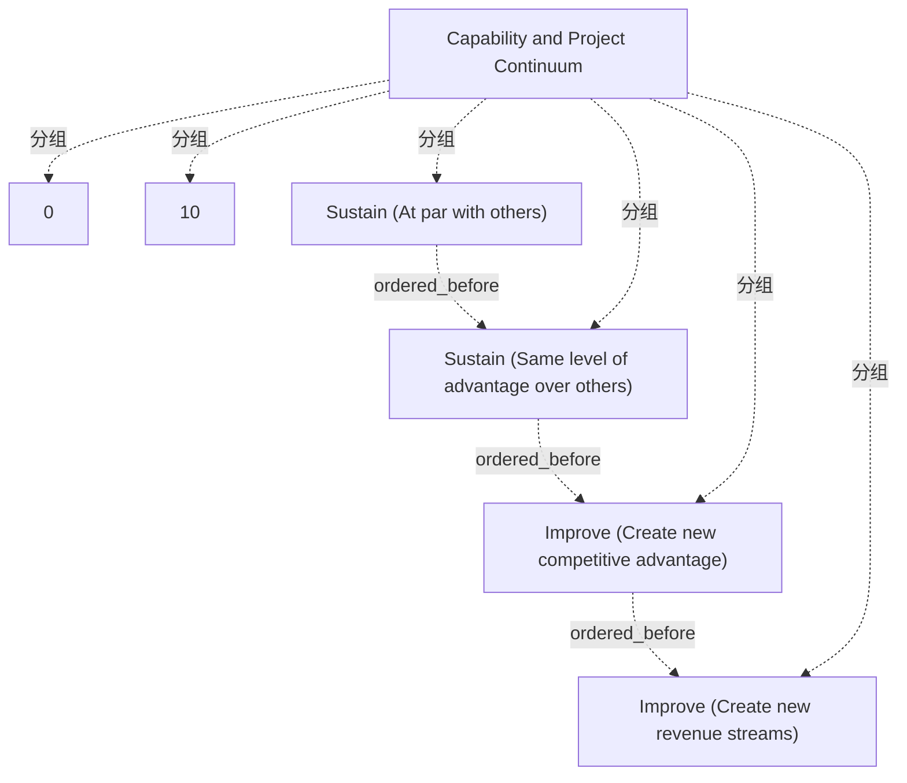

# G186/fig8-1 · 能力与项目连续谱

类型：`architecture-evolution-or-plan`。说明支持组合的架构不是在阶段 F 一次性收尾，而是在能力与项目的连续谱上持续演进：先维持现有优势，再创造新差异化与新市场。正文借此指出组合工作要从阶段 H 开始，并把在途项目和既有目标架构纳入考虑。

英文 PDF 物理页：[90]。本页为架构语义分析，原文与原图分别保留。

## 原图与可编辑图


[完整 JSON](fig8-1.json) · [可编辑 Mermaid](fig8-1.mmd) · [仅关系图](fig8-1.relations.mmd) · [层级分解图](fig8-1.hierarchy.mmd)

图形重建表达语义，不复制源图布局。虚线表示解释、矩阵映射或分组关系，不自动表示不确定性的概率。



## 架构分析

先看横贯全图的蓝色条：它是一条连续谱，不是四个分开的项目。条上方 0 与 10 是尺度端点，连同两端共十一个等距短竖线，没有单位。条下方四段文字从左到右读：Sustain（与对手持平）→ Sustain（维持同等优势）→ Improve（创造新竞争优势）→ Improve（创造新收入流）。

- 本图有 7 个具名或隐含元素、3 条关系和 6 条包含/分组记录。
- 包含/分组树最大深度为 1；根节点为 能力与项目连续谱。
- 本图没有可直接确认为人员直属汇报的关系；视觉上下位置、能力分解和治理职责分别读取。
- 蓝条、2端点数值、4完整类别标签与11根等距刻度线核对；中间9刻度未打印数值。
- 0–10无单位/评分定义，无四段边界或箭头；不推导每一类数值区间或成熟度。
- 90页说明维持与改进的四类诉求，获得优势后仍需维持；不是只可单向完成一次的生命周期。

### 如何用于项目

- 为每个演进状态/工作包登记前置条件、交付物、依赖和实际决策人。
- 时间轴表达计划顺序；架构范围、已批准计划和资源承诺须另有项目证据。

### 结构所表达的逻辑

- 连续谱分四段：与市场其他参与者持平、维持对对手的同等优势、创造新的竞争优势、创造新市场与收入流。
- 前两段归为 Sustain（维持），后两段归为 Improve（改进）；两者是同一连续谱的前后半段，不是互斥类别。
- 四段是能力与项目交付的递进，不是四个独立项目，也不是四个 ADM 阶段。
- 正文强调：一旦获得新能力或能力差异化，就必须持续维持这一增量优势，因此 Sustain 不是一次性的收尾。
- 组合级架构必须考虑现有的隐式或显式目标架构，以及在建项目带来的影响；这项工作实际上从阶段 H 启动。
- 0–10 的刻度等距但没有标单位或时间，不能据此推算工期、年限或成熟度分值。

## 上下级与包含

只有一层：一条连续谱条加四个并列的阶段标签；0 与 10 是尺度端点，不是层级，也不从属于某一阶段。

|父项|子项|层级类型|依据与解释|
|---|---|---|---|
|能力与项目连续谱|0（尺度起点）|classified_under|标签位于蓝条上方/下方，没有被条形包围；属于量尺注记。|
|能力与项目连续谱|10（尺度终点）|classified_under|标签位于蓝条上方/下方，没有被条形包围；属于量尺注记。|
|能力与项目连续谱|维持（与其他参与者持平）|classified_under|标签位于蓝条上方/下方，没有被条形包围；属于量尺注记。|
|能力与项目连续谱|维持（保持对他人的同等优势）|classified_under|标签位于蓝条上方/下方，没有被条形包围；属于量尺注记。|
|能力与项目连续谱|改进（创造新的竞争优势）|classified_under|标签位于蓝条上方/下方，没有被条形包围；属于量尺注记。|
|能力与项目连续谱|改进（创造新的收入流）|classified_under|标签位于蓝条上方/下方，没有被条形包围；属于量尺注记。|

## 全部元素与角色

|元素ID|原文名称|类型|含义|直接父项|深度|
|---|---|---|---|---|---|
|continuum|Capability and Project Continuum|concept|即图中横贯的蓝色条；标题来自图题，条本身没有文字。|—||
|scale_zero|0|note|刻度起点，无单位。|能力与项目连续谱|1|
|scale_ten|10|note|刻度终点，无单位。|能力与项目连续谱|1|
|phase_sustain_parity|Sustain (At par with others)|phase|阶段：维持（与其他参与者持平）|能力与项目连续谱|1|
|phase_sustain_advantage|Sustain (Same level of advantage over others)|phase|阶段：维持（保持对他人的同等优势）|能力与项目连续谱|1|
|phase_improve_competitive|Improve (Create new competitive advantage)|phase|阶段：改进（创造新的竞争优势）|能力与项目连续谱|1|
|phase_improve_revenue|Improve (Create new revenue streams)|phase|阶段：改进（创造新的收入流）|能力与项目连续谱|1|

## 全部关系

图中没有连线或箭头。四个阶段的先后只由从左到右的水平位置表达（推断关系）；条上的短竖线只是刻度，不表示依赖或里程碑。

|主体|语义关系|客体|显式线/隐式|原文标签|依据|
|---|---|---|---|---|---|
|维持（与其他参与者持平）|ordered_before|维持（保持对他人的同等优势）|implicit||沿连续谱从左向右排列，不是已绘制的依赖、时间或强制执行序列。|
|维持（保持对他人的同等优势）|ordered_before|改进（创造新的竞争优势）|implicit||沿连续谱从左向右排列，不是已绘制的依赖、时间或强制执行序列。|
|改进（创造新的竞争优势）|ordered_before|改进（创造新的收入流）|implicit||沿连续谱从左向右排列，不是已绘制的依赖、时间或强制执行序列。|

## 本轮语义修正

- 沿连续谱从左向右排列，不是已绘制的依赖、时间或强制执行序列。
- 沿连续谱从左向右排列，不是已绘制的依赖、时间或强制执行序列。
- 沿连续谱从左向右排列，不是已绘制的依赖、时间或强制执行序列。

## 误读检查

- 不要把 0–10 当作成熟度评分或日历时间轴，原图没有给出任何单位。
- 不要以为四个阶段等长；图没有画分段边界，标签只是沿条排列。
- 蓝色条不是甘特条，四个标签也不是四个项目或四次 ADM 迭代。
- 不要把 Sustain 理解为“项目结束后才做”的阶段；获得新能力后就要持续维持优势。

## 原文证据

### [PDF 第 90 页](../../../documents/G186.md#page-90)

> Almost all EA engagements, external or with an in-house EA team, are initiated for an Enterprise that has been in existence for a while. Whether explicitly initiated or acknowledged, an architecture is in place and solutions are being delivered against that architecture. Even when the Architecture to Support Strategy has been created for the first time, there are ongoing efforts and their impact that will have to be accounted for.
> The primary objective of Architecture to Support Portfolio is to identify projects, identify dependencies and synergies, and prioritize and initiate the projects. From that perspective, it would appear that all of the work is confined to Phase F to complete the architecture work and transition to solution delivery work.

## 来源与分析状态

所有元素/关系均有来源定位；未把历史解释重命名为本轮逐线视觉确认。源图与语义图是两种视图，布局不证明汇报或因果。

源 PDF SHA-256：`ed1c26faba5023a8d1b32b0ec893d75a3bb1d7a6508e99fa56ded079585d922a`。

源图记录：[原始解释与转录](../../../figures/G186/fig8-1.json)。

```json
{
  "quality": {
    "graph_integrity": "checked",
    "semantic_analysis": "typed-graph-and-context-analysis",
    "visual_review": "source-content-audited",
    "notice_zh": "所有元素/关系均有来源定位；未把历史解释重命名为本轮逐线视觉确认。源图与语义图是两种视图，布局不证明汇报或因果。"
  },
  "source_uncertainty": {
    "confidence": "high",
    "uncertainties_zh": [
      "0–10 没有单位；条的四个阶段之间没有画分界线，标签的水平位置只能表示顺序，不能精确读出各段长度。",
      "图中没有箭头，四段的先后顺序依据正文的列表和从左到右的排列推断。"
    ],
    "analyzed_from": [
      "英文 PDF 第 90 页图 8-1 截图（2x2 放大块）",
      "英文 PDF 第 90 页正文与第 91 页表 8-1 前后文",
      "中文稿 G186e_实践者方法_按TOGAF_ADM开发企业架构.md 第 1243–1284 行"
    ],
    "date": "2026-10-31"
  },
  "source_conflicts": []
}
```
