# G186/tabB-1 · 表 B-1：利益相关者职责（组合）

类型：`mapping-or-assessment-matrix`。附录 B 的示例矩阵：为每种架构目的维护一组标准化的利益相关者类别、关注点类别及对应关系；表 B-1 展示“组合”目的下的对应关系，作为视角库和建议沟通方式的起点。

英文 PDF 物理页：[151]。本页为架构语义分析，原文与原图分别保留。

## 原图与可编辑图


[完整 JSON](tabB-1.json) · [可编辑 Mermaid](tabB-1.mmd) · [仅关系图](tabB-1.relations.mmd) · [层级分解图](tabB-1.hierarchy.mmd)

图形重建表达语义，不复制源图布局。虚线表示解释、矩阵映射或分组关系，不自动表示不确定性的概率。

```mermaid
flowchart TB
  %% Semantic reconstruction; see original source image for exact layout.
  n0["Stakeholder Responsibility (Portfolio)"]
  n1["Senior Leaders"]
  n2["Portfolio Managers"]
  n3["Business Requirements Owners"]
  n4["Implementers"]
  n5["Risk Owners"]
  n6["Business Partner"]
  n7["Customer"]
  n8["Agility"]
  n9["Efficiency"]
  n10["Value"]
  n11["Value Proposition"]
  n12["Change Cost"]
  n13["Change Impact"]
  n14["Alignment"]
  n15["Feasibility"]
  n16["Dependability"]
  n17["Control"]
  n18["Specification"]
  n19["Security"]
  n20["Confidence"]
  n21["Customer Intimacy"]
  n22["Scalability"]
  n23["Business Continuity"]
  n0 -.->|"分组"| n1
  n0 -.->|"分组"| n2
  n0 -.->|"分组"| n3
  n0 -.->|"分组"| n4
  n0 -.->|"分组"| n5
  n0 -.->|"分组"| n6
  n0 -.->|"分组"| n7
  n0 -.->|"分组"| n8
  n0 -.->|"分组"| n9
  n0 -.->|"分组"| n10
  n0 -.->|"分组"| n11
  n0 -.->|"分组"| n12
  n0 -.->|"分组"| n13
  n0 -.->|"分组"| n14
  n0 -.->|"分组"| n15
  n0 -.->|"分组"| n16
  n0 -.->|"分组"| n17
  n0 -.->|"分组"| n18
  n0 -.->|"分组"| n19
  n0 -.->|"分组"| n20
  n0 -.->|"分组"| n21
  n0 -.->|"分组"| n22
  n0 -.->|"分组"| n23
```



## 架构分析

横轴是 16 个关注点，列标题竖排；纵轴是 7 类利益相关者。先按行读：某类利益相关者在本目的下被标记了哪些关注点。再按列读：某个关注点由哪些利益相关者共同负责。单元格有 X 表示存在职责/对应关系，空白表示本矩阵未标注。

- 本图有 24 个具名或隐含元素、0 条关系和 23 条包含/分组记录。
- 包含/分组树最大深度为 1；根节点为 利益相关者职责矩阵（组合）。
- 本图没有可直接确认为人员直属汇报的关系；视觉上下位置、能力分解和治理职责分别读取。
- 原图靠嵌套表达结构，没有连线；新语义图将包含单独显式化，不补造流程、数据流或依赖。
- 7行×16关注点共112格全部逐格核对，52个X；Value和Change Cost两列全空。
- 150页列出Differentiation关注点但本表16列没有该列；保留表/正文差异，不补造空列。
- X仅为该示例组合层利益相关者/关注点交叉关系；空白是不标记，不等于明令无职责；本表非RACI。

### 如何用于项目

- 先固定行、列所代表的维度及单元格含义，再登记有证据的映射或评分。
- 空白、无关系、未测量和不适用分别处理；颜色不自动等于优先级。

### 结构所表达的逻辑

- 矩阵有 7 类利益相关者：高层领导、组合经理、业务需求负责人、实施者、风险责任人、业务伙伴、客户。
- 矩阵有 16 类关注点：敏捷性、效率、价值、价值主张、变更成本、变更影响、对齐、可行性、可靠性、控制、规格、安全、信心、客户亲密度、可扩展性、业务连续性。
- 全表共 52 个 X；按行计数：高层领导 8、组合经理 10、业务需求负责人 8、实施者 6、风险责任人 7、业务伙伴 7、客户 6。
- “价值”和“变更成本”两列在本矩阵中没有任何 X；这不代表它们不重要，而是本“组合”目的矩阵未把这两类关注点分配给任何利益相关者类别，需在其他目的的矩阵或视角库中补齐。
- “变更影响”“安全”“信心”覆盖面较广，均被 6 类利益相关者标记；“客户亲密度”被 4 类标记。
- 客户行只有 6 个 X（敏捷性、价值主张、安全、信心、客户亲密度、业务连续性）；附录 B 注明架构可能不直接提供给客户，但必须从客户视角评估。
- 每行/每列的组合在附录 C 中会进一步转成一个视角（viewpoint），用于确定回应关注点所需的信息与沟通方式。

## 上下级与包含

没有上下级：行是 7 类并列的利益相关者，列是 16 类并列的关注点；矩阵是两维交叉，不是树。

|父项|子项|层级类型|依据与解释|
|---|---|---|---|
|利益相关者职责矩阵（组合）|高层领导|visual_grouping|框、泳道、域或分类组的成员归属；没有额外证据不提升为业务组合或管理关系。|
|利益相关者职责矩阵（组合）|组合经理|visual_grouping|框、泳道、域或分类组的成员归属；没有额外证据不提升为业务组合或管理关系。|
|利益相关者职责矩阵（组合）|业务需求负责人|visual_grouping|框、泳道、域或分类组的成员归属；没有额外证据不提升为业务组合或管理关系。|
|利益相关者职责矩阵（组合）|实施者|visual_grouping|框、泳道、域或分类组的成员归属；没有额外证据不提升为业务组合或管理关系。|
|利益相关者职责矩阵（组合）|风险责任人|visual_grouping|框、泳道、域或分类组的成员归属；没有额外证据不提升为业务组合或管理关系。|
|利益相关者职责矩阵（组合）|业务伙伴|visual_grouping|框、泳道、域或分类组的成员归属；没有额外证据不提升为业务组合或管理关系。|
|利益相关者职责矩阵（组合）|客户|visual_grouping|框、泳道、域或分类组的成员归属；没有额外证据不提升为业务组合或管理关系。|
|利益相关者职责矩阵（组合）|敏捷性|visual_grouping|框、泳道、域或分类组的成员归属；没有额外证据不提升为业务组合或管理关系。|
|利益相关者职责矩阵（组合）|效率|visual_grouping|框、泳道、域或分类组的成员归属；没有额外证据不提升为业务组合或管理关系。|
|利益相关者职责矩阵（组合）|价值|visual_grouping|框、泳道、域或分类组的成员归属；没有额外证据不提升为业务组合或管理关系。|
|利益相关者职责矩阵（组合）|价值主张|visual_grouping|框、泳道、域或分类组的成员归属；没有额外证据不提升为业务组合或管理关系。|
|利益相关者职责矩阵（组合）|变更成本|visual_grouping|框、泳道、域或分类组的成员归属；没有额外证据不提升为业务组合或管理关系。|
|利益相关者职责矩阵（组合）|变更影响|visual_grouping|框、泳道、域或分类组的成员归属；没有额外证据不提升为业务组合或管理关系。|
|利益相关者职责矩阵（组合）|对齐|visual_grouping|框、泳道、域或分类组的成员归属；没有额外证据不提升为业务组合或管理关系。|
|利益相关者职责矩阵（组合）|可行性|visual_grouping|框、泳道、域或分类组的成员归属；没有额外证据不提升为业务组合或管理关系。|
|利益相关者职责矩阵（组合）|可靠性|visual_grouping|框、泳道、域或分类组的成员归属；没有额外证据不提升为业务组合或管理关系。|
|利益相关者职责矩阵（组合）|控制|visual_grouping|框、泳道、域或分类组的成员归属；没有额外证据不提升为业务组合或管理关系。|
|利益相关者职责矩阵（组合）|规格|visual_grouping|框、泳道、域或分类组的成员归属；没有额外证据不提升为业务组合或管理关系。|
|利益相关者职责矩阵（组合）|安全|visual_grouping|框、泳道、域或分类组的成员归属；没有额外证据不提升为业务组合或管理关系。|
|利益相关者职责矩阵（组合）|信心|visual_grouping|框、泳道、域或分类组的成员归属；没有额外证据不提升为业务组合或管理关系。|
|利益相关者职责矩阵（组合）|客户亲密度|visual_grouping|框、泳道、域或分类组的成员归属；没有额外证据不提升为业务组合或管理关系。|
|利益相关者职责矩阵（组合）|可扩展性|visual_grouping|框、泳道、域或分类组的成员归属；没有额外证据不提升为业务组合或管理关系。|
|利益相关者职责矩阵（组合）|业务连续性|visual_grouping|框、泳道、域或分类组的成员归属；没有额外证据不提升为业务组合或管理关系。|

## 全部元素与角色

|元素ID|原文名称|类型|含义|直接父项|深度|
|---|---|---|---|---|---|
|matrix|Stakeholder Responsibility (Portfolio)|group|表 B-1 的整体矩阵。|—||
|sh_senior_leaders|Senior Leaders|stakeholder|利益相关者：高层领导|利益相关者职责矩阵（组合）|1|
|sh_portfolio_managers|Portfolio Managers|stakeholder|利益相关者：组合经理|利益相关者职责矩阵（组合）|1|
|sh_business_requirements_owners|Business Requirements Owners|stakeholder|利益相关者：业务需求负责人|利益相关者职责矩阵（组合）|1|
|sh_implementers|Implementers|stakeholder|利益相关者：实施者|利益相关者职责矩阵（组合）|1|
|sh_risk_owners|Risk Owners|stakeholder|利益相关者：风险责任人|利益相关者职责矩阵（组合）|1|
|sh_business_partner|Business Partner|stakeholder|利益相关者：业务伙伴|利益相关者职责矩阵（组合）|1|
|sh_customer|Customer|stakeholder|利益相关者：客户|利益相关者职责矩阵（组合）|1|
|cn_agility|Agility|requirement|需求：敏捷性|利益相关者职责矩阵（组合）|1|
|cn_efficiency|Efficiency|requirement|需求：效率|利益相关者职责矩阵（组合）|1|
|cn_value|Value|requirement|需求：价值|利益相关者职责矩阵（组合）|1|
|cn_value_proposition|Value Proposition|requirement|需求：价值主张|利益相关者职责矩阵（组合）|1|
|cn_change_cost|Change Cost|requirement|需求：变更成本|利益相关者职责矩阵（组合）|1|
|cn_change_impact|Change Impact|requirement|需求：变更影响|利益相关者职责矩阵（组合）|1|
|cn_alignment|Alignment|requirement|需求：对齐|利益相关者职责矩阵（组合）|1|
|cn_feasibility|Feasibility|requirement|需求：可行性|利益相关者职责矩阵（组合）|1|
|cn_dependability|Dependability|requirement|需求：可靠性|利益相关者职责矩阵（组合）|1|
|cn_control|Control|requirement|需求：控制|利益相关者职责矩阵（组合）|1|
|cn_specification|Specification|requirement|需求：规格|利益相关者职责矩阵（组合）|1|
|cn_security|Security|requirement|需求：安全|利益相关者职责矩阵（组合）|1|
|cn_confidence|Confidence|requirement|需求：信心|利益相关者职责矩阵（组合）|1|
|cn_customer_intimacy|Customer Intimacy|requirement|需求：客户亲密度|利益相关者职责矩阵（组合）|1|
|cn_scalability|Scalability|requirement|需求：可扩展性|利益相关者职责矩阵（组合）|1|
|cn_business_continuity|Business Continuity|requirement|需求：业务连续性|利益相关者职责矩阵（组合）|1|

## 全部关系

图中没有连线或箭头。行列交叉处的 X 表示该利益相关者类别与该关注点存在职责/对应关系；空白单元格表示未标注。灰色行底色只是表头/行标题的区分，不表示优先级。

|主体|语义关系|客体|显式线/隐式|原文标签|依据|
|---|---|---|---|---|---|

## 表 B-1 利益相关者职责（组合）逐格转录

```json
{
  "id": "t_b1",
  "title_zh": "表 B-1 利益相关者职责（组合）逐格转录",
  "columns": [
    "利益相关者",
    "Agility 敏捷性",
    "Efficiency 效率",
    "Value 价值",
    "Value Proposition 价值主张",
    "Change Cost 变更成本",
    "Change Impact 变更影响",
    "Alignment 对齐",
    "Feasibility 可行性",
    "Dependability 可靠性",
    "Control 控制",
    "Specification 规格",
    "Security 安全",
    "Confidence 信心",
    "Customer Intimacy 客户亲密度",
    "Scalability 可扩展性",
    "Business Continuity 业务连续性"
  ],
  "rows": [
    [
      "Senior Leaders 高层领导",
      "X",
      "X",
      "",
      "X",
      "",
      "X",
      "X",
      "",
      "",
      "",
      "",
      "X",
      "",
      "X",
      "",
      "X"
    ],
    [
      "Portfolio Managers 组合经理",
      "X",
      "X",
      "",
      "X",
      "",
      "X",
      "X",
      "X",
      "",
      "",
      "",
      "",
      "X",
      "X",
      "X",
      "X"
    ],
    [
      "Business Requirements Owners 业务需求负责人",
      "X",
      "X",
      "",
      "X",
      "",
      "X",
      "",
      "",
      "",
      "",
      "X",
      "X",
      "X",
      "X",
      "",
      ""
    ],
    [
      "Implementers 实施者",
      "",
      "",
      "",
      "",
      "",
      "X",
      "",
      "X",
      "",
      "X",
      "X",
      "",
      "X",
      "",
      "X",
      ""
    ],
    [
      "Risk Owners 风险责任人",
      "",
      "",
      "",
      "",
      "",
      "X",
      "",
      "X",
      "X",
      "",
      "X",
      "X",
      "X",
      "",
      "X",
      ""
    ],
    [
      "Business Partner 业务伙伴",
      "X",
      "X",
      "",
      "",
      "",
      "X",
      "",
      "X",
      "",
      "",
      "X",
      "X",
      "X",
      "",
      "",
      ""
    ],
    [
      "Customer 客户",
      "X",
      "",
      "",
      "X",
      "",
      "",
      "",
      "",
      "",
      "",
      "",
      "X",
      "X",
      "X",
      "",
      "X"
    ]
  ],
  "cell_legend": [
    "X = 该利益相关者类别对该关注点有职责/对应关系；空白 = 本矩阵未标注。",
    "原表没有区分负责/批准/咨询/知情，不能当 RACI 使用。"
  ],
  "notes_zh": "逐格核对英文 PDF 第 151 页表 B-1；共 7 行 × 16 列，52 个 X。“价值”“变更成本”两列全空。"
}
```

## 误读检查

- 不要把它读成 RACI 矩阵：X 不区分负责、批准、咨询、知情，只表示“有关系/有职责”。
- 空白单元格不等于该利益相关者不关心该关注点，只表示本表未标注。
- “价值”“变更成本”两列全空，不能据此得出组合目的不关心价值或变更成本；附录说明每种目的各有一张矩阵。
- 本表只适用于“组合”目的，不能直接套用到战略、项目或解决方案交付目的。
- Customer Intimacy 在附录 B 的术语是“客户亲密度”，不是“客户亲近”。

## 原文证据

### [PDF 第 150 页](../../../documents/G186.md#page-150)

> • Agility: what is the ability of the architecture to adapt to future unanticipated change?
> • Efficiency: how does some aspect of the architecture contribute to efficiency of operations?
### [PDF 第 151 页](../../../documents/G186.md#page-151)

> Endnotes [1] See Customization of Architecture Contents and Metamodel in the TOGAF® Leader’s Guide to Establishing and Evolving an EA Capability (see G184).

## 来源与分析状态

所有元素/关系均有来源定位；未把历史解释重命名为本轮逐线视觉确认。源图与语义图是两种视图，布局不证明汇报或因果。

源 PDF SHA-256：`ed1c26faba5023a8d1b32b0ec893d75a3bb1d7a6508e99fa56ded079585d922a`。

源图记录：[原始解释与转录](../../../figures/G186/tabB-1.json)。

```json
{
  "quality": {
    "graph_integrity": "checked",
    "semantic_analysis": "typed-graph-and-context-analysis",
    "visual_review": "source-content-audited",
    "notice_zh": "所有元素/关系均有来源定位；未把历史解释重命名为本轮逐线视觉确认。源图与语义图是两种视图，布局不证明汇报或因果。"
  },
  "source_uncertainty": {
    "confidence": "high",
    "uncertainties_zh": [
      "原表没有图例；X 的确切含义（负责/关注/需参与）由表题“Stakeholder Responsibility”与附录 B 正文推断，不能区分 RACI 角色。",
      "原表是位图，个别单元格的 X 位置靠像素比对确认；已逐格核对，但无法排除原书排版造成的轻微错位。"
    ],
    "analyzed_from": [
      "英文 PDF 第 151 页表 B-1 截图（整图与 2x2 放大块，按网格逐格像素核对）",
      "英文 PDF 第 151 页表题与尾注",
      "中文稿 G186e_实践者方法_按TOGAF_ADM开发企业架构.md 第 2080–2124 行"
    ],
    "date": "2026-10-31"
  },
  "source_conflicts": []
}
```
