# G188/ex3-22 · 示例 3-22：项目 A 的工作分解结构（WBS）图

类型：`decomposition-or-organization-model`。示例演示“按交付物分解”的 WBS 做法：项目经理已有一份详细交付物清单，于是以最终目标为根，把工作分成项目管理、应用关系与数据流、能力映射、关键观察、改进建议五个分支，再落到可估算的交付物，作为后续定义活动、排进度和估算的基础。

英文 PDF 物理页：[55]。本页为架构语义分析，原文与原图分别保留。

## 原图与可编辑图


[完整 JSON](ex3-22.json) · [可编辑 Mermaid](ex3-22.mmd) · [仅关系图](ex3-22.relations.mmd) · [层级分解图](ex3-22.hierarchy.mmd)

图形重建表达语义，不复制源图布局。虚线表示解释、矩阵映射或分组关系，不自动表示不确定性的概率。

```mermaid
flowchart TB
  %% Semantic reconstruction; see original source image for exact layout.
  n0["Assessment of current application portfolio and recommend improvement options"]
  n1["Project management"]
  n2["Relationships and data flows between applications"]
  n3["Mapping application capabilities"]
  n4["Key observations"]
  n5["Improvement recommendations"]
  n6["Planning"]
  n7["Monitoring &amp; controlling"]
  n8["Reporting &amp; Administration"]
  n9["Agree list of applications"]
  n10["Analysis of relationships between applications"]
  n11["Analysis of data flow between applications"]
  n12["Identification of overlaps between applications"]
  n13["Identification of application gaps"]
  n14["Identification of key technological constraints"]
  n15["Observations from application relationship"]
  n16["Observations from mapping application capabilities"]
  n17["Identification of improvement recommendations"]
  n18["Identification of initiatives along with prioritization"]
  n19["Preparation of initiatives roadmap"]
  n0 -->|"decomposes_into"| n1
  n0 -->|"decomposes_into"| n2
  n0 -->|"decomposes_into"| n3
  n0 -->|"decomposes_into"| n4
  n0 -->|"decomposes_into"| n5
  n1 -->|"decomposes_into"| n6
  n1 -->|"decomposes_into"| n7
  n1 -->|"decomposes_into"| n8
  n2 -->|"decomposes_into"| n9
  n2 -->|"decomposes_into"| n10
  n2 -->|"decomposes_into"| n11
  n3 -->|"decomposes_into"| n12
  n3 -->|"decomposes_into"| n13
  n4 -->|"decomposes_into"| n14
  n4 -->|"decomposes_into"| n15
  n4 -->|"decomposes_into"| n16
  n5 -->|"decomposes_into"| n17
  n5 -->|"decomposes_into"| n18
  n5 -->|"decomposes_into"| n19
  n0 -.->|"work_breakdown"| n1
  n0 -.->|"work_breakdown"| n2
  n0 -.->|"work_breakdown"| n3
  n0 -.->|"work_breakdown"| n4
  n0 -.->|"work_breakdown"| n5
  n1 -.->|"work_breakdown"| n6
  n1 -.->|"work_breakdown"| n7
  n1 -.->|"work_breakdown"| n8
  n2 -.->|"work_breakdown"| n9
  n2 -.->|"work_breakdown"| n10
  n2 -.->|"work_breakdown"| n11
  n3 -.->|"work_breakdown"| n12
  n3 -.->|"work_breakdown"| n13
  n4 -.->|"work_breakdown"| n14
  n4 -.->|"work_breakdown"| n15
  n4 -.->|"work_breakdown"| n16
  n5 -.->|"work_breakdown"| n17
  n5 -.->|"work_breakdown"| n18
  n5 -.->|"work_breakdown"| n19
```



## 架构分析

从最上方根节点“评估当前应用组合并提出改进选项”向下读，五条肘形箭头指向五个二级分支，从左到右依次为项目管理、应用间的关系与数据流、映射应用能力、关键观察、改进建议。每个分支标题下方的竖线是工作包总线，总线向左（图中实际画法）分出箭头，挂接该分支的交付物；同一分支内自上而下是并列交付物，不是先后顺序。

- 本图有 20 个具名或隐含元素、19 条关系和 19 条包含/分组记录。
- 包含/分组树最大深度为 2；根节点为 评估当前应用组合并提出改进选项。
- 本图没有可直接确认为人员直属汇报的关系；视觉上下位置、能力分解和治理职责分别读取。
- 20节点19树边全部核对：根1、主分支5、叶3+3+2+3+3；所有箭头从父工作分支指向叶。
- 映射应用能力仅有2叶，无遗漏第三叶；Project management分支也属于项目WBS，不是其他列的上级。
- 55页明确本节Project Work Package采用项目管理定义，与TOGAF Phase E中工作包含义有差别。

### 如何用于项目

- 按父项展开所有直接子项，检查同层粒度、重叠和缺项。
- 保留组成、分类、能力分解与组织汇报的区别；将示例名称替换为已确认的项目对象。

### 结构所表达的逻辑

- WBS 按“交付物”而不是按“阶段”或“组织”分解：第二层是五类工作包/交付物组，第三层是具体交付物。
- 根节点就是项目 A 的总体目标：评估当前应用组合并提出改进选项（与表 2-1 的示例 A 一致）。
- 项目管理被作为 WBS 的一个分支（规划、监控与控制、报告与行政），与架构交付工作并列，提醒项目管理本身也要被计划和估算。
- 架构工作分成三条线：应用间关系与数据流、能力映射、关键观察；观察结果再汇入“改进建议”分支。
- “映射应用能力”分支只有两项交付物（重叠识别、缺口识别），说明该分支范围较窄，不应擅自补成三项。
- 最右侧“改进建议”分支以“识别改进建议→识别举措并排定优先级→编制举措路线图”收束，对应从分析到可执行路线图的递进。
- 图中箭头只表示分解（父子），不表示交付物之间的先后依赖；同一分支内三项的上下顺序没有时间含义。

## 上下级与包含

三层：L1 根节点（项目 A 总体目标）；L2 五个分支（Project management、Relationships and data flows between applications、Mapping application capabilities、Key observations、Improvement recommendations）；L3 每个分支下的交付物（2–3 项）。分支之间并列，交付物之间并列，均无上下级交叉。

|父项|子项|层级类型|依据与解释|
|---|---|---|---|
|评估当前应用组合并提出改进选项|项目管理|work_breakdown|由树形实线箭头显示工作分解；不是视觉框内包含，也不是执行顺序或人员汇报。|
|评估当前应用组合并提出改进选项|应用间的关系与数据流|work_breakdown|由树形实线箭头显示工作分解；不是视觉框内包含，也不是执行顺序或人员汇报。|
|评估当前应用组合并提出改进选项|映射应用能力|work_breakdown|由树形实线箭头显示工作分解；不是视觉框内包含，也不是执行顺序或人员汇报。|
|评估当前应用组合并提出改进选项|关键观察|work_breakdown|由树形实线箭头显示工作分解；不是视觉框内包含，也不是执行顺序或人员汇报。|
|评估当前应用组合并提出改进选项|改进建议|work_breakdown|由树形实线箭头显示工作分解；不是视觉框内包含，也不是执行顺序或人员汇报。|
|项目管理|规划|work_breakdown|由树形实线箭头显示工作分解；不是视觉框内包含，也不是执行顺序或人员汇报。|
|项目管理|监控与控制|work_breakdown|由树形实线箭头显示工作分解；不是视觉框内包含，也不是执行顺序或人员汇报。|
|项目管理|报告与行政|work_breakdown|由树形实线箭头显示工作分解；不是视觉框内包含，也不是执行顺序或人员汇报。|
|应用间的关系与数据流|确认应用清单|work_breakdown|由树形实线箭头显示工作分解；不是视觉框内包含，也不是执行顺序或人员汇报。|
|应用间的关系与数据流|分析应用间关系|work_breakdown|由树形实线箭头显示工作分解；不是视觉框内包含，也不是执行顺序或人员汇报。|
|应用间的关系与数据流|分析应用间数据流|work_breakdown|由树形实线箭头显示工作分解；不是视觉框内包含，也不是执行顺序或人员汇报。|
|映射应用能力|识别应用间重叠|work_breakdown|由树形实线箭头显示工作分解；不是视觉框内包含，也不是执行顺序或人员汇报。|
|映射应用能力|识别应用缺口|work_breakdown|由树形实线箭头显示工作分解；不是视觉框内包含，也不是执行顺序或人员汇报。|
|关键观察|识别关键技术约束|work_breakdown|由树形实线箭头显示工作分解；不是视觉框内包含，也不是执行顺序或人员汇报。|
|关键观察|应用关系观察|work_breakdown|由树形实线箭头显示工作分解；不是视觉框内包含，也不是执行顺序或人员汇报。|
|关键观察|应用能力映射观察|work_breakdown|由树形实线箭头显示工作分解；不是视觉框内包含，也不是执行顺序或人员汇报。|
|改进建议|识别改进建议|work_breakdown|由树形实线箭头显示工作分解；不是视觉框内包含，也不是执行顺序或人员汇报。|
|改进建议|识别举措并排定优先级|work_breakdown|由树形实线箭头显示工作分解；不是视觉框内包含，也不是执行顺序或人员汇报。|
|改进建议|编制举措路线图|work_breakdown|由树形实线箭头显示工作分解；不是视觉框内包含，也不是执行顺序或人员汇报。|

## 全部元素与角色

|元素ID|原文名称|类型|含义|直接父项|深度|
|---|---|---|---|---|---|
|wbs_root|Assessment of current application portfolio and recommend improvement options|artifact|制品：评估当前应用组合并提出改进选项|—||
|wp_project_management|Project management|artifact|制品：项目管理|评估当前应用组合并提出改进选项|1|
|wp_relationships|Relationships and data flows between applications|artifact|制品：应用间的关系与数据流|评估当前应用组合并提出改进选项|1|
|wp_mapping|Mapping application capabilities|artifact|制品：映射应用能力|评估当前应用组合并提出改进选项|1|
|wp_observations|Key observations|artifact|制品：关键观察|评估当前应用组合并提出改进选项|1|
|wp_recommendations|Improvement recommendations|artifact|制品：改进建议|评估当前应用组合并提出改进选项|1|
|d_planning|Planning|artifact|制品：规划|项目管理|2|
|d_monitoring|Monitoring & controlling|artifact|制品：监控与控制|项目管理|2|
|d_reporting|Reporting & Administration|artifact|制品：报告与行政|项目管理|2|
|d_agree_list|Agree list of applications|artifact|制品：确认应用清单|应用间的关系与数据流|2|
|d_relationships|Analysis of relationships between applications|artifact|制品：分析应用间关系|应用间的关系与数据流|2|
|d_data_flow|Analysis of data flow between applications|artifact|制品：分析应用间数据流|应用间的关系与数据流|2|
|d_overlaps|Identification of overlaps between applications|artifact|制品：识别应用间重叠|映射应用能力|2|
|d_gaps|Identification of application gaps|artifact|制品：识别应用缺口|映射应用能力|2|
|d_constraints|Identification of key technological constraints|artifact|制品：识别关键技术约束|关键观察|2|
|d_obs_relationship|Observations from application relationship|artifact|制品：应用关系观察|关键观察|2|
|d_obs_mapping|Observations from mapping application capabilities|artifact|制品：应用能力映射观察|关键观察|2|
|d_improvements|Identification of improvement recommendations|artifact|制品：识别改进建议|改进建议|2|
|d_initiatives|Identification of initiatives along with prioritization|artifact|制品：识别举措并排定优先级|改进建议|2|
|d_roadmap|Preparation of initiatives roadmap|artifact|制品：编制举措路线图|改进建议|2|

## 全部关系

所有线都是分解线，不是流程线：根节点下方一条横线分出五条向下箭头到分支；每个分支标题下一条竖直总线，再用向左的肘形箭头接到各交付物。箭头方向表示“父→子（分解出）”，不表示工作先后或数据流。

|主体|语义关系|客体|显式线/隐式|原文标签|依据|
|---|---|---|---|---|---|
|评估当前应用组合并提出改进选项|decomposes_into|项目管理|显式连线||1根→5主分支→14活动/交付物的WBS分解，不把按列/行排列改为串行依赖。|
|评估当前应用组合并提出改进选项|decomposes_into|应用间的关系与数据流|显式连线||1根→5主分支→14活动/交付物的WBS分解，不把按列/行排列改为串行依赖。|
|评估当前应用组合并提出改进选项|decomposes_into|映射应用能力|显式连线||1根→5主分支→14活动/交付物的WBS分解，不把按列/行排列改为串行依赖。|
|评估当前应用组合并提出改进选项|decomposes_into|关键观察|显式连线||1根→5主分支→14活动/交付物的WBS分解，不把按列/行排列改为串行依赖。|
|评估当前应用组合并提出改进选项|decomposes_into|改进建议|显式连线||1根→5主分支→14活动/交付物的WBS分解，不把按列/行排列改为串行依赖。|
|项目管理|decomposes_into|规划|显式连线||1根→5主分支→14活动/交付物的WBS分解，不把按列/行排列改为串行依赖。|
|项目管理|decomposes_into|监控与控制|显式连线||1根→5主分支→14活动/交付物的WBS分解，不把按列/行排列改为串行依赖。|
|项目管理|decomposes_into|报告与行政|显式连线||1根→5主分支→14活动/交付物的WBS分解，不把按列/行排列改为串行依赖。|
|应用间的关系与数据流|decomposes_into|确认应用清单|显式连线||1根→5主分支→14活动/交付物的WBS分解，不把按列/行排列改为串行依赖。|
|应用间的关系与数据流|decomposes_into|分析应用间关系|显式连线||1根→5主分支→14活动/交付物的WBS分解，不把按列/行排列改为串行依赖。|
|应用间的关系与数据流|decomposes_into|分析应用间数据流|显式连线||1根→5主分支→14活动/交付物的WBS分解，不把按列/行排列改为串行依赖。|
|映射应用能力|decomposes_into|识别应用间重叠|显式连线||1根→5主分支→14活动/交付物的WBS分解，不把按列/行排列改为串行依赖。|
|映射应用能力|decomposes_into|识别应用缺口|显式连线||1根→5主分支→14活动/交付物的WBS分解，不把按列/行排列改为串行依赖。|
|关键观察|decomposes_into|识别关键技术约束|显式连线||1根→5主分支→14活动/交付物的WBS分解，不把按列/行排列改为串行依赖。|
|关键观察|decomposes_into|应用关系观察|显式连线||1根→5主分支→14活动/交付物的WBS分解，不把按列/行排列改为串行依赖。|
|关键观察|decomposes_into|应用能力映射观察|显式连线||1根→5主分支→14活动/交付物的WBS分解，不把按列/行排列改为串行依赖。|
|改进建议|decomposes_into|识别改进建议|显式连线||1根→5主分支→14活动/交付物的WBS分解，不把按列/行排列改为串行依赖。|
|改进建议|decomposes_into|识别举措并排定优先级|显式连线||1根→5主分支→14活动/交付物的WBS分解，不把按列/行排列改为串行依赖。|
|改进建议|decomposes_into|编制举措路线图|显式连线||1根→5主分支→14活动/交付物的WBS分解，不把按列/行排列改为串行依赖。|

## 项目 A 的 WBS 逐行转录

```json
{
  "id": "t_wbs",
  "title_zh": "项目 A 的 WBS 逐行转录",
  "columns": [
    "层级",
    "父节点",
    "节点标签（英文）",
    "节点标签（中文）"
  ],
  "rows": [
    [
      "L1",
      "—",
      "Assessment of current application portfolio and recommend improvement options",
      "评估当前应用组合并提出改进选项"
    ],
    [
      "L2",
      "L1",
      "Project management",
      "项目管理"
    ],
    [
      "L3",
      "Project management",
      "Planning",
      "规划"
    ],
    [
      "L3",
      "Project management",
      "Monitoring & controlling",
      "监控与控制"
    ],
    [
      "L3",
      "Project management",
      "Reporting & Administration",
      "报告与行政"
    ],
    [
      "L2",
      "L1",
      "Relationships and data flows between applications",
      "应用间的关系与数据流"
    ],
    [
      "L3",
      "Relationships and data flows between applications",
      "Agree list of applications",
      "确认应用清单"
    ],
    [
      "L3",
      "Relationships and data flows between applications",
      "Analysis of relationships between applications",
      "分析应用间关系"
    ],
    [
      "L3",
      "Relationships and data flows between applications",
      "Analysis of data flow between applications",
      "分析应用间数据流"
    ],
    [
      "L2",
      "L1",
      "Mapping application capabilities",
      "映射应用能力"
    ],
    [
      "L3",
      "Mapping application capabilities",
      "Identification of overlaps between applications",
      "识别应用间重叠"
    ],
    [
      "L3",
      "Mapping application capabilities",
      "Identification of application gaps",
      "识别应用缺口"
    ],
    [
      "L2",
      "L1",
      "Key observations",
      "关键观察"
    ],
    [
      "L3",
      "Key observations",
      "Identification of key technological constraints",
      "识别关键技术约束"
    ],
    [
      "L3",
      "Key observations",
      "Observations from application relationship",
      "应用关系观察"
    ],
    [
      "L3",
      "Key observations",
      "Observations from mapping application capabilities",
      "应用能力映射观察"
    ],
    [
      "L2",
      "L1",
      "Improvement recommendations",
      "改进建议"
    ],
    [
      "L3",
      "Improvement recommendations",
      "Identification of improvement recommendations",
      "识别改进建议"
    ],
    [
      "L3",
      "Improvement recommendations",
      "Identification of initiatives along with prioritization",
      "识别举措并排定优先级"
    ],
    [
      "L3",
      "Improvement recommendations",
      "Preparation of initiatives roadmap",
      "编制举措路线图"
    ]
  ],
  "notes_zh": "共 1 个根、5 个分支、14 个交付物；层级与父子关系按原图箭头转录。"
}
```

## 本轮语义修正

- 1根→5主分支→14活动/交付物的WBS分解，不把按列/行排列改为串行依赖。
- 1根→5主分支→14活动/交付物的WBS分解，不把按列/行排列改为串行依赖。
- 1根→5主分支→14活动/交付物的WBS分解，不把按列/行排列改为串行依赖。
- 1根→5主分支→14活动/交付物的WBS分解，不把按列/行排列改为串行依赖。
- 1根→5主分支→14活动/交付物的WBS分解，不把按列/行排列改为串行依赖。
- 1根→5主分支→14活动/交付物的WBS分解，不把按列/行排列改为串行依赖。
- 1根→5主分支→14活动/交付物的WBS分解，不把按列/行排列改为串行依赖。
- 1根→5主分支→14活动/交付物的WBS分解，不把按列/行排列改为串行依赖。
- 1根→5主分支→14活动/交付物的WBS分解，不把按列/行排列改为串行依赖。
- 1根→5主分支→14活动/交付物的WBS分解，不把按列/行排列改为串行依赖。
- 1根→5主分支→14活动/交付物的WBS分解，不把按列/行排列改为串行依赖。
- 1根→5主分支→14活动/交付物的WBS分解，不把按列/行排列改为串行依赖。
- 1根→5主分支→14活动/交付物的WBS分解，不把按列/行排列改为串行依赖。
- 1根→5主分支→14活动/交付物的WBS分解，不把按列/行排列改为串行依赖。
- 1根→5主分支→14活动/交付物的WBS分解，不把按列/行排列改为串行依赖。
- 1根→5主分支→14活动/交付物的WBS分解，不把按列/行排列改为串行依赖。
- 1根→5主分支→14活动/交付物的WBS分解，不把按列/行排列改为串行依赖。
- 1根→5主分支→14活动/交付物的WBS分解，不把按列/行排列改为串行依赖。
- 1根→5主分支→14活动/交付物的WBS分解，不把按列/行排列改为串行依赖。

## 误读检查

- 不要把五个分支理解为五个先后阶段；它们是并列的交付物类别。
- 不要把同一分支内交付物的上下顺序当成执行顺序；WBS 只表达范围分解。
- 不要把“项目管理”分支当作项目外的管理开销而忽略：它是 WBS 的正式组成部分，含规划、监控、报告三项交付物。
- 中文稿重绘 SVG 的箭头从方框中心指向左边缘，方向看似反了；应按原图理解为父节点分解到子交付物。
- “映射应用能力”只有重叠与缺口两项，不要按其他分支的三项模式自行补全。

## 原文证据

### [PDF 第 54 页](../../../documents/G188.md#page-54)

> This is the process of subdividing project deliverables and project work into smaller, more manageable components [PMBOK].
> It should be determined which architecture domains should be developed, to what level of detail, and which architecture views should be built prior to creating the Work Breakdown Structure, and the result of this task should be an input to the Work Breakdown Structure.
### [PDF 第 55 页](../../../documents/G188.md#page-55)

> After the detailed scope is defined, the following Project Management tools and techniques can be used in order to define the Project Plan. During this phase it is recommended to prepare a schedule; a detailed schedule for each phase should be prepared during the Planning a Stage activity (see Section 3.3).
> This activity is used to identify any specific tasks that need to be executed in order to produce deliverables.

## 来源与分析状态

所有元素/关系均有来源定位；未把历史解释重命名为本轮逐线视觉确认。源图与语义图是两种视图，布局不证明汇报或因果。

源 PDF SHA-256：`6e654af12a0bc034c7548d425a01123331ac9129c478a0bb957db89dd353dd29`。

源图记录：[原始解释与转录](../../../figures/G188/ex3-22.json)。

```json
{
  "quality": {
    "graph_integrity": "checked",
    "semantic_analysis": "typed-graph-and-context-analysis",
    "visual_review": "source-content-audited",
    "notice_zh": "所有元素/关系均有来源定位；未把历史解释重命名为本轮逐线视觉确认。源图与语义图是两种视图，布局不证明汇报或因果。"
  },
  "source_uncertainty": {
    "confidence": "high",
    "uncertainties_zh": [
      "原图分支标题为斜体深灰块、交付物为浅灰块，均无编号；WBS 编号（如 1.1）在原图中不存在，本分析未虚构编号。",
      "中文稿 re绘 SVG 的箭头从框中心指向左边缘，方向与原图相反；本分析按原图记录为父→子。"
    ],
    "analyzed_from": [
      "英文 PDF 第 55 页原图截图（含 3x3 放大分块）",
      "英文 PDF 第 54–55 页正文",
      "中文稿 G188e_架构项目管理.md 第 779–830 行及图内标签对照表 L805–L829",
      "figs/g188e_ex3-22_en.png 与 figs/zh/g188e_ex3-22_zh.svg"
    ],
    "date": "2026-10-31"
  },
  "source_conflicts": []
}
```
