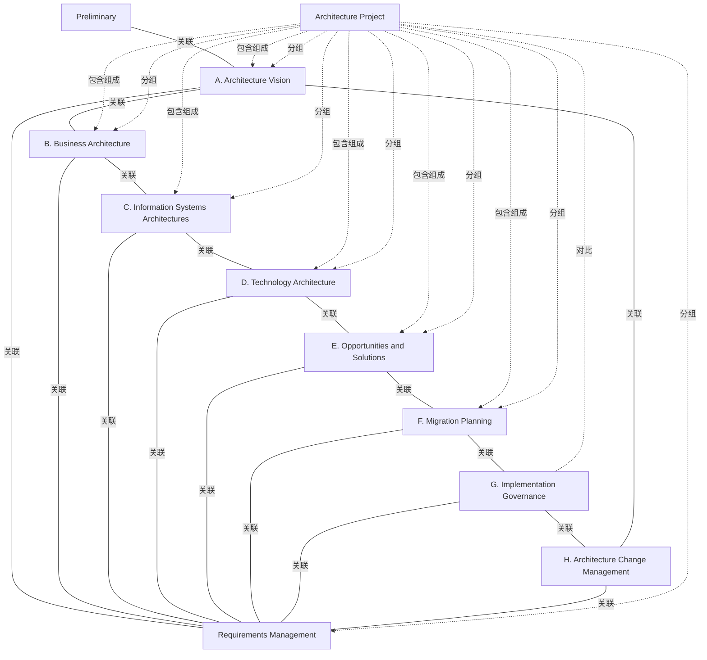

# G188/fig1-1 · 架构项目与 TOGAF ADM 的关系

类型：`process-or-method-model`。为“架构项目”下操作性定义：作者不按 TOGAF 术语而按项目边界来界定，用一张 ADM 图直观说明哪些 ADM 活动属于架构项目、哪些不属于，从而为后文按项目管理方法管理 A–F 奠定范围基础。

英文 PDF 物理页：[16]。本页为架构语义分析，原文与原图分别保留。

## 原图与可编辑图


[完整 JSON](fig1-1.json) · [可编辑 Mermaid](fig1-1.mmd) · [仅关系图](fig1-1.relations.mmd) · [层级分解图](fig1-1.hierarchy.mmd)

图形重建表达语义，不复制源图布局。虚线表示解释、矩阵映射或分组关系，不自动表示不确定性的概率。



## 架构分析

先看中心：需求管理是贯穿各阶段的中心活动。再沿圆周按 A→B→C→D→E→F→G→H→A 的顺序读八个阶段（图中只有连线、没有箭头，循环方向来自 ADM 常识）。最后看浅蓝色不规则的“Architecture Project”轮廓：它把 A–F 与中心需求管理包在一起，预备阶段、G、H 落在轮廓之外。

- 本图有 11 个具名或隐含元素、24 条关系和 7 条包含/分组记录。
- 包含/分组树最大深度为 1；根节点为 架构项目、预备阶段、阶段 G：实施治理、阶段 H：架构变更管理。
- 本图没有可直接确认为人员直属汇报的关系；视觉上下位置、能力分解和治理职责分别读取。
- 10个ADM圆、1项目范围共11元素；9条环/预备线+8需求放射线全部无箭头。
- 项目浅蓝范围含A–F与Requirements Management，排除Preliminary/G/H；16页明确这是本指南Architecture Project定义。
- 不把浅蓝遮罩形成的浅色当成未开始/低优先级状态，也不把范围之外阶段当作TOGAF不需要。

### 如何用于项目

- 按阶段/事件/行为关系读取入口、出口、责任和产物；检查循环与例外路径。
- 工作流先后不表示组织管理权；在项目中显式记录条件和完成标准。

### 结构所表达的逻辑

- 架构项目 = ADM 阶段 A 至 F + 需求管理；这是本文档对“架构项目”的工作定义，而非 TOGAF 标准术语。
- 预备阶段在项目之外：它建立企业的架构能力，其输出（尤其是架构工作请求）作为架构项目的输入。
- 阶段 G（实施治理）在项目之外：它治理架构的实施，通常作为另一个项目或项目群运行。
- 阶段 H（架构变更管理）在项目之外：它维护已实施的架构，属于运营业务/流程而非项目管理。
- 需求管理位于圆心，用放射线与八个阶段相连，表示它贯穿整个 ADM 周期，而不是一个前后相继的阶段。
- 阶段 A–F 首尾相接成环，说明架构项目虽然在 F 结束，但 ADM 本身是循环的；架构项目只是其中的一段。

## 上下级与包含

两层视觉结构：外层是 ADM 的九个圆（预备 + A–H）加中心的需求管理；内层是浅蓝色“Architecture Project”范围轮廓，包住 A–F 与需求管理。图中没有组织上下级，只有范围包含（轮廓）与连接（圆之间细线）。

|父项|子项|层级类型|依据与解释|
|---|---|---|---|
|架构项目|阶段 A：架构愿景|visual_grouping|框、泳道、域或分类组的成员归属；没有额外证据不提升为业务组合或管理关系。|
|架构项目|阶段 B：业务架构|visual_grouping|框、泳道、域或分类组的成员归属；没有额外证据不提升为业务组合或管理关系。|
|架构项目|阶段 C：信息系统架构|visual_grouping|框、泳道、域或分类组的成员归属；没有额外证据不提升为业务组合或管理关系。|
|架构项目|阶段 D：技术架构|visual_grouping|框、泳道、域或分类组的成员归属；没有额外证据不提升为业务组合或管理关系。|
|架构项目|阶段 E：机会与解决方案|visual_grouping|框、泳道、域或分类组的成员归属；没有额外证据不提升为业务组合或管理关系。|
|架构项目|阶段 F：迁移规划|visual_grouping|框、泳道、域或分类组的成员归属；没有额外证据不提升为业务组合或管理关系。|
|架构项目|需求管理|visual_grouping|框、泳道、域或分类组的成员归属；没有额外证据不提升为业务组合或管理关系。|

### 业务组成与特化

|父项/范围/类型|子项/责任对象/实例|语义|
|---|---|---|
|架构项目|阶段 A：架构愿景|composition|
|架构项目|阶段 B：业务架构|composition|
|架构项目|阶段 C：信息系统架构|composition|
|架构项目|阶段 D：技术架构|composition|
|架构项目|阶段 E：机会与解决方案|composition|
|架构项目|阶段 F：迁移规划|composition|

## 全部元素与角色

|元素ID|原文名称|类型|含义|直接父项|深度|
|---|---|---|---|---|---|
|arch_project|Architecture Project|group|范围边界，不是一个阶段；轮廓内为 A–F 与需求管理。|—||
|preliminary|Preliminary|phase|在架构项目范围之外。|—||
|phase_a|A. Architecture Vision|phase|阶段：阶段 A：架构愿景|架构项目|1|
|phase_b|B. Business Architecture|phase|阶段：阶段 B：业务架构|架构项目|1|
|phase_c|C. Information Systems Architectures|phase|阶段：阶段 C：信息系统架构|架构项目|1|
|phase_d|D. Technology Architecture|phase|阶段：阶段 D：技术架构|架构项目|1|
|phase_e|E. Opportunities and Solutions|phase|阶段：阶段 E：机会与解决方案|架构项目|1|
|phase_f|F. Migration Planning|phase|阶段：阶段 F：迁移规划|架构项目|1|
|phase_g|G. Implementation Governance|phase|在架构项目范围之外。|—||
|phase_h|H. Architecture Change Management|phase|在架构项目范围之外。|—||
|requirements_management|Requirements Management|phase|贯穿性活动，与八个阶段都有连接。|架构项目|1|

## 全部关系

细灰线连接相邻阶段（A–B、B–C……H–A）以及预备阶段–A，表示 ADM 的阶段顺序；中心需求管理向八个阶段各发一条放射线，表示需求管理贯穿每个阶段。所有线都没有箭头，方向由 ADM 的循环阅读习惯给出。浅蓝轮廓是范围边界，不是连线。

|主体|语义关系|客体|显式线/隐式|原文标签|依据|
|---|---|---|---|---|---|
|预备阶段|关联|阶段 A：架构愿景|显式连线||原图是灰色无箭头环边/预备连接；ADM常用阶段顺序可由标准语境说明，但此图没有方向箭头。|
|阶段 A：架构愿景|关联|阶段 B：业务架构|显式连线||原图是灰色无箭头环边/预备连接；ADM常用阶段顺序可由标准语境说明，但此图没有方向箭头。|
|阶段 B：业务架构|关联|阶段 C：信息系统架构|显式连线||原图是灰色无箭头环边/预备连接；ADM常用阶段顺序可由标准语境说明，但此图没有方向箭头。|
|阶段 C：信息系统架构|关联|阶段 D：技术架构|显式连线||原图是灰色无箭头环边/预备连接；ADM常用阶段顺序可由标准语境说明，但此图没有方向箭头。|
|阶段 D：技术架构|关联|阶段 E：机会与解决方案|显式连线||原图是灰色无箭头环边/预备连接；ADM常用阶段顺序可由标准语境说明，但此图没有方向箭头。|
|阶段 E：机会与解决方案|关联|阶段 F：迁移规划|显式连线||原图是灰色无箭头环边/预备连接；ADM常用阶段顺序可由标准语境说明，但此图没有方向箭头。|
|阶段 F：迁移规划|关联|阶段 G：实施治理|显式连线||原图是灰色无箭头环边/预备连接；ADM常用阶段顺序可由标准语境说明，但此图没有方向箭头。|
|阶段 G：实施治理|关联|阶段 H：架构变更管理|显式连线||原图是灰色无箭头环边/预备连接；ADM常用阶段顺序可由标准语境说明，但此图没有方向箭头。|
|阶段 H：架构变更管理|关联|阶段 A：架构愿景|显式连线||原图是灰色无箭头环边/预备连接；ADM常用阶段顺序可由标准语境说明，但此图没有方向箭头。|
|阶段 A：架构愿景|关联|需求管理|显式连线||需求管理放射线之一，表示需求贯穿阶段 A|
|阶段 B：业务架构|关联|需求管理|显式连线||关联|
|阶段 C：信息系统架构|关联|需求管理|显式连线||关联|
|阶段 D：技术架构|关联|需求管理|显式连线||关联|
|阶段 E：机会与解决方案|关联|需求管理|显式连线||关联|
|阶段 F：迁移规划|关联|需求管理|显式连线||关联|
|阶段 G：实施治理|关联|需求管理|显式连线||关联|
|阶段 H：架构变更管理|关联|需求管理|显式连线||关联|
|架构项目|包含组成|阶段 A：架构愿景|solid||浅蓝边界包围A–F和需求管理，属于范围包含/排除，不是连接线。|
|架构项目|包含组成|阶段 B：业务架构|solid||浅蓝边界包围A–F和需求管理，属于范围包含/排除，不是连接线。|
|架构项目|包含组成|阶段 C：信息系统架构|solid||浅蓝边界包围A–F和需求管理，属于范围包含/排除，不是连接线。|
|架构项目|包含组成|阶段 D：技术架构|solid||浅蓝边界包围A–F和需求管理，属于范围包含/排除，不是连接线。|
|架构项目|包含组成|阶段 E：机会与解决方案|solid||浅蓝边界包围A–F和需求管理，属于范围包含/排除，不是连接线。|
|架构项目|包含组成|阶段 F：迁移规划|solid||浅蓝边界包围A–F和需求管理，属于范围包含/排除，不是连接线。|
|架构项目|对比|阶段 G：实施治理|implicit||浅蓝边界包围A–F和需求管理，属于范围包含/排除，不是连接线。|

## 本轮语义修正

- 原图是灰色无箭头环边/预备连接；ADM常用阶段顺序可由标准语境说明，但此图没有方向箭头。
- 原图是灰色无箭头环边/预备连接；ADM常用阶段顺序可由标准语境说明，但此图没有方向箭头。
- 原图是灰色无箭头环边/预备连接；ADM常用阶段顺序可由标准语境说明，但此图没有方向箭头。
- 原图是灰色无箭头环边/预备连接；ADM常用阶段顺序可由标准语境说明，但此图没有方向箭头。
- 原图是灰色无箭头环边/预备连接；ADM常用阶段顺序可由标准语境说明，但此图没有方向箭头。
- 原图是灰色无箭头环边/预备连接；ADM常用阶段顺序可由标准语境说明，但此图没有方向箭头。
- 原图是灰色无箭头环边/预备连接；ADM常用阶段顺序可由标准语境说明，但此图没有方向箭头。
- 原图是灰色无箭头环边/预备连接；ADM常用阶段顺序可由标准语境说明，但此图没有方向箭头。
- 原图是灰色无箭头环边/预备连接；ADM常用阶段顺序可由标准语境说明，但此图没有方向箭头。
- 浅蓝边界包围A–F和需求管理，属于范围包含/排除，不是连接线。
- 浅蓝边界包围A–F和需求管理，属于范围包含/排除，不是连接线。
- 浅蓝边界包围A–F和需求管理，属于范围包含/排除，不是连接线。
- 浅蓝边界包围A–F和需求管理，属于范围包含/排除，不是连接线。
- 浅蓝边界包围A–F和需求管理，属于范围包含/排除，不是连接线。
- 浅蓝边界包围A–F和需求管理，属于范围包含/排除，不是连接线。
- 浅蓝边界包围A–F和需求管理，属于范围包含/排除，不是连接线。

## 误读检查

- 不要把浅蓝色轮廓理解为“架构项目包含 G/H”：G、H 画在轮廓外，颜色也更亮（表示范围外）。
- 不要以为需求管理是第九个阶段；它在圆心，与所有阶段相连，是贯穿性活动。
- 图中没有箭头，不能据此判断阶段之间的严格先后或迭代次数；ADM 实际是迭代执行的。
- 中文稿当前引用的 figs/g188_fig1-1.svg 用虚线圆表示范围，但圆没有包住 A 和 H，且只留字母，不能据它判断项目边界。

## 原文证据

### [PDF 第 16 页](../../../documents/G188.md#page-16)

> Figure 1-1: Architecture Project Relationship to the TOGAF ADM (Adapted from the TOGAF Standard)

## 来源与分析状态

所有元素/关系均有来源定位；未把历史解释重命名为本轮逐线视觉确认。源图与语义图是两种视图，布局不证明汇报或因果。

源 PDF SHA-256：`6e654af12a0bc034c7548d425a01123331ac9129c478a0bb957db89dd353dd29`。

源图记录：[原始解释与转录](../../../figures/G188/fig1-1.json)。

```json
{
  "quality": {
    "graph_integrity": "checked",
    "semantic_analysis": "typed-graph-and-context-analysis",
    "visual_review": "source-content-audited",
    "notice_zh": "所有元素/关系均有来源定位；未把历史解释重命名为本轮逐线视觉确认。源图与语义图是两种视图，布局不证明汇报或因果。"
  },
  "source_uncertainty": {
    "confidence": "high",
    "uncertainties_zh": [
      "原图圆环上 H 与 A 之间的连线被浅蓝轮廓遮挡，是否表示从 H 返回 A 只能按 ADM 常识判断；本分析记为闭环连线。",
      "中文稿所附 SVG 的虚线圆半径与节点位置不一致，本文按英文原图判断范围，未采用 SVG 的边界。"
    ],
    "analyzed_from": [
      "英文 PDF 第 16 页原图截图（含 2x2 放大分块）",
      "英文 PDF 第 16 页正文",
      "中文稿 G188e_架构项目管理.md 第 89–100 行",
      "figs/g188_fig1-1.svg 源码"
    ],
    "date": "2026-10-31"
  },
  "source_conflicts": []
}
```
