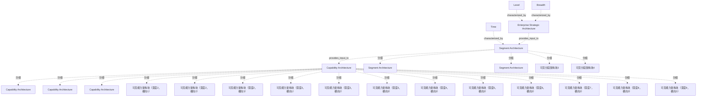

# G188/fig2-1 · 企业架构的层级（TOGAF 架构全景摘要分类模型）

类型：`architecture-concept-or-system-model`。把 TOGAF 的架构全景分类模型压缩成一张透视图，让读者在讨论架构项目范围时能说清“项目覆盖哪一层、多宽、看多长时间”，并支撑下文的结论：一个架构项目通常只覆盖其中一个层级。

英文 PDF 物理页：[20]。本页为架构语义分析，原文与原图分别保留。

## 原图与可编辑图


[完整 JSON](fig2-1.json) · [可编辑 Mermaid](fig2-1.mmd) · [仅关系图](fig2-1.relations.mmd) · [层级分解图](fig2-1.hierarchy.mmd)

图形重建表达语义，不复制源图布局。虚线表示解释、矩阵映射或分组关系，不自动表示不确定性的概率。



## 架构分析

先看三条轴：向右的 Time（时间）、向右上方的 Breadth（广度）、向下的 Level（层级）。再沿 Level 轴自上而下读三层：最上层是一整块黄色 Enterprise Strategic Architecture；中间绿色层由多个并排的 Segment Architecture 方块组成，并沿时间轴向后重复；最下紫色层是数量更多、体量更小的 Capability Architecture 方块。透视方向表示同一层在时间上可有多代、在广度上可有多块。

- 本图有 25 个具名或隐含元素、5 条关系和 19 条包含/分组记录。
- 包含/分组树最大深度为 1；根节点为 层级、广度、时间、企业战略架构、分段架构、能力架构。
- 本图没有可直接确认为人员直属汇报的关系；视觉上下位置、能力分解和治理职责分别读取。
- 轴文字与方向核对：Breadth斜向深处、Time水平向右、Level向下；修正历史把深度方向误称时间切片的表述。
- 1战略板、4可分辨分段块、15可分辨能力块保存为独立视觉实例；其中2分段标签和3能力标签可见。
- 遮挡的后排左侧实体数量不确定，不补满规则网格；多个小块不对应具体年份或成熟度值。
- 20页上下层提供输入，不证明逐一组成、权责或固定1:N基数。

### 如何用于项目

- 围绕作者目的读取本图实体、分组与连线，并用对应原文限定其含义。
- 把参考模型与项目事实分开，实际范围、约束、值和责任须有项目证据。

### 结构所表达的逻辑

- 企业架构全景有三个分类维度：层级（Level）、广度（Breadth）、时间（Time）；三者共同界定一个架构的范围。
- 层级自上而下为：企业战略架构（覆盖整个企业）→ 分段架构（覆盖企业的一个业务分段）→ 能力架构（覆盖单个业务能力，最详细）。
- 越往下层，架构数量越多、单块范围越小：图中战略层只有一块，分段层有多块，能力层方块最多、最小。
- 同一层沿时间轴向后重复排列，表示架构会随时间演进，存在多个时间切片（基线、过渡、目标等）。
- 正文据此指出：一个架构项目通常恰好覆盖三个层级中的一个；战略层项目的架构通常是分段层项目的输入，分段层又为能力层提供输入。
- 颜色只区分层级（黄/绿/紫），图中没有图例；不应把颜色理解为成熟度或优先级。

## 上下级与包含

三层自上而下：企业战略架构（L1）→ 分段架构（L2）→ 能力架构（L3）。这是架构覆盖范围的层级包含关系（战略层最广、能力层最细），不是组织汇报关系。每条轴是独立的分类维度，不构成层级。

|父项|子项|层级类型|依据与解释|
|---|---|---|---|
|分段架构|可见分段架构块1|classified_under|按当前原图审校显式区分分类、包含与其他层级语义。|
|分段架构|可见分段架构块2|classified_under|按当前原图审校显式区分分类、包含与其他层级语义。|
|分段架构|可见分段架构块3|classified_under|按当前原图审校显式区分分类、包含与其他层级语义。|
|分段架构|可见分段架构块4|classified_under|按当前原图审校显式区分分类、包含与其他层级语义。|
|能力架构|可见能力架构块（深度1，横向1）|classified_under|按当前原图审校显式区分分类、包含与其他层级语义。|
|能力架构|可见能力架构块（深度1，横向2）|classified_under|按当前原图审校显式区分分类、包含与其他层级语义。|
|能力架构|可见能力架构块（深度1，横向3）|classified_under|按当前原图审校显式区分分类、包含与其他层级语义。|
|能力架构|可见能力架构块（深度2，横向1）|classified_under|按当前原图审校显式区分分类、包含与其他层级语义。|
|能力架构|可见能力架构块（深度2，横向2）|classified_under|按当前原图审校显式区分分类、包含与其他层级语义。|
|能力架构|可见能力架构块（深度2，横向3）|classified_under|按当前原图审校显式区分分类、包含与其他层级语义。|
|能力架构|可见能力架构块（深度3，横向1）|classified_under|按当前原图审校显式区分分类、包含与其他层级语义。|
|能力架构|可见能力架构块（深度3，横向2）|classified_under|按当前原图审校显式区分分类、包含与其他层级语义。|
|能力架构|可见能力架构块（深度3，横向3）|classified_under|按当前原图审校显式区分分类、包含与其他层级语义。|
|能力架构|可见能力架构块（深度4，横向3）|classified_under|按当前原图审校显式区分分类、包含与其他层级语义。|
|能力架构|可见能力架构块（深度5，横向3）|classified_under|按当前原图审校显式区分分类、包含与其他层级语义。|
|能力架构|可见能力架构块（深度6，横向3）|classified_under|按当前原图审校显式区分分类、包含与其他层级语义。|
|能力架构|可见能力架构块（深度7，横向3）|classified_under|按当前原图审校显式区分分类、包含与其他层级语义。|
|能力架构|可见能力架构块（深度8，横向3）|classified_under|按当前原图审校显式区分分类、包含与其他层级语义。|
|能力架构|可见能力架构块（深度9，横向3）|classified_under|按当前原图审校显式区分分类、包含与其他层级语义。|

## 全部元素与角色

|元素ID|原文名称|类型|含义|直接父项|深度|
|---|---|---|---|---|---|
|level_axis|Level|concept|分类维度：架构覆盖的层级，向下由战略到能力。|—||
|breadth_axis|Breadth|concept|分类维度：架构覆盖的广度。|—||
|time_axis|Time|concept|分类维度：架构覆盖的时间跨度/时间切片。|—||
|enterprise_strategic_architecture|Enterprise Strategic Architecture|architecture|覆盖整个企业的高层架构。|—||
|segment_architecture|Segment Architecture|index|该层的概念汇总索引，源图中的重复出现单独建模；不把汇总索引当成唯一可见方块。|—||
|capability_architecture|Capability Architecture|index|该层的概念汇总索引，源图中的重复出现单独建模；不把汇总索引当成唯一可见方块。|—||
|segment_visible_1|Segment Architecture|architecture|仅列可分辨的可见实例；其他被战略板/前层遮住部分不补造数量。|分段架构|1|
|segment_visible_2|Segment Architecture|architecture|仅列可分辨的可见实例；其他被战略板/前层遮住部分不补造数量。|分段架构|1|
|segment_visible_3|可见分段架构块3|architecture|仅列可分辨的可见实例；其他被战略板/前层遮住部分不补造数量。|分段架构|1|
|segment_visible_4|可见分段架构块4|architecture|仅列可分辨的可见实例；其他被战略板/前层遮住部分不补造数量。|分段架构|1|
|capability_visible_d1_c1|Capability Architecture|architecture|前3排各可分辨3块（后2排左/中块仅顶面）；更深6排只记录可见右块，遮挡后的数量不推定。|能力架构|1|
|capability_visible_d1_c2|Capability Architecture|architecture|前3排各可分辨3块（后2排左/中块仅顶面）；更深6排只记录可见右块，遮挡后的数量不推定。|能力架构|1|
|capability_visible_d1_c3|Capability Architecture|architecture|前3排各可分辨3块（后2排左/中块仅顶面）；更深6排只记录可见右块，遮挡后的数量不推定。|能力架构|1|
|capability_visible_d2_c1|可见能力架构块（深度2，横向1）|architecture|前3排各可分辨3块（后2排左/中块仅顶面）；更深6排只记录可见右块，遮挡后的数量不推定。|能力架构|1|
|capability_visible_d2_c2|可见能力架构块（深度2，横向2）|architecture|前3排各可分辨3块（后2排左/中块仅顶面）；更深6排只记录可见右块，遮挡后的数量不推定。|能力架构|1|
|capability_visible_d2_c3|可见能力架构块（深度2，横向3）|architecture|前3排各可分辨3块（后2排左/中块仅顶面）；更深6排只记录可见右块，遮挡后的数量不推定。|能力架构|1|
|capability_visible_d3_c1|可见能力架构块（深度3，横向1）|architecture|前3排各可分辨3块（后2排左/中块仅顶面）；更深6排只记录可见右块，遮挡后的数量不推定。|能力架构|1|
|capability_visible_d3_c2|可见能力架构块（深度3，横向2）|architecture|前3排各可分辨3块（后2排左/中块仅顶面）；更深6排只记录可见右块，遮挡后的数量不推定。|能力架构|1|
|capability_visible_d3_c3|可见能力架构块（深度3，横向3）|architecture|前3排各可分辨3块（后2排左/中块仅顶面）；更深6排只记录可见右块，遮挡后的数量不推定。|能力架构|1|
|capability_visible_d4_c3|可见能力架构块（深度4，横向3）|architecture|前3排各可分辨3块（后2排左/中块仅顶面）；更深6排只记录可见右块，遮挡后的数量不推定。|能力架构|1|
|capability_visible_d5_c3|可见能力架构块（深度5，横向3）|architecture|前3排各可分辨3块（后2排左/中块仅顶面）；更深6排只记录可见右块，遮挡后的数量不推定。|能力架构|1|
|capability_visible_d6_c3|可见能力架构块（深度6，横向3）|architecture|前3排各可分辨3块（后2排左/中块仅顶面）；更深6排只记录可见右块，遮挡后的数量不推定。|能力架构|1|
|capability_visible_d7_c3|可见能力架构块（深度7，横向3）|architecture|前3排各可分辨3块（后2排左/中块仅顶面）；更深6排只记录可见右块，遮挡后的数量不推定。|能力架构|1|
|capability_visible_d8_c3|可见能力架构块（深度8，横向3）|architecture|前3排各可分辨3块（后2排左/中块仅顶面）；更深6排只记录可见右块，遮挡后的数量不推定。|能力架构|1|
|capability_visible_d9_c3|可见能力架构块（深度9，横向3）|architecture|前3排各可分辨3块（后2排左/中块仅顶面）；更深6排只记录可见右块，遮挡后的数量不推定。|能力架构|1|

### 分段架构：属性

```json
{
  "visible_blocks": 2
}
```

### 能力架构：属性

```json
{
  "visible_blocks": 3
}
```

## 全部关系

三箭头只是坐标轴；无架构间关系连线。

|主体|语义关系|客体|显式线/隐式|原文标签|依据|
|---|---|---|---|---|---|
|层级|characterized_by|企业战略架构|solid|Level|箭头为Level向下、Breadth斜向右上、Time水平向右的坐标轴，不是指向某架构方块的业务连接。|
|广度|characterized_by|企业战略架构|solid|Breadth|箭头为Level向下、Breadth斜向右上、Time水平向右的坐标轴，不是指向某架构方块的业务连接。|
|时间|characterized_by|分段架构|solid|Time|箭头为Level向下、Breadth斜向右上、Time水平向右的坐标轴，不是指向某架构方块的业务连接。|
|企业战略架构|provides_input_to|分段架构|implicit||20页说战略级项目为分段项目提供输入、分段为能力项目提供输入；上下叠置不等于逐一业务组成。|
|分段架构|provides_input_to|能力架构|implicit||20页说战略级项目为分段项目提供输入、分段为能力项目提供输入；上下叠置不等于逐一业务组成。|

## 本轮语义修正

- 箭头为Level向下、Breadth斜向右上、Time水平向右的坐标轴，不是指向某架构方块的业务连接。
- 箭头为Level向下、Breadth斜向右上、Time水平向右的坐标轴，不是指向某架构方块的业务连接。
- 箭头为Level向下、Breadth斜向右上、Time水平向右的坐标轴，不是指向某架构方块的业务连接。
- 20页说战略级项目为分段项目提供输入、分段为能力项目提供输入；上下叠置不等于逐一业务组成。
- 20页说战略级项目为分段项目提供输入、分段为能力项目提供输入；上下叠置不等于逐一业务组成。

## 误读检查

- Time沿水平轴，Breadth沿斜向深度轴，不能互换。
- 重复块大小/数目是示意且有遮挡，不能推出实际企业数量、年份或规范性基数。
- 上下层项目提供输入，未逐一画出哪个Segment属于哪个战略单元。

## 原文证据

### [PDF 第 19 页](../../../documents/G188.md#page-19)

> An Architecture Project is an endeavor undertaken to define and describe the Enterprise Architecture to be implemented. In TOGAF terms, as shown in Figure 2-1, it encompasses all activities undertaken within the Phases A to F and Requirements Management of the ADM. Practically, it can be a stand- alone project or part of a larger effort (e.g., a program).
### [PDF 第 20 页](../../../documents/G188.md#page-20)

> Figure 2-1: Levels of Enterprise Architecture (the TOGAF Standard: Summary Classification Model for

## 来源与分析状态

所有元素/关系均有来源定位；未把历史解释重命名为本轮逐线视觉确认。源图与语义图是两种视图，布局不证明汇报或因果。

源 PDF SHA-256：`6e654af12a0bc034c7548d425a01123331ac9129c478a0bb957db89dd353dd29`。

源图记录：[原始解释与转录](../../../figures/G188/fig2-1.json)。

```json
{
  "quality": {
    "graph_integrity": "checked",
    "semantic_analysis": "typed-graph-and-context-analysis",
    "visual_review": "source-content-audited",
    "notice_zh": "所有元素/关系均有来源定位；未把历史解释重命名为本轮逐线视觉确认。源图与语义图是两种视图，布局不证明汇报或因果。"
  },
  "source_uncertainty": {
    "confidence": "high",
    "uncertainties_zh": [
      "原图分段层、能力层后方未加标签的方块数量无法精确计数，本分析只记录可见的带标签方块数并以“多个”描述其余。",
      "三个轴在原图中从左上角同一点引出，Level 与 Breadth 箭头的具体交点被战略层板遮挡，按视觉判断记录。"
    ],
    "analyzed_from": [
      "英文 PDF 第 20 页原图截图（含 2x2 放大分块）",
      "英文 PDF 第 19–21 页正文",
      "中文稿 G188e_架构项目管理.md 第 147–182 行及图内标签对照表 L154–L164",
      "figs/zh/g188e_fig2-1_zh.png 与 figs/g188e_fig2-1_en.png"
    ],
    "date": "2026-10-31"
  },
  "source_conflicts": []
}
```
