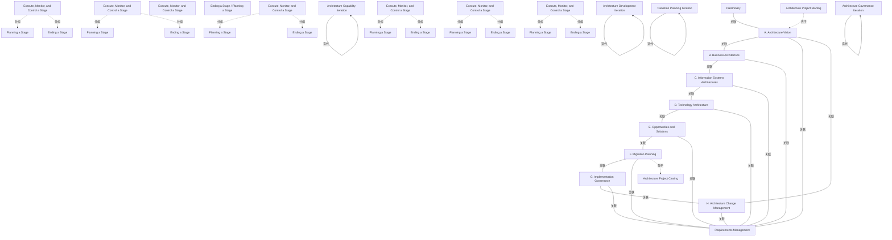

# G188/fig2-2 · 架构项目生命周期（从 TOGAF ADM 视角）

类型：`process-or-method-model`。说明“架构项目生命周期”不是一条直线，而是与 ADM 阶段叠合、可迭代的循环：项目启动对应预备到 A 之间，项目收尾对应 F 之后，阶段规划/执行监控/阶段收尾在每个 ADM 阶段边界重复，并用四个回路指出能力、开发、过渡规划与治理各自的迭代范围。

英文 PDF 物理页：[24]。本页为架构语义分析，原文与原图分别保留。

## 原图与可编辑图


[完整 JSON](fig2-2.json) · [可编辑 Mermaid](fig2-2.mmd) · [仅关系图](fig2-2.relations.mmd) · [层级分解图](fig2-2.hierarchy.mmd)

图形重建表达语义，不复制源图布局。虚线表示解释、矩阵映射或分组关系，不自动表示不确定性的概率。



## 架构分析

从顶部 Preliminary 开始，顺时针读 A→B→C→D→E→F→G→H。每个阶段圆之间的青绿色双带是阶段边界：左边一条“Ending a Stage”，右边一条“Planning a Stage”。最外圈黄色环是项目层活动：H 与 A 之间是 Architecture Project Starting，F 与 G 之间是 Architecture Project Closing，其余四段反复写 Execute, Monitor, and Control a Stage。再看深灰色闭合箭头：它们标出四个迭代回路，箭头方向表示回路回到起点。

- 本图有 36 个具名或隐含元素、23 条关系和 12 条包含/分组记录。
- 包含/分组树最大深度为 1；根节点为 预备阶段、阶段 A：架构愿景、阶段 B：业务架构、阶段 C：信息系统架构、阶段 D：技术架构、阶段 E：机会与解决方案、阶段 F：迁移规划、阶段 G：实施治理、阶段 H：架构变更管理、需求管理、架构项目启动、架构项目收尾、执行、监控与控制阶段、阶段收尾 / 规划阶段、架构能力迭代、架构开发迭代、过渡规划迭代、架构治理迭代、阶段执行、监控与控制（A扇区）、阶段执行、监控与控制（B扇区）、阶段执行、监控与控制（C扇区）、阶段执行、监控与控制（D扇区）、阶段执行、监控与控制（E扇区）、阶段执行、监控与控制（F扇区）。
- 本图没有可直接确认为人员直属汇报的关系；视觉上下位置、能力分解和治理职责分别读取。
- 包含分组后有 13 个连通分量；分离可能源于图例、并列分类或独立示例，未自动补边。
- ADM10圆、4具名迭代、启动/结束黄色区、6灰色执行扇区、6规划与6结束带均核对；补18个被聚合的重复出现。
- 不将具名循环箭头硬连到两个圆或当作通常的单向阶段边；灰色环线与径向青色管理带分开。
- 24页明确一阶段对应一个ADM phase只是简化，多数情况下不应如此；一个管理阶段可跨多phase并迭代。

### 如何用于项目

- 按阶段/事件/行为关系读取入口、出口、责任和产物；检查循环与例外路径。
- 工作流先后不表示组织管理权；在项目中显式记录条件和完成标准。

### 结构所表达的逻辑

- 架构项目阶段与 ADM 阶段不是一一对应：图中为简化才让每个项目阶段对应一个 ADM 阶段；正文明确多数情况下不应如此，一个阶段可覆盖多个 ADM 阶段并重复执行。
- 阶段边界是双向活动：结束当前阶段（Ending a Stage）之后紧接规划下一阶段（Planning a Stage），因此每个边界画成两条并排的青绿色带。
- 外环的 Execute, Monitor, and Control a Stage 沿圆周重复出现，表示执行监控不是某个阶段的专属步骤，而是贯穿整个项目阶段环。
- 项目启动发生在进入阶段 A 之前（H 与 A 之间的黄色扇区），项目收尾发生在阶段 F 之后（F 与 G 之间的黄色扇区）；G、H 仍画在圆盘上，但属于项目实施/运营侧。
- 四个迭代回路各有范围：能力迭代在预备与 A 之间，开发迭代覆盖 B–F，过渡规划迭代在 E–F，治理迭代在 G/H 与需求管理一侧；说明不同管理问题在不同粒度上循环。
- 需求管理位于圆心并与各阶段相连，是贯穿所有阶段与所有迭代的公共活动。

## 上下级与包含

三层同心结构：最内是中心需求管理；中间是八个 ADM 阶段圆（外加顶部的预备阶段）；最外是黄色项目阶段环与青绿色阶段边界带。项目启动/收尾是外环上的两个扇区，不是独立阶段圆。四个迭代回路是叠加在圆盘上的标注，不构成层级。

|父项|子项|层级类型|依据与解释|
|---|---|---|---|
|阶段执行、监控与控制（A扇区）|规划阶段（A对应边界）|classified_under|按当前原图审校显式区分分类、包含与其他层级语义。|
|阶段执行、监控与控制（A扇区）|结束阶段（A对应边界）|classified_under|按当前原图审校显式区分分类、包含与其他层级语义。|
|阶段执行、监控与控制（B扇区）|规划阶段（B对应边界）|classified_under|按当前原图审校显式区分分类、包含与其他层级语义。|
|阶段执行、监控与控制（B扇区）|结束阶段（B对应边界）|classified_under|按当前原图审校显式区分分类、包含与其他层级语义。|
|阶段执行、监控与控制（C扇区）|规划阶段（C对应边界）|classified_under|按当前原图审校显式区分分类、包含与其他层级语义。|
|阶段执行、监控与控制（C扇区）|结束阶段（C对应边界）|classified_under|按当前原图审校显式区分分类、包含与其他层级语义。|
|阶段执行、监控与控制（D扇区）|规划阶段（D对应边界）|classified_under|按当前原图审校显式区分分类、包含与其他层级语义。|
|阶段执行、监控与控制（D扇区）|结束阶段（D对应边界）|classified_under|按当前原图审校显式区分分类、包含与其他层级语义。|
|阶段执行、监控与控制（E扇区）|规划阶段（E对应边界）|classified_under|按当前原图审校显式区分分类、包含与其他层级语义。|
|阶段执行、监控与控制（E扇区）|结束阶段（E对应边界）|classified_under|按当前原图审校显式区分分类、包含与其他层级语义。|
|阶段执行、监控与控制（F扇区）|规划阶段（F对应边界）|classified_under|按当前原图审校显式区分分类、包含与其他层级语义。|
|阶段执行、监控与控制（F扇区）|结束阶段（F对应边界）|classified_under|按当前原图审校显式区分分类、包含与其他层级语义。|

## 全部元素与角色

|元素ID|原文名称|类型|含义|直接父项|深度|
|---|---|---|---|---|---|
|preliminary|Preliminary|phase|阶段：预备阶段|—||
|phase_a|A. Architecture Vision|phase|阶段：阶段 A：架构愿景|—||
|phase_b|B. Business Architecture|phase|阶段：阶段 B：业务架构|—||
|phase_c|C. Information Systems Architectures|phase|阶段：阶段 C：信息系统架构|—||
|phase_d|D. Technology Architecture|phase|阶段：阶段 D：技术架构|—||
|phase_e|E. Opportunities and Solutions|phase|阶段：阶段 E：机会与解决方案|—||
|phase_f|F. Migration Planning|phase|阶段：阶段 F：迁移规划|—||
|phase_g|G. Implementation Governance|phase|阶段：阶段 G：实施治理|—||
|phase_h|H. Architecture Change Management|phase|阶段：阶段 H：架构变更管理|—||
|requirements_management|Requirements Management|phase|阶段：需求管理|—||
|project_starting|Architecture Project Starting|phase|项目层活动，位于进入阶段 A 之前。|—||
|project_closing|Architecture Project Closing|phase|阶段：架构项目收尾|—||
|execute_monitor_control|Execute, Monitor, and Control a Stage|index|重复阶段文字的编辑性索引；实际六组文字/扇区分别建模。|—||
|stage_boundary|Ending a Stage / Planning a Stage|index|重复阶段文字的编辑性索引；实际六组文字/扇区分别建模。|—||
|architecture_capability_iteration|Architecture Capability Iteration|note|回路标注，对应深灰闭合箭头。|—||
|architecture_development_iteration|Architecture Development Iteration|note|大回路覆盖 B–F。|—||
|transition_planning_iteration|Transition Planning Iteration|note|说明：过渡规划迭代|—||
|architecture_governance_iteration|Architecture Governance Iteration|note|说明：架构治理迭代|—||
|stage_sector_a|Execute, Monitor, and Control a Stage|stage|扇区弧上重复出现的实际标签；图为了简化将阶段映射至ADM阶段，正文明确通常不应一一固定。|—||
|planning_stage_a|Planning a Stage|stage_boundary|6组边界的独立文字出现；相邻两扇区间为Ending/Planning双带，首尾各单带。|阶段执行、监控与控制（A扇区）|1|
|ending_stage_a|Ending a Stage|stage_boundary|6组边界的独立文字出现；相邻两扇区间为Ending/Planning双带，首尾各单带。|阶段执行、监控与控制（A扇区）|1|
|stage_sector_b|Execute, Monitor, and Control a Stage|stage|扇区弧上重复出现的实际标签；图为了简化将阶段映射至ADM阶段，正文明确通常不应一一固定。|—||
|planning_stage_b|Planning a Stage|stage_boundary|6组边界的独立文字出现；相邻两扇区间为Ending/Planning双带，首尾各单带。|阶段执行、监控与控制（B扇区）|1|
|ending_stage_b|Ending a Stage|stage_boundary|6组边界的独立文字出现；相邻两扇区间为Ending/Planning双带，首尾各单带。|阶段执行、监控与控制（B扇区）|1|
|stage_sector_c|Execute, Monitor, and Control a Stage|stage|扇区弧上重复出现的实际标签；图为了简化将阶段映射至ADM阶段，正文明确通常不应一一固定。|—||
|planning_stage_c|Planning a Stage|stage_boundary|6组边界的独立文字出现；相邻两扇区间为Ending/Planning双带，首尾各单带。|阶段执行、监控与控制（C扇区）|1|
|ending_stage_c|Ending a Stage|stage_boundary|6组边界的独立文字出现；相邻两扇区间为Ending/Planning双带，首尾各单带。|阶段执行、监控与控制（C扇区）|1|
|stage_sector_d|Execute, Monitor, and Control a Stage|stage|扇区弧上重复出现的实际标签；图为了简化将阶段映射至ADM阶段，正文明确通常不应一一固定。|—||
|planning_stage_d|Planning a Stage|stage_boundary|6组边界的独立文字出现；相邻两扇区间为Ending/Planning双带，首尾各单带。|阶段执行、监控与控制（D扇区）|1|
|ending_stage_d|Ending a Stage|stage_boundary|6组边界的独立文字出现；相邻两扇区间为Ending/Planning双带，首尾各单带。|阶段执行、监控与控制（D扇区）|1|
|stage_sector_e|Execute, Monitor, and Control a Stage|stage|扇区弧上重复出现的实际标签；图为了简化将阶段映射至ADM阶段，正文明确通常不应一一固定。|—||
|planning_stage_e|Planning a Stage|stage_boundary|6组边界的独立文字出现；相邻两扇区间为Ending/Planning双带，首尾各单带。|阶段执行、监控与控制（E扇区）|1|
|ending_stage_e|Ending a Stage|stage_boundary|6组边界的独立文字出现；相邻两扇区间为Ending/Planning双带，首尾各单带。|阶段执行、监控与控制（E扇区）|1|
|stage_sector_f|Execute, Monitor, and Control a Stage|stage|扇区弧上重复出现的实际标签；图为了简化将阶段映射至ADM阶段，正文明确通常不应一一固定。|—||
|planning_stage_f|Planning a Stage|stage_boundary|6组边界的独立文字出现；相邻两扇区间为Ending/Planning双带，首尾各单带。|阶段执行、监控与控制（F扇区）|1|
|ending_stage_f|Ending a Stage|stage_boundary|6组边界的独立文字出现；相邻两扇区间为Ending/Planning双带，首尾各单带。|阶段执行、监控与控制（F扇区）|1|

## 全部关系

阶段圆之间的细灰线表示 ADM 相邻阶段关系；中心到各阶段的放射线表示需求管理贯穿；青绿色径向双带表示阶段边界（Ending/Planning）；黄色外环的弧段表示项目层活动；深灰色带箭头的闭合曲线表示迭代回路，箭头指向回路的下一个位置。所有阶段连接线本身无箭头，循环方向由顺时针阅读给出。

|主体|语义关系|客体|显式线/隐式|原文标签|依据|
|---|---|---|---|---|---|
|预备阶段|关联|阶段 A：架构愿景|显式连线|Ending a Stage / Planning a Stage|ADM圆环连接没有箭头，灰色线与项目阶段扇区是不同编码；并非青色双带连接Preliminary→A。|
|阶段 A：架构愿景|关联|阶段 B：业务架构|显式连线|Ending a Stage / Planning a Stage|ADM圆环连接没有箭头，灰色线与项目阶段扇区是不同编码；并非青色双带连接Preliminary→A。|
|阶段 B：业务架构|关联|阶段 C：信息系统架构|显式连线|Ending a Stage / Planning a Stage|ADM圆环连接没有箭头，灰色线与项目阶段扇区是不同编码；并非青色双带连接Preliminary→A。|
|阶段 C：信息系统架构|关联|阶段 D：技术架构|显式连线|Ending a Stage / Planning a Stage|ADM圆环连接没有箭头，灰色线与项目阶段扇区是不同编码；并非青色双带连接Preliminary→A。|
|阶段 D：技术架构|关联|阶段 E：机会与解决方案|显式连线|Ending a Stage / Planning a Stage|ADM圆环连接没有箭头，灰色线与项目阶段扇区是不同编码；并非青色双带连接Preliminary→A。|
|阶段 E：机会与解决方案|关联|阶段 F：迁移规划|显式连线|Ending a Stage / Planning a Stage|ADM圆环连接没有箭头，灰色线与项目阶段扇区是不同编码；并非青色双带连接Preliminary→A。|
|阶段 F：迁移规划|关联|阶段 G：实施治理|显式连线|Ending a Stage|ADM圆环连接没有箭头，灰色线与项目阶段扇区是不同编码；并非青色双带连接Preliminary→A。|
|阶段 G：实施治理|关联|阶段 H：架构变更管理|显式连线||ADM圆环连接没有箭头，灰色线与项目阶段扇区是不同编码；并非青色双带连接Preliminary→A。|
|阶段 H：架构变更管理|关联|阶段 A：架构愿景|显式连线||ADM圆环连接没有箭头，灰色线与项目阶段扇区是不同编码；并非青色双带连接Preliminary→A。|
|阶段 A：架构愿景|关联|需求管理|显式连线||关联|
|阶段 B：业务架构|关联|需求管理|显式连线||关联|
|阶段 C：信息系统架构|关联|需求管理|显式连线||关联|
|阶段 D：技术架构|关联|需求管理|显式连线||关联|
|阶段 E：机会与解决方案|关联|需求管理|显式连线||关联|
|阶段 F：迁移规划|关联|需求管理|显式连线||关联|
|阶段 G：实施治理|关联|需求管理|显式连线||关联|
|阶段 H：架构变更管理|关联|需求管理|显式连线||关联|
|架构项目启动|先于|阶段 A：架构愿景|solid||黄色启动/结束扇区以位置表达生命周期范围，无独立阶段间箭头。|
|阶段 F：迁移规划|先于|架构项目收尾|solid||黄色启动/结束扇区以位置表达生命周期范围，无独立阶段间箭头。|
|架构能力迭代|迭代|架构能力迭代|显式连线|Architecture Capability Iteration|灰色/黑色循环箭头是相应Iteration的循环图形，不直接连接旧记录的两个ADM圆。按具名迭代图形自循环保存，不臆造阶段端点。|
|架构开发迭代|迭代|架构开发迭代|显式连线|Architecture Development Iteration|灰色/黑色循环箭头是相应Iteration的循环图形，不直接连接旧记录的两个ADM圆。按具名迭代图形自循环保存，不臆造阶段端点。|
|过渡规划迭代|迭代|过渡规划迭代|显式连线|Transition Planning Iteration|灰色/黑色循环箭头是相应Iteration的循环图形，不直接连接旧记录的两个ADM圆。按具名迭代图形自循环保存，不臆造阶段端点。|
|架构治理迭代|迭代|架构治理迭代|显式连线|Architecture Governance Iteration|灰色/黑色循环箭头是相应Iteration的循环图形，不直接连接旧记录的两个ADM圆。按具名迭代图形自循环保存，不臆造阶段端点。|

## 本轮语义修正

- ADM圆环连接没有箭头，灰色线与项目阶段扇区是不同编码；并非青色双带连接Preliminary→A。
- ADM圆环连接没有箭头，灰色线与项目阶段扇区是不同编码；并非青色双带连接Preliminary→A。
- ADM圆环连接没有箭头，灰色线与项目阶段扇区是不同编码；并非青色双带连接Preliminary→A。
- ADM圆环连接没有箭头，灰色线与项目阶段扇区是不同编码；并非青色双带连接Preliminary→A。
- ADM圆环连接没有箭头，灰色线与项目阶段扇区是不同编码；并非青色双带连接Preliminary→A。
- ADM圆环连接没有箭头，灰色线与项目阶段扇区是不同编码；并非青色双带连接Preliminary→A。
- ADM圆环连接没有箭头，灰色线与项目阶段扇区是不同编码；并非青色双带连接Preliminary→A。
- ADM圆环连接没有箭头，灰色线与项目阶段扇区是不同编码；并非青色双带连接Preliminary→A。
- ADM圆环连接没有箭头，灰色线与项目阶段扇区是不同编码；并非青色双带连接Preliminary→A。
- 黄色启动/结束扇区以位置表达生命周期范围，无独立阶段间箭头。
- 黄色启动/结束扇区以位置表达生命周期范围，无独立阶段间箭头。
- 灰色/黑色循环箭头是相应Iteration的循环图形，不直接连接旧记录的两个ADM圆。按具名迭代图形自循环保存，不臆造阶段端点。
- 灰色/黑色循环箭头是相应Iteration的循环图形，不直接连接旧记录的两个ADM圆。按具名迭代图形自循环保存，不臆造阶段端点。
- 灰色/黑色循环箭头是相应Iteration的循环图形，不直接连接旧记录的两个ADM圆。按具名迭代图形自循环保存，不臆造阶段端点。
- 灰色/黑色循环箭头是相应Iteration的循环图形，不直接连接旧记录的两个ADM圆。按具名迭代图形自循环保存，不臆造阶段端点。

## 误读检查

- 不要把青色“Ending a Stage / Planning a Stage”带理解为 ADM 阶段之间的额外阶段；它是每个阶段边界处要做的两项管理活动。
- 不要以为项目阶段一定等于 ADM 阶段；原图注明这是简化假设。
- 不要把 G、H 排除在圆盘之外：它们仍属于 ADM 循环，只是在架构项目范围之外（见图 1-1）。
- 中文稿引用的 figs/g188_fig2-2.svg 是线性六步图，没有圆盘、阶段边界带和四个迭代回路，不能据它理解本图。

## 原文证据

### [PDF 第 23 页](../../../documents/G188.md#page-23)

> The above sequence forms an Architecture Project lifecycle, which is used as the basic structure to discuss Architecture Project Management in this document. This lifecycle maps into the TOGAF ADM (which describes architecture development phases and steps). It can be represented by Figure 2-2.
### [PDF 第 24 页](../../../documents/G188.md#page-24)

> Figure 2-2: Architecture Project Lifecycle from the TOGAF ADM Perspective
> High-level mapping of the Architecture Project lifecycle to the TOGAF ADM phases and Project Management methods is presented in Table 2-2. Please note that the TOGAF Standard focuses on architecture development activities in the Architecture Project, and Project Management methods focus on managing successful execution of this endeavor.
> Table 2-2: Architecture Project Lifecycle Mapped to the TOGAF ADM and Project Management Methods

## 来源与分析状态

所有元素/关系均有来源定位；未把历史解释重命名为本轮逐线视觉确认。源图与语义图是两种视图，布局不证明汇报或因果。

源 PDF SHA-256：`6e654af12a0bc034c7548d425a01123331ac9129c478a0bb957db89dd353dd29`。

源图记录：[原始解释与转录](../../../figures/G188/fig2-2.json)。

```json
{
  "quality": {
    "graph_integrity": "checked",
    "semantic_analysis": "typed-graph-and-context-analysis",
    "visual_review": "source-content-audited",
    "notice_zh": "所有元素/关系均有来源定位；未把历史解释重命名为本轮逐线视觉确认。源图与语义图是两种视图，布局不证明汇报或因果。"
  },
  "source_uncertainty": {
    "confidence": "medium",
    "uncertainties_zh": [
      "外环“Execute, Monitor, and Control a Stage”在圆周上重复四次，具体起止角度因文字沿弧线排布难以精确判断，本文按四个弧段记录。",
      "F–G 边界处只看到一条“Ending a Stage”带，另一条“Planning a Stage”被项目收尾扇区取代；原图较小，无法完全排除还有被遮挡的带。",
      "四个迭代回路的具体起止节点按箭头与位置判断，回路在圆盘上互相交叠，起止点可能有半个节点的误差。"
    ],
    "analyzed_from": [
      "英文 PDF 第 24 页原图截图（含 2x2 与 3x3 放大分块）",
      "英文 PDF 第 23–24 页正文",
      "中文稿 G188e_架构项目管理.md 第 197–228 行",
      "figs/g188_fig2-2.svg 文本内容"
    ],
    "date": "2026-10-31"
  },
  "source_conflicts": []
}
```
