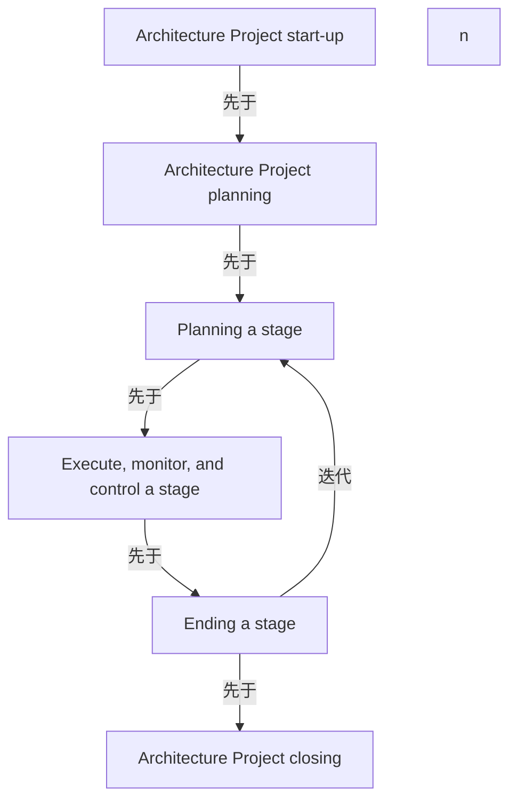

# G188/fig3-1 · 本节结构与架构项目流程（箭头）

类型：`process-or-method-model`。既作为第 3 章各小节的导航图（每个方框对应 3.1–3.6 中的一节），又用箭头说明这些活动之间的流程关系：启动与规划是一次性的，阶段级三项活动循环执行，循环结束后才进入项目收尾。

英文 PDF 物理页：[31]。本页为架构语义分析，原文与原图分别保留。

## 原图与可编辑图


[完整 JSON](fig3-1.json) · [可编辑 Mermaid](fig3-1.mmd) · [仅关系图](fig3-1.relations.mmd) · [层级分解图](fig3-1.hierarchy.mmd)

图形重建表达语义，不复制源图布局。虚线表示解释、矩阵映射或分组关系，不自动表示不确定性的概率。



## 架构分析

先读左列自上而下：架构项目启动 → 架构项目规划。规划完成后箭头向右进入右列，开始阶段级循环：阶段规划 → 执行、监控与控制阶段 → 阶段收尾；阶段收尾右侧的箭头向上折回阶段规划，旁标 n，表示对每个阶段重复。循环结束后，从阶段收尾向左下箭头进入架构项目收尾。

- 本图有 7 个具名或隐含元素、6 条关系和 0 条包含/分组记录。
- 本图没有可直接确认为人员直属汇报的关系；视觉上下位置、能力分解和治理职责分别读取。
- 包含分组后有 2 个连通分量；分离可能源于图例、并列分类或独立示例，未自动补边。
- 6流程框、n注记与6灰色箭头逐端点核对；stage ending既可返回planning又可进入closing。
- 右侧回路进入Planning a stage右边；左下箭头从Ending a stage指向Architecture Project closing，未反转。
- 31页列明流程范围与未详细覆盖的采购/成本等领域，本图不是全部项目管理知识领域。

### 如何用于项目

- 按阶段/事件/行为关系读取入口、出口、责任和产物；检查循环与例外路径。
- 工作流先后不表示组织管理权；在项目中显式记录条件和完成标准。

### 结构所表达的逻辑

- 项目启动与项目规划是项目级、一次性活动；阶段规划、执行监控、阶段收尾是阶段级、重复 n 次的活动。
- 阶段级循环的顺序是“先规划本阶段，再执行监控，最后收尾”，收尾后又回到下一阶段的规划。
- 架构项目收尾只在阶段循环结束后发生，且由“阶段收尾”触发，而不是与阶段收尾并行。
- 六个方框与第 3 章的 3.1–3.6 节一一对应，因此这张图也是本章的阅读路线图。
- 图中没有画 ADM 阶段；ADM 的对应关系在图 2-2 中用圆盘表达，这里只保留项目管理活动。

## 上下级与包含

两层：左列是项目级活动（启动、规划、收尾），右列是阶段级活动（阶段规划、执行监控、阶段收尾）。阶段级活动整体处于“项目规划之后、项目收尾之前”的时间段内，并通过 n 次回路重复；图中没有组织上下级。

|父项|子项|层级类型|依据与解释|
|---|---|---|---|
|—|—|无视觉包含|关系中明确的组成/特化见 JSON semantic_hierarchy。|

## 全部元素与角色

|元素ID|原文名称|类型|含义|直接父项|深度|
|---|---|---|---|---|---|
|start_up|Architecture Project start-up|phase|阶段：架构项目启动|—||
|project_planning|Architecture Project planning|phase|阶段：架构项目规划|—||
|project_closing|Architecture Project closing|phase|阶段：架构项目收尾|—||
|stage_planning|Planning a stage|process|流程：阶段规划|—||
|stage_execution|Execute, monitor, and control a stage|process|流程：执行、监控与控制阶段|—||
|stage_ending|Ending a stage|process|流程：阶段收尾|—||
|iteration_n|n|note|位于阶段循环箭头旁的次数符号，没有打印数值，不是第n个执行动作节点。|—||

### n（重复次数）：属性

```json
{
  "symbol": "n",
  "meaning": "repetition count unspecified"
}
```

## 全部关系

实线箭头表示流程先后：启动→规划、规划→阶段规划、阶段规划→执行监控→阶段收尾、阶段收尾→项目收尾。右侧折线箭头从阶段收尾回到阶段规划，表示循环，n 表示重复次数。没有虚线、没有并行分支。

|主体|语义关系|客体|显式线/隐式|原文标签|依据|
|---|---|---|---|---|---|
|架构项目启动|先于|架构项目规划|显式连线||先于|
|架构项目规划|先于|阶段规划|显式连线||先于|
|阶段规划|先于|执行、监控与控制阶段|显式连线||先于|
|执行、监控与控制阶段|先于|阶段收尾|显式连线||先于|
|阶段收尾|迭代|阶段规划|显式连线|n|右侧折线回路，表示对下一阶段重复规划—执行—收尾|
|阶段收尾|先于|架构项目收尾|显式连线||阶段循环结束后进入项目收尾|

## 误读检查

- 不要把“阶段规划”理解为规划某个 ADM 阶段；本文档中 stage 指项目阶段，一个项目阶段可覆盖多个 ADM 阶段。
- 不要以为架构项目收尾与阶段收尾是同一件事：阶段收尾每个阶段都做，项目收尾只在最后做一次。
- 不要把 n 理解为固定次数；它是“对每个阶段重复”的占位符号。
- 中文稿引用的重绘 SVG 增加了副标题和“说明”，阅读时不要把那些补充文字当作原图内容。

## 原文证据

### [PDF 第 31 页](../../../documents/G188.md#page-31)

> Figure 3-1: Structure of this Section and Architecture Project Flow (arrows)

## 来源与分析状态

所有元素/关系均有来源定位；未把历史解释重命名为本轮逐线视觉确认。源图与语义图是两种视图，布局不证明汇报或因果。

源 PDF SHA-256：`6e654af12a0bc034c7548d425a01123331ac9129c478a0bb957db89dd353dd29`。

源图记录：[原始解释与转录](../../../figures/G188/fig3-1.json)。

```json
{
  "quality": {
    "graph_integrity": "checked",
    "semantic_analysis": "typed-graph-and-context-analysis",
    "visual_review": "source-content-audited",
    "notice_zh": "所有元素/关系均有来源定位；未把历史解释重命名为本轮逐线视觉确认。源图与语义图是两种视图，布局不证明汇报或因果。"
  },
  "source_uncertainty": {
    "confidence": "high",
    "uncertainties_zh": [
      "原图左列“Architecture Project closing”与右列“Ending a stage”之间只有一条箭头，未标明是否需要先完成阶段收尾报告；本分析按箭头读为阶段收尾后进入项目收尾。",
      "n 回路在原图中从“Ending a stage”右侧折回“Planning a stage”右侧，是否同时经过“Architecture Project planning”无法从图中判断；按只回到阶段规划记录。"
    ],
    "analyzed_from": [
      "英文 PDF 第 31 页原图截图（含 2x2 放大分块）",
      "英文 PDF 第 31 页正文",
      "中文稿 G188e_架构项目管理.md 第 269–301 行及图内标签对照表 L287–L298",
      "figs/zh/g188e_fig3-1_zh.svg 源码与 figs/g188e_fig3-1_en.png"
    ],
    "date": "2026-10-31"
  },
  "source_conflicts": []
}
```
