# G188/fig3-2 · 基于 PRINCE2 方法的项目管理团队简化图

类型：`decomposition-or-organization-model`。用一张简化结构图说明项目经理并非独自工作：PRINCE2 的项目管理团队包含治理机构、项目管理、团队级管理与项目支持；并标出本文档哪几节分别覆盖这些部分，帮助架构师把团队角色对应到本指南章节。

英文 PDF 物理页：[40]。本页为架构语义分析，原文与原图分别保留。

## 原图与可编辑图


[完整 JSON](fig3-2.json) · [可编辑 Mermaid](fig3-2.mmd) · [仅关系图](fig3-2.relations.mmd) · [层级分解图](fig3-2.hierarchy.mmd)

图形重建表达语义，不复制源图布局。虚线表示解释、矩阵映射或分组关系，不自动表示不确定性的概率。

```mermaid
flowchart TB
  %% Semantic reconstruction; see original source image for exact layout.
  n0["Project Management Team"]
  n1["Governance"]
  n2["Project Management"]
  n3["Team-level Management"]
  n4["Project Support"]
  n5["Delivery"]
  n6["Covered in &quot;Governance in Architecture Projects&quot;"]
  n7["Covered in &quot;Project Manager&#x27;s Support in Architecture Projects&quot;"]
  n8["Covered in &quot;Project Manager&#x27;s Support in Architecture Projects&quot;"]
  n9["Covered in &quot;Delivery Team in Architecture Projects&quot;"]
  n0 -.->|"contains"| n1
  n0 -.->|"contains"| n2
  n0 -.->|"contains"| n3
  n0 -.->|"contains"| n4
  n6 -->|"关联"| n1
  n7 -->|"关联"| n3
  n8 -->|"关联"| n4
  n9 -->|"关联"| n5
  n2 -.-|"关联"| n1
  n3 -.-|"关联"| n2
  n0 -.->|"organization_partition"| n1
  n0 -.->|"organization_partition"| n2
  n0 -.->|"organization_partition"| n3
  n0 -.->|"organization_partition"| n4
```



## 架构分析

先看虚线大框“Project Management Team”：框内左上为 Governance，左中为 Project Management，左下为 Team-level Management，右侧大块为 Project Support。再看框外下方的 Delivery，它不属于项目管理团队。最后读三组带箭头的说明文字：左上箭头指向 Governance，左下箭头指向 Team-level Management，右侧箭头指向 Project Support，分别说明这些部分在本指南哪一节讲述。

- 本图有 10 个具名或隐含元素、10 条关系和 4 条包含/分组记录。
- 包含/分组树最大深度为 1；根节点为 项目管理团队、交付、见“架构项目中的治理”一节、见“架构项目中项目经理的支持”一节、见“架构项目中项目经理的支持”一节、见“架构项目中的交付团队”一节。
- 本图没有可直接确认为人员直属汇报的关系；视觉上下位置、能力分解和治理职责分别读取。
- 包含分组后有 2 个连通分量；分离可能源于图例、并列分类或独立示例，未自动补边。
- 10节点/注记与4青色注释箭头完整，Project Support跨两层；Delivery在管理团队外。
- 4箭头对应章节覆盖说明，不是任务或管理权责流；右箭头由右注释指向左边支持块。
- 40页是PRINCE2项目管理团队口径，且明确PMBOK团队不含治理机构，不能泛化为两方法统一人事架构。

### 如何用于项目

- 按父项展开所有直接子项，检查同层粒度、重叠和缺项。
- 保留组成、分类、能力分解与组织汇报的区别；将示例名称替换为已确认的项目对象。

### 结构所表达的逻辑

- PRINCE2 的“项目管理团队”是完整的项目管理结构，包含负责治理、管理与支持的机构，不等同于“项目团队”。
- Governance（治理）位于团队结构顶端，对应本指南“架构项目中的治理”一节；在 PRINCE2 中由指导委员会/执行发起人领导，在 TOGAF 中对应架构委员会。
- Project Management（项目管理）是项目经理直接负责的管理活动层，位于治理之下、团队级管理之上。
- Team-level Management（团队级管理）由团队经理承担，负责按项目工作包交付产品；对应本指南“项目经理的支持”一节。
- Project Support（项目支持）通常由项目管理办公室（PMO）承担，提供行政与运营支持及工具技术指导，也归入“项目经理的支持”一节。
- Delivery（交付）在虚线框之外，是实际执行架构工作的人员，对应本指南“架构项目中的交付团队”一节。
- 与 PMBOK 相比，PRINCE2 的项目管理团队明确包含治理机构；PMBOK 的项目管理团队只限管理与领导活动，治理由发起人/指导委员会在团队之外提供。

## 上下级与包含

三层：最外是项目治理（Governance）；中间是项目管理（Project Management）；其下是团队级管理（Team-level Management）与项目支持（Project Support），二者并列。交付（Delivery）不属于项目管理团队，位于虚线框外下方，是被管理/被支持的对象。视觉上 Governance 在最上、Project Management 居中、Team-level Management 在下，Project Support 占右侧整列。

|父项|子项|层级类型|依据与解释|
|---|---|---|---|
|项目管理团队|治理|organization_partition|组织单元的组成/分区；此处不自动证明岗位直属汇报。|
|项目管理团队|项目管理|organization_partition|组织单元的组成/分区；此处不自动证明岗位直属汇报。|
|项目管理团队|团队级管理|organization_partition|组织单元的组成/分区；此处不自动证明岗位直属汇报。|
|项目管理团队|项目支持|organization_partition|组织单元的组成/分区；此处不自动证明岗位直属汇报。|

## 全部元素与角色

|元素ID|原文名称|类型|含义|直接父项|深度|
|---|---|---|---|---|---|
|pm_team|Project Management Team|organization_unit|PRINCE2 的完整项目管理结构范围。|—||
|governance|Governance|organization_unit|组织单元：治理|项目管理团队|1|
|project_management|Project Management|organization_unit|组织单元：项目管理|项目管理团队|1|
|team_level_management|Team-level Management|organization_unit|组织单元：团队级管理|项目管理团队|1|
|project_support|Project Support|organization_unit|组织单元：项目支持|项目管理团队|1|
|delivery|Delivery|organization_unit|交付团队，不属于项目管理团队。|—||
|note_governance|Covered in "Governance in Architecture Projects"|note|说明：见“架构项目中的治理”一节|—||
|note_pm_support_left|Covered in "Project Manager's Support in Architecture Projects"|note|说明：见“架构项目中项目经理的支持”一节|—||
|note_pm_support_right|Covered in "Project Manager's Support in Architecture Projects"|note|说明：见“架构项目中项目经理的支持”一节|—||
|note_delivery|Covered in "Delivery Team in Architecture Projects"|note|说明：见“架构项目中的交付团队”一节|—||

## 全部关系

虚线大框表示“项目管理团队”的成员范围（包含关系），框内四个色块是组成部分，色块之间没有连线，上下位置只表示治理—管理—团队管理的层次。框外三条实心箭头是注释引线，不是流程：左侧两条分别指向 Governance 与 Team-level Management，右侧一条指向 Project Support，箭头表示“这一部分在本指南某节讲述”。Delivery 与虚线框之间没有连线，表示它不在团队内。

|主体|语义关系|客体|显式线/隐式|原文标签|依据|
|---|---|---|---|---|---|
|项目管理团队|contains|治理|dashed||虚线外框的范围包含，不是组成箭头。|
|项目管理团队|contains|项目管理|dashed||虚线外框的范围包含，不是组成箭头。|
|项目管理团队|contains|团队级管理|dashed||虚线外框的范围包含，不是组成箭头。|
|项目管理团队|contains|项目支持|dashed||虚线外框的范围包含，不是组成箭头。|
|见“架构项目中的治理”一节|关联|治理|显式连线||说明文字用箭头指向 Governance|
|见“架构项目中项目经理的支持”一节|关联|团队级管理|显式连线||关联|
|见“架构项目中项目经理的支持”一节|关联|项目支持|显式连线||箭头画面朝左，但语义从右侧注释指向Project Support；不得因朝左把端点方向反转。|
|见“架构项目中的交付团队”一节|关联|交付|显式连线||关联|
|项目管理|关联|治理|implicit||治理/项目管理/团队管理框上下排列无汇报连线；文本说明管理支持关系，但图不足以确认人员直属汇报。|
|团队级管理|关联|项目管理|implicit||治理/项目管理/团队管理框上下排列无汇报连线；文本说明管理支持关系，但图不足以确认人员直属汇报。|

## 本轮语义修正

- 虚线外框的范围包含，不是组成箭头。
- 虚线外框的范围包含，不是组成箭头。
- 虚线外框的范围包含，不是组成箭头。
- 虚线外框的范围包含，不是组成箭头。
- 箭头画面朝左，但语义从右侧注释指向Project Support；不得因朝左把端点方向反转。
- 治理/项目管理/团队管理框上下排列无汇报连线；文本说明管理支持关系，但图不足以确认人员直属汇报。
- 治理/项目管理/团队管理框上下排列无汇报连线；文本说明管理支持关系，但图不足以确认人员直属汇报。

## 误读检查

- 不要把 Delivery 算进项目管理团队：它画在虚线框外，是交付团队。
- 不要以为 Project Support 与 Team-level Management 有上下级关系：二者在图中并列，分别面向支持与团队管理。
- 不要把 Governance 理解为项目经理之上的另一个项目经理；它是治理机构（指导委员会/执行发起人，TOGAF 中为架构委员会）。
- 图中的色块大小不代表人数或工作量，只用于容纳标签。

## 原文证据

### [PDF 第 40 页](../../../documents/G188.md#page-40)

> Figure 3-2: Simplified Chart Representing Model Project Team Based on the PRINCE2 Method

## 来源与分析状态

所有元素/关系均有来源定位；未把历史解释重命名为本轮逐线视觉确认。源图与语义图是两种视图，布局不证明汇报或因果。

源 PDF SHA-256：`6e654af12a0bc034c7548d425a01123331ac9129c478a0bb957db89dd353dd29`。

源图记录：[原始解释与转录](../../../figures/G188/fig3-2.json)。

```json
{
  "quality": {
    "graph_integrity": "checked",
    "semantic_analysis": "typed-graph-and-context-analysis",
    "visual_review": "source-content-audited",
    "notice_zh": "所有元素/关系均有来源定位；未把历史解释重命名为本轮逐线视觉确认。源图与语义图是两种视图，布局不证明汇报或因果。"
  },
  "source_uncertainty": {
    "confidence": "high",
    "uncertainties_zh": [
      "原图为纯色块，Project Management 与其余三块颜色略有差异（浅灰蓝 vs 深蓝），图中无图例，此处按色差推断项目管理层为独立一层，未赋予额外含义。",
      "左侧下方箭头在视觉上落在 Project Management 与 Team-level Management 之间，本文按文字“Project Manager's Support”判为指向 Team-level Management；Project Support 也由同一节覆盖。"
    ],
    "analyzed_from": [
      "英文 PDF 第 40 页原图截图（含 3x3 放大分块）",
      "英文 PDF 第 40 页正文",
      "中文稿 G188e_架构项目管理.md 第 454–517 行",
      "figs/g188e_fig3-2_en.png"
    ],
    "date": "2026-10-31"
  },
  "source_conflicts": []
}
```
