# G188/fig3-3 · 架构项目的最终交付物

类型：`decomposition-or-organization-model`。把“产品移交”说清楚：列出阶段 F 结束时架构项目必须交付的全部产品，说明它们如何组成更大的交付物（架构定义文档、实施与迁移计划）、如何作为实施项目的输入，以及哪些交付物会启动下一轮架构工作或架构能力改进。

英文 PDF 物理页：[74]。本页为架构语义分析，原文与原图分别保留。

## 原图与可编辑图


[完整 JSON](fig3-3.json) · [可编辑 Mermaid](fig3-3.mmd) · [仅关系图](fig3-3.relations.mmd) · [层级分解图](fig3-3.hierarchy.mmd)

图形重建表达语义，不复制源图布局。虚线表示解释、矩阵映射或分组关系，不自动表示不确定性的概率。

```mermaid
flowchart TB
  %% Semantic reconstruction; see original source image for exact layout.
  n0["F"]
  n1["Finalized Architecture Definition Document"]
  n2["Finalized Transition Architectures"]
  n3["Finalized Architecture Roadmap"]
  n4["Implementation Governance Model"]
  n5["Implementation and Migration Plan (Detailed)"]
  n6["Implementation and Migration Strategy"]
  n7["Project and Portfolio Breakdown of the Implementation"]
  n8["Project Charters (Optional)"]
  n9["Finalized Architecture Requirements Specification"]
  n10["Re-Usable Architecture Building Blocks"]
  n11["Requests for Architecture Work for a New Iteration of the ADM Cycle (If Any)"]
  n12["CR for the Architecture Capability Arising from Lessons Learned"]
  n13["Implementation"]
  n14["A (New Cycle)"]
  n15["A (New Capability Cycle)"]
  n16["Legend"]
  n17["Process Grouping Box"]
  n18["Process Name"]
  n19["Process Deliverable"]
  n20["Process Flow Dependency"]
  n21["Input Dependency"]
  n22["Product Delivery"]
  n23["Simplified Process Group"]
  n24["TOGAF ADM Phases B to F"]
  n0 -->|"产生/交付"| n1
  n0 -->|"产生/交付"| n3
  n0 -->|"产生/交付"| n4
  n0 -->|"产生/交付"| n5
  n0 -->|"产生/交付"| n9
  n0 -->|"产生/交付"| n10
  n0 -->|"产生/交付"| n11
  n0 -->|"产生/交付"| n12
  n1 -->|"聚合"| n2
  n5 -->|"聚合"| n6
  n5 -->|"聚合"| n7
  n5 -->|"聚合"| n8
  n2 -->|"input_to"| n13
  n3 -->|"input_to"| n13
  n4 -->|"input_to"| n13
  n9 -->|"input_to"| n13
  n10 -->|"input_to"| n13
  n11 -->|"触发"| n14
  n12 -->|"触发"| n15
  n1 -.->|"aggregation"| n2
  n5 -.->|"aggregation"| n6
  n5 -.->|"aggregation"| n7
  n5 -.->|"aggregation"| n8
  n16 -.->|"visual_containment_only"| n17
  n16 -.->|"visual_containment_only"| n18
  n16 -.->|"visual_containment_only"| n19
  n16 -.->|"visual_containment_only"| n20
  n16 -.->|"visual_containment_only"| n21
  n16 -.->|"visual_containment_only"| n22
  n16 -.->|"visual_containment_only"| n23
  n16 -.->|"visual_containment_only"| n24
```



## 架构分析

从左侧 F 圆开始向右读：虚线扇形指向八个交付物框，表示这些是阶段 F 的产出。注意两个空心菱形：上方菱形把“最终过渡架构”聚合进“最终架构定义文档”；中部菱形把“实施与迁移战略”“实施的项目与组合分解”“项目章程（可选）”聚合进“实施与迁移计划（详细）”。再沿点线向右，交付物作为输入进入“Implementation”（实施）。最下方两条点线分别把“新一轮 ADM 周期的架构工作请求”和“由经验教训产生的架构能力变更请求”送到两个 A 圆（新周期、新能力周期）。右下角图例解释线型与形状。

- 本图有 25 个具名或隐含元素、19 条关系和 12 条包含/分组记录。
- 包含/分组树最大深度为 1；根节点为 阶段 F、最终架构定义文档、最终架构路线图、实施治理模型、实施与迁移计划（详细）、最终架构需求规格说明书、可复用架构构建块、新一轮 ADM 周期的架构工作请求（如有）、由经验教训产生的架构能力变更请求、实施、阶段 A（新周期）、阶段 A（新能力周期）、图例。
- 本图没有可直接确认为人员直属汇报的关系；视觉上下位置、能力分解和治理职责分别读取。
- 包含分组后有 2 个连通分量；分离可能源于图例、并列分类或独立示例，未自动补边。
- 17历史元素+8图例项完整复核；8条F产品交付虚线、4空菱形聚合、5总线输入和2新A周期输入。
- 修正总线最上方输入起点为Finalized Transition Architectures；拒绝未画出的详细迁移计划→Implementation边。
- 共同总线前段点线、最终向Implementation一段长虚线，按源样式分别描述，不统一改画实线。
- 架构工作请求与能力改进CR分别通往不同的新A周期；Project Charters明确Optional，前者请求明确If Any。

### 如何用于项目

- 按父项展开所有直接子项，检查同层粒度、重叠和缺项。
- 保留组成、分类、能力分解与组织汇报的区别；将示例名称替换为已确认的项目对象。

### 结构所表达的逻辑

- 阶段 F 的最终交付物有八项：架构定义文档、架构路线图、实施治理模型、实施与迁移计划（详细）、架构需求规格说明书、可复用架构构建块、新一轮架构工作请求（如有）、架构能力变更请求。
- 最终过渡架构不是独立交付物，而是最终架构定义文档的组成部分（空心菱形聚合）。
- 实施与迁移计划（详细）由三部分组成：实施与迁移战略、实施的项目与组合分解、项目章程（可选）；项目章程可选，说明并非每次移交都要成立实施项目。
- 全部交付物最终作为实施组织（Implementation）的输入；图中用点线表示输入依赖，用虚线表示产品交付，两者含义不同。
- 架构项目可以产生“新一轮 ADM 周期的架构工作请求”，把成果反馈到阶段 A，形成新的架构迭代。
- 由经验教训产生的架构能力变更请求进入“新能力周期”的阶段 A，改进的是架构能力本身而非某个架构。
- 图例还定义了 Process Flow Dependency（实线箭头）、Simplified Process Group（粗蓝箭头）与 Process Grouping Box/Process Name/Process Deliverable，但本图实际只用到文档形状、聚合菱形、虚线与点线。

## 上下级与包含

三层：阶段 F 是产出源；八个交付物是 L1；其中架构定义文档与实施与迁移计划各自聚合 L2 子交付物（过渡架构；战略、分解、项目章程）。实施与新周期 A 是交付物的下游接收者，不是子节点。

|父项|子项|层级类型|依据与解释|
|---|---|---|---|
|最终架构定义文档|最终过渡架构|aggregation|由空心菱形关系表达文档聚合，不是子文档在父文档形状内的视觉包含。|
|实施与迁移计划（详细）|实施与迁移战略|aggregation|由空心菱形关系表达文档聚合，不是子文档在父文档形状内的视觉包含。|
|实施与迁移计划（详细）|实施的项目与组合分解|aggregation|由空心菱形关系表达文档聚合，不是子文档在父文档形状内的视觉包含。|
|实施与迁移计划（详细）|项目章程（可选）|aggregation|由空心菱形关系表达文档聚合，不是子文档在父文档形状内的视觉包含。|
|图例|矩形分组框|visual_containment_only|保存原图解释中的包含；业务关系类型需要图例或正文进一步限定。|
|图例|两侧双竖线过程框|visual_containment_only|保存原图解释中的包含；业务关系类型需要图例或正文进一步限定。|
|图例|波浪底文档|visual_containment_only|保存原图解释中的包含；业务关系类型需要图例或正文进一步限定。|
|图例|实线箭头|visual_containment_only|保存原图解释中的包含；业务关系类型需要图例或正文进一步限定。|
|图例|点线箭头|visual_containment_only|保存原图解释中的包含；业务关系类型需要图例或正文进一步限定。|
|图例|长虚线箭头|visual_containment_only|保存原图解释中的包含；业务关系类型需要图例或正文进一步限定。|
|图例|蓝色粗箭头|visual_containment_only|保存原图解释中的包含；业务关系类型需要图例或正文进一步限定。|
|图例|圆形|visual_containment_only|保存原图解释中的包含；业务关系类型需要图例或正文进一步限定。|

### 业务组成与特化

|父项/范围/类型|子项/责任对象/实例|语义|
|---|---|---|
|最终架构定义文档|最终过渡架构|aggregation|
|实施与迁移计划（详细）|实施与迁移战略|aggregation|
|实施与迁移计划（详细）|实施的项目与组合分解|aggregation|
|实施与迁移计划（详细）|项目章程（可选）|aggregation|

## 全部元素与角色

|元素ID|原文名称|类型|含义|直接父项|深度|
|---|---|---|---|---|---|
|phase_f|F|phase|阶段：阶段 F|—||
|final_add|Finalized Architecture Definition Document|artifact|制品：最终架构定义文档|—||
|final_transition_arch|Finalized Transition Architectures|artifact|制品：最终过渡架构|最终架构定义文档|1|
|final_roadmap|Finalized Architecture Roadmap|artifact|制品：最终架构路线图|—||
|governance_model|Implementation Governance Model|artifact|制品：实施治理模型|—||
|im_plan|Implementation and Migration Plan (Detailed)|artifact|制品：实施与迁移计划（详细）|—||
|im_strategy|Implementation and Migration Strategy|artifact|制品：实施与迁移战略|实施与迁移计划（详细）|1|
|portfolio_breakdown|Project and Portfolio Breakdown of the Implementation|artifact|制品：实施的项目与组合分解|实施与迁移计划（详细）|1|
|project_charters|Project Charters (Optional)|artifact|制品：项目章程（可选）|实施与迁移计划（详细）|1|
|requirements_spec|Finalized Architecture Requirements Specification|artifact|制品：最终架构需求规格说明书|—||
|reusable_abbs|Re-Usable Architecture Building Blocks|artifact|制品：可复用架构构建块|—||
|raw_request|Requests for Architecture Work for a New Iteration of the ADM Cycle (If Any)|artifact|制品：新一轮 ADM 周期的架构工作请求（如有）|—||
|capability_cr|CR for the Architecture Capability Arising from Lessons Learned|artifact|制品：由经验教训产生的架构能力变更请求|—||
|implementation|Implementation|organization_unit|接收交付物的实施组织/项目。|—||
|new_cycle_a|A (New Cycle)|phase|阶段：阶段 A（新周期）|—||
|new_capability_a|A (New Capability Cycle)|phase|阶段：阶段 A（新能力周期）|—||
|legend_box|Legend|note|说明：图例|—||
|legend_grouping|Process Grouping Box|legend_symbol|图例示例，不是另一个业务节点。|图例|1|
|legend_process|Process Name|legend_symbol|图例示例，不是另一个业务节点。|图例|1|
|legend_deliverable|Process Deliverable|legend_symbol|图例示例，不是另一个业务节点。|图例|1|
|legend_process_dependency|Process Flow Dependency|legend_symbol|图例示例，不是另一个业务节点。|图例|1|
|legend_input_dependency|Input Dependency|legend_symbol|图例示例，不是另一个业务节点。|图例|1|
|legend_product_delivery|Product Delivery|legend_symbol|图例示例，不是另一个业务节点。|图例|1|
|legend_simplified|Simplified Process Group|legend_symbol|图例示例，不是另一个业务节点。|图例|1|
|legend_adm_phases|TOGAF ADM Phases B to F|legend_symbol|图例示例，不是另一个业务节点。|图例|1|

### 矩形分组框：属性

```json
{
  "is_legend": true
}
```

### 两侧双竖线过程框：属性

```json
{
  "is_legend": true
}
```

### 波浪底文档：属性

```json
{
  "is_legend": true
}
```

### 实线箭头：属性

```json
{
  "is_legend": true
}
```

### 点线箭头：属性

```json
{
  "is_legend": true
}
```

### 长虚线箭头：属性

```json
{
  "is_legend": true
}
```

### 蓝色粗箭头：属性

```json
{
  "is_legend": true
}
```

### 圆形：属性

```json
{
  "is_legend": true
}
```

## 全部关系

虚线箭头（Product Delivery）表示 F 产出交付物、以及交付物交付给实施；点线箭头（Input Dependency）表示交付物作为实施的输入、以及请求类交付物触发新的 A 阶段；实线 + 空心菱形表示聚合（菱形在整体一端）。图中没有流程先后线，左右位置表示“产出→接收”。

|主体|语义关系|客体|显式线/隐式|原文标签|依据|
|---|---|---|---|---|---|
|阶段 F|产生/交付|最终架构定义文档|显式连线||虚线产品交付|
|阶段 F|产生/交付|最终架构路线图|显式连线||产生/交付|
|阶段 F|产生/交付|实施治理模型|显式连线||产生/交付|
|阶段 F|产生/交付|实施与迁移计划（详细）|显式连线||产生/交付|
|阶段 F|产生/交付|最终架构需求规格说明书|显式连线||产生/交付|
|阶段 F|产生/交付|可复用架构构建块|显式连线||产生/交付|
|阶段 F|产生/交付|新一轮 ADM 周期的架构工作请求（如有）|显式连线||产生/交付|
|阶段 F|产生/交付|由经验教训产生的架构能力变更请求|显式连线||产生/交付|
|最终架构定义文档|聚合|最终过渡架构|显式连线||空心菱形在架构定义文档一端，表示文档聚合过渡架构|
|实施与迁移计划（详细）|聚合|实施与迁移战略|显式连线||空心菱形在计划一端|
|实施与迁移计划（详细）|聚合|实施的项目与组合分解|显式连线||聚合|
|实施与迁移计划（详细）|聚合|项目章程（可选）|显式连线||聚合|
|最终过渡架构|input_to|实施|显式连线||上方点线明确从Finalized Transition Architectures右侧接总线，不是其左边Definition Document。|
|最终架构路线图|input_to|实施|显式连线||交付物点线输入到右侧共同总线，由总线末段虚线箭头指向Implementation；不将交付物写作消耗实施过程。|
|实施治理模型|input_to|实施|显式连线||交付物点线输入到右侧共同总线，由总线末段虚线箭头指向Implementation；不将交付物写作消耗实施过程。|
|最终架构需求规格说明书|input_to|实施|显式连线||交付物点线输入到右侧共同总线，由总线末段虚线箭头指向Implementation；不将交付物写作消耗实施过程。|
|可复用架构构建块|input_to|实施|显式连线||交付物点线输入到右侧共同总线，由总线末段虚线箭头指向Implementation；不将交付物写作消耗实施过程。|
|新一轮 ADM 周期的架构工作请求（如有）|触发|阶段 A（新周期）|显式连线||点线箭头指向 A（新周期）|
|由经验教训产生的架构能力变更请求|触发|阶段 A（新能力周期）|显式连线||点线箭头指向 A（新能力周期）|

## 本轮否定的历史关系

以下旧解释保留用于追溯，不进入当前关系图、层级或知识图谱的有效边。

|旧记录|主体|旧关系|客体|否定依据|
|---|---|---|---|---|
|17|实施与迁移计划（详细）|produces|实施|Implementation and Migration Plan的右侧实线只聚合三个子文档，没有线接到右侧Implementation总线；不可仅因用途合理补边。|

## 本轮语义修正

- 上方点线明确从Finalized Transition Architectures右侧接总线，不是其左边Definition Document。
- 交付物点线输入到右侧共同总线，由总线末段虚线箭头指向Implementation；不将交付物写作消耗实施过程。
- 交付物点线输入到右侧共同总线，由总线末段虚线箭头指向Implementation；不将交付物写作消耗实施过程。
- 交付物点线输入到右侧共同总线，由总线末段虚线箭头指向Implementation；不将交付物写作消耗实施过程。
- 交付物点线输入到右侧共同总线，由总线末段虚线箭头指向Implementation；不将交付物写作消耗实施过程。
- Implementation and Migration Plan的右侧实线只聚合三个子文档，没有线接到右侧Implementation总线；不可仅因用途合理补边。

## 误读检查

- 不要把“最终过渡架构”当作与架构定义文档并列的独立交付物：菱形表示它被聚合进架构定义文档。
- 不要把项目章程当作必选项：图中明确标注 (Optional)。
- 不要把两个 A 圆理解为同一个阶段：一个是“新周期”，一个是“新能力周期”，前者启动新的架构建模，后者改进架构能力。
- 不要把实施（Implementation）算作架构项目的一部分：它在图右侧，是接收交付物的实施组织/项目。
- 中文稿重绘 SVG 自加了“TOGAF ADM 阶段 B–F”分组框，并漏画多条输入依赖线，不能据它判断交付物与实施之间的全部关系。

## 原文证据

### [PDF 第 73 页](../../../documents/G188.md#page-73)

> The detailed mapping of Architecture Project products is presented in Figure 3-3.
### [PDF 第 74 页](../../../documents/G188.md#page-74)

> To close the project formally, the Project Manager has to prepare a closing report and recommend project closure to the project governance.
> The project closing report should contain information collected throughout all stages of the project. The report should summarize [PMBOK]:

## 来源与分析状态

所有元素/关系均有来源定位；未把历史解释重命名为本轮逐线视觉确认。源图与语义图是两种视图，布局不证明汇报或因果。

源 PDF SHA-256：`6e654af12a0bc034c7548d425a01123331ac9129c478a0bb957db89dd353dd29`。

源图记录：[原始解释与转录](../../../figures/G188/fig3-3.json)。

```json
{
  "quality": {
    "graph_integrity": "checked",
    "semantic_analysis": "typed-graph-and-context-analysis",
    "visual_review": "source-content-audited",
    "notice_zh": "所有元素/关系均有来源定位；未把历史解释重命名为本轮逐线视觉确认。源图与语义图是两种视图，布局不证明汇报或因果。"
  },
  "source_uncertainty": {
    "confidence": "medium",
    "uncertainties_zh": [
      "原图右侧竖向点线总线与多个交付物的连接关系在原尺寸下较细，本分析按“架构定义文档、路线图、治理模型、需求规格、可复用构建块均作为实施输入”记录；是否还包括最终过渡架构单独连线无法确认。",
      "图例中的 Process Flow Dependency、Simplified Process Group、Process Grouping Box 等在本图正文区域没有实际出现，故只作为图例元素记录，未建立关系。",
      "“Implementation”块的形状（两端带竖线的矩形）与图例 Process Name 相同，按语义判为实施过程/组织，而非普通过程名。"
    ],
    "analyzed_from": [
      "英文 PDF 第 74 页原图截图（含 2x2 放大分块）",
      "英文 PDF 第 73–74 页正文",
      "中文稿 G188e_架构项目管理.md 第 1250–1299 行及图内标签对照表 L1267–L1296",
      "figs/g188e_fig3-3_en.png 与 figs/zh/g188e_fig3-3_zh.svg 源码"
    ],
    "date": "2026-10-31"
  },
  "source_conflicts": []
}
```
