# G188/fig4-1 · TOGAF ADM 与 PRINCE2 映射（高层）

类型：`mapping-or-assessment-matrix`。给出 TOGAF ADM 与 PRINCE2 的高层映射：说明阶段 A 的工作如何由 PRINCE2 的“项目启动”和“发起”流程支撑，B–F 如何作为工作交付阶段在“管理阶段边界”和“控制阶段”下运行，以及这些 PRINCE2 流程分别对应本指南第 3 章的哪一节。

英文 PDF 物理页：[79]。本页为架构语义分析，原文与原图分别保留。

## 原图与可编辑图


[完整 JSON](fig4-1.json) · [可编辑 Mermaid](fig4-1.mmd) · [仅关系图](fig4-1.relations.mmd) · [层级分解图](fig4-1.hierarchy.mmd)

图形重建表达语义，不复制源图布局。虚线表示解释、矩阵映射或分组关系，不自动表示不确定性的概率。

```mermaid
flowchart TB
  %% Semantic reconstruction; see original source image for exact layout.
  n0["ADM (A)"]
  n1["Establish the Project"]
  n2["Identify Business Goals &amp; Business Drivers"]
  n3["Review Architecture Principles inc. Business Principles"]
  n4["Define Scope"]
  n5["Define Constraints"]
  n6["Identify Stakeholders &amp; Concerns, Bus Reqs &amp; Arch Vision"]
  n7["Define Statement of Architecture Work and Secure Approval"]
  n8["PRINCE2 (Starting Up the Project)"]
  n9["Appoint Project Executives and Project Manager"]
  n10["Design a Project Management Team"]
  n11["Prepare Outline Business Case"]
  n12["Prepare Project Approach and Assemble Project Brief"]
  n13["Plan the Initiation Stage"]
  n14["Stage Plan (Initiation)"]
  n15["PRINCE2 (Initiation)"]
  n16["Prepare Management Strategy"]
  n17["Project Controls"]
  n18["Create Project Plan"]
  n19["Refine the Business Case"]
  n20["Assemble the Project Initiation Document"]
  n21["Prepare the: Risk Mgmt Strategy / Configuration Mgmt Strategy / Quality Mgmt Strategy / Communication Mgmt Strategy"]
  n22["Handover"]
  n23["ADM Phases B to F"]
  n24["控制阶段（8 项活动清单）"]
  n25["Authorize a Project Work Package"]
  n26["Review Project Work Package Status"]
  n27["Receive Completed Project Work Package"]
  n28["Review a Stage Status"]
  n29["Report Highlights"]
  n30["Capture and Examine Issues and Risks"]
  n31["Escalate Issues and Risks"]
  n32["Take Corrective Action"]
  n33["PRINCE2 (Managing the Stage Boundary)"]
  n34["Plan the Next Stage"]
  n35["Update Project Plans"]
  n36["Update Business Case"]
  n37["Report Stage End"]
  n38["Produce Exception Plan"]
  n39["PRINCE2 (Closing the Project)"]
  n40["Prepare Closure"]
  n41["Product Handover"]
  n42["Evaluate the Project"]
  n43["Recommend Closure"]
  n44["Detailed Guidance"]
  n45["3.1 Start Up Architecture Project"]
  n46["3.2 Architecture Project Planning"]
  n47["3.3 Planning a Stage"]
  n48["3.4 Monitor / Manage / Control a Stage"]
  n49["3.5 Ending a Stage"]
  n50["3.6 Architecture Project Closing"]
  n51["Directing the Project"]
  n52["Controlling the Stage"]
  n53["Risk Mgmt Strategy"]
  n54["Configuration Mgmt Strategy"]
  n55["Quality Mgmt Strategy"]
  n56["Communication Mgmt Strategy"]
  n57["详细指导旁向下虚线箭头"]
  n58["详细指导旁返回虚线箭头"]
  n59["Legend"]
  n60["Phase According to Detailed Guidance"]
  n61["Process Grouping Box"]
  n62["Process Name"]
  n63["Process Deliverable"]
  n64["Process Flow Dependency"]
  n65["Input Dependency"]
  n66["Product Delivery"]
  n67["Simplified Process Group"]
  n68["TOGAF ADM Phases B to F"]
  n2 -->|"先于"| n3
  n3 -->|"先于"| n4
  n4 -->|"先于"| n5
  n5 -->|"先于"| n6
  n1 -->|"先于"| n9
  n9 -->|"先于"| n10
  n10 -->|"先于"| n11
  n11 -->|"先于"| n12
  n12 -->|"先于"| n13
  n13 -->|"产生/交付"| n14
  n13 -->|"触发"| n2
  n8 -->|"先于"| n15
  n17 -->|"先于"| n18
  n18 -->|"先于"| n19
  n19 -->|"先于"| n20
  n16 -->|"产生/交付"| n21
  n20 -->|"产生/交付"| n22
  n4 -->|"input_to"| n18
  n6 -->|"input_to"| n17
  n6 -->|"先于"| n18
  n7 -->|"先于"| n20
  n15 -->|"先于"| n33
  n34 -->|"先于"| n23
  n23 -->|"先于"| n37
  n33 -->|"先于"| n39
  n47 -.->|"先于"| n48
  n48 -.->|"先于"| n49
  n49 -.->|"先于"| n50
  n0 -.->|"分组"| n1
  n0 -.->|"分组"| n2
  n0 -.->|"分组"| n3
  n0 -.->|"分组"| n4
  n0 -.->|"分组"| n5
  n0 -.->|"分组"| n6
  n0 -.->|"分组"| n7
  n8 -.->|"分组"| n9
  n8 -.->|"分组"| n10
  n8 -.->|"分组"| n11
  n8 -.->|"分组"| n12
  n8 -.->|"分组"| n13
  n15 -.->|"分组"| n16
  n15 -.->|"分组"| n17
  n15 -.->|"分组"| n18
  n15 -.->|"分组"| n19
  n15 -.->|"分组"| n20
  n24 -.->|"分组"| n25
  n24 -.->|"分组"| n26
  n24 -.->|"分组"| n27
  n24 -.->|"分组"| n28
  n24 -.->|"分组"| n29
  n24 -.->|"分组"| n30
  n24 -.->|"分组"| n31
  n24 -.->|"分组"| n32
  n33 -.->|"分组"| n34
  n33 -.->|"分组"| n35
  n33 -.->|"分组"| n36
  n33 -.->|"分组"| n37
  n33 -.->|"分组"| n38
  n39 -.->|"分组"| n40
  n39 -.->|"分组"| n41
  n39 -.->|"分组"| n42
  n39 -.->|"分组"| n43
  n44 -.->|"分组"| n45
  n44 -.->|"分组"| n46
  n44 -.->|"分组"| n47
  n44 -.->|"分组"| n48
  n44 -.->|"分组"| n49
  n44 -.->|"分组"| n50
  n21 -.->|"visual_containment_only"| n53
  n21 -.->|"visual_containment_only"| n54
  n21 -.->|"visual_containment_only"| n55
  n21 -.->|"visual_containment_only"| n56
  n44 -.->|"分组"| n57
  n44 -.->|"分组"| n58
  n59 -.->|"visual_containment_only"| n60
  n59 -.->|"visual_containment_only"| n61
  n59 -.->|"visual_containment_only"| n62
  n59 -.->|"visual_containment_only"| n63
  n59 -.->|"visual_containment_only"| n64
  n59 -.->|"visual_containment_only"| n65
  n59 -.->|"visual_containment_only"| n66
  n59 -.->|"visual_containment_only"| n67
  n59 -.->|"visual_containment_only"| n68
```



## 架构分析

原图应从左上“Establish the Project”开始向下读：ADM 阶段 A 的任务列在左，PRINCE2 流程列在中。先看“Starting Up the Project”五个流程自上而下，再进入“Initiation”五个流程；ADM 任务与 PRINCE2 流程之间的实线箭头表示流程依赖，点线表示 ADM 产出作为 PRINCE2 流程的输入（Define Scope/Constraints→Project Controls、Identify Stakeholders→Create Project Plan、SoAW→Assemble PID），虚线表示产品交付（Stage Plan、Handover）。下方 B–F 圆代表阶段执行，其右侧是 Controlling the Stage 的 8 项活动与 Managing the Stage Boundary 的 5 项活动，最后进入 Closing。右侧 Detailed Guidance 列说明每一段对应的章节。

- 本图有 69 个具名或隐含元素、28 条关系和 55 条包含/分组记录。
- 包含/分组树最大深度为 1；根节点为 ADM（阶段 A）、PRINCE2（项目启动）、阶段计划（发起）、PRINCE2（发起）、编制风险管理策略、配置管理策略、质量管理策略、沟通管理策略、移交、ADM 阶段 B–F、控制阶段（8 项活动清单）、PRINCE2（管理阶段边界）、PRINCE2（项目收尾）、详细指南、指导项目、控制阶段、图例。
- 本图没有可直接确认为人员直属汇报的关系；视觉上下位置、能力分解和治理职责分别读取。
- 包含分组后有 6 个连通分量；分离可能源于图例、并列分类或独立示例，未自动补边。
- 原PDF高分辨率逐区核对全部过程框/分组/活动清单/指导条/图例；补4策略项、2指导箭头与9图例符号。
- 拒绝10条由上下排列或蓝色过程符号臆造的关系；实际Create Project Plan以下3项有箭头，Closing Project四项之间无箭头。
- 关键交叉点纠错：Scope点线跨过Controls输入线后进入Project Plan；Controls点线来自Stakeholders支路，非Constraints。
- Plan Next Stage→ADM B–F方向与旧版相反，Report Stage End实际来自ADM B–F；循环蓝箭头和治理长箭头不是从任意说明框指向指导黑条。

### 如何用于项目

- 先固定行、列所代表的维度及单元格含义，再登记有证据的映射或评分。
- 空白、无关系、未测量和不适用分别处理；颜色不自动等于优先级。

### 结构所表达的逻辑

- ADM 阶段 A 被拆成七个任务，与 PRINCE2 的“项目启动”和“发起”两个流程组并行对应，而不是阶段 A 整体对应一个 PRINCE2 流程。
- “项目启动”的五个流程按顺序执行：任命执行发起人与项目经理→设计项目管理团队→编制概要商业论证→选择项目方法并汇编项目任务书→规划发起阶段；最后产出 Stage Plan (Initiation)。
- “发起”的五个流程：编制管理策略→建立项目控制→创建项目计划→细化商业论证→汇编项目启动文档；Prepare Management Strategy 还展开为风险、配置、质量、沟通四项管理策略。
- 点线表示 ADM 任务为 PRINCE2 流程提供输入：定义范围与定义约束输入“项目控制”，识别利益相关者输入“创建项目计划”，架构工作说明书输入“汇编项目启动文档”。
- B–F 不作为单个 PRINCE2 流程，而是作为工作交付阶段，在“管理阶段边界”（规划下一阶段、更新计划与商业论证、报告阶段结束、编制例外计划）和“控制阶段”下循环。
- Controlling the Stage 的 8 项活动从授权工作包到采取纠正措施，覆盖工作包全生命周期与阶段状态报告；它是 PRINCE2 对 B–F 日常控制的抓手。
- 阶段 F 之后进入 PRINCE2“项目收尾”：准备收尾→产品移交→评估项目→建议收尾。
- 右侧 Detailed Guidance 列把映射落到本指南章节：3.1 启动、3.2 规划、3.3 阶段规划、3.4 执行监控、3.5 阶段收尾、3.6 项目收尾。

## 上下级与包含

横向三个泳道：ADM（阶段 A）、PRINCE2（四个流程组）、Detailed Guidance（第 3 章六节）。PRINCE2 内部再分流程组（大框）与流程（小框），流程组是流程的容器；Controlling the Stage 的 8 项活动是 B–F 阶段执行活动的清单，不是流程组的下级流程。

|父项|子项|层级类型|依据与解释|
|---|---|---|---|
|ADM（阶段 A）|建立项目|visual_grouping|框、泳道、域或分类组的成员归属；没有额外证据不提升为业务组合或管理关系。|
|ADM（阶段 A）|识别业务目标与业务驱动因素|visual_grouping|框、泳道、域或分类组的成员归属；没有额外证据不提升为业务组合或管理关系。|
|ADM（阶段 A）|评审架构原则（含业务原则）|visual_grouping|框、泳道、域或分类组的成员归属；没有额外证据不提升为业务组合或管理关系。|
|ADM（阶段 A）|定义范围|visual_grouping|框、泳道、域或分类组的成员归属；没有额外证据不提升为业务组合或管理关系。|
|ADM（阶段 A）|定义约束|visual_grouping|框、泳道、域或分类组的成员归属；没有额外证据不提升为业务组合或管理关系。|
|ADM（阶段 A）|识别利益相关者与关注点、业务需求与架构愿景|visual_grouping|框、泳道、域或分类组的成员归属；没有额外证据不提升为业务组合或管理关系。|
|ADM（阶段 A）|编制架构工作说明书并获得批准|visual_grouping|框、泳道、域或分类组的成员归属；没有额外证据不提升为业务组合或管理关系。|
|PRINCE2（项目启动）|任命项目执行发起人与项目经理|visual_grouping|框、泳道、域或分类组的成员归属；没有额外证据不提升为业务组合或管理关系。|
|PRINCE2（项目启动）|设计项目管理团队|visual_grouping|框、泳道、域或分类组的成员归属；没有额外证据不提升为业务组合或管理关系。|
|PRINCE2（项目启动）|编制概要商业论证|visual_grouping|框、泳道、域或分类组的成员归属；没有额外证据不提升为业务组合或管理关系。|
|PRINCE2（项目启动）|选择项目方法并汇编项目任务书|visual_grouping|框、泳道、域或分类组的成员归属；没有额外证据不提升为业务组合或管理关系。|
|PRINCE2（项目启动）|规划发起阶段|visual_grouping|框、泳道、域或分类组的成员归属；没有额外证据不提升为业务组合或管理关系。|
|PRINCE2（发起）|编制管理策略|visual_grouping|框、泳道、域或分类组的成员归属；没有额外证据不提升为业务组合或管理关系。|
|PRINCE2（发起）|项目控制|visual_grouping|框、泳道、域或分类组的成员归属；没有额外证据不提升为业务组合或管理关系。|
|PRINCE2（发起）|创建项目计划|visual_grouping|框、泳道、域或分类组的成员归属；没有额外证据不提升为业务组合或管理关系。|
|PRINCE2（发起）|细化商业论证|visual_grouping|框、泳道、域或分类组的成员归属；没有额外证据不提升为业务组合或管理关系。|
|PRINCE2（发起）|汇编项目启动文档|visual_grouping|框、泳道、域或分类组的成员归属；没有额外证据不提升为业务组合或管理关系。|
|控制阶段（8 项活动清单）|授权项目工作包|visual_grouping|框、泳道、域或分类组的成员归属；没有额外证据不提升为业务组合或管理关系。|
|控制阶段（8 项活动清单）|审查项目工作包状态|visual_grouping|框、泳道、域或分类组的成员归属；没有额外证据不提升为业务组合或管理关系。|
|控制阶段（8 项活动清单）|接收已完成的项目工作包|visual_grouping|框、泳道、域或分类组的成员归属；没有额外证据不提升为业务组合或管理关系。|
|控制阶段（8 项活动清单）|审查阶段状态|visual_grouping|框、泳道、域或分类组的成员归属；没有额外证据不提升为业务组合或管理关系。|
|控制阶段（8 项活动清单）|报告要点|visual_grouping|框、泳道、域或分类组的成员归属；没有额外证据不提升为业务组合或管理关系。|
|控制阶段（8 项活动清单）|捕获并审查问题与风险|visual_grouping|框、泳道、域或分类组的成员归属；没有额外证据不提升为业务组合或管理关系。|
|控制阶段（8 项活动清单）|上报问题与风险|visual_grouping|框、泳道、域或分类组的成员归属；没有额外证据不提升为业务组合或管理关系。|
|控制阶段（8 项活动清单）|采取纠正措施|visual_grouping|框、泳道、域或分类组的成员归属；没有额外证据不提升为业务组合或管理关系。|
|PRINCE2（管理阶段边界）|规划下一阶段|visual_grouping|框、泳道、域或分类组的成员归属；没有额外证据不提升为业务组合或管理关系。|
|PRINCE2（管理阶段边界）|更新项目计划|visual_grouping|框、泳道、域或分类组的成员归属；没有额外证据不提升为业务组合或管理关系。|
|PRINCE2（管理阶段边界）|更新商业论证|visual_grouping|框、泳道、域或分类组的成员归属；没有额外证据不提升为业务组合或管理关系。|
|PRINCE2（管理阶段边界）|报告阶段结束|visual_grouping|框、泳道、域或分类组的成员归属；没有额外证据不提升为业务组合或管理关系。|
|PRINCE2（管理阶段边界）|编制例外计划|visual_grouping|框、泳道、域或分类组的成员归属；没有额外证据不提升为业务组合或管理关系。|
|PRINCE2（项目收尾）|准备收尾|visual_grouping|框、泳道、域或分类组的成员归属；没有额外证据不提升为业务组合或管理关系。|
|PRINCE2（项目收尾）|产品移交|visual_grouping|框、泳道、域或分类组的成员归属；没有额外证据不提升为业务组合或管理关系。|
|PRINCE2（项目收尾）|评估项目|visual_grouping|框、泳道、域或分类组的成员归属；没有额外证据不提升为业务组合或管理关系。|
|PRINCE2（项目收尾）|建议收尾|visual_grouping|框、泳道、域或分类组的成员归属；没有额外证据不提升为业务组合或管理关系。|
|详细指南|3.1 启动架构项目|visual_grouping|框、泳道、域或分类组的成员归属；没有额外证据不提升为业务组合或管理关系。|
|详细指南|3.2 架构项目规划|visual_grouping|框、泳道、域或分类组的成员归属；没有额外证据不提升为业务组合或管理关系。|
|详细指南|3.3 阶段规划|visual_grouping|框、泳道、域或分类组的成员归属；没有额外证据不提升为业务组合或管理关系。|
|详细指南|3.4 监控/管理/控制阶段|visual_grouping|框、泳道、域或分类组的成员归属；没有额外证据不提升为业务组合或管理关系。|
|详细指南|3.5 阶段收尾|visual_grouping|框、泳道、域或分类组的成员归属；没有额外证据不提升为业务组合或管理关系。|
|详细指南|3.6 架构项目收尾|visual_grouping|框、泳道、域或分类组的成员归属；没有额外证据不提升为业务组合或管理关系。|
|编制风险管理策略、配置管理策略、质量管理策略、沟通管理策略|风险管理策略|visual_containment_only|保存原图解释中的包含；业务关系类型需要图例或正文进一步限定。|
|编制风险管理策略、配置管理策略、质量管理策略、沟通管理策略|配置管理策略|visual_containment_only|保存原图解释中的包含；业务关系类型需要图例或正文进一步限定。|
|编制风险管理策略、配置管理策略、质量管理策略、沟通管理策略|质量管理策略|visual_containment_only|保存原图解释中的包含；业务关系类型需要图例或正文进一步限定。|
|编制风险管理策略、配置管理策略、质量管理策略、沟通管理策略|沟通管理策略|visual_containment_only|保存原图解释中的包含；业务关系类型需要图例或正文进一步限定。|
|详细指南|详细指导旁向下虚线箭头|visual_grouping|框、泳道、域或分类组的成员归属；没有额外证据不提升为业务组合或管理关系。|
|详细指南|详细指导旁返回虚线箭头|visual_grouping|框、泳道、域或分类组的成员归属；没有额外证据不提升为业务组合或管理关系。|
|图例|Phase According to Detailed Guidance|visual_containment_only|保存原图解释中的包含；业务关系类型需要图例或正文进一步限定。|
|图例|Process Grouping Box|visual_containment_only|保存原图解释中的包含；业务关系类型需要图例或正文进一步限定。|
|图例|Process Name|visual_containment_only|保存原图解释中的包含；业务关系类型需要图例或正文进一步限定。|
|图例|Process Deliverable|visual_containment_only|保存原图解释中的包含；业务关系类型需要图例或正文进一步限定。|
|图例|Process Flow Dependency|visual_containment_only|保存原图解释中的包含；业务关系类型需要图例或正文进一步限定。|
|图例|Input Dependency|visual_containment_only|保存原图解释中的包含；业务关系类型需要图例或正文进一步限定。|
|图例|Product Delivery|visual_containment_only|保存原图解释中的包含；业务关系类型需要图例或正文进一步限定。|
|图例|Simplified Process Group|visual_containment_only|保存原图解释中的包含；业务关系类型需要图例或正文进一步限定。|
|图例|TOGAF ADM Phases B to F|visual_containment_only|保存原图解释中的包含；业务关系类型需要图例或正文进一步限定。|

## 全部元素与角色

|元素ID|原文名称|类型|含义|直接父项|深度|
|---|---|---|---|---|---|
|lane_adm|ADM (A)|group|分组：ADM（阶段 A）|—||
|adm_establish|Establish the Project|process|流程：建立项目|ADM（阶段 A）|1|
|adm_goals|Identify Business Goals & Business Drivers|process|流程：识别业务目标与业务驱动因素|ADM（阶段 A）|1|
|adm_principles|Review Architecture Principles inc. Business Principles|process|流程：评审架构原则（含业务原则）|ADM（阶段 A）|1|
|adm_scope|Define Scope|process|流程：定义范围|ADM（阶段 A）|1|
|adm_constraints|Define Constraints|process|流程：定义约束|ADM（阶段 A）|1|
|adm_stakeholders|Identify Stakeholders & Concerns, Bus Reqs & Arch Vision|process|流程：识别利益相关者与关注点、业务需求与架构愿景|ADM（阶段 A）|1|
|adm_soaw|Define Statement of Architecture Work and Secure Approval|process|流程：编制架构工作说明书并获得批准|ADM（阶段 A）|1|
|lane_su|PRINCE2 (Starting Up the Project)|group|分组：PRINCE2（项目启动）|—||
|su_appoint|Appoint Project Executives and Project Manager|process|流程：任命项目执行发起人与项目经理|PRINCE2（项目启动）|1|
|su_team|Design a Project Management Team|process|流程：设计项目管理团队|PRINCE2（项目启动）|1|
|su_business_case|Prepare Outline Business Case|process|流程：编制概要商业论证|PRINCE2（项目启动）|1|
|su_brief|Prepare Project Approach and Assemble Project Brief|process|流程：选择项目方法并汇编项目任务书|PRINCE2（项目启动）|1|
|su_plan_initiation|Plan the Initiation Stage|process|流程：规划发起阶段|PRINCE2（项目启动）|1|
|stage_plan_init|Stage Plan (Initiation)|artifact|制品：阶段计划（发起）|—||
|lane_initiation|PRINCE2 (Initiation)|group|分组：PRINCE2（发起）|—||
|ini_mgmt_strategy|Prepare Management Strategy|process|流程：编制管理策略|PRINCE2（发起）|1|
|ini_controls|Project Controls|process|流程：项目控制|PRINCE2（发起）|1|
|ini_project_plan|Create Project Plan|process|流程：创建项目计划|PRINCE2（发起）|1|
|ini_business_case|Refine the Business Case|process|流程：细化商业论证|PRINCE2（发起）|1|
|ini_pid|Assemble the Project Initiation Document|process|流程：汇编项目启动文档|PRINCE2（发起）|1|
|strategy_set|Prepare the: Risk Mgmt Strategy / Configuration Mgmt Strategy / Quality Mgmt Strategy / Communication Mgmt Strategy|artifact|制品：编制风险管理策略、配置管理策略、质量管理策略、沟通管理策略|—||
|handover|Handover|artifact|制品：移交|—||
|adm_bf|ADM Phases B to F|phase|阶段：ADM 阶段 B–F|—||
|controlling_box|控制阶段（8 项活动清单）|group|无标题矩形注记框列8项Controlling the Stage活动；旧标签括号8 activities为编辑摘要。|—||
|ctl_authorize|Authorize a Project Work Package|process|流程：授权项目工作包|控制阶段（8 项活动清单）|1|
|ctl_review_pkg|Review Project Work Package Status|process|流程：审查项目工作包状态|控制阶段（8 项活动清单）|1|
|ctl_receive_pkg|Receive Completed Project Work Package|process|流程：接收已完成的项目工作包|控制阶段（8 项活动清单）|1|
|ctl_stage_status|Review a Stage Status|process|流程：审查阶段状态|控制阶段（8 项活动清单）|1|
|ctl_report_highlights|Report Highlights|process|流程：报告要点|控制阶段（8 项活动清单）|1|
|ctl_capture_issues|Capture and Examine Issues and Risks|process|流程：捕获并审查问题与风险|控制阶段（8 项活动清单）|1|
|ctl_escalate|Escalate Issues and Risks|process|流程：上报问题与风险|控制阶段（8 项活动清单）|1|
|ctl_corrective|Take Corrective Action|process|流程：采取纠正措施|控制阶段（8 项活动清单）|1|
|lane_msb|PRINCE2 (Managing the Stage Boundary)|group|分组：PRINCE2（管理阶段边界）|—||
|msb_next_stage|Plan the Next Stage|process|流程：规划下一阶段|PRINCE2（管理阶段边界）|1|
|msb_update_plans|Update Project Plans|process|流程：更新项目计划|PRINCE2（管理阶段边界）|1|
|msb_update_bc|Update Business Case|process|流程：更新商业论证|PRINCE2（管理阶段边界）|1|
|msb_report_end|Report Stage End|process|流程：报告阶段结束|PRINCE2（管理阶段边界）|1|
|msb_exception|Produce Exception Plan|process|流程：编制例外计划|PRINCE2（管理阶段边界）|1|
|lane_closing|PRINCE2 (Closing the Project)|group|分组：PRINCE2（项目收尾）|—||
|close_prepare|Prepare Closure|process|流程：准备收尾|PRINCE2（项目收尾）|1|
|close_handover|Product Handover|process|流程：产品移交|PRINCE2（项目收尾）|1|
|close_evaluate|Evaluate the Project|process|流程：评估项目|PRINCE2（项目收尾）|1|
|close_recommend|Recommend Closure|process|流程：建议收尾|PRINCE2（项目收尾）|1|
|lane_guidance|Detailed Guidance|group|分组：详细指南|—||
|g31|3.1 Start Up Architecture Project|phase|阶段：3.1 启动架构项目|详细指南|1|
|g32|3.2 Architecture Project Planning|phase|阶段：3.2 架构项目规划|详细指南|1|
|g33|3.3 Planning a Stage|phase|阶段：3.3 阶段规划|详细指南|1|
|g34|3.4 Monitor / Manage / Control a Stage|phase|阶段：3.4 监控/管理/控制阶段|详细指南|1|
|g35|3.5 Ending a Stage|phase|阶段：3.5 阶段收尾|详细指南|1|
|g36|3.6 Architecture Project Closing|phase|阶段：3.6 架构项目收尾|详细指南|1|
|directing_project|Directing the Project|note|跨项目启动、规划和阶段管理的简化过程箭头；不直接连接某一个Detailed Guidance条。|—||
|controlling_stage|Controlling the Stage|note|两个蓝色箭头表示简化的阶段控制过程及重复，不是从Controlling Stage到ADM圆的双向关系。|—||
|management_strategy_1|Risk Mgmt Strategy|strategy|图中元素：风险管理策略|编制风险管理策略、配置管理策略、质量管理策略、沟通管理策略|1|
|management_strategy_2|Configuration Mgmt Strategy|strategy|图中元素：配置管理策略|编制风险管理策略、配置管理策略、质量管理策略、沟通管理策略|1|
|management_strategy_3|Quality Mgmt Strategy|strategy|图中元素：质量管理策略|编制风险管理策略、配置管理策略、质量管理策略、沟通管理策略|1|
|management_strategy_4|Communication Mgmt Strategy|strategy|图中元素：沟通管理策略|编制风险管理策略、配置管理策略、质量管理策略、沟通管理策略|1|
|guidance_down|详细指导旁向下虚线箭头|guide|无独立标签的跨度箭头，不触及各黑条边界。|详细指南|1|
|guidance_up|详细指导旁返回虚线箭头|guide|与向下箭头一起提示管理阶段迭代；未画各黑条之间相邻边。|详细指南|1|
|legend_box|Legend|legend|图中元素：图例|—||
|legend_item_1|Phase According to Detailed Guidance|legend_symbol|图中元素：Phase According to Detailed Guidance|图例|1|
|legend_item_2|Process Grouping Box|legend_symbol|图中元素：Process Grouping Box|图例|1|
|legend_item_3|Process Name|legend_symbol|图中元素：Process Name|图例|1|
|legend_item_4|Process Deliverable|legend_symbol|图中元素：Process Deliverable|图例|1|
|legend_item_5|Process Flow Dependency|legend_symbol|图中元素：Process Flow Dependency|图例|1|
|legend_item_6|Input Dependency|legend_symbol|图中元素：Input Dependency|图例|1|
|legend_item_7|Product Delivery|legend_symbol|图中元素：Product Delivery|图例|1|
|legend_item_8|Simplified Process Group|legend_symbol|图中元素：Simplified Process Group|图例|1|
|legend_item_9|TOGAF ADM Phases B to F|legend_symbol|图中元素：TOGAF ADM Phases B to F|图例|1|

### 指导项目：属性

```json
{
  "visual_form": "vertical cyan arrow down",
  "span": "start-up through ending-a-stage, stopping before closing",
  "connects_guidance_node": false
}
```

### 控制阶段：属性

```json
{
  "visual_form": "vertical cyan arrow and separate coiled cyan arrow",
  "span": "ADM B–F execution between next-stage planning and stage-end reporting",
  "connects_adm_circle": false
}
```

### Phase According to Detailed Guidance：属性

```json
{
  "is_legend": true
}
```

### Process Grouping Box：属性

```json
{
  "is_legend": true
}
```

### Process Name：属性

```json
{
  "is_legend": true
}
```

### Process Deliverable：属性

```json
{
  "is_legend": true
}
```

### Process Flow Dependency：属性

```json
{
  "is_legend": true
}
```

### Input Dependency：属性

```json
{
  "is_legend": true
}
```

### Product Delivery：属性

```json
{
  "is_legend": true
}
```

### Simplified Process Group：属性

```json
{
  "is_legend": true
}
```

### TOGAF ADM Phases B to F：属性

```json
{
  "is_legend": true
}
```

## 全部关系

实线箭头=流程依赖（前一个流程/任务完成后进入下一个）；点线箭头=输入依赖（左侧 ADM 任务的产出被右侧 PRINCE2 流程使用）；虚线箭头=产品交付（流程产出文档，如 Stage Plan、Handover）；粗蓝箭头=简化流程组（Directing the Project、Controlling the Stage），把多个流程归并为一个管理动作。箭头方向一律从左到右或从上到下，表示时间/输入流向。

|主体|语义关系|客体|显式线/隐式|原文标签|依据|
|---|---|---|---|---|---|
|识别业务目标与业务驱动因素|先于|评审架构原则（含业务原则）|显式连线||先于|
|评审架构原则（含业务原则）|先于|定义范围|显式连线||先于|
|定义范围|先于|定义约束|显式连线||先于|
|定义约束|先于|识别利益相关者与关注点、业务需求与架构愿景|显式连线||先于|
|建立项目|先于|任命项目执行发起人与项目经理|显式连线||先于|
|任命项目执行发起人与项目经理|先于|设计项目管理团队|显式连线||先于|
|设计项目管理团队|先于|编制概要商业论证|显式连线||先于|
|编制概要商业论证|先于|选择项目方法并汇编项目任务书|显式连线||先于|
|选择项目方法并汇编项目任务书|先于|规划发起阶段|显式连线||先于|
|规划发起阶段|产生/交付|阶段计划（发起）|显式连线||虚线产品交付|
|规划发起阶段|触发|识别业务目标与业务驱动因素|显式连线||向左箭头指向 ADM“识别业务目标”|
|PRINCE2（项目启动）|先于|PRINCE2（发起）|显式连线||Starting Up 组底部指向 Initiation 组顶部|
|项目控制|先于|创建项目计划|显式连线||先于|
|创建项目计划|先于|细化商业论证|显式连线||先于|
|细化商业论证|先于|汇编项目启动文档|显式连线||先于|
|编制管理策略|产生/交付|编制风险管理策略、配置管理策略、质量管理策略、沟通管理策略|显式连线||右侧注释框展开四项策略|
|汇编项目启动文档|产生/交付|移交|显式连线||产生/交付|
|定义范围|input_to|创建项目计划|显式连线||Define Scope点线竖干在Project Controls水平线处跨越（桥形），继续向下并汇入Create Project Plan水平实线，不能在交叉点连接Controls。|
|识别利益相关者与关注点、业务需求与架构愿景|input_to|项目控制|显式连线||进入Project Controls的点线起于Stakeholders/Concerns等节点输出线的支路，非Define Constraints；沿左侧竖干回溯确认。|
|识别利益相关者与关注点、业务需求与架构愿景|先于|创建项目计划|显式连线||图例实线为Process Flow Dependency，保存ADM Stakeholders→Create Project Plan实线。|
|编制架构工作说明书并获得批准|先于|汇编项目启动文档|显式连线||图例实线为Process Flow Dependency，保存SoAW→Assemble PID实线。|
|PRINCE2（发起）|先于|PRINCE2（管理阶段边界）|显式连线||Initiation 组底部箭头指向 Managing the Stage Boundary 组顶部|
|规划下一阶段|先于|ADM 阶段 B–F|显式连线||线从Plan the Next Stage左侧向左延伸并向下，箭头在ADM B–F圆顶部；旧记录反向。|
|ADM 阶段 B–F|先于|报告阶段结束|显式连线||Report Stage End输入实线来自ADM B–F圆底部，沿底部向右；8项活动说明框没有出线。|
|PRINCE2（管理阶段边界）|先于|PRINCE2（项目收尾）|显式连线||先于|
|3.3 阶段规划|先于|3.4 监控/管理/控制阶段|implicit||章节色条的阅读排列，不是相邻黑条间已绘制的流程箭头。|
|3.4 监控/管理/控制阶段|先于|3.5 阶段收尾|implicit||章节色条的阅读排列，不是相邻黑条间已绘制的流程箭头。|
|3.5 阶段收尾|先于|3.6 架构项目收尾|implicit||章节色条的阅读排列，不是相邻黑条间已绘制的流程箭头。|

## 本轮否定的历史关系

以下旧解释保留用于追溯，不进入当前关系图、层级或知识图谱的有效边。

|旧记录|主体|旧关系|客体|否定依据|
|---|---|---|---|---|
|4|识别利益相关者与关注点、业务需求与架构愿景|sequence|编制架构工作说明书并获得批准|源图对应节点之间无该连接；不把上下邻接、蓝色简化过程范围或波浪形迭代符号补成两节点间实线。|
|13|编制管理策略|sequence|项目控制|源图对应节点之间无该连接；不把上下邻接、蓝色简化过程范围或波浪形迭代符号补成两节点间实线。|
|25|控制阶段|association|ADM 阶段 B–F|源图对应节点之间无该连接；不把上下邻接、蓝色简化过程范围或波浪形迭代符号补成两节点间实线。|
|26|控制阶段|association|3.3 阶段规划|源图对应节点之间无该连接；不把上下邻接、蓝色简化过程范围或波浪形迭代符号补成两节点间实线。|
|27|指导项目|association|3.1 启动架构项目|源图对应节点之间无该连接；不把上下邻接、蓝色简化过程范围或波浪形迭代符号补成两节点间实线。|
|28|规划下一阶段|sequence|更新项目计划|源图对应节点之间无该连接；不把上下邻接、蓝色简化过程范围或波浪形迭代符号补成两节点间实线。|
|29|更新项目计划|sequence|更新商业论证|源图对应节点之间无该连接；不把上下邻接、蓝色简化过程范围或波浪形迭代符号补成两节点间实线。|
|32|准备收尾|sequence|产品移交|源图对应节点之间无该连接；不把上下邻接、蓝色简化过程范围或波浪形迭代符号补成两节点间实线。|
|33|产品移交|sequence|评估项目|源图对应节点之间无该连接；不把上下邻接、蓝色简化过程范围或波浪形迭代符号补成两节点间实线。|
|34|评估项目|sequence|建议收尾|源图对应节点之间无该连接；不把上下邻接、蓝色简化过程范围或波浪形迭代符号补成两节点间实线。|

## 本轮语义修正

- 源图对应节点之间无该连接；不把上下邻接、蓝色简化过程范围或波浪形迭代符号补成两节点间实线。
- 源图对应节点之间无该连接；不把上下邻接、蓝色简化过程范围或波浪形迭代符号补成两节点间实线。
- Define Scope点线竖干在Project Controls水平线处跨越（桥形），继续向下并汇入Create Project Plan水平实线，不能在交叉点连接Controls。
- 进入Project Controls的点线起于Stakeholders/Concerns等节点输出线的支路，非Define Constraints；沿左侧竖干回溯确认。
- 图例实线为Process Flow Dependency，保存ADM Stakeholders→Create Project Plan实线。
- 图例实线为Process Flow Dependency，保存SoAW→Assemble PID实线。
- 线从Plan the Next Stage左侧向左延伸并向下，箭头在ADM B–F圆顶部；旧记录反向。
- 源图对应节点之间无该连接；不把上下邻接、蓝色简化过程范围或波浪形迭代符号补成两节点间实线。
- 源图对应节点之间无该连接；不把上下邻接、蓝色简化过程范围或波浪形迭代符号补成两节点间实线。
- 源图对应节点之间无该连接；不把上下邻接、蓝色简化过程范围或波浪形迭代符号补成两节点间实线。
- 源图对应节点之间无该连接；不把上下邻接、蓝色简化过程范围或波浪形迭代符号补成两节点间实线。
- 源图对应节点之间无该连接；不把上下邻接、蓝色简化过程范围或波浪形迭代符号补成两节点间实线。
- Report Stage End输入实线来自ADM B–F圆底部，沿底部向右；8项活动说明框没有出线。
- 源图对应节点之间无该连接；不把上下邻接、蓝色简化过程范围或波浪形迭代符号补成两节点间实线。
- 源图对应节点之间无该连接；不把上下邻接、蓝色简化过程范围或波浪形迭代符号补成两节点间实线。
- 源图对应节点之间无该连接；不把上下邻接、蓝色简化过程范围或波浪形迭代符号补成两节点间实线。
- 章节色条的阅读排列，不是相邻黑条间已绘制的流程箭头。
- 章节色条的阅读排列，不是相邻黑条间已绘制的流程箭头。
- 章节色条的阅读排列，不是相邻黑条间已绘制的流程箭头。

## 误读检查

- 不要把 ADM 阶段 A 与 PRINCE2“发起”当成一一对应：阶段 A 的任务与“项目启动”“发起”两个流程组并行，且只是部分任务有输入关系。
- 不要把 B–F 当成一个 PRINCE2 流程；它是被“管理阶段边界”和“控制阶段”管理的一组工作交付阶段。
- 不要把点线当成流程顺序：点线只表示输入依赖，可能跨越多个流程。
- 不要把 Controlling the Stage 的 8 项活动漏掉；中文稿重绘 SVG 未画这 8 项，是本图最容易被误读的地方。
- 右侧黑色块是 Detailed Guidance 的章节索引，不是 PRINCE2 阶段。

## 原文证据

### [PDF 第 77 页](../../../documents/G188.md#page-77)

> Figure 4-1 presents the results of the TOGAF ADM mapping into PRINCE2 Project Management processes at a high level. In order to ensure clear understanding of the mapping, some tasks and processes were aggregated and simplified. Furthermore, only the main deliverables are presented.
> Figure 4-1 should be read from top to bottom starting from the first task of the ADM in Phase A: Establish the Architecture Project. In this TOGAF task architecture activities should be planned and managed using accepted practices for the enterprise.
### [PDF 第 78 页](../../../documents/G188.md#page-78)

> Be aware that some of the TOGAF ADM Phase A tasks produce Project Management deliverables which are used in PRINCE2 processes as shown in Figure 4-1 with a dotted line. The final task in ADM Phase A is the Statement of Architecture Work Definition and Approval, which along with deliverables should be included in the Project Initiation Document, which is the main deliverable from the PRINCE2 “Initiation” stage assembled in the last process (Assemble the Project Initiation Document).
### [PDF 第 79 页](../../../documents/G188.md#page-79)

> Figure 4-1: TOGAF ADM and PRINCE2 Mapping (High-Level) (Derived from the TOGAF Standard and
### [PDF 第 80 页](../../../documents/G188.md#page-80)

> Figure 4-2 presents the results of the TOGAF ADM mapping into PRINCE2 Project Management processes on a detailed level. The aim of this diagram is to present a detailed mapping, including all tasks from the TOGAF ADM Phase A (Architecture Vision) and the PRINCE2 “Starting up the project” and “Initiation” stages, along with deliverables. This section describes additional elements or changes to the high-level mapping that were included in the detailed mapping and therefore should be read along with the description of the high-level mapping.
> The following processes/stages were detailed to exactly reflect the TOGAF ADM and PRINCE2.

## 来源与分析状态

所有元素/关系均有来源定位；未把历史解释重命名为本轮逐线视觉确认。源图与语义图是两种视图，布局不证明汇报或因果。

源 PDF SHA-256：`6e654af12a0bc034c7548d425a01123331ac9129c478a0bb957db89dd353dd29`。

源图记录：[原始解释与转录](../../../figures/G188/fig4-1.json)。

```json
{
  "quality": {
    "graph_integrity": "checked",
    "semantic_analysis": "typed-graph-and-context-analysis",
    "visual_review": "source-content-audited",
    "notice_zh": "所有元素/关系均有来源定位；未把历史解释重命名为本轮逐线视觉确认。源图与语义图是两种视图，布局不证明汇报或因果。"
  },
  "source_uncertainty": {
    "confidence": "medium",
    "uncertainties_zh": [
      "原图中 Define Scope 与 Define Constraints 的点线在进入 Project Controls 前是否合并为一条，放大后仍有一条竖线连接两段点线；本分析记录为两条输入，汇合后进入同一流程。",
      "“Identify Stakeholders & Concerns, Bus Reqs & Arch Vision”到“Create Project Plan”的线为实线，但按语义是输入依赖；原图线型在小尺寸下难辨，本文按实线记录并在描述中说明。",
      "Detailed Guidance 列两条点线（3.3→3.5、3.4→3.6）的确切起止因黑块遮挡不易判断，本分析只记录章节顺序的隐含关系，未单列这两条点线。",
      "B–F 圆与“Plan the Next Stage”的连线在穿过 MSB 组边框处没有明显箭头，方向按流程阅读判断。"
    ],
    "analyzed_from": [
      "英文 PDF 第 79 页原图截图（含 3x3 放大分块）",
      "英文 PDF 第 77–79 页正文",
      "中文稿 G188e_架构项目管理.md 第 1370–1414 行及图内标签对照表 L1380–L1414",
      "figs/g188e_fig4-1_en.png 与 figs/zh/g188e_fig4-1_zh.svg 文本内容"
    ],
    "date": "2026-10-31"
  },
  "source_conflicts": []
}
```
