# G188/fig4-2 · TOGAF ADM 与 PRINCE2 映射（详细）

类型：`mapping-or-assessment-matrix`。在高层次映射（图 4-1）基础上展开到任务与交付物级：完整列出 ADM 阶段 A 的 11 个任务、PRINCE2“项目启动”6 个流程与“发起”8 个流程，以及各流程产生的文档，说明架构工作如何被 PRINCE2 的计划与文档体系承接，并保持 B–F、阶段边界、收尾的映射。

英文 PDF 物理页：[83]。本页为架构语义分析，原文与原图分别保留。

## 原图与可编辑图


[完整 JSON](fig4-2.json) · [可编辑 Mermaid](fig4-2.mmd) · [仅关系图](fig4-2.relations.mmd) · [层级分解图](fig4-2.hierarchy.mmd)

图形重建表达语义，不复制源图布局。虚线表示解释、矩阵映射或分组关系，不自动表示不确定性的概率。

```mermaid
flowchart TB
  %% Semantic reconstruction; see original source image for exact layout.
  n0["TOGAF 9.1 ADM (A)"]
  n1["Establish the Project"]
  n2["Identify Stakeholders, Concerns, and Bus Reqs"]
  n3["Confirm and Elaborate Bus. Goals, Drivers, and Constraints"]
  n4["Evaluate Business Capabilities"]
  n5["Assess Readiness for Business Transformation"]
  n6["Define Scope"]
  n7["Confirm and Elaborate Arch. Principles, inc. Bus. Principles"]
  n8["Develop Architecture Vision"]
  n9["Define Target Arch. Value Propositions and KPIs"]
  n10["Identify Bus. Transformation Risks and Mitigation Activities"]
  n11["Develop Statement of Architecture Work; Secure Approval"]
  n12["Refine Statements of Business Principles, Goals, and Drivers"]
  n13["Capability Assessment"]
  n14["Architecture Principles"]
  n15["Draft Architecture Definition Document"]
  n16["Architecture Vision"]
  n17["Communication Plan"]
  n18["Approved Statement of Architecture Work"]
  n19["PRINCE2 (Starting Up the Project)"]
  n20["Appoint the Executive and Project Manager"]
  n21["Prepare the Outline Business Case"]
  n22["Capture Previous Lessons"]
  n23["Design and Appoint the Project Management Team"]
  n24["Select the Project Approach and Assemble the Project Brief"]
  n25["Plan the Initiation Stage"]
  n26["Project Brief: Project Management Team Role Descriptions"]
  n27["Project Brief: Outline Business Case"]
  n28["Project Brief: Project Product Description"]
  n29["Lessons Log"]
  n30["Project Brief: Project Management Team Structure"]
  n31["Project Brief: Updated Project Mgt Team Role Descriptions"]
  n32["Project Brief: Project Approach"]
  n33["Initiation Stage Plan"]
  n34["PRINCE2 (Initiation)"]
  n35["Prepare the Risk Management Strategy"]
  n36["Prepare the Quality Management Strategy"]
  n37["Prepare the Configuration Management Strategy"]
  n38["Prepare the Communication Management Strategy"]
  n39["Set Up the Project Controls"]
  n40["Create the Project Plan"]
  n41["Refine the Business Case"]
  n42["Assemble the Project Initiation Documentation"]
  n43["Project Initiation Documentation: Risk Management Strategy"]
  n44["Risk Register"]
  n45["Project Initiation Documentation: Quality Mgmt Strategy"]
  n46["Quality Register"]
  n47["PID: Configuration Management Strategy"]
  n48["Configuration Item Records"]
  n49["Issue Register"]
  n50["PID: Communication Management Strategy"]
  n51["PID: Project Controls"]
  n52["PID: Project Plan"]
  n53["Benefits Review Plan"]
  n54["PID: Detailed Business Case"]
  n55["Product Initiation Documentation"]
  n56["ADM Phases B to F"]
  n57["控制阶段（8 项活动清单）"]
  n58["Authorize a Project Work Package"]
  n59["Review Project Work Package Status"]
  n60["Receive Completed Project Work Package"]
  n61["Review a Stage Status"]
  n62["Report Highlights"]
  n63["Capture and Examine Issues and Risks"]
  n64["Escalate Issues and Risks"]
  n65["Take Corrective Action"]
  n66["PRINCE2 (Managing the Stage Boundary)"]
  n67["Plan the Next Stage"]
  n68["Update Project Plans"]
  n69["Update Business Case"]
  n70["Report Stage End"]
  n71["Produce Exception Plan"]
  n72["PRINCE2 (Closing the Project)"]
  n73["Prepare Closure"]
  n74["Product Handover"]
  n75["Evaluate the Project"]
  n76["Recommend Closure"]
  n77["Detailed Guidance"]
  n78["3.1 Start Up Architecture Project"]
  n79["3.2 Architecture Project Planning"]
  n80["3.3 Planning a Stage"]
  n81["3.4 Monitor / Manage / Control a Stage"]
  n82["3.5 Ending a Stage"]
  n83["3.6 Architecture Project Closing"]
  n84["Directing the Project"]
  n85["Controlling the Stage"]
  n86["Legend"]
  n87["阶段指导向下虚线箭头"]
  n88["阶段指导返回虚线箭头"]
  n89["Phase According to Detailed Guidance"]
  n90["Process Grouping Box"]
  n91["Process Name"]
  n92["Process Deliverable"]
  n93["Process Flow Dependency"]
  n94["Input Dependency"]
  n95["Product Delivery"]
  n96["Simplified Process Group"]
  n97["TOGAF ADM Phases B to F"]
  n3 -->|"产生/交付"| n12
  n5 -->|"产生/交付"| n13
  n7 -->|"产生/交付"| n14
  n8 -->|"产生/交付"| n15
  n8 -->|"产生/交付"| n16
  n11 -->|"产生/交付 &#91;图文冲突&#93;"| n17
  n11 -->|"产生/交付"| n18
  n1 -->|"先于"| n20
  n20 -->|"先于"| n22
  n22 -->|"先于"| n21
  n22 -->|"先于"| n23
  n23 -->|"先于"| n24
  n24 -->|"先于"| n25
  n21 -->|"先于"| n24
  n21 -->|"先于"| n25
  n20 -->|"产生/交付"| n26
  n21 -->|"产生/交付"| n27
  n21 -->|"产生/交付"| n28
  n22 -->|"产生/交付"| n29
  n23 -->|"产生/交付"| n30
  n23 -->|"产生/交付"| n31
  n24 -->|"产生/交付"| n32
  n25 -->|"产生/交付"| n33
  n25 -->|"触发"| n2
  n25 -->|"先于"| n34
  n35 -->|"产生/交付"| n43
  n35 -->|"产生/交付"| n44
  n36 -->|"产生/交付"| n45
  n36 -->|"产生/交付"| n46
  n37 -->|"产生/交付"| n47
  n37 -->|"产生/交付"| n48
  n37 -->|"产生/交付"| n49
  n35 -->|"先于"| n38
  n36 -->|"先于"| n38
  n37 -->|"先于"| n38
  n38 -->|"产生/交付"| n50
  n38 -->|"先于"| n39
  n38 -->|"先于"| n40
  n39 -->|"产生/交付"| n51
  n39 -->|"先于"| n41
  n40 -->|"产生/交付"| n52
  n40 -->|"先于"| n41
  n41 -->|"产生/交付"| n53
  n41 -->|"产生/交付"| n54
  n41 -->|"先于"| n42
  n42 -->|"产生/交付"| n55
  n2 -->|"input_to"| n39
  n6 -->|"input_to"| n41
  n11 -->|"先于"| n42
  n18 -.->|"included_in"| n42
  n34 -->|"先于"| n66
  n67 -->|"先于"| n56
  n56 -->|"先于"| n70
  n66 -->|"先于"| n72
  n80 -.->|"先于"| n81
  n81 -.->|"先于"| n82
  n82 -.->|"先于"| n83
  n8 -->|"先于"| n40
  n0 -.->|"分组"| n1
  n0 -.->|"分组"| n2
  n0 -.->|"分组"| n3
  n0 -.->|"分组"| n4
  n0 -.->|"分组"| n5
  n0 -.->|"分组"| n6
  n0 -.->|"分组"| n7
  n0 -.->|"分组"| n8
  n0 -.->|"分组"| n9
  n0 -.->|"分组"| n10
  n0 -.->|"分组"| n11
  n0 -.->|"visual_enclosure"| n12
  n0 -.->|"visual_enclosure"| n13
  n0 -.->|"visual_enclosure"| n14
  n0 -.->|"visual_enclosure"| n15
  n0 -.->|"visual_enclosure"| n16
  n0 -.->|"visual_enclosure"| n17
  n0 -.->|"visual_enclosure"| n18
  n19 -.->|"分组"| n20
  n19 -.->|"分组"| n21
  n19 -.->|"分组"| n22
  n19 -.->|"分组"| n23
  n19 -.->|"分组"| n24
  n19 -.->|"分组"| n25
  n19 -.->|"visual_enclosure"| n26
  n19 -.->|"visual_enclosure"| n27
  n19 -.->|"visual_enclosure"| n28
  n19 -.->|"visual_enclosure"| n29
  n19 -.->|"visual_enclosure"| n30
  n19 -.->|"visual_enclosure"| n31
  n19 -.->|"visual_enclosure"| n32
  n19 -.->|"visual_enclosure"| n33
  n34 -.->|"分组"| n35
  n34 -.->|"分组"| n36
  n34 -.->|"分组"| n37
  n34 -.->|"分组"| n38
  n34 -.->|"分组"| n39
  n34 -.->|"分组"| n40
  n34 -.->|"分组"| n41
  n34 -.->|"分组"| n42
  n34 -.->|"visual_enclosure"| n43
  n34 -.->|"visual_enclosure"| n44
  n34 -.->|"visual_enclosure"| n45
  n34 -.->|"visual_enclosure"| n46
  n34 -.->|"visual_enclosure"| n47
  n34 -.->|"visual_enclosure"| n48
  n34 -.->|"visual_enclosure"| n49
  n34 -.->|"visual_enclosure"| n50
  n34 -.->|"visual_enclosure"| n51
  n34 -.->|"visual_enclosure"| n52
  n34 -.->|"visual_enclosure"| n53
  n34 -.->|"visual_enclosure"| n54
  n34 -.->|"visual_enclosure"| n55
  n57 -.->|"分组"| n58
  n57 -.->|"分组"| n59
  n57 -.->|"分组"| n60
  n57 -.->|"分组"| n61
  n57 -.->|"分组"| n62
  n57 -.->|"分组"| n63
  n57 -.->|"分组"| n64
  n57 -.->|"分组"| n65
  n66 -.->|"分组"| n67
  n66 -.->|"分组"| n68
  n66 -.->|"分组"| n69
  n66 -.->|"分组"| n70
  n66 -.->|"分组"| n71
  n72 -.->|"分组"| n73
  n72 -.->|"分组"| n74
  n72 -.->|"分组"| n75
  n72 -.->|"分组"| n76
  n77 -.->|"分组"| n78
  n77 -.->|"分组"| n79
  n77 -.->|"分组"| n80
  n77 -.->|"分组"| n81
  n77 -.->|"分组"| n82
  n77 -.->|"分组"| n83
  n77 -.->|"分组"| n87
  n77 -.->|"分组"| n88
  n86 -.->|"visual_containment_only"| n89
  n86 -.->|"visual_containment_only"| n90
  n86 -.->|"visual_containment_only"| n91
  n86 -.->|"visual_containment_only"| n92
  n86 -.->|"visual_containment_only"| n93
  n86 -.->|"visual_containment_only"| n94
  n86 -.->|"visual_containment_only"| n95
  n86 -.->|"visual_containment_only"| n96
  n86 -.->|"visual_containment_only"| n97
```



## 架构分析

从左上“Establish the Project”开始向下读左列 11 个 ADM 任务；每个任务右侧的文档形状是它的交付物。中列先读 Starting Up 的 6 个流程（Appoint 在最上，Capture Lessons 与 Prepare OBC 并列），再读 Initiation 的 8 个流程（三个策略并列，汇入沟通策略，再分到项目控制与项目计划，最后经细化商业论证到汇编 PID）。实线=流程依赖，点线=输入依赖，虚线=产品交付。下方 B–F 与 Managing the Stage Boundary、Closing 的读法同图 4-1。

- 本图有 98 个具名或隐含元素、58 条关系和 87 条包含/分组记录。
- 包含/分组树最大深度为 1；根节点为 TOGAF 9.1 ADM（阶段 A）、PRINCE2（项目启动）、PRINCE2（发起）、ADM 阶段 B–F、控制阶段（8 项活动清单）、PRINCE2（管理阶段边界）、PRINCE2（项目收尾）、详细指南、指导项目、控制阶段、图例。
- 本图没有可直接确认为人员直属汇报的关系；视觉上下位置、能力分解和治理职责分别读取。
- 包含分组后有 6 个连通分量；分离可能源于图例、并列分类或独立示例，未自动补边。
- 86历史元素、两张映射表和全部源连接逐区核对，补图例与阶段循环引导；补回Architecture Vision→Create Project Plan遗漏实线。
- 拒绝17条未观察到的邻接/蓝色符号伪连接，修正Plan Next Stage→ADM方向和ADM→Stage End起点。
- Controls与Plan共同汇入Business Case；Stakeholders点线到Controls，Scope点线到Business Case，正确保留两处跨线桥形。
- Communication Plan在图中由SoAW共同分支产出，但80页正文归风险识别，保留冲突而非选一个冒充一致。
- 源图标题仍为TOGAF 9.1 ADM(A)，交付物原字串Product Initiation Documentation；均保留来源，不默改为10th或Project。

### 如何用于项目

- 先固定行、列所代表的维度及单元格含义，再登记有证据的映射或评分。
- 空白、无关系、未测量和不适用分别处理；颜色不自动等于优先级。

### 结构所表达的逻辑

- 阶段 A 的任务被拆到 11 个，且每个任务对应一个交付物：业务原则、能力评估、架构原则、架构定义文档草案、架构愿景、沟通计划、已批准的架构工作说明书。
- PRINCE2“项目启动”有 6 个流程；Capture Previous Lessons 与 Prepare the Outline Business Case 并列，后者产出 Project Brief 的概要商业论证与产品描述，并向前馈入 Select the Project Approach 与 Plan the Initiation Stage。
- PRINCE2“发起”有 8 个流程；风险、质量、配置三个管理策略并列编制，再汇入沟通管理策略，然后进入项目控制与项目计划两条线。
- 每个流程都有明确交付物：如风险策略产出 PID: Risk Management Strategy 与 Risk Register；配置策略产出 PID: Configuration Management Strategy、Configuration Item Records、Issue Register；细化商业论证产出 Benefits Review Plan 与 PID: Detailed Business Case。
- ADM 任务通过点线向 PRINCE2 流程提供输入：Identify Stakeholders 与 Define Scope 的成果进入 Refine the Business Case，SoAW 直接进入 Assemble the PID。
- 经批准的 SoAW 被纳入 PID，这是阶段 A 与 PRINCE2 发起阶段的汇合点：架构工作的授权由此转化为项目启动文档的一部分。
- B–F 仍是工作交付阶段，由 Controlling the Stage 的 8 项活动与 Managing the Stage Boundary 的 5 项活动管理；阶段边界处规划下一阶段、更新计划与商业论证、报告阶段结束、编制例外计划。
- Detailed Guidance 列把每一段映射到 3.1–3.6 节；Directing the Project 覆盖 3.1–3.2，Controlling the Stage 覆盖 3.3–3.6。

## 上下级与包含

两个维度：纵向是时间/流程顺序（Starting Up → Initiation → 阶段边界循环 → Closing）；横向是三方对应（ADM 任务—PRINCE2 流程—Detailed Guidance 章节）。PRINCE2 流程组是流程的容器，交付物挂在流程右侧，不构成流程的上下级。

|父项|子项|层级类型|依据与解释|
|---|---|---|---|
|TOGAF 9.1 ADM（阶段 A）|建立项目|visual_grouping|框、泳道、域或分类组的成员归属；没有额外证据不提升为业务组合或管理关系。|
|TOGAF 9.1 ADM（阶段 A）|识别利益相关者、关注点与业务需求|visual_grouping|框、泳道、域或分类组的成员归属；没有额外证据不提升为业务组合或管理关系。|
|TOGAF 9.1 ADM（阶段 A）|确认并细化业务目标、驱动因素与约束|visual_grouping|框、泳道、域或分类组的成员归属；没有额外证据不提升为业务组合或管理关系。|
|TOGAF 9.1 ADM（阶段 A）|评估业务能力|visual_grouping|框、泳道、域或分类组的成员归属；没有额外证据不提升为业务组合或管理关系。|
|TOGAF 9.1 ADM（阶段 A）|评估业务转型就绪度|visual_grouping|框、泳道、域或分类组的成员归属；没有额外证据不提升为业务组合或管理关系。|
|TOGAF 9.1 ADM（阶段 A）|定义范围|visual_grouping|框、泳道、域或分类组的成员归属；没有额外证据不提升为业务组合或管理关系。|
|TOGAF 9.1 ADM（阶段 A）|确认并细化架构原则（含业务原则）|visual_grouping|框、泳道、域或分类组的成员归属；没有额外证据不提升为业务组合或管理关系。|
|TOGAF 9.1 ADM（阶段 A）|制定架构愿景|visual_grouping|框、泳道、域或分类组的成员归属；没有额外证据不提升为业务组合或管理关系。|
|TOGAF 9.1 ADM（阶段 A）|定义目标架构价值主张与 KPI|visual_grouping|框、泳道、域或分类组的成员归属；没有额外证据不提升为业务组合或管理关系。|
|TOGAF 9.1 ADM（阶段 A）|识别业务转型风险与缓解活动|visual_grouping|框、泳道、域或分类组的成员归属；没有额外证据不提升为业务组合或管理关系。|
|TOGAF 9.1 ADM（阶段 A）|编制架构工作说明书；获得批准|visual_grouping|框、泳道、域或分类组的成员归属；没有额外证据不提升为业务组合或管理关系。|
|TOGAF 9.1 ADM（阶段 A）|细化业务原则、目标与驱动因素说明|visual_enclosure|这些文档实际在TOGAF 9.1 ADM(A)外框内。|
|TOGAF 9.1 ADM（阶段 A）|能力评估|visual_enclosure|这些文档实际在TOGAF 9.1 ADM(A)外框内。|
|TOGAF 9.1 ADM（阶段 A）|架构原则|visual_enclosure|这些文档实际在TOGAF 9.1 ADM(A)外框内。|
|TOGAF 9.1 ADM（阶段 A）|架构定义文档草案|visual_enclosure|这些文档实际在TOGAF 9.1 ADM(A)外框内。|
|TOGAF 9.1 ADM（阶段 A）|架构愿景|visual_enclosure|这些文档实际在TOGAF 9.1 ADM(A)外框内。|
|TOGAF 9.1 ADM（阶段 A）|沟通计划|visual_enclosure|这些文档实际在TOGAF 9.1 ADM(A)外框内。|
|TOGAF 9.1 ADM（阶段 A）|已批准的架构工作说明书|visual_enclosure|这些文档实际在TOGAF 9.1 ADM(A)外框内。|
|PRINCE2（项目启动）|任命执行发起人与项目经理|visual_grouping|框、泳道、域或分类组的成员归属；没有额外证据不提升为业务组合或管理关系。|
|PRINCE2（项目启动）|编制概要商业论证|visual_grouping|框、泳道、域或分类组的成员归属；没有额外证据不提升为业务组合或管理关系。|
|PRINCE2（项目启动）|汲取以往经验|visual_grouping|框、泳道、域或分类组的成员归属；没有额外证据不提升为业务组合或管理关系。|
|PRINCE2（项目启动）|设计并任命项目管理团队|visual_grouping|框、泳道、域或分类组的成员归属；没有额外证据不提升为业务组合或管理关系。|
|PRINCE2（项目启动）|选择项目方法并汇编项目任务书|visual_grouping|框、泳道、域或分类组的成员归属；没有额外证据不提升为业务组合或管理关系。|
|PRINCE2（项目启动）|规划发起阶段|visual_grouping|框、泳道、域或分类组的成员归属；没有额外证据不提升为业务组合或管理关系。|
|PRINCE2（项目启动）|项目任务书：项目管理团队角色描述|visual_enclosure|这些文档形状实际在Starting Up的外框内。|
|PRINCE2（项目启动）|项目任务书：概要商业论证|visual_enclosure|这些文档形状实际在Starting Up的外框内。|
|PRINCE2（项目启动）|项目任务书：项目产品描述|visual_enclosure|这些文档形状实际在Starting Up的外框内。|
|PRINCE2（项目启动）|经验记录|visual_enclosure|这些文档形状实际在Starting Up的外框内。|
|PRINCE2（项目启动）|项目任务书：项目管理团队结构|visual_enclosure|这些文档形状实际在Starting Up的外框内。|
|PRINCE2（项目启动）|项目任务书：更新后的项目管理团队角色描述|visual_enclosure|这些文档形状实际在Starting Up的外框内。|
|PRINCE2（项目启动）|项目任务书：项目方法|visual_enclosure|这些文档形状实际在Starting Up的外框内。|
|PRINCE2（项目启动）|发起阶段计划|visual_enclosure|这些文档形状实际在Starting Up的外框内。|
|PRINCE2（发起）|编制风险管理策略|visual_grouping|框、泳道、域或分类组的成员归属；没有额外证据不提升为业务组合或管理关系。|
|PRINCE2（发起）|编制质量管理策略|visual_grouping|框、泳道、域或分类组的成员归属；没有额外证据不提升为业务组合或管理关系。|
|PRINCE2（发起）|编制配置管理策略|visual_grouping|框、泳道、域或分类组的成员归属；没有额外证据不提升为业务组合或管理关系。|
|PRINCE2（发起）|编制沟通管理策略|visual_grouping|框、泳道、域或分类组的成员归属；没有额外证据不提升为业务组合或管理关系。|
|PRINCE2（发起）|建立项目控制|visual_grouping|框、泳道、域或分类组的成员归属；没有额外证据不提升为业务组合或管理关系。|
|PRINCE2（发起）|创建项目计划|visual_grouping|框、泳道、域或分类组的成员归属；没有额外证据不提升为业务组合或管理关系。|
|PRINCE2（发起）|细化商业论证|visual_grouping|框、泳道、域或分类组的成员归属；没有额外证据不提升为业务组合或管理关系。|
|PRINCE2（发起）|汇编项目启动文档|visual_grouping|框、泳道、域或分类组的成员归属；没有额外证据不提升为业务组合或管理关系。|
|PRINCE2（发起）|项目启动文档：风险管理策略|visual_enclosure|这些文档形状实际在Initiation外框内。|
|PRINCE2（发起）|风险登记册|visual_enclosure|这些文档形状实际在Initiation外框内。|
|PRINCE2（发起）|项目启动文档：质量管理策略|visual_enclosure|这些文档形状实际在Initiation外框内。|
|PRINCE2（发起）|质量登记册|visual_enclosure|这些文档形状实际在Initiation外框内。|
|PRINCE2（发起）|PID：配置管理策略|visual_enclosure|这些文档形状实际在Initiation外框内。|
|PRINCE2（发起）|配置项记录|visual_enclosure|这些文档形状实际在Initiation外框内。|
|PRINCE2（发起）|问题登记册|visual_enclosure|这些文档形状实际在Initiation外框内。|
|PRINCE2（发起）|PID：沟通管理策略|visual_enclosure|这些文档形状实际在Initiation外框内。|
|PRINCE2（发起）|PID：项目控制|visual_enclosure|这些文档形状实际在Initiation外框内。|
|PRINCE2（发起）|PID：项目计划|visual_enclosure|这些文档形状实际在Initiation外框内。|
|PRINCE2（发起）|收益评审计划|visual_enclosure|这些文档形状实际在Initiation外框内。|
|PRINCE2（发起）|PID：详细商业论证|visual_enclosure|这些文档形状实际在Initiation外框内。|
|PRINCE2（发起）|项目启动文档（PID）|visual_enclosure|这些文档形状实际在Initiation外框内。|
|控制阶段（8 项活动清单）|授权项目工作包|visual_grouping|框、泳道、域或分类组的成员归属；没有额外证据不提升为业务组合或管理关系。|
|控制阶段（8 项活动清单）|审查项目工作包状态|visual_grouping|框、泳道、域或分类组的成员归属；没有额外证据不提升为业务组合或管理关系。|
|控制阶段（8 项活动清单）|接收已完成的项目工作包|visual_grouping|框、泳道、域或分类组的成员归属；没有额外证据不提升为业务组合或管理关系。|
|控制阶段（8 项活动清单）|审查阶段状态|visual_grouping|框、泳道、域或分类组的成员归属；没有额外证据不提升为业务组合或管理关系。|
|控制阶段（8 项活动清单）|报告要点|visual_grouping|框、泳道、域或分类组的成员归属；没有额外证据不提升为业务组合或管理关系。|
|控制阶段（8 项活动清单）|捕获并审查问题与风险|visual_grouping|框、泳道、域或分类组的成员归属；没有额外证据不提升为业务组合或管理关系。|
|控制阶段（8 项活动清单）|上报问题与风险|visual_grouping|框、泳道、域或分类组的成员归属；没有额外证据不提升为业务组合或管理关系。|
|控制阶段（8 项活动清单）|采取纠正措施|visual_grouping|框、泳道、域或分类组的成员归属；没有额外证据不提升为业务组合或管理关系。|
|PRINCE2（管理阶段边界）|规划下一阶段|visual_grouping|框、泳道、域或分类组的成员归属；没有额外证据不提升为业务组合或管理关系。|
|PRINCE2（管理阶段边界）|更新项目计划|visual_grouping|框、泳道、域或分类组的成员归属；没有额外证据不提升为业务组合或管理关系。|
|PRINCE2（管理阶段边界）|更新商业论证|visual_grouping|框、泳道、域或分类组的成员归属；没有额外证据不提升为业务组合或管理关系。|
|PRINCE2（管理阶段边界）|报告阶段结束|visual_grouping|框、泳道、域或分类组的成员归属；没有额外证据不提升为业务组合或管理关系。|
|PRINCE2（管理阶段边界）|编制例外计划|visual_grouping|框、泳道、域或分类组的成员归属；没有额外证据不提升为业务组合或管理关系。|
|PRINCE2（项目收尾）|准备收尾|visual_grouping|框、泳道、域或分类组的成员归属；没有额外证据不提升为业务组合或管理关系。|
|PRINCE2（项目收尾）|产品移交|visual_grouping|框、泳道、域或分类组的成员归属；没有额外证据不提升为业务组合或管理关系。|
|PRINCE2（项目收尾）|评估项目|visual_grouping|框、泳道、域或分类组的成员归属；没有额外证据不提升为业务组合或管理关系。|
|PRINCE2（项目收尾）|建议收尾|visual_grouping|框、泳道、域或分类组的成员归属；没有额外证据不提升为业务组合或管理关系。|
|详细指南|3.1 启动架构项目|visual_grouping|框、泳道、域或分类组的成员归属；没有额外证据不提升为业务组合或管理关系。|
|详细指南|3.2 架构项目规划|visual_grouping|框、泳道、域或分类组的成员归属；没有额外证据不提升为业务组合或管理关系。|
|详细指南|3.3 阶段规划|visual_grouping|框、泳道、域或分类组的成员归属；没有额外证据不提升为业务组合或管理关系。|
|详细指南|3.4 监控/管理/控制阶段|visual_grouping|框、泳道、域或分类组的成员归属；没有额外证据不提升为业务组合或管理关系。|
|详细指南|3.5 阶段收尾|visual_grouping|框、泳道、域或分类组的成员归属；没有额外证据不提升为业务组合或管理关系。|
|详细指南|3.6 架构项目收尾|visual_grouping|框、泳道、域或分类组的成员归属；没有额外证据不提升为业务组合或管理关系。|
|详细指南|阶段指导向下虚线箭头|visual_grouping|框、泳道、域或分类组的成员归属；没有额外证据不提升为业务组合或管理关系。|
|详细指南|阶段指导返回虚线箭头|visual_grouping|框、泳道、域或分类组的成员归属；没有额外证据不提升为业务组合或管理关系。|
|图例|Phase According to Detailed Guidance|visual_containment_only|保存原图解释中的包含；业务关系类型需要图例或正文进一步限定。|
|图例|Process Grouping Box|visual_containment_only|保存原图解释中的包含；业务关系类型需要图例或正文进一步限定。|
|图例|Process Name|visual_containment_only|保存原图解释中的包含；业务关系类型需要图例或正文进一步限定。|
|图例|Process Deliverable|visual_containment_only|保存原图解释中的包含；业务关系类型需要图例或正文进一步限定。|
|图例|Process Flow Dependency|visual_containment_only|保存原图解释中的包含；业务关系类型需要图例或正文进一步限定。|
|图例|Input Dependency|visual_containment_only|保存原图解释中的包含；业务关系类型需要图例或正文进一步限定。|
|图例|Product Delivery|visual_containment_only|保存原图解释中的包含；业务关系类型需要图例或正文进一步限定。|
|图例|Simplified Process Group|visual_containment_only|保存原图解释中的包含；业务关系类型需要图例或正文进一步限定。|
|图例|TOGAF ADM Phases B to F|visual_containment_only|保存原图解释中的包含；业务关系类型需要图例或正文进一步限定。|

## 全部元素与角色

|元素ID|原文名称|类型|含义|直接父项|深度|
|---|---|---|---|---|---|
|lane_adm|TOGAF 9.1 ADM (A)|group|分组：TOGAF 9.1 ADM（阶段 A）|—||
|adm_establish|Establish the Project|process|流程：建立项目|TOGAF 9.1 ADM（阶段 A）|1|
|adm_stakeholders|Identify Stakeholders, Concerns, and Bus Reqs|process|流程：识别利益相关者、关注点与业务需求|TOGAF 9.1 ADM（阶段 A）|1|
|adm_goals|Confirm and Elaborate Bus. Goals, Drivers, and Constraints|process|流程：确认并细化业务目标、驱动因素与约束|TOGAF 9.1 ADM（阶段 A）|1|
|adm_capabilities|Evaluate Business Capabilities|process|流程：评估业务能力|TOGAF 9.1 ADM（阶段 A）|1|
|adm_readiness|Assess Readiness for Business Transformation|process|流程：评估业务转型就绪度|TOGAF 9.1 ADM（阶段 A）|1|
|adm_scope|Define Scope|process|流程：定义范围|TOGAF 9.1 ADM（阶段 A）|1|
|adm_principles|Confirm and Elaborate Arch. Principles, inc. Bus. Principles|process|流程：确认并细化架构原则（含业务原则）|TOGAF 9.1 ADM（阶段 A）|1|
|adm_vision|Develop Architecture Vision|process|流程：制定架构愿景|TOGAF 9.1 ADM（阶段 A）|1|
|adm_value|Define Target Arch. Value Propositions and KPIs|process|流程：定义目标架构价值主张与 KPI|TOGAF 9.1 ADM（阶段 A）|1|
|adm_risks|Identify Bus. Transformation Risks and Mitigation Activities|process|流程：识别业务转型风险与缓解活动|TOGAF 9.1 ADM（阶段 A）|1|
|adm_soaw|Develop Statement of Architecture Work; Secure Approval|process|流程：编制架构工作说明书；获得批准|TOGAF 9.1 ADM（阶段 A）|1|
|d_refine_principles|Refine Statements of Business Principles, Goals, and Drivers|artifact|制品：细化业务原则、目标与驱动因素说明|TOGAF 9.1 ADM（阶段 A）|1|
|d_capability_assessment|Capability Assessment|artifact|制品：能力评估|TOGAF 9.1 ADM（阶段 A）|1|
|d_architecture_principles|Architecture Principles|artifact|制品：架构原则|TOGAF 9.1 ADM（阶段 A）|1|
|d_draft_add|Draft Architecture Definition Document|artifact|制品：架构定义文档草案|TOGAF 9.1 ADM（阶段 A）|1|
|d_architecture_vision|Architecture Vision|artifact|制品：架构愿景|TOGAF 9.1 ADM（阶段 A）|1|
|d_communication_plan|Communication Plan|artifact|制品：沟通计划|TOGAF 9.1 ADM（阶段 A）|1|
|d_approved_soaw|Approved Statement of Architecture Work|artifact|制品：已批准的架构工作说明书|TOGAF 9.1 ADM（阶段 A）|1|
|lane_su|PRINCE2 (Starting Up the Project)|group|分组：PRINCE2（项目启动）|—||
|su_appoint|Appoint the Executive and Project Manager|process|流程：任命执行发起人与项目经理|PRINCE2（项目启动）|1|
|su_obc|Prepare the Outline Business Case|process|流程：编制概要商业论证|PRINCE2（项目启动）|1|
|su_lessons|Capture Previous Lessons|process|流程：汲取以往经验|PRINCE2（项目启动）|1|
|su_team|Design and Appoint the Project Management Team|process|流程：设计并任命项目管理团队|PRINCE2（项目启动）|1|
|su_approach|Select the Project Approach and Assemble the Project Brief|process|流程：选择项目方法并汇编项目任务书|PRINCE2（项目启动）|1|
|su_plan_init|Plan the Initiation Stage|process|流程：规划发起阶段|PRINCE2（项目启动）|1|
|sd_role_desc|Project Brief: Project Management Team Role Descriptions|artifact|制品：项目任务书：项目管理团队角色描述|PRINCE2（项目启动）|1|
|sd_obc|Project Brief: Outline Business Case|artifact|制品：项目任务书：概要商业论证|PRINCE2（项目启动）|1|
|sd_product_desc|Project Brief: Project Product Description|artifact|制品：项目任务书：项目产品描述|PRINCE2（项目启动）|1|
|sd_lessons|Lessons Log|artifact|制品：经验记录|PRINCE2（项目启动）|1|
|sd_team_structure|Project Brief: Project Management Team Structure|artifact|制品：项目任务书：项目管理团队结构|PRINCE2（项目启动）|1|
|sd_team_role_desc|Project Brief: Updated Project Mgt Team Role Descriptions|artifact|制品：项目任务书：更新后的项目管理团队角色描述|PRINCE2（项目启动）|1|
|sd_approach|Project Brief: Project Approach|artifact|制品：项目任务书：项目方法|PRINCE2（项目启动）|1|
|sd_init_plan|Initiation Stage Plan|artifact|制品：发起阶段计划|PRINCE2（项目启动）|1|
|lane_init|PRINCE2 (Initiation)|group|分组：PRINCE2（发起）|—||
|ini_risk|Prepare the Risk Management Strategy|process|流程：编制风险管理策略|PRINCE2（发起）|1|
|ini_quality|Prepare the Quality Management Strategy|process|流程：编制质量管理策略|PRINCE2（发起）|1|
|ini_config|Prepare the Configuration Management Strategy|process|流程：编制配置管理策略|PRINCE2（发起）|1|
|ini_comm|Prepare the Communication Management Strategy|process|流程：编制沟通管理策略|PRINCE2（发起）|1|
|ini_controls|Set Up the Project Controls|process|流程：建立项目控制|PRINCE2（发起）|1|
|ini_plan|Create the Project Plan|process|流程：创建项目计划|PRINCE2（发起）|1|
|ini_bc|Refine the Business Case|process|流程：细化商业论证|PRINCE2（发起）|1|
|ini_pid|Assemble the Project Initiation Documentation|process|流程：汇编项目启动文档|PRINCE2（发起）|1|
|id_risk_strategy|Project Initiation Documentation: Risk Management Strategy|artifact|制品：项目启动文档：风险管理策略|PRINCE2（发起）|1|
|id_risk_register|Risk Register|artifact|制品：风险登记册|PRINCE2（发起）|1|
|id_quality_strategy|Project Initiation Documentation: Quality Mgmt Strategy|artifact|制品：项目启动文档：质量管理策略|PRINCE2（发起）|1|
|id_quality_register|Quality Register|artifact|制品：质量登记册|PRINCE2（发起）|1|
|id_config_strategy|PID: Configuration Management Strategy|artifact|制品：PID：配置管理策略|PRINCE2（发起）|1|
|id_config_records|Configuration Item Records|artifact|制品：配置项记录|PRINCE2（发起）|1|
|id_issue_register|Issue Register|artifact|制品：问题登记册|PRINCE2（发起）|1|
|id_comm_strategy|PID: Communication Management Strategy|artifact|制品：PID：沟通管理策略|PRINCE2（发起）|1|
|id_controls|PID: Project Controls|artifact|制品：PID：项目控制|PRINCE2（发起）|1|
|id_project_plan|PID: Project Plan|artifact|制品：PID：项目计划|PRINCE2（发起）|1|
|id_benefits_plan|Benefits Review Plan|artifact|制品：收益评审计划|PRINCE2（发起）|1|
|id_detailed_bc|PID: Detailed Business Case|artifact|制品：PID：详细商业论证|PRINCE2（发起）|1|
|id_pid|Product Initiation Documentation|artifact|制品：项目启动文档（PID）|PRINCE2（发起）|1|
|adm_bf|ADM Phases B to F|phase|阶段：ADM 阶段 B–F|—||
|controlling_box|控制阶段（8 项活动清单）|group|无标题8活动注记框，Controlling the Stage文字实际上印在旁边蓝色箭头上。|—||
|ctl_authorize|Authorize a Project Work Package|process|流程：授权项目工作包|控制阶段（8 项活动清单）|1|
|ctl_review_pkg|Review Project Work Package Status|process|流程：审查项目工作包状态|控制阶段（8 项活动清单）|1|
|ctl_receive_pkg|Receive Completed Project Work Package|process|流程：接收已完成的项目工作包|控制阶段（8 项活动清单）|1|
|ctl_stage_status|Review a Stage Status|process|流程：审查阶段状态|控制阶段（8 项活动清单）|1|
|ctl_report_highlights|Report Highlights|process|流程：报告要点|控制阶段（8 项活动清单）|1|
|ctl_capture_issues|Capture and Examine Issues and Risks|process|流程：捕获并审查问题与风险|控制阶段（8 项活动清单）|1|
|ctl_escalate|Escalate Issues and Risks|process|流程：上报问题与风险|控制阶段（8 项活动清单）|1|
|ctl_corrective|Take Corrective Action|process|流程：采取纠正措施|控制阶段（8 项活动清单）|1|
|lane_msb|PRINCE2 (Managing the Stage Boundary)|group|分组：PRINCE2（管理阶段边界）|—||
|msb_next|Plan the Next Stage|process|流程：规划下一阶段|PRINCE2（管理阶段边界）|1|
|msb_plans|Update Project Plans|process|流程：更新项目计划|PRINCE2（管理阶段边界）|1|
|msb_bc|Update Business Case|process|流程：更新商业论证|PRINCE2（管理阶段边界）|1|
|msb_report|Report Stage End|process|流程：报告阶段结束|PRINCE2（管理阶段边界）|1|
|msb_exception|Produce Exception Plan|process|流程：编制例外计划|PRINCE2（管理阶段边界）|1|
|lane_close|PRINCE2 (Closing the Project)|group|分组：PRINCE2（项目收尾）|—||
|close_prepare|Prepare Closure|process|流程：准备收尾|PRINCE2（项目收尾）|1|
|close_handover|Product Handover|process|流程：产品移交|PRINCE2（项目收尾）|1|
|close_evaluate|Evaluate the Project|process|流程：评估项目|PRINCE2（项目收尾）|1|
|close_recommend|Recommend Closure|process|流程：建议收尾|PRINCE2（项目收尾）|1|
|lane_guidance|Detailed Guidance|group|分组：详细指南|—||
|g31|3.1 Start Up Architecture Project|phase|阶段：3.1 启动架构项目|详细指南|1|
|g32|3.2 Architecture Project Planning|phase|阶段：3.2 架构项目规划|详细指南|1|
|g33|3.3 Planning a Stage|phase|阶段：3.3 阶段规划|详细指南|1|
|g34|3.4 Monitor / Manage / Control a Stage|phase|阶段：3.4 监控/管理/控制阶段|详细指南|1|
|g35|3.5 Ending a Stage|phase|阶段：3.5 阶段收尾|详细指南|1|
|g36|3.6 Architecture Project Closing|phase|阶段：3.6 架构项目收尾|详细指南|1|
|directing|Directing the Project|note|说明：指导项目|—||
|controlling|Controlling the Stage|note|说明：控制阶段|—||
|legend_box|Legend|legend|图中元素：图例|—||
|guidance_down|阶段指导向下虚线箭头|guide|跨度引导线，不连接每个黑条。|详细指南|1|
|guidance_up|阶段指导返回虚线箭头|guide|与下行箭头一起表示阶段指导迭代。|详细指南|1|
|legend_item_1|Phase According to Detailed Guidance|legend_symbol|图中元素：Phase According to Detailed Guidance|图例|1|
|legend_item_2|Process Grouping Box|legend_symbol|图中元素：Process Grouping Box|图例|1|
|legend_item_3|Process Name|legend_symbol|图中元素：Process Name|图例|1|
|legend_item_4|Process Deliverable|legend_symbol|图中元素：Process Deliverable|图例|1|
|legend_item_5|Process Flow Dependency|legend_symbol|图中元素：Process Flow Dependency|图例|1|
|legend_item_6|Input Dependency|legend_symbol|图中元素：Input Dependency|图例|1|
|legend_item_7|Product Delivery|legend_symbol|图中元素：Product Delivery|图例|1|
|legend_item_8|Simplified Process Group|legend_symbol|图中元素：Simplified Process Group|图例|1|
|legend_item_9|TOGAF ADM Phases B to F|legend_symbol|图中元素：TOGAF ADM Phases B to F|图例|1|

### TOGAF 9.1 ADM（阶段 A）：属性

```json
{
  "literal_version_label": "TOGAF 9.1 ADM (A)",
  "document_collection": "TOGAF Standard 10th",
  "version_mismatch_retained": true
}
```

### 项目启动文档（PID）：属性

```json
{
  "literal_source_typo": "Product Initiation Documentation",
  "expected_contextual_term": "Project Initiation Documentation",
  "do_not_silently_replace": true
}
```

### Phase According to Detailed Guidance：属性

```json
{
  "is_legend": true
}
```

### Process Grouping Box：属性

```json
{
  "is_legend": true
}
```

### Process Name：属性

```json
{
  "is_legend": true
}
```

### Process Deliverable：属性

```json
{
  "is_legend": true
}
```

### Process Flow Dependency：属性

```json
{
  "is_legend": true
}
```

### Input Dependency：属性

```json
{
  "is_legend": true
}
```

### Product Delivery：属性

```json
{
  "is_legend": true
}
```

### Simplified Process Group：属性

```json
{
  "is_legend": true
}
```

### TOGAF ADM Phases B to F：属性

```json
{
  "is_legend": true
}
```

## 全部关系

实线箭头=流程依赖；点线箭头=输入依赖（ADM 任务或流程产出作为另一流程的输入）；虚线箭头=产品交付（流程→文档）；粗蓝箭头=简化流程组（Directing the Project、Controlling the Stage）。交付物之间的短虚线表示同一流程产出多个文档。

|主体|语义关系|客体|显式线/隐式|原文标签|依据|
|---|---|---|---|---|---|
|确认并细化业务目标、驱动因素与约束|产生/交付|细化业务原则、目标与驱动因素说明|显式连线||产生/交付|
|评估业务转型就绪度|产生/交付|能力评估|显式连线||产生/交付|
|确认并细化架构原则（含业务原则）|产生/交付|架构原则|显式连线||产生/交付|
|制定架构愿景|产生/交付|架构定义文档草案|显式连线||产生/交付|
|制定架构愿景|产生/交付|架构愿景|显式连线||产生/交付|
|编制架构工作说明书；获得批准|产生/交付|沟通计划|显式连线||Communication Plan的左向产品虚线沿共同竖干回溯至Develop Statement of Architecture Work，而不是上方风险识别框。|
|编制架构工作说明书；获得批准|产生/交付|已批准的架构工作说明书|显式连线||产生/交付|
|建立项目|先于|任命执行发起人与项目经理|显式连线||先于|
|任命执行发起人与项目经理|先于|汲取以往经验|显式连线||先于|
|汲取以往经验|先于|编制概要商业论证|显式连线||图箭头向左，从Capture Previous Lessons到Prepare Outline Business Case；朝左不是反转语义from/to。|
|汲取以往经验|先于|设计并任命项目管理团队|显式连线||先于|
|设计并任命项目管理团队|先于|选择项目方法并汇编项目任务书|显式连线||先于|
|选择项目方法并汇编项目任务书|先于|规划发起阶段|显式连线||先于|
|编制概要商业论证|先于|选择项目方法并汇编项目任务书|显式连线||OBC 的连线向下汇入 Select the Project Approach|
|编制概要商业论证|先于|规划发起阶段|显式连线||先于|
|任命执行发起人与项目经理|产生/交付|项目任务书：项目管理团队角色描述|显式连线||核对原始高分辨率图，指向交付物的是长虚线产品交付，不是实线过程流。|
|编制概要商业论证|产生/交付|项目任务书：概要商业论证|显式连线||产生/交付|
|编制概要商业论证|产生/交付|项目任务书：项目产品描述|显式连线||产生/交付|
|汲取以往经验|产生/交付|经验记录|显式连线||核对原始高分辨率图，指向交付物的是长虚线产品交付，不是实线过程流。|
|设计并任命项目管理团队|产生/交付|项目任务书：项目管理团队结构|显式连线||产生/交付|
|设计并任命项目管理团队|产生/交付|项目任务书：更新后的项目管理团队角色描述|显式连线||产生/交付|
|选择项目方法并汇编项目任务书|产生/交付|项目任务书：项目方法|显式连线||核对原始高分辨率图，指向交付物的是长虚线产品交付，不是实线过程流。|
|规划发起阶段|产生/交付|发起阶段计划|显式连线||核对原始高分辨率图，指向交付物的是长虚线产品交付，不是实线过程流。|
|规划发起阶段|触发|识别利益相关者、关注点与业务需求|显式连线||向左箭头进入 ADM“识别利益相关者”|
|规划发起阶段|先于|PRINCE2（发起）|显式连线||进入Initiation外框的连线来自Plan the Initiation Stage底部，分支同时进入ADM Stakeholders；并非仅从Starting Up外框边界起。|
|编制风险管理策略|产生/交付|项目启动文档：风险管理策略|显式连线||产生/交付|
|编制风险管理策略|产生/交付|风险登记册|显式连线||产生/交付|
|编制质量管理策略|产生/交付|项目启动文档：质量管理策略|显式连线||产生/交付|
|编制质量管理策略|产生/交付|质量登记册|显式连线||产生/交付|
|编制配置管理策略|产生/交付|PID：配置管理策略|显式连线||产生/交付|
|编制配置管理策略|产生/交付|配置项记录|显式连线||产生/交付|
|编制配置管理策略|产生/交付|问题登记册|显式连线||产生/交付|
|编制风险管理策略|先于|编制沟通管理策略|显式连线||先于|
|编制质量管理策略|先于|编制沟通管理策略|显式连线||先于|
|编制配置管理策略|先于|编制沟通管理策略|显式连线||先于|
|编制沟通管理策略|产生/交付|PID：沟通管理策略|显式连线||核对原始高分辨率图，指向交付物的是长虚线产品交付，不是实线过程流。|
|编制沟通管理策略|先于|建立项目控制|显式连线||先于|
|编制沟通管理策略|先于|创建项目计划|显式连线||先于|
|建立项目控制|产生/交付|PID：项目控制|显式连线||产生/交付|
|建立项目控制|先于|细化商业论证|显式连线||Set Up Project Controls与Create Project Plan的底部共同汇流后向下进入Refine Business Case，未有Controls→Plan横向箭头。|
|创建项目计划|产生/交付|PID：项目计划|显式连线||核对原始高分辨率图，指向交付物的是长虚线产品交付，不是实线过程流。|
|创建项目计划|先于|细化商业论证|显式连线||先于|
|细化商业论证|产生/交付|收益评审计划|显式连线||产生/交付|
|细化商业论证|产生/交付|PID：详细商业论证|显式连线||产生/交付|
|细化商业论证|先于|汇编项目启动文档|显式连线||先于|
|汇编项目启动文档|产生/交付|项目启动文档（PID）|显式连线||产生/交付|
|识别利益相关者、关注点与业务需求|input_to|建立项目控制|显式连线||Stakeholders输出的点线从顶端水平线向下终止于Set Up Project Controls左侧输入支路；80页文字同样指定Project Controls。|
|定义范围|input_to|细化商业论证|显式连线||Define Scope点线穿过Architecture Vision实线时以桥形跨越，继续下降到Refine Business Case；不能在交叉处并线。|
|编制架构工作说明书；获得批准|先于|汇编项目启动文档|显式连线||从ADM SoAW过程框到Assemble PID是实线过程流，源图未从左侧Approved SoAW文档再画一条边。|
|已批准的架构工作说明书|included_in|汇编项目启动文档|solid||82页文字说Approved SoAW应包含在PID，但源图没有文档到PID过程的独立实线；作为正文语义而非像素边保存。|
|PRINCE2（发起）|先于|PRINCE2（管理阶段边界）|显式连线||先于|
|规划下一阶段|先于|ADM 阶段 B–F|显式连线||Plan Next Stage左侧连线向左后向下，箭头落在ADM B–F圆顶；旧版反向。|
|ADM 阶段 B–F|先于|报告阶段结束|显式连线||Report Stage End实线从ADM B–F圆底部发出，8活动注记框没有出线。|
|PRINCE2（管理阶段边界）|先于|PRINCE2（项目收尾）|显式连线||先于|
|3.3 阶段规划|先于|3.4 监控/管理/控制阶段|implicit||Detailed Guidance阅读顺序摘要，无相邻条形间实线。|
|3.4 监控/管理/控制阶段|先于|3.5 阶段收尾|implicit||Detailed Guidance阅读顺序摘要，无相邻条形间实线。|
|3.5 阶段收尾|先于|3.6 架构项目收尾|implicit||Detailed Guidance阅读顺序摘要，无相邻条形间实线。|
|制定架构愿景|先于|创建项目计划|显式连线||Develop Architecture Vision右侧实线横贯图并在Project Controls竖线处跨越，再折向上进入Create Project Plan；补回遗漏源连接。|

### 极性、基数与图文冲突

数值和符号按原图记录；业务解释与原图冲突时分别保存，不静默修正原文。

|关系ID|极性|基数/端点标记|冲突说明|
|---|---|---|---|
|G188/fig4-2#r0015||null|{"visual_source": "Develop Statement of Architecture Work; Secure Approval", "prose_source": "Identify Business Transformation Risks and Mitigation Activities", "prose_pdf_page": 80, "handling": "preserve drawing topology and document conflicting prose; do not silently reconcile"}|

## 本轮否定的历史关系

以下旧解释保留用于追溯，不进入当前关系图、层级或知识图谱的有效边。

|旧记录|主体|旧关系|客体|否定依据|
|---|---|---|---|---|
||识别利益相关者、关注点与业务需求|sequence|确认并细化业务目标、驱动因素与约束|源图没有此直接连接；ADM左列、阶段边界组内部分过程、关闭组内过程均不能仅按上下排列连成顺序，蓝色符号也未连接这些端点。|
|1|确认并细化业务目标、驱动因素与约束|sequence|评估业务能力|源图没有此直接连接；ADM左列、阶段边界组内部分过程、关闭组内过程均不能仅按上下排列连成顺序，蓝色符号也未连接这些端点。|
|2|评估业务能力|sequence|评估业务转型就绪度|源图没有此直接连接；ADM左列、阶段边界组内部分过程、关闭组内过程均不能仅按上下排列连成顺序，蓝色符号也未连接这些端点。|
|3|评估业务转型就绪度|sequence|定义范围|源图没有此直接连接；ADM左列、阶段边界组内部分过程、关闭组内过程均不能仅按上下排列连成顺序，蓝色符号也未连接这些端点。|
|4|定义范围|sequence|确认并细化架构原则（含业务原则）|源图没有此直接连接；ADM左列、阶段边界组内部分过程、关闭组内过程均不能仅按上下排列连成顺序，蓝色符号也未连接这些端点。|
|5|确认并细化架构原则（含业务原则）|sequence|制定架构愿景|源图没有此直接连接；ADM左列、阶段边界组内部分过程、关闭组内过程均不能仅按上下排列连成顺序，蓝色符号也未连接这些端点。|
|6|制定架构愿景|sequence|定义目标架构价值主张与 KPI|源图没有此直接连接；ADM左列、阶段边界组内部分过程、关闭组内过程均不能仅按上下排列连成顺序，蓝色符号也未连接这些端点。|
|7|定义目标架构价值主张与 KPI|sequence|识别业务转型风险与缓解活动|源图没有此直接连接；ADM左列、阶段边界组内部分过程、关闭组内过程均不能仅按上下排列连成顺序，蓝色符号也未连接这些端点。|
|8|识别业务转型风险与缓解活动|sequence|编制架构工作说明书；获得批准|源图没有此直接连接；ADM左列、阶段边界组内部分过程、关闭组内过程均不能仅按上下排列连成顺序，蓝色符号也未连接这些端点。|
|61|控制阶段|association|ADM 阶段 B–F|源图没有此直接连接；ADM左列、阶段边界组内部分过程、关闭组内过程均不能仅按上下排列连成顺序，蓝色符号也未连接这些端点。|
|62|控制阶段|association|3.3 阶段规划|源图没有此直接连接；ADM左列、阶段边界组内部分过程、关闭组内过程均不能仅按上下排列连成顺序，蓝色符号也未连接这些端点。|
|63|指导项目|association|3.1 启动架构项目|源图没有此直接连接；ADM左列、阶段边界组内部分过程、关闭组内过程均不能仅按上下排列连成顺序，蓝色符号也未连接这些端点。|
|64|规划下一阶段|sequence|更新项目计划|源图没有此直接连接；ADM左列、阶段边界组内部分过程、关闭组内过程均不能仅按上下排列连成顺序，蓝色符号也未连接这些端点。|
|65|更新项目计划|sequence|更新商业论证|源图没有此直接连接；ADM左列、阶段边界组内部分过程、关闭组内过程均不能仅按上下排列连成顺序，蓝色符号也未连接这些端点。|
|68|准备收尾|sequence|产品移交|源图没有此直接连接；ADM左列、阶段边界组内部分过程、关闭组内过程均不能仅按上下排列连成顺序，蓝色符号也未连接这些端点。|
|69|产品移交|sequence|评估项目|源图没有此直接连接；ADM左列、阶段边界组内部分过程、关闭组内过程均不能仅按上下排列连成顺序，蓝色符号也未连接这些端点。|
|70|评估项目|sequence|建议收尾|源图没有此直接连接；ADM左列、阶段边界组内部分过程、关闭组内过程均不能仅按上下排列连成顺序，蓝色符号也未连接这些端点。|

## PRINCE2 流程与其交付物（按原图逐行转录）

```json
{
  "id": "t_process_deliverables",
  "title_zh": "PRINCE2 流程与其交付物（按原图逐行转录）",
  "columns": [
    "流程组",
    "流程",
    "交付物"
  ],
  "rows": [
    [
      "Starting Up",
      "Appoint the Executive and Project Manager",
      "Project Brief: Project Management Team Role Descriptions"
    ],
    [
      "Starting Up",
      "Prepare the Outline Business Case",
      "Project Brief: Outline Business Case；Project Brief: Project Product Description"
    ],
    [
      "Starting Up",
      "Capture Previous Lessons",
      "Lessons Log"
    ],
    [
      "Starting Up",
      "Design and Appoint the Project Management Team",
      "Project Brief: Project Management Team Structure；Project Brief: Updated Project Mgt Team Role Descriptions"
    ],
    [
      "Starting Up",
      "Select the Project Approach and Assemble the Project Brief",
      "Project Brief: Project Approach"
    ],
    [
      "Starting Up",
      "Plan the Initiation Stage",
      "Initiation Stage Plan"
    ],
    [
      "Initiation",
      "Prepare the Risk Management Strategy",
      "Project Initiation Documentation: Risk Management Strategy；Risk Register"
    ],
    [
      "Initiation",
      "Prepare the Quality Management Strategy",
      "Project Initiation Documentation: Quality Mgmt Strategy；Quality Register"
    ],
    [
      "Initiation",
      "Prepare the Configuration Management Strategy",
      "PID: Configuration Management Strategy；Configuration Item Records；Issue Register"
    ],
    [
      "Initiation",
      "Prepare the Communication Management Strategy",
      "PID: Communication Management Strategy"
    ],
    [
      "Initiation",
      "Set Up the Project Controls",
      "PID: Project Controls"
    ],
    [
      "Initiation",
      "Create the Project Plan",
      "PID: Project Plan"
    ],
    [
      "Initiation",
      "Refine the Business Case",
      "Benefits Review Plan；PID: Detailed Business Case"
    ],
    [
      "Initiation",
      "Assemble the Project Initiation Documentation",
      "Product Initiation Documentation"
    ]
  ],
  "notes_zh": "交付物名称按原图逐字记录；PID 前缀在图中混用“Project Initiation Documentation”与“PID”。"
}
```

## ADM 阶段 A 任务与其交付物（按原图自上而下）

```json
{
  "id": "t_adm_deliverables",
  "title_zh": "ADM 阶段 A 任务与其交付物（按原图自上而下）",
  "columns": [
    "序号",
    "ADM 任务",
    "交付物"
  ],
  "rows": [
    [
      "1",
      "Establish the Project",
      "—"
    ],
    [
      "2",
      "Identify Stakeholders, Concerns, and Bus Reqs",
      "—"
    ],
    [
      "3",
      "Confirm and Elaborate Bus. Goals, Drivers, and Constraints",
      "Refine Statements of Business Principles, Goals, and Drivers"
    ],
    [
      "4",
      "Evaluate Business Capabilities",
      "—"
    ],
    [
      "5",
      "Assess Readiness for Business Transformation",
      "Capability Assessment"
    ],
    [
      "6",
      "Define Scope",
      "—"
    ],
    [
      "7",
      "Confirm and Elaborate Arch. Principles, inc. Bus. Principles",
      "Architecture Principles"
    ],
    [
      "8",
      "Develop Architecture Vision",
      "Draft Architecture Definition Document；Architecture Vision"
    ],
    [
      "9",
      "Define Target Arch. Value Propositions and KPIs",
      "—"
    ],
    [
      "10",
      "Identify Bus. Transformation Risks and Mitigation Activities",
      "源图未从此框画出交付线；80页正文称其产出Communication Plan（与图冲突）"
    ],
    [
      "11",
      "Develop Statement of Architecture Work; Secure Approval",
      "Approved Statement of Architecture Work；Communication Plan（源图共同虚线分支，和正文来源冲突）"
    ]
  ],
  "notes_zh": "原图并未给每个任务都画交付物；表中“—”表示该任务旁无独立文档形状。"
}
```

## 本轮语义修正

- 源图没有此直接连接；ADM左列、阶段边界组内部分过程、关闭组内过程均不能仅按上下排列连成顺序，蓝色符号也未连接这些端点。
- 源图没有此直接连接；ADM左列、阶段边界组内部分过程、关闭组内过程均不能仅按上下排列连成顺序，蓝色符号也未连接这些端点。
- 源图没有此直接连接；ADM左列、阶段边界组内部分过程、关闭组内过程均不能仅按上下排列连成顺序，蓝色符号也未连接这些端点。
- 源图没有此直接连接；ADM左列、阶段边界组内部分过程、关闭组内过程均不能仅按上下排列连成顺序，蓝色符号也未连接这些端点。
- 源图没有此直接连接；ADM左列、阶段边界组内部分过程、关闭组内过程均不能仅按上下排列连成顺序，蓝色符号也未连接这些端点。
- 源图没有此直接连接；ADM左列、阶段边界组内部分过程、关闭组内过程均不能仅按上下排列连成顺序，蓝色符号也未连接这些端点。
- 源图没有此直接连接；ADM左列、阶段边界组内部分过程、关闭组内过程均不能仅按上下排列连成顺序，蓝色符号也未连接这些端点。
- 源图没有此直接连接；ADM左列、阶段边界组内部分过程、关闭组内过程均不能仅按上下排列连成顺序，蓝色符号也未连接这些端点。
- 源图没有此直接连接；ADM左列、阶段边界组内部分过程、关闭组内过程均不能仅按上下排列连成顺序，蓝色符号也未连接这些端点。
- Communication Plan的左向产品虚线沿共同竖干回溯至Develop Statement of Architecture Work，而不是上方风险识别框。
- 图箭头向左，从Capture Previous Lessons到Prepare Outline Business Case；朝左不是反转语义from/to。
- 核对原始高分辨率图，指向交付物的是长虚线产品交付，不是实线过程流。
- 核对原始高分辨率图，指向交付物的是长虚线产品交付，不是实线过程流。
- 核对原始高分辨率图，指向交付物的是长虚线产品交付，不是实线过程流。
- 核对原始高分辨率图，指向交付物的是长虚线产品交付，不是实线过程流。
- 进入Initiation外框的连线来自Plan the Initiation Stage底部，分支同时进入ADM Stakeholders；并非仅从Starting Up外框边界起。
- 核对原始高分辨率图，指向交付物的是长虚线产品交付，不是实线过程流。
- Set Up Project Controls与Create Project Plan的底部共同汇流后向下进入Refine Business Case，未有Controls→Plan横向箭头。
- 核对原始高分辨率图，指向交付物的是长虚线产品交付，不是实线过程流。
- Stakeholders输出的点线从顶端水平线向下终止于Set Up Project Controls左侧输入支路；80页文字同样指定Project Controls。
- Define Scope点线穿过Architecture Vision实线时以桥形跨越，继续下降到Refine Business Case；不能在交叉处并线。
- 从ADM SoAW过程框到Assemble PID是实线过程流，源图未从左侧Approved SoAW文档再画一条边。
- 82页文字说Approved SoAW应包含在PID，但源图没有文档到PID过程的独立实线；作为正文语义而非像素边保存。
- Plan Next Stage左侧连线向左后向下，箭头落在ADM B–F圆顶；旧版反向。
- 源图没有此直接连接；ADM左列、阶段边界组内部分过程、关闭组内过程均不能仅按上下排列连成顺序，蓝色符号也未连接这些端点。
- 源图没有此直接连接；ADM左列、阶段边界组内部分过程、关闭组内过程均不能仅按上下排列连成顺序，蓝色符号也未连接这些端点。
- 源图没有此直接连接；ADM左列、阶段边界组内部分过程、关闭组内过程均不能仅按上下排列连成顺序，蓝色符号也未连接这些端点。
- 源图没有此直接连接；ADM左列、阶段边界组内部分过程、关闭组内过程均不能仅按上下排列连成顺序，蓝色符号也未连接这些端点。
- 源图没有此直接连接；ADM左列、阶段边界组内部分过程、关闭组内过程均不能仅按上下排列连成顺序，蓝色符号也未连接这些端点。
- Report Stage End实线从ADM B–F圆底部发出，8活动注记框没有出线。
- 源图没有此直接连接；ADM左列、阶段边界组内部分过程、关闭组内过程均不能仅按上下排列连成顺序，蓝色符号也未连接这些端点。
- 源图没有此直接连接；ADM左列、阶段边界组内部分过程、关闭组内过程均不能仅按上下排列连成顺序，蓝色符号也未连接这些端点。
- 源图没有此直接连接；ADM左列、阶段边界组内部分过程、关闭组内过程均不能仅按上下排列连成顺序，蓝色符号也未连接这些端点。
- Detailed Guidance阅读顺序摘要，无相邻条形间实线。
- Detailed Guidance阅读顺序摘要，无相邻条形间实线。
- Detailed Guidance阅读顺序摘要，无相邻条形间实线。
- Develop Architecture Vision右侧实线横贯图并在Project Controls竖线处跨越，再折向上进入Create Project Plan；补回遗漏源连接。

## 误读检查

- 左侧ADM过程没有画成顺序链；不能按上下位置制造箭头。
- Communication Plan源图与正文来源冲突须分别引用。
- TOGAF 9.1为源图标签；本合集版本不能自动改变历史图内容。
- “Product Initiation Documentation”是源图原字串，不是另一个经过确认的新交付物定义。

## 原文证据

### [PDF 第 77 页](../../../documents/G188.md#page-77)

> The aim of this section is to present a mapping of the TOGAF ADM [C220] to PRINCE2 [PRINCE2]. This section is assumed to provide general information about the mapping, not detailed information about the TOGAF ADM phases and PRINCE2 processes; therefore, the standard terms are used without description. For more detailed information, please refer to the TOGAF Standard and Managing Successful Projects with PRINCE2.
> In general, the TOGAF ADM Phase A (Architecture Vision) can be mapped to the PRINCE2 processes “Starting up the project” and “Initiation”. The TOGAF ADM Phase B (Business Architecture), Phase C (Information Systems Architectures), Phase D (Technology Architecture), Phase E (Opportunities and Solutions), and Phase F (Migration Planning) can be grouped together and considered substantive Architecture Project phases, which – according to PRINCE2 – should be considered work delivery stages.
### [PDF 第 78 页](../../../documents/G188.md#page-78)

> The Stage Plan (initiation) is the result of the “Starting up the project” stage and is considered an input to the next TOGAF ADM Phase A tasks and PRINCE2 “Initiation” stage, which should be performed in parallel. The following ADM Phase A tasks:
> • Confirm and Elaborate Business Goals, Business Drivers, and Constraints
### [PDF 第 80 页](../../../documents/G188.md#page-80)

> Figure 4-2 presents the results of the TOGAF ADM mapping into PRINCE2 Project Management processes on a detailed level. The aim of this diagram is to present a detailed mapping, including all tasks from the TOGAF ADM Phase A (Architecture Vision) and the PRINCE2 “Starting up the project” and “Initiation” stages, along with deliverables. This section describes additional elements or changes to the high-level mapping that were included in the detailed mapping and therefore should be read along with the description of the high-level mapping.
### [PDF 第 81 页](../../../documents/G188.md#page-81)

> • Prepare the outline Business Case — resulting in the Outline Business Case and Project Product Description (both part of the Project Brief)
> • Design and appoint the Project Management team — resulting in the Project Management team structure and updated Project Management team role descriptions (both part of the Project Brief)
### [PDF 第 82 页](../../../documents/G188.md#page-82)

> • Assemble the Project Initiation Documentation — resulting in the Project Initiation Documentation
> The approved Statement of Architecture Work (resulting from the ADM step Develop Statement of Architecture Work; Secure Approval) should be included in the Project Initiation Document.
### [PDF 第 83 页](../../../documents/G188.md#page-83)

> Figure 4-2: TOGAF ADM and PRINCE2 Mapping (Detailed) (Derived from the TOGAF Standard and PRINCE2)

## 来源与分析状态

所有元素/关系均有来源定位；未把历史解释重命名为本轮逐线视觉确认。源图与语义图是两种视图，布局不证明汇报或因果。

源 PDF SHA-256：`6e654af12a0bc034c7548d425a01123331ac9129c478a0bb957db89dd353dd29`。

源图记录：[原始解释与转录](../../../figures/G188/fig4-2.json)。

```json
{
  "quality": {
    "graph_integrity": "checked",
    "semantic_analysis": "typed-graph-and-context-analysis",
    "visual_review": "source-content-audited",
    "notice_zh": "所有元素/关系均有来源定位；未把历史解释重命名为本轮逐线视觉确认。源图与语义图是两种视图，布局不证明汇报或因果。"
  },
  "source_uncertainty": {
    "confidence": "medium",
    "uncertainties_zh": [
      "Starting Up 中 Prepare the Outline Business Case 与 Capture Previous Lessons 的并列及前馈关系按连线判读；原图线条在流程组内交叉较多，OBC 到 Select/Plan 的两条线是否都直接从 OBC 出发无法完全确认。",
      "Initiation 中三个策略流程汇入 Communication Strategy 的连线在原图被流程框遮挡，按视觉上的汇合横线判读。",
      "ADM 任务与交付物之间多数为点线，个别（如 SoAW）为实线；本分析按可见线型记录，未对每一小段线型逐一放大验证。",
      "“带圈数字”在原图中仅部分可见，本分析以 ADM 任务序号 1–11 记录，未额外解释跨列编号对应。"
    ],
    "analyzed_from": [
      "英文 PDF 第 83 页原图截图（含 3x3 放大分块）",
      "英文 PDF 第 77、79 页相关正文",
      "中文稿 G188e_架构项目管理.md 第 1446–1512 行及图内标签对照表 L1460–L1494",
      "figs/g188e_fig4-2_en.png 与 figs/zh/g188e_fig4-2_zh.svg 文本内容"
    ],
    "date": "2026-10-31"
  },
  "source_conflicts": []
}
```
