# G188/fig5-1 · TOGAF ADM 与 PMBOK 映射（高层）

类型：`mapping-or-assessment-matrix`。以原图和第5章上下文解释架构工作与PMBOK第五版项目管理活动的映射，区分源图连线、正文适用范围和项目实施裁剪。

英文 PDF 物理页：[85]。本页为架构语义分析，原文与原图分别保留。

## 原图与可编辑图


[完整 JSON](fig5-1.json) · [可编辑 Mermaid](fig5-1.mmd) · [仅关系图](fig5-1.relations.mmd) · [层级分解图](fig5-1.hierarchy.mmd)

图形重建表达语义，不复制源图布局。虚线表示解释、矩阵映射或分组关系，不自动表示不确定性的概率。

```mermaid
flowchart TB
  %% Semantic reconstruction; see original source image for exact layout.
  n0["TOGAF 9.1 ADM (A)"]
  n1["Establish the Project"]
  n2["Identify Stakeholders, Concerns, and Bus Reqs"]
  n3["Confirm and Elaborate Bus. Goals, Drivers, and Constraints"]
  n4["Evaluate Business Capabilities"]
  n5["Assess Readiness for Business Transformation"]
  n6["Define Scope"]
  n7["Confirm and Elaborate Arch. Principles, inc. Bus. Principles"]
  n8["Develop Architecture Vision"]
  n9["Define Target Arch. Value Propositions and KPIs"]
  n10["Identify Bus. Transformation Risks and Mitigation Activities"]
  n11["Develop Statement of Architecture Work; Secure Approval"]
  n12["Refine Statements of Business Principles, Goals, and Drivers"]
  n13["Capability Assessment"]
  n14["Architecture Principles"]
  n15["Draft Architecture Definition Document"]
  n16["Architecture Vision"]
  n17["Communication Plan"]
  n18["Approved Statement of Architecture Work"]
  n19["Project Initiation"]
  n20["Develop Project Charter"]
  n21["Project Charter"]
  n22["无标题的四过程分组"]
  n23["Identify Stakeholders"]
  n24["Collect Requirements"]
  n25["Plan Communication Management"]
  n26["Plan Stakeholder Management"]
  n27["Define the Scope"]
  n28["Plan Scope Management"]
  n29["Planning"]
  n30["Create Work Breakdown Structure"]
  n31["Plan Schedule"]
  n32["Define Activities"]
  n33["Sequence Activities"]
  n34["Sequence Activity Resources"]
  n35["Estimate Activity Durations"]
  n36["Develop Schedule"]
  n37["Plan Costs Management"]
  n38["Estimate Costs"]
  n39["Determine Budget"]
  n40["Develop Project Management Plan"]
  n41["Project Management Plan"]
  n42["Risk Management"]
  n43["Plan Risk Management"]
  n44["Identify Risks"]
  n45["Perform Qualitative Risk Analysis"]
  n46["Perform Quantitative Risk Analysis"]
  n47["Plan Risk Responses"]
  n48["Phase Control"]
  n49["Re-Plan at Each Phase"]
  n50["Control Schedule"]
  n51["Control Risks"]
  n52["Control Costs"]
  n53["Scope"]
  n54["Validate the Scope"]
  n55["Control Scope"]
  n56["Quality"]
  n57["Perform Quality Assurance"]
  n58["Control Quality"]
  n59["Integration"]
  n60["Direct and Manage Project Work"]
  n61["Monitor and Control Project Work"]
  n62["Perform Integrated Change Control"]
  n63["Close Project or Phase"]
  n64["Communication"]
  n65["Manage Communication"]
  n66["Control Communication"]
  n67["Stakeholders"]
  n68["Manage Stakeholder Engagement"]
  n69["Control Stakeholder Engagement"]
  n70["HR Management"]
  n71["Acquire Project Team"]
  n72["Develop Project Team"]
  n73["Manage Project Team"]
  n74["Closing the Project"]
  n75["Close Project or Phase"]
  n76["TOGAF ADM Phases B to F"]
  n77["Detailed Guidance"]
  n78["3.1 Architecture Project Start Up"]
  n79["3.2 Architecture Project Planning"]
  n80["3.3 Planning a Stage"]
  n81["3.4 Execute / Monitor / Control a Stage"]
  n82["3.5 Ending a Stage"]
  n83["3.6 Architecture Project Closing"]
  n84["Directing the Project"]
  n85["Controlling the Stage"]
  n86["阶段循环橙色插图"]
  n87["详细指南左侧向下点线箭头"]
  n88["详细指南右侧向上点线箭头"]
  n3 -->|"产生/交付 &#91;图文冲突&#93;"| n12
  n5 -->|"产生/交付 &#91;图文冲突&#93;"| n13
  n7 -->|"产生/交付 &#91;图文冲突&#93;"| n14
  n8 -->|"产生/交付 &#91;图文冲突&#93;"| n15
  n8 -->|"产生/交付 &#91;图文冲突&#93;"| n16
  n11 -->|"产生/交付"| n17
  n11 -->|"产生/交付 &#91;图文冲突&#93;"| n18
  n1 ---|"映射"| n20
  n20 -->|"产生/交付 &#91;图文冲突&#93;"| n21
  n2 ---|"映射"| n22
  n3 ---|"映射"| n27
  n4 ---|"映射"| n27
  n6 ---|"映射"| n28
  n30 -->|"先于"| n31
  n31 -->|"先于"| n32
  n32 -->|"先于"| n33
  n33 -->|"先于"| n34
  n34 -->|"先于"| n35
  n36 -->|"先于"| n37
  n37 -->|"先于"| n38
  n38 -->|"先于"| n39
  n39 -->|"先于"| n40
  n35 -->|"先于"| n36
  n29 -->|"产生/交付"| n41
  n29 ---|"映射"| n48
  n10 ---|"映射"| n42
  n48 ---|"映射"| n74
  n8 ---|"映射"| n27
  n9 ---|"映射"| n27
  n11 ---|"映射"| n29
  n76 ---|"关联"| n48
  n0 -.->|"分组"| n1
  n0 -.->|"分组"| n2
  n0 -.->|"分组"| n3
  n0 -.->|"分组"| n4
  n0 -.->|"分组"| n5
  n0 -.->|"分组"| n6
  n0 -.->|"分组"| n7
  n0 -.->|"分组"| n8
  n0 -.->|"分组"| n9
  n0 -.->|"分组"| n10
  n0 -.->|"分组"| n11
  n0 -.->|"分组"| n12
  n0 -.->|"分组"| n13
  n0 -.->|"分组"| n14
  n0 -.->|"分组"| n15
  n0 -.->|"分组"| n16
  n0 -.->|"分组"| n17
  n0 -.->|"分组"| n18
  n19 -.->|"分组"| n20
  n22 -.->|"分组"| n23
  n22 -.->|"分组"| n24
  n22 -.->|"分组"| n25
  n22 -.->|"分组"| n26
  n29 -.->|"分组"| n30
  n29 -.->|"分组"| n31
  n29 -.->|"分组"| n32
  n29 -.->|"分组"| n33
  n29 -.->|"分组"| n34
  n29 -.->|"分组"| n35
  n29 -.->|"分组"| n36
  n29 -.->|"分组"| n37
  n29 -.->|"分组"| n38
  n29 -.->|"分组"| n39
  n29 -.->|"分组"| n40
  n42 -.->|"分组"| n43
  n42 -.->|"分组"| n44
  n42 -.->|"分组"| n45
  n42 -.->|"分组"| n46
  n42 -.->|"分组"| n47
  n48 -.->|"分组"| n49
  n49 -.->|"分组"| n50
  n49 -.->|"分组"| n51
  n49 -.->|"分组"| n52
  n49 -.->|"分组"| n53
  n53 -.->|"分组"| n54
  n53 -.->|"分组"| n55
  n49 -.->|"分组"| n56
  n56 -.->|"分组"| n57
  n56 -.->|"分组"| n58
  n48 -.->|"分组"| n59
  n59 -.->|"分组"| n60
  n59 -.->|"分组"| n61
  n59 -.->|"分组"| n62
  n59 -.->|"分组"| n63
  n48 -.->|"分组"| n64
  n64 -.->|"分组"| n65
  n64 -.->|"分组"| n66
  n48 -.->|"分组"| n67
  n67 -.->|"分组"| n68
  n67 -.->|"分组"| n69
  n48 -.->|"分组"| n70
  n70 -.->|"分组"| n71
  n70 -.->|"分组"| n72
  n70 -.->|"分组"| n73
  n74 -.->|"分组"| n75
  n77 -.->|"分组"| n78
  n77 -.->|"分组"| n79
  n77 -.->|"分组"| n80
  n77 -.->|"分组"| n81
  n77 -.->|"分组"| n82
  n77 -.->|"分组"| n83
  n77 -.->|"分组"| n87
  n77 -.->|"分组"| n88
```



## 架构分析

先读左侧ADM A、无标题四过程组、Planning、Risk Management，再读Phase Control内嵌组和右侧章节注记。

逐条核对端点、跨线跳弧与箭头头部。Planning的两列是一条带回折线的顺序链，其他映射线多没有方向。

正文将A关联启动/规划、B–F作为交付阶段并建议F末收尾，是该指南的高层解释；原图不是完整ADM运行约束。

- 本图有 89 个具名或隐含元素、31 条关系和 73 条包含/分组记录。
- 包含/分组树最大深度为 3；根节点为 TOGAF 9.1 ADM（阶段 A）、项目启动、项目章程、无标题的四过程分组、定义范围（PMBOK）、规划范围管理、规划、项目管理计划、风险管理、阶段控制、项目收尾、TOGAF ADM 阶段 B–F、详细指南、指导项目、控制阶段、阶段循环橙色插图。
- 本图没有可直接确认为人员直属汇报的关系；视觉上下位置、能力分解和治理职责分别读取。
- 包含分组后有 5 个连通分量；分离可能源于图例、并列分类或独立示例，未自动补边。
- 逐一核对86个历史节点，并登记橙色循环与两侧指南点线注记；修正无标题分组被命名和7个ADM文档未归入实际容器的问题。
- 拒绝无源依据的ADM顺序、风险过程顺序、蓝箭头与章节的连接、同名过程等价连线；保留真实Planning十一过程连续链。
- 纠正4处关系端点：四过程分组、风险分组、Planning输出和沟通计划来源；补回愿景/价值命题总线及SoAW到Planning边界连接。
- 有总线跨线跳弧；Assess Readiness与Architecture Principles没有接入范围总线。
- 章节正文声明聚合简化；原图仍写TOGAF 9.1，不能改造成第10版完整元模型。源图没有表格，表格是本项目对可见内容的转录。

### 如何用于项目

- 先固定行、列所代表的维度及单元格含义，再登记有证据的映射或评分。
- 空白、无关系、未测量和不适用分别处理；颜色不自动等于优先级。

### 结构所表达的逻辑

- 保留TOGAF 9.1 ADM (A)、Plan Costs Management、Sequence Activity Resources等实际标签；异常用词与版本单列记录。
- 四个任务经共用总线关联Define the Scope：目标/驱动/约束、能力评价、架构愿景、目标价值命题/KPI。Define Scope另行连接Plan Scope Management。
- Communication Plan与Approved Statement of Architecture Work共用SoAW输出分支；正文风险步骤描述与图不同，不能合并成一致证据。
- 风险组明确含定性与定量风险分析；没有内部顺序箭头。
- 原图对任务与过程做了聚合简化，缺采购等细节不能推定项目不需要；阶段组织要结合本指南2.2/3.3及企业项目管理框架。

## 上下级与包含

ADM A外框包含11个任务及7个文档；Project Initiation只含Develop Project Charter。四过程分组无标题。Phase Control包含Re-Plan、Integration、Communication、Stakeholders、HR，Scope/Quality在Re-Plan内。Detailed Guidance六黑块是章节注记。

|父项|子项|层级类型|依据与解释|
|---|---|---|---|
|TOGAF 9.1 ADM（阶段 A）|建立项目|visual_grouping|框、泳道、域或分类组的成员归属；没有额外证据不提升为业务组合或管理关系。|
|TOGAF 9.1 ADM（阶段 A）|识别利益相关者、关注点与业务需求|visual_grouping|框、泳道、域或分类组的成员归属；没有额外证据不提升为业务组合或管理关系。|
|TOGAF 9.1 ADM（阶段 A）|确认并细化业务目标、驱动因素与约束|visual_grouping|框、泳道、域或分类组的成员归属；没有额外证据不提升为业务组合或管理关系。|
|TOGAF 9.1 ADM（阶段 A）|评估业务能力|visual_grouping|框、泳道、域或分类组的成员归属；没有额外证据不提升为业务组合或管理关系。|
|TOGAF 9.1 ADM（阶段 A）|评估业务转型就绪度|visual_grouping|框、泳道、域或分类组的成员归属；没有额外证据不提升为业务组合或管理关系。|
|TOGAF 9.1 ADM（阶段 A）|定义范围|visual_grouping|框、泳道、域或分类组的成员归属；没有额外证据不提升为业务组合或管理关系。|
|TOGAF 9.1 ADM（阶段 A）|确认并细化架构原则（含业务原则）|visual_grouping|框、泳道、域或分类组的成员归属；没有额外证据不提升为业务组合或管理关系。|
|TOGAF 9.1 ADM（阶段 A）|制定架构愿景|visual_grouping|框、泳道、域或分类组的成员归属；没有额外证据不提升为业务组合或管理关系。|
|TOGAF 9.1 ADM（阶段 A）|定义目标架构价值主张与 KPI|visual_grouping|框、泳道、域或分类组的成员归属；没有额外证据不提升为业务组合或管理关系。|
|TOGAF 9.1 ADM（阶段 A）|识别业务转型风险与缓解活动|visual_grouping|框、泳道、域或分类组的成员归属；没有额外证据不提升为业务组合或管理关系。|
|TOGAF 9.1 ADM（阶段 A）|编制架构工作说明书；获得批准|visual_grouping|框、泳道、域或分类组的成员归属；没有额外证据不提升为业务组合或管理关系。|
|TOGAF 9.1 ADM（阶段 A）|细化业务原则、目标与驱动因素说明|visual_grouping|框、泳道、域或分类组的成员归属；没有额外证据不提升为业务组合或管理关系。|
|TOGAF 9.1 ADM（阶段 A）|能力评估|visual_grouping|框、泳道、域或分类组的成员归属；没有额外证据不提升为业务组合或管理关系。|
|TOGAF 9.1 ADM（阶段 A）|架构原则|visual_grouping|框、泳道、域或分类组的成员归属；没有额外证据不提升为业务组合或管理关系。|
|TOGAF 9.1 ADM（阶段 A）|架构定义文档草案|visual_grouping|框、泳道、域或分类组的成员归属；没有额外证据不提升为业务组合或管理关系。|
|TOGAF 9.1 ADM（阶段 A）|架构愿景|visual_grouping|框、泳道、域或分类组的成员归属；没有额外证据不提升为业务组合或管理关系。|
|TOGAF 9.1 ADM（阶段 A）|沟通计划|visual_grouping|框、泳道、域或分类组的成员归属；没有额外证据不提升为业务组合或管理关系。|
|TOGAF 9.1 ADM（阶段 A）|已批准的架构工作说明书|visual_grouping|框、泳道、域或分类组的成员归属；没有额外证据不提升为业务组合或管理关系。|
|项目启动|制定项目章程|visual_grouping|框、泳道、域或分类组的成员归属；没有额外证据不提升为业务组合或管理关系。|
|无标题的四过程分组|识别利益相关者|visual_grouping|框、泳道、域或分类组的成员归属；没有额外证据不提升为业务组合或管理关系。|
|无标题的四过程分组|收集需求|visual_grouping|框、泳道、域或分类组的成员归属；没有额外证据不提升为业务组合或管理关系。|
|无标题的四过程分组|规划沟通管理|visual_grouping|框、泳道、域或分类组的成员归属；没有额外证据不提升为业务组合或管理关系。|
|无标题的四过程分组|规划利益相关者管理|visual_grouping|框、泳道、域或分类组的成员归属；没有额外证据不提升为业务组合或管理关系。|
|规划|创建工作分解结构|visual_grouping|框、泳道、域或分类组的成员归属；没有额外证据不提升为业务组合或管理关系。|
|规划|规划进度|visual_grouping|框、泳道、域或分类组的成员归属；没有额外证据不提升为业务组合或管理关系。|
|规划|定义活动|visual_grouping|框、泳道、域或分类组的成员归属；没有额外证据不提升为业务组合或管理关系。|
|规划|排列活动顺序|visual_grouping|框、泳道、域或分类组的成员归属；没有额外证据不提升为业务组合或管理关系。|
|规划|排序活动资源|visual_grouping|框、泳道、域或分类组的成员归属；没有额外证据不提升为业务组合或管理关系。|
|规划|估算活动工期|visual_grouping|框、泳道、域或分类组的成员归属；没有额外证据不提升为业务组合或管理关系。|
|规划|制定进度|visual_grouping|框、泳道、域或分类组的成员归属；没有额外证据不提升为业务组合或管理关系。|
|规划|规划成本管理|visual_grouping|框、泳道、域或分类组的成员归属；没有额外证据不提升为业务组合或管理关系。|
|规划|估算成本|visual_grouping|框、泳道、域或分类组的成员归属；没有额外证据不提升为业务组合或管理关系。|
|规划|确定预算|visual_grouping|框、泳道、域或分类组的成员归属；没有额外证据不提升为业务组合或管理关系。|
|规划|制定项目管理计划|visual_grouping|框、泳道、域或分类组的成员归属；没有额外证据不提升为业务组合或管理关系。|
|风险管理|规划风险管理|visual_grouping|框、泳道、域或分类组的成员归属；没有额外证据不提升为业务组合或管理关系。|
|风险管理|识别风险|visual_grouping|框、泳道、域或分类组的成员归属；没有额外证据不提升为业务组合或管理关系。|
|风险管理|实施定性风险分析|visual_grouping|框、泳道、域或分类组的成员归属；没有额外证据不提升为业务组合或管理关系。|
|风险管理|实施定量风险分析|visual_grouping|框、泳道、域或分类组的成员归属；没有额外证据不提升为业务组合或管理关系。|
|风险管理|规划风险应对|visual_grouping|框、泳道、域或分类组的成员归属；没有额外证据不提升为业务组合或管理关系。|
|阶段控制|每个阶段重新规划|visual_grouping|框、泳道、域或分类组的成员归属；没有额外证据不提升为业务组合或管理关系。|
|每个阶段重新规划|控制进度|visual_grouping|框、泳道、域或分类组的成员归属；没有额外证据不提升为业务组合或管理关系。|
|每个阶段重新规划|控制风险|visual_grouping|框、泳道、域或分类组的成员归属；没有额外证据不提升为业务组合或管理关系。|
|每个阶段重新规划|控制成本|visual_grouping|框、泳道、域或分类组的成员归属；没有额外证据不提升为业务组合或管理关系。|
|每个阶段重新规划|范围|visual_grouping|框、泳道、域或分类组的成员归属；没有额外证据不提升为业务组合或管理关系。|
|范围|核实范围|visual_grouping|框、泳道、域或分类组的成员归属；没有额外证据不提升为业务组合或管理关系。|
|范围|控制范围|visual_grouping|框、泳道、域或分类组的成员归属；没有额外证据不提升为业务组合或管理关系。|
|每个阶段重新规划|质量|visual_grouping|框、泳道、域或分类组的成员归属；没有额外证据不提升为业务组合或管理关系。|
|质量|实施质量保证|visual_grouping|框、泳道、域或分类组的成员归属；没有额外证据不提升为业务组合或管理关系。|
|质量|控制质量|visual_grouping|框、泳道、域或分类组的成员归属；没有额外证据不提升为业务组合或管理关系。|
|阶段控制|整合|visual_grouping|框、泳道、域或分类组的成员归属；没有额外证据不提升为业务组合或管理关系。|
|整合|指导与管理项目工作|visual_grouping|框、泳道、域或分类组的成员归属；没有额外证据不提升为业务组合或管理关系。|
|整合|监控项目工作|visual_grouping|框、泳道、域或分类组的成员归属；没有额外证据不提升为业务组合或管理关系。|
|整合|实施整体变更控制|visual_grouping|框、泳道、域或分类组的成员归属；没有额外证据不提升为业务组合或管理关系。|
|整合|结束项目或阶段|visual_grouping|框、泳道、域或分类组的成员归属；没有额外证据不提升为业务组合或管理关系。|
|阶段控制|沟通|visual_grouping|框、泳道、域或分类组的成员归属；没有额外证据不提升为业务组合或管理关系。|
|沟通|管理沟通|visual_grouping|框、泳道、域或分类组的成员归属；没有额外证据不提升为业务组合或管理关系。|
|沟通|控制沟通|visual_grouping|框、泳道、域或分类组的成员归属；没有额外证据不提升为业务组合或管理关系。|
|阶段控制|利益相关者|visual_grouping|框、泳道、域或分类组的成员归属；没有额外证据不提升为业务组合或管理关系。|
|利益相关者|管理利益相关者参与|visual_grouping|框、泳道、域或分类组的成员归属；没有额外证据不提升为业务组合或管理关系。|
|利益相关者|控制利益相关者参与|visual_grouping|框、泳道、域或分类组的成员归属；没有额外证据不提升为业务组合或管理关系。|
|阶段控制|人力资源管理|visual_grouping|框、泳道、域或分类组的成员归属；没有额外证据不提升为业务组合或管理关系。|
|人力资源管理|组建项目团队|visual_grouping|框、泳道、域或分类组的成员归属；没有额外证据不提升为业务组合或管理关系。|
|人力资源管理|建设项目团队|visual_grouping|框、泳道、域或分类组的成员归属；没有额外证据不提升为业务组合或管理关系。|
|人力资源管理|管理项目团队|visual_grouping|框、泳道、域或分类组的成员归属；没有额外证据不提升为业务组合或管理关系。|
|项目收尾|结束项目或阶段|visual_grouping|框、泳道、域或分类组的成员归属；没有额外证据不提升为业务组合或管理关系。|
|详细指南|3.1 启动架构项目|visual_grouping|框、泳道、域或分类组的成员归属；没有额外证据不提升为业务组合或管理关系。|
|详细指南|3.2 架构项目规划|visual_grouping|框、泳道、域或分类组的成员归属；没有额外证据不提升为业务组合或管理关系。|
|详细指南|3.3 阶段规划|visual_grouping|框、泳道、域或分类组的成员归属；没有额外证据不提升为业务组合或管理关系。|
|详细指南|3.4 执行/监控/控制阶段|visual_grouping|框、泳道、域或分类组的成员归属；没有额外证据不提升为业务组合或管理关系。|
|详细指南|3.5 阶段收尾|visual_grouping|框、泳道、域或分类组的成员归属；没有额外证据不提升为业务组合或管理关系。|
|详细指南|3.6 架构项目收尾|visual_grouping|框、泳道、域或分类组的成员归属；没有额外证据不提升为业务组合或管理关系。|
|详细指南|详细指南左侧向下点线箭头|visual_grouping|框、泳道、域或分类组的成员归属；没有额外证据不提升为业务组合或管理关系。|
|详细指南|详细指南右侧向上点线箭头|visual_grouping|框、泳道、域或分类组的成员归属；没有额外证据不提升为业务组合或管理关系。|

## 全部元素与角色

|元素ID|原文名称|类型|含义|直接父项|深度|
|---|---|---|---|---|---|
|lane_adm|TOGAF 9.1 ADM (A)|group|分组：TOGAF 9.1 ADM（阶段 A）|—||
|adm_establish|Establish the Project|process|流程：建立项目|TOGAF 9.1 ADM（阶段 A）|1|
|adm_stakeholders|Identify Stakeholders, Concerns, and Bus Reqs|process|流程：识别利益相关者、关注点与业务需求|TOGAF 9.1 ADM（阶段 A）|1|
|adm_goals|Confirm and Elaborate Bus. Goals, Drivers, and Constraints|process|流程：确认并细化业务目标、驱动因素与约束|TOGAF 9.1 ADM（阶段 A）|1|
|adm_capabilities|Evaluate Business Capabilities|process|流程：评估业务能力|TOGAF 9.1 ADM（阶段 A）|1|
|adm_readiness|Assess Readiness for Business Transformation|process|流程：评估业务转型就绪度|TOGAF 9.1 ADM（阶段 A）|1|
|adm_scope|Define Scope|process|流程：定义范围|TOGAF 9.1 ADM（阶段 A）|1|
|adm_principles|Confirm and Elaborate Arch. Principles, inc. Bus. Principles|process|流程：确认并细化架构原则（含业务原则）|TOGAF 9.1 ADM（阶段 A）|1|
|adm_vision|Develop Architecture Vision|process|流程：制定架构愿景|TOGAF 9.1 ADM（阶段 A）|1|
|adm_value|Define Target Arch. Value Propositions and KPIs|process|流程：定义目标架构价值主张与 KPI|TOGAF 9.1 ADM（阶段 A）|1|
|adm_risks|Identify Bus. Transformation Risks and Mitigation Activities|process|流程：识别业务转型风险与缓解活动|TOGAF 9.1 ADM（阶段 A）|1|
|adm_soaw|Develop Statement of Architecture Work; Secure Approval|process|流程：编制架构工作说明书；获得批准|TOGAF 9.1 ADM（阶段 A）|1|
|d_refine_principles|Refine Statements of Business Principles, Goals, and Drivers|artifact|制品：细化业务原则、目标与驱动因素说明|TOGAF 9.1 ADM（阶段 A）|1|
|d_capability_assessment|Capability Assessment|artifact|制品：能力评估|TOGAF 9.1 ADM（阶段 A）|1|
|d_architecture_principles|Architecture Principles|artifact|制品：架构原则|TOGAF 9.1 ADM（阶段 A）|1|
|d_draft_add|Draft Architecture Definition Document|artifact|制品：架构定义文档草案|TOGAF 9.1 ADM（阶段 A）|1|
|d_architecture_vision|Architecture Vision|artifact|制品：架构愿景|TOGAF 9.1 ADM（阶段 A）|1|
|d_communication_plan|Communication Plan|artifact|制品：沟通计划|TOGAF 9.1 ADM（阶段 A）|1|
|d_approved_soaw|Approved Statement of Architecture Work|artifact|制品：已批准的架构工作说明书|TOGAF 9.1 ADM（阶段 A）|1|
|grp_initiation|Project Initiation|group|分组：项目启动|—||
|pm_charter|Develop Project Charter|process|流程：制定项目章程|项目启动|1|
|d_project_charter|Project Charter|artifact|制品：项目章程|—||
|grp_init_processes|无标题的四过程分组|group|源图未印组名；含Identify Stakeholders、Collect Requirements、Plan Communication Management、Plan Stakeholder Management。不能赋予Project Initiation源标签。|—||
|pm_identify_stakeholders|Identify Stakeholders|process|流程：识别利益相关者|无标题的四过程分组|1|
|pm_collect_requirements|Collect Requirements|process|流程：收集需求|无标题的四过程分组|1|
|pm_plan_comm|Plan Communication Management|process|流程：规划沟通管理|无标题的四过程分组|1|
|pm_plan_stakeholders|Plan Stakeholder Management|process|流程：规划利益相关者管理|无标题的四过程分组|1|
|pm_define_scope|Define the Scope|process|流程：定义范围（PMBOK）|—||
|pm_plan_scope|Plan Scope Management|process|流程：规划范围管理|—||
|grp_planning|Planning|group|分组：规划|—||
|pm_create_wbs|Create Work Breakdown Structure|process|流程：创建工作分解结构|规划|1|
|pm_plan_schedule|Plan Schedule|process|流程：规划进度|规划|1|
|pm_define_activities|Define Activities|process|流程：定义活动|规划|1|
|pm_sequence_activities|Sequence Activities|process|流程：排列活动顺序|规划|1|
|pm_sequence_resources|Sequence Activity Resources|process|流程：排序活动资源|规划|1|
|pm_estimate_durations|Estimate Activity Durations|process|流程：估算活动工期|规划|1|
|pm_develop_schedule|Develop Schedule|process|流程：制定进度|规划|1|
|pm_plan_costs|Plan Costs Management|process|流程：规划成本管理|规划|1|
|pm_estimate_costs|Estimate Costs|process|流程：估算成本|规划|1|
|pm_determine_budget|Determine Budget|process|流程：确定预算|规划|1|
|pm_develop_plan|Develop Project Management Plan|process|流程：制定项目管理计划|规划|1|
|d_pm_plan|Project Management Plan|artifact|制品：项目管理计划|—||
|grp_risk|Risk Management|group|分组：风险管理|—||
|pm_plan_risk|Plan Risk Management|process|流程：规划风险管理|风险管理|1|
|pm_identify_risks|Identify Risks|process|流程：识别风险|风险管理|1|
|pm_qual_risk|Perform Qualitative Risk Analysis|process|流程：实施定性风险分析|风险管理|1|
|pm_quant_risk|Perform Quantitative Risk Analysis|process|流程：实施定量风险分析|风险管理|1|
|pm_plan_risk_responses|Plan Risk Responses|process|流程：规划风险应对|风险管理|1|
|grp_control|Phase Control|group|分组：阶段控制|—||
|grp_replan|Re-Plan at Each Phase|group|分组：每个阶段重新规划|阶段控制|1|
|pm_control_schedule|Control Schedule|process|流程：控制进度|每个阶段重新规划|2|
|pm_control_risks|Control Risks|process|流程：控制风险|每个阶段重新规划|2|
|pm_control_costs|Control Costs|process|流程：控制成本|每个阶段重新规划|2|
|grp_scope_ctl|Scope|group|分组：范围|每个阶段重新规划|2|
|pm_validate_scope|Validate the Scope|process|流程：核实范围|范围|3|
|pm_control_scope|Control Scope|process|流程：控制范围|范围|3|
|grp_quality|Quality|group|分组：质量|每个阶段重新规划|2|
|pm_quality_assurance|Perform Quality Assurance|process|流程：实施质量保证|质量|3|
|pm_control_quality|Control Quality|process|流程：控制质量|质量|3|
|grp_integration|Integration|group|分组：整合|阶段控制|1|
|pm_direct_work|Direct and Manage Project Work|process|流程：指导与管理项目工作|整合|2|
|pm_monitor_work|Monitor and Control Project Work|process|流程：监控项目工作|整合|2|
|pm_integrated_change|Perform Integrated Change Control|process|流程：实施整体变更控制|整合|2|
|pm_close_phase|Close Project or Phase|process|流程：结束项目或阶段|整合|2|
|grp_comm_ctl|Communication|group|分组：沟通|阶段控制|1|
|pm_manage_comm|Manage Communication|process|流程：管理沟通|沟通|2|
|pm_control_comm|Control Communication|process|流程：控制沟通|沟通|2|
|grp_stake_ctl|Stakeholders|group|分组：利益相关者|阶段控制|1|
|pm_manage_stake|Manage Stakeholder Engagement|process|流程：管理利益相关者参与|利益相关者|2|
|pm_control_stake|Control Stakeholder Engagement|process|流程：控制利益相关者参与|利益相关者|2|
|grp_hr|HR Management|group|分组：人力资源管理|阶段控制|1|
|pm_acquire_team|Acquire Project Team|process|流程：组建项目团队|人力资源管理|2|
|pm_develop_team|Develop Project Team|process|流程：建设项目团队|人力资源管理|2|
|pm_manage_team|Manage Project Team|process|流程：管理项目团队|人力资源管理|2|
|grp_closing|Closing the Project|group|分组：项目收尾|—||
|pm_close_project|Close Project or Phase|process|流程：结束项目或阶段|项目收尾|1|
|adm_bf|TOGAF ADM Phases B to F|phase|阶段：TOGAF ADM 阶段 B–F|—||
|lane_guidance|Detailed Guidance|group|分组：详细指南|—||
|g31|3.1 Architecture Project Start Up|phase|阶段：3.1 启动架构项目|详细指南|1|
|g32|3.2 Architecture Project Planning|phase|阶段：3.2 架构项目规划|详细指南|1|
|g33|3.3 Planning a Stage|phase|阶段：3.3 阶段规划|详细指南|1|
|g34|3.4 Execute / Monitor / Control a Stage|phase|阶段：3.4 执行/监控/控制阶段|详细指南|1|
|g35|3.5 Ending a Stage|phase|阶段：3.5 阶段收尾|详细指南|1|
|g36|3.6 Architecture Project Closing|phase|阶段：3.6 架构项目收尾|详细指南|1|
|directing|Directing the Project|annotation|原图蓝色竖箭头旁的简化过程组标签；不作为过程关系端点。|—||
|controlling|Controlling the Stage|annotation|原图蓝色竖箭头旁的简化过程组标签；不作为过程关系端点。|—||
|orange_iteration_inset|阶段循环橙色插图|annotation|左下可见多排橙色向右箭头与回转弧，以及Begin、Re-Plan、Close、End等微型标签；标题小字并非都清晰。只记录重规划/循环视觉结构，不据模糊像素生成任务名、任务数、唯一流程依赖或ADM阶段清单。|—||
|guidance_down_annotation|详细指南左侧向下点线箭头|annotation|3.3–3.5黑块左侧有向下点线箭头，端点未与块相连，不导出块间Input Dependency。|详细指南|1|
|guidance_up_annotation|详细指南右侧向上点线箭头|annotation|3.3–3.5黑块右侧有向上点线箭头，端点未与块相连，不导出块间Input Dependency。|详细指南|1|

## 全部关系

图例实线箭头为Process Flow Dependency，点线箭头Input Dependency，长虚线箭头Product Delivery，粗蓝箭头Simplified Process Group。主体映射实线多无箭头，按无向关联保存；点状文档交付线与图例存在样式不一致。分组内排列不自动产生连线。

|主体|语义关系|客体|显式线/隐式|原文标签|依据|
|---|---|---|---|---|---|
|确认并细化业务目标、驱动因素与约束|产生/交付|细化业务原则、目标与驱动因素说明|显式连线||原图短点状线指向波底文档符号；保留交付语义及实见线型，图例另将Product Delivery画为长虚线，两者不强行等同。|
|评估业务转型就绪度|产生/交付|能力评估|显式连线||原图短点状线指向波底文档符号；保留交付语义及实见线型，图例另将Product Delivery画为长虚线，两者不强行等同。|
|确认并细化架构原则（含业务原则）|产生/交付|架构原则|显式连线||原图短点状线指向波底文档符号；保留交付语义及实见线型，图例另将Product Delivery画为长虚线，两者不强行等同。|
|制定架构愿景|产生/交付|架构定义文档草案|显式连线||原图短点状线指向波底文档符号；保留交付语义及实见线型，图例另将Product Delivery画为长虚线，两者不强行等同。|
|制定架构愿景|产生/交付|架构愿景|显式连线||原图短点状线指向波底文档符号；保留交付语义及实见线型，图例另将Product Delivery画为长虚线，两者不强行等同。|
|编制架构工作说明书；获得批准|产生/交付|沟通计划|显式连线||沟通计划与已批准SoAW共用从Develop Statement of Architecture Work引出的点线分支；不是从风险识别过程引出。正文4.2.1的不同说法另记源文冲突。|
|编制架构工作说明书；获得批准|产生/交付|已批准的架构工作说明书|显式连线||原图短点状线指向波底文档符号；保留交付语义及实见线型，图例另将Product Delivery画为长虚线，两者不强行等同。|
|建立项目|映射|制定项目章程|显式连线||Establish the Project到Develop Project Charter是实线，无箭头头部。|
|制定项目章程|产生/交付|项目章程|显式连线||原图短点状线指向波底文档符号；保留交付语义及实见线型，图例另将Product Delivery画为长虚线，两者不强行等同。|
|识别利益相关者、关注点与业务需求|映射|无标题的四过程分组|显式连线||连线终止于无标题四过程分组的左边框，而非Identify Stakeholders过程框。|
|确认并细化业务目标、驱动因素与约束|映射|定义范围（PMBOK）|显式连线||目标/驱动/约束接入公共竖总线，连接Define the Scope；无箭头。|
|评估业务能力|映射|定义范围（PMBOK）|显式连线||Evaluate Business Capabilities接入Define the Scope总线，未接Plan Scope Management。|
|定义范围|映射|规划范围管理|显式连线||Define Scope跨过另一总线后连接Plan Scope Management；无箭头。|
|创建工作分解结构|先于|规划进度|显式连线||逐段核对Planning中实线箭头；Estimate Activity Durations底部折线向右上回接Develop Schedule，保留真实连续链。|
|规划进度|先于|定义活动|显式连线||逐段核对Planning中实线箭头；Estimate Activity Durations底部折线向右上回接Develop Schedule，保留真实连续链。|
|定义活动|先于|排列活动顺序|显式连线||逐段核对Planning中实线箭头；Estimate Activity Durations底部折线向右上回接Develop Schedule，保留真实连续链。|
|排列活动顺序|先于|排序活动资源|显式连线||逐段核对Planning中实线箭头；Estimate Activity Durations底部折线向右上回接Develop Schedule，保留真实连续链。|
|排序活动资源|先于|估算活动工期|显式连线||逐段核对Planning中实线箭头；Estimate Activity Durations底部折线向右上回接Develop Schedule，保留真实连续链。|
|制定进度|先于|规划成本管理|显式连线||逐段核对Planning中实线箭头；Estimate Activity Durations底部折线向右上回接Develop Schedule，保留真实连续链。|
|规划成本管理|先于|估算成本|显式连线||逐段核对Planning中实线箭头；Estimate Activity Durations底部折线向右上回接Develop Schedule，保留真实连续链。|
|估算成本|先于|确定预算|显式连线||逐段核对Planning中实线箭头；Estimate Activity Durations底部折线向右上回接Develop Schedule，保留真实连续链。|
|确定预算|先于|制定项目管理计划|显式连线||逐段核对Planning中实线箭头；Estimate Activity Durations底部折线向右上回接Develop Schedule，保留真实连续链。|
|估算活动工期|先于|制定进度|显式连线||逐段核对Planning中实线箭头；Estimate Activity Durations底部折线向右上回接Develop Schedule，保留真实连续链。|
|规划|产生/交付|项目管理计划|显式连线||点线从Planning外框底部引出并指向Project Management Plan，而非直接从内部Develop Project Management Plan框引出。|
|规划|映射|阶段控制|显式连线||Planning外框到Phase Control外框为实线，未画箭头。|
|识别业务转型风险与缓解活动|映射|风险管理|显式连线||风险识别/缓解横线终点在Risk Management外框左边界，未到Identify Risks框；跨Planning输入线处有跳弧。|
|阶段控制|映射|项目收尾|显式连线||Phase Control外框到Closing the Project外框为无箭头实线。|
|制定架构愿景|映射|定义范围（PMBOK）|显式连线||Develop Architecture Vision接入同一Define the Scope竖总线；没有箭头。|
|定义目标架构价值主张与 KPI|映射|定义范围（PMBOK）|显式连线||Define Target Architecture Value Propositions and KPIs接入同一Define the Scope竖总线；没有箭头。|
|编制架构工作说明书；获得批准|映射|规划|显式连线||已批准架构工作过程的右侧实线向上折入Planning外框；跨风险横线处有跳弧，没有箭头。|
|TOGAF ADM 阶段 B–F|关联|阶段控制|显式连线||ADM B to F圆上下分别以无箭头实线连接Phase Control左边界；这里记录同一对端点，保留双路线说明而不创造先后或双向执行含义。|

### 极性、基数与图文冲突

数值和符号按原图记录；业务解释与原图冲突时分别保存，不静默修正原文。

|关系ID|极性|基数/端点标记|冲突说明|
|---|---|---|---|
|G188/fig5-1#r0010||null|{"kind": "legend-body-line-style", "description_zh": "图例Product Delivery为长虚线，图中这些文档连接呈短点状；不按线型自动重分类为输入依赖。"}|
|G188/fig5-1#r0011||null|{"kind": "legend-body-line-style", "description_zh": "图例Product Delivery为长虚线，图中这些文档连接呈短点状；不按线型自动重分类为输入依赖。"}|
|G188/fig5-1#r0012||null|{"kind": "legend-body-line-style", "description_zh": "图例Product Delivery为长虚线，图中这些文档连接呈短点状；不按线型自动重分类为输入依赖。"}|
|G188/fig5-1#r0013||null|{"kind": "legend-body-line-style", "description_zh": "图例Product Delivery为长虚线，图中这些文档连接呈短点状；不按线型自动重分类为输入依赖。"}|
|G188/fig5-1#r0014||null|{"kind": "legend-body-line-style", "description_zh": "图例Product Delivery为长虚线，图中这些文档连接呈短点状；不按线型自动重分类为输入依赖。"}|
|G188/fig5-1#r0016||null|{"kind": "legend-body-line-style", "description_zh": "图例Product Delivery为长虚线，图中这些文档连接呈短点状；不按线型自动重分类为输入依赖。"}|
|G188/fig5-1#r0018||null|{"kind": "legend-body-line-style", "description_zh": "图例Product Delivery为长虚线，图中这些文档连接呈短点状；不按线型自动重分类为输入依赖。"}|

## 本轮否定的历史关系

以下旧解释保留用于追溯，不进入当前关系图、层级或知识图谱的有效边。

|旧记录|主体|旧关系|客体|否定依据|
|---|---|---|---|---|
||识别利益相关者、关注点与业务需求|sequence|确认并细化业务目标、驱动因素与约束|ADM左列相邻过程之间没有画出的顺序箭头；垂直排列不能产生执行依赖。|
|1|确认并细化业务目标、驱动因素与约束|sequence|评估业务能力|ADM左列相邻过程之间没有画出的顺序箭头；垂直排列不能产生执行依赖。|
|2|评估业务能力|sequence|评估业务转型就绪度|ADM左列相邻过程之间没有画出的顺序箭头；垂直排列不能产生执行依赖。|
|3|评估业务转型就绪度|sequence|定义范围|ADM左列相邻过程之间没有画出的顺序箭头；垂直排列不能产生执行依赖。|
|4|定义范围|sequence|确认并细化架构原则（含业务原则）|ADM左列相邻过程之间没有画出的顺序箭头；垂直排列不能产生执行依赖。|
|5|确认并细化架构原则（含业务原则）|sequence|制定架构愿景|ADM左列相邻过程之间没有画出的顺序箭头；垂直排列不能产生执行依赖。|
|6|制定架构愿景|sequence|定义目标架构价值主张与 KPI|ADM左列相邻过程之间没有画出的顺序箭头；垂直排列不能产生执行依赖。|
|7|定义目标架构价值主张与 KPI|sequence|识别业务转型风险与缓解活动|ADM左列相邻过程之间没有画出的顺序箭头；垂直排列不能产生执行依赖。|
|8|识别业务转型风险与缓解活动|sequence|编制架构工作说明书；获得批准|ADM左列相邻过程之间没有画出的顺序箭头；垂直排列不能产生执行依赖。|
|21|评估业务转型就绪度|consumes|规划范围管理|Assess Readiness只向左连接Capability Assessment，未连接Plan Scope Management。|
|22|定义范围|consumes|定义范围（PMBOK）|Define Scope横线跨越Define the Scope总线处画跨线跳弧，未连接该总线。|
|24|确认并细化架构原则（含业务原则）|consumes|规划范围管理|Confirm and Elaborate Architecture Principles仅向左连接Architecture Principles，未接Plan Scope Management。|
|38|规划风险管理|sequence|识别风险|Risk Management内部五过程仅纵向排列，没有画出的相邻顺序连线。|
|39|识别风险|sequence|实施定性风险分析|Risk Management内部五过程仅纵向排列，没有画出的相邻顺序连线。|
|40|实施定性风险分析|sequence|实施定量风险分析|Risk Management内部五过程仅纵向排列，没有画出的相邻顺序连线。|
|41|实施定量风险分析|sequence|规划风险应对|Risk Management内部五过程仅纵向排列，没有画出的相邻顺序连线。|
|42|控制阶段|association|TOGAF ADM 阶段 B–F|蓝色竖箭头是Simplified Process Group注记，没有连接Detailed Guidance章节框或ADM圆的箭头。|
|43|控制阶段|association|3.3 阶段规划|蓝色竖箭头是Simplified Process Group注记，没有连接Detailed Guidance章节框或ADM圆的箭头。|
|44|指导项目|association|3.1 启动架构项目|蓝色竖箭头是Simplified Process Group注记，没有连接Detailed Guidance章节框或ADM圆的箭头。|
|46|结束项目或阶段|equivalence|结束项目或阶段|两个Close Project or Phase同名过程出现在两个不同分组，原图未画等价连接；同名比较保留在解释中。|

## PMBOK 过程按原图分组逐项转录

```json
{
  "id": "t_pmbok_processes",
  "title_zh": "PMBOK 过程按原图分组逐项转录",
  "columns": [
    "分组",
    "过程"
  ],
  "rows": [
    [
      "Project Initiation",
      "Develop Project Charter"
    ],
    [
      "无标题四过程分组（项目说明名，不是源标签）",
      "Identify Stakeholders；Collect Requirements；Plan Communication Management；Plan Stakeholder Management"
    ],
    [
      "Planning（范围—进度链）",
      "Create Work Breakdown Structure；Plan Schedule；Define Activities；Sequence Activities；Sequence Activity Resources；Estimate Activity Durations"
    ],
    [
      "Planning（进度—成本链）",
      "Develop Schedule；Plan Costs Management；Estimate Costs；Determine Budget；Develop Project Management Plan"
    ],
    [
      "Risk Management",
      "Plan Risk Management；Identify Risks；Perform Qualitative Risk Analysis；Perform Quantitative Risk Analysis；Plan Risk Responses"
    ],
    [
      "Phase Control — Re-Plan at Each Phase",
      "Control Schedule；Control Risks；Control Costs"
    ],
    [
      "Phase Control — Scope",
      "Validate the Scope；Control Scope"
    ],
    [
      "Phase Control — Quality",
      "Perform Quality Assurance；Control Quality"
    ],
    [
      "Phase Control — Integration",
      "Direct and Manage Project Work；Monitor and Control Project Work；Perform Integrated Change Control；Close Project or Phase"
    ],
    [
      "Phase Control — Communication",
      "Manage Communication；Control Communication"
    ],
    [
      "Phase Control — Stakeholders",
      "Manage Stakeholder Engagement；Control Stakeholder Engagement"
    ],
    [
      "Phase Control — HR Management",
      "Acquire Project Team；Develop Project Team；Manage Project Team"
    ],
    [
      "Closing the Project",
      "Close Project or Phase"
    ]
  ],
  "notes_zh": "“Define the Scope”与“Plan Scope Management”两个过程在图中单独放置，不在上述分组框内。"
}
```

## ADM A任务与图中相连文档（序号仅为转录阅读顺序）

```json
{
  "id": "t_adm_deliverables",
  "title_zh": "ADM A任务与图中相连文档（序号仅为转录阅读顺序）",
  "columns": [
    "转录序号",
    "ADM 任务",
    "交付物"
  ],
  "rows": [
    [
      "1",
      "Establish the Project",
      "—"
    ],
    [
      "2",
      "Identify Stakeholders, Concerns, and Bus Reqs",
      "—"
    ],
    [
      "3",
      "Confirm and Elaborate Bus. Goals, Drivers, and Constraints",
      "Refine Statements of Business Principles, Goals, and Drivers"
    ],
    [
      "4",
      "Evaluate Business Capabilities",
      "—"
    ],
    [
      "5",
      "Assess Readiness for Business Transformation",
      "Capability Assessment"
    ],
    [
      "6",
      "Define Scope",
      "—"
    ],
    [
      "7",
      "Confirm and Elaborate Arch. Principles, inc. Bus. Principles",
      "Architecture Principles"
    ],
    [
      "8",
      "Develop Architecture Vision",
      "Draft Architecture Definition Document；Architecture Vision"
    ],
    [
      "9",
      "Define Target Arch. Value Propositions and KPIs",
      "—"
    ],
    [
      "10",
      "Identify Bus. Transformation Risks and Mitigation Activities",
      "—"
    ],
    [
      "11",
      "Develop Statement of Architecture Work; Secure Approval",
      "Communication Plan；Approved Statement of Architecture Work"
    ]
  ],
  "notes_zh": "原图没有任务序号或相邻顺序线；Communication Plan实际连接SoAW过程，正文4.2.1却将其归于风险识别，保留冲突。未画文档不等于任务没有产出。"
}
```

## 本轮语义修正

- ADM左列相邻过程之间没有画出的顺序箭头；垂直排列不能产生执行依赖。
- ADM左列相邻过程之间没有画出的顺序箭头；垂直排列不能产生执行依赖。
- ADM左列相邻过程之间没有画出的顺序箭头；垂直排列不能产生执行依赖。
- ADM左列相邻过程之间没有画出的顺序箭头；垂直排列不能产生执行依赖。
- ADM左列相邻过程之间没有画出的顺序箭头；垂直排列不能产生执行依赖。
- ADM左列相邻过程之间没有画出的顺序箭头；垂直排列不能产生执行依赖。
- ADM左列相邻过程之间没有画出的顺序箭头；垂直排列不能产生执行依赖。
- ADM左列相邻过程之间没有画出的顺序箭头；垂直排列不能产生执行依赖。
- ADM左列相邻过程之间没有画出的顺序箭头；垂直排列不能产生执行依赖。
- 原图短点状线指向波底文档符号；保留交付语义及实见线型，图例另将Product Delivery画为长虚线，两者不强行等同。
- 原图短点状线指向波底文档符号；保留交付语义及实见线型，图例另将Product Delivery画为长虚线，两者不强行等同。
- 原图短点状线指向波底文档符号；保留交付语义及实见线型，图例另将Product Delivery画为长虚线，两者不强行等同。
- 原图短点状线指向波底文档符号；保留交付语义及实见线型，图例另将Product Delivery画为长虚线，两者不强行等同。
- 原图短点状线指向波底文档符号；保留交付语义及实见线型，图例另将Product Delivery画为长虚线，两者不强行等同。
- 沟通计划与已批准SoAW共用从Develop Statement of Architecture Work引出的点线分支；不是从风险识别过程引出。正文4.2.1的不同说法另记源文冲突。
- 原图短点状线指向波底文档符号；保留交付语义及实见线型，图例另将Product Delivery画为长虚线，两者不强行等同。
- Establish the Project到Develop Project Charter是实线，无箭头头部。
- 原图短点状线指向波底文档符号；保留交付语义及实见线型，图例另将Product Delivery画为长虚线，两者不强行等同。
- 连线终止于无标题四过程分组的左边框，而非Identify Stakeholders过程框。
- 目标/驱动/约束接入公共竖总线，连接Define the Scope；无箭头。
- Evaluate Business Capabilities接入Define the Scope总线，未接Plan Scope Management。
- Assess Readiness只向左连接Capability Assessment，未连接Plan Scope Management。
- Define Scope横线跨越Define the Scope总线处画跨线跳弧，未连接该总线。
- Define Scope跨过另一总线后连接Plan Scope Management；无箭头。
- Confirm and Elaborate Architecture Principles仅向左连接Architecture Principles，未接Plan Scope Management。
- 逐段核对Planning中实线箭头；Estimate Activity Durations底部折线向右上回接Develop Schedule，保留真实连续链。
- 逐段核对Planning中实线箭头；Estimate Activity Durations底部折线向右上回接Develop Schedule，保留真实连续链。
- 逐段核对Planning中实线箭头；Estimate Activity Durations底部折线向右上回接Develop Schedule，保留真实连续链。
- 逐段核对Planning中实线箭头；Estimate Activity Durations底部折线向右上回接Develop Schedule，保留真实连续链。
- 逐段核对Planning中实线箭头；Estimate Activity Durations底部折线向右上回接Develop Schedule，保留真实连续链。
- 逐段核对Planning中实线箭头；Estimate Activity Durations底部折线向右上回接Develop Schedule，保留真实连续链。
- 逐段核对Planning中实线箭头；Estimate Activity Durations底部折线向右上回接Develop Schedule，保留真实连续链。
- 逐段核对Planning中实线箭头；Estimate Activity Durations底部折线向右上回接Develop Schedule，保留真实连续链。
- 逐段核对Planning中实线箭头；Estimate Activity Durations底部折线向右上回接Develop Schedule，保留真实连续链。
- 逐段核对Planning中实线箭头；Estimate Activity Durations底部折线向右上回接Develop Schedule，保留真实连续链。
- 点线从Planning外框底部引出并指向Project Management Plan，而非直接从内部Develop Project Management Plan框引出。
- Planning外框到Phase Control外框为实线，未画箭头。
- 风险识别/缓解横线终点在Risk Management外框左边界，未到Identify Risks框；跨Planning输入线处有跳弧。
- Risk Management内部五过程仅纵向排列，没有画出的相邻顺序连线。
- Risk Management内部五过程仅纵向排列，没有画出的相邻顺序连线。
- Risk Management内部五过程仅纵向排列，没有画出的相邻顺序连线。
- Risk Management内部五过程仅纵向排列，没有画出的相邻顺序连线。
- 蓝色竖箭头是Simplified Process Group注记，没有连接Detailed Guidance章节框或ADM圆的箭头。
- 蓝色竖箭头是Simplified Process Group注记，没有连接Detailed Guidance章节框或ADM圆的箭头。
- 蓝色竖箭头是Simplified Process Group注记，没有连接Detailed Guidance章节框或ADM圆的箭头。
- Phase Control外框到Closing the Project外框为无箭头实线。
- 两个Close Project or Phase同名过程出现在两个不同分组，原图未画等价连接；同名比较保留在解释中。
- Develop Architecture Vision接入同一Define the Scope竖总线；没有箭头。
- Define Target Architecture Value Propositions and KPIs接入同一Define the Scope竖总线；没有箭头。
- 已批准架构工作过程的右侧实线向上折入Planning外框；跨风险横线处有跳弧，没有箭头。
- ADM B to F圆上下分别以无箭头实线连接Phase Control左边界；这里记录同一对端点，保留双路线说明而不创造先后或双向执行含义。

## 误读检查

- 不能从ADM竖排推导严格总序。
- 不能把无标题分组虚构成印有Project Initiation的组。
- 不能把无箭头映射改成consumes或执行依赖。
- 不能从两个同名收尾过程画出原图不存在的等价线。
- 不能把蓝色简化过程箭头当作人员或章节连线。
- 原图微型循环文字不足以支持逐任务还原，保持可见性限制。

## 原文证据

### [PDF 第 84 页](../../../documents/G188.md#page-84)

> Figure 5-1 presents the high-level mapping between the TOGAF ADM and PMBOK processes. In order to ensure clear understanding of mapping, some tasks and processes were aggregated and simplified.
### [PDF 第 85 页](../../../documents/G188.md#page-85)

> Figure 5-1: TOGAF ADM and PMBOK Mapping (High-Level) (Derived from the TOGAF Standard and the
### [PDF 第 86 页](../../../documents/G188.md#page-86)

> The following part of this section presents the detailed description of the PMBOK processes mapping to the TOGAF ADM cycle. First, Phase A is being assessed. In this section each step is mapped to the PMBOK processes. Then, Phases B to F are assessed. The last part presents the closing part of the Architecture Project. The mapping covers an explanation of why and how specific processes are mapped to each of the steps.
> In this step we should consider the use of the following PMBOK process:

## 来源与分析状态

所有元素/关系均有来源定位；未把历史解释重命名为本轮逐线视觉确认。源图与语义图是两种视图，布局不证明汇报或因果。

源 PDF SHA-256：`6e654af12a0bc034c7548d425a01123331ac9129c478a0bb957db89dd353dd29`。

源图记录：[原始解释与转录](../../../figures/G188/fig5-1.json)。

```json
{
  "quality": {
    "graph_integrity": "checked",
    "semantic_analysis": "typed-graph-and-context-analysis",
    "visual_review": "source-content-audited",
    "notice_zh": "所有元素/关系均有来源定位；未把历史解释重命名为本轮逐线视觉确认。源图与语义图是两种视图，布局不证明汇报或因果。"
  },
  "source_uncertainty": {
    "status": "current-source-review",
    "uncertainties_zh": [
      "源图微型橙色插图顶部部分文字不可清晰判定；保持图像及描述，不补造逐项任务。",
      "文档交付连线的短点状样式与图例Product Delivery长虚线存在不一致。",
      "第4.2.1节对Communication Plan的任务归属与图中SoAW分支不一致。"
    ]
  },
  "source_conflicts": []
}
```
