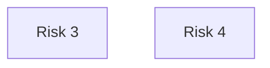

# G188/img-p54 · 风险登记表示例（3.4.5 节未编号插图）

类型：`mapping-or-assessment-matrix`。在“识别并检查风险与问题”的说明后给出一个真实表格样例，展示风险如何被登记与跟踪：每条风险都有编号、提出日期、完整描述、可能性与影响评分、由二者得出的严重度、缓解计划、责任人、状态和关闭日期。

英文 PDF 物理页：[68]。本页为架构语义分析，原文与原图分别保留。

## 原图与可编辑图


[完整 JSON](img-p54.json) · [可编辑 Mermaid](img-p54.mmd) · [仅关系图](img-p54.relations.mmd) · [层级分解图](img-p54.hierarchy.mmd)

图形重建表达语义，不复制源图布局。虚线表示解释、矩阵映射或分组关系，不自动表示不确定性的概率。



## 架构分析

按列读：先由 ID/Date Raised 定位一条风险，再读 Risk Description 了解风险本身；接着看 Likelihood、Impact 与着色单元格 Severity 判断等级；然后读 Mitigation Plan 了解应对，最后看 Owner、Status、Date Closed 判断跟踪状态。表中只保留第 3、4 两行，上下各有“…”表示省略了其他行。

- 本图有 2 个具名或隐含元素、0 条关系和 0 条包含/分组记录。
- 本图没有可直接确认为人员直属汇报的关系；视觉上下位置、能力分解和治理职责分别读取。
- 包含分组后有 2 个连通分量；分离可能源于图例、并列分类或独立示例，未自动补边。
- 10列表头及2完整记录逐格核对；ID3/4，Raised日期04.03.2014/05.03.2014，评分3/2/5和2/2/4。
- 两风险说明、全部缓解措施、责任人、状态和空Date Closed完整保留；OR为可选缓解方案，1/2/3为编号措施。
- 日期日月次序和Severity计算公式未在截图声明，撤销历史确定DD.MM.YYYY的无证据结论；不能用3×2把源Severity5改成6。

### 如何用于项目

- 先固定行、列所代表的维度及单元格含义，再登记有证据的映射或评分。
- 空白、无关系、未测量和不适用分别处理；颜色不自动等于优先级。

### 结构所表达的逻辑

- 风险登记表把“识别”转成“可跟踪”：每条风险有唯一 ID、提出日期和明确责任人，避免口头跟踪。
- 风险 3 关注解决方案的计费能力可能无法由现有 COTS 产品支持，而架构团队对市场方案缺乏了解；缓解措施是聘请外部咨询或通过 RFI 补充市场知识。
- 风险 4 关注架构项目对解决方案性能负责、但硬件技术与选型由基础设施团队决定，导致架构项目可能无法保证性能；缓解措施包括性能测试与外推、向基础设施团队传递容量需求、在测试后咨询方案供应商。
- Severity 由 Likelihood 与 Impact 共同决定，并在单元格中用颜色标出：风险 3 为 3×2→5（琥珀色），风险 4 为 2×2→4（绿色）；数值不是简单乘积。
- 状态用“已识别（缓解计划待定）”“已管理（缓解计划已同意）”区分，说明风险要走到“缓解计划已约定”才算被管理。
- Date Closed 两行均为空，表示风险尚未关闭；表中有意保留空列，提醒登记表要跟踪到关闭。

## 上下级与包含

无层级，只有一张表：表头一行 + 两条数据行；上下“…”表示表格被截取，省略了其他风险行。

|父项|子项|层级类型|依据与解释|
|---|---|---|---|
|—|—|无视觉包含|关系中明确的组成/特化见 JSON semantic_hierarchy。|

## 全部元素与角色

|元素ID|原文名称|类型|含义|直接父项|深度|
|---|---|---|---|---|---|
|risk_3|Risk 3|risk|原始10列值见attributes及逐格表，不由Severity与Likelihood/Impact反推评分公式。|—||
|risk_4|Risk 4|risk|原始10列值见attributes及逐格表，不由Severity与Likelihood/Impact反推评分公式。|—||

### 风险3：属性

```json
{
  "ID": "3",
  "Date Raised": "04.03.2014",
  "Risk Description": "There is a risk that billing capabilities of the target solution will be defined in a way that no existing COTS solution can support. Architecture Project team has no knowledge of such solutions available on the market.",
  "Likelihood": "3",
  "Impact": "2",
  "Severity": "5",
  "Mitigation Plan": "Hire an external consultancy with knowledge on billing capabilities of market available solutions. OR: Extend the project plan with an RFI to gain knowledge on solutions available on the market.",
  "Owner": "CRM solution architect",
  "Status": "Identified - mitigation plan to be agreed",
  "Date Closed": ""
}
```

### 风险4：属性

```json
{
  "ID": "4",
  "Date Raised": "05.03.2014",
  "Risk Description": "Architecture Project has the responsibility for solution performance, but it is the Infrastructure who decides on the hardware technology and sizing. Therefore, Architecture Project may be unable to ensure performance of the solution.",
  "Likelihood": "2",
  "Impact": "2",
  "Severity": "4",
  "Mitigation Plan": "1. Perform performance tests on development environment and extrapolate results to estimate performance. Development environment has to be filled with test data. 2. Expected infrastructure needs will be passed to the Infrastructure team. 3. Consult solution provider on the recommended hardware after the performance tests.",
  "Owner": "Architecture Project manager",
  "Status": "Managed - mitigation plan agreed",
  "Date Closed": ""
}
```

## 全部关系

表格线只分隔行列，不表达关系。Severity 单元格底色是唯一的编码：琥珀色表示严重度 5，绿色表示严重度 4；原图未给颜色图例。

|主体|语义关系|客体|显式线/隐式|原文标签|依据|
|---|---|---|---|---|---|

## 风险登记表（原图可见部分逐行转录）

```json
{
  "id": "t_risk_register",
  "title_zh": "风险登记表（原图可见部分逐行转录）",
  "columns": [
    "ID",
    "Date Raised",
    "Risk Description",
    "Likelihood",
    "Impact",
    "Severity",
    "Mitigation Plan",
    "Owner",
    "Status",
    "Date Closed"
  ],
  "rows": [
    [
      "3",
      "04.03.2014",
      "There is a risk that billing capabilities of the target solution will be defined in a way that no existing COTS solution can support. Architecture Project team has no knowledge of such solutions available on the market.",
      "3",
      "2",
      "5",
      "Hire an external consultancy with knowledge on billing capabilities of market available solutions. OR: Extend the project plan with an RFI to gain knowledge on solutions available on the market.",
      "CRM solution architect",
      "Identified - mitigation plan to be agreed",
      ""
    ],
    [
      "4",
      "05.03.2014",
      "Architecture Project has the responsibility for solution performance, but it is the Infrastructure who decides on the hardware technology and sizing. Therefore, Architecture Project may be unable to ensure performance of the solution.",
      "2",
      "2",
      "4",
      "1. Perform performance tests on development environment and extrapolate results to estimate performance. Development environment has to be filled with test data. 2. Expected infrastructure needs will be passed to the Infrastructure team. 3. Consult solution provider on the recommended hardware after the performance tests.",
      "Architecture Project manager",
      "Managed - mitigation plan agreed",
      ""
    ]
  ],
  "cell_legend": [
    "Severity=5的单元格为黄色，Severity=4为绿色；图内没有颜色阈值或评分公式图例。",
    "Date Raised原样为04.03.2014与05.03.2014，图未声明日月次序，不擅自转成ISO日期。",
    "表头下方及末行下方的…表示省略其他行；Date Closed两格确实空白。"
  ],
  "notes_zh": "原图为未编号、无标题的表格截图，仅完整显示表头与第 3、4 行；未显示的第 1、2 行无法转录。"
}
```

## 误读检查

- 日期格式在截图中未明示，保留原样。
- 仅两行及上下省略号，不可宣称完整风险登记册。
- Severity数值与颜色为源数据，不能假设评分采用乘法或给出未显示的阈值。

## 原文证据

### [PDF 第 68 页](../../../documents/G188.md#page-68)

> Plan defines a new Project Work Package to start in the next period, this needs to be clearly communicated to the team; if there is a “green light” to start the work, or what needs to happen before the green light is given.
> • Identify and examine risks and issues – most risks and issues come from team members.

## 来源与分析状态

所有元素/关系均有来源定位；未把历史解释重命名为本轮逐线视觉确认。源图与语义图是两种视图，布局不证明汇报或因果。

源 PDF SHA-256：`6e654af12a0bc034c7548d425a01123331ac9129c478a0bb957db89dd353dd29`。

源图记录：[原始解释与转录](../../../figures/G188/img-p54.json)。

```json
{
  "quality": {
    "graph_integrity": "checked",
    "semantic_analysis": "typed-graph-and-context-analysis",
    "visual_review": "source-content-audited",
    "notice_zh": "所有元素/关系均有来源定位；未把历史解释重命名为本轮逐线视觉确认。源图与语义图是两种视图，布局不证明汇报或因果。"
  },
  "source_uncertainty": {
    "confidence": "high",
    "uncertainties_zh": [
      "原图只显示两条数据行，无法得知省略的行数与是否有标题行之外的说明文字。",
      "Severity 的颜色语义（琥珀=高、绿=中）由数值与常见交通灯习惯推断，原图没有图例。",
      "表头 Likelihood/Impact/Severity 三列较窄且文字竖排，按英文表头逐字转录。"
    ],
    "analyzed_from": [
      "英文 PDF 第 68 页原图截图（含 3x3 放大分块）",
      "英文 PDF 第 68 页正文",
      "中文稿 G188e_架构项目管理.md 第 1130、1143、1160 行",
      "无 figs/ 资产引用"
    ],
    "date": "2026-10-31"
  },
  "source_conflicts": []
}
```
