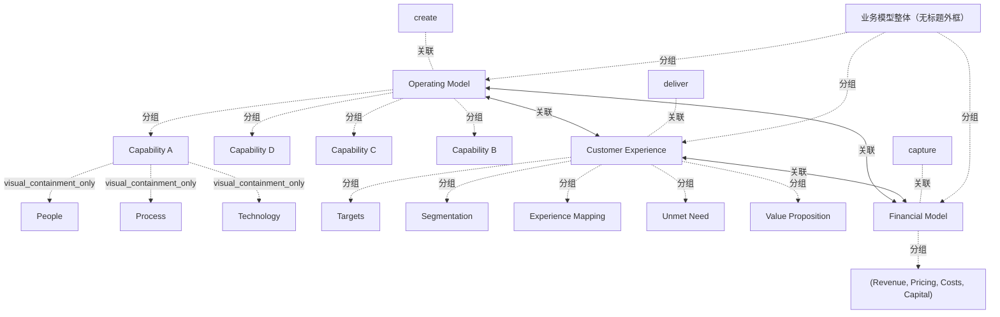

# G18A/fig2-1 · 业务模型的抽象视图

类型：`architecture-concept-or-system-model`。为第 2 节的业务模型定义提供最简骨架：说明业务模型是「创造价值—交付价值—获取价值」的整体逻辑，而不只是一张收入表；随后图 2-2、2-3、2-4 给出更具体的框架与画布。

英文 PDF 物理页：[13]。本页为架构语义分析，原文与原图分别保留。

## 原图与可编辑图


[完整 JSON](fig2-1.json) · [可编辑 Mermaid](fig2-1.mmd) · [仅关系图](fig2-1.relations.mmd) · [层级分解图](fig2-1.hierarchy.mmd)

图形重建表达语义，不复制源图布局。虚线表示解释、矩阵映射或分组关系，不自动表示不确定性的概率。



## 架构分析

先看外框：它圈定「业务模型」这一整体。左侧 Operating Model 旁标 create，右侧 Customer Experience 旁标 deliver，底部横贯的 Financial Model 下方标 capture；三块之间各有一条粗双向箭头。再看内部：Operating Model 中四张卡片从前到后叠放，最前的 Capability A 内有 People、Process、Technology 三个交叠圆；Customer Experience 的标题栏下纵向列出五个关注点；Financial Model 的标题栏下是四项财务组成。

- 本图有 20 个具名或隐含元素、6 条关系和 16 条包含/分组记录。
- 包含/分组树最大深度为 3；根节点为 业务模型整体（无标题外框）、创造（价值）、交付（价值）、获取（价值）。
- 本图没有可直接确认为人员直属汇报的关系；视觉上下位置、能力分解和治理职责分别读取。
- 外层无名边框包围运营模式、客户体验和财务模型；3条粗双向箭头连接三者。
- Capability D、C、B、A是4张重叠同级卡片，不是逐级子能力；A内部3个相交圆分别是People、Process、Technology。
- 客户体验包含Targets、Segmentation、Experience Mapping、Unmet Need、Value Proposition；财务模型括号列出Revenue、Pricing、Costs、Capital。
- create、deliver、capture是外侧文字标注，通过位置对应3大区域，没有连线。

### 如何用于项目

- 围绕作者目的读取本图实体、分组与连线，并用对应原文限定其含义。
- 把参考模型与项目事实分开，实际范围、约束、值和责任须有项目证据。

### 结构所表达的逻辑

- 三块分别对应价值创造（运营模式）、价值交付（客户体验）、价值获取（财务模型），它们是业务模型的三个侧面，不是三个部门或三个步骤。
- create / deliver / capture 是标注三个区域的动作词，位于外框之外，图中没有箭头把它们串成流程。
- 客户体验被拆成 Targets、Segmentation、Experience Mapping、Unmet Need、Value Proposition 五个关注点，说明交付侧从客户细分与未满足需求出发。
- 财务模型由 Revenue、Pricing、Costs、Capital 四类构成，既含收入与定价，也含成本与资本投入。
- 运营模式用四张叠放卡片表示存在多项能力；最前一张 Capability A 内的 People、Process、Technology 三圆交叠，表示能力由人员、流程、技术共同构成。
- 三块之间全部是粗双向箭头，表示相互制约与反馈：运营模式影响客户体验与财务结果，财务约束又反过来限制前两者。
- 本图刻意不含组织、流程步骤或指标，正文称其为业务模型「最抽象」的表示；更具体的制品才定义结构要素及其关系。

## 上下级与包含

外框（业务模型整体）之下是三个并列的一级要素：Operating Model、Customer Experience、Financial Model。Operating Model 之下是多个 Capability（图中以 D、C、B、A 四张叠放卡示意），Capability A 之下是 People、Process、Technology 三个交叠成分。Customer Experience 与 Financial Model 之下是各自的关注点/组成项。三块之间是相互作用关系，不是上下级。

|父项|子项|层级类型|依据与解释|
|---|---|---|---|
|业务模型整体（无标题外框）|运营模式|visual_grouping|框、泳道、域或分类组的成员归属；没有额外证据不提升为业务组合或管理关系。|
|运营模式|能力 D|visual_grouping|框、泳道、域或分类组的成员归属；没有额外证据不提升为业务组合或管理关系。|
|运营模式|能力 C|visual_grouping|框、泳道、域或分类组的成员归属；没有额外证据不提升为业务组合或管理关系。|
|运营模式|能力 B|visual_grouping|框、泳道、域或分类组的成员归属；没有额外证据不提升为业务组合或管理关系。|
|运营模式|能力 A|visual_grouping|框、泳道、域或分类组的成员归属；没有额外证据不提升为业务组合或管理关系。|
|能力 A|人员|visual_containment_only|保存原图解释中的包含；业务关系类型需要图例或正文进一步限定。|
|能力 A|流程|visual_containment_only|保存原图解释中的包含；业务关系类型需要图例或正文进一步限定。|
|能力 A|技术|visual_containment_only|保存原图解释中的包含；业务关系类型需要图例或正文进一步限定。|
|业务模型整体（无标题外框）|客户体验|visual_grouping|框、泳道、域或分类组的成员归属；没有额外证据不提升为业务组合或管理关系。|
|客户体验|目标客户|visual_grouping|框、泳道、域或分类组的成员归属；没有额外证据不提升为业务组合或管理关系。|
|客户体验|客户细分|visual_grouping|框、泳道、域或分类组的成员归属；没有额外证据不提升为业务组合或管理关系。|
|客户体验|体验映射|visual_grouping|框、泳道、域或分类组的成员归属；没有额外证据不提升为业务组合或管理关系。|
|客户体验|未满足需求|visual_grouping|框、泳道、域或分类组的成员归属；没有额外证据不提升为业务组合或管理关系。|
|客户体验|价值主张|visual_grouping|框、泳道、域或分类组的成员归属；没有额外证据不提升为业务组合或管理关系。|
|业务模型整体（无标题外框）|财务模型|visual_grouping|框、泳道、域或分类组的成员归属；没有额外证据不提升为业务组合或管理关系。|
|财务模型|（收入、定价、成本、资本）|visual_grouping|框、泳道、域或分类组的成员归属；没有额外证据不提升为业务组合或管理关系。|

## 全部元素与角色

|元素ID|原文名称|类型|含义|直接父项|深度|
|---|---|---|---|---|---|
|bm_frame|业务模型整体（无标题外框）|group|细黑矩形边框，圈定三块要素；图中没有标题。|—||
|create|create|note|标注运营模式所做的动作，不是流程节点。|—||
|deliver|deliver|note|标注客户体验所做的动作。|—||
|capture|capture|note|标注财务模型所做的动作。|—||
|op_model|Operating Model|group|标题栏下有横线，内部为叠放的能力卡。|业务模型整体（无标题外框）|1|
|capability_d|Capability D|capability|叠放卡片中的一张，原图未说明 D 的含义。|运营模式|2|
|capability_c|Capability C|capability|叠放卡片中的一张。|运营模式|2|
|capability_b|Capability B|capability|叠放卡片中的一张。|运营模式|2|
|capability_a|Capability A|capability|唯一展示内部结构的能力卡。|运营模式|2|
|people|People|actor|三圆之一，与 Process、Technology 交叠。|能力 A|3|
|process|Process|process|三圆之一。|能力 A|3|
|technology|Technology|technology|三圆之一。|能力 A|3|
|cx|Customer Experience|group|标题栏下有横线，下面纵向列出五个关注点。|业务模型整体（无标题外框）|1|
|cx_targets|Targets|concept|概念：目标客户|客户体验|2|
|cx_segmentation|Segmentation|concept|概念：客户细分|客户体验|2|
|cx_mapping|Experience Mapping|concept|概念：体验映射|客户体验|2|
|cx_unmet_need|Unmet Need|concept|概念：未满足需求|客户体验|2|
|cx_value_prop|Value Proposition|concept|概念：价值主张|客户体验|2|
|fin_model|Financial Model|group|标题栏下有横线，其下是四项财务组成。|业务模型整体（无标题外框）|1|
|fin_items|(Revenue, Pricing, Costs, Capital)|concept|财务模型框中的四个并列项目，源图以一行括号文字表示；不是四级嵌套。|财务模型|2|

### （收入、定价、成本、资本）：属性

```json
[
  "Revenue",
  "Pricing",
  "Costs",
  "Capital"
]
```

## 全部关系

图中只有三条粗双向箭头：Operating Model ↔ Customer Experience、Operating Model ↔ Financial Model、Customer Experience ↔ Financial Model，均表示双向影响，没有起点终点。外框是边界线，不表示关系。四张能力卡之间、三个交叠圆之间没有连线，叠放与交叠本身表达「多个能力」「三者共同构成」。

|主体|语义关系|客体|显式线/隐式|原文标签|依据|
|---|---|---|---|---|---|
|运营模式|关联|客户体验|显式连线||粗双向箭头：运营模式与客户体验相互影响（创造什么、如何交付）。|
|运营模式|关联|财务模型|显式连线||粗双向箭头：运营模式与财务模型相互约束。|
|客户体验|关联|财务模型|显式连线||粗双向箭头：客户体验与财务模型相互影响（体验设计影响收入与成本）。|
|创造（价值）|关联|运营模式|implicit||仅靠位置表达：create 标注运营模式。|
|交付（价值）|关联|客户体验|implicit||仅靠位置表达：deliver 标注客户体验。|
|获取（价值）|关联|财务模型|implicit||仅靠位置表达：capture 标注财务模型。|

## 误读检查

- 不要把 create → deliver → capture 读成先后三步：图中没有任何箭头把它们连起来，三者是同时成立的三项功能。
- 不要把 Capability D/C/B/A 理解为从低到高的四级能力：它们只是四张叠放卡片，A 在最前是为了展示其内部结构。
- 不要以为 Financial Model 画在底部就只是「结果」：它与另外两块是并列要素，箭头是双向的。
- 不要把 People、Process、Technology 三圆交叠当成三个部门的重叠；它表示一项能力的三个构成成分。
- 中文稿第 93 行引用的 figs/g18a_fig2-1.svg 是三圆链示意，与本图不是同一结构，不能据它理解本图。

## 原文证据

### [PDF 第 12 页](../../../documents/G18A.md#page-12)

> One effective way to achieve alignment between an organization’s strategic objectives and the target- state architecture is to employ the concept of the business model. Business model artifacts are used to:
> • Provide a common understanding of what the organization is, or looks like, today
### [PDF 第 13 页](../../../documents/G18A.md#page-13)

> Business models can be represented in different ways. The three-element framework shown in Figure 2-1 describes the structure of a business model in its most abstract form.
> Figure 2-1: Abstract View of a Business Model (Source: The Business Model Innovation Factory, Saul Kaplan,

## 来源与分析状态

所有元素/关系均有来源定位；未把历史解释重命名为本轮逐线视觉确认。源图与语义图是两种视图，布局不证明汇报或因果。

源 PDF SHA-256：`ed764e6eaeaad0cfccc67841223c76429684b31f188e6e90fbaf17cd44bc1fe4`。

源图记录：[原始解释与转录](../../../figures/G18A/fig2-1.json)。

```json
{
  "quality": {
    "graph_integrity": "checked",
    "semantic_analysis": "typed-graph-and-context-analysis",
    "visual_review": "source-content-audited",
    "notice_zh": "所有元素/关系均有来源定位；未把历史解释重命名为本轮逐线视觉确认。源图与语义图是两种视图，布局不证明汇报或因果。"
  },
  "source_uncertainty": {
    "confidence": "high",
    "uncertainties_zh": [
      "Capability A–D 的排列（由后向前 D→A）是否暗示层级或先后，原图与正文均未说明；解析按「四张并列叠放卡」处理。",
      "People/Process/Technology 三圆交叠是否特指三者交集，图中未标注。",
      "Customer Experience 列表第 5 项 Value Proposition 与 Operating Model 的关系，图中未画线。",
      "Operating Model / Customer Experience / Financial Model 与 create / deliver / capture 的中文译名由解析者拟定，中文稿未给出对照。"
    ],
    "analyzed_from": [
      "英文 PDF 第 13 页原图截图（fig2-1_p13_1.png）及 2×2 放大分块 z11/z12/z22",
      "英文 PDF 第 13 页正文",
      "中文稿 G18Ae_业务模型.md 第 89–93 行",
      "figs/g18a_fig2-1.svg 源码与 SVG 文本"
    ],
    "date": "2026-10-31"
  },
  "source_conflicts": []
}
```
