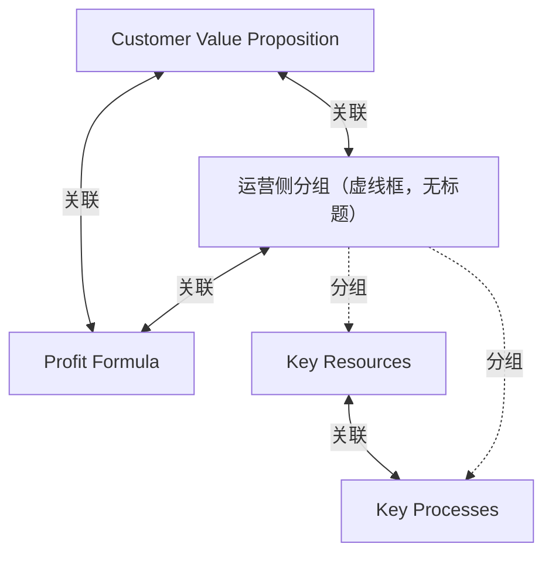

# G18A/fig2-2 · 四框框架

类型：`architecture-concept-or-system-model`。作为图 2-1 之外的另一种著名表示，说明业务模型可以用四个必须彼此自洽的要素来描述：为谁创造什么价值、如何赚钱、靠什么资源与流程实现。

英文 PDF 物理页：[13]。本页为架构语义分析，原文与原图分别保留。

## 原图与可编辑图


[完整 JSON](fig2-2.json) · [可编辑 Mermaid](fig2-2.mmd) · [仅关系图](fig2-2.relations.mmd) · [层级分解图](fig2-2.hierarchy.mmd)

图形重建表达语义，不复制源图布局。虚线表示解释、矩阵映射或分组关系，不自动表示不确定性的概率。



## 架构分析

从顶部中央的 Customer Value Proposition 开始，沿两条斜向粗双向箭头分别看向左下（Key Resources + Key Processes 虚线组）与右下（Profit Formula）；再注意虚线组与 Profit Formula 之间的水平双向箭头，以及组内两框之间的小双向箭头。全图没有起点和终点，四框构成一个相互约束的整体。

- 本图有 5 个具名或隐含元素、4 条关系和 2 条包含/分组记录。
- 包含/分组树最大深度为 1；根节点为 客户价值主张、利润公式、运营侧分组（虚线框，无标题）。
- 本图没有可直接确认为人员直属汇报的关系；视觉上下位置、能力分解和治理职责分别读取。
- 逐项核对Customer Value Proposition、Profit Formula、Key Resources、Key Processes 4个具名框及4条双向箭头。
- Key Resources与Key Processes由虚线外框组成运营侧组；这不是额外具名业务对象。

### 如何用于项目

- 围绕作者目的读取本图实体、分组与连线，并用对应原文限定其含义。
- 把参考模型与项目事实分开，实际范围、约束、值和责任须有项目证据。

### 结构所表达的逻辑

- 四个框分别是 Customer Value Proposition（顶部中央）、Profit Formula（右下）、Key Resources 与 Key Processes（左下，被虚线框圈在一起）。
- 所有连线都是粗双向箭头，说明四要素两两互动：改动任一框都会牵动其他框，框架用来检验一致性而不是描述流程。
- 关键资源与关键流程同处一个虚线分组，代表业务模型的「运营侧」作为一个整体与价值主张、利润公式互动。
- 价值主张与利润公式直接双向相连：客户价值与盈利方式必须同时成立，不能只优化一边。
- 关键资源与关键流程之间还有一条短双向箭头，表示资源支撑流程、流程又积累/消耗资源。
- 原图只有框名，没有任何解释文字；四要素的具体含义依赖正文与原书，不能从图中推断细节。
- 图中没有客户、渠道、竞争等要素，不能当作业务模型画布使用。

## 上下级与包含

没有上下级。四个框并列；Key Resources 与 Key Processes 被虚线框圈为一个视觉分组（组内两框仍并列），该组与 Customer Value Proposition、Profit Formula 构成三角。

|父项|子项|层级类型|依据与解释|
|---|---|---|---|
|运营侧分组（虚线框，无标题）|关键资源|visual_grouping|框、泳道、域或分类组的成员归属；没有额外证据不提升为业务组合或管理关系。|
|运营侧分组（虚线框，无标题）|关键流程|visual_grouping|框、泳道、域或分类组的成员归属；没有额外证据不提升为业务组合或管理关系。|

## 全部元素与角色

|元素ID|原文名称|类型|含义|直接父项|深度|
|---|---|---|---|---|---|
|cvp|Customer Value Proposition|concept|四框之一，位于三角顶点。|—||
|profit_formula|Profit Formula|concept|四框之一。|—||
|ops_group|运营侧分组（虚线框，无标题）|group|虚线圆角框，仅圈住关键资源与关键流程两个框。|—||
|key_resources|Key Resources|resource|资源：关键资源|运营侧分组（虚线框，无标题）|1|
|key_processes|Key Processes|process|流程：关键流程|运营侧分组（虚线框，无标题）|1|

## 全部关系

四条粗灰双向箭头表示双向依赖/相互影响，没有起点终点；虚线圆角框是分组边界，不是关系线。箭头是粗灰色实心三角头，两端都有。

|主体|语义关系|客体|显式线/隐式|原文标签|依据|
|---|---|---|---|---|---|
|客户价值主张|关联|运营侧分组（虚线框，无标题）|显式连线||斜向粗双向箭头：价值主张与资源/流程组相互制约。|
|客户价值主张|关联|利润公式|显式连线||斜向粗双向箭头：价值主张与利润公式相互制约。|
|运营侧分组（虚线框，无标题）|关联|利润公式|显式连线||水平粗双向箭头：运营侧与利润公式相互制约。|
|关键资源|关联|关键流程|显式连线||组内短粗双向箭头：关键资源与关键流程互相依赖。|

## 误读检查

- 不要按箭头读成先后顺序：全部是双向箭头，表示同时成立、互相制约。
- 不要把虚线框当成第五个要素：它只是把关键资源与关键流程圈成运营侧一组。
- 不要把 Profit Formula 只理解为财务部门的事：它与价值主张直接双向相连，是业务模型的一极。
- 中文稿第 97 行引用的 SVG 是 2×2 网格且没有箭头，还把四框内容改写为自拟解释，不能据它理解四框之间的互动。

## 原文证据

### [PDF 第 13 页](../../../documents/G18A.md#page-13)

> Other well-known framework examples include the Four-Box Framework (Figure 2-2) and the Business Model Cube (Figure 2-3).
> Figure 2-2: Four-Box Framework (Source: Seizing the White Space, Mark W. Johnson, 2010 [Johnson, 2010])

## 来源与分析状态

所有元素/关系均有来源定位；未把历史解释重命名为本轮逐线视觉确认。源图与语义图是两种视图，布局不证明汇报或因果。

源 PDF SHA-256：`ed764e6eaeaad0cfccc67841223c76429684b31f188e6e90fbaf17cd44bc1fe4`。

源图记录：[原始解释与转录](../../../figures/G18A/fig2-2.json)。

```json
{
  "quality": {
    "graph_integrity": "checked",
    "semantic_analysis": "typed-graph-and-context-analysis",
    "visual_review": "source-content-audited",
    "notice_zh": "所有元素/关系均有来源定位；未把历史解释重命名为本轮逐线视觉确认。源图与语义图是两种视图，布局不证明汇报或因果。"
  },
  "source_uncertainty": {
    "confidence": "high",
    "uncertainties_zh": [
      "四条双箭头的具体语义（影响、依赖还是信息流）图中没有文字说明，解析统一按「双向影响/依赖」处理。",
      "虚线分组没有标题，称其为「运营侧」是依据框内两框（资源、流程）的通用含义所作的概括。"
    ],
    "analyzed_from": [
      "英文 PDF 第 13 页原图截图（fig2-2_p13_1.png）及 2×2 放大分块 z11",
      "英文 PDF 第 13 页正文",
      "中文稿 G18Ae_业务模型.md 第 95–97 行",
      "figs/g18a_fig2-2.svg 源码与 SVG 文本"
    ],
    "date": "2026-10-31"
  },
  "source_conflicts": []
}
```
