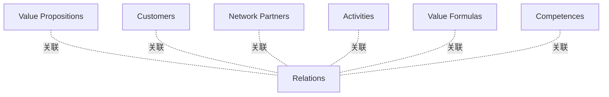

# G18A/fig2-3 · 业务模型立方体

类型：`analytical-view`。介绍 Lindgren 与 Rasmussen 的业务模型立方体，说明业务模型除了清单式框架外，还可以用多维、可组合、可拆看某一面的立体结构来表示，强调「关系」而非单块内容。

英文 PDF 物理页：[14]。本页为架构语义分析，原文与原图分别保留。

## 原图与可编辑图


[完整 JSON](fig2-3.json) · [可编辑 Mermaid](fig2-3.mmd) · [仅关系图](fig2-3.relations.mmd) · [层级分解图](fig2-3.hierarchy.mmd)

图形重建表达语义，不复制源图布局。虚线表示解释、矩阵映射或分组关系，不自动表示不确定性的概率。



## 架构分析

先看中央蓝色立方体：它表面密密麻麻重复印着 Relations，是全图的核心。再看向外拉开的六块面板：顶部品红为 Value Propositions，底部暗红为 Competences，左侧蓝紫为 Activities，左后方橙色为 Customers，右后方绿色为 Network Partners，右侧橙色为 Value Formulas。面板之间没有连线，靠「围绕中心立方体」表达维度与整体的关系。

- 本图有 7 个具名或隐含元素、6 条关系和 0 条包含/分组记录。
- 本图没有可直接确认为人员直属汇报的关系；视觉上下位置、能力分解和治理职责分别读取。
- 六个展开面分别为Value Propositions、Customers、Network Partners、Activities、Value Formulas、Competences；中央Relations为六维关系的立方体隐喻。
- 图中没有连接六面到中央的独立线条；现有6条关系仅表达空间对应，不是流程或数据流。

### 如何用于项目

- 围绕作者目的读取本图实体、分组与连线，并用对应原文限定其含义。
- 把参考模型与项目事实分开，实际范围、约束、值和责任须有项目证据。

### 结构所表达的逻辑

- 六个维度分别是 Value Propositions、Customers、Network Partners、Activities、Competences、Value Formulas。
- 中央立方体表面重复写满 Relations，强调六维之间的相互关系才是业务模型的核心，六块面板只是维度本身。
- 面板被画成「拉开的外壳」，表示可以单独审视某一维度；合拢起来才构成完整立方体。
- 顶面（价值主张）与底面（能力）相对，左右与后方是活动、客户、网络伙伴、价值公式，位置本身没有严格的层级或顺序。
- 图中没有任何箭头或流程，也没有客户细分、渠道、成本结构等画布块，不能当作业务模型画布使用。
- 六种颜色只用于区分面板，图中没有颜色含义说明。

## 上下级与包含

两层：中央 Relations 立方体代表「关系」这一核心；六块外围面板代表六个维度，彼此并列，均从属于整个立方体。图中没有上级框，也没有把六维再分解。

|父项|子项|层级类型|依据与解释|
|---|---|---|---|
|—|—|无视觉包含|关系中明确的组成/特化见 JSON semantic_hierarchy。|

## 全部元素与角色

|元素ID|原文名称|类型|含义|直接父项|深度|
|---|---|---|---|---|---|
|relations_cube|Relations|concept|蓝色立方体，三个可见面均重复印有 Relations 字样；原图以此表示六维之间的关系。|—||
|value_propositions|Value Propositions|concept|概念：价值主张|—||
|customers|Customers|concept|概念：客户|—||
|network_partners|Network Partners|concept|概念：网络伙伴|—||
|activities|Activities|concept|概念：活动|—||
|value_formulas|Value Formulas|concept|概念：价值公式|—||
|competences|Competences|concept|概念：能力|—||

## 全部关系

图中没有连线或箭头。六块面板与中央立方体之间只靠空间围绕关系表达「维度围绕关系」；面板之间的相对位置也不表示连线。

|主体|语义关系|客体|显式线/隐式|原文标签|依据|
|---|---|---|---|---|---|
|价值主张|关联|关系（立方体）|implicit||六面展开的空间对应；不是原图箭头。|
|客户|关联|关系（立方体）|implicit||六面展开的空间对应；不是原图箭头。|
|网络伙伴|关联|关系（立方体）|implicit||六面展开的空间对应；不是原图箭头。|
|活动|关联|关系（立方体）|implicit||六面展开的空间对应；不是原图箭头。|
|价值公式|关联|关系（立方体）|implicit||六面展开的空间对应；不是原图箭头。|
|能力|关联|关系（立方体）|implicit||六面展开的空间对应；不是原图箭头。|

## 本轮语义修正

- 六面展开的空间对应；不是原图箭头。
- 六面展开的空间对应；不是原图箭头。
- 六面展开的空间对应；不是原图箭头。
- 六面展开的空间对应；不是原图箭头。
- 六面展开的空间对应；不是原图箭头。
- 六面展开的空间对应；不是原图箭头。

## 误读检查

- 不要把中央的 Relations 当成第七个维度：它是模型的核心对象（关系），不是一块面板。
- 不要把六块面板读成六个步骤或先后顺序，它们同时存在、可任意组合。
- 不要把面板的上下左右位置当成层级（例如以为 Value Propositions 高于 Competences）。
- 中文稿第 99 行引用的 SVG 只画了三面，并自拟了“客户/渠道”“资源/伙伴”“成本/收入”，与原图六维名称不符，不能据它理解本图。

## 原文证据

### [PDF 第 13 页](../../../documents/G18A.md#page-13)

> Other well-known framework examples include the Four-Box Framework (Figure 2-2) and the Business Model Cube (Figure 2-3).
### [PDF 第 14 页](../../../documents/G18A.md#page-14)

> Figure 2-3: Business Model Cube (Source: The Business Model Cube, Peter Lindgren, Ole Horn Rasmussen, 2013

## 来源与分析状态

所有元素/关系均有来源定位；未把历史解释重命名为本轮逐线视觉确认。源图与语义图是两种视图，布局不证明汇报或因果。

源 PDF SHA-256：`ed764e6eaeaad0cfccc67841223c76429684b31f188e6e90fbaf17cd44bc1fe4`。

源图记录：[原始解释与转录](../../../figures/G18A/fig2-3.json)。

```json
{
  "quality": {
    "graph_integrity": "checked",
    "semantic_analysis": "typed-graph-and-context-analysis",
    "visual_review": "source-content-audited",
    "notice_zh": "所有元素/关系均有来源定位；未把历史解释重命名为本轮逐线视觉确认。源图与语义图是两种视图，布局不证明汇报或因果。"
  },
  "source_uncertainty": {
    "confidence": "high",
    "uncertainties_zh": [
      "中央立方体纹理中的文字放大后辨认为重复的 Relations，原书可能用 Relationships，无法从图中确认。",
      "六个面板与立方体六个面的严格对应关系（哪块面板是哪个面）在透视中被拉开，只能按大致方位判断。",
      "图中未说明六个维度之间是否存在优先顺序。",
      "Network Partners、Activities、Value Formulas、Competences 的中文译名由解析者拟定，中文稿未给出对照。"
    ],
    "analyzed_from": [
      "英文 PDF 第 14 页原图截图（fig2-3_p14_1.png）及 3×3 放大分块（重点 z22 中央立方体）",
      "英文 PDF 第 14 页正文",
      "中文稿 G18Ae_业务模型.md 第 95–99 行",
      "figs/g18a_fig2-3.svg 源码与 SVG 文本"
    ],
    "date": "2026-10-31"
  },
  "source_conflicts": []
}
```
