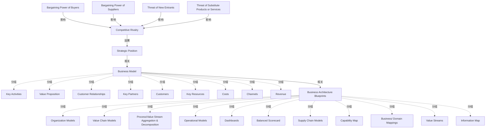

# G18A/fig4-1 · 战略、业务模型与架构之间的关系

类型：`process-or-method-model`。说明业务模型在战略与业务架构之间的中介位置：竞争态势驱动战略定位，战略定位由业务模型来表示，业务模型再由一组业务架构蓝图展开；以此支撑第 4 节「业务架构阐明业务模型的不同视角」的论点，并对应 TOGAF 阶段 B 的架构蓝图工作。

英文 PDF 物理页：[18]。本页为架构语义分析，原文与原图分别保留。

## 原图与可编辑图


[完整 JSON](fig4-1.json) · [可编辑 Mermaid](fig4-1.mmd) · [仅关系图](fig4-1.relations.mmd) · [层级分解图](fig4-1.hierarchy.mmd)

图形重建表达语义，不复制源图布局。虚线表示解释、矩阵映射或分组关系，不自动表示不确定性的概率。



## 架构分析

左上读五力：四个蓝框的箭头全部指向中央圆形 Competitive Rivalry，表示竞争强度由四力共同决定。沿向下的粗箭头读“drives”：竞争强度驱动 Strategic Position。再向下读“represented by”：战略定位由业务模型（3×3 灰蓝网格）来表示。最后向右读“articulated by”：业务模型由右侧 11 个业务架构蓝图来阐明。三个斜体短语是判断方向的关键，不要漏读。

- 本图有 28 个具名或隐含元素、7 条关系和 20 条包含/分组记录。
- 包含/分组树最大深度为 1；根节点为 买方议价能力、供方议价能力、新进入者威胁、替代产品或服务威胁、竞争强度、战略定位、业务模型、业务架构蓝图。
- 本图没有可直接确认为人员直属汇报的关系；视觉上下位置、能力分解和治理职责分别读取。
- 4种外部竞争力量指向Competitive Rivalry，随后3条箭头依次标为drives、represented by、articulated by。
- Business Model以9块拼图表达，Business Architecture Blueprints以11张橙色卡片表达；两者标题无外层围框，归属按分类保存。
- 四力量箭头与3条跨区箭头均已核对端点；未出现基数或因果+/-。

### 如何用于项目

- 按阶段/事件/行为关系读取入口、出口、责任和产物；检查循环与例外路径。
- 工作流先后不表示组织管理权；在项目中显式记录条件和完成标准。

### 结构所表达的逻辑

- 左上四力（Bargaining Power of Buyers、Bargaining Power of Suppliers、Threat of New Entrants、Threat of Substitute Products or Services）分别用箭头指向中央的 Competitive Rivalry，表示它们共同塑造竞争强度。
- Competitive Rivalry 通过标有 drives 的箭头指向 Strategic Position：战略定位是对竞争态势的回应。
- Strategic Position 通过标有 represented by 的箭头指向 Business Model：业务模型是战略定位的表示，而不是战略本身。
- Business Model 区域是 3×3 网格：上排 Key Activities、Value Proposition、Customer Relationships；中排 Key Partners、Customers、Key Resources；下排 Costs、Channels、Revenue。
- Business Model 通过标有 articulated by 的箭头指向右侧 Business Architecture Blueprints：业务架构把模型展开为多个视角的蓝图。
- 蓝图共 11 个，分四行：Organization Models、Value Chain Models、Process/Value Stream Aggregation & Decomposition；Operational Models、Dashboards、Balanced Scorecard；Supply Chain Models、Capability Map、Business/Domain Mappings；Value Streams、Information Map。
- 图注说明左上改编自 Porter 的五力模型、右侧蓝图来自 BIZBOK 6.5，因此本图是引用并组合两套来源的示意图，不是 TOGAF 专用记法。
- 全图只有一条向下的主链，没有反馈箭头；正文虽提到业务架构可把讨论回馈到业务模型，但图中未画这条回路。

## 上下级与包含

四段递进：① 四力 → Competitive Rivalry；② Competitive Rivalry → Strategic Position；③ Strategic Position → Business Model（其内 9 个画布块并列）；④ Business Model → Business Architecture Blueprints（其内 11 个蓝图并列，按 3+3+3+2 排布）。各段内部并列，段与段之间是单向推导，不是组织上下级。

|父项|子项|层级类型|依据与解释|
|---|---|---|---|
|业务模型|关键活动|classified_under|标题附近的拼图块/蓝图卡片分类，标题没有包围它们的外框。|
|业务模型|价值主张|classified_under|标题附近的拼图块/蓝图卡片分类，标题没有包围它们的外框。|
|业务模型|客户关系|classified_under|标题附近的拼图块/蓝图卡片分类，标题没有包围它们的外框。|
|业务模型|关键合作伙伴|classified_under|标题附近的拼图块/蓝图卡片分类，标题没有包围它们的外框。|
|业务模型|客户|classified_under|标题附近的拼图块/蓝图卡片分类，标题没有包围它们的外框。|
|业务模型|关键资源|classified_under|标题附近的拼图块/蓝图卡片分类，标题没有包围它们的外框。|
|业务模型|成本|classified_under|标题附近的拼图块/蓝图卡片分类，标题没有包围它们的外框。|
|业务模型|渠道|classified_under|标题附近的拼图块/蓝图卡片分类，标题没有包围它们的外框。|
|业务模型|收入|classified_under|标题附近的拼图块/蓝图卡片分类，标题没有包围它们的外框。|
|业务架构蓝图|组织模型|classified_under|标题附近的拼图块/蓝图卡片分类，标题没有包围它们的外框。|
|业务架构蓝图|价值链模型|classified_under|标题附近的拼图块/蓝图卡片分类，标题没有包围它们的外框。|
|业务架构蓝图|流程/价值流聚合与分解|classified_under|标题附近的拼图块/蓝图卡片分类，标题没有包围它们的外框。|
|业务架构蓝图|运营模型|classified_under|标题附近的拼图块/蓝图卡片分类，标题没有包围它们的外框。|
|业务架构蓝图|仪表盘|classified_under|标题附近的拼图块/蓝图卡片分类，标题没有包围它们的外框。|
|业务架构蓝图|平衡计分卡|classified_under|标题附近的拼图块/蓝图卡片分类，标题没有包围它们的外框。|
|业务架构蓝图|供应链模型|classified_under|标题附近的拼图块/蓝图卡片分类，标题没有包围它们的外框。|
|业务架构蓝图|能力地图|classified_under|标题附近的拼图块/蓝图卡片分类，标题没有包围它们的外框。|
|业务架构蓝图|业务/域映射|classified_under|标题附近的拼图块/蓝图卡片分类，标题没有包围它们的外框。|
|业务架构蓝图|价值流|classified_under|标题附近的拼图块/蓝图卡片分类，标题没有包围它们的外框。|
|业务架构蓝图|信息地图|classified_under|标题附近的拼图块/蓝图卡片分类，标题没有包围它们的外框。|

## 全部元素与角色

|元素ID|原文名称|类型|含义|直接父项|深度|
|---|---|---|---|---|---|
|f_buyers|Bargaining Power of Buyers|concept|概念：买方议价能力|—||
|f_suppliers|Bargaining Power of Suppliers|concept|概念：供方议价能力|—||
|f_entrants|Threat of New Entrants|concept|概念：新进入者威胁|—||
|f_substitutes|Threat of Substitute Products or Services|concept|概念：替代产品或服务威胁|—||
|f_rivalry|Competitive Rivalry|concept|概念：竞争强度|—||
|strategic_position|Strategic Position|concept|概念：战略定位|—||
|business_model|Business Model|group|标题 Business Model 位于网格正下方；网格本身没有外框。|—||
|bm_activities|Key Activities|concept|概念：关键活动|业务模型|1|
|bm_value_prop|Value Proposition|concept|概念：价值主张|业务模型|1|
|bm_cust_rel|Customer Relationships|concept|概念：客户关系|业务模型|1|
|bm_partners|Key Partners|concept|概念：关键合作伙伴|业务模型|1|
|bm_customers|Customers|concept|概念：客户|业务模型|1|
|bm_resources|Key Resources|concept|概念：关键资源|业务模型|1|
|bm_costs|Costs|concept|概念：成本|业务模型|1|
|bm_channels|Channels|concept|概念：渠道|业务模型|1|
|bm_revenue|Revenue|concept|概念：收入|业务模型|1|
|ba_blueprints|Business Architecture Blueprints|group|包含 11 个橙色卡片，按 3+3+3+2 排列。|—||
|ba_org|Organization Models|artifact|制品：组织模型|业务架构蓝图|1|
|ba_value_chain|Value Chain Models|artifact|制品：价值链模型|业务架构蓝图|1|
|ba_process|Process/Value Stream Aggregation & Decomposition|artifact|制品：流程/价值流聚合与分解|业务架构蓝图|1|
|ba_operational|Operational Models|artifact|制品：运营模型|业务架构蓝图|1|
|ba_dashboards|Dashboards|artifact|制品：仪表盘|业务架构蓝图|1|
|ba_scorecard|Balanced Scorecard|artifact|制品：平衡计分卡|业务架构蓝图|1|
|ba_supply_chain|Supply Chain Models|artifact|制品：供应链模型|业务架构蓝图|1|
|ba_capability_map|Capability Map|artifact|制品：能力地图|业务架构蓝图|1|
|ba_domain_map|Business/ Domain Mappings|artifact|制品：业务/域映射|业务架构蓝图|1|
|ba_value_streams|Value Streams|artifact|制品：价值流|业务架构蓝图|1|
|ba_info_map|Information Map|artifact|制品：信息地图|业务架构蓝图|1|

## 全部关系

共 7 条箭头：4 条从四力框指向 Competitive Rivalry（无文字）；1 条向下标 drives；1 条向下标 represented by；1 条向右标 articulated by。全部为浅蓝色粗箭头、单向；斜体动词说明关系性质，箭头方向即阅读方向。

|主体|语义关系|客体|显式线/隐式|原文标签|依据|
|---|---|---|---|---|---|
|买方议价能力|影响|竞争强度|显式连线||买方议价能力作用于竞争强度。|
|供方议价能力|影响|竞争强度|显式连线||供方议价能力作用于竞争强度。|
|新进入者威胁|影响|竞争强度|显式连线||新进入者威胁作用于竞争强度。|
|替代产品或服务威胁|影响|竞争强度|显式连线||替代品威胁作用于竞争强度。|
|竞争强度|因果|战略定位|显式连线|drives|箭头标签为drives；原图没有+或−符号，不赋予正向数值因果极性。|
|战略定位|相关|业务模型|显式连线|represented by|战略定位由业务模型来表示：业务模型是战略定位的具象表达。|
|业务模型|相关|业务架构蓝图|显式连线|articulated by|业务模型由业务架构蓝图来阐明/展开：蓝图给出模型的多视角细节。|

## 业务架构蓝图区的排列（按原图逐行）

```json
{
  "id": "t_blueprints",
  "title_zh": "业务架构蓝图区的排列（按原图逐行）",
  "columns": [
    "行",
    "第 1 列",
    "第 2 列",
    "第 3 列"
  ],
  "rows": [
    [
      "1",
      "Organization Models",
      "Value Chain Models",
      "Process/Value Stream Aggregation & Decomposition"
    ],
    [
      "2",
      "Operational Models",
      "Dashboards",
      "Balanced Scorecard"
    ],
    [
      "3",
      "Supply Chain Models",
      "Capability Map",
      "Business/ Domain Mappings"
    ],
    [
      "4",
      "Value Streams",
      "Information Map",
      "—"
    ]
  ],
  "notes_zh": "共 11 个蓝图卡片；第 4 行只有 2 个。"
}
```

## 本轮语义修正

- 箭头标签为drives；原图没有+或−符号，不赋予正向数值因果极性。

## 误读检查

- 不要把左上五力框当成业务模型的组成部分：它们属于战略分析区，只通过 Competitive Rivalry 与主链相连。
- 不要漏看 drives / represented by / articulated by 三个动词：它们决定整条链的方向，只看框会误以为四者并列。
- 不要把 11 个业务架构蓝图当成 11 个流程步骤，它们是同一阶段可选的架构视角/蓝图。
- 不要把 Business Model 的 3×3 网格与图 2-4 的手绘画布混为一谈：本图把九块排成 3×3，且用的是 Customers 而非 Customer Segments。
- 中文稿第 140 行引用的 SVG 把本图简化为“战略→业务模型→业务架构→执行”四框，丢失五力、战略定位与全部蓝图，不能据它理解本图。

## 原文证据

### [PDF 第 17 页](../../../documents/G18A.md#page-17)

> In the TOGAF Standard, Phase B: Business Architecture is where architects take the high-level business model artifact and develop a detailed set of architecture blueprints (representing different viewpoints of the proposal) to enable more in-depth planning, investment, and option analysis (see Figure 4-1). These detailed perspectives are useful and necessary for planning teams, business analysts, and business unit managers to understand and evaluate the overall impact of the proposed business model on the operation.
### [PDF 第 18 页](../../../documents/G18A.md#page-18)

> Figure 4-1: Relationships between Strategy, Business Models, and Architecture

## 来源与分析状态

所有元素/关系均有来源定位；未把历史解释重命名为本轮逐线视觉确认。源图与语义图是两种视图，布局不证明汇报或因果。

源 PDF SHA-256：`ed764e6eaeaad0cfccc67841223c76429684b31f188e6e90fbaf17cd44bc1fe4`。

源图记录：[原始解释与转录](../../../figures/G18A/fig4-1.json)。

```json
{
  "quality": {
    "graph_integrity": "checked",
    "semantic_analysis": "typed-graph-and-context-analysis",
    "visual_review": "source-content-audited",
    "notice_zh": "所有元素/关系均有来源定位；未把历史解释重命名为本轮逐线视觉确认。源图与语义图是两种视图，布局不证明汇报或因果。"
  },
  "source_uncertainty": {
    "confidence": "high",
    "uncertainties_zh": [
      "四力指向 Competitive Rivalry 的四条箭头没有文字，解析按波特五力的标准含义处理。",
      "represented by 与 articulated by 的语义较抽象，按“战略定位由业务模型表示、业务模型由蓝图阐明”直译。",
      "Business Model 网格中 Customers 与图 2-4 的 Customers 是否同一概念，图中未说明。",
      "五力名称、Strategic Position 与 11 个蓝图的中文译名由解析者拟定，中文稿仅给出“业务架构蓝图”一词。"
    ],
    "analyzed_from": [
      "英文 PDF 第 18 页原图截图（fig4-1_p18_1.png）及 2×2 放大分块 z11/z21/z22",
      "英文 PDF 第 17–18 页正文与图注",
      "中文稿 G18Ae_业务模型.md 第 136–142 行",
      "figs/g18a_fig4-1.svg 源码与 SVG 文本"
    ],
    "date": "2026-10-31"
  },
  "source_conflicts": []
}
```
