# G18A/fig7-1 · 零售商业务模型画布——现状

类型：`business-model-canvas`。以零售企业为例演示如何用业务模型画布描述现状业务模型；它既是第 7 章现状基线的完整示例，也是随后与未来态（图 7-2）对照、进而引出价值流与能力差距分析的起点。

英文 PDF 物理页：[24]。本页为架构语义分析，原文与原图分别保留。

## 原图与可编辑图


[完整 JSON](fig7-1.json) · [可编辑 Mermaid](fig7-1.mmd) · [仅关系图](fig7-1.relations.mmd) · [层级分解图](fig7-1.hierarchy.mmd)

图形重建表达语义，不复制源图布局。虚线表示解释、矩阵映射或分组关系，不自动表示不确定性的概率。

```mermaid
flowchart TB
  %% Semantic reconstruction; see original source image for exact layout.
  n0["零售业务模型画布外框（无标签）"]
  n1["Key Partners"]
  n2["Key Activities"]
  n3["Key Resources"]
  n4["Value Propositions"]
  n5["Customer Relationships"]
  n6["Channels"]
  n7["Customer Segments"]
  n8["Cost Structure"]
  n9["Revenue Streams"]
  n10["Product Manufacturers"]
  n11["National Suppliers"]
  n12["Regional Suppliers"]
  n13["Customer Analysis"]
  n14["Supplier Management"]
  n15["Brand Reputation"]
  n16["Real Estate"]
  n17["Low Prices"]
  n18["Personal Touch"]
  n19["Availability for Common and Regional Needs"]
  n20["Personal Assistance"]
  n21["Warranty Service"]
  n22["Retail Shopfronts"]
  n23["Web-based Inventory Info"]
  n24["Mass Market"]
  n25["Regional Specialization"]
  n26["Facilities and Transport"]
  n27["Employees and Supply"]
  n28["Scale Across Nation"]
  n29["Profit on Sales"]
  n30["Warranty Service"]
  n31["Manufacture Rebates"]
  n32["Retailer Business Model Diagram – Current State"]
  n4 -.->|"支撑/服务"| n7
  n6 -.->|"支撑/服务"| n7
  n0 -.->|"分组"| n1
  n0 -.->|"分组"| n2
  n0 -.->|"分组"| n3
  n0 -.->|"分组"| n4
  n0 -.->|"分组"| n5
  n0 -.->|"分组"| n6
  n0 -.->|"分组"| n7
  n0 -.->|"分组"| n8
  n0 -.->|"分组"| n9
  n1 -.->|"分组"| n10
  n1 -.->|"分组"| n11
  n1 -.->|"分组"| n12
  n2 -.->|"分组"| n13
  n2 -.->|"分组"| n14
  n3 -.->|"分组"| n15
  n3 -.->|"分组"| n16
  n4 -.->|"分组"| n17
  n4 -.->|"分组"| n18
  n4 -.->|"分组"| n19
  n5 -.->|"分组"| n20
  n5 -.->|"分组"| n21
  n6 -.->|"分组"| n22
  n6 -.->|"分组"| n23
  n7 -.->|"分组"| n24
  n7 -.->|"分组"| n25
  n8 -.->|"分组"| n26
  n8 -.->|"分组"| n27
  n8 -.->|"分组"| n28
  n9 -.->|"分组"| n29
  n9 -.->|"分组"| n30
  n9 -.->|"分组"| n31
```



## 架构分析

按标准画布布局读：中列 Value Propositions；向右上 Customer Relationships、右下 Channels、最右 Customer Segments；向左 Key Partners 以及上 Key Activities、下 Key Resources；底部左 Cost Structure、右 Revenue Streams。正文建议从客户视角从右向左读：先看客户细分，再看价值主张与渠道/关系，最后看左侧资源、活动、伙伴与成本。块内条目自上而下排列，没有箭头。

- 本图有 33 个具名或隐含元素、2 条关系和 31 条包含/分组记录。
- 包含/分组树最大深度为 2；根节点为 零售业务模型画布外框（无标签）、零售商业务模型图——当前状态。
- 本图没有可直接确认为人员直属汇报的关系；视觉上下位置、能力分解和治理职责分别读取。
- 包含分组后有 2 个连通分量；分离可能源于图例、并列分类或独立示例，未自动补边。
- 逐项核对9个画布区块及22条黄色便签；黄色一致，无风险热度含义。
- Warranty Service同时出现于客户关系和收入流，保留两个不同位置的节点；没有将重名便签合并。
- 标题栏位于画布外框之外，现单独建为标题注记；画布区块之间没有箭头。

### 如何用于项目

- 先明确受益方和价值主张，再把各画布要素关联到能力、价值流及所需资源。
- 画布用于假设和共同理解；不能替代细化的实现架构或已验证经营数据。

### 结构所表达的逻辑

- 客户细分只有 Mass Market 与 Regional Specialization，说明企业采取“大众市场 + 区域专业化”的双重定位。
- 价值主张三条：Low Prices、Personal Touch、Availability for Common and Regional Needs，集中在价格、服务与可获得性。
- 渠道两条：Retail Shopfronts（实体店面）与 Web-based Inventory Info（线上查库存），是“线下为主、线上仅提供信息”的组合。
- 客户关系两条：Personal Assistance 与 Warranty Service；其中 Warranty Service 同时出现在收入来源块，说明保修既是关系手段也是收入来源。
- 关键资源只有 Brand Reputation 与 Real Estate；关键活动为 Customer Analysis 与 Supplier Management，与正文“强大客户分析、维护品牌与地产”一致。
- 关键合作伙伴三类：Product Manufacturers、National Suppliers、Regional Suppliers，呈“制造 + 全国 + 区域”的供应结构。
- 成本三项：Facilities and Transport、Employees and Supply、Scale Across Nation，与实体店面、房地产、全国扩张相呼应。
- 画布内没有箭头，九个块的关系由版式表达；块内条目自上而下不代表优先级。

## 上下级与包含

两层：画布整体（带标题的矩形框）下分九个构建块，每块下为 2–3 个条目。九个块并列；Cost Structure 与 Revenue Streams 横跨底部两段，各占一半宽度。

|父项|子项|层级类型|依据与解释|
|---|---|---|---|
|零售业务模型画布外框（无标签）|关键合作伙伴|visual_grouping|框、泳道、域或分类组的成员归属；没有额外证据不提升为业务组合或管理关系。|
|零售业务模型画布外框（无标签）|关键活动|visual_grouping|框、泳道、域或分类组的成员归属；没有额外证据不提升为业务组合或管理关系。|
|零售业务模型画布外框（无标签）|关键资源|visual_grouping|框、泳道、域或分类组的成员归属；没有额外证据不提升为业务组合或管理关系。|
|零售业务模型画布外框（无标签）|价值主张|visual_grouping|框、泳道、域或分类组的成员归属；没有额外证据不提升为业务组合或管理关系。|
|零售业务模型画布外框（无标签）|客户关系|visual_grouping|框、泳道、域或分类组的成员归属；没有额外证据不提升为业务组合或管理关系。|
|零售业务模型画布外框（无标签）|渠道|visual_grouping|框、泳道、域或分类组的成员归属；没有额外证据不提升为业务组合或管理关系。|
|零售业务模型画布外框（无标签）|客户细分|visual_grouping|框、泳道、域或分类组的成员归属；没有额外证据不提升为业务组合或管理关系。|
|零售业务模型画布外框（无标签）|成本结构|visual_grouping|框、泳道、域或分类组的成员归属；没有额外证据不提升为业务组合或管理关系。|
|零售业务模型画布外框（无标签）|收入来源|visual_grouping|框、泳道、域或分类组的成员归属；没有额外证据不提升为业务组合或管理关系。|
|关键合作伙伴|产品制造商|visual_grouping|框、泳道、域或分类组的成员归属；没有额外证据不提升为业务组合或管理关系。|
|关键合作伙伴|全国供应商|visual_grouping|框、泳道、域或分类组的成员归属；没有额外证据不提升为业务组合或管理关系。|
|关键合作伙伴|区域供应商|visual_grouping|框、泳道、域或分类组的成员归属；没有额外证据不提升为业务组合或管理关系。|
|关键活动|客户分析|visual_grouping|框、泳道、域或分类组的成员归属；没有额外证据不提升为业务组合或管理关系。|
|关键活动|供应商管理|visual_grouping|框、泳道、域或分类组的成员归属；没有额外证据不提升为业务组合或管理关系。|
|关键资源|品牌声誉|visual_grouping|框、泳道、域或分类组的成员归属；没有额外证据不提升为业务组合或管理关系。|
|关键资源|房地产|visual_grouping|框、泳道、域或分类组的成员归属；没有额外证据不提升为业务组合或管理关系。|
|价值主张|低价|visual_grouping|框、泳道、域或分类组的成员归属；没有额外证据不提升为业务组合或管理关系。|
|价值主张|个性化接触|visual_grouping|框、泳道、域或分类组的成员归属；没有额外证据不提升为业务组合或管理关系。|
|价值主张|满足通用与区域需求的可获得性|visual_grouping|框、泳道、域或分类组的成员归属；没有额外证据不提升为业务组合或管理关系。|
|客户关系|人工协助|visual_grouping|框、泳道、域或分类组的成员归属；没有额外证据不提升为业务组合或管理关系。|
|客户关系|保修服务|visual_grouping|框、泳道、域或分类组的成员归属；没有额外证据不提升为业务组合或管理关系。|
|渠道|零售店面|visual_grouping|框、泳道、域或分类组的成员归属；没有额外证据不提升为业务组合或管理关系。|
|渠道|基于网络的库存信息|visual_grouping|框、泳道、域或分类组的成员归属；没有额外证据不提升为业务组合或管理关系。|
|客户细分|大众市场|visual_grouping|框、泳道、域或分类组的成员归属；没有额外证据不提升为业务组合或管理关系。|
|客户细分|区域专业化|visual_grouping|框、泳道、域或分类组的成员归属；没有额外证据不提升为业务组合或管理关系。|
|成本结构|设施与运输|visual_grouping|框、泳道、域或分类组的成员归属；没有额外证据不提升为业务组合或管理关系。|
|成本结构|员工与供应|visual_grouping|框、泳道、域或分类组的成员归属；没有额外证据不提升为业务组合或管理关系。|
|成本结构|全国规模扩张|visual_grouping|框、泳道、域或分类组的成员归属；没有额外证据不提升为业务组合或管理关系。|
|收入来源|销售利润|visual_grouping|框、泳道、域或分类组的成员归属；没有额外证据不提升为业务组合或管理关系。|
|收入来源|保修服务|visual_grouping|框、泳道、域或分类组的成员归属；没有额外证据不提升为业务组合或管理关系。|
|收入来源|制造商返利|visual_grouping|框、泳道、域或分类组的成员归属；没有额外证据不提升为业务组合或管理关系。|

## 全部元素与角色

|元素ID|原文名称|类型|含义|直接父项|深度|
|---|---|---|---|---|---|
|canvas|零售业务模型画布外框（无标签）|group|包围9个构成块的实际外边框；图上方标题另为独立标题栏。|—||
|kp|Key Partners|group|分组：关键合作伙伴|零售业务模型画布外框（无标签）|1|
|ka|Key Activities|group|分组：关键活动|零售业务模型画布外框（无标签）|1|
|kr|Key Resources|group|分组：关键资源|零售业务模型画布外框（无标签）|1|
|vp|Value Propositions|group|分组：价值主张|零售业务模型画布外框（无标签）|1|
|cr|Customer Relationships|group|分组：客户关系|零售业务模型画布外框（无标签）|1|
|ch|Channels|group|分组：渠道|零售业务模型画布外框（无标签）|1|
|cs|Customer Segments|group|分组：客户细分|零售业务模型画布外框（无标签）|1|
|cost|Cost Structure|group|分组：成本结构|零售业务模型画布外框（无标签）|1|
|rev|Revenue Streams|group|分组：收入来源|零售业务模型画布外框（无标签）|1|
|kp_manufacturers|Product Manufacturers|actor|参与者：产品制造商|关键合作伙伴|2|
|kp_national|National Suppliers|actor|参与者：全国供应商|关键合作伙伴|2|
|kp_regional|Regional Suppliers|actor|参与者：区域供应商|关键合作伙伴|2|
|ka_analysis|Customer Analysis|process|流程：客户分析|关键活动|2|
|ka_supplier|Supplier Management|process|流程：供应商管理|关键活动|2|
|kr_brand|Brand Reputation|resource|资源：品牌声誉|关键资源|2|
|kr_realestate|Real Estate|resource|资源：房地产|关键资源|2|
|vp_low|Low Prices|concept|概念：低价|价值主张|2|
|vp_personal|Personal Touch|concept|概念：个性化接触|价值主张|2|
|vp_availability|Availability for Common and Regional Needs|concept|概念：满足通用与区域需求的可获得性|价值主张|2|
|cr_personal|Personal Assistance|service|服务：人工协助|客户关系|2|
|cr_warranty|Warranty Service|service|同一标签在收入来源块再次出现。|客户关系|2|
|ch_shopfronts|Retail Shopfronts|other|实体渠道触点。|渠道|2|
|ch_web|Web-based Inventory Info|other|线上信息渠道（只提供库存信息，不是在线交易）。|渠道|2|
|cs_mass|Mass Market|actor|参与者：大众市场|客户细分|2|
|cs_regional|Regional Specialization|actor|参与者：区域专业化|客户细分|2|
|cost_facilities|Facilities and Transport|resource|资源：设施与运输|成本结构|2|
|cost_employees|Employees and Supply|resource|资源：员工与供应|成本结构|2|
|cost_scale|Scale Across Nation|resource|资源：全国规模扩张|成本结构|2|
|rev_profit|Profit on Sales|concept|概念：销售利润|收入来源|2|
|rev_warranty|Warranty Service|concept|与客户关系块的同名标签不同实例。|收入来源|2|
|rev_rebates|Manufacture Rebates|concept|概念：制造商返利|收入来源|2|
|title|Retailer Business Model Diagram – Current State|annotation|图中元素：零售商业务模型图——当前状态|—||

## 全部关系

图中没有箭头或连线，只有分隔块用的直线（竖线与横线）。块内黄色条目框是并列清单，不含顺序或依赖。价值侧与成本侧的区分由左右位置表达。

|主体|语义关系|客体|显式线/隐式|原文标签|依据|
|---|---|---|---|---|---|
|价值主张|支撑/服务|客户细分|implicit||Appendix A原文定义价值主张面向客户、渠道用于触达客户；这是正文支持的概念关系，图上没有连接箭头。|
|渠道|支撑/服务|客户细分|implicit||Appendix A原文定义价值主张面向客户、渠道用于触达客户；这是正文支持的概念关系，图上没有连接箭头。|

## 本轮否定的历史关系

以下旧解释保留用于追溯，不进入当前关系图、层级或知识图谱的有效边。

|旧记录|主体|旧关系|客体|否定依据|
|---|---|---|---|---|
|2|关键合作伙伴|dependency|关键活动|九宫格的邻接排列不能证明特定Key Partners→Key Activities依赖。正文只称伙伴使商业模式运作，未给这两个块之间的定向依赖。|

## 图 7-1 画布九块逐条转录（现状）

```json
{
  "id": "t_canvas_current",
  "title_zh": "图 7-1 画布九块逐条转录（现状）",
  "columns": [
    "构建块",
    "条目 1",
    "条目 2",
    "条目 3"
  ],
  "rows": [
    [
      "Key Partners 关键合作伙伴",
      "Product Manufacturers 产品制造商",
      "National Suppliers 全国供应商",
      "Regional Suppliers 区域供应商"
    ],
    [
      "Key Activities 关键活动",
      "Customer Analysis 客户分析",
      "Supplier Management 供应商管理",
      "—"
    ],
    [
      "Key Resources 关键资源",
      "Brand Reputation 品牌声誉",
      "Real Estate 房地产",
      "—"
    ],
    [
      "Value Propositions 价值主张",
      "Low Prices 低价",
      "Personal Touch 个性化接触",
      "Availability for Common and Regional Needs 满足通用与区域需求的可获得性"
    ],
    [
      "Customer Relationships 客户关系",
      "Personal Assistance 人工协助",
      "Warranty Service 保修服务",
      "—"
    ],
    [
      "Channels 渠道",
      "Retail Shopfronts 零售店面",
      "Web-based Inventory Info 基于网络的库存信息",
      "—"
    ],
    [
      "Customer Segments 客户细分",
      "Mass Market 大众市场",
      "Regional Specialization 区域专业化",
      "—"
    ],
    [
      "Cost Structure 成本结构",
      "Facilities and Transport 设施与运输",
      "Employees and Supply 员工与供应",
      "Scale Across Nation 全国规模扩张"
    ],
    [
      "Revenue Streams 收入来源",
      "Profit on Sales 销售利润",
      "Warranty Service 保修服务",
      "Manufacture Rebates 制造商返利"
    ]
  ],
  "notes_zh": "按原图块内自上而下顺序转录；「—」表示该块只有两条条目。Warranty Service 在两个块中各出现一次。"
}
```

## 本轮语义修正

- Appendix A原文定义价值主张面向客户、渠道用于触达客户；这是正文支持的概念关系，图上没有连接箭头。
- Appendix A原文定义价值主张面向客户、渠道用于触达客户；这是正文支持的概念关系，图上没有连接箭头。
- 九宫格的邻接排列不能证明特定Key Partners→Key Activities依赖。正文只称伙伴使商业模式运作，未给这两个块之间的定向依赖。

## 误读检查

- 不要把块内条目自上而下的次序当成优先级或时间顺序。
- Warranty Service 在客户关系与收入来源两块各出现一次，是两个不同视角，不是重复错误。
- 不要忽略最右侧 Customer Segments 块：画布右侧是客户侧，正文建议从这里开始读。
- 不要把图顶标题中的 Diagram 误认为与 Canvas 不同的方法；正文明确这是 Business Model Canvas 的实例。
- 中文稿正文第 208 行把英文 “sustained services” 译为“保修服务”、把 “facilities” 译为“房地产”，是意译；图内对应 Warranty Service 与 Real Estate。

## 原文证据

### [PDF 第 24 页](../../../documents/G18A.md#page-24)

> In Figure 7-1, we have a generic representation of a retail business model in its current state, meaning it represents how the business has been delivering value for the last several years. One way to understand the model is to read from the customers’ perspective – right-to-left – seeing how the business strives to serve both a mass retail shopper market and provide some regional specialization; provides both personal and sustained services; and gives shoppers both physical store shopfronts and the ability to find inventory ahead of time through the Internet. The business intends to provide greater value than the competition through lower prices, personalized help, and a better product range. To achieve this, they must have strong customer analytics, maintain their brand and facilities, and keep strong partnerships that lead to the right products through the right suppliers to meet those customer needs.
### [PDF 第 25 页](../../../documents/G18A.md#page-25)

> introduce new products or services to address unmet customer needs. A common guideline is that a truly new business model comes from a combined shift in customer segments and value proposition; anything narrower or on a smaller scale is merely an adjustment to the current business model.
> In the future-state model (see Figure 7-2), we see shifts in both the revenue-generating side of the canvas (increased specialization with specific customers, more online and digital presence, targeted value at the lowest possible cost) and the cost side (digital technologies being a key cost driver, a need for new partnerships, plus the global impacts on partnerships and costs). Some areas, such as key activities and sources of revenue, don’t change. Forming a new business model like this is a very people-oriented process, ideally based on good market, product, and cost data, but with leaders reaching alignment on how the business will deliver the most value in the future.
### [PDF 第 26 页](../../../documents/G18A.md#page-26)

> • The shift in the business model’s direction drives a need to reassess the “Acquire Retail Product” value stream as shown in the TOGAF® Series Guide: Value Streams (§4.1) [G178], where the value stages may stay the same but some of the stakeholders, criteria, and value items will be affected
> • Value may now be delivered to the customer from all five value stages when customers are located anywhere in the world, including finding products specialized to their local needs

## 来源与分析状态

所有元素/关系均有来源定位；未把历史解释重命名为本轮逐线视觉确认。源图与语义图是两种视图，布局不证明汇报或因果。

源 PDF SHA-256：`ed764e6eaeaad0cfccc67841223c76429684b31f188e6e90fbaf17cd44bc1fe4`。

源图记录：[原始解释与转录](../../../figures/G18A/fig7-1.json)。

```json
{
  "quality": {
    "graph_integrity": "checked",
    "semantic_analysis": "typed-graph-and-context-analysis",
    "visual_review": "source-content-audited",
    "notice_zh": "所有元素/关系均有来源定位；未把历史解释重命名为本轮逐线视觉确认。源图与语义图是两种视图，布局不证明汇报或因果。"
  },
  "source_uncertainty": {
    "confidence": "high",
    "uncertainties_zh": [
      "块内条目自上而下的顺序是否表示优先级，原图未说明。",
      "“Regional Specialization”作为客户细分条目的确切含义（区域专营客户还是区域化需求）图中未解释。",
      "“Warranty Service”在客户关系与收入来源两块均出现，是否为同一业务的不同侧面，图中未标注。"
    ],
    "analyzed_from": [
      "英文 PDF 第 24 页原图截图（fig7-1_p24_1.png）及 3×3 放大分块",
      "英文 PDF 第 24 页正文",
      "中文稿 G18Ae_业务模型.md 第 206–250 行（含图内标签对照表）",
      "figs/g18ae_fig7-1_en.png 与 figs/zh/g18ae_fig7-1_zh.png"
    ],
    "date": "2026-10-31"
  },
  "source_conflicts": []
}
```
