# G18A/fig7-2 · 零售商业务模型画布——未来态

类型：`business-model-canvas`。展示业务模型如何因市场压力、销售下滑或成本上升而改变；通过与图 7-1 逐块对照，说明真正的新业务模型来自客户细分与价值主张的联合转变，并引出价值流与能力差距分析。

英文 PDF 物理页：[25]。本页为架构语义分析，原文与原图分别保留。

## 原图与可编辑图


[完整 JSON](fig7-2.json) · [可编辑 Mermaid](fig7-2.mmd) · [仅关系图](fig7-2.relations.mmd) · [层级分解图](fig7-2.hierarchy.mmd)

图形重建表达语义，不复制源图布局。虚线表示解释、矩阵映射或分组关系，不自动表示不确定性的概率。

```mermaid
flowchart TB
  %% Semantic reconstruction; see original source image for exact layout.
  n0["零售业务模型画布外框（无标签）"]
  n1["Key Partners"]
  n2["Key Activities"]
  n3["Key Resources"]
  n4["Value Propositions"]
  n5["Customer Relationships"]
  n6["Channels"]
  n7["Customer Segments"]
  n8["Cost Structure"]
  n9["Revenue Streams"]
  n10["Product Manufacturers"]
  n11["Global Suppliers"]
  n12["Internet and App Providers"]
  n13["Customer Analysis"]
  n14["Supplier Management"]
  n15["Brand Reputation"]
  n16["Cloud Hosting &amp; App Support"]
  n17["Lowest Prices"]
  n18["Convenience Anywhere"]
  n19["Availability for Common and Specific Needs"]
  n20["Automated AI Services"]
  n21["Web Shopping Self-service"]
  n22["Limited Shopfronts"]
  n23["Web-based Shopping Apps"]
  n24["Mass Market"]
  n25["Consumer-specific Specialization"]
  n26["Infrastructure &amp; Transport"]
  n27["Employees and Supply"]
  n28["Scale Across Globe"]
  n29["Profit on Sales"]
  n30["Warranty Service"]
  n31["Manufacture Rebates"]
  n32["Retailer Business Model Diagram – Future State"]
  n4 -.->|"支撑/服务"| n7
  n6 -.->|"支撑/服务"| n7
  n0 -.->|"分组"| n1
  n0 -.->|"分组"| n2
  n0 -.->|"分组"| n3
  n0 -.->|"分组"| n4
  n0 -.->|"分组"| n5
  n0 -.->|"分组"| n6
  n0 -.->|"分组"| n7
  n0 -.->|"分组"| n8
  n0 -.->|"分组"| n9
  n1 -.->|"分组"| n10
  n1 -.->|"分组"| n11
  n1 -.->|"分组"| n12
  n2 -.->|"分组"| n13
  n2 -.->|"分组"| n14
  n3 -.->|"分组"| n15
  n3 -.->|"分组"| n16
  n4 -.->|"分组"| n17
  n4 -.->|"分组"| n18
  n4 -.->|"分组"| n19
  n5 -.->|"分组"| n20
  n5 -.->|"分组"| n21
  n6 -.->|"分组"| n22
  n6 -.->|"分组"| n23
  n7 -.->|"分组"| n24
  n7 -.->|"分组"| n25
  n8 -.->|"分组"| n26
  n8 -.->|"分组"| n27
  n8 -.->|"分组"| n28
  n9 -.->|"分组"| n29
  n9 -.->|"分组"| n30
  n9 -.->|"分组"| n31
```



## 架构分析

先按与图 7-1 相同的布局定位九块，再逐块对照现状图找差异：右上 Customer Segments 由 Regional Specialization 变为 Consumer-specific Specialization；Value Propositions 由 Low Prices 变为 Lowest Prices 并新增 Convenience Anywhere；Channels 与 Customer Relationships 改为线上/自动化；Key Resources、Key Partners、Cost Structure 随之更换；Key Activities 与 Revenue Streams 不变。同样可按正文建议从右向左读。

- 本图有 33 个具名或隐含元素、2 条关系和 31 条包含/分组记录。
- 包含/分组树最大深度为 2；根节点为 零售业务模型画布外框（无标签）、零售商业务模型图——未来状态。
- 本图没有可直接确认为人员直属汇报的关系；视觉上下位置、能力分解和治理职责分别读取。
- 包含分组后有 2 个连通分量；分离可能源于图例、并列分类或独立示例，未自动补边。
- 逐项核对9个画布区块及22条黄色便签；黄色一致，无风险热度含义。
- Warranty Service同时出现于客户关系和收入流，保留两个不同位置的节点；没有将重名便签合并。
- 标题栏位于画布外框之外，现单独建为标题注记；画布区块之间没有箭头。
- 未来状态将全国/区域供应商换为全球供应商和互联网/应用伙伴，房产换为云托管与应用支持，人工服务转为AI/自助购物。
- 仍保留Customer Analysis、Supplier Management及三项收入便签；原文明确某些区域保持不变，不能把所有区块当成新能力。

### 如何用于项目

- 先明确受益方和价值主张，再把各画布要素关联到能力、价值流及所需资源。
- 画布用于假设和共同理解；不能替代细化的实现架构或已验证经营数据。

### 结构所表达的逻辑

- 客户细分：Mass Market 保留，Regional Specialization 改为 Consumer-specific Specialization，从区域专业化转向面向特定消费者。
- 价值主张：Low Prices 改为 Lowest Prices，新增 Convenience Anywhere，第三条由 Regional 改为 Specific，整体转向“更低价格 + 随处便利 + 特定需求”。
- 渠道：Retail Shopfronts 改为 Limited Shopfronts，Web-based Inventory Info 改为 Web-based Shopping Apps，从“实体为主 + 线上查信息”转为“有限店面 + 线上购物”。
- 客户关系：Personal Assistance、Warranty Service 改为 Automated AI Services、Web Shopping Self-service，服务方式自动化、自助化。
- 关键资源：保留 Brand Reputation，Real Estate 换成 Cloud Hosting & App Support；成本侧 Facilities and Transport 换成 Infrastructure & Transport，Scale Across Nation 换成 Scale Across Globe。
- 关键合作伙伴：National/Regional Suppliers 换成 Global Suppliers，并新增 Internet and App Providers，供应链全球化且引入数字伙伴。
- Key Activities（Customer Analysis、Supplier Management）与 Revenue Streams（Profit on Sales、Warranty Service、Manufacture Rebates）完全不变，对应正文“部分区域不变”。
- 收入侧（右）与成本侧（左）同时变化，符合正文“真正的新业务模型来自客户细分与价值主张的联合转变”。

## 上下级与包含

两层：画布整体（带标题的矩形框）下分九个构建块，每块下为 2–3 个条目。九个块并列；底部成本结构与收入来源各占一半宽度。

|父项|子项|层级类型|依据与解释|
|---|---|---|---|
|零售业务模型画布外框（无标签）|关键合作伙伴|visual_grouping|框、泳道、域或分类组的成员归属；没有额外证据不提升为业务组合或管理关系。|
|零售业务模型画布外框（无标签）|关键活动|visual_grouping|框、泳道、域或分类组的成员归属；没有额外证据不提升为业务组合或管理关系。|
|零售业务模型画布外框（无标签）|关键资源|visual_grouping|框、泳道、域或分类组的成员归属；没有额外证据不提升为业务组合或管理关系。|
|零售业务模型画布外框（无标签）|价值主张|visual_grouping|框、泳道、域或分类组的成员归属；没有额外证据不提升为业务组合或管理关系。|
|零售业务模型画布外框（无标签）|客户关系|visual_grouping|框、泳道、域或分类组的成员归属；没有额外证据不提升为业务组合或管理关系。|
|零售业务模型画布外框（无标签）|渠道|visual_grouping|框、泳道、域或分类组的成员归属；没有额外证据不提升为业务组合或管理关系。|
|零售业务模型画布外框（无标签）|客户细分|visual_grouping|框、泳道、域或分类组的成员归属；没有额外证据不提升为业务组合或管理关系。|
|零售业务模型画布外框（无标签）|成本结构|visual_grouping|框、泳道、域或分类组的成员归属；没有额外证据不提升为业务组合或管理关系。|
|零售业务模型画布外框（无标签）|收入来源|visual_grouping|框、泳道、域或分类组的成员归属；没有额外证据不提升为业务组合或管理关系。|
|关键合作伙伴|产品制造商|visual_grouping|框、泳道、域或分类组的成员归属；没有额外证据不提升为业务组合或管理关系。|
|关键合作伙伴|全球供应商|visual_grouping|框、泳道、域或分类组的成员归属；没有额外证据不提升为业务组合或管理关系。|
|关键合作伙伴|互联网与应用提供商|visual_grouping|框、泳道、域或分类组的成员归属；没有额外证据不提升为业务组合或管理关系。|
|关键活动|客户分析|visual_grouping|框、泳道、域或分类组的成员归属；没有额外证据不提升为业务组合或管理关系。|
|关键活动|供应商管理|visual_grouping|框、泳道、域或分类组的成员归属；没有额外证据不提升为业务组合或管理关系。|
|关键资源|品牌声誉|visual_grouping|框、泳道、域或分类组的成员归属；没有额外证据不提升为业务组合或管理关系。|
|关键资源|云托管与应用支持|visual_grouping|框、泳道、域或分类组的成员归属；没有额外证据不提升为业务组合或管理关系。|
|价值主张|最低价格|visual_grouping|框、泳道、域或分类组的成员归属；没有额外证据不提升为业务组合或管理关系。|
|价值主张|随处便利|visual_grouping|框、泳道、域或分类组的成员归属；没有额外证据不提升为业务组合或管理关系。|
|价值主张|满足通用与特定需求的可获得性|visual_grouping|框、泳道、域或分类组的成员归属；没有额外证据不提升为业务组合或管理关系。|
|客户关系|自动化 AI 服务|visual_grouping|框、泳道、域或分类组的成员归属；没有额外证据不提升为业务组合或管理关系。|
|客户关系|网络购物自助服务|visual_grouping|框、泳道、域或分类组的成员归属；没有额外证据不提升为业务组合或管理关系。|
|渠道|有限店面|visual_grouping|框、泳道、域或分类组的成员归属；没有额外证据不提升为业务组合或管理关系。|
|渠道|基于网络的购物应用|visual_grouping|框、泳道、域或分类组的成员归属；没有额外证据不提升为业务组合或管理关系。|
|客户细分|大众市场|visual_grouping|框、泳道、域或分类组的成员归属；没有额外证据不提升为业务组合或管理关系。|
|客户细分|面向特定消费者的专业化|visual_grouping|框、泳道、域或分类组的成员归属；没有额外证据不提升为业务组合或管理关系。|
|成本结构|基础设施与运输|visual_grouping|框、泳道、域或分类组的成员归属；没有额外证据不提升为业务组合或管理关系。|
|成本结构|员工与供应|visual_grouping|框、泳道、域或分类组的成员归属；没有额外证据不提升为业务组合或管理关系。|
|成本结构|全球规模扩张|visual_grouping|框、泳道、域或分类组的成员归属；没有额外证据不提升为业务组合或管理关系。|
|收入来源|销售利润|visual_grouping|框、泳道、域或分类组的成员归属；没有额外证据不提升为业务组合或管理关系。|
|收入来源|保修服务|visual_grouping|框、泳道、域或分类组的成员归属；没有额外证据不提升为业务组合或管理关系。|
|收入来源|制造商返利|visual_grouping|框、泳道、域或分类组的成员归属；没有额外证据不提升为业务组合或管理关系。|

## 全部元素与角色

|元素ID|原文名称|类型|含义|直接父项|深度|
|---|---|---|---|---|---|
|canvas|零售业务模型画布外框（无标签）|group|包围9个构成块的实际外边框；图上方标题另为独立标题栏。|—||
|kp|Key Partners|group|分组：关键合作伙伴|零售业务模型画布外框（无标签）|1|
|ka|Key Activities|group|分组：关键活动|零售业务模型画布外框（无标签）|1|
|kr|Key Resources|group|分组：关键资源|零售业务模型画布外框（无标签）|1|
|vp|Value Propositions|group|分组：价值主张|零售业务模型画布外框（无标签）|1|
|cr|Customer Relationships|group|分组：客户关系|零售业务模型画布外框（无标签）|1|
|ch|Channels|group|分组：渠道|零售业务模型画布外框（无标签）|1|
|cs|Customer Segments|group|分组：客户细分|零售业务模型画布外框（无标签）|1|
|cost|Cost Structure|group|分组：成本结构|零售业务模型画布外框（无标签）|1|
|rev|Revenue Streams|group|分组：收入来源|零售业务模型画布外框（无标签）|1|
|kp_manufacturers|Product Manufacturers|actor|参与者：产品制造商|关键合作伙伴|2|
|kp_global|Global Suppliers|actor|参与者：全球供应商|关键合作伙伴|2|
|kp_internet|Internet and App Providers|actor|参与者：互联网与应用提供商|关键合作伙伴|2|
|ka_analysis|Customer Analysis|process|流程：客户分析|关键活动|2|
|ka_supplier|Supplier Management|process|流程：供应商管理|关键活动|2|
|kr_brand|Brand Reputation|resource|资源：品牌声誉|关键资源|2|
|kr_cloud|Cloud Hosting & App Support|resource|资源：云托管与应用支持|关键资源|2|
|vp_lowest|Lowest Prices|concept|概念：最低价格|价值主张|2|
|vp_convenience|Convenience Anywhere|concept|概念：随处便利|价值主张|2|
|vp_availability|Availability for Common and Specific Needs|concept|概念：满足通用与特定需求的可获得性|价值主张|2|
|cr_ai|Automated AI Services|service|服务：自动化 AI 服务|客户关系|2|
|cr_selfservice|Web Shopping Self-service|service|服务：网络购物自助服务|客户关系|2|
|ch_limited|Limited Shopfronts|other|缩减后的实体渠道。|渠道|2|
|ch_apps|Web-based Shopping Apps|other|线上购物渠道。|渠道|2|
|cs_mass|Mass Market|actor|参与者：大众市场|客户细分|2|
|cs_consumer|Consumer-specific Specialization|actor|参与者：面向特定消费者的专业化|客户细分|2|
|cost_infra|Infrastructure & Transport|resource|资源：基础设施与运输|成本结构|2|
|cost_employees|Employees and Supply|resource|资源：员工与供应|成本结构|2|
|cost_global|Scale Across Globe|resource|资源：全球规模扩张|成本结构|2|
|rev_profit|Profit on Sales|concept|概念：销售利润|收入来源|2|
|rev_warranty|Warranty Service|concept|概念：保修服务|收入来源|2|
|rev_rebates|Manufacture Rebates|concept|概念：制造商返利|收入来源|2|
|title|Retailer Business Model Diagram – Future State|annotation|图中元素：零售商业务模型图——未来状态|—||

## 全部关系

图中没有箭头或连线，只有分隔块用的直线。块内条目为并列清单；未来态与现状的差异不靠颜色或标记表示，只能通过与图 7-1 逐条比对得出。

|主体|语义关系|客体|显式线/隐式|原文标签|依据|
|---|---|---|---|---|---|
|价值主张|支撑/服务|客户细分|implicit||Appendix A原文定义价值主张面向客户、渠道用于触达客户；这是正文支持的概念关系，图上没有连接箭头。|
|渠道|支撑/服务|客户细分|implicit||Appendix A原文定义价值主张面向客户、渠道用于触达客户；这是正文支持的概念关系，图上没有连接箭头。|

## 本轮否定的历史关系

以下旧解释保留用于追溯，不进入当前关系图、层级或知识图谱的有效边。

|旧记录|主体|旧关系|客体|否定依据|
|---|---|---|---|---|
|2|关键合作伙伴|dependency|关键活动|九宫格的邻接排列不能证明特定Key Partners→Key Activities依赖。正文只称伙伴使商业模式运作，未给这两个块之间的定向依赖。|

## 图 7-2 画布九块逐条转录（未来态）

```json
{
  "id": "t_canvas_future",
  "title_zh": "图 7-2 画布九块逐条转录（未来态）",
  "columns": [
    "构建块",
    "条目 1",
    "条目 2",
    "条目 3"
  ],
  "rows": [
    [
      "Key Partners 关键合作伙伴",
      "Product Manufacturers 产品制造商",
      "Global Suppliers 全球供应商",
      "Internet and App Providers 互联网与应用提供商"
    ],
    [
      "Key Activities 关键活动",
      "Customer Analysis 客户分析",
      "Supplier Management 供应商管理",
      "—"
    ],
    [
      "Key Resources 关键资源",
      "Brand Reputation 品牌声誉",
      "Cloud Hosting & App Support 云托管与应用支持",
      "—"
    ],
    [
      "Value Propositions 价值主张",
      "Lowest Prices 最低价格",
      "Convenience Anywhere 随处便利",
      "Availability for Common and Specific Needs 满足通用与特定需求的可获得性"
    ],
    [
      "Customer Relationships 客户关系",
      "Automated AI Services 自动化 AI 服务",
      "Web Shopping Self-service 网络购物自助服务",
      "—"
    ],
    [
      "Channels 渠道",
      "Limited Shopfronts 有限店面",
      "Web-based Shopping Apps 基于网络的购物应用",
      "—"
    ],
    [
      "Customer Segments 客户细分",
      "Mass Market 大众市场",
      "Consumer-specific Specialization 面向特定消费者的专业化",
      "—"
    ],
    [
      "Cost Structure 成本结构",
      "Infrastructure & Transport 基础设施与运输",
      "Employees and Supply 员工与供应",
      "Scale Across Globe 全球规模扩张"
    ],
    [
      "Revenue Streams 收入来源",
      "Profit on Sales 销售利润",
      "Warranty Service 保修服务",
      "Manufacture Rebates 制造商返利"
    ]
  ],
  "notes_zh": "按原图块内自上而下顺序转录；「—」表示该块只有两条条目。"
}
```

## 现状（图 7-1）与未来态（图 7-2）逐块差异

```json
{
  "id": "t_current_vs_future",
  "title_zh": "现状（图 7-1）与未来态（图 7-2）逐块差异",
  "columns": [
    "构建块",
    "现状",
    "未来态",
    "变化性质"
  ],
  "rows": [
    [
      "Customer Segments",
      "Mass Market；Regional Specialization",
      "Mass Market；Consumer-specific Specialization",
      "区域专业化 → 面向特定消费者的专业化"
    ],
    [
      "Value Propositions",
      "Low Prices；Personal Touch；Availability for Common and Regional Needs",
      "Lowest Prices；Convenience Anywhere；Availability for Common and Specific Needs",
      "价格更低、新增随处便利、区域→特定"
    ],
    [
      "Channels",
      "Retail Shopfronts；Web-based Inventory Info",
      "Limited Shopfronts；Web-based Shopping Apps",
      "实体收缩、线上从信息转为购物"
    ],
    [
      "Customer Relationships",
      "Personal Assistance；Warranty Service",
      "Automated AI Services；Web Shopping Self-service",
      "人工/保修 → 自动化/自助"
    ],
    [
      "Key Resources",
      "Brand Reputation；Real Estate",
      "Brand Reputation；Cloud Hosting & App Support",
      "地产 → 云与应用支持"
    ],
    [
      "Key Partners",
      "Product Manufacturers；National Suppliers；Regional Suppliers",
      "Product Manufacturers；Global Suppliers；Internet and App Providers",
      "全国/区域 → 全球 + 数字伙伴"
    ],
    [
      "Cost Structure",
      "Facilities and Transport；Employees and Supply；Scale Across Nation",
      "Infrastructure & Transport；Employees and Supply；Scale Across Globe",
      "设施 → 基础设施；全国 → 全球"
    ],
    [
      "Key Activities",
      "Customer Analysis；Supplier Management",
      "Customer Analysis；Supplier Management",
      "不变"
    ],
    [
      "Revenue Streams",
      "Profit on Sales；Warranty Service；Manufacture Rebates",
      "Profit on Sales；Warranty Service；Manufacture Rebates",
      "不变"
    ]
  ],
  "notes_zh": "差异为逐条对照两图得出；原图本身不含差异标记。"
}
```

## 本轮语义修正

- Appendix A原文定义价值主张面向客户、渠道用于触达客户；这是正文支持的概念关系，图上没有连接箭头。
- Appendix A原文定义价值主张面向客户、渠道用于触达客户；这是正文支持的概念关系，图上没有连接箭头。
- 九宫格的邻接排列不能证明特定Key Partners→Key Activities依赖。正文只称伙伴使商业模式运作，未给这两个块之间的定向依赖。

## 误读检查

- 不要把未来态理解为九块全部重写：关键活动与收入来源与现状完全相同。
- 不要忽略 Mass Market 仍然保留：未来态仍是“大众市场 + 特定消费者”的双重定位。
- 图中没有任何“变化标记”（箭头、颜色、删除线），差异必须对照图 7-1 才能看出。
- 不要以为 Warranty Service 只属于客户关系：它在收入来源中仍保留。
- 中文稿正文第 255 行的块顺序（先客户细分后价值主张）与画布从左到右的布局不同，只是叙述顺序，不影响内容。

## 原文证据

### [PDF 第 24 页](../../../documents/G18A.md#page-24)

> We will now use a specific type of business model framework – the Business Model Canvas – to provide a use-case. Appendix A provides a deeper definition of the structural elements in the canvas and how to interpret them. The starting place to build a model in the canvas depends on the organization and the desired usage for describing business value. Our use-case will take us through a retail business, which relates to the examples previously used in the TOGAF® Series Guide: Business Capabilities [ G211] and TOGAF® Series Guide: Value Streams [G178].
> In Figure 7-1, we have a generic representation of a retail business model in its current state, meaning it represents how the business has been delivering value for the last several years. One way to understand the model is to read from the customers’ perspective – right-to-left – seeing how the business strives to serve both a mass retail shopper market and provide some regional specialization; provides both personal and sustained services; and gives shoppers both physical store shopfronts and the ability to find inventory ahead of time through the Internet. The business intends to provide greater value than the competition through lower prices, personalized help, and a better product range. To achieve this, they must have strong customer analytics, maintain their brand and facilities, and keep strong partnerships that lead to the right products through the right suppliers to meet those customer needs.
### [PDF 第 25 页](../../../documents/G18A.md#page-25)

> In the future-state model (see Figure 7-2), we see shifts in both the revenue-generating side of the canvas (increased specialization with specific customers, more online and digital presence, targeted value at the lowest possible cost) and the cost side (digital technologies being a key cost driver, a need for new partnerships, plus the global impacts on partnerships and costs). Some areas, such as key activities and sources of revenue, don’t change. Forming a new business model like this is a very people-oriented process, ideally based on good market, product, and cost data, but with leaders reaching alignment on how the business will deliver the most value in the future.
### [PDF 第 26 页](../../../documents/G18A.md#page-26)

> • The shift in the business model’s direction drives a need to reassess the “Acquire Retail Product” value stream as shown in the TOGAF® Series Guide: Value Streams (§4.1) [G178], where the value stages may stay the same but some of the stakeholders, criteria, and value items will be affected
> • Value may now be delivered to the customer from all five value stages when customers are located anywhere in the world, including finding products specialized to their local needs

## 来源与分析状态

所有元素/关系均有来源定位；未把历史解释重命名为本轮逐线视觉确认。源图与语义图是两种视图，布局不证明汇报或因果。

源 PDF SHA-256：`ed764e6eaeaad0cfccc67841223c76429684b31f188e6e90fbaf17cd44bc1fe4`。

源图记录：[原始解释与转录](../../../figures/G18A/fig7-2.json)。

```json
{
  "quality": {
    "graph_integrity": "checked",
    "semantic_analysis": "typed-graph-and-context-analysis",
    "visual_review": "source-content-audited",
    "notice_zh": "所有元素/关系均有来源定位；未把历史解释重命名为本轮逐线视觉确认。源图与语义图是两种视图，布局不证明汇报或因果。"
  },
  "source_uncertainty": {
    "confidence": "high",
    "uncertainties_zh": [
      "块内条目自上而下的顺序是否表示优先级，原图未说明。",
      "“Consumer-specific Specialization”与现状的“Regional Specialization”是否为同一维度的替换，图中只能从事务所对照推断。",
      "原图没有标注哪些块是新增、删除或修改，差异表为解析者逐条比对的结果。"
    ],
    "analyzed_from": [
      "英文 PDF 第 25 页原图截图（fig7-2_p25_1.png）及 3×3 放大分块",
      "英文 PDF 第 25 页正文",
      "中文稿 G18Ae_业务模型.md 第 251–296 行（含图内标签对照表）",
      "figs/g18ae_fig7-2_en.png 与 figs/zh/g18ae_fig7-2_zh.png"
    ],
    "date": "2026-10-31"
  },
  "source_conflicts": []
}
```
