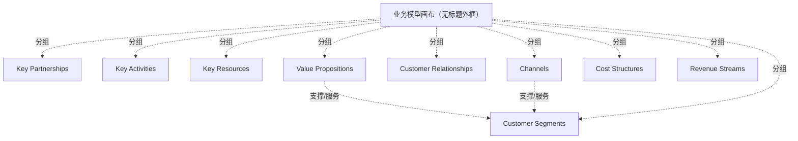

# G18A/figA-1 · 业务模型画布

类型：`business-model-canvas`。在附录 A 给出业务模型画布的标准结构与九块名称，配合正文逐条定义，作为第 7 章零售案例与全书业务模型表述的参照框架。

英文 PDF 物理页：[29]。本页为架构语义分析，原文与原图分别保留。

## 原图与可编辑图


[完整 JSON](figA-1.json) · [可编辑 Mermaid](figA-1.mmd) · [仅关系图](figA-1.relations.mmd) · [层级分解图](figA-1.hierarchy.mmd)

图形重建表达语义，不复制源图布局。虚线表示解释、矩阵映射或分组关系，不自动表示不确定性的概率。



## 架构分析

按画布布局读：中列 Value Propositions；向右上 Customer Relationships、右下 Channels、最右 Customer Segments；向左 Key Partnerships，其右上 Key Activities、右下 Key Resources；底部左 Cost Structures、右 Revenue Streams。每块左上角是块名，右侧配一幅线描小图。图中没有条目文字，具体内容需回到正文九条定义。

- 本图有 10 个具名或隐含元素、2 条关系和 9 条包含/分组记录。
- 包含/分组树最大深度为 1；根节点为 业务模型画布（无标题外框）。
- 本图没有可直接确认为人员直属汇报的关系；视觉上下位置、能力分解和治理职责分别读取。
- 空白模板包含9块及其插图，没有填入案例、问题文本或连线。
- 保留Key Partnerships、Cost Structures等此图的原词和复数，不替换成其他画布的近义词。

### 如何用于项目

- 先明确受益方和价值主张，再把各画布要素关联到能力、价值流及所需资源。
- 画布用于假设和共同理解；不能替代细化的实现架构或已验证经营数据。

### 结构所表达的逻辑

- 九个构建块：Key Partnerships、Key Activities、Value Propositions、Customer Relationships、Customer Segments、Key Resources、Channels、Cost Structures、Revenue Streams。
- 版式是标准画布：上半五列，其中关键合作伙伴、价值主张、客户细分三块通高，关键活动/关键资源与客户关系/渠道分别上下叠放；下半为成本结构与收入来源两段。
- 与图 2-4 的用词不同：此处为 Key Partnerships（复数）、Cost Structures（复数）、Customer Segments；图 2-4 用手绘版 Key Partners、Costs、Customers。
- 每块内只有一幅线描小图（戒指、挖掘机、礼盒、心形、人物、木箱、卡车、票据、收银机），仅作视觉提示，不承载信息。
- 画布内没有任何条目、数字或箭头，只有块名；这是一张结构定义图，不是某个企业的实例。
- 中文稿附录 A 正文按客户细分、价值主张、渠道、客户关系、收入来源、关键资源、关键活动、关键合作伙伴、成本结构的顺序逐条给出定义。

## 上下级与包含

两层：外层画布框下分九个构建块，块内不再分层（只有块名与插画）。九个块并列，其中三块通高、四块两两上下叠放、两块位于底部。

|父项|子项|层级类型|依据与解释|
|---|---|---|---|
|业务模型画布（无标题外框）|关键合作伙伴|visual_grouping|框、泳道、域或分类组的成员归属；没有额外证据不提升为业务组合或管理关系。|
|业务模型画布（无标题外框）|关键活动|visual_grouping|框、泳道、域或分类组的成员归属；没有额外证据不提升为业务组合或管理关系。|
|业务模型画布（无标题外框）|关键资源|visual_grouping|框、泳道、域或分类组的成员归属；没有额外证据不提升为业务组合或管理关系。|
|业务模型画布（无标题外框）|价值主张|visual_grouping|框、泳道、域或分类组的成员归属；没有额外证据不提升为业务组合或管理关系。|
|业务模型画布（无标题外框）|客户关系|visual_grouping|框、泳道、域或分类组的成员归属；没有额外证据不提升为业务组合或管理关系。|
|业务模型画布（无标题外框）|渠道|visual_grouping|框、泳道、域或分类组的成员归属；没有额外证据不提升为业务组合或管理关系。|
|业务模型画布（无标题外框）|客户细分|visual_grouping|框、泳道、域或分类组的成员归属；没有额外证据不提升为业务组合或管理关系。|
|业务模型画布（无标题外框）|成本结构|visual_grouping|框、泳道、域或分类组的成员归属；没有额外证据不提升为业务组合或管理关系。|
|业务模型画布（无标题外框）|收入来源|visual_grouping|框、泳道、域或分类组的成员归属；没有额外证据不提升为业务组合或管理关系。|

## 全部元素与角色

|元素ID|原文名称|类型|含义|直接父项|深度|
|---|---|---|---|---|---|
|canvas|业务模型画布（无标题外框）|group|分组：业务模型画布（无标题外框）|—||
|kp|Key Partnerships|group|块内画有一对相扣的圆环。|业务模型画布（无标题外框）|1|
|ka|Key Activities|group|块内画有一人操作挖掘机。|业务模型画布（无标题外框）|1|
|kr|Key Resources|group|块内画有一人守着木箱。|业务模型画布（无标题外框）|1|
|vp|Value Propositions|group|块内画有一个系缎带的礼盒。|业务模型画布（无标题外框）|1|
|cr|Customer Relationships|group|块内画有一颗心。|业务模型画布（无标题外框）|1|
|ch|Channels|group|块内画有一辆厢式货车。|业务模型画布（无标题外框）|1|
|cs|Customer Segments|group|块内画有一个站立的人。|业务模型画布（无标题外框）|1|
|cost|Cost Structures|group|块内画有一张带线条的票据。|业务模型画布（无标题外框）|1|
|rev|Revenue Streams|group|块内画有一台收银机。|业务模型画布（无标题外框）|1|

## 全部关系

图中没有箭头或关系连线，只有分隔九个块用的直线。块的相邻与上下叠放表达画布的标准布局，不表示流程或依赖方向。

|主体|语义关系|客体|显式线/隐式|原文标签|依据|
|---|---|---|---|---|---|
|价值主张|支撑/服务|客户细分|implicit||Appendix A原文定义价值主张面向客户、渠道用于触达客户；这是正文支持的概念关系，图上没有连接箭头。|
|渠道|支撑/服务|客户细分|implicit||Appendix A原文定义价值主张面向客户、渠道用于触达客户；这是正文支持的概念关系，图上没有连接箭头。|

## 本轮否定的历史关系

以下旧解释保留用于追溯，不进入当前关系图、层级或知识图谱的有效边。

|旧记录|主体|旧关系|客体|否定依据|
|---|---|---|---|---|
|2|关键合作伙伴|dependency|关键活动|九宫格的邻接排列不能证明特定Key Partners→Key Activities依赖。正文只称伙伴使商业模式运作，未给这两个块之间的定向依赖。|

## 本轮语义修正

- Appendix A原文定义价值主张面向客户、渠道用于触达客户；这是正文支持的概念关系，图上没有连接箭头。
- Appendix A原文定义价值主张面向客户、渠道用于触达客户；这是正文支持的概念关系，图上没有连接箭头。
- 九宫格的邻接排列不能证明特定Key Partners→Key Activities依赖。正文只称伙伴使商业模式运作，未给这两个块之间的定向依赖。

## 误读检查

- 不要把图 A-1 与图 2-4 当成同一张图：图 A-1 是平面九宫格（Key Partnerships / Customer Segments / Cost Structures / Revenue Streams），图 2-4 是手绘透视图（Key Partners / Customers / Costs / Revenue）。
- 不要从块内的线描小图推断该块的具体内容，它们只是装饰性提示。
- 不要把九个块读成流程步骤；画布是同时成立的结构。
- 中文稿第 337 行图 A-1 复用了图 2-4 的 SVG，但两张英文原图并不相同，不能据该 SVG 判断图 A-1 的原貌。

## 原文证据

### [PDF 第 28 页](../../../documents/G18A.md#page-28)

> The Business Model Canvas includes nine building blocks, as depicted in Figure A-1:
### [PDF 第 29 页](../../../documents/G18A.md#page-29)

> The Business Model Canvas is a particularly useful tool for understanding how a business handles its key determinants of revenue and cost, the value proposition it uses to go to market, the customers it serves, and the resources it needs to execute. These elements play a crucial step in laying the framework for:
> • The remaining work to address the specific application, information, and technology solutions

## 来源与分析状态

所有元素/关系均有来源定位；未把历史解释重命名为本轮逐线视觉确认。源图与语义图是两种视图，布局不证明汇报或因果。

源 PDF SHA-256：`ed764e6eaeaad0cfccc67841223c76429684b31f188e6e90fbaf17cd44bc1fe4`。

源图记录：[原始解释与转录](../../../figures/G18A/figA-1.json)。

```json
{
  "quality": {
    "graph_integrity": "checked",
    "semantic_analysis": "typed-graph-and-context-analysis",
    "visual_review": "source-content-audited",
    "notice_zh": "所有元素/关系均有来源定位；未把历史解释重命名为本轮逐线视觉确认。源图与语义图是两种视图，布局不证明汇报或因果。"
  },
  "source_uncertainty": {
    "confidence": "high",
    "uncertainties_zh": [
      "画布本身没有标题，图题仅写在图注中；是否应把“Figure A-1”视为画布标题，图中无法判断。",
      "块内线描小图是否对应特定隐喻（如戒指=伙伴关系、心=关系），原图未注释。",
      "原图使用 Cost Structures 复数形式，中文稿统一译为“成本结构”，不复数化。"
    ],
    "analyzed_from": [
      "英文 PDF 第 29 页原图截图（figA-1_p29_1.png，1240 px 宽，块名可直接辨读）",
      "英文 PDF 第 28–29 页正文",
      "中文稿 G18Ae_业务模型.md 第 315–337 行",
      "figs/g18a_fig2-4.svg 源码与 SVG 文本（中文稿为图 A-1 复用该资产）"
    ],
    "date": "2026-10-31"
  },
  "source_conflicts": []
}
```
