# G190/fig2-1 · 金融机构的简单信息地图

类型：`architecture-concept-or-system-model`。第 2 章把信息地图定义为“信息概念及其相互关系的集合”，本图给出一个最小可读的样例：先用“名词质疑”从业务语言中挑出关键名词，再把它们按业务说法连起来。正文同时声明这只是简单高层示例，更细致的建模见附录 A。

英文 PDF 物理页：[12]。本页为架构语义分析，原文与原图分别保留。

## 原图与可编辑图


[完整 JSON](fig2-1.json) · [可编辑 Mermaid](fig2-1.mmd) · [仅关系图](fig2-1.relations.mmd) · [层级分解图](fig2-1.hierarchy.mmd)

图形重建表达语义，不复制源图布局。虚线表示解释、矩阵映射或分组关系，不自动表示不确定性的概率。

```mermaid
flowchart TB
  %% Semantic reconstruction; see original source image for exact layout.
  n0["Payment"]
  n1["Loan"]
  n2["Customer"]
  n3["Account"]
  n4["Branch"]
  n5["Employee"]
  n0 -->|"关联"| n1
  n1 ---|"关联 &#91;图文冲突&#93;"| n2
  n2 -->|"关联"| n3
  n4 -->|"关联"| n1
  n4 -->|"关联"| n3
  n5 -->|"关联"| n2
  n5 -->|"关联"| n4
```



## 架构分析

没有固定起点，可从任一概念出发沿箭头读：箭头尾部是句子的主语，箭头指向宾语，线上方/旁的动词短语是关系名。例如 Employee → Branch 旁的 works for 读作“员工为分支机构工作”。先读概念框（蓝色），再读箭头标签，不要给框补充属性和基数。

- 本图有 6 个具名或隐含元素、7 条关系和 0 条包含/分组记录。
- 本图没有可直接确认为人员直属汇报的关系；视觉上下位置、能力分解和治理职责分别读取。
- 六个信息概念和七条具名箭头逐项核对。
- Loan→Customer图上箭头与requests or receives语法方向冲突，保留图箭头并单列语义解释不确定性，不能说Loan请求Customer。

### 如何用于项目

- 围绕作者目的读取本图实体、分组与连线，并用对应原文限定其含义。
- 把参考模型与项目事实分开，实际范围、约束、值和责任须有项目证据。

### 结构所表达的逻辑

- 全图只有 6 个概念、7 条关系，全部是业务名词和业务动词，没有属性、主键、基数——这正是信息地图区别于数据模型的地方。
- 关系用业务语言表达（is made against、requests or receives、holds、provides、manages、supports、works for），没有采用 UML 的关联/组合/泛化等建模记法。
- 客户是关系的汇聚点：客户“申请或接收”贷款、“持有”账户；贷款与账户又分别被付款、分支机构连接。
- 付款只连到贷款（is made against），说明付款是针对某笔贷款发生的，而不是直接挂在客户或账户上。
- 分支机构同时“提供”贷款、“管理”账户；员工“支持”客户、“为”分支机构“工作”，把组织侧的概念也纳入同一张图。
- 图中有意省略了产品、渠道等概念，属于“简单、高层”示例；正文明确更详细的示例与技术放在附录 A。
- 方向不可反读：holds 是客户→账户（客户持有账户），works for 是员工→分支机构，反过来会改变业务含义。

## 上下级与包含

没有上下级。6 个信息概念平级，图中没有分类、分解或包含关系；层级只体现在概念图整体属于“信息地图”这一制品。

|父项|子项|层级类型|依据与解释|
|---|---|---|---|
|—|—|无视觉包含|关系中明确的组成/特化见 JSON semantic_hierarchy。|

## 全部元素与角色

|元素ID|原文名称|类型|含义|直接父项|深度|
|---|---|---|---|---|---|
|ic_payment|Payment|data|信息概念；只与 Loan 相连。|—||
|ic_loan|Loan|data|信息概念；连接付款、客户、分支机构。|—||
|ic_customer|Customer|data|信息概念；连接贷款、账户、员工。|—||
|ic_account|Account|data|信息概念；连接客户与分支机构。|—||
|ic_branch|Branch|data|信息概念；连接贷款、账户、员工。|—||
|ic_employee|Employee|data|信息概念；连接客户与分支机构。|—||

## 全部关系

7 条黑色实线箭头都带动词标签，方向表示业务语句的主语→宾语；没有虚线、没有菱形（组合/聚合）、没有空心三角（泛化）、也没有基数标注。关系是业务词汇层面的关联，不承诺任何实现或数据结构。

|主体|语义关系|客体|显式线/隐式|原文标签|依据|
|---|---|---|---|---|---|
|付款|关联|贷款|显式连线|is made against|付款针对某笔贷款发生（水平箭头向右）。|
|贷款|关联|客户|显式连线|requests or receives|箭头画为Loan→Customer，标签却是requests or receives；记录冲突，不把其中一个强行当成唯一业务语义。|
|客户|关联|账户|显式连线|holds|客户持有账户；斜线由右上指向账户。|
|分支机构|关联|贷款|显式连线|provides|分支机构提供贷款；斜线由左下指向贷款。|
|分支机构|关联|账户|显式连线|manages|分支机构管理账户；斜线由左下指向账户。|
|员工|关联|客户|显式连线|supports|员工支持客户；竖线由员工向上指向客户。|
|员工|关联|分支机构|显式连线|works for|员工为分支机构工作；长横线由右向左指向分支机构。|

### 极性、基数与图文冲突

数值和符号按原图记录；业务解释与原图冲突时分别保存，不静默修正原文。

|关系ID|极性|基数/端点标记|冲突说明|
|---|---|---|---|
|G190/fig2-1#r0002||null|{"kind": "label-versus-drawn-arrow", "drawn_arrow": "Loan→Customer", "label_en": "requests or receives", "label_reading": "Customer requests or receives Loan"}|

## 本轮语义修正

- 箭头画为Loan→Customer，标签却是requests or receives；记录冲突，不把其中一个强行当成唯一业务语义。

## 误读检查

- 不要当成 ER 图或类图：图里没有属性、主键、外键和基数，付款与贷款之间不是数据库的“一对多”。
- “持有”是客户→账户，不是账户→客户；中文重绘 SVG 把这条线画成从贷款出发且不接触账户，不能据它理解。
- 6 个概念之间没有分类层级，贷款不是付款的一种，账户也不是客户的子类。
- 图中没有出现“产品”，不能据此认为该金融机构没有产品概念——正文说明这是刻意简化的示例。

## 原文证据

### [PDF 第 12 页](../../../documents/G190.md#page-12)

> A simple, high-level example of an Information Map is shown in Figure 2-1. This illustrates some key information concepts and inter-relationships that might be found at a financial company. Appendix A provides more detailed examples and techniques for modeling information than this simple representation and includes the use of specific modeling languages.

## 来源与分析状态

所有元素/关系均有来源定位；未把历史解释重命名为本轮逐线视觉确认。源图与语义图是两种视图，布局不证明汇报或因果。

源 PDF SHA-256：`7d7431f02be8992e49abbee999263a7d0065506dd6f8d94da210b2ae20853d03`。

源图记录：[原始解释与转录](../../../figures/G190/fig2-1.json)。

```json
{
  "quality": {
    "graph_integrity": "checked",
    "semantic_analysis": "typed-graph-and-context-analysis",
    "visual_review": "source-content-audited",
    "notice_zh": "所有元素/关系均有来源定位；未把历史解释重命名为本轮逐线视觉确认。源图与语义图是两种视图，布局不证明汇报或因果。"
  },
  "source_uncertainty": {
    "confidence": "high",
    "uncertainties_zh": [
      "原图未说明 7 条关系是否有意省略其他概念间关系，本分析只按画出的线记录。",
      "“is made against”的中文译法不唯一（针对贷款付款／以贷款为付款对象），此处取“针对……付款”。"
    ],
    "analyzed_from": [
      "英文 PDF 第 12 页图 2-1 原图截图（含 2x2 放大分块）",
      "英文 PDF 第 12 页正文与第 16 页相关段落",
      "中文稿 G190e_信息映射.md 第 94、98 行",
      "figs/g190_fig2-1.svg 源码及其渲染图对比"
    ],
    "date": "2026-10-31"
  },
  "source_conflicts": []
}
```
