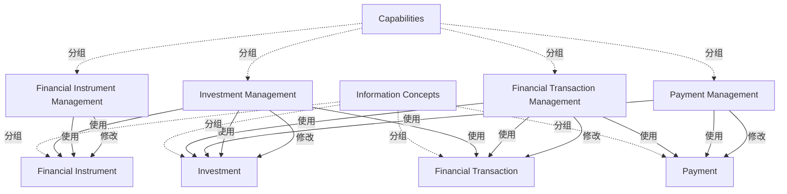

# G190/fig4-1 · 业务能力与信息概念

类型：`architecture-concept-or-system-model`。第 4 章说明信息地图与业务能力地图联系最紧密：设计未来态架构时能力使用信息概念，能力也确立（修改）信息概念。本图用“投资”场景给出能力—信息交叉映射的一个子集，示范如何在不假定数据存储或系统的前提下描述业务制品。

英文 PDF 物理页：[14]。本页为架构语义分析，原文与原图分别保留。

## 原图与可编辑图


[完整 JSON](fig4-1.json) · [可编辑 Mermaid](fig4-1.mmd) · [仅关系图](fig4-1.relations.mmd) · [层级分解图](fig4-1.hierarchy.mmd)

图形重建表达语义，不复制源图布局。虚线表示解释、矩阵映射或分组关系，不自动表示不确定性的概率。



## 架构分析

先读左右两列标题（Capabilities / Information Concepts），再按行看红色水平箭头：每项能力修改与它同名的信息概念。然后看蓝色斜线：从右列信息概念出发、箭头落在左列能力上的，表示该能力使用这个信息概念。蓝色线会交叉，读线时以箭头落点（能力端）为准，不要按起点所在行猜。

- 本图有 10 个具名或隐含元素、13 条关系和 8 条包含/分组记录。
- 包含/分组树最大深度为 1；根节点为 业务能力、信息概念。
- 本图没有可直接确认为人员直属汇报的关系；视觉上下位置、能力分解和治理职责分别读取。
- 四个能力、四个信息概念、四条Modifies与九条Uses逐线核对；Uses的原图箭头朝向能力，但语义主体是使用信息的能力。
- 两列标题只是分类，不是封闭容器；交叉线没有连接点。

### 如何用于项目

- 围绕作者目的读取本图实体、分组与连线，并用对应原文限定其含义。
- 把参考模型与项目事实分开，实际范围、约束、值和责任须有项目证据。

### 结构所表达的逻辑

- 4 项能力各自“修改”一个同名信息概念（红箭头水平向右），这是能力的产出/维护责任。
- 除同名概念外，能力还“使用”其他信息概念：投资管理使用投资、金融工具、金融交易三项，是使用最多的能力。
- 信息概念也被多项能力共享：投资信息被投资管理、支付管理、金融交易管理三项能力使用；付款信息被支付管理（同名）和金融交易管理使用。
- 金融工具管理只使用金融工具（加同名水平线），映射最单纯；金融交易管理使用金融交易、投资、付款三项。
- 红蓝两种箭头表达两种不同责任：修改=写/维护，使用=读/引用；同一对能力—概念可以只有其中一种。
- 图中刻意不出现数据仓储、业务系统等实现元素，说明这是业务架构层面的信息概念映射，不是数据模型。
- 正文指出这只是构建“投资”概念的映射子集，完整映射还应包含协议、合作伙伴等能力与信息概念。

## 上下级与包含

两列同层元素：各自的列头只分类，不是业务父实体；能力与信息之间全为使用/修改映射。

|父项|子项|层级类型|依据与解释|
|---|---|---|---|
|业务能力|投资管理|classified_under|列标题用于分类；没有封闭容器，也不表示业务上下级。|
|业务能力|金融工具管理|classified_under|列标题用于分类；没有封闭容器，也不表示业务上下级。|
|业务能力|支付管理|classified_under|列标题用于分类；没有封闭容器，也不表示业务上下级。|
|业务能力|金融交易管理|classified_under|列标题用于分类；没有封闭容器，也不表示业务上下级。|
|信息概念|投资|classified_under|列标题用于分类；没有封闭容器，也不表示业务上下级。|
|信息概念|金融工具|classified_under|列标题用于分类；没有封闭容器，也不表示业务上下级。|
|信息概念|付款|classified_under|列标题用于分类；没有封闭容器，也不表示业务上下级。|
|信息概念|金融交易|classified_under|列标题用于分类；没有封闭容器，也不表示业务上下级。|

## 全部元素与角色

|元素ID|原文名称|类型|含义|直接父项|深度|
|---|---|---|---|---|---|
|grp_capabilities|Capabilities|group|分组：业务能力|—||
|grp_information|Information Concepts|group|分组：信息概念|—||
|cap_investment|Investment Management|capability|能力：投资管理|业务能力|1|
|cap_financial_instrument|Financial Instrument Management|capability|能力：金融工具管理|业务能力|1|
|cap_payment|Payment Management|capability|能力：支付管理|业务能力|1|
|cap_financial_transaction|Financial Transaction Management|capability|能力：金融交易管理|业务能力|1|
|info_investment|Investment|data|信息/数据：投资|信息概念|1|
|info_financial_instrument|Financial Instrument|data|信息/数据：金融工具|信息概念|1|
|info_payment|Payment|data|信息/数据：付款|信息概念|1|
|info_financial_transaction|Financial Transaction|data|信息/数据：金融交易|信息概念|1|

## 全部关系

红色实线箭头（4 条）= 能力修改信息，方向由能力指向信息概念；蓝色实线箭头（9 条）= 能力使用信息，方向由信息概念指向能力。两者都是直线、无虚线、无基数、无组合/泛化符号；蓝线在中间交叉但交叉点不表示任何关系。

|主体|语义关系|客体|显式线/隐式|原文标签|依据|
|---|---|---|---|---|---|
|投资管理|修改|投资|显式连线|Modifies|红色水平箭头，能力修改同名信息概念。|
|金融工具管理|修改|金融工具|显式连线|Modifies|修改|
|支付管理|修改|付款|显式连线|Modifies|修改|
|金融交易管理|修改|金融交易|显式连线|Modifies|修改|
|投资管理|使用|投资|显式连线|Uses|蓝箭头从信息指向消费能力；语义主语是能力，故记录能力uses信息。visual保留原蓝箭头方向。|
|金融工具管理|使用|金融工具|显式连线|Uses|蓝箭头从信息指向消费能力；语义主语是能力，故记录能力uses信息。visual保留原蓝箭头方向。|
|支付管理|使用|付款|显式连线|Uses|蓝箭头从信息指向消费能力；语义主语是能力，故记录能力uses信息。visual保留原蓝箭头方向。|
|金融交易管理|使用|金融交易|显式连线|Uses|蓝箭头从信息指向消费能力；语义主语是能力，故记录能力uses信息。visual保留原蓝箭头方向。|
|投资管理|使用|金融工具|显式连线|Uses|蓝箭头从信息指向消费能力；语义主语是能力，故记录能力uses信息。visual保留原蓝箭头方向。|
|支付管理|使用|投资|显式连线|Uses|蓝箭头从信息指向消费能力；语义主语是能力，故记录能力uses信息。visual保留原蓝箭头方向。|
|金融交易管理|使用|投资|显式连线|Uses|蓝箭头从信息指向消费能力；语义主语是能力，故记录能力uses信息。visual保留原蓝箭头方向。|
|金融交易管理|使用|付款|显式连线|Uses|蓝箭头从信息指向消费能力；语义主语是能力，故记录能力uses信息。visual保留原蓝箭头方向。|
|投资管理|使用|金融交易|显式连线|Uses|蓝箭头从信息指向消费能力；语义主语是能力，故记录能力uses信息。visual保留原蓝箭头方向。|

## 能力 × 信息概念交叉映射（按原图逐条线转录）

```json
{
  "id": "t_crossmap",
  "title_zh": "能力 × 信息概念交叉映射（按原图逐条线转录）",
  "columns": [
    "能力",
    "信息概念",
    "关系",
    "线型"
  ],
  "rows": [
    [
      "投资管理 Investment Management",
      "投资 Investment",
      "修改 Modifies",
      "红色实线箭头，能力→概念"
    ],
    [
      "金融工具管理 Financial Instrument Management",
      "金融工具 Financial Instrument",
      "修改 Modifies",
      "红色实线箭头，能力→概念"
    ],
    [
      "支付管理 Payment Management",
      "付款 Payment",
      "修改 Modifies",
      "红色实线箭头，能力→概念"
    ],
    [
      "金融交易管理 Financial Transaction Management",
      "金融交易 Financial Transaction",
      "修改 Modifies",
      "红色实线箭头，能力→概念"
    ],
    [
      "投资管理 Investment Management",
      "投资 Investment",
      "使用 Uses",
      "蓝色实线箭头，概念→能力"
    ],
    [
      "金融工具管理 Financial Instrument Management",
      "金融工具 Financial Instrument",
      "使用 Uses",
      "蓝色实线箭头，概念→能力"
    ],
    [
      "支付管理 Payment Management",
      "付款 Payment",
      "使用 Uses",
      "蓝色实线箭头，概念→能力"
    ],
    [
      "金融交易管理 Financial Transaction Management",
      "金融交易 Financial Transaction",
      "使用 Uses",
      "蓝色实线箭头，概念→能力"
    ],
    [
      "投资管理 Investment Management",
      "金融工具 Financial Instrument",
      "使用 Uses",
      "蓝色斜线"
    ],
    [
      "支付管理 Payment Management",
      "投资 Investment",
      "使用 Uses",
      "蓝色斜线"
    ],
    [
      "金融交易管理 Financial Transaction Management",
      "投资 Investment",
      "使用 Uses",
      "蓝色斜线"
    ],
    [
      "金融交易管理 Financial Transaction Management",
      "付款 Payment",
      "使用 Uses",
      "蓝色斜线"
    ],
    [
      "投资管理 Investment Management",
      "金融交易 Financial Transaction",
      "使用 Uses",
      "蓝色斜线"
    ]
  ],
  "notes_zh": "每行对应原图中一条画出的线；蓝线共 9 条（4 条水平、5 条斜线），红线 4 条。"
}
```

## 本轮语义修正

- 蓝箭头从信息指向消费能力；语义主语是能力，故记录能力uses信息。visual保留原蓝箭头方向。
- 蓝箭头从信息指向消费能力；语义主语是能力，故记录能力uses信息。visual保留原蓝箭头方向。
- 蓝箭头从信息指向消费能力；语义主语是能力，故记录能力uses信息。visual保留原蓝箭头方向。
- 蓝箭头从信息指向消费能力；语义主语是能力，故记录能力uses信息。visual保留原蓝箭头方向。
- 蓝箭头从信息指向消费能力；语义主语是能力，故记录能力uses信息。visual保留原蓝箭头方向。
- 蓝箭头从信息指向消费能力；语义主语是能力，故记录能力uses信息。visual保留原蓝箭头方向。
- 蓝箭头从信息指向消费能力；语义主语是能力，故记录能力uses信息。visual保留原蓝箭头方向。
- 蓝箭头从信息指向消费能力；语义主语是能力，故记录能力uses信息。visual保留原蓝箭头方向。
- 蓝箭头从信息指向消费能力；语义主语是能力，故记录能力uses信息。visual保留原蓝箭头方向。

## 误读检查

- 蓝线箭头指向能力，不能按“能力→信息”读成能力向信息提供数据；语义是“信息被能力使用”。
- 红线与蓝线不是“强/弱”或“正/负”的极性，而是两种不同关系（修改 vs 使用）。
- 同名能力与概念之间的水平线不是“等同”，而是“该能力修改该信息概念”。
- 蓝线交叉处没有节点，交叉不代表两条关系相交或互相影响。
- 中文重绘 SVG 无箭头、且把多条线接到错误的概念上（如投资管理—付款），不能据它推断能力—信息对应关系。

## 原文证据

### [PDF 第 14 页](../../../documents/G190.md#page-14)

> For example, the Investment Management capability can be defined as the “ability to identify, develop, analyze, valuate, exchange, acquire, dispose of, and report on any type of monetary asset purchased with the idea that the asset will provide income in the future or will be sold at a higher price for a profit”. While the primary information concept for this capability is Investment, additional information concepts are used by Investment Management and, conversely, Investment information is used by other capabilities. A subset of capability-to-information cross-mappings involved in framing an Investment are represented in Figure 4-1. A more comprehensive mapping would include Agreement, Partner, and other capabilities and information concepts.
### [PDF 第 15 页](../../../documents/G190.md#page-15)

> Each capability shown in Figure 4-1 requires and modifies information concepts directly related to that capability, such as Investment Management, which modifies Investment information. In addition, Investment Management requires Financial Instrument information as well as information on the Financial Transaction marking the execution of the trade. Similarly, Payment Management requires Investment Information, and Financial Transaction Management requires Investment and Payment information. Notice that in each of these examples the business artifacts can be characterized and related without assuming specific implementations, such as data repositories and business systems. This mapping allows many approaches for assigning roles to execute processes, more powerful architectural assessments, and a broader array of solutions.

## 来源与分析状态

所有元素/关系均有来源定位；未把历史解释重命名为本轮逐线视觉确认。源图与语义图是两种视图，布局不证明汇报或因果。

源 PDF SHA-256：`7d7431f02be8992e49abbee999263a7d0065506dd6f8d94da210b2ae20853d03`。

源图记录：[原始解释与转录](../../../figures/G190/fig4-1.json)。

```json
{
  "quality": {
    "graph_integrity": "checked",
    "semantic_analysis": "typed-graph-and-context-analysis",
    "visual_review": "source-content-audited",
    "notice_zh": "所有元素/关系均有来源定位；未把历史解释重命名为本轮逐线视觉确认。源图与语义图是两种视图，布局不证明汇报或因果。"
  },
  "source_uncertainty": {
    "confidence": "medium",
    "uncertainties_zh": [
      "蓝线共 9 条（按能力端和概念端的箭头/出线计数），但原图只有 8 个可见的 Uses 文字标签，靠近投资管理右上角的两条线似乎共用标签，无法确定哪一条没有独立标签。",
      "斜线在中间大量交叉，个别线（如投资→支付管理与金融工具→投资管理）的标签归属靠端点与斜率推断，未见文字重复标注。"
    ],
    "analyzed_from": [
      "英文 PDF 第 14 页图 4-1 原图截图及 2x2 放大分块",
      "对原图蓝色/红色像素按列扫描并做 Hough 直线拟合，确认 9 条蓝线与 4 条红线的端点",
      "英文 PDF 第 14、15 页正文",
      "中文稿 G190e_信息映射.md 第 131–139 行",
      "figs/g190_fig4-1.svg 源码"
    ],
    "date": "2026-10-31"
  },
  "source_conflicts": []
}
```
