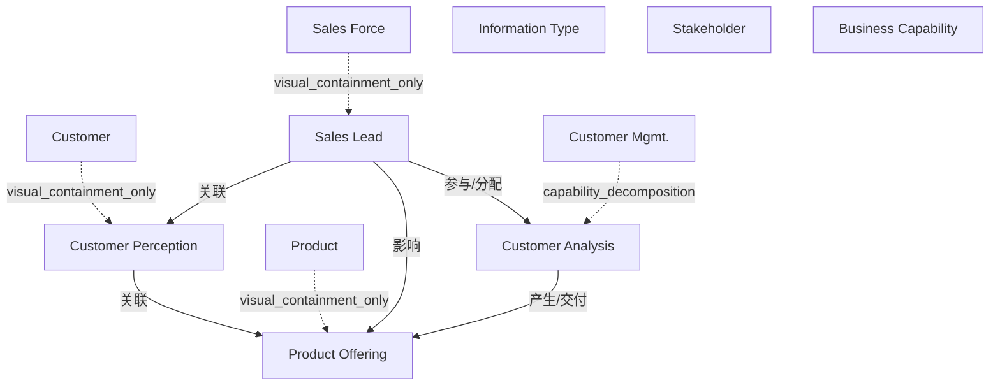

# G190/fig5-1 · 多个业务概念之间的示例关系

类型：`architecture-concept-or-system-model`。第 5 章要说明信息地图不等于数据模型：客户认知是主观判断，不能存成数据字段，但它与产品供给、销售能力、利益相关者之间存在真实关系。本图给出这种“多概念关系”的样例，为图 2-1/4-1 这类可数据化的示例作对照。

英文 PDF 物理页：[16]。本页为架构语义分析，原文与原图分别保留。

## 原图与可编辑图


[完整 JSON](fig5-1.json) · [可编辑 Mermaid](fig5-1.mmd) · [仅关系图](fig5-1.relations.mmd) · [层级分解图](fig5-1.hierarchy.mmd)

图形重建表达语义，不复制源图布局。虚线表示解释、矩阵映射或分组关系，不自动表示不确定性的概率。



## 架构分析

先看右侧图例确认卡片标题颜色的含义（蓝=信息类型、绿=利益相关者、红=业务能力），再按箭头读四个概念：客户认知—产品供给在上方，销售线索在左下，客户分析在右下。箭头旁的动词短语说明主语对宾语做什么；卡片彩色标题是类别，白色部分才是被连线指涉的具体概念。

- 本图有 11 个具名或隐含元素、5 条关系和 4 条包含/分组记录。
- 包含/分组树最大深度为 1；根节点为 客户、产品、销售队伍、客户管理、信息类型、利益相关者、业务能力。
- 本图没有可直接确认为人员直属汇报的关系；视觉上下位置、能力分解和治理职责分别读取。
- 包含分组后有 4 个连通分量；分离可能源于图例、并列分类或独立示例，未自动补边。
- 四张概念卡、三色图例、五条带词语箭头完整核对；卡片上栏表示类别/所属领域，下栏是概念名称。
- Sales Lead为利益相关者，Customer Analysis为业务能力，Customer Perception与Product Offering为信息；不是组织树。

### 如何用于项目

- 围绕作者目的读取本图实体、分组与连线，并用对应原文限定其含义。
- 把参考模型与项目事实分开，实际范围、约束、值和责任须有项目证据。

### 结构所表达的逻辑

- 四个概念分属三种类型：客户认知与产品供给是信息类型，销售线索是利益相关者，客户分析是业务能力；颜色只标在卡片标题上。
- 客户认知“基于”产品供给：企业需要了解客户对某产品的认知，才能做内部规划（正文语境）。
- 销售线索负责人“评估”客户认知——这是一种依赖经验、无法还原为数据字段的主观判断，正是本图要说明的非数据化信息。
- 销售线索“影响产品供给的结果”，并“具备”客户分析能力：利益相关者通过能力作用于信息，而不是直接读写数据。
- 客户分析（业务能力）“建立”产品供给：能力确立信息概念，与第 4 章“能力使用/修改信息”的论断一致。
- 图中没有任何数据存储、字段或系统，说明信息地图可以描述尚未（甚至无法）数据化的业务信息。

## 上下级与包含

上栏标注领域/类型、下栏标注具体信息或能力的卡片内分区；它们不是人事汇报或业务分解。

|父项|子项|层级类型|依据与解释|
|---|---|---|---|
|客户|客户认知|visual_containment_only|保存原图解释中的包含；业务关系类型需要图例或正文进一步限定。|
|产品|产品供给|visual_containment_only|保存原图解释中的包含；业务关系类型需要图例或正文进一步限定。|
|销售队伍|销售负责人|visual_containment_only|保存原图解释中的包含；业务关系类型需要图例或正文进一步限定。|
|客户管理|客户分析|capability_decomposition|同类能力的包含分解；能力实例与能力类型另以实例化关系记录。|

## 全部元素与角色

|元素ID|原文名称|类型|含义|直接父项|深度|
|---|---|---|---|---|---|
|cust_type|Customer|data|信息/数据：客户|—||
|customer_perception|Customer Perception|data|信息/数据：客户认知|客户|1|
|product_type|Product|data|信息/数据：产品|—||
|product_offering|Product Offering|data|信息/数据：产品供给|产品|1|
|sales_force|Sales Force|organization_unit|组织单元：销售队伍|—||
|sales_lead|Sales Lead|stakeholder|Sales Lead在本图为Stakeholder；正文描述其评估客户并推荐产品，非销售线索数据对象。|销售队伍|1|
|customer_mgmt|Customer Mgmt.|capability|能力：客户管理|—||
|customer_analysis|Customer Analysis|capability|能力：客户分析|客户管理|1|
|legend_information|Information Type|notation|原图右侧图例，不是另一个业务实体。|—||
|legend_stakeholder|Stakeholder|notation|原图右侧图例，不是另一个业务实体。|—||
|legend_capability|Business Capability|notation|原图右侧图例，不是另一个业务实体。|—||

### 客户：属性

```json
{
  "card_color": "blue"
}
```

### 产品：属性

```json
{
  "card_color": "blue"
}
```

### 销售队伍：属性

```json
{
  "card_color": "green"
}
```

### 客户管理：属性

```json
{
  "card_color": "red"
}
```

## 全部关系

5 条黑色实线箭头，均带动词短语：is based on（客户认知→产品供给）、evaluates（销售线索→客户认知）、impacts the outcome of（销售线索→产品供给）、has the ability（销售线索→客户分析）、establishes（客户分析→产品供给）。箭头方向即句子主语→宾语；没有虚线、基数或组合/泛化符号。

|主体|语义关系|客体|显式线/隐式|原文标签|依据|
|---|---|---|---|---|---|
|客户认知|关联|产品供给|显式连线|is based on|上方水平箭头，客户认知基于产品供给。|
|销售负责人|关联|客户认知|显式连线|evaluates|左侧竖直箭头向上，销售线索负责人评估客户认知。|
|销售负责人|影响|产品供给|显式连线|impacts the outcome of|中部斜线，销售线索负责人影响产品供给的结果。|
|销售负责人|参与/分配|客户分析|显式连线|has the ability|下方水平箭头，销售线索负责人具备客户分析能力。|
|客户分析|产生/交付|产品供给|显式连线|establishes|右侧竖直箭头向上，客户分析能力建立产品供给信息。|

## 误读检查

- 卡片彩色标题不是与白框并列的第二个实体，而是同一张卡片上的类别标题；箭头都落在白色部分的具体概念上。
- “is based on”箭头由客户认知指向产品供给（客户认知基于产品供给），不是产品供给基于客户认知。
- 红色卡片标题“Customer Mgmt.”只是说明这是业务能力类别，不代表客户管理系统或组织单元。
- 中文图的“销售线索”是错译，不要据此把 Sales Lead 理解为营销线索；它是做出产品建议的人（利益相关者）。
- 本图不是数据模型：客户认知被正文明确描述为不可直接读取、不可还原为数据字段的信息。

## 原文证据

### [PDF 第 16 页](../../../documents/G190.md#page-16)

> For example, a critical type of customer information may be Customer Perception; a characterization of their viewpoint in relation to a specific topic. Another critical type of information for your business may be Product Offering, which has a relationship to Customer Perception where your business needs to know that perception of that product to inform internal planning. A Sales Lead (stakeholder) has the ability to assess customer needs (Customer Analysis – a business capability), which includes the subjective ability (not in a form reducible to a data field), through experience, to assess Customer Perception. The Sales Lead, armed with stored data such as previous sales volume in a customer relationship management system and product characteristics in a product data management system, makes a final recommendation on product development based on their subjective view of Customer Perception. A sample of this relationship is shown in Figure 5-1.

## 来源与分析状态

所有元素/关系均有来源定位；未把历史解释重命名为本轮逐线视觉确认。源图与语义图是两种视图，布局不证明汇报或因果。

源 PDF SHA-256：`7d7431f02be8992e49abbee999263a7d0065506dd6f8d94da210b2ae20853d03`。

源图记录：[原始解释与转录](../../../figures/G190/fig5-1.json)。

```json
{
  "quality": {
    "graph_integrity": "checked",
    "semantic_analysis": "typed-graph-and-context-analysis",
    "visual_review": "source-content-audited",
    "notice_zh": "所有元素/关系均有来源定位；未把历史解释重命名为本轮逐线视觉确认。源图与语义图是两种视图，布局不证明汇报或因果。"
  },
  "source_uncertainty": {
    "confidence": "high",
    "uncertainties_zh": [
      "卡片彩色标题与白色正文究竟是“类别+具体概念”还是“同一概念的两行名称”，原图未明说；此处按前者记录并作为父子关系。",
      "“impacts the outcome of”从销售线索卡片的右上角（Sales Force 标题处）引出而非白框正文，但语义指向 Sales Lead；元素归属按正文判断。"
    ],
    "analyzed_from": [
      "英文 PDF 第 16 页图 5-1 原图截图",
      "英文 PDF 第 16 页正文",
      "中文稿 G190e_信息映射.md 第 153、157 行及第 161–181 行标签对照表",
      "figs/g190e_fig5-1_en.png 与 figs/zh/g190e_fig5-1_zh.png"
    ],
    "date": "2026-10-31"
  },
  "source_conflicts": []
}
```
