# G190/figA-1 · 使用 ArchiMate 语言的信息地图

类型：`architecture-model`。附录 A.1 要证明 ArchiMate 的正式语义能让信息地图“更深入地揭示信息景观的结构”。本图用保险场景示范：同一批业务对象之间可以区分聚合、组合、泛化和普通关联，比第 2 章的简单概念图表达力更强，但仍不涉及属性与基数。

英文 PDF 物理页：[22]。本页为架构语义分析，原文与原图分别保留。

## 原图与可编辑图


[完整 JSON](figA-1.json) · [可编辑 Mermaid](figA-1.mmd) · [仅关系图](figA-1.relations.mmd) · [层级分解图](figA-1.hierarchy.mmd)

图形重建表达语义，不复制源图布局。虚线表示解释、矩阵映射或分组关系，不自动表示不确定性的概率。

```mermaid
flowchart TB
  %% Semantic reconstruction; see original source image for exact layout.
  n0["Customer"]
  n1["Insurance File"]
  n2["Insurance Request"]
  n3["Insurance Policy"]
  n4["Claim"]
  n5["Travel Insurance Policy"]
  n6["Homeowner&#x27;s Insurance Policy"]
  n7["Auto Insurance Policy"]
  n8["Legal expense Insurance Policy"]
  n0 -->|"聚合"| n1
  n1 -->|"包含组成"| n2
  n1 -->|"包含组成"| n4
  n1 -->|"包含组成"| n3
  n2 ---|"关联"| n3
  n3 ---|"关联"| n4
  n5 -->|"特化"| n3
  n6 -->|"特化"| n3
  n7 -->|"特化"| n3
  n8 -->|"特化"| n3
```



## 架构分析

从顶部 Customer 往下读：先看菱形判断整体—部分（空心=聚合、实心=组合，菱形永远在“整体”一端），再看底部的空心三角判断泛化（三角指向父类）。左右两条没有符号的线是普通关联。图中没有箭头和基数，不要按数据模型的主外键去读。

- 本图有 9 个具名或隐含元素、10 条关系和 0 条包含/分组记录。
- 本图没有可直接确认为人员直属汇报的关系；视觉上下位置、能力分解和治理职责分别读取。
- 九个业务对象全部核对：Customer聚合Insurance File；File组合Request/Policy/Claim；四种保险类型以空心三角特化Policy。
- Request—Policy与Policy—Claim均为无箭头关联；没有数值基数。

### 如何用于项目

- 按节点类型建立业务、应用、数据、技术对象，并保留跨层服务、访问和实现关系。
- 交叉线不是连接点；角色分工、数据使用和组织汇报不得混用。

### 结构所表达的逻辑

- Customer 与 Insurance File 之间是空心菱形聚合：客户拥有保险档案，档案可以独立于客户存在。
- Insurance File 与 Insurance Request、Insurance Policy、Claim 之间是实心菱形组合：保险档案由申请、保单、理赔三类记录构成，部分随整体存亡。
- Insurance Policy 是父类型，四种具体保单（Travel、Homeowner's、Auto、Legal expense Insurance Policy）通过空心三角泛化到它。
- Insurance Request 与 Insurance Policy、Insurance Policy 与 Claim 之间只有无标签的普通关联线，表示业务上相关但不构成整体—部分或分类。
- 全图只有业务对象，没有属性、主键和基数——正文明确 ArchiMate 是比 UML 更简化的模型，省略方法、属性和关系基数。
- 业务对象代表有形实体（如保单记录），而信息概念本身是无形的；本图用前者承载后者，是 ArchiMate 表达信息地图的基本手法。

## 上下级与包含

四层：Customer（L1）→ Insurance File（L2）→ Insurance Request / Insurance Policy / Claim（L3）→ 四种具体保单（L4）。层级由聚合、组合、泛化三种结构关系表达；Insurance Request 与 Policy、Policy 与 Claim 之间的关联不产生层级。

|父项|子项|层级类型|依据与解释|
|---|---|---|---|
|—|—|无视觉包含|关系中明确的组成/特化见 JSON semantic_hierarchy。|

### 业务组成与特化

|父项/范围/类型|子项/责任对象/实例|语义|
|---|---|---|
|客户|保险档案|aggregation|
|保险档案|保险申请|composition|
|保险档案|理赔|composition|
|保险档案|保单|composition|
|保单|旅行险保单|type_specialization|
|保单|家财险保单|type_specialization|
|保单|车险保单|type_specialization|
|保单|法律费用险保单|type_specialization|

## 全部元素与角色

|元素ID|原文名称|类型|含义|直接父项|深度|
|---|---|---|---|---|---|
|bo_customer|Customer|data|信息/数据：客户|—||
|bo_insurance_file|Insurance File|data|信息/数据：保险档案|—||
|bo_insurance_request|Insurance Request|data|信息/数据：保险申请|—||
|bo_insurance_policy|Insurance Policy|data|信息/数据：保单|—||
|bo_claim|Claim|data|信息/数据：理赔|—||
|bo_travel_policy|Travel Insurance Policy|data|信息/数据：旅行险保单|—||
|bo_homeowner_policy|Homeowner's Insurance Policy|data|信息/数据：家财险保单|—||
|bo_auto_policy|Auto Insurance Policy|data|信息/数据：车险保单|—||
|bo_legal_expense_policy|Legal expense Insurance Policy|data|信息/数据：法律费用险保单|—||

## 全部关系

空心菱形（Customer 端）= 聚合，菱形在整体端；实心菱形（Insurance File 端）= 组合，菱形在整体端；空心三角（Insurance Policy 端）= 泛化，四条线从子类汇到父类；无符号实线 = 普通关联（Request—Policy、Policy—Claim）。全部为实线、无箭头、无基数、无关系名。

|主体|语义关系|客体|显式线/隐式|原文标签|依据|
|---|---|---|---|---|---|
|客户|聚合|保险档案|显式连线||空心菱形在 Customer 端，客户聚合保险档案。|
|保险档案|包含组成|保险申请|显式连线||实心菱形在 Insurance File 端，经折线连到保险申请。|
|保险档案|包含组成|理赔|显式连线||实心菱形在 Insurance File 端，经右侧折线连到理赔。|
|保险档案|包含组成|保单|显式连线||实心菱形在 Insurance File 底边，竖直连到保单。|
|保险申请|关联|保单|显式连线||第三层两框之间的水平无符号实线。|
|保单|关联|理赔|显式连线||保单与理赔之间的水平无符号实线。|
|旅行险保单|特化|保单|显式连线||空心三角指向父类保单，线从左一子类汇入。|
|家财险保单|特化|保单|显式连线||空心三角指向父类保单，线从左二子类汇入。|
|车险保单|特化|保单|显式连线||空心三角指向父类保单，线从右二子类汇入。|
|法律费用险保单|特化|保单|显式连线||空心三角指向父类保单，线从右一子类汇入。|

## 误读检查

- 菱形在整体一端：Customer ◇— Insurance File 读作“客户聚合保险档案”，不是“保险档案聚合客户”。
- 空心菱形是聚合、实心菱形是组合，两者不能混读；只有组合才表示部分随整体存亡。
- 底部的空心三角是泛化（子类→父类），不是“包含”或“指向”；四种保单是 Insurance Policy 的子类型，不是其组成部分。
- 图顶部的黄色窄条是被裁切的元素残片（标签不可见），不是标题栏或图例。
- 中文重绘 SVG 画的是客户/账户/交易与“含义”，与原图无关，不能代替本图。

## 原文证据

### [PDF 第 22 页](../../../documents/G190.md#page-22)

> Figure A-1 presents an Information Map in the ArchiMate language using business object elements.

## 来源与分析状态

所有元素/关系均有来源定位；未把历史解释重命名为本轮逐线视觉确认。源图与语义图是两种视图，布局不证明汇报或因果。

源 PDF SHA-256：`7d7431f02be8992e49abbee999263a7d0065506dd6f8d94da210b2ae20853d03`。

源图记录：[原始解释与转录](../../../figures/G190/figA-1.json)。

```json
{
  "quality": {
    "graph_integrity": "checked",
    "semantic_analysis": "typed-graph-and-context-analysis",
    "visual_review": "source-content-audited",
    "notice_zh": "所有元素/关系均有来源定位；未把历史解释重命名为本轮逐线视觉确认。源图与语义图是两种视图，布局不证明汇报或因果。"
  },
  "source_uncertainty": {
    "confidence": "medium",
    "uncertainties_zh": [
      "图顶 Customer 上方还有一条被页面裁切的黄色矩形残片，只能看到底部一条边，标签不可见，无法判断它是什么元素（正文也未提及），故未列入 elements。",
      "Insurance File 的中文译名“保险档案”为解析者拟定，中文稿未给出该图术语表。",
      "ArchiMate 中聚合/组合的菱形方向按 UML 惯例（菱形在整体端）判读；原图未加文字说明。"
    ],
    "analyzed_from": [
      "英文 PDF 第 22 页图 A-1 原图截图及 3x 局部放大（Customer–Insurance File、Insurance File 两侧组合、泛化三角）",
      "英文 PDF 第 22 页整页与正文",
      "中文稿 G190e_信息映射.md 第 240–247 行",
      "figs/g190_figA-1.svg 源码及渲染图"
    ],
    "date": "2026-10-31"
  },
  "source_conflicts": []
}
```
