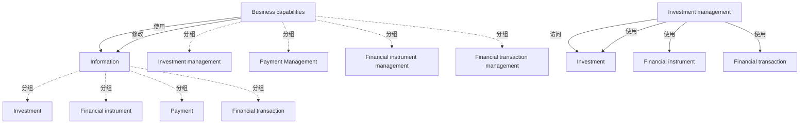

# G190/figA-2 · 使用 ArchiMate 语言的“信息—业务能力”交叉映射

类型：`architecture-model`。附录 A.1 在讲完业务对象之间的结构关系后，用本图说明 ArchiMate 还能表达信息概念与业务能力等其他业务架构概念之间的关系。上方分组图给出总体关系，下方详图证明这些关系可以落到底层业务对象上。

英文 PDF 物理页：[23]。本页为架构语义分析，原文与原图分别保留。

## 原图与可编辑图


[完整 JSON](figA-2.json) · [可编辑 Mermaid](figA-2.mmd) · [仅关系图](figA-2.relations.mmd) · [层级分解图](figA-2.hierarchy.mmd)

图形重建表达语义，不复制源图布局。虚线表示解释、矩阵映射或分组关系，不自动表示不确定性的概率。



## 架构分析

先读上方两个分组框：Information 组左侧引出的虚线箭头（Uses）指向 Business capabilities 组，表示信息被能力使用；反向的实线（Modifies）连接两组，表示能力修改信息。再读下方面板：这是投资管理一行的放大，实线 Modifies 从投资管理连到 Investment，三条虚线 Uses 分别从 Investment、Financial instrument、Financial transaction 指回投资管理。

- 本图有 14 个具名或隐含元素、6 条关系和 8 条包含/分组记录。
- 包含/分组树最大深度为 1；根节点为 业务能力、信息、Investment management（下方细化图）、Investment（下方细化图）、Financial instrument（下方细化图）、Financial transaction（下方细化图）。
- 本图没有可直接确认为人员直属汇报的关系；视觉上下位置、能力分解和治理职责分别读取。
- 包含分组后有 2 个连通分量；分离可能源于图例、并列分类或独立示例，未自动补边。
- 上图四个能力/四个信息类型及两个总括容器，下图重复出现Investment management与三种信息。
- 下图与上图同名节点是两个绘图出现位置，必须分别保留实例ID；六条线逐端点核对，Uses语义为能力使用信息。

### 如何用于项目

- 按节点类型建立业务、应用、数据、技术对象，并保留跨层服务、访问和实现关系。
- 交叉线不是连接点；角色分工、数据使用和组织汇报不得混用。

### 结构所表达的逻辑

- 上图把两类元素各装进一个 ArchiMate 分组（Business capabilities / Information），关系只画在分组边界上，是高度概括的视图。
- Uses 用虚线、Modifies 用实线，线型本身编码关系种类；Uses 的箭头指向能力（信息被能力使用），Modifies 没有箭头但按标签读作能力→信息。
- 下方面板把投资管理展开：它修改 Investment，同时使用 Investment、Financial instrument、Financial transaction 三个业务对象。
- 同一个业务对象可以既被修改又被使用：Investment 在详图中同时出现在 Modifies 与 Uses 两端。
- 投资管理是唯一被展开的能力，说明这一面板是示例性的下钻，而不是完整映射。
- 分组框、能力框、业务对象框都带 ArchiMate 图标，表明这是 ArchiMate 视图而非普通框图。

## 上下级与包含

两层容器关系：Business capabilities 分组包含 4 项能力，Information 分组包含 4 个业务对象；能力与业务对象之间是使用/修改的交叉关系，不构成层级。下方面板是同一模型的一个局部视图，不是新的层级。

|父项|子项|层级类型|依据与解释|
|---|---|---|---|
|业务能力|投资管理|visual_grouping|框、泳道、域或分类组的成员归属；没有额外证据不提升为业务组合或管理关系。|
|业务能力|支付管理|visual_grouping|框、泳道、域或分类组的成员归属；没有额外证据不提升为业务组合或管理关系。|
|业务能力|金融工具管理|visual_grouping|框、泳道、域或分类组的成员归属；没有额外证据不提升为业务组合或管理关系。|
|业务能力|金融交易管理|visual_grouping|框、泳道、域或分类组的成员归属；没有额外证据不提升为业务组合或管理关系。|
|信息|投资|visual_grouping|框、泳道、域或分类组的成员归属；没有额外证据不提升为业务组合或管理关系。|
|信息|金融工具|visual_grouping|框、泳道、域或分类组的成员归属；没有额外证据不提升为业务组合或管理关系。|
|信息|付款|visual_grouping|框、泳道、域或分类组的成员归属；没有额外证据不提升为业务组合或管理关系。|
|信息|金融交易|visual_grouping|框、泳道、域或分类组的成员归属；没有额外证据不提升为业务组合或管理关系。|

## 全部元素与角色

|元素ID|原文名称|类型|含义|直接父项|深度|
|---|---|---|---|---|---|
|grp_capabilities|Business capabilities|group|分组：业务能力|—||
|grp_information|Information|group|分组：信息|—||
|cap_investment|Investment management|capability|能力：投资管理|业务能力|1|
|cap_payment|Payment Management|capability|能力：支付管理|业务能力|1|
|cap_financial_instrument|Financial instrument management|capability|能力：金融工具管理|业务能力|1|
|cap_financial_transaction|Financial transaction management|capability|能力：金融交易管理|业务能力|1|
|info_investment|Investment|data|信息/数据：投资|信息|1|
|info_financial_instrument|Financial instrument|data|信息/数据：金融工具|信息|1|
|info_payment|Payment|data|信息/数据：付款|信息|1|
|info_financial_transaction|Financial transaction|data|信息/数据：金融交易|信息|1|
|cap_investment_detail|Investment management|capability|上方概览图同名类型的第二次绘图出现，使用独立节点避免丢失上下两图的拓扑。|—||
|info_investment_detail|Investment|data|上方概览图同名类型的第二次绘图出现，使用独立节点避免丢失上下两图的拓扑。|—||
|info_financial_instrument_detail|Financial instrument|data|上方概览图同名类型的第二次绘图出现，使用独立节点避免丢失上下两图的拓扑。|—||
|info_financial_transaction_detail|Financial transaction|data|上方概览图同名类型的第二次绘图出现，使用独立节点避免丢失上下两图的拓扑。|—||

## 全部关系

Uses的虚线箭头在画面从信息指向能力，语义按能力uses信息保存；Modifies无向实线按标签读为能力修改信息。视觉方向与使用关系主语分别记录。

|主体|语义关系|客体|显式线/隐式|原文标签|依据|
|---|---|---|---|---|---|
|业务能力|使用|信息|显式连线|Uses|Uses的语义是能力使用信息；画面箭头朝能力保存在visual，语义边用使用者→信息对象。|
|业务能力|修改|信息|显式连线|Modifies|上方面板：两分组之间的实线，无箭头。|
|Investment management（下方细化图）|访问|Investment（下方细化图）|显式连线|Modifies|该线属于下方细化图，端点指向下方独立出现节点；Uses按能力使用信息读，Modifies按能力修改信息读。|
|Investment management（下方细化图）|使用|Investment（下方细化图）|显式连线|Uses|该线属于下方细化图，端点指向下方独立出现节点；Uses按能力使用信息读，Modifies按能力修改信息读。|
|Investment management（下方细化图）|使用|Financial instrument（下方细化图）|显式连线|Uses|该线属于下方细化图，端点指向下方独立出现节点；Uses按能力使用信息读，Modifies按能力修改信息读。|
|Investment management（下方细化图）|使用|Financial transaction（下方细化图）|显式连线|Uses|该线属于下方细化图，端点指向下方独立出现节点；Uses按能力使用信息读，Modifies按能力修改信息读。|

## 本轮语义修正

- Uses的语义是能力使用信息；画面箭头朝能力保存在visual，语义边用使用者→信息对象。
- 该线属于下方细化图，端点指向下方独立出现节点；Uses按能力使用信息读，Modifies按能力修改信息读。
- 该线属于下方细化图，端点指向下方独立出现节点；Uses按能力使用信息读，Modifies按能力修改信息读。
- 该线属于下方细化图，端点指向下方独立出现节点；Uses按能力使用信息读，Modifies按能力修改信息读。
- 该线属于下方细化图，端点指向下方独立出现节点；Uses按能力使用信息读，Modifies按能力修改信息读。

## 误读检查

- 上方的分组级连线只是概括：不能据此认为 Information 组内每个业务对象都参与 Use，具体参与情况要看下方面板。
- Uses 是虚线箭头且指向能力；Modifies 是实线且没有箭头，不能凭“有没有箭头”判断谁是主语。
- 下方面板不是第二套模型，而是投资管理一行的放大；两处出现同名元素是重复展示，不是重复定义。
- 分组框（Business capabilities / Information）是 ArchiMate 的容器，不是能力或信息概念本身。
- 中文重绘 SVG 只有 2×2 个元素、没有分组和虚线，不能据它理解本图的两层结构。

## 原文证据

### [PDF 第 23 页](../../../documents/G190.md#page-23)

> Figure A-2: Information-to-Business Capability Cross-Mapping using the ArchiMate Language

## 来源与分析状态

所有元素/关系均有来源定位；未把历史解释重命名为本轮逐线视觉确认。源图与语义图是两种视图，布局不证明汇报或因果。

源 PDF SHA-256：`7d7431f02be8992e49abbee999263a7d0065506dd6f8d94da210b2ae20853d03`。

源图记录：[原始解释与转录](../../../figures/G190/figA-2.json)。

```json
{
  "quality": {
    "graph_integrity": "checked",
    "semantic_analysis": "typed-graph-and-context-analysis",
    "visual_review": "source-content-audited",
    "notice_zh": "所有元素/关系均有来源定位；未把历史解释重命名为本轮逐线视觉确认。源图与语义图是两种视图，布局不证明汇报或因果。"
  },
  "source_uncertainty": {
    "confidence": "medium",
    "uncertainties_zh": [
      "下方面板左侧、投资管理框后面还有一段被裁切的白色矩形与顶部细线残片（可能是原幻灯片的分组边框或标题），标签不可见，无法判定其身份，未列入 elements。",
      "分组级的两条线是原图的高度概括画法，ArchiMate 规范中并不存在“组到组”的 Uses/Modifies 关系类型；此处按图面文字记录为 serving/access，不主张其符合严格语义。",
      "原图能力框/业务对象框右上角的小图标分辨率有限，按位置判断为 ArchiMate 的能力与业务对象标记。"
    ],
    "analyzed_from": [
      "英文 PDF 第 23 页图 A-2 原图截图（含上方面板与下方面板）",
      "英文 PDF 第 23 页整页与正文",
      "中文稿 G190e_信息映射.md 第 249–251 行",
      "figs/g190_figA-2.svg 源码"
    ],
    "date": "2026-10-31"
  },
  "source_conflicts": []
}
```
