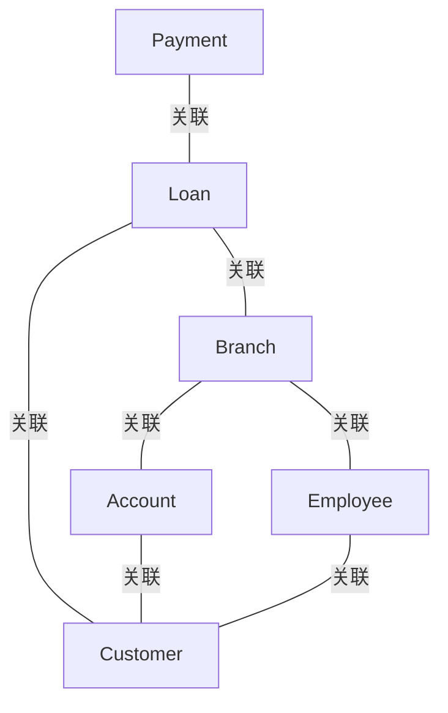

# G190/figA-3 · UML 中的信息地图

类型：`architecture-metamodel`。附录 A.2 要说明 UML 类图特别适合信息映射：它比 ArchiMate 多出属性（以及后文的基数），可以把每个业务实体所承载的逻辑信息单元列清楚。本图先给类与属性的全貌，基数留给图 A-4 单独示范。

英文 PDF 物理页：[24]。本页为架构语义分析，原文与原图分别保留。

## 原图与可编辑图


[完整 JSON](figA-3.json) · [可编辑 Mermaid](figA-3.mmd) · [仅关系图](figA-3.relations.mmd) · [层级分解图](figA-3.hierarchy.mmd)

图形重建表达语义，不复制源图布局。虚线表示解释、矩阵映射或分组关系，不自动表示不确定性的概率。



## 架构分析

逐个类读：黄色标题条是类名，下面每行是一个属性，前缀 + 表示 public。类之间的实线只表示“业务上相关”，没有箭头、没有基数、没有关联名。先读类名确认有哪些信息类型，再按线看它们如何相连（付款—贷款—客户、贷款—分支机构—账户、分支机构—员工—客户）。

- 本图有 6 个具名或隐含元素、7 条关系和 0 条包含/分组记录。
- 本图没有可直接确认为人员直属汇报的关系；视觉上下位置、能力分解和治理职责分别读取。
- 六个UML类、各属性名和七条无箭头关联均逐项核对；没有显示关系基数。

### 如何用于项目

- 使用本图的实体类型作为建模词表，建立本地实体ID，再分别填入关系端点与证据。
- 核对主动/被动关系的语义方向和基数；实现、使能、使用、包含及实例化分别建模。

### 结构所表达的逻辑

- 6 个类与图 2-1 的 6 个信息概念一一对应（付款、贷款、客户、分支机构、账户、员工），但这里补上了属性，信息量更大。
- 属性列在类框内，全部为 public（+），且只给名称不给类型；正文说属性是与各业务实体相关的逻辑信息单元，必须在某处完整定义。
- 7 条关联线没有任何标签、箭头或基数，只表达“这两个信息类型相关”；多重度要到图 A-4 才出现。
- 关联的拓扑与图 2-1 相同：付款—贷款—客户、贷款—分支机构—账户、分支机构—员工—客户，形成一个闭合的关系网。
- 类框画成右侧/底部带阴影的“堆叠纸张”样式，是原图的制图风格，不代表多个类或多重实例。
- 正文指出 UML 比 ArchiMate 更详细（有属性、基数和可选的关联名），但本图仍属于概念层，不含方法或数据库实现。

## 上下级与包含

没有层级：6 个类平级，关联线只表示相关，不是分类或包含。属性在类框内形成“类—属性”的两级文字结构，但属性不是独立元素。

|父项|子项|层级类型|依据与解释|
|---|---|---|---|
|—|—|无视觉包含|关系中明确的组成/特化见 JSON semantic_hierarchy。|

## 全部元素与角色

|元素ID|原文名称|类型|含义|直接父项|深度|
|---|---|---|---|---|---|
|cls_payment|Payment|data|信息/数据：付款|—||
|cls_loan|Loan|data|信息/数据：贷款|—||
|cls_customer|Customer|data|信息/数据：客户|—||
|cls_branch|Branch|data|信息/数据：分支机构|—||
|cls_account|Account|data|信息/数据：账户|—||
|cls_employee|Employee|data|信息/数据：员工|—||

### 付款：属性

```json
{
  "visibility": "+",
  "attributes": [
    "Payment_Number",
    "Payment_Date",
    "Payment_Amount"
  ]
}
```

### 贷款：属性

```json
{
  "visibility": "+",
  "attributes": [
    "Amount",
    "Loan_Number"
  ]
}
```

### 客户：属性

```json
{
  "visibility": "+",
  "attributes": [
    "Customer_ID",
    "Customer_Name",
    "Customer_City",
    "Customer_Street"
  ]
}
```

### 分支机构：属性

```json
{
  "visibility": "+",
  "attributes": [
    "Branch_Name",
    "Branch_Code",
    "Branch_City"
  ]
}
```

### 账户：属性

```json
{
  "visibility": "+",
  "attributes": [
    "Account_ID",
    "Balance"
  ]
}
```

### 员工：属性

```json
{
  "visibility": "+",
  "attributes": [
    "Employee_ID",
    "Employee_Name",
    "Dependent_Name",
    "Telephone_Number",
    "Start_Date"
  ]
}
```

## 全部关系

7 条黑色实线均为无向关联（UML association），没有箭头（不表示导航性）、没有关联名、没有多重度；线只是把两个类连起来，方向不可读。

|主体|语义关系|客体|显式线/隐式|原文标签|依据|
|---|---|---|---|---|---|
|付款|关联|贷款|显式连线||上排水平实线，无标签。|
|贷款|关联|客户|显式连线||上排水平实线，无标签。|
|贷款|关联|分支机构|显式连线||从 Loan 左边缘折向左下，再接到 Branch 右上角。|
|分支机构|关联|账户|显式连线||中部水平实线，无标签。|
|账户|关联|客户|显式连线||从 Account 右边缘向右再向上，接到 Customer 底边。|
|分支机构|关联|员工|显式连线||从 Branch 底边向下再向右，接到 Employee 左边缘。|
|员工|关联|客户|显式连线||从 Employee 右边缘向右再向上，接到 Customer 底边右侧。|

## 误读检查

- 关联线没有箭头，不能读成“付款产生贷款”之类的流向；UML 关联默认是双向/未指定的。
- 图中没有多重度，不要因为付款只连贷款就推断“一对一”。
- 属性前的 + 是 UML 可见性 public，不是“新增”或“主键”。
- 黄色标题条是类名，不是包或分组；类框的阴影只是画法。
- 中文重绘 SVG 是客户/账户/交易三个类的另一种模型，且自加了基数与关系名，不能代替本图。

## 原文证据

### [PDF 第 24 页](../../../documents/G190.md#page-24)

> UML has its roots in object-oriented design. Its class diagrams are particularly useful for Information Mapping. The ArchiMate Specification’s representation of business objects and their relationships owes a lot to UML, basically being a less detailed model and omitting things like methods, attributes, and relationship cardinalities.
> In UML, cardinalities also allow the architect to constrain the number of objects of a certain class that can be related to a single object of the other class. For example, in Figure A-4, the cardinality (1..*) means that a customer must have at least one account, but that there is no upper limit on the number of accounts they can have; the cardinality (1..2) means that an account must be related to at least one, but no more than two customers.
### [PDF 第 25 页](../../../documents/G190.md#page-25)

> The attributes are logical units of information related to each of the business entities in the diagram. While it isn’t always necessary to show the attributes for every information concept on every diagram, it is necessary to define all the attributes for all the business entities somewhere. Tables, spreadsheets, and databases are all useful ways to store the related data for each information concept, as previously shown in Table 7-1.
> ERDs have a long history in information systems design. They are typically used at three levels of design:

## 来源与分析状态

所有元素/关系均有来源定位；未把历史解释重命名为本轮逐线视觉确认。源图与语义图是两种视图，布局不证明汇报或因果。

源 PDF SHA-256：`7d7431f02be8992e49abbee999263a7d0065506dd6f8d94da210b2ae20853d03`。

源图记录：[原始解释与转录](../../../figures/G190/figA-3.json)。

```json
{
  "quality": {
    "graph_integrity": "checked",
    "semantic_analysis": "typed-graph-and-context-analysis",
    "visual_review": "source-content-audited",
    "notice_zh": "所有元素/关系均有来源定位；未把历史解释重命名为本轮逐线视觉确认。源图与语义图是两种视图，布局不证明汇报或因果。"
  },
  "source_uncertainty": {
    "confidence": "high",
    "uncertainties_zh": [
      "属性名前的浅蓝色小图标在原图中过小，无法确认是建模工具的“public 属性”图标还是“数据类型”图标；属性本身没有给类型，故只记录名称。",
      "7 条关联线均无标签、无基数、无导航箭头，关联的语义只能按“业务相关”理解，无法确定两端角色名。"
    ],
    "analyzed_from": [
      "英文 PDF 第 24 页图 A-3 原图截图及 2x 放大分块（逐类转录属性）",
      "英文 PDF 第 24 页整页与正文",
      "英文 PDF 第 25 页属性段落",
      "中文稿 G190e_信息映射.md 第 255–263 行",
      "figs/g190_figA-3.svg 源码"
    ],
    "date": "2026-10-31"
  },
  "source_conflicts": []
}
```
