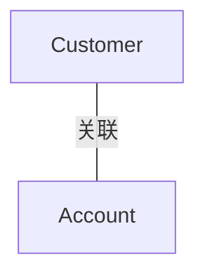

# G190/figA-4 · 信息类型之间的关系

类型：`architecture-metamodel`。附录 A.2 在讲完类与属性后，用本图补上 UML 的另一项能力：基数可以约束“一个类的对象能与另一类的多少个对象关联”。正文正是借这张图解释 1..* 与 1..2 的含义。

英文 PDF 物理页：[25]。本页为架构语义分析，原文与原图分别保留。

## 原图与可编辑图


[完整 JSON](figA-4.json) · [可编辑 Mermaid](figA-4.mmd) · [仅关系图](figA-4.relations.mmd) · [层级分解图](figA-4.hierarchy.mmd)

图形重建表达语义，不复制源图布局。虚线表示解释、矩阵映射或分组关系，不自动表示不确定性的概率。



## 架构分析

先读两个圆：左边 Customer、右边 Account，属性写在各自圆的下方并带类型。再看中间那条水平关联线：靠近某一端的数字描述“该端类相对另一端一个对象可以有多少个实例”。因此账户端的 1..* 表示一个客户至少有 1 个账户、数量无上限；客户端的 1..2 表示一个账户至少关联 1 个、最多 2 个客户。

- 本图有 2 个具名或隐含元素、1 条关系和 0 条包含/分组记录。
- 本图没有可直接确认为人员直属汇报的关系；视觉上下位置、能力分解和治理职责分别读取。
- 两个信息类型、五项属性、Customer端1..2及Account端1..*已核对正文。

### 如何用于项目

- 使用本图的实体类型作为建模词表，建立本地实体ID，再分别填入关系端点与证据。
- 核对主动/被动关系的语义方向和基数；实现、使能、使用、包含及实例化分别建模。

### 结构所表达的逻辑

- 两个信息类型：Customer 有 4 个带类型的属性（First Name/Last Name/Age/Address），Account 只有 1 个（Balance owing: currency）。
- 属性带类型（text、numeric、currency），比图 A-3 只给属性名更接近逻辑层设计。
- 账户端基数 1..*：一个客户必须至少拥有一个账户，账户数量没有上限。
- 客户端基数 1..2：一个账户必须关联至少一个、最多两个客户。
- 基数标在它所描述的那一端：读某个数字时要看它靠近哪个类，再反推另一端的对象。
- 图中没有箭头、没有关联名、没有角色名，关联是未指定导航性的双向关联。

## 上下级与包含

没有层级：两个类平级，只有一条关联。属性以文字清单挂在各自圆的下方，属于类的组成部分，不是独立元素。

|父项|子项|层级类型|依据与解释|
|---|---|---|---|
|—|—|无视觉包含|关系中明确的组成/特化见 JSON semantic_hierarchy。|

## 全部元素与角色

|元素ID|原文名称|类型|含义|直接父项|深度|
|---|---|---|---|---|---|
|cls_customer|Customer|data|信息/数据：客户|—||
|cls_account|Account|data|信息/数据：账户|—||

### 客户：属性

```json
{
  "attributes": [
    "First Name: text",
    "Last Name: text",
    "Age: numeric",
    "Address: text"
  ]
}
```

### 账户：属性

```json
{
  "attributes": [
    "Balance owing: currency"
  ]
}
```

## 全部关系

一条水平实线 = UML 无向关联；两端分别标多重度 1..2（客户端）与 1..*（账户端）；无箭头、无关联名、无角色名。圆形与圆内横线只是类符号的画法，不表示包含关系。

|主体|语义关系|客体|显式线/隐式|原文标签|依据|
|---|---|---|---|---|---|
|客户|关联|账户|显式连线||Customer端1..2：每个账户关联1至2位客户；Account端1..*：每个客户关联至少一个账户。|

### 极性、基数与图文冲突

数值和符号按原图记录；业务解释与原图冲突时分别保存，不静默修正原文。

|关系ID|极性|基数/端点标记|冲突说明|
|---|---|---|---|
|G190/figA-4#r0001||{"from": "1..2", "to": "1..*", "basis": "printed-source-cardinality"}||

## 本轮语义修正

- Customer端1..2：每个账户关联1至2位客户；Account端1..*：每个客户关联至少一个账户。

## 误读检查

- 不要把 1..2 读成“一个客户最多两个账户”：它标在客户一端，描述的是每个账户对应的客户数。
- 1..* 标在账户一端，描述的是每个客户对应的账户数（至少 1、无上限），不是“账户有很多客户”。
- 圆形不是 ER 图的实体椭圆，也不是维恩图；属性写在圆外下方。
- 中文重绘 SVG 把两个基数对调了（客户 1..*、账户 1..2），与正文解释相反，不能据它理解本图。
- 图里没有方法、没有主键标记，不能当作完整的类设计或数据库模式。

## 原文证据

### [PDF 第 24 页](../../../documents/G190.md#page-24)

> In UML, cardinalities also allow the architect to constrain the number of objects of a certain class that can be related to a single object of the other class. For example, in Figure A-4, the cardinality (1..*) means that a customer must have at least one account, but that there is no upper limit on the number of accounts they can have; the cardinality (1..2) means that an account must be related to at least one, but no more than two customers.
### [PDF 第 25 页](../../../documents/G190.md#page-25)

> The attributes are logical units of information related to each of the business entities in the diagram. While it isn’t always necessary to show the attributes for every information concept on every diagram, it is necessary to define all the attributes for all the business entities somewhere. Tables, spreadsheets, and databases are all useful ways to store the related data for each information concept, as previously shown in Table 7-1.
> ERDs have a long history in information systems design. They are typically used at three levels of design:

## 来源与分析状态

所有元素/关系均有来源定位；未把历史解释重命名为本轮逐线视觉确认。源图与语义图是两种视图，布局不证明汇报或因果。

源 PDF SHA-256：`7d7431f02be8992e49abbee999263a7d0065506dd6f8d94da210b2ae20853d03`。

源图记录：[原始解释与转录](../../../figures/G190/figA-4.json)。

```json
{
  "quality": {
    "graph_integrity": "checked",
    "semantic_analysis": "typed-graph-and-context-analysis",
    "visual_review": "source-content-audited",
    "notice_zh": "所有元素/关系均有来源定位；未把历史解释重命名为本轮逐线视觉确认。源图与语义图是两种视图，布局不证明汇报或因果。"
  },
  "source_uncertainty": {
    "confidence": "high",
    "uncertainties_zh": [
      "圆形类符号不是当前 UML 规范的标准类框（标准为矩形三栏），此处按原图记法描述为“简化的类符号”，不主张其符合 UML 图形规范。",
      "1..2 的业务合理性（一个账户最多两个客户）由原图与正文共同给出，未见进一步解释。"
    ],
    "analyzed_from": [
      "英文 PDF 第 25 页图 A-4 原图截图",
      "英文 PDF 第 24 页基数说明段落与第 25 页属性段落",
      "中文稿 G190e_信息映射.md 第 259–263 行",
      "figs/g190_figA-4.svg 源码"
    ],
    "date": "2026-10-31"
  },
  "source_conflicts": []
}
```
