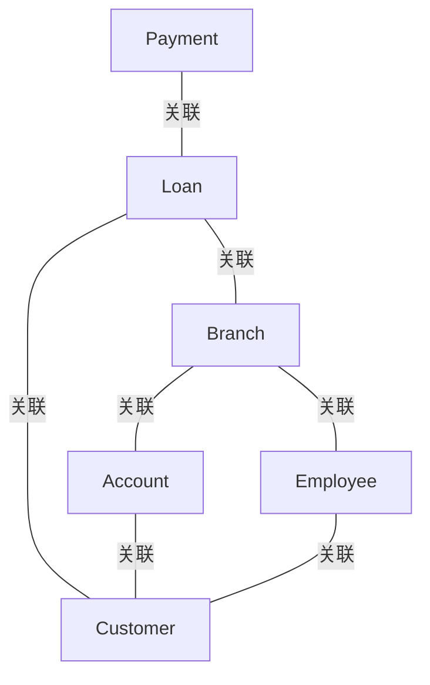

# G190/figA-5 · 实体关系图中的信息地图

类型：`architecture-metamodel`。附录 A.3 说明 ERD 在信息系统设计中的三个层次，并强调业务架构最常用概念层（有时逻辑层）。本图是概念层 ERD 的样例：实体仍是业务实体，但改用数据库设计者熟悉的鸦爪基数符号，为后续逻辑/物理设计留出接口。

英文 PDF 物理页：[26]。本页为架构语义分析，原文与原图分别保留。

## 原图与可编辑图


[完整 JSON](figA-5.json) · [可编辑 Mermaid](figA-5.mmd) · [仅关系图](figA-5.relations.mmd) · [层级分解图](figA-5.hierarchy.mmd)

图形重建表达语义，不复制源图布局。虚线表示解释、矩阵映射或分组关系，不自动表示不确定性的概率。



## 架构分析

逐个实体读属性，再沿关系线看两端的符号：圈 = 可选（0..1），竖杠 = 恰好一个，鸦爪 = 多个，圈+鸦爪 = 0..多，杠+鸦爪 = 1..多。符号画在哪一端，就描述哪一端相对另一端一个实例的基数。图中没有关系名，只能按符号读基数。

- 本图有 6 个具名或隐含元素、7 条关系和 0 条包含/分组记录。
- 本图没有可直接确认为人员直属汇报的关系；视觉上下位置、能力分解和治理职责分别读取。
- 六个ER实体、19项属性与七条连线已核对；圈/竖线/鸦爪只按本例源图记录，不自动补全缺失符号。

### 如何用于项目

- 使用本图的实体类型作为建模词表，建立本地实体ID，再分别填入关系端点与证据。
- 核对主动/被动关系的语义方向和基数；实现、使能、使用、包含及实例化分别建模。

### 结构所表达的逻辑

- 6 个实体与图 A-3 的 6 个类一一对应，属性清单基本相同，说明这是同一业务模型的 ERD 表达。
- 关系仍是 7 条，拓扑与图 A-3 完全一致：付款—贷款—客户、贷款—分支机构—账户、分支机构—员工—客户。
- 基数用鸦爪符号而非数字：图中出现圈（可选）、竖杠（一个）、圈+鸦爪（0..多）、杠+鸦爪（1..多）四种组合。
- 多数关系是一端为竖杠、另一端为圈，按标准 IE 读法是“一端恰好一个、另一端 0 或 1”；只有分支机构—账户是 0..多，员工—客户两端都是 1..多。
- Employee 的最后一个属性拼写为 Telephone_Numer（少一个 b），与图 A-3 的 Telephone_Number 不一致，属原图笔误。
- 实体框的青色标题条与图 A-3 的黄色标题条不同，是 ERD 工具的样式；属性前缀 + 仍表示 public。

## 上下级与包含

没有层级：6 个实体平级，关系线只表示关联；属性列在实体框内，是实体的组成部分而非独立元素。

|父项|子项|层级类型|依据与解释|
|---|---|---|---|
|—|—|无视觉包含|关系中明确的组成/特化见 JSON semantic_hierarchy。|

## 全部元素与角色

|元素ID|原文名称|类型|含义|直接父项|深度|
|---|---|---|---|---|---|
|ent_payment|Payment|data|信息/数据：付款|—||
|ent_loan|Loan|data|信息/数据：贷款|—||
|ent_customer|Customer|data|信息/数据：客户|—||
|ent_branch|Branch|data|信息/数据：分支机构|—||
|ent_account|Account|data|信息/数据：账户|—||
|ent_employee|Employee|data|信息/数据：员工|—||

### 付款：属性

```json
{
  "visibility": "+",
  "attributes": [
    "Payment_Number",
    "Payment_Date",
    "Payment_Amount"
  ]
}
```

### 贷款：属性

```json
{
  "visibility": "+",
  "attributes": [
    "Amount",
    "Loan_Number"
  ]
}
```

### 客户：属性

```json
{
  "visibility": "+",
  "attributes": [
    "Customer_ID",
    "Customer_Name",
    "Customer_Street",
    "Customer_City"
  ]
}
```

### 分支机构：属性

```json
{
  "visibility": "+",
  "attributes": [
    "Branch_Name",
    "Branch_Code",
    "Branch_City"
  ]
}
```

### 账户：属性

```json
{
  "visibility": "+",
  "attributes": [
    "Account_ID",
    "Balance"
  ]
}
```

### 员工：属性

```json
{
  "visibility": "+",
  "attributes": [
    "Employee_ID",
    "Employee_Name",
    "Dependent_Name",
    "Start_Date",
    "Telephone_Numer"
  ]
}
```

## 全部关系

7 条无箭头的实线关系，两端用鸦爪记法标基数；没有关系名、没有角色名、没有方向箭头。线条走向（水平、折线、绕行）只为避让实体框，不表达额外语义。

|主体|语义关系|客体|显式线/隐式|原文标签|依据|
|---|---|---|---|---|---|
|付款|关联|贷款|显式连线||原图端点符号：from=circle-only；to=single-bar。|
|贷款|关联|客户|显式连线||原图端点符号：from=single-bar；to=circle-only。|
|贷款|关联|分支机构|显式连线||原图端点符号：from=circle-only；to=single-bar。|
|分支机构|关联|账户|显式连线||原图端点符号：from=circle-and-crow-foot；to=single-bar。|
|账户|关联|客户|显式连线||原图端点符号：from=single-bar；to=circle-only。|
|分支机构|关联|员工|显式连线||原图端点符号：from=single-bar；to=circle-only。|
|员工|关联|客户|显式连线||原图端点符号：from=bar-and-crow-foot；to=bar-and-crow-foot。|

### 极性、基数与图文冲突

数值和符号按原图记录；业务解释与原图冲突时分别保存，不静默修正原文。

|关系ID|极性|基数/端点标记|冲突说明|
|---|---|---|---|
|G190/figA-5#r0001||{"from_symbol": "circle-only", "to_symbol": "single-bar", "basis": "literal-source-glyphs", "notice_zh": "单独圆圈仅表可选性，不从未显示的第二个符号推导完整上界。"}||
|G190/figA-5#r0002||{"from_symbol": "single-bar", "to_symbol": "circle-only", "basis": "literal-source-glyphs", "notice_zh": "单独圆圈仅表可选性，不从未显示的第二个符号推导完整上界。"}||
|G190/figA-5#r0003||{"from_symbol": "circle-only", "to_symbol": "single-bar", "basis": "literal-source-glyphs", "notice_zh": "单独圆圈仅表可选性，不从未显示的第二个符号推导完整上界。"}||
|G190/figA-5#r0004||{"from_symbol": "circle-and-crow-foot", "to_symbol": "single-bar", "basis": "literal-source-glyphs", "notice_zh": "单独圆圈仅表可选性，不从未显示的第二个符号推导完整上界。"}||
|G190/figA-5#r0005||{"from_symbol": "single-bar", "to_symbol": "circle-only", "basis": "literal-source-glyphs", "notice_zh": "单独圆圈仅表可选性，不从未显示的第二个符号推导完整上界。"}||
|G190/figA-5#r0006||{"from_symbol": "single-bar", "to_symbol": "circle-only", "basis": "literal-source-glyphs", "notice_zh": "单独圆圈仅表可选性，不从未显示的第二个符号推导完整上界。"}||
|G190/figA-5#r0007||{"from_symbol": "bar-and-crow-foot", "to_symbol": "bar-and-crow-foot", "basis": "literal-source-glyphs", "notice_zh": "单独圆圈仅表可选性，不从未显示的第二个符号推导完整上界。"}||

## 本轮语义修正

- 原图端点符号：from=circle-only；to=single-bar。
- 原图端点符号：from=single-bar；to=circle-only。
- 原图端点符号：from=circle-only；to=single-bar。
- 原图端点符号：from=circle-and-crow-foot；to=single-bar。
- 原图端点符号：from=single-bar；to=circle-only。
- 原图端点符号：from=single-bar；to=circle-only。
- 原图端点符号：from=bar-and-crow-foot；to=bar-and-crow-foot。

## 误读检查

- 鸦爪符号贴在实体边上时，读的是该实体的基数；不要按“靠近谁就属于谁”理解。
- 图中没有关系名，不能凭线的形状猜“持有/包含/订购”等业务动词——这些是中文重绘 SVG 自拟的。
- 本图是概念层 ERD，不是物理数据库模式：属性没有主外键标记，实体也未必已实现。
- 客户端的圈不是“零个客户”，而是“0 或 1 个”的可选基数；与图 A-4 的 1..2 不是同一套写法。
- Employee 的 Telephone_Numer 是原图拼写错误，不是另一个字段。

## 原文证据

### [PDF 第 25 页](../../../documents/G190.md#page-25)

> The attributes are logical units of information related to each of the business entities in the diagram. While it isn’t always necessary to show the attributes for every information concept on every diagram, it is necessary to define all the attributes for all the business entities somewhere. Tables, spreadsheets, and databases are all useful ways to store the related data for each information concept, as previously shown in Table 7-1.
> ERDs have a long history in information systems design. They are typically used at three levels of design:
### [PDF 第 26 页](../../../documents/G190.md#page-26)


## 来源与分析状态

所有元素/关系均有来源定位；未把历史解释重命名为本轮逐线视觉确认。源图与语义图是两种视图，布局不证明汇报或因果。

源 PDF SHA-256：`7d7431f02be8992e49abbee999263a7d0065506dd6f8d94da210b2ae20853d03`。

源图记录：[原始解释与转录](../../../figures/G190/figA-5.json)。

```json
{
  "quality": {
    "graph_integrity": "checked",
    "semantic_analysis": "typed-graph-and-context-analysis",
    "visual_review": "source-content-audited",
    "notice_zh": "所有元素/关系均有来源定位；未把历史解释重命名为本轮逐线视觉确认。源图与语义图是两种视图，布局不证明汇报或因果。"
  },
  "source_uncertainty": {
    "confidence": "medium",
    "uncertainties_zh": [
      "基数按标准 IE/鸦爪读法逐端记录（圈=0..1、杠=1、圈+鸦爪=0..*、杠+鸦爪=1..*），但其中 4 条关系按此读法得到的业务含义不自然（如“一个客户恰好一笔贷款”“一个分支机构恰好一个账户”），作者原意可能是把圈当作“多”来用；原图没有基数文字，无法确证。",
      "Employee 的 Telephone_Numer 确认是原图拼写（少一个 b），不是转录错误。",
      "各实体框的青色标题条是样式，不代表主键或分区。"
    ],
    "analyzed_from": [
      "英文 PDF 第 26 页图 A-5 原图截图及 3x 局部放大（逐个关系端点核对鸦爪/圈/杠符号）",
      "英文 PDF 第 25–26 页正文",
      "中文稿 G190e_信息映射.md 第 267–275 行",
      "figs/g190_figA-5.svg 源码"
    ],
    "date": "2026-10-31"
  },
  "source_conflicts": []
}
```
