# G198/fig6-1 · 分段架构与解决方案架构

类型：`process-or-method-model`。第 6.2 节用本图对比分段架构与解决方案架构：分段架构面向某个业务领域，其服务会被领域外的其他流程使用；解决方案架构面向单个项目或发布，描述一个离散业务运作及其 IS/IT 如何支撑它。

英文 PDF 物理页：[23]。本页为架构语义分析，原文与原图分别保留。

## 原图与可编辑图


[完整 JSON](fig6-1.json) · [可编辑 Mermaid](fig6-1.mmd) · [仅关系图](fig6-1.relations.mmd) · [层级分解图](fig6-1.hierarchy.mmd)

图形重建表达语义，不复制源图布局。虚线表示解释、矩阵映射或分组关系，不自动表示不确定性的概率。

```mermaid
flowchart TB
  %% Semantic reconstruction; see original source image for exact layout.
  n0["Business processes"]
  n1["Application services"]
  n2["Application components"]
  n3["Technology"]
  n4["Segment Architecture"]
  n5["Sales"]
  n6["Solution Architecture"]
  n7["Information"]
  n8["未命名流程形状1"]
  n9["未命名流程形状2"]
  n10["未命名流程形状3"]
  n11["未命名流程形状4"]
  n12["未命名流程形状5"]
  n13["未命名流程形状6"]
  n14["未命名流程形状7"]
  n15["未命名流程形状8"]
  n16["未命名服务椭圆1"]
  n17["未命名服务椭圆2"]
  n18["未命名服务椭圆3"]
  n19["未命名服务椭圆4"]
  n20["未命名服务椭圆5"]
  n21["未命名服务椭圆6"]
  n22["未命名服务椭圆7"]
  n23["未命名服务椭圆8"]
  n24["未命名服务椭圆9"]
  n25["未命名服务椭圆10"]
  n26["未命名服务椭圆11"]
  n27["未命名服务椭圆12"]
  n28["未命名服务椭圆13"]
  n29["未命名应用组件矩形1"]
  n30["未命名应用组件矩形2"]
  n31["未命名应用组件矩形3"]
  n32["未命名应用组件矩形4"]
  n33["未命名应用组件矩形5"]
  n34["未命名应用组件矩形6"]
  n35["未命名应用组件矩形7"]
  n36["未命名技术长条1"]
  n37["未命名技术长条2"]
  n38["未命名技术长条3"]
  n39["未命名技术长条4"]
  n40["未命名技术长条5"]
  n41["未命名技术长条6"]
  n42["未命名技术长条7"]
  n43["未命名技术长条8"]
  n44["未命名技术圆柱1"]
  n45["未命名技术圆柱2"]
  n46["未命名技术圆柱3"]
  n47["未命名技术圆柱4"]
  n48["未命名技术圆柱5"]
  n49["未命名技术圆柱6"]
  n50["未命名技术圆柱7"]
  n51["未命名技术圆柱8"]
  n52["未命名技术圆柱9"]
  n53["未命名技术圆柱10"]
  n54["未命名技术方框1"]
  n55["未命名技术方框2"]
  n56["未命名技术方框3"]
  n57["未命名技术方框4"]
  n58["未命名技术方框5"]
  n59["未命名技术方框6"]
  n60["未命名技术方框7"]
  n0 -.->|"使用"| n1
  n2 -.->|"实现"| n1
  n3 -.->|"支撑/服务"| n2
  n4 -.->|"覆盖该层部分元素"| n0
  n4 -.->|"覆盖该层部分元素"| n1
  n4 -.->|"覆盖该层部分元素"| n2
  n4 -.->|"覆盖该层部分元素"| n3
  n6 -.->|"覆盖该层部分元素"| n0
  n6 -.->|"覆盖该层部分元素"| n1
  n6 -.->|"覆盖该层部分元素"| n2
  n6 -.->|"覆盖该层部分元素"| n3
  n0 -.->|"使用"| n1
  n7 -.-|"关联"| n0
  n8 -->|"先于"| n9
  n9 -->|"先于"| n10
  n10 -->|"先于"| n11
  n11 -->|"先于"| n12
  n12 -->|"先于"| n13
  n13 -->|"先于"| n14
  n14 -->|"先于"| n15
  n8 -->|"使用"| n16
  n9 -->|"使用"| n17
  n9 -->|"使用"| n18
  n10 -->|"使用"| n19
  n11 -->|"使用"| n19
  n12 -->|"使用"| n20
  n12 -->|"使用"| n22
  n12 -->|"使用"| n23
  n12 -->|"使用"| n25
  n13 -->|"使用"| n21
  n13 -->|"使用"| n24
  n14 -->|"使用"| n25
  n14 -->|"使用"| n26
  n15 -->|"使用"| n26
  n15 -->|"使用"| n27
  n29 ---|"关联"| n16
  n30 ---|"关联"| n17
  n31 ---|"关联"| n18
  n31 ---|"关联"| n20
  n32 ---|"关联"| n19
  n32 ---|"关联"| n21
  n33 ---|"关联"| n22
  n33 ---|"关联"| n23
  n34 ---|"关联"| n24
  n34 ---|"关联"| n25
  n34 ---|"关联"| n26
  n35 ---|"关联"| n27
  n34 -->|"使用"| n28
  n35 ---|"关联"| n28
  n4 -.->|"视觉包含"| n10
  n4 -.->|"视觉包含"| n11
  n4 -.->|"视觉包含"| n18
  n4 -.->|"视觉包含"| n19
  n4 -.->|"视觉包含"| n20
  n4 -.->|"视觉包含"| n21
  n4 -.->|"视觉包含"| n31
  n4 -.->|"视觉包含"| n32
  n4 -.->|"视觉包含"| n47
  n4 -.->|"视觉包含"| n55
  n4 -.->|"视觉包含"| n56
  n6 -.->|"视觉包含"| n13
  n6 -.->|"视觉包含"| n14
  n6 -.->|"视觉包含"| n15
  n6 -.->|"视觉包含"| n24
  n6 -.->|"视觉包含"| n25
  n6 -.->|"视觉包含"| n26
  n6 -.->|"视觉包含"| n27
  n6 -.->|"视觉包含"| n28
  n6 -.->|"视觉包含"| n34
  n6 -.->|"视觉包含"| n35
  n3 -.->|"视觉包含"| n36
  n3 -.->|"视觉包含"| n37
  n3 -.->|"视觉包含"| n38
  n3 -.->|"视觉包含"| n39
  n3 -.->|"视觉包含"| n40
  n3 -.->|"视觉包含"| n41
  n3 -.->|"视觉包含"| n42
  n3 -.->|"视觉包含"| n43
  n4 -.->|"视觉包含"| n46
  n6 -.->|"视觉包含"| n50
  n6 -.->|"视觉包含"| n51
  n6 -.->|"视觉包含"| n52
  n6 -.->|"视觉包含"| n53
  n6 -.->|"视觉包含"| n58
  n6 -.->|"视觉包含"| n59
  n6 -.->|"视觉包含"| n60
  n6 -.->|"视觉包含"| n42
  n6 -.->|"视觉包含"| n43
  n4 -.->|"覆盖该层部分元素"| n37
  n4 -.->|"覆盖该层部分元素"| n38
  n6 -.->|"覆盖该层部分元素"| n40
  n6 -.->|"覆盖该层部分元素"| n41
  n4 -.->|"分组"| n5
  n0 -.->|"分组"| n8
  n0 -.->|"分组"| n9
  n0 -.->|"分组"| n10
  n0 -.->|"分组"| n11
  n0 -.->|"分组"| n12
  n0 -.->|"分组"| n13
  n0 -.->|"分组"| n14
  n0 -.->|"分组"| n15
  n1 -.->|"分组"| n16
  n1 -.->|"分组"| n17
  n1 -.->|"分组"| n18
  n1 -.->|"分组"| n19
  n1 -.->|"分组"| n20
  n1 -.->|"分组"| n21
  n1 -.->|"分组"| n22
  n1 -.->|"分组"| n23
  n1 -.->|"分组"| n24
  n1 -.->|"分组"| n25
  n1 -.->|"分组"| n26
  n1 -.->|"分组"| n27
  n1 -.->|"分组"| n28
  n2 -.->|"分组"| n29
  n2 -.->|"分组"| n30
  n2 -.->|"分组"| n31
  n2 -.->|"分组"| n32
  n2 -.->|"分组"| n33
  n2 -.->|"分组"| n34
  n2 -.->|"分组"| n35
  n3 -.->|"分组"| n36
  n3 -.->|"分组"| n37
  n3 -.->|"分组"| n38
  n3 -.->|"分组"| n39
  n3 -.->|"分组"| n40
  n3 -.->|"分组"| n41
  n3 -.->|"分组"| n42
  n3 -.->|"分组"| n43
  n3 -.->|"分组"| n44
  n3 -.->|"分组"| n45
  n3 -.->|"分组"| n46
  n3 -.->|"分组"| n47
  n3 -.->|"分组"| n48
  n3 -.->|"分组"| n49
  n3 -.->|"分组"| n50
  n3 -.->|"分组"| n51
  n3 -.->|"分组"| n52
  n3 -.->|"分组"| n53
  n3 -.->|"分组"| n54
  n3 -.->|"分组"| n55
  n3 -.->|"分组"| n56
  n3 -.->|"分组"| n57
  n3 -.->|"分组"| n58
  n3 -.->|"分组"| n59
  n3 -.->|"分组"| n60
```



## 架构分析

先读四层及其未命名形状，再沿实际箭头和连线读取复用关系，最后查看分段/方案范围及信息纵向注记。未命名形状仅按位置编号，不对应任何已确认项目组件。

- 本图有 61 个具名或隐含元素、92 条关系和 54 条包含/分组记录。
- 包含/分组树最大深度为 1；根节点为 业务流程层、应用服务层、应用组件层、技术层、分段架构范围、解决方案架构范围、信息视角。
- 本图没有可直接确认为人员直属汇报的关系；视觉上下位置、能力分解和治理职责分别读取。
- 逐形状登记8个未命名流程、13个服务椭圆、7个组件矩形、8个技术长条、10个技术圆柱和7个技术方框。
- 流程顺序、流程到服务及组件/服务连线分别逐端点登记；不把技术层的上下排列虚构为连线。
- 分段和方案范围覆盖各层中的部分元素；跨边界技术长条不作为被完整包含的单个技术对象。

### 如何用于项目

- 按阶段/事件/行为关系读取入口、出口、责任和产物；检查循环与例外路径。
- 工作流先后不表示组织管理权；在项目中显式记录条件和完成标准。

### 结构所表达的逻辑

- 四行由未命名的流程、服务、组件和技术图元组成；当前记录提供层级汇总。
- Sales服务可被其边界外的流程使用；分段架构不等于单一部门。
- 解决方案架构描述离散聚焦的业务运作及其IS/IT支撑，通常对应一个项目或发布。
- 范围虚线覆盖各层一部分元素，不表示范围是整层的父项。

## 上下级与包含

四层是分类；Segment/Sales与Solution框分别选取各层部分元素。没有范围框包含整个业务/应用/技术层的语义，也没有人员汇报。

|父项|子项|层级类型|依据与解释|
|---|---|---|---|
|分段架构范围|Sales 分段|visual_grouping|框、泳道、域或分类组的成员归属；没有额外证据不提升为业务组合或管理关系。|
|业务流程层|未命名流程形状1|visual_grouping|框、泳道、域或分类组的成员归属；没有额外证据不提升为业务组合或管理关系。|
|业务流程层|未命名流程形状2|visual_grouping|框、泳道、域或分类组的成员归属；没有额外证据不提升为业务组合或管理关系。|
|业务流程层|未命名流程形状3|visual_grouping|框、泳道、域或分类组的成员归属；没有额外证据不提升为业务组合或管理关系。|
|业务流程层|未命名流程形状4|visual_grouping|框、泳道、域或分类组的成员归属；没有额外证据不提升为业务组合或管理关系。|
|业务流程层|未命名流程形状5|visual_grouping|框、泳道、域或分类组的成员归属；没有额外证据不提升为业务组合或管理关系。|
|业务流程层|未命名流程形状6|visual_grouping|框、泳道、域或分类组的成员归属；没有额外证据不提升为业务组合或管理关系。|
|业务流程层|未命名流程形状7|visual_grouping|框、泳道、域或分类组的成员归属；没有额外证据不提升为业务组合或管理关系。|
|业务流程层|未命名流程形状8|visual_grouping|框、泳道、域或分类组的成员归属；没有额外证据不提升为业务组合或管理关系。|
|应用服务层|未命名服务椭圆1|visual_grouping|框、泳道、域或分类组的成员归属；没有额外证据不提升为业务组合或管理关系。|
|应用服务层|未命名服务椭圆2|visual_grouping|框、泳道、域或分类组的成员归属；没有额外证据不提升为业务组合或管理关系。|
|应用服务层|未命名服务椭圆3|visual_grouping|框、泳道、域或分类组的成员归属；没有额外证据不提升为业务组合或管理关系。|
|应用服务层|未命名服务椭圆4|visual_grouping|框、泳道、域或分类组的成员归属；没有额外证据不提升为业务组合或管理关系。|
|应用服务层|未命名服务椭圆5|visual_grouping|框、泳道、域或分类组的成员归属；没有额外证据不提升为业务组合或管理关系。|
|应用服务层|未命名服务椭圆6|visual_grouping|框、泳道、域或分类组的成员归属；没有额外证据不提升为业务组合或管理关系。|
|应用服务层|未命名服务椭圆7|visual_grouping|框、泳道、域或分类组的成员归属；没有额外证据不提升为业务组合或管理关系。|
|应用服务层|未命名服务椭圆8|visual_grouping|框、泳道、域或分类组的成员归属；没有额外证据不提升为业务组合或管理关系。|
|应用服务层|未命名服务椭圆9|visual_grouping|框、泳道、域或分类组的成员归属；没有额外证据不提升为业务组合或管理关系。|
|应用服务层|未命名服务椭圆10|visual_grouping|框、泳道、域或分类组的成员归属；没有额外证据不提升为业务组合或管理关系。|
|应用服务层|未命名服务椭圆11|visual_grouping|框、泳道、域或分类组的成员归属；没有额外证据不提升为业务组合或管理关系。|
|应用服务层|未命名服务椭圆12|visual_grouping|框、泳道、域或分类组的成员归属；没有额外证据不提升为业务组合或管理关系。|
|应用服务层|未命名服务椭圆13|visual_grouping|框、泳道、域或分类组的成员归属；没有额外证据不提升为业务组合或管理关系。|
|应用组件层|未命名应用组件矩形1|visual_grouping|框、泳道、域或分类组的成员归属；没有额外证据不提升为业务组合或管理关系。|
|应用组件层|未命名应用组件矩形2|visual_grouping|框、泳道、域或分类组的成员归属；没有额外证据不提升为业务组合或管理关系。|
|应用组件层|未命名应用组件矩形3|visual_grouping|框、泳道、域或分类组的成员归属；没有额外证据不提升为业务组合或管理关系。|
|应用组件层|未命名应用组件矩形4|visual_grouping|框、泳道、域或分类组的成员归属；没有额外证据不提升为业务组合或管理关系。|
|应用组件层|未命名应用组件矩形5|visual_grouping|框、泳道、域或分类组的成员归属；没有额外证据不提升为业务组合或管理关系。|
|应用组件层|未命名应用组件矩形6|visual_grouping|框、泳道、域或分类组的成员归属；没有额外证据不提升为业务组合或管理关系。|
|应用组件层|未命名应用组件矩形7|visual_grouping|框、泳道、域或分类组的成员归属；没有额外证据不提升为业务组合或管理关系。|
|技术层|未命名技术长条1|visual_grouping|框、泳道、域或分类组的成员归属；没有额外证据不提升为业务组合或管理关系。|
|技术层|未命名技术长条2|visual_grouping|框、泳道、域或分类组的成员归属；没有额外证据不提升为业务组合或管理关系。|
|技术层|未命名技术长条3|visual_grouping|框、泳道、域或分类组的成员归属；没有额外证据不提升为业务组合或管理关系。|
|技术层|未命名技术长条4|visual_grouping|框、泳道、域或分类组的成员归属；没有额外证据不提升为业务组合或管理关系。|
|技术层|未命名技术长条5|visual_grouping|框、泳道、域或分类组的成员归属；没有额外证据不提升为业务组合或管理关系。|
|技术层|未命名技术长条6|visual_grouping|框、泳道、域或分类组的成员归属；没有额外证据不提升为业务组合或管理关系。|
|技术层|未命名技术长条7|visual_grouping|框、泳道、域或分类组的成员归属；没有额外证据不提升为业务组合或管理关系。|
|技术层|未命名技术长条8|visual_grouping|框、泳道、域或分类组的成员归属；没有额外证据不提升为业务组合或管理关系。|
|技术层|未命名技术圆柱1|visual_grouping|框、泳道、域或分类组的成员归属；没有额外证据不提升为业务组合或管理关系。|
|技术层|未命名技术圆柱2|visual_grouping|框、泳道、域或分类组的成员归属；没有额外证据不提升为业务组合或管理关系。|
|技术层|未命名技术圆柱3|visual_grouping|框、泳道、域或分类组的成员归属；没有额外证据不提升为业务组合或管理关系。|
|技术层|未命名技术圆柱4|visual_grouping|框、泳道、域或分类组的成员归属；没有额外证据不提升为业务组合或管理关系。|
|技术层|未命名技术圆柱5|visual_grouping|框、泳道、域或分类组的成员归属；没有额外证据不提升为业务组合或管理关系。|
|技术层|未命名技术圆柱6|visual_grouping|框、泳道、域或分类组的成员归属；没有额外证据不提升为业务组合或管理关系。|
|技术层|未命名技术圆柱7|visual_grouping|框、泳道、域或分类组的成员归属；没有额外证据不提升为业务组合或管理关系。|
|技术层|未命名技术圆柱8|visual_grouping|框、泳道、域或分类组的成员归属；没有额外证据不提升为业务组合或管理关系。|
|技术层|未命名技术圆柱9|visual_grouping|框、泳道、域或分类组的成员归属；没有额外证据不提升为业务组合或管理关系。|
|技术层|未命名技术圆柱10|visual_grouping|框、泳道、域或分类组的成员归属；没有额外证据不提升为业务组合或管理关系。|
|技术层|未命名技术方框1|visual_grouping|框、泳道、域或分类组的成员归属；没有额外证据不提升为业务组合或管理关系。|
|技术层|未命名技术方框2|visual_grouping|框、泳道、域或分类组的成员归属；没有额外证据不提升为业务组合或管理关系。|
|技术层|未命名技术方框3|visual_grouping|框、泳道、域或分类组的成员归属；没有额外证据不提升为业务组合或管理关系。|
|技术层|未命名技术方框4|visual_grouping|框、泳道、域或分类组的成员归属；没有额外证据不提升为业务组合或管理关系。|
|技术层|未命名技术方框5|visual_grouping|框、泳道、域或分类组的成员归属；没有额外证据不提升为业务组合或管理关系。|
|技术层|未命名技术方框6|visual_grouping|框、泳道、域或分类组的成员归属；没有额外证据不提升为业务组合或管理关系。|
|技术层|未命名技术方框7|visual_grouping|框、泳道、域或分类组的成员归属；没有额外证据不提升为业务组合或管理关系。|

## 全部元素与角色

|元素ID|原文名称|类型|含义|直接父项|深度|
|---|---|---|---|---|---|
|layer_bp|Business processes|group|分组：业务流程层|—||
|layer_as|Application services|group|分组：应用服务层|—||
|layer_ac|Application components|group|分组：应用组件层|—||
|layer_tech|Technology|group|分组：技术层|—||
|scope_segment|Segment Architecture|group|分组：分段架构范围|—||
|scope_sales|Sales|group|分组：Sales 分段|分段架构范围|1|
|scope_solution|Solution Architecture|group|分组：解决方案架构范围|—||
|information_view|Information|concept|图右侧的Information纵向注记；不是独立信息实体或与流程相连的方框。|—||
|process_01|未命名流程形状1|process|源图未标业务名称的流程形状实例，编号仅用于追溯位置，不是源文命名。|业务流程层|1|
|process_02|未命名流程形状2|process|源图未标业务名称的流程形状实例，编号仅用于追溯位置，不是源文命名。|业务流程层|1|
|process_03|未命名流程形状3|process|源图未标业务名称的流程形状实例，编号仅用于追溯位置，不是源文命名。|业务流程层|1|
|process_04|未命名流程形状4|process|源图未标业务名称的流程形状实例，编号仅用于追溯位置，不是源文命名。|业务流程层|1|
|process_05|未命名流程形状5|process|源图未标业务名称的流程形状实例，编号仅用于追溯位置，不是源文命名。|业务流程层|1|
|process_06|未命名流程形状6|process|源图未标业务名称的流程形状实例，编号仅用于追溯位置，不是源文命名。|业务流程层|1|
|process_07|未命名流程形状7|process|源图未标业务名称的流程形状实例，编号仅用于追溯位置，不是源文命名。|业务流程层|1|
|process_08|未命名流程形状8|process|源图未标业务名称的流程形状实例，编号仅用于追溯位置，不是源文命名。|业务流程层|1|
|service_01|未命名服务椭圆1|service|源图未标业务名称的服务椭圆实例，编号仅用于追溯位置，不是源文命名。|应用服务层|1|
|service_02|未命名服务椭圆2|service|源图未标业务名称的服务椭圆实例，编号仅用于追溯位置，不是源文命名。|应用服务层|1|
|service_03|未命名服务椭圆3|service|源图未标业务名称的服务椭圆实例，编号仅用于追溯位置，不是源文命名。|应用服务层|1|
|service_04|未命名服务椭圆4|service|源图未标业务名称的服务椭圆实例，编号仅用于追溯位置，不是源文命名。|应用服务层|1|
|service_05|未命名服务椭圆5|service|源图未标业务名称的服务椭圆实例，编号仅用于追溯位置，不是源文命名。|应用服务层|1|
|service_06|未命名服务椭圆6|service|源图未标业务名称的服务椭圆实例，编号仅用于追溯位置，不是源文命名。|应用服务层|1|
|service_07|未命名服务椭圆7|service|源图未标业务名称的服务椭圆实例，编号仅用于追溯位置，不是源文命名。|应用服务层|1|
|service_08|未命名服务椭圆8|service|源图未标业务名称的服务椭圆实例，编号仅用于追溯位置，不是源文命名。|应用服务层|1|
|service_09|未命名服务椭圆9|service|源图未标业务名称的服务椭圆实例，编号仅用于追溯位置，不是源文命名。|应用服务层|1|
|service_10|未命名服务椭圆10|service|源图未标业务名称的服务椭圆实例，编号仅用于追溯位置，不是源文命名。|应用服务层|1|
|service_11|未命名服务椭圆11|service|源图未标业务名称的服务椭圆实例，编号仅用于追溯位置，不是源文命名。|应用服务层|1|
|service_12|未命名服务椭圆12|service|源图未标业务名称的服务椭圆实例，编号仅用于追溯位置，不是源文命名。|应用服务层|1|
|service_13|未命名服务椭圆13|service|源图未标业务名称的服务椭圆实例，编号仅用于追溯位置，不是源文命名。|应用服务层|1|
|component_01|未命名应用组件矩形1|application|源图未标业务名称的应用组件矩形实例，编号仅用于追溯位置，不是源文命名。|应用组件层|1|
|component_02|未命名应用组件矩形2|application|源图未标业务名称的应用组件矩形实例，编号仅用于追溯位置，不是源文命名。|应用组件层|1|
|component_03|未命名应用组件矩形3|application|源图未标业务名称的应用组件矩形实例，编号仅用于追溯位置，不是源文命名。|应用组件层|1|
|component_04|未命名应用组件矩形4|application|源图未标业务名称的应用组件矩形实例，编号仅用于追溯位置，不是源文命名。|应用组件层|1|
|component_05|未命名应用组件矩形5|application|源图未标业务名称的应用组件矩形实例，编号仅用于追溯位置，不是源文命名。|应用组件层|1|
|component_06|未命名应用组件矩形6|application|源图未标业务名称的应用组件矩形实例，编号仅用于追溯位置，不是源文命名。|应用组件层|1|
|component_07|未命名应用组件矩形7|application|源图未标业务名称的应用组件矩形实例，编号仅用于追溯位置，不是源文命名。|应用组件层|1|
|tech_bar_01|未命名技术长条1|technology|源图未标业务名称的技术长条实例，编号仅用于追溯位置，不是源文命名。|技术层|1|
|tech_bar_02|未命名技术长条2|technology|源图未标业务名称的技术长条实例，编号仅用于追溯位置，不是源文命名。|技术层|1|
|tech_bar_03|未命名技术长条3|technology|源图未标业务名称的技术长条实例，编号仅用于追溯位置，不是源文命名。|技术层|1|
|tech_bar_04|未命名技术长条4|technology|源图未标业务名称的技术长条实例，编号仅用于追溯位置，不是源文命名。|技术层|1|
|tech_bar_05|未命名技术长条5|technology|源图未标业务名称的技术长条实例，编号仅用于追溯位置，不是源文命名。|技术层|1|
|tech_bar_06|未命名技术长条6|technology|源图未标业务名称的技术长条实例，编号仅用于追溯位置，不是源文命名。|技术层|1|
|tech_bar_07|未命名技术长条7|technology|源图未标业务名称的技术长条实例，编号仅用于追溯位置，不是源文命名。|技术层|1|
|tech_bar_08|未命名技术长条8|technology|源图未标业务名称的技术长条实例，编号仅用于追溯位置，不是源文命名。|技术层|1|
|tech_cylinder_01|未命名技术圆柱1|technology|源图未标业务名称的技术圆柱实例，编号仅用于追溯位置，不是源文命名。|技术层|1|
|tech_cylinder_02|未命名技术圆柱2|technology|源图未标业务名称的技术圆柱实例，编号仅用于追溯位置，不是源文命名。|技术层|1|
|tech_cylinder_03|未命名技术圆柱3|technology|源图未标业务名称的技术圆柱实例，编号仅用于追溯位置，不是源文命名。|技术层|1|
|tech_cylinder_04|未命名技术圆柱4|technology|源图未标业务名称的技术圆柱实例，编号仅用于追溯位置，不是源文命名。|技术层|1|
|tech_cylinder_05|未命名技术圆柱5|technology|源图未标业务名称的技术圆柱实例，编号仅用于追溯位置，不是源文命名。|技术层|1|
|tech_cylinder_06|未命名技术圆柱6|technology|源图未标业务名称的技术圆柱实例，编号仅用于追溯位置，不是源文命名。|技术层|1|
|tech_cylinder_07|未命名技术圆柱7|technology|源图未标业务名称的技术圆柱实例，编号仅用于追溯位置，不是源文命名。|技术层|1|
|tech_cylinder_08|未命名技术圆柱8|technology|源图未标业务名称的技术圆柱实例，编号仅用于追溯位置，不是源文命名。|技术层|1|
|tech_cylinder_09|未命名技术圆柱9|technology|源图未标业务名称的技术圆柱实例，编号仅用于追溯位置，不是源文命名。|技术层|1|
|tech_cylinder_10|未命名技术圆柱10|technology|源图未标业务名称的技术圆柱实例，编号仅用于追溯位置，不是源文命名。|技术层|1|
|tech_box_01|未命名技术方框1|technology|源图未标业务名称的技术方框实例，编号仅用于追溯位置，不是源文命名。|技术层|1|
|tech_box_02|未命名技术方框2|technology|源图未标业务名称的技术方框实例，编号仅用于追溯位置，不是源文命名。|技术层|1|
|tech_box_03|未命名技术方框3|technology|源图未标业务名称的技术方框实例，编号仅用于追溯位置，不是源文命名。|技术层|1|
|tech_box_04|未命名技术方框4|technology|源图未标业务名称的技术方框实例，编号仅用于追溯位置，不是源文命名。|技术层|1|
|tech_box_05|未命名技术方框5|technology|源图未标业务名称的技术方框实例，编号仅用于追溯位置，不是源文命名。|技术层|1|
|tech_box_06|未命名技术方框6|technology|源图未标业务名称的技术方框实例，编号仅用于追溯位置，不是源文命名。|技术层|1|
|tech_box_07|未命名技术方框7|technology|源图未标业务名称的技术方框实例，编号仅用于追溯位置，不是源文命名。|技术层|1|

## 全部关系

业务流程通过箭头使用应用服务；服务接口通过连线归属应用组件。洋红连线表达跨流程的Sales服务复用。此记录以层为单位汇总未命名图元，范围虚线与技能渐变不计作对象间实际连线。

|主体|语义关系|客体|显式线/隐式|原文标签|依据|
|---|---|---|---|---|---|
|业务流程层|使用|应用服务层|solid||旧记录连接层标签，属于层间语义摘要；原图实际连线现在另由未命名形状间的具体边表示，技术层没有逐形状垂直连线。|
|应用组件层|实现|应用服务层|solid||旧记录连接层标签，属于层间语义摘要；原图实际连线现在另由未命名形状间的具体边表示，技术层没有逐形状垂直连线。|
|技术层|支撑/服务|应用组件层|solid||旧记录连接层标签，属于层间语义摘要；原图实际连线现在另由未命名形状间的具体边表示，技术层没有逐形状垂直连线。|
|分段架构范围|覆盖该层部分元素|业务流程层|implicit||范围虚线只覆盖该层部分未命名元素；不能把整层作为分段/解决方案架构的组成子项。|
|分段架构范围|覆盖该层部分元素|应用服务层|implicit||范围虚线只覆盖该层部分未命名元素；不能把整层作为分段/解决方案架构的组成子项。|
|分段架构范围|覆盖该层部分元素|应用组件层|implicit||范围虚线只覆盖该层部分未命名元素；不能把整层作为分段/解决方案架构的组成子项。|
|分段架构范围|覆盖该层部分元素|技术层|implicit||范围虚线只覆盖该层部分未命名元素；不能把整层作为分段/解决方案架构的组成子项。|
|解决方案架构范围|覆盖该层部分元素|业务流程层|dashed||范围虚线只覆盖该层部分未命名元素；不能把整层作为分段/解决方案架构的组成子项。|
|解决方案架构范围|覆盖该层部分元素|应用服务层|dashed||范围虚线只覆盖该层部分未命名元素；不能把整层作为分段/解决方案架构的组成子项。|
|解决方案架构范围|覆盖该层部分元素|应用组件层|dashed||范围虚线只覆盖该层部分未命名元素；不能把整层作为分段/解决方案架构的组成子项。|
|解决方案架构范围|覆盖该层部分元素|技术层|dashed||范围虚线只覆盖该层部分未命名元素；不能把整层作为分段/解决方案架构的组成子项。|
|业务流程层|使用|应用服务层|solid||旧记录连接层标签，属于层间语义摘要；原图实际连线现在另由未命名形状间的具体边表示，技术层没有逐形状垂直连线。|
|信息视角|关联|业务流程层|implicit||Information是右侧纵向文字注记，未与流程节点画连线。|
|未命名流程形状1|先于|未命名流程形状2|显式连线||原图从左向右流程箭头；节点未命名，未据此产生实际项目流程。|
|未命名流程形状2|先于|未命名流程形状3|显式连线||原图从左向右流程箭头；节点未命名，未据此产生实际项目流程。|
|未命名流程形状3|先于|未命名流程形状4|显式连线||原图从左向右流程箭头；节点未命名，未据此产生实际项目流程。|
|未命名流程形状4|先于|未命名流程形状5|显式连线||原图从左向右流程箭头；节点未命名，未据此产生实际项目流程。|
|未命名流程形状5|先于|未命名流程形状6|显式连线||原图从左向右流程箭头；节点未命名，未据此产生实际项目流程。|
|未命名流程形状6|先于|未命名流程形状7|显式连线||原图从左向右流程箭头；节点未命名，未据此产生实际项目流程。|
|未命名流程形状7|先于|未命名流程形状8|显式连线||原图从左向右流程箭头；节点未命名，未据此产生实际项目流程。|
|未命名流程形状1|使用|未命名服务椭圆1|显式连线||黑色箭头从流程形状指向服务椭圆；源文解释跨流程复用分段服务。|
|未命名流程形状2|使用|未命名服务椭圆2|显式连线||黑色箭头从流程形状指向服务椭圆；源文解释跨流程复用分段服务。|
|未命名流程形状2|使用|未命名服务椭圆3|显式连线||紫红色箭头从流程形状指向服务椭圆；源文解释跨流程复用分段服务。|
|未命名流程形状3|使用|未命名服务椭圆4|显式连线||紫红色箭头从流程形状指向服务椭圆；源文解释跨流程复用分段服务。|
|未命名流程形状4|使用|未命名服务椭圆4|显式连线||紫红色箭头从流程形状指向服务椭圆；源文解释跨流程复用分段服务。|
|未命名流程形状5|使用|未命名服务椭圆5|显式连线||紫红色箭头从流程形状指向服务椭圆；源文解释跨流程复用分段服务。|
|未命名流程形状5|使用|未命名服务椭圆7|显式连线||黑色箭头从流程形状指向服务椭圆；源文解释跨流程复用分段服务。|
|未命名流程形状5|使用|未命名服务椭圆8|显式连线||黑色箭头从流程形状指向服务椭圆；源文解释跨流程复用分段服务。|
|未命名流程形状5|使用|未命名服务椭圆10|显式连线||黑色箭头从流程形状指向服务椭圆；源文解释跨流程复用分段服务。|
|未命名流程形状6|使用|未命名服务椭圆6|显式连线||紫红色箭头从流程形状指向服务椭圆；源文解释跨流程复用分段服务。|
|未命名流程形状6|使用|未命名服务椭圆9|显式连线||黑色箭头从流程形状指向服务椭圆；源文解释跨流程复用分段服务。|
|未命名流程形状7|使用|未命名服务椭圆10|显式连线||黑色箭头从流程形状指向服务椭圆；源文解释跨流程复用分段服务。|
|未命名流程形状7|使用|未命名服务椭圆11|显式连线||黑色箭头从流程形状指向服务椭圆；源文解释跨流程复用分段服务。|
|未命名流程形状8|使用|未命名服务椭圆11|显式连线||黑色箭头从流程形状指向服务椭圆；源文解释跨流程复用分段服务。|
|未命名流程形状8|使用|未命名服务椭圆12|显式连线||黑色箭头从流程形状指向服务椭圆；源文解释跨流程复用分段服务。|
|未命名应用组件矩形1|关联|未命名服务椭圆1|显式连线||组件与服务之间有实线，服务端有实心圆点；记录实际连接，不将圆点当成流程箭头。|
|未命名应用组件矩形2|关联|未命名服务椭圆2|显式连线||组件与服务之间有实线，服务端有实心圆点；记录实际连接，不将圆点当成流程箭头。|
|未命名应用组件矩形3|关联|未命名服务椭圆3|显式连线||组件与服务之间有实线，服务端有实心圆点；记录实际连接，不将圆点当成流程箭头。|
|未命名应用组件矩形3|关联|未命名服务椭圆5|显式连线||组件与服务之间有实线，服务端有实心圆点；记录实际连接，不将圆点当成流程箭头。|
|未命名应用组件矩形4|关联|未命名服务椭圆4|显式连线||组件与服务之间有实线，服务端有实心圆点；记录实际连接，不将圆点当成流程箭头。|
|未命名应用组件矩形4|关联|未命名服务椭圆6|显式连线||组件与服务之间有实线，服务端有实心圆点；记录实际连接，不将圆点当成流程箭头。|
|未命名应用组件矩形5|关联|未命名服务椭圆7|显式连线||组件与服务之间有实线，服务端有实心圆点；记录实际连接，不将圆点当成流程箭头。|
|未命名应用组件矩形5|关联|未命名服务椭圆8|显式连线||组件与服务之间有实线，服务端有实心圆点；记录实际连接，不将圆点当成流程箭头。|
|未命名应用组件矩形6|关联|未命名服务椭圆9|显式连线||组件与服务之间有实线，服务端有实心圆点；记录实际连接，不将圆点当成流程箭头。|
|未命名应用组件矩形6|关联|未命名服务椭圆10|显式连线||组件与服务之间有实线，服务端有实心圆点；记录实际连接，不将圆点当成流程箭头。|
|未命名应用组件矩形6|关联|未命名服务椭圆11|显式连线||组件与服务之间有实线，服务端有实心圆点；记录实际连接，不将圆点当成流程箭头。|
|未命名应用组件矩形7|关联|未命名服务椭圆12|显式连线||组件与服务之间有实线，服务端有实心圆点；记录实际连接，不将圆点当成流程箭头。|
|未命名应用组件矩形6|使用|未命名服务椭圆13|显式连线||倒数第二个应用组件有向右箭头指向组件行椭圆。|
|未命名应用组件矩形7|关联|未命名服务椭圆13|显式连线||最右组件与组件行椭圆相连，圆点位于椭圆右端。|
|分段架构范围|视觉包含|未命名流程形状3|none||该未命名形状位于所示范围线内；这是图示范围对应，不是人员汇报。|
|分段架构范围|视觉包含|未命名流程形状4|none||该未命名形状位于所示范围线内；这是图示范围对应，不是人员汇报。|
|分段架构范围|视觉包含|未命名服务椭圆3|none||该未命名形状位于所示范围线内；这是图示范围对应，不是人员汇报。|
|分段架构范围|视觉包含|未命名服务椭圆4|none||该未命名形状位于所示范围线内；这是图示范围对应，不是人员汇报。|
|分段架构范围|视觉包含|未命名服务椭圆5|none||该未命名形状位于所示范围线内；这是图示范围对应，不是人员汇报。|
|分段架构范围|视觉包含|未命名服务椭圆6|none||该未命名形状位于所示范围线内；这是图示范围对应，不是人员汇报。|
|分段架构范围|视觉包含|未命名应用组件矩形3|none||该未命名形状位于所示范围线内；这是图示范围对应，不是人员汇报。|
|分段架构范围|视觉包含|未命名应用组件矩形4|none||该未命名形状位于所示范围线内；这是图示范围对应，不是人员汇报。|
|分段架构范围|视觉包含|未命名技术圆柱4|none||该未命名形状位于所示范围线内；这是图示范围对应，不是人员汇报。|
|分段架构范围|视觉包含|未命名技术方框2|none||该未命名形状位于所示范围线内；这是图示范围对应，不是人员汇报。|
|分段架构范围|视觉包含|未命名技术方框3|none||该未命名形状位于所示范围线内；这是图示范围对应，不是人员汇报。|
|解决方案架构范围|视觉包含|未命名流程形状6|none||该未命名形状位于所示范围线内；这是图示范围对应，不是人员汇报。|
|解决方案架构范围|视觉包含|未命名流程形状7|none||该未命名形状位于所示范围线内；这是图示范围对应，不是人员汇报。|
|解决方案架构范围|视觉包含|未命名流程形状8|none||该未命名形状位于所示范围线内；这是图示范围对应，不是人员汇报。|
|解决方案架构范围|视觉包含|未命名服务椭圆9|none||该未命名形状位于所示范围线内；这是图示范围对应，不是人员汇报。|
|解决方案架构范围|视觉包含|未命名服务椭圆10|none||该未命名形状位于所示范围线内；这是图示范围对应，不是人员汇报。|
|解决方案架构范围|视觉包含|未命名服务椭圆11|none||该未命名形状位于所示范围线内；这是图示范围对应，不是人员汇报。|
|解决方案架构范围|视觉包含|未命名服务椭圆12|none||该未命名形状位于所示范围线内；这是图示范围对应，不是人员汇报。|
|解决方案架构范围|视觉包含|未命名服务椭圆13|none||该未命名形状位于所示范围线内；这是图示范围对应，不是人员汇报。|
|解决方案架构范围|视觉包含|未命名应用组件矩形6|none||该未命名形状位于所示范围线内；这是图示范围对应，不是人员汇报。|
|解决方案架构范围|视觉包含|未命名应用组件矩形7|none||该未命名形状位于所示范围线内；这是图示范围对应，不是人员汇报。|
|技术层|视觉包含|未命名技术长条1|none||技术层可见长条；无垂直技术连接，不能仅凭排列把它连接到上方应用。|
|技术层|视觉包含|未命名技术长条2|none||技术层可见长条；无垂直技术连接，不能仅凭排列把它连接到上方应用。|
|技术层|视觉包含|未命名技术长条3|none||技术层可见长条；无垂直技术连接，不能仅凭排列把它连接到上方应用。|
|技术层|视觉包含|未命名技术长条4|none||技术层可见长条；无垂直技术连接，不能仅凭排列把它连接到上方应用。|
|技术层|视觉包含|未命名技术长条5|none||技术层可见长条；无垂直技术连接，不能仅凭排列把它连接到上方应用。|
|技术层|视觉包含|未命名技术长条6|none||技术层可见长条；无垂直技术连接，不能仅凭排列把它连接到上方应用。|
|技术层|视觉包含|未命名技术长条7|none||技术层可见长条；无垂直技术连接，不能仅凭排列把它连接到上方应用。|
|技术层|视觉包含|未命名技术长条8|none||技术层可见长条；无垂直技术连接，不能仅凭排列把它连接到上方应用。|
|分段架构范围|视觉包含|未命名技术圆柱3|none||圆柱完整位于分段范围内；不赋予技术产品名。|
|解决方案架构范围|视觉包含|未命名技术圆柱7|none||技术形状完整位于方案范围内；图示是范围包含，未画连接到具体应用的垂直线。|
|解决方案架构范围|视觉包含|未命名技术圆柱8|none||技术形状完整位于方案范围内；图示是范围包含，未画连接到具体应用的垂直线。|
|解决方案架构范围|视觉包含|未命名技术圆柱9|none||技术形状完整位于方案范围内；图示是范围包含，未画连接到具体应用的垂直线。|
|解决方案架构范围|视觉包含|未命名技术圆柱10|none||技术形状完整位于方案范围内；图示是范围包含，未画连接到具体应用的垂直线。|
|解决方案架构范围|视觉包含|未命名技术方框5|none||技术形状完整位于方案范围内；图示是范围包含，未画连接到具体应用的垂直线。|
|解决方案架构范围|视觉包含|未命名技术方框6|none||技术形状完整位于方案范围内；图示是范围包含，未画连接到具体应用的垂直线。|
|解决方案架构范围|视觉包含|未命名技术方框7|none||技术形状完整位于方案范围内；图示是范围包含，未画连接到具体应用的垂直线。|
|解决方案架构范围|视觉包含|未命名技术长条7|none||技术形状完整位于方案范围内；图示是范围包含，未画连接到具体应用的垂直线。|
|解决方案架构范围|视觉包含|未命名技术长条8|none||技术形状完整位于方案范围内；图示是范围包含，未画连接到具体应用的垂直线。|
|分段架构范围|覆盖该层部分元素|未命名技术长条2|none||该技术长条穿过范围左边界，只有部分处于范围内；不能将整个长条记为被范围包含。|
|分段架构范围|覆盖该层部分元素|未命名技术长条3|none||该技术长条穿过范围左边界，只有部分处于范围内；不能将整个长条记为被范围包含。|
|解决方案架构范围|覆盖该层部分元素|未命名技术长条5|none||该技术长条穿过范围左边界，只有部分处于范围内；不能将整个长条记为被范围包含。|
|解决方案架构范围|覆盖该层部分元素|未命名技术长条6|none||该技术长条穿过范围左边界，只有部分处于范围内；不能将整个长条记为被范围包含。|

## 两种架构范围的对比（据原图与正文）

```json
{
  "id": "t_scopes",
  "title_zh": "两种架构范围的对比（据原图与正文）",
  "columns": [
    "范围",
    "覆盖",
    "原图表达",
    "正文说明"
  ],
  "rows": [
    [
      "分段架构 Segment Architecture",
      "某个业务领域内的多个业务流程、服务、组件与技术",
      "洋红色虚线大括号 + Sales 点划线框；Sales 服务被其他流程使用",
      "面向特定业务问题或组织，复用其他架构师产出并接入整体架构全景"
    ],
    [
      "解决方案架构 Solution Architecture",
      "单个离散业务运作/活动及其 IS/IT 支撑",
      "右侧橄榄色虚线框，覆盖一个流程及其服务、组件、技术",
      "系统或子系统层面（如管理或安全）的架构设计与文档；通常适用单个项目或发布"
    ]
  ]
}
```

## 本轮语义修正

- 旧记录连接层标签，属于层间语义摘要；原图实际连线现在另由未命名形状间的具体边表示，技术层没有逐形状垂直连线。
- 旧记录连接层标签，属于层间语义摘要；原图实际连线现在另由未命名形状间的具体边表示，技术层没有逐形状垂直连线。
- 旧记录连接层标签，属于层间语义摘要；原图实际连线现在另由未命名形状间的具体边表示，技术层没有逐形状垂直连线。
- 范围虚线只覆盖该层部分未命名元素；不能把整层作为分段/解决方案架构的组成子项。
- 范围虚线只覆盖该层部分未命名元素；不能把整层作为分段/解决方案架构的组成子项。
- 范围虚线只覆盖该层部分未命名元素；不能把整层作为分段/解决方案架构的组成子项。
- 范围虚线只覆盖该层部分未命名元素；不能把整层作为分段/解决方案架构的组成子项。
- 范围虚线只覆盖该层部分未命名元素；不能把整层作为分段/解决方案架构的组成子项。
- 范围虚线只覆盖该层部分未命名元素；不能把整层作为分段/解决方案架构的组成子项。
- 范围虚线只覆盖该层部分未命名元素；不能把整层作为分段/解决方案架构的组成子项。
- 范围虚线只覆盖该层部分未命名元素；不能把整层作为分段/解决方案架构的组成子项。
- 旧记录连接层标签，属于层间语义摘要；原图实际连线现在另由未命名形状间的具体边表示，技术层没有逐形状垂直连线。
- Information是右侧纵向文字注记，未与流程节点画连线。
- 原图从左向右流程箭头；节点未命名，未据此产生实际项目流程。
- 原图从左向右流程箭头；节点未命名，未据此产生实际项目流程。
- 原图从左向右流程箭头；节点未命名，未据此产生实际项目流程。
- 原图从左向右流程箭头；节点未命名，未据此产生实际项目流程。
- 原图从左向右流程箭头；节点未命名，未据此产生实际项目流程。
- 原图从左向右流程箭头；节点未命名，未据此产生实际项目流程。
- 原图从左向右流程箭头；节点未命名，未据此产生实际项目流程。
- 黑色箭头从流程形状指向服务椭圆；源文解释跨流程复用分段服务。
- 黑色箭头从流程形状指向服务椭圆；源文解释跨流程复用分段服务。
- 紫红色箭头从流程形状指向服务椭圆；源文解释跨流程复用分段服务。
- 紫红色箭头从流程形状指向服务椭圆；源文解释跨流程复用分段服务。
- 紫红色箭头从流程形状指向服务椭圆；源文解释跨流程复用分段服务。
- 紫红色箭头从流程形状指向服务椭圆；源文解释跨流程复用分段服务。
- 黑色箭头从流程形状指向服务椭圆；源文解释跨流程复用分段服务。
- 黑色箭头从流程形状指向服务椭圆；源文解释跨流程复用分段服务。
- 黑色箭头从流程形状指向服务椭圆；源文解释跨流程复用分段服务。
- 紫红色箭头从流程形状指向服务椭圆；源文解释跨流程复用分段服务。
- 黑色箭头从流程形状指向服务椭圆；源文解释跨流程复用分段服务。
- 黑色箭头从流程形状指向服务椭圆；源文解释跨流程复用分段服务。
- 黑色箭头从流程形状指向服务椭圆；源文解释跨流程复用分段服务。
- 黑色箭头从流程形状指向服务椭圆；源文解释跨流程复用分段服务。
- 黑色箭头从流程形状指向服务椭圆；源文解释跨流程复用分段服务。
- 组件与服务之间有实线，服务端有实心圆点；记录实际连接，不将圆点当成流程箭头。
- 组件与服务之间有实线，服务端有实心圆点；记录实际连接，不将圆点当成流程箭头。
- 组件与服务之间有实线，服务端有实心圆点；记录实际连接，不将圆点当成流程箭头。
- 组件与服务之间有实线，服务端有实心圆点；记录实际连接，不将圆点当成流程箭头。
- 组件与服务之间有实线，服务端有实心圆点；记录实际连接，不将圆点当成流程箭头。
- 组件与服务之间有实线，服务端有实心圆点；记录实际连接，不将圆点当成流程箭头。
- 组件与服务之间有实线，服务端有实心圆点；记录实际连接，不将圆点当成流程箭头。
- 组件与服务之间有实线，服务端有实心圆点；记录实际连接，不将圆点当成流程箭头。
- 组件与服务之间有实线，服务端有实心圆点；记录实际连接，不将圆点当成流程箭头。
- 组件与服务之间有实线，服务端有实心圆点；记录实际连接，不将圆点当成流程箭头。
- 组件与服务之间有实线，服务端有实心圆点；记录实际连接，不将圆点当成流程箭头。
- 组件与服务之间有实线，服务端有实心圆点；记录实际连接，不将圆点当成流程箭头。
- 倒数第二个应用组件有向右箭头指向组件行椭圆。
- 最右组件与组件行椭圆相连，圆点位于椭圆右端。
- 该未命名形状位于所示范围线内；这是图示范围对应，不是人员汇报。
- 该未命名形状位于所示范围线内；这是图示范围对应，不是人员汇报。
- 该未命名形状位于所示范围线内；这是图示范围对应，不是人员汇报。
- 该未命名形状位于所示范围线内；这是图示范围对应，不是人员汇报。
- 该未命名形状位于所示范围线内；这是图示范围对应，不是人员汇报。
- 该未命名形状位于所示范围线内；这是图示范围对应，不是人员汇报。
- 该未命名形状位于所示范围线内；这是图示范围对应，不是人员汇报。
- 该未命名形状位于所示范围线内；这是图示范围对应，不是人员汇报。
- 该未命名形状位于所示范围线内；这是图示范围对应，不是人员汇报。
- 该未命名形状位于所示范围线内；这是图示范围对应，不是人员汇报。
- 该未命名形状位于所示范围线内；这是图示范围对应，不是人员汇报。
- 该未命名形状位于所示范围线内；这是图示范围对应，不是人员汇报。
- 该未命名形状位于所示范围线内；这是图示范围对应，不是人员汇报。
- 该未命名形状位于所示范围线内；这是图示范围对应，不是人员汇报。
- 该未命名形状位于所示范围线内；这是图示范围对应，不是人员汇报。
- 该未命名形状位于所示范围线内；这是图示范围对应，不是人员汇报。
- 该未命名形状位于所示范围线内；这是图示范围对应，不是人员汇报。
- 该未命名形状位于所示范围线内；这是图示范围对应，不是人员汇报。
- 该未命名形状位于所示范围线内；这是图示范围对应，不是人员汇报。
- 该未命名形状位于所示范围线内；这是图示范围对应，不是人员汇报。
- 该未命名形状位于所示范围线内；这是图示范围对应，不是人员汇报。
- 技术层可见长条；无垂直技术连接，不能仅凭排列把它连接到上方应用。
- 技术层可见长条；无垂直技术连接，不能仅凭排列把它连接到上方应用。
- 技术层可见长条；无垂直技术连接，不能仅凭排列把它连接到上方应用。
- 技术层可见长条；无垂直技术连接，不能仅凭排列把它连接到上方应用。
- 技术层可见长条；无垂直技术连接，不能仅凭排列把它连接到上方应用。
- 技术层可见长条；无垂直技术连接，不能仅凭排列把它连接到上方应用。
- 技术层可见长条；无垂直技术连接，不能仅凭排列把它连接到上方应用。
- 技术层可见长条；无垂直技术连接，不能仅凭排列把它连接到上方应用。
- 圆柱完整位于分段范围内；不赋予技术产品名。
- 技术形状完整位于方案范围内；图示是范围包含，未画连接到具体应用的垂直线。
- 技术形状完整位于方案范围内；图示是范围包含，未画连接到具体应用的垂直线。
- 技术形状完整位于方案范围内；图示是范围包含，未画连接到具体应用的垂直线。
- 技术形状完整位于方案范围内；图示是范围包含，未画连接到具体应用的垂直线。
- 技术形状完整位于方案范围内；图示是范围包含，未画连接到具体应用的垂直线。
- 技术形状完整位于方案范围内；图示是范围包含，未画连接到具体应用的垂直线。
- 技术形状完整位于方案范围内；图示是范围包含，未画连接到具体应用的垂直线。
- 技术形状完整位于方案范围内；图示是范围包含，未画连接到具体应用的垂直线。
- 技术形状完整位于方案范围内；图示是范围包含，未画连接到具体应用的垂直线。
- 该技术长条穿过范围左边界，只有部分处于范围内；不能将整个长条记为被范围包含。
- 该技术长条穿过范围左边界，只有部分处于范围内；不能将整个长条记为被范围包含。
- 该技术长条穿过范围左边界，只有部分处于范围内；不能将整个长条记为被范围包含。
- 该技术长条穿过范围左边界，只有部分处于范围内；不能将整个长条记为被范围包含。

## 误读检查

- 四条层带是架构层，不是组织部门；Sales 是分段架构的示例业务领域，不是指销售部门本身。
- Solution Architecture 不是“比 Segment Architecture 更低的一层”，而是范围更窄：单个业务运作/项目发布。
- 洋红色线不是错误或告警，而是表示 Sales 的服务在分段边界之外被使用。
- 图中没有技能等级含义；不要把图 6-2 的渐变箭头套到本图。
- 中文稿引用的 figs/g198_fig6-1.svg 是三层方框的通用示意，与原图无关，不能据它理解本图。

## 原文证据

### [PDF 第 22 页](../../../documents/G198.md#page-22)

> The architect provides and maintains these models as a framework for understanding the domain(s) of development work, guiding what should be done within the organization, or outside the organization. The architect must represent the organization view of the architecture by understanding all the necessary business components.
> Verify assumptions, bring in subject matter experts, etc. in order to improve the model and to further define it, adding as necessary new ideas to make the result more flexible and more tightly linked to current and expected requirements.
### [PDF 第 23 页](../../../documents/G198.md#page-23)

> Figure 6-1 illustrates the difference between Segment Architecture and Solution Architecture.
### [PDF 第 24 页](../../../documents/G198.md#page-24)

> For more information about Solution and Segment Architects and Architecture, see the TOGAF Standard [C220] .
> An Enterprise Architect must be proficient in the techniques that go into producing designs of complex systems, including requirements discovery and analysis, formulation of solution context, identification of solution alternatives and their assessment, technology selection, and design configuration.

## 来源与分析状态

所有元素/关系均有来源定位；未把历史解释重命名为本轮逐线视觉确认。源图与语义图是两种视图，布局不证明汇报或因果。

源 PDF SHA-256：`d5c636f7a991605dccfd7e81374261426af82c12cf918b128d3bd7ed4b3edb65`。

源图记录：[原始解释与转录](../../../figures/G198/fig6-1.json)。

```json
{
  "quality": {
    "graph_integrity": "checked",
    "semantic_analysis": "typed-graph-and-context-analysis",
    "visual_review": "source-content-audited",
    "notice_zh": "所有元素/关系均有来源定位；未把历史解释重命名为本轮逐线视觉确认。源图与语义图是两种视图，布局不证明汇报或因果。"
  },
  "source_uncertainty": {
    "confidence": "medium",
    "uncertainties_zh": [
      "原图中的方框、椭圆、圆柱均无名称；本解析按四层和两个范围边界概括，没有逐个编号无标签节点。",
      "洋红色线与橄榄色虚线的精确覆盖范围按版式判断；Sales 边界内的服务使用关系是原图的主要语义。",
      "Information 竖排标签的含义按位置推断为信息视角，原文没有单独解释。"
    ],
    "analyzed_from": [
      "英文 PDF 第 23 页原图截图（600 dpi）",
      "英文 PDF 第 23 页正文",
      "中文稿 G198e_架构技能框架.md 第 391–407 行",
      "figs/g198_fig6-1.svg 源码（确认与原图不对应）"
    ],
    "date": "2026-10-31"
  },
  "source_conflicts": []
}
```
