# G206/fig2-1 · 网式组织图（Web-Styled Organigraph）

类型：`architecture-concept-or-system-model`。以web-styled organigraph帮助读者理解企业内外组织实体的工作关系；转化为项目制品时须收集实体身份、边界和关系证据。

英文 PDF 物理页：[12]。本页为架构语义分析，原文与原图分别保留。

## 原图与可编辑图


[完整 JSON](fig2-1.json) · [可编辑 Mermaid](fig2-1.mmd) · [仅关系图](fig2-1.relations.mmd) · [层级分解图](fig2-1.hierarchy.mmd)

图形重建表达语义，不复制源图布局。虚线表示解释、矩阵映射或分组关系，不自动表示不确定性的概率。

```mermaid
flowchart TB
  %% Semantic reconstruction; see original source image for exact layout.
  n0["无标签点（31,313）"]
  n1["无标签点（64,330）"]
  n2["无标签点（76,288）"]
  n3["无标签点（131,258）"]
  n4["无标签点（124,314）"]
  n5["无标签点（115,351）"]
  n6["无标签点（179,305）"]
  n7["无标签点（178,184）"]
  n8["无标签点（146,140）"]
  n9["无标签点（191,145）"]
  n10["无标签点（235,201）"]
  n11["无标签点（253,272）"]
  n12["无标签点（253,369）"]
  n13["无标签点（307,205）"]
  n14["无标签点（332,155）"]
  n15["无标签点（327,328）"]
  n16["无标签点（389,196）"]
  n17["无标签点（383,270）"]
  n18["无标签点（415,343）"]
  n19["无标签点（398,416）"]
  n20["无标签点（369,76）"]
  n21["无标签点（394,44）"]
  n22["无标签点（397,22）"]
  n23["无标签点（415,25）"]
  n24["无标签点（426,49）"]
  n25["无标签点（411,123）"]
  n26["无标签点（433,110）"]
  n27["无标签点（476,136）"]
  n28["无标签点（491,107）"]
  n29["无标签点（483,81）"]
  n30["无标签点（508,126）"]
  n31["无标签点（510,112）"]
  n32["无标签点（550,106）"]
  n33["无标签点（560,144）"]
  n34["无标签点（422,184）"]
  n35["无标签点（407,225）"]
  n36["无标签点（486,180）"]
  n37["无标签点（510,205）"]
  n38["无标签点（467,238）"]
  n39["无标签点（486,319）"]
  n40["无标签点（560,247）"]
  n41["无标签点（621,145）"]
  n42["无标签点（618,189）"]
  n43["无标签点（653,268）"]
  n44["无标签点（601,315）"]
  n45["无标签点（594,331）"]
  n46["无标签点（604,334）"]
  n47["无标签点（630,366）"]
  n48["无标签点（597,356）"]
  n49["无标签点（668,398）"]
  n50["无标签点（686,436）"]
  n51["无标签点（676,474）"]
  n52["无标签点（705,483）"]
  n53["无标签点（635,477）"]
  n54["无标签点（608,499）"]
  n55["无标签点（595,472）"]
  n56["无标签点（580,498）"]
  n57["无标签点（590,442）"]
  n58["无标签点（631,429）"]
  n59["无标签点（536,462）"]
  n60["无标签点（475,423）"]
  n61["无标签点（448,475）"]
  n62["无标签点（560,368）"]
  n63["无标签点（677,160）"]
  n64["无标签点（729,186）"]
  n65["无标签点（719,263）"]
  n66["无标签点（686,214）"]
  n67["无标签点（780,145）"]
  n68["无标签点（780,260）"]
  n69["无标签点（755,329）"]
  n70["无标签点（698,368）"]
  n71["无标签点（711,423）"]
  n72["无标签点（751,397）"]
  n73["无标签点（807,378）"]
  n74["无标签点（843,207）"]
  n75["无标签点（811,167）"]
  n76["无标签点（871,155）"]
  n77["无标签点（854,119）"]
  n78["无标签点（863,314）"]
  n79["无标签点（892,251）"]
  n80["无标签点（947,231）"]
  n81["无标签点（994,283）"]
  n82["无标签点（914,317）"]
  n83["无标签点（895,357）"]
  n84["无标签点状圆圈（253,272）"]
  n85["无标签点状圆圈（253,369）"]
  n86["无标签点状圆圈（389,196）"]
  n87["无标签点状圆圈（486,319）"]
  n88["无标签点状圆圈（618,189）"]
  n89["无标签点状圆圈（755,329）"]
  n90["无标签点状圆圈（807,378）"]
  n91["无标签点状圆圈（843,207）"]
  n0 ---|"关联"| n2
  n1 ---|"关联"| n2
  n2 ---|"关联"| n3
  n2 ---|"关联"| n4
  n4 ---|"关联"| n3
  n4 ---|"关联"| n5
  n4 ---|"关联"| n6
  n3 ---|"关联"| n6
  n3 ---|"关联"| n10
  n6 ---|"关联"| n11
  n6 ---|"关联"| n12
  n7 ---|"关联"| n8
  n7 ---|"关联"| n9
  n7 ---|"关联"| n10
  n7 ---|"关联"| n12
  n10 ---|"关联"| n11
  n11 ---|"关联"| n12
  n11 ---|"关联"| n15
  n12 ---|"关联"| n15
  n12 ---|"关联"| n16
  n13 ---|"关联"| n14
  n13 ---|"关联"| n16
  n13 ---|"关联"| n15
  n15 ---|"关联"| n17
  n15 ---|"关联"| n19
  n15 ---|"关联"| n18
  n17 ---|"关联"| n19
  n17 ---|"关联"| n39
  n18 ---|"关联"| n19
  n18 ---|"关联"| n39
  n18 ---|"关联"| n38
  n22 ---|"关联"| n21
  n23 ---|"关联"| n21
  n24 ---|"关联"| n21
  n21 ---|"关联"| n20
  n20 ---|"关联"| n25
  n25 ---|"关联"| n26
  n26 ---|"关联"| n27
  n27 ---|"关联"| n28
  n28 ---|"关联"| n29
  n28 ---|"关联"| n30
  n27 ---|"关联"| n36
  n25 ---|"关联"| n34
  n34 ---|"关联"| n36
  n34 ---|"关联"| n35
  n31 ---|"关联"| n32
  n32 ---|"关联"| n33
  n33 ---|"关联"| n42
  n41 ---|"关联"| n42
  n33 ---|"关联"| n37
  n37 ---|"关联"| n38
  n37 ---|"关联"| n62
  n33 ---|"关联"| n40
  n40 ---|"关联"| n39
  n40 ---|"关联"| n43
  n40 ---|"关联"| n44
  n44 ---|"关联"| n43
  n39 ---|"关联"| n62
  n44 ---|"关联"| n45
  n44 ---|"关联"| n46
  n46 ---|"关联"| n47
  n47 ---|"关联"| n48
  n47 ---|"关联"| n49
  n49 ---|"关联"| n50
  n50 ---|"关联"| n51
  n51 ---|"关联"| n52
  n50 ---|"关联"| n53
  n53 ---|"关联"| n54
  n54 ---|"关联"| n55
  n54 ---|"关联"| n56
  n53 ---|"关联"| n57
  n57 ---|"关联"| n58
  n58 ---|"关联"| n51
  n57 ---|"关联"| n59
  n59 ---|"关联"| n60
  n60 ---|"关联"| n61
  n59 ---|"关联"| n62
  n62 ---|"关联"| n58
  n43 ---|"关联"| n66
  n66 ---|"关联"| n64
  n64 ---|"关联"| n63
  n64 ---|"关联"| n67
  n64 ---|"关联"| n65
  n66 ---|"关联"| n68
  n68 ---|"关联"| n69
  n69 ---|"关联"| n70
  n70 ---|"关联"| n71
  n70 ---|"关联"| n72
  n72 ---|"关联"| n73
  n69 ---|"关联"| n73
  n69 ---|"关联"| n79
  n68 ---|"关联"| n74
  n74 ---|"关联"| n75
  n74 ---|"关联"| n76
  n76 ---|"关联"| n77
  n74 ---|"关联"| n78
  n68 ---|"关联"| n78
  n68 ---|"关联"| n79
  n78 ---|"关联"| n79
  n79 ---|"关联"| n80
  n79 ---|"关联"| n81
  n79 ---|"关联"| n82
  n82 ---|"关联"| n83
```



## 架构分析

查看点和无向细线，沿端点追踪关系；颜色渐变不自动划分组织类别。

白色环与点状大圆分开记录；没有原图图例时不赋予组织含义。

结合第2章组织地图定义与第3章组织图对比，不能把示意当项目现状。

- 本图有 92 个具名或隐含元素、103 条关系和 0 条包含/分组记录。
- 本图没有可直接确认为人员直属汇报的关系；视觉上下位置、能力分解和治理职责分别读取。
- 包含分组后有 10 个连通分量；分离可能源于图例、并列分类或独立示例，未自动补边。
- 记录84个无标签可见点、103条可追踪实线及8个浅蓝点状圆圈；坐标为近似视觉定位，不是官方标签。
- 源图所有颜色横向渐变，没有五个明确社群的边界或官方命名；旧五簇/五枢纽聚合不能冒充完整原图。
- 圆圈、白色外环、节点尺寸的编码含义原文未定义；不宣称大小等于连接度或圆圈必为团队。
- 第2章定义组织地图覆盖主要组织单元、伙伴、利益相关者及正式/非正式工作关系，可超出法定边界；这不消除第3章对组织图用途的区分。

### 如何用于项目

- 围绕作者目的读取本图实体、分组与连线，并用对应原文限定其含义。
- 把参考模型与项目事实分开，实际范围、约束、值和责任须有项目证据。

### 结构所表达的逻辑

- 全部节点无文字，原图无箭头、图例、表格、基数；坐标ID均为项目定位标识。
- 第2章允许组织单元包括业务单元、服务线、功能、伙伴或临时协作组，但图中未给每个点分类。
- 网络可跨法律边界，工作关系包括正式与非正式；不能由视觉线判断法律关系或管理权。
- 大小、色彩、白环、点状圆的具体编码未定义；保留未知优于推定连接度或社群成员。

## 上下级与包含

无源标签层级。各点无向相连，点状圆圈作为视觉注记独立保存，不从颜色、大小或位置构造HR汇报或拥有。

|父项|子项|层级类型|依据与解释|
|---|---|---|---|
|—|—|无视觉包含|关系中明确的组成/特化见 JSON semantic_hierarchy。|

## 全部元素与角色

|元素ID|原文名称|类型|含义|直接父项|深度|
|---|---|---|---|---|---|
|point_31_313|无标签点（31,313）|organization_unit|原图无名称的实心点；坐标仅为项目定位标识，不能生成实际组织名、组织层级或重要性分数。|—||
|point_64_330|无标签点（64,330）|organization_unit|原图无名称的实心点；坐标仅为项目定位标识，不能生成实际组织名、组织层级或重要性分数。|—||
|point_76_288|无标签点（76,288）|organization_unit|原图无名称的实心点；坐标仅为项目定位标识，不能生成实际组织名、组织层级或重要性分数。|—||
|point_131_258|无标签点（131,258）|organization_unit|原图无名称的实心点；坐标仅为项目定位标识，不能生成实际组织名、组织层级或重要性分数。|—||
|point_124_314|无标签点（124,314）|organization_unit|原图无名称的实心点；坐标仅为项目定位标识，不能生成实际组织名、组织层级或重要性分数。|—||
|point_115_351|无标签点（115,351）|organization_unit|原图无名称的实心点；坐标仅为项目定位标识，不能生成实际组织名、组织层级或重要性分数。|—||
|point_179_305|无标签点（179,305）|organization_unit|原图无名称的实心点；坐标仅为项目定位标识，不能生成实际组织名、组织层级或重要性分数。|—||
|point_178_184|无标签点（178,184）|organization_unit|原图无名称的实心点；坐标仅为项目定位标识，不能生成实际组织名、组织层级或重要性分数。|—||
|point_146_140|无标签点（146,140）|organization_unit|原图无名称的实心点；坐标仅为项目定位标识，不能生成实际组织名、组织层级或重要性分数。|—||
|point_191_145|无标签点（191,145）|organization_unit|原图无名称的实心点；坐标仅为项目定位标识，不能生成实际组织名、组织层级或重要性分数。|—||
|point_235_201|无标签点（235,201）|organization_unit|原图无名称的实心点；坐标仅为项目定位标识，不能生成实际组织名、组织层级或重要性分数。|—||
|point_253_272|无标签点（253,272）|organization_unit|原图无名称的实心点；坐标仅为项目定位标识，不能生成实际组织名、组织层级或重要性分数。|—||
|point_253_369|无标签点（253,369）|organization_unit|原图无名称的实心点；坐标仅为项目定位标识，不能生成实际组织名、组织层级或重要性分数。|—||
|point_307_205|无标签点（307,205）|organization_unit|原图无名称的实心点；坐标仅为项目定位标识，不能生成实际组织名、组织层级或重要性分数。|—||
|point_332_155|无标签点（332,155）|organization_unit|原图无名称的实心点；坐标仅为项目定位标识，不能生成实际组织名、组织层级或重要性分数。|—||
|point_327_328|无标签点（327,328）|organization_unit|原图无名称的实心点；坐标仅为项目定位标识，不能生成实际组织名、组织层级或重要性分数。|—||
|point_389_196|无标签点（389,196）|organization_unit|原图无名称的实心点；坐标仅为项目定位标识，不能生成实际组织名、组织层级或重要性分数。|—||
|point_383_270|无标签点（383,270）|organization_unit|原图无名称的实心点；坐标仅为项目定位标识，不能生成实际组织名、组织层级或重要性分数。|—||
|point_415_343|无标签点（415,343）|organization_unit|原图无名称的实心点；坐标仅为项目定位标识，不能生成实际组织名、组织层级或重要性分数。|—||
|point_398_416|无标签点（398,416）|organization_unit|原图无名称的实心点；坐标仅为项目定位标识，不能生成实际组织名、组织层级或重要性分数。|—||
|point_369_76|无标签点（369,76）|organization_unit|原图无名称的实心点；坐标仅为项目定位标识，不能生成实际组织名、组织层级或重要性分数。|—||
|point_394_44|无标签点（394,44）|organization_unit|原图无名称的实心点；坐标仅为项目定位标识，不能生成实际组织名、组织层级或重要性分数。|—||
|point_397_22|无标签点（397,22）|organization_unit|原图无名称的实心点；坐标仅为项目定位标识，不能生成实际组织名、组织层级或重要性分数。|—||
|point_415_25|无标签点（415,25）|organization_unit|原图无名称的实心点；坐标仅为项目定位标识，不能生成实际组织名、组织层级或重要性分数。|—||
|point_426_49|无标签点（426,49）|organization_unit|原图无名称的实心点；坐标仅为项目定位标识，不能生成实际组织名、组织层级或重要性分数。|—||
|point_411_123|无标签点（411,123）|organization_unit|原图无名称的实心点；坐标仅为项目定位标识，不能生成实际组织名、组织层级或重要性分数。|—||
|point_433_110|无标签点（433,110）|organization_unit|原图无名称的实心点；坐标仅为项目定位标识，不能生成实际组织名、组织层级或重要性分数。|—||
|point_476_136|无标签点（476,136）|organization_unit|原图无名称的实心点；坐标仅为项目定位标识，不能生成实际组织名、组织层级或重要性分数。|—||
|point_491_107|无标签点（491,107）|organization_unit|原图无名称的实心点；坐标仅为项目定位标识，不能生成实际组织名、组织层级或重要性分数。|—||
|point_483_81|无标签点（483,81）|organization_unit|原图无名称的实心点；坐标仅为项目定位标识，不能生成实际组织名、组织层级或重要性分数。|—||
|point_508_126|无标签点（508,126）|organization_unit|原图无名称的实心点；坐标仅为项目定位标识，不能生成实际组织名、组织层级或重要性分数。|—||
|point_510_112|无标签点（510,112）|organization_unit|原图无名称的实心点；坐标仅为项目定位标识，不能生成实际组织名、组织层级或重要性分数。|—||
|point_550_106|无标签点（550,106）|organization_unit|原图无名称的实心点；坐标仅为项目定位标识，不能生成实际组织名、组织层级或重要性分数。|—||
|point_560_144|无标签点（560,144）|organization_unit|原图无名称的实心点；坐标仅为项目定位标识，不能生成实际组织名、组织层级或重要性分数。|—||
|point_422_184|无标签点（422,184）|organization_unit|原图无名称的实心点；坐标仅为项目定位标识，不能生成实际组织名、组织层级或重要性分数。|—||
|point_407_225|无标签点（407,225）|organization_unit|原图无名称的实心点；坐标仅为项目定位标识，不能生成实际组织名、组织层级或重要性分数。|—||
|point_486_180|无标签点（486,180）|organization_unit|原图无名称的实心点；坐标仅为项目定位标识，不能生成实际组织名、组织层级或重要性分数。|—||
|point_510_205|无标签点（510,205）|organization_unit|原图无名称的实心点；坐标仅为项目定位标识，不能生成实际组织名、组织层级或重要性分数。|—||
|point_467_238|无标签点（467,238）|organization_unit|原图无名称的实心点；坐标仅为项目定位标识，不能生成实际组织名、组织层级或重要性分数。|—||
|point_486_319|无标签点（486,319）|organization_unit|原图无名称的实心点；坐标仅为项目定位标识，不能生成实际组织名、组织层级或重要性分数。|—||
|point_560_247|无标签点（560,247）|organization_unit|原图无名称的实心点；坐标仅为项目定位标识，不能生成实际组织名、组织层级或重要性分数。|—||
|point_621_145|无标签点（621,145）|organization_unit|原图无名称的实心点；坐标仅为项目定位标识，不能生成实际组织名、组织层级或重要性分数。|—||
|point_618_189|无标签点（618,189）|organization_unit|原图无名称的实心点；坐标仅为项目定位标识，不能生成实际组织名、组织层级或重要性分数。|—||
|point_653_268|无标签点（653,268）|organization_unit|原图无名称的实心点；坐标仅为项目定位标识，不能生成实际组织名、组织层级或重要性分数。|—||
|point_601_315|无标签点（601,315）|organization_unit|原图无名称的实心点；坐标仅为项目定位标识，不能生成实际组织名、组织层级或重要性分数。|—||
|point_594_331|无标签点（594,331）|organization_unit|原图无名称的实心点；坐标仅为项目定位标识，不能生成实际组织名、组织层级或重要性分数。|—||
|point_604_334|无标签点（604,334）|organization_unit|原图无名称的实心点；坐标仅为项目定位标识，不能生成实际组织名、组织层级或重要性分数。|—||
|point_630_366|无标签点（630,366）|organization_unit|原图无名称的实心点；坐标仅为项目定位标识，不能生成实际组织名、组织层级或重要性分数。|—||
|point_597_356|无标签点（597,356）|organization_unit|原图无名称的实心点；坐标仅为项目定位标识，不能生成实际组织名、组织层级或重要性分数。|—||
|point_668_398|无标签点（668,398）|organization_unit|原图无名称的实心点；坐标仅为项目定位标识，不能生成实际组织名、组织层级或重要性分数。|—||
|point_686_436|无标签点（686,436）|organization_unit|原图无名称的实心点；坐标仅为项目定位标识，不能生成实际组织名、组织层级或重要性分数。|—||
|point_676_474|无标签点（676,474）|organization_unit|原图无名称的实心点；坐标仅为项目定位标识，不能生成实际组织名、组织层级或重要性分数。|—||
|point_705_483|无标签点（705,483）|organization_unit|原图无名称的实心点；坐标仅为项目定位标识，不能生成实际组织名、组织层级或重要性分数。|—||
|point_635_477|无标签点（635,477）|organization_unit|原图无名称的实心点；坐标仅为项目定位标识，不能生成实际组织名、组织层级或重要性分数。|—||
|point_608_499|无标签点（608,499）|organization_unit|原图无名称的实心点；坐标仅为项目定位标识，不能生成实际组织名、组织层级或重要性分数。|—||
|point_595_472|无标签点（595,472）|organization_unit|原图无名称的实心点；坐标仅为项目定位标识，不能生成实际组织名、组织层级或重要性分数。|—||
|point_580_498|无标签点（580,498）|organization_unit|原图无名称的实心点；坐标仅为项目定位标识，不能生成实际组织名、组织层级或重要性分数。|—||
|point_590_442|无标签点（590,442）|organization_unit|原图无名称的实心点；坐标仅为项目定位标识，不能生成实际组织名、组织层级或重要性分数。|—||
|point_631_429|无标签点（631,429）|organization_unit|原图无名称的实心点；坐标仅为项目定位标识，不能生成实际组织名、组织层级或重要性分数。|—||
|point_536_462|无标签点（536,462）|organization_unit|原图无名称的实心点；坐标仅为项目定位标识，不能生成实际组织名、组织层级或重要性分数。|—||
|point_475_423|无标签点（475,423）|organization_unit|原图无名称的实心点；坐标仅为项目定位标识，不能生成实际组织名、组织层级或重要性分数。|—||
|point_448_475|无标签点（448,475）|organization_unit|原图无名称的实心点；坐标仅为项目定位标识，不能生成实际组织名、组织层级或重要性分数。|—||
|point_560_368|无标签点（560,368）|organization_unit|原图无名称的实心点；坐标仅为项目定位标识，不能生成实际组织名、组织层级或重要性分数。|—||
|point_677_160|无标签点（677,160）|organization_unit|原图无名称的实心点；坐标仅为项目定位标识，不能生成实际组织名、组织层级或重要性分数。|—||
|point_729_186|无标签点（729,186）|organization_unit|原图无名称的实心点；坐标仅为项目定位标识，不能生成实际组织名、组织层级或重要性分数。|—||
|point_719_263|无标签点（719,263）|organization_unit|原图无名称的实心点；坐标仅为项目定位标识，不能生成实际组织名、组织层级或重要性分数。|—||
|point_686_214|无标签点（686,214）|organization_unit|原图无名称的实心点；坐标仅为项目定位标识，不能生成实际组织名、组织层级或重要性分数。|—||
|point_780_145|无标签点（780,145）|organization_unit|原图无名称的实心点；坐标仅为项目定位标识，不能生成实际组织名、组织层级或重要性分数。|—||
|point_780_260|无标签点（780,260）|organization_unit|原图无名称的实心点；坐标仅为项目定位标识，不能生成实际组织名、组织层级或重要性分数。|—||
|point_755_329|无标签点（755,329）|organization_unit|原图无名称的实心点；坐标仅为项目定位标识，不能生成实际组织名、组织层级或重要性分数。|—||
|point_698_368|无标签点（698,368）|organization_unit|原图无名称的实心点；坐标仅为项目定位标识，不能生成实际组织名、组织层级或重要性分数。|—||
|point_711_423|无标签点（711,423）|organization_unit|原图无名称的实心点；坐标仅为项目定位标识，不能生成实际组织名、组织层级或重要性分数。|—||
|point_751_397|无标签点（751,397）|organization_unit|原图无名称的实心点；坐标仅为项目定位标识，不能生成实际组织名、组织层级或重要性分数。|—||
|point_807_378|无标签点（807,378）|organization_unit|原图无名称的实心点；坐标仅为项目定位标识，不能生成实际组织名、组织层级或重要性分数。|—||
|point_843_207|无标签点（843,207）|organization_unit|原图无名称的实心点；坐标仅为项目定位标识，不能生成实际组织名、组织层级或重要性分数。|—||
|point_811_167|无标签点（811,167）|organization_unit|原图无名称的实心点；坐标仅为项目定位标识，不能生成实际组织名、组织层级或重要性分数。|—||
|point_871_155|无标签点（871,155）|organization_unit|原图无名称的实心点；坐标仅为项目定位标识，不能生成实际组织名、组织层级或重要性分数。|—||
|point_854_119|无标签点（854,119）|organization_unit|原图无名称的实心点；坐标仅为项目定位标识，不能生成实际组织名、组织层级或重要性分数。|—||
|point_863_314|无标签点（863,314）|organization_unit|原图无名称的实心点；坐标仅为项目定位标识，不能生成实际组织名、组织层级或重要性分数。|—||
|point_892_251|无标签点（892,251）|organization_unit|原图无名称的实心点；坐标仅为项目定位标识，不能生成实际组织名、组织层级或重要性分数。|—||
|point_947_231|无标签点（947,231）|organization_unit|原图无名称的实心点；坐标仅为项目定位标识，不能生成实际组织名、组织层级或重要性分数。|—||
|point_994_283|无标签点（994,283）|organization_unit|原图无名称的实心点；坐标仅为项目定位标识，不能生成实际组织名、组织层级或重要性分数。|—||
|point_914_317|无标签点（914,317）|organization_unit|原图无名称的实心点；坐标仅为项目定位标识，不能生成实际组织名、组织层级或重要性分数。|—||
|point_895_357|无标签点（895,357）|organization_unit|原图无名称的实心点；坐标仅为项目定位标识，不能生成实际组织名、组织层级或重要性分数。|—||
|ring_point_253_272|无标签点状圆圈（253,272）|annotation|浅蓝点状圆圈；原文未定义其边界类型或成员规则，不作组织包含关系。|—||
|ring_point_253_369|无标签点状圆圈（253,369）|annotation|浅蓝点状圆圈；原文未定义其边界类型或成员规则，不作组织包含关系。|—||
|ring_point_389_196|无标签点状圆圈（389,196）|annotation|浅蓝点状圆圈；原文未定义其边界类型或成员规则，不作组织包含关系。|—||
|ring_point_486_319|无标签点状圆圈（486,319）|annotation|浅蓝点状圆圈；原文未定义其边界类型或成员规则，不作组织包含关系。|—||
|ring_point_618_189|无标签点状圆圈（618,189）|annotation|浅蓝点状圆圈；原文未定义其边界类型或成员规则，不作组织包含关系。|—||
|ring_point_755_329|无标签点状圆圈（755,329）|annotation|浅蓝点状圆圈；原文未定义其边界类型或成员规则，不作组织包含关系。|—||
|ring_point_807_378|无标签点状圆圈（807,378）|annotation|浅蓝点状圆圈；原文未定义其边界类型或成员规则，不作组织包含关系。|—||
|ring_point_843_207|无标签点状圆圈（843,207）|annotation|浅蓝点状圆圈；原文未定义其边界类型或成员规则，不作组织包含关系。|—||

## 全部关系

细实线无箭头，表达网络中的关系；原图未逐线区分正式/非正式。交叉非节点、点状圆圈非连接线，不根据线长生成权重。

|主体|语义关系|客体|显式线/隐式|原文标签|依据|
|---|---|---|---|---|---|
|无标签点（31,313）|关联|无标签点（76,288）|显式连线||原图可见细实线，两端无箭头；坐标用于定位，连线交叉不表示连接。|
|无标签点（64,330）|关联|无标签点（76,288）|显式连线||原图可见细实线，两端无箭头；坐标用于定位，连线交叉不表示连接。|
|无标签点（76,288）|关联|无标签点（131,258）|显式连线||原图可见细实线，两端无箭头；坐标用于定位，连线交叉不表示连接。|
|无标签点（76,288）|关联|无标签点（124,314）|显式连线||原图可见细实线，两端无箭头；坐标用于定位，连线交叉不表示连接。|
|无标签点（124,314）|关联|无标签点（131,258）|显式连线||原图可见细实线，两端无箭头；坐标用于定位，连线交叉不表示连接。|
|无标签点（124,314）|关联|无标签点（115,351）|显式连线||原图可见细实线，两端无箭头；坐标用于定位，连线交叉不表示连接。|
|无标签点（124,314）|关联|无标签点（179,305）|显式连线||原图可见细实线，两端无箭头；坐标用于定位，连线交叉不表示连接。|
|无标签点（131,258）|关联|无标签点（179,305）|显式连线||原图可见细实线，两端无箭头；坐标用于定位，连线交叉不表示连接。|
|无标签点（131,258）|关联|无标签点（235,201）|显式连线||原图可见细实线，两端无箭头；坐标用于定位，连线交叉不表示连接。|
|无标签点（179,305）|关联|无标签点（253,272）|显式连线||原图可见细实线，两端无箭头；坐标用于定位，连线交叉不表示连接。|
|无标签点（179,305）|关联|无标签点（253,369）|显式连线||原图可见细实线，两端无箭头；坐标用于定位，连线交叉不表示连接。|
|无标签点（178,184）|关联|无标签点（146,140）|显式连线||原图可见细实线，两端无箭头；坐标用于定位，连线交叉不表示连接。|
|无标签点（178,184）|关联|无标签点（191,145）|显式连线||原图可见细实线，两端无箭头；坐标用于定位，连线交叉不表示连接。|
|无标签点（178,184）|关联|无标签点（235,201）|显式连线||原图可见细实线，两端无箭头；坐标用于定位，连线交叉不表示连接。|
|无标签点（178,184）|关联|无标签点（253,369）|显式连线||原图可见细实线，两端无箭头；坐标用于定位，连线交叉不表示连接。|
|无标签点（235,201）|关联|无标签点（253,272）|显式连线||原图可见细实线，两端无箭头；坐标用于定位，连线交叉不表示连接。|
|无标签点（253,272）|关联|无标签点（253,369）|显式连线||原图可见细实线，两端无箭头；坐标用于定位，连线交叉不表示连接。|
|无标签点（253,272）|关联|无标签点（327,328）|显式连线||原图可见细实线，两端无箭头；坐标用于定位，连线交叉不表示连接。|
|无标签点（253,369）|关联|无标签点（327,328）|显式连线||原图可见细实线，两端无箭头；坐标用于定位，连线交叉不表示连接。|
|无标签点（253,369）|关联|无标签点（389,196）|显式连线||原图可见细实线，两端无箭头；坐标用于定位，连线交叉不表示连接。|
|无标签点（307,205）|关联|无标签点（332,155）|显式连线||原图可见细实线，两端无箭头；坐标用于定位，连线交叉不表示连接。|
|无标签点（307,205）|关联|无标签点（389,196）|显式连线||原图可见细实线，两端无箭头；坐标用于定位，连线交叉不表示连接。|
|无标签点（307,205）|关联|无标签点（327,328）|显式连线||原图可见细实线，两端无箭头；坐标用于定位，连线交叉不表示连接。|
|无标签点（327,328）|关联|无标签点（383,270）|显式连线||原图可见细实线，两端无箭头；坐标用于定位，连线交叉不表示连接。|
|无标签点（327,328）|关联|无标签点（398,416）|显式连线||原图可见细实线，两端无箭头；坐标用于定位，连线交叉不表示连接。|
|无标签点（327,328）|关联|无标签点（415,343）|显式连线||原图可见细实线，两端无箭头；坐标用于定位，连线交叉不表示连接。|
|无标签点（383,270）|关联|无标签点（398,416）|显式连线||原图可见细实线，两端无箭头；坐标用于定位，连线交叉不表示连接。|
|无标签点（383,270）|关联|无标签点（486,319）|显式连线||原图可见细实线，两端无箭头；坐标用于定位，连线交叉不表示连接。|
|无标签点（415,343）|关联|无标签点（398,416）|显式连线||原图可见细实线，两端无箭头；坐标用于定位，连线交叉不表示连接。|
|无标签点（415,343）|关联|无标签点（486,319）|显式连线||原图可见细实线，两端无箭头；坐标用于定位，连线交叉不表示连接。|
|无标签点（415,343）|关联|无标签点（467,238）|显式连线||原图可见细实线，两端无箭头；坐标用于定位，连线交叉不表示连接。|
|无标签点（397,22）|关联|无标签点（394,44）|显式连线||原图可见细实线，两端无箭头；坐标用于定位，连线交叉不表示连接。|
|无标签点（415,25）|关联|无标签点（394,44）|显式连线||原图可见细实线，两端无箭头；坐标用于定位，连线交叉不表示连接。|
|无标签点（426,49）|关联|无标签点（394,44）|显式连线||原图可见细实线，两端无箭头；坐标用于定位，连线交叉不表示连接。|
|无标签点（394,44）|关联|无标签点（369,76）|显式连线||原图可见细实线，两端无箭头；坐标用于定位，连线交叉不表示连接。|
|无标签点（369,76）|关联|无标签点（411,123）|显式连线||原图可见细实线，两端无箭头；坐标用于定位，连线交叉不表示连接。|
|无标签点（411,123）|关联|无标签点（433,110）|显式连线||原图可见细实线，两端无箭头；坐标用于定位，连线交叉不表示连接。|
|无标签点（433,110）|关联|无标签点（476,136）|显式连线||原图可见细实线，两端无箭头；坐标用于定位，连线交叉不表示连接。|
|无标签点（476,136）|关联|无标签点（491,107）|显式连线||原图可见细实线，两端无箭头；坐标用于定位，连线交叉不表示连接。|
|无标签点（491,107）|关联|无标签点（483,81）|显式连线||原图可见细实线，两端无箭头；坐标用于定位，连线交叉不表示连接。|
|无标签点（491,107）|关联|无标签点（508,126）|显式连线||原图可见细实线，两端无箭头；坐标用于定位，连线交叉不表示连接。|
|无标签点（476,136）|关联|无标签点（486,180）|显式连线||原图可见细实线，两端无箭头；坐标用于定位，连线交叉不表示连接。|
|无标签点（411,123）|关联|无标签点（422,184）|显式连线||原图可见细实线，两端无箭头；坐标用于定位，连线交叉不表示连接。|
|无标签点（422,184）|关联|无标签点（486,180）|显式连线||原图可见细实线，两端无箭头；坐标用于定位，连线交叉不表示连接。|
|无标签点（422,184）|关联|无标签点（407,225）|显式连线||原图可见细实线，两端无箭头；坐标用于定位，连线交叉不表示连接。|
|无标签点（510,112）|关联|无标签点（550,106）|显式连线||原图可见细实线，两端无箭头；坐标用于定位，连线交叉不表示连接。|
|无标签点（550,106）|关联|无标签点（560,144）|显式连线||原图可见细实线，两端无箭头；坐标用于定位，连线交叉不表示连接。|
|无标签点（560,144）|关联|无标签点（618,189）|显式连线||原图可见细实线，两端无箭头；坐标用于定位，连线交叉不表示连接。|
|无标签点（621,145）|关联|无标签点（618,189）|显式连线||原图可见细实线，两端无箭头；坐标用于定位，连线交叉不表示连接。|
|无标签点（560,144）|关联|无标签点（510,205）|显式连线||原图可见细实线，两端无箭头；坐标用于定位，连线交叉不表示连接。|
|无标签点（510,205）|关联|无标签点（467,238）|显式连线||原图可见细实线，两端无箭头；坐标用于定位，连线交叉不表示连接。|
|无标签点（510,205）|关联|无标签点（560,368）|显式连线||原图可见细实线，两端无箭头；坐标用于定位，连线交叉不表示连接。|
|无标签点（560,144）|关联|无标签点（560,247）|显式连线||原图可见细实线，两端无箭头；坐标用于定位，连线交叉不表示连接。|
|无标签点（560,247）|关联|无标签点（486,319）|显式连线||原图可见细实线，两端无箭头；坐标用于定位，连线交叉不表示连接。|
|无标签点（560,247）|关联|无标签点（653,268）|显式连线||原图可见细实线，两端无箭头；坐标用于定位，连线交叉不表示连接。|
|无标签点（560,247）|关联|无标签点（601,315）|显式连线||原图可见细实线，两端无箭头；坐标用于定位，连线交叉不表示连接。|
|无标签点（601,315）|关联|无标签点（653,268）|显式连线||原图可见细实线，两端无箭头；坐标用于定位，连线交叉不表示连接。|
|无标签点（486,319）|关联|无标签点（560,368）|显式连线||原图可见细实线，两端无箭头；坐标用于定位，连线交叉不表示连接。|
|无标签点（601,315）|关联|无标签点（594,331）|显式连线||原图可见细实线，两端无箭头；坐标用于定位，连线交叉不表示连接。|
|无标签点（601,315）|关联|无标签点（604,334）|显式连线||原图可见细实线，两端无箭头；坐标用于定位，连线交叉不表示连接。|
|无标签点（604,334）|关联|无标签点（630,366）|显式连线||原图可见细实线，两端无箭头；坐标用于定位，连线交叉不表示连接。|
|无标签点（630,366）|关联|无标签点（597,356）|显式连线||原图可见细实线，两端无箭头；坐标用于定位，连线交叉不表示连接。|
|无标签点（630,366）|关联|无标签点（668,398）|显式连线||原图可见细实线，两端无箭头；坐标用于定位，连线交叉不表示连接。|
|无标签点（668,398）|关联|无标签点（686,436）|显式连线||原图可见细实线，两端无箭头；坐标用于定位，连线交叉不表示连接。|
|无标签点（686,436）|关联|无标签点（676,474）|显式连线||原图可见细实线，两端无箭头；坐标用于定位，连线交叉不表示连接。|
|无标签点（676,474）|关联|无标签点（705,483）|显式连线||原图可见细实线，两端无箭头；坐标用于定位，连线交叉不表示连接。|
|无标签点（686,436）|关联|无标签点（635,477）|显式连线||原图可见细实线，两端无箭头；坐标用于定位，连线交叉不表示连接。|
|无标签点（635,477）|关联|无标签点（608,499）|显式连线||原图可见细实线，两端无箭头；坐标用于定位，连线交叉不表示连接。|
|无标签点（608,499）|关联|无标签点（595,472）|显式连线||原图可见细实线，两端无箭头；坐标用于定位，连线交叉不表示连接。|
|无标签点（608,499）|关联|无标签点（580,498）|显式连线||原图可见细实线，两端无箭头；坐标用于定位，连线交叉不表示连接。|
|无标签点（635,477）|关联|无标签点（590,442）|显式连线||原图可见细实线，两端无箭头；坐标用于定位，连线交叉不表示连接。|
|无标签点（590,442）|关联|无标签点（631,429）|显式连线||原图可见细实线，两端无箭头；坐标用于定位，连线交叉不表示连接。|
|无标签点（631,429）|关联|无标签点（676,474）|显式连线||原图可见细实线，两端无箭头；坐标用于定位，连线交叉不表示连接。|
|无标签点（590,442）|关联|无标签点（536,462）|显式连线||原图可见细实线，两端无箭头；坐标用于定位，连线交叉不表示连接。|
|无标签点（536,462）|关联|无标签点（475,423）|显式连线||原图可见细实线，两端无箭头；坐标用于定位，连线交叉不表示连接。|
|无标签点（475,423）|关联|无标签点（448,475）|显式连线||原图可见细实线，两端无箭头；坐标用于定位，连线交叉不表示连接。|
|无标签点（536,462）|关联|无标签点（560,368）|显式连线||原图可见细实线，两端无箭头；坐标用于定位，连线交叉不表示连接。|
|无标签点（560,368）|关联|无标签点（631,429）|显式连线||原图可见细实线，两端无箭头；坐标用于定位，连线交叉不表示连接。|
|无标签点（653,268）|关联|无标签点（686,214）|显式连线||原图可见细实线，两端无箭头；坐标用于定位，连线交叉不表示连接。|
|无标签点（686,214）|关联|无标签点（729,186）|显式连线||原图可见细实线，两端无箭头；坐标用于定位，连线交叉不表示连接。|
|无标签点（729,186）|关联|无标签点（677,160）|显式连线||原图可见细实线，两端无箭头；坐标用于定位，连线交叉不表示连接。|
|无标签点（729,186）|关联|无标签点（780,145）|显式连线||原图可见细实线，两端无箭头；坐标用于定位，连线交叉不表示连接。|
|无标签点（729,186）|关联|无标签点（719,263）|显式连线||原图可见细实线，两端无箭头；坐标用于定位，连线交叉不表示连接。|
|无标签点（686,214）|关联|无标签点（780,260）|显式连线||原图可见细实线，两端无箭头；坐标用于定位，连线交叉不表示连接。|
|无标签点（780,260）|关联|无标签点（755,329）|显式连线||原图可见细实线，两端无箭头；坐标用于定位，连线交叉不表示连接。|
|无标签点（755,329）|关联|无标签点（698,368）|显式连线||原图可见细实线，两端无箭头；坐标用于定位，连线交叉不表示连接。|
|无标签点（698,368）|关联|无标签点（711,423）|显式连线||原图可见细实线，两端无箭头；坐标用于定位，连线交叉不表示连接。|
|无标签点（698,368）|关联|无标签点（751,397）|显式连线||原图可见细实线，两端无箭头；坐标用于定位，连线交叉不表示连接。|
|无标签点（751,397）|关联|无标签点（807,378）|显式连线||原图可见细实线，两端无箭头；坐标用于定位，连线交叉不表示连接。|
|无标签点（755,329）|关联|无标签点（807,378）|显式连线||原图可见细实线，两端无箭头；坐标用于定位，连线交叉不表示连接。|
|无标签点（755,329）|关联|无标签点（892,251）|显式连线||原图可见细实线，两端无箭头；坐标用于定位，连线交叉不表示连接。|
|无标签点（780,260）|关联|无标签点（843,207）|显式连线||原图可见细实线，两端无箭头；坐标用于定位，连线交叉不表示连接。|
|无标签点（843,207）|关联|无标签点（811,167）|显式连线||原图可见细实线，两端无箭头；坐标用于定位，连线交叉不表示连接。|
|无标签点（843,207）|关联|无标签点（871,155）|显式连线||原图可见细实线，两端无箭头；坐标用于定位，连线交叉不表示连接。|
|无标签点（871,155）|关联|无标签点（854,119）|显式连线||原图可见细实线，两端无箭头；坐标用于定位，连线交叉不表示连接。|
|无标签点（843,207）|关联|无标签点（863,314）|显式连线||原图可见细实线，两端无箭头；坐标用于定位，连线交叉不表示连接。|
|无标签点（780,260）|关联|无标签点（863,314）|显式连线||原图可见细实线，两端无箭头；坐标用于定位，连线交叉不表示连接。|
|无标签点（780,260）|关联|无标签点（892,251）|显式连线||原图可见细实线，两端无箭头；坐标用于定位，连线交叉不表示连接。|
|无标签点（863,314）|关联|无标签点（892,251）|显式连线||原图可见细实线，两端无箭头；坐标用于定位，连线交叉不表示连接。|
|无标签点（892,251）|关联|无标签点（947,231）|显式连线||原图可见细实线，两端无箭头；坐标用于定位，连线交叉不表示连接。|
|无标签点（892,251）|关联|无标签点（994,283）|显式连线||原图可见细实线，两端无箭头；坐标用于定位，连线交叉不表示连接。|
|无标签点（892,251）|关联|无标签点（914,317）|显式连线||原图可见细实线，两端无箭头；坐标用于定位，连线交叉不表示连接。|
|无标签点（914,317）|关联|无标签点（895,357）|显式连线||原图可见细实线，两端无箭头；坐标用于定位，连线交叉不表示连接。|

## 本轮否定的历史元素

源图未出现的旧元素保留供追溯，不进入当前节点、关系或层级。

|旧元素|旧标签|否定依据|
|---|---|---|
|comm_red|红色节点簇（最左侧）|历史按渐变色人为划分五社群/五hub，没有可识别的源节点身份或圈定边界；替换为逐点定位转录。|
|hub_red|红色簇中的大节点（带白色圆环）|历史按渐变色人为划分五社群/五hub，没有可识别的源节点身份或圈定边界；替换为逐点定位转录。|
|comm_purple|紫色节点簇（左中）|历史按渐变色人为划分五社群/五hub，没有可识别的源节点身份或圈定边界；替换为逐点定位转录。|
|hub_purple|紫色簇中的大节点（带白色圆环）|历史按渐变色人为划分五社群/五hub，没有可识别的源节点身份或圈定边界；替换为逐点定位转录。|
|comm_blue|蓝色节点簇（中央）|历史按渐变色人为划分五社群/五hub，没有可识别的源节点身份或圈定边界；替换为逐点定位转录。|
|hub_blue|蓝色簇中的大节点（带白色圆环）|历史按渐变色人为划分五社群/五hub，没有可识别的源节点身份或圈定边界；替换为逐点定位转录。|
|comm_teal|青色节点簇（中右）|历史按渐变色人为划分五社群/五hub，没有可识别的源节点身份或圈定边界；替换为逐点定位转录。|
|hub_teal|青色簇中的大节点（带白色圆环）|历史按渐变色人为划分五社群/五hub，没有可识别的源节点身份或圈定边界；替换为逐点定位转录。|
|comm_green|绿色节点簇（最右侧）|历史按渐变色人为划分五社群/五hub，没有可识别的源节点身份或圈定边界；替换为逐点定位转录。|
|hub_green|绿色簇中的大节点（带白色圆环）|历史按渐变色人为划分五社群/五hub，没有可识别的源节点身份或圈定边界；替换为逐点定位转录。|

## 本轮否定的历史关系

以下旧解释保留用于追溯，不进入当前关系图、层级或知识图谱的有效边。

|旧记录|主体|旧关系|客体|否定依据|
|---|---|---|---|---|
||红色节点簇（最左侧）|association|紫色节点簇（左中）|历史关系连接人为聚类而非实际源图点，不能作为源图显式连接；保留历史并以逐线转录替代。|
|1|紫色节点簇（左中）|association|蓝色节点簇（中央）|历史关系连接人为聚类而非实际源图点，不能作为源图显式连接；保留历史并以逐线转录替代。|
|2|蓝色节点簇（中央）|association|青色节点簇（中右）|历史关系连接人为聚类而非实际源图点，不能作为源图显式连接；保留历史并以逐线转录替代。|
|3|青色节点簇（中右）|association|绿色节点簇（最右侧）|历史关系连接人为聚类而非实际源图点，不能作为源图显式连接；保留历史并以逐线转录替代。|
|4|红色簇中的大节点（带白色圆环）|association|红色节点簇（最左侧）|历史关系连接人为聚类而非实际源图点，不能作为源图显式连接；保留历史并以逐线转录替代。|
|5|紫色簇中的大节点（带白色圆环）|association|紫色节点簇（左中）|历史关系连接人为聚类而非实际源图点，不能作为源图显式连接；保留历史并以逐线转录替代。|
|6|蓝色簇中的大节点（带白色圆环）|association|蓝色节点簇（中央）|历史关系连接人为聚类而非实际源图点，不能作为源图显式连接；保留历史并以逐线转录替代。|
|7|青色簇中的大节点（带白色圆环）|association|青色节点簇（中右）|历史关系连接人为聚类而非实际源图点，不能作为源图显式连接；保留历史并以逐线转录替代。|
|8|绿色簇中的大节点（带白色圆环）|association|绿色节点簇（最右侧）|历史关系连接人为聚类而非实际源图点，不能作为源图显式连接；保留历史并以逐线转录替代。|

## 本轮语义修正

- 历史关系连接人为聚类而非实际源图点，不能作为源图显式连接；保留历史并以逐线转录替代。
- 历史关系连接人为聚类而非实际源图点，不能作为源图显式连接；保留历史并以逐线转录替代。
- 历史关系连接人为聚类而非实际源图点，不能作为源图显式连接；保留历史并以逐线转录替代。
- 历史关系连接人为聚类而非实际源图点，不能作为源图显式连接；保留历史并以逐线转录替代。
- 历史关系连接人为聚类而非实际源图点，不能作为源图显式连接；保留历史并以逐线转录替代。
- 历史关系连接人为聚类而非实际源图点，不能作为源图显式连接；保留历史并以逐线转录替代。
- 历史关系连接人为聚类而非实际源图点，不能作为源图显式连接；保留历史并以逐线转录替代。
- 历史关系连接人为聚类而非实际源图点，不能作为源图显式连接；保留历史并以逐线转录替代。
- 历史关系连接人为聚类而非实际源图点，不能作为源图显式连接；保留历史并以逐线转录替代。
- 原图可见细实线，两端无箭头；坐标用于定位，连线交叉不表示连接。
- 原图可见细实线，两端无箭头；坐标用于定位，连线交叉不表示连接。
- 原图可见细实线，两端无箭头；坐标用于定位，连线交叉不表示连接。
- 原图可见细实线，两端无箭头；坐标用于定位，连线交叉不表示连接。
- 原图可见细实线，两端无箭头；坐标用于定位，连线交叉不表示连接。
- 原图可见细实线，两端无箭头；坐标用于定位，连线交叉不表示连接。
- 原图可见细实线，两端无箭头；坐标用于定位，连线交叉不表示连接。
- 原图可见细实线，两端无箭头；坐标用于定位，连线交叉不表示连接。
- 原图可见细实线，两端无箭头；坐标用于定位，连线交叉不表示连接。
- 原图可见细实线，两端无箭头；坐标用于定位，连线交叉不表示连接。
- 原图可见细实线，两端无箭头；坐标用于定位，连线交叉不表示连接。
- 原图可见细实线，两端无箭头；坐标用于定位，连线交叉不表示连接。
- 原图可见细实线，两端无箭头；坐标用于定位，连线交叉不表示连接。
- 原图可见细实线，两端无箭头；坐标用于定位，连线交叉不表示连接。
- 原图可见细实线，两端无箭头；坐标用于定位，连线交叉不表示连接。
- 原图可见细实线，两端无箭头；坐标用于定位，连线交叉不表示连接。
- 原图可见细实线，两端无箭头；坐标用于定位，连线交叉不表示连接。
- 原图可见细实线，两端无箭头；坐标用于定位，连线交叉不表示连接。
- 原图可见细实线，两端无箭头；坐标用于定位，连线交叉不表示连接。
- 原图可见细实线，两端无箭头；坐标用于定位，连线交叉不表示连接。
- 原图可见细实线，两端无箭头；坐标用于定位，连线交叉不表示连接。
- 原图可见细实线，两端无箭头；坐标用于定位，连线交叉不表示连接。
- 原图可见细实线，两端无箭头；坐标用于定位，连线交叉不表示连接。
- 原图可见细实线，两端无箭头；坐标用于定位，连线交叉不表示连接。
- 原图可见细实线，两端无箭头；坐标用于定位，连线交叉不表示连接。
- 原图可见细实线，两端无箭头；坐标用于定位，连线交叉不表示连接。
- 原图可见细实线，两端无箭头；坐标用于定位，连线交叉不表示连接。
- 原图可见细实线，两端无箭头；坐标用于定位，连线交叉不表示连接。
- 原图可见细实线，两端无箭头；坐标用于定位，连线交叉不表示连接。
- 原图可见细实线，两端无箭头；坐标用于定位，连线交叉不表示连接。
- 原图可见细实线，两端无箭头；坐标用于定位，连线交叉不表示连接。
- 原图可见细实线，两端无箭头；坐标用于定位，连线交叉不表示连接。
- 原图可见细实线，两端无箭头；坐标用于定位，连线交叉不表示连接。
- 原图可见细实线，两端无箭头；坐标用于定位，连线交叉不表示连接。
- 原图可见细实线，两端无箭头；坐标用于定位，连线交叉不表示连接。
- 原图可见细实线，两端无箭头；坐标用于定位，连线交叉不表示连接。
- 原图可见细实线，两端无箭头；坐标用于定位，连线交叉不表示连接。
- 原图可见细实线，两端无箭头；坐标用于定位，连线交叉不表示连接。
- 原图可见细实线，两端无箭头；坐标用于定位，连线交叉不表示连接。
- 原图可见细实线，两端无箭头；坐标用于定位，连线交叉不表示连接。
- 原图可见细实线，两端无箭头；坐标用于定位，连线交叉不表示连接。
- 原图可见细实线，两端无箭头；坐标用于定位，连线交叉不表示连接。
- 原图可见细实线，两端无箭头；坐标用于定位，连线交叉不表示连接。
- 原图可见细实线，两端无箭头；坐标用于定位，连线交叉不表示连接。
- 原图可见细实线，两端无箭头；坐标用于定位，连线交叉不表示连接。
- 原图可见细实线，两端无箭头；坐标用于定位，连线交叉不表示连接。
- 原图可见细实线，两端无箭头；坐标用于定位，连线交叉不表示连接。
- 原图可见细实线，两端无箭头；坐标用于定位，连线交叉不表示连接。
- 原图可见细实线，两端无箭头；坐标用于定位，连线交叉不表示连接。
- 原图可见细实线，两端无箭头；坐标用于定位，连线交叉不表示连接。
- 原图可见细实线，两端无箭头；坐标用于定位，连线交叉不表示连接。
- 原图可见细实线，两端无箭头；坐标用于定位，连线交叉不表示连接。
- 原图可见细实线，两端无箭头；坐标用于定位，连线交叉不表示连接。
- 原图可见细实线，两端无箭头；坐标用于定位，连线交叉不表示连接。
- 原图可见细实线，两端无箭头；坐标用于定位，连线交叉不表示连接。
- 原图可见细实线，两端无箭头；坐标用于定位，连线交叉不表示连接。
- 原图可见细实线，两端无箭头；坐标用于定位，连线交叉不表示连接。
- 原图可见细实线，两端无箭头；坐标用于定位，连线交叉不表示连接。
- 原图可见细实线，两端无箭头；坐标用于定位，连线交叉不表示连接。
- 原图可见细实线，两端无箭头；坐标用于定位，连线交叉不表示连接。
- 原图可见细实线，两端无箭头；坐标用于定位，连线交叉不表示连接。
- 原图可见细实线，两端无箭头；坐标用于定位，连线交叉不表示连接。
- 原图可见细实线，两端无箭头；坐标用于定位，连线交叉不表示连接。
- 原图可见细实线，两端无箭头；坐标用于定位，连线交叉不表示连接。
- 原图可见细实线，两端无箭头；坐标用于定位，连线交叉不表示连接。
- 原图可见细实线，两端无箭头；坐标用于定位，连线交叉不表示连接。
- 原图可见细实线，两端无箭头；坐标用于定位，连线交叉不表示连接。
- 原图可见细实线，两端无箭头；坐标用于定位，连线交叉不表示连接。
- 原图可见细实线，两端无箭头；坐标用于定位，连线交叉不表示连接。
- 原图可见细实线，两端无箭头；坐标用于定位，连线交叉不表示连接。
- 原图可见细实线，两端无箭头；坐标用于定位，连线交叉不表示连接。
- 原图可见细实线，两端无箭头；坐标用于定位，连线交叉不表示连接。
- 原图可见细实线，两端无箭头；坐标用于定位，连线交叉不表示连接。
- 原图可见细实线，两端无箭头；坐标用于定位，连线交叉不表示连接。
- 原图可见细实线，两端无箭头；坐标用于定位，连线交叉不表示连接。
- 原图可见细实线，两端无箭头；坐标用于定位，连线交叉不表示连接。
- 原图可见细实线，两端无箭头；坐标用于定位，连线交叉不表示连接。
- 原图可见细实线，两端无箭头；坐标用于定位，连线交叉不表示连接。
- 原图可见细实线，两端无箭头；坐标用于定位，连线交叉不表示连接。
- 原图可见细实线，两端无箭头；坐标用于定位，连线交叉不表示连接。
- 原图可见细实线，两端无箭头；坐标用于定位，连线交叉不表示连接。
- 原图可见细实线，两端无箭头；坐标用于定位，连线交叉不表示连接。
- 原图可见细实线，两端无箭头；坐标用于定位，连线交叉不表示连接。
- 原图可见细实线，两端无箭头；坐标用于定位，连线交叉不表示连接。
- 原图可见细实线，两端无箭头；坐标用于定位，连线交叉不表示连接。
- 原图可见细实线，两端无箭头；坐标用于定位，连线交叉不表示连接。
- 原图可见细实线，两端无箭头；坐标用于定位，连线交叉不表示连接。
- 原图可见细实线，两端无箭头；坐标用于定位，连线交叉不表示连接。
- 原图可见细实线，两端无箭头；坐标用于定位，连线交叉不表示连接。
- 原图可见细实线，两端无箭头；坐标用于定位，连线交叉不表示连接。
- 原图可见细实线，两端无箭头；坐标用于定位，连线交叉不表示连接。
- 原图可见细实线，两端无箭头；坐标用于定位，连线交叉不表示连接。
- 原图可见细实线，两端无箭头；坐标用于定位，连线交叉不表示连接。
- 原图可见细实线，两端无箭头；坐标用于定位，连线交叉不表示连接。
- 原图可见细实线，两端无箭头；坐标用于定位，连线交叉不表示连接。
- 原图可见细实线，两端无箭头；坐标用于定位，连线交叉不表示连接。
- 原图可见细实线，两端无箭头；坐标用于定位，连线交叉不表示连接。
- 原图可见细实线，两端无箭头；坐标用于定位，连线交叉不表示连接。
- 原图可见细实线，两端无箭头；坐标用于定位，连线交叉不表示连接。
- 原图可见细实线，两端无箭头；坐标用于定位，连线交叉不表示连接。
- 原图可见细实线，两端无箭头；坐标用于定位，连线交叉不表示连接。
- 原图可见细实线，两端无箭头；坐标用于定位，连线交叉不表示连接。
- 原图可见细实线，两端无箭头；坐标用于定位，连线交叉不表示连接。

## 误读检查

- 不能将红紫蓝青绿五个色段当作官方定义的五个组织。
- 不能把尺寸当绩效、连接度或权力数值。
- 不能把线改成reports_to、数据流或依赖箭头。
- 不能把点状圆当组织范围边界并自动归入所有相交节点。

## 原文证据

### [PDF 第 12 页](../../../documents/G206.md#page-12)

> 1. The main organizational units, partners, and stakeholder groups that comprise the ecosystem of an enterprise
> 2. The working relationships (informal as well as formal) between each of those entities
### [PDF 第 13 页](../../../documents/G206.md#page-13)

> Each node in an organization map represents an organization unit. An organization unit can be a business unit or service line, a functional area or department that operates within the business unit, a third-party partner or supplier, or a less formally recognized group such as a collaborative team. Collaborative teams are typically cross-functional and have a relatively temporary lifespan – much shorter than a business unit or department that is shown on the organization chart. Table 2-1 shows the various types and levels of organization units that may be shown in an organization map.

## 来源与分析状态

所有元素/关系均有来源定位；未把历史解释重命名为本轮逐线视觉确认。源图与语义图是两种视图，布局不证明汇报或因果。

源 PDF SHA-256：`5de1a634ef389e88b16b11454fdf96350ab33664468a0df2a6aed513e2270c35`。

源图记录：[原始解释与转录](../../../figures/G206/fig2-1.json)。

```json
{
  "quality": {
    "graph_integrity": "checked",
    "semantic_analysis": "typed-graph-and-context-analysis",
    "visual_review": "source-content-audited",
    "notice_zh": "所有元素/关系均有来源定位；未把历史解释重命名为本轮逐线视觉确认。源图与语义图是两种视图，布局不证明汇报或因果。"
  },
  "source_uncertainty": {
    "status": "current-source-review",
    "uncertainties_zh": [
      "源图为低分辨率匿名示意，最小点与短线端点位置仅近似；不用于计算真实网络指标。",
      "颜色、大小、白环、点状圆编码缺少定义；各点实际身份和关系类型未知。"
    ]
  },
  "source_conflicts": []
}
```
