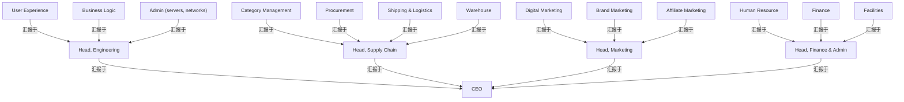

# G206/fig3-1 · 标准组织架构图

类型：`decomposition-or-organization-model`。作为第 3 章的对照物，先给出读者熟悉的传统组织架构图，再说明组织地图的不同：这张图只画正式汇报线，以职位和部门为单位，无法表达横向、同级、多对多以及对外关系。

英文 PDF 物理页：[14]。本页为架构语义分析，原文与原图分别保留。

## 原图与可编辑图


[完整 JSON](fig3-1.json) · [可编辑 Mermaid](fig3-1.mmd) · [仅关系图](fig3-1.relations.mmd) · [层级分解图](fig3-1.hierarchy.mmd)

图形重建表达语义，不复制源图布局。虚线表示解释、矩阵映射或分组关系，不自动表示不确定性的概率。



## 架构分析

从最上方的 CEO 开始沿折线向下：第二层是工程、供应链、市场、财务与行政四位负责人，第三层是各自管辖的部门。同一水平线上的框之间没有任何连线，说明图不表达它们之间的关系。

- 本图有 18 个具名或隐含元素、17 条关系和 0 条包含/分组记录。
- 保留来源解释中的 17 条汇报/组织归属关系，其主体类型为 {'organization_unit': 13, 'role': 4}；组织单元不是具体员工，来源示例不能变成项目现行人事结构。
- 逐一核对18个方框、4个职能分支及17条无箭头组织连接；该传统组织图与随后工作关系地图不同，正文明确其正式汇报用途。

### 如何用于项目

- 按父项展开所有直接子项，检查同层粒度、重叠和缺项。
- 保留组成、分类、能力分解与组织汇报的区别；将示例名称替换为已确认的项目对象。

### 结构所表达的逻辑

- 共 18 个框、3 个层级：CEO → 4 位职能负责人 → 13 个部门。
- 只有垂直的汇报折线，没有横向、跨部门或对外的连线；这正是正文所说“无法描绘同级、多对多关系”的直观例子。
- 负责人框写作“Head, Engineering”等职位名，体现组织架构图以具名个人和头衔为中心。
- 四条职能线的部门数分别为 3、4、3、3；供应链线最多，含品类管理、采购、运输与物流、仓库。
- 部门名多为职能（财务、人力资源、采购、市场），没有外部伙伴、协作团队或企业边界标识。
- 图中没有图例；方框加折线的记法本身即为读者熟知的组织架构图惯例。

## 上下级与包含

三层。L1 为 CEO；L2 为工程、供应链、市场、财务与行政四位负责人；L3 为各部门（工程线 3 个、供应链线 4 个、市场线 3 个、财务与行政线 3 个）。每个 L3 部门只有一个上级，L2 也只向 CEO 汇报。

|父项|子项|层级类型|依据与解释|
|---|---|---|---|
|—|—|无视觉包含|关系中明确的组成/特化见 JSON semantic_hierarchy。|

### 明确汇报关系

|父项/范围/类型|子项/责任对象/实例|语义|
|---|---|---|
|首席执行官（CEO）|工程负责人|reports_to|
|首席执行官（CEO）|供应链负责人|reports_to|
|首席执行官（CEO）|市场负责人|reports_to|
|首席执行官（CEO）|财务与行政负责人|reports_to|
|工程负责人|用户体验|reports_to|
|工程负责人|业务逻辑|reports_to|
|工程负责人|系统管理（服务器、网络）|reports_to|
|供应链负责人|品类管理|reports_to|
|供应链负责人|采购|reports_to|
|供应链负责人|运输与物流|reports_to|
|供应链负责人|仓库|reports_to|
|市场负责人|数字营销|reports_to|
|市场负责人|品牌营销|reports_to|
|市场负责人|联盟营销|reports_to|
|财务与行政负责人|人力资源|reports_to|
|财务与行政负责人|财务|reports_to|
|财务与行政负责人|设施|reports_to|

## 全部元素与角色

|元素ID|原文名称|类型|含义|直接父项|深度|
|---|---|---|---|---|---|
|ceo|CEO|role|角色：首席执行官（CEO）|—||
|head_engineering|Head, Engineering|role|角色：工程负责人|—||
|head_supply_chain|Head, Supply Chain|role|角色：供应链负责人|—||
|head_marketing|Head, Marketing|role|角色：市场负责人|—||
|head_finance_admin|Head, Finance & Admin|role|角色：财务与行政负责人|—||
|user_experience|User Experience|organization_unit|组织单元：用户体验|—||
|business_logic|Business Logic|organization_unit|组织单元：业务逻辑|—||
|admin_servers_networks|Admin (servers, networks)|organization_unit|组织单元：系统管理（服务器、网络）|—||
|category_management|Category Management|organization_unit|组织单元：品类管理|—||
|procurement|Procurement|organization_unit|组织单元：采购|—||
|shipping_logistics|Shipping & Logistics|organization_unit|组织单元：运输与物流|—||
|warehouse|Warehouse|organization_unit|组织单元：仓库|—||
|digital_marketing|Digital Marketing|organization_unit|组织单元：数字营销|—||
|brand_marketing|Brand Marketing|organization_unit|组织单元：品牌营销|—||
|affiliate_marketing|Affiliate Marketing|organization_unit|组织单元：联盟营销|—||
|human_resource|Human Resource|organization_unit|组织单元：人力资源|—||
|finance|Finance|organization_unit|组织单元：财务|—||
|facilities|Facilities|organization_unit|组织单元：设施|—||

## 全部关系

折线没有箭头；上下位置与第14–15页正式汇报结构说明共同确定上下级阅读。四位负责人向CEO汇报，各职能单元归对应负责人，不能把同层位置当作横向协作连线。

|主体|语义关系|客体|显式线/隐式|原文标签|依据|
|---|---|---|---|---|---|
|工程负责人|汇报于|首席执行官（CEO）|显式连线||负责人向 CEO 汇报|
|供应链负责人|汇报于|首席执行官（CEO）|显式连线||汇报于|
|市场负责人|汇报于|首席执行官（CEO）|显式连线||汇报于|
|财务与行政负责人|汇报于|首席执行官（CEO）|显式连线||汇报于|
|用户体验|汇报于|工程负责人|显式连线||汇报于|
|业务逻辑|汇报于|工程负责人|显式连线||汇报于|
|系统管理（服务器、网络）|汇报于|工程负责人|显式连线||汇报于|
|品类管理|汇报于|供应链负责人|显式连线||汇报于|
|采购|汇报于|供应链负责人|显式连线||汇报于|
|运输与物流|汇报于|供应链负责人|显式连线||汇报于|
|仓库|汇报于|供应链负责人|显式连线||汇报于|
|数字营销|汇报于|市场负责人|显式连线||汇报于|
|品牌营销|汇报于|市场负责人|显式连线||汇报于|
|联盟营销|汇报于|市场负责人|显式连线||汇报于|
|人力资源|汇报于|财务与行政负责人|显式连线||汇报于|
|财务|汇报于|财务与行政负责人|显式连线||汇报于|
|设施|汇报于|财务与行政负责人|显式连线||汇报于|

## 误读检查

- 折线只表示正式汇报关系，不是流程、数据流或协作关系。
- 同一层的框之间没有连线，不能据此推断它们之间没有协作；只是这种图不表达横向关系。
- CEO 与“Head, …”是职位/角色，不是组织单元本身的名称。
- 本图是被对比的传统做法，不代表本指南推荐的组织地图画法。
- 中文重绘 PNG 中“Head, Finance & Admin”未译，不能据此认为原图本身中英混排。

## 原文证据

### [PDF 第 14 页](../../../documents/G206.md#page-14)

> Traditional hierarchical models of a business (an example of which is shown in Figure 3-1) focus on formal, top-down reporting structures rather than how the business actually operates. In doing so, they fail to depict the many horizontal, peer-to-peer, or many-to-many relationships that enable the business to function on a day-to-day basis through project teams and working groups that form across different business units and often include external parties.
### [PDF 第 15 页](../../../documents/G206.md#page-15)

> Organization maps and organization charts also differ in terms of their underlying purpose. Typically, organization charts are tools used by senior management and Human Resources (HR) to depict the formal structure of an organization, including the reporting relationships and relative ranks of its parts and positions/jobs. In contrast, an organization map is used by analysts, planners, and architects to depict a richer model of the organization – to communicate both internal and external relationships and collaborations from an organizational unit or business entity perspective.
> In summary, the key differences between organization maps and organization charts are as follows:

## 来源与分析状态

所有元素/关系均有来源定位；未把历史解释重命名为本轮逐线视觉确认。源图与语义图是两种视图，布局不证明汇报或因果。

源 PDF SHA-256：`5de1a634ef389e88b16b11454fdf96350ab33664468a0df2a6aed513e2270c35`。

源图记录：[原始解释与转录](../../../figures/G206/fig3-1.json)。

```json
{
  "quality": {
    "graph_integrity": "checked",
    "semantic_analysis": "typed-graph-and-context-analysis",
    "visual_review": "source-content-audited",
    "notice_zh": "所有元素/关系均有来源定位；未把历史解释重命名为本轮逐线视觉确认。源图与语义图是两种视图，布局不证明汇报或因果。"
  },
  "source_uncertainty": {
    "confidence": "high",
    "uncertainties_zh": [
      "骨架把 figs/zh/g206e_fig3-1_zh.png 标为“被中文稿引用”，实际 L147 引用的是 figs/zh/g206e_fig3-1_zh.svg；两个资产都已核对",
      "英文原图底部有淡色“© The Open Group”水印，不影响标签识读"
    ],
    "analyzed_from": [
      "英文 PDF 第 14 页原图（600 dpi 裁切）及 figctx 2x2 放大分块",
      "英文 PDF 第 14 页正文",
      "中文稿 G206e_组织映射.md 第 142–172 行",
      "figs/zh/g206e_fig3-1_zh.png 与 figs/zh/g206e_fig3-1_zh.svg 的文本/画面",
      "figs/g206e_fig3-1_en.png（自动相似度 0.987）"
    ],
    "date": "2026-10-31"
  },
  "source_conflicts": []
}
```
