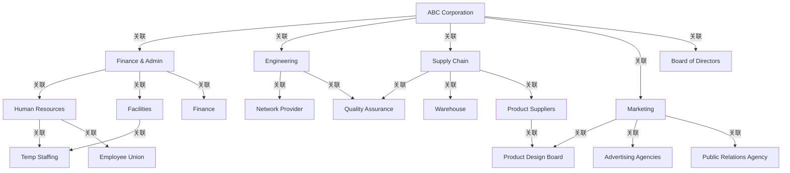

# G206/fig3-2 · 通用组织地图

类型：`architecture-concept-or-system-model`。给出组织地图的“通用模板”：在同一张图里同时容纳企业内部单元、外部伙伴和跨单元协作团队，并用颜色区分组织单元类型，从而直观说明组织地图比组织架构图画得更宽、更深。

英文 PDF 物理页：[15]。本页为架构语义分析，原文与原图分别保留。

## 原图与可编辑图


[完整 JSON](fig3-2.json) · [可编辑 Mermaid](fig3-2.mmd) · [仅关系图](fig3-2.relations.mmd) · [层级分解图](fig3-2.hierarchy.mmd)

图形重建表达语义，不复制源图布局。虚线表示解释、矩阵映射或分组关系，不自动表示不确定性的概率。



## 架构分析

从中央蓝色椭圆 ABC Corporation 读起，它表示地图范围；向外先看绿色业务单元（财务与行政、工程、供应链、市场），再沿箭头看紫色部门、橙色外部伙伴和灰色协作团队。先按颜色判断类型，再按箭头判断工作关系。

- 本图有 18 个具名或隐含元素、20 条关系和 0 条包含/分组记录。
- 本图没有可直接确认为人员直属汇报的关系；视觉上下位置、能力分解和治理职责分别读取。
- 18个组织单元、5项椭圆图例与20条有向工作关系均核对。
- Product Design Board的左侧输入来自Marketing而非ABC Corporation；Product Suppliers与Supply Chain之间的箭头指向供应商。

### 如何用于项目

- 围绕作者目的读取本图实体、分组与连线，并用对应原文限定其含义。
- 把参考模型与项目事实分开，实际范围、约束、值和责任须有项目证据。

### 结构所表达的逻辑

- 18个组织单元：ABC Corporation为企业；Finance & Admin、Engineering、Supply Chain、Marketing为业务单元，其余按5项图例分类。
- ABC Corporation直接连接4个业务单元与Board of Directors；Product Design Board的输入来自Marketing及Product Suppliers。
- Finance & Admin连接Human Resources、Facilities、Finance；Human Resources连接Temp Staffing及Employee Union，Facilities也连接Temp Staffing。
- Engineering连接Network Provider及Quality Assurance；Supply Chain连接Quality Assurance、Warehouse及Product Suppliers。
- Marketing连接Advertising Agencies、Public Relations Agency及Product Design Board；Product Suppliers连接Product Design Board。
- 企业椭圆表示全图范围，工作关系不等于正式组织汇报。

## 上下级与包含

按表 2-1 的类型层级：企业为 L0；业务单元为 L1；部门与外部伙伴同为 L2；协作团队为 L3。图中没有包含框，层级不由嵌套而由颜色和围绕关系表达。

|父项|子项|层级类型|依据与解释|
|---|---|---|---|
|—|—|无视觉包含|关系中明确的组成/特化见 JSON semantic_hierarchy。|

## 全部元素与角色

|元素ID|原文名称|类型|含义|直接父项|深度|
|---|---|---|---|---|---|
|abc_corporation|ABC Corporation|organization_unit|组织单元：ABC 公司|—||
|finance_admin|Finance & Admin|organization_unit|组织单元：财务与行政|—||
|engineering|Engineering|organization_unit|组织单元：工程|—||
|supply_chain|Supply Chain|organization_unit|组织单元：供应链|—||
|marketing|Marketing|organization_unit|组织单元：市场|—||
|human_resources|Human Resources|organization_unit|组织单元：人力资源|—||
|facilities|Facilities|organization_unit|组织单元：设施|—||
|finance|Finance|organization_unit|组织单元：财务|—||
|warehouse|Warehouse|organization_unit|组织单元：仓库|—||
|temp_staffing|Temp Staffing|organization_unit|组织单元：临时用工|—||
|employee_union|Employee Union|organization_unit|组织单元：工会|—||
|network_provider|Network Provider|organization_unit|组织单元：网络供应商|—||
|product_suppliers|Product Suppliers|organization_unit|组织单元：产品供应商|—||
|advertising_agencies|Advertising Agencies|organization_unit|组织单元：广告代理商|—||
|public_relations_agency|Public Relations Agency|organization_unit|组织单元：公共关系机构|—||
|board_of_directors|Board of Directors|organization_unit|组织单元：董事会|—||
|quality_assurance|Quality Assurance|organization_unit|组织单元：质量保证|—||
|product_design_board|Product Design Board|organization_unit|组织单元：产品设计委员会|—||

### ABC 公司：属性

```json
{
  "org_type": "Enterprise"
}
```

### 财务与行政：属性

```json
{
  "org_type": "Business Unit"
}
```

### 工程：属性

```json
{
  "org_type": "Business Unit"
}
```

### 供应链：属性

```json
{
  "org_type": "Business Unit"
}
```

### 市场：属性

```json
{
  "org_type": "Business Unit"
}
```

### 人力资源：属性

```json
{
  "org_type": "Department"
}
```

### 设施：属性

```json
{
  "org_type": "Department"
}
```

### 财务：属性

```json
{
  "org_type": "Department"
}
```

### 仓库：属性

```json
{
  "org_type": "Department"
}
```

### 临时用工：属性

```json
{
  "org_type": "External Partner"
}
```

### 工会：属性

```json
{
  "org_type": "External Partner"
}
```

### 网络供应商：属性

```json
{
  "org_type": "External Partner"
}
```

### 产品供应商：属性

```json
{
  "org_type": "External Partner"
}
```

### 广告代理商：属性

```json
{
  "org_type": "External Partner"
}
```

### 公共关系机构：属性

```json
{
  "org_type": "External Partner"
}
```

### 董事会：属性

```json
{
  "org_type": "Collaborative Team"
}
```

### 质量保证：属性

```json
{
  "org_type": "Collaborative Team"
}
```

### 产品设计委员会：属性

```json
{
  "org_type": "Collaborative Team"
}
```

## 全部关系

20条单向曲线表示工作关系。箭头只确定方向，图内没有定义每条关系的交易内容或责任；不把它们转为正式汇报。

|主体|语义关系|客体|显式线/隐式|原文标签|依据|
|---|---|---|---|---|---|
|ABC 公司|关联|财务与行政|显式连线||企业指向业务单元的工作关系|
|ABC 公司|关联|工程|显式连线||关联|
|ABC 公司|关联|供应链|显式连线||关联|
|ABC 公司|关联|市场|显式连线||关联|
|ABC 公司|关联|董事会|显式连线||关联|
|市场|关联|产品设计委员会|显式连线||原图Product Design Board上方弯曲线从Marketing右上侧出发，并未与ABC Corporation相连。|
|财务与行政|关联|人力资源|显式连线||关联|
|财务与行政|关联|设施|显式连线||关联|
|财务与行政|关联|财务|显式连线||关联|
|人力资源|关联|临时用工|显式连线||关联|
|人力资源|关联|工会|显式连线||关联|
|设施|关联|临时用工|显式连线||关联|
|工程|关联|网络供应商|显式连线||关联|
|工程|关联|质量保证|显式连线||关联|
|供应链|关联|质量保证|显式连线||关联|
|供应链|关联|仓库|显式连线||关联|
|产品供应商|关联|产品设计委员会|显式连线||关联|
|供应链|关联|产品供应商|显式连线||原图箭头尖端落在Product Suppliers右上边缘；方向为Supply Chain到Product Suppliers。|
|市场|关联|广告代理商|显式连线||关联|
|市场|关联|公共关系机构|显式连线||关联|

## 本轮语义修正

- 原图Product Design Board上方弯曲线从Marketing右上侧出发，并未与ABC Corporation相连。
- 原图箭头尖端落在Product Suppliers右上边缘；方向为Supply Chain到Product Suppliers。

## 误读检查

- 不要把绿色业务单元当作紫色部门的汇报上级；图只画工作关系，未画汇报线。
- 橙色是外部伙伴，不是部门；工会、临时用工、广告代理商都在企业法定边界之外。
- 灰色不是“其他/未分类”，而是跨单元的协作团队。
- 中央椭圆不是总部，而是整张地图的范围。
- 中文重绘 SVG 的连线与方向有多处错误（财务部→广告代理商、产品设计委员会→仓库、产品设计委员会→产品供应商等），不能据它读关系。

## 原文证据

### [PDF 第 14 页](../../../documents/G206.md#page-14)

> Organization maps, as shown in Figure 3-2, go much further by depicting internal and external relationships as well as the collaborations from across the enterprise and beyond to include its ecosystem of business partners and stakeholders. The central oval (the enterprise) should be interpreted as denoting the total scope to be represented in the map, not just as the name of the legal entity. Also note that all of these entities are organization units, while the term business unit is being used to denote the next level below the enterprise (in this case representing business functions).
### [PDF 第 15 页](../../../documents/G206.md#page-15)

> Organization maps and organization charts also differ in terms of their underlying purpose. Typically, organization charts are tools used by senior management and Human Resources (HR) to depict the formal structure of an organization, including the reporting relationships and relative ranks of its parts and positions/jobs. In contrast, an organization map is used by analysts, planners, and architects to depict a richer model of the organization – to communicate both internal and external relationships and collaborations from an organizational unit or business entity perspective.
> In summary, the key differences between organization maps and organization charts are as follows:

## 来源与分析状态

所有元素/关系均有来源定位；未把历史解释重命名为本轮逐线视觉确认。源图与语义图是两种视图，布局不证明汇报或因果。

源 PDF SHA-256：`5de1a634ef389e88b16b11454fdf96350ab33664468a0df2a6aed513e2270c35`。

源图记录：[原始解释与转录](../../../figures/G206/fig3-2.json)。

```json
{
  "quality": {
    "graph_integrity": "checked",
    "semantic_analysis": "typed-graph-and-context-analysis",
    "visual_review": "source-content-audited",
    "notice_zh": "所有元素/关系均有来源定位；未把历史解释重命名为本轮逐线视觉确认。源图与语义图是两种视图，布局不证明汇报或因果。"
  },
  "source_uncertainty": {
    "confidence": "high",
    "uncertainties_zh": [
      "所有箭头都没有文字标签，具体语义（工作关系/提供/影响）由图形推断，统一记为 association",
      "“产品设计委员会”与“质量保证”画成灰色协作团队，但英文正文未逐一解释其成员构成",
      "英文页脚与图内左上有“© The Open Group”水印"
    ],
    "analyzed_from": [
      "英文 PDF 第 15 页原图（600 dpi 裁切）及 figctx 2x2 放大分块",
      "英文 PDF 第 14–15 页正文",
      "中文稿 G206e_组织映射.md 第 152–186 行",
      "figs/g206_fig3-2.svg 源码（节点与连线坐标）"
    ],
    "date": "2026-10-31"
  },
  "source_conflicts": []
}
```
