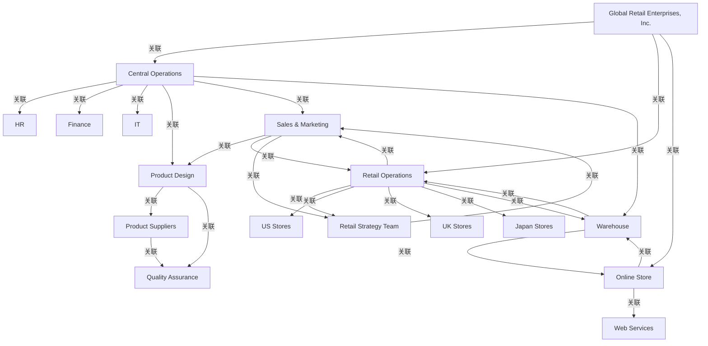

# G206/fig7-1 · 零售业务组织地图

类型：`architecture-concept-or-system-model`。把第 3 章的通用组织地图落到零售企业：用同一套五色记法画出企业、业务线/渠道、职能部门、门店、外部伙伴与协作团队，说明组织地图既能显示组织分工，也能显示运营层面的工作关系。

英文 PDF 物理页：[22]。本页为架构语义分析，原文与原图分别保留。

## 原图与可编辑图


[完整 JSON](fig7-1.json) · [可编辑 Mermaid](fig7-1.mmd) · [仅关系图](fig7-1.relations.mmd) · [层级分解图](fig7-1.hierarchy.mmd)

图形重建表达语义，不复制源图布局。虚线表示解释、矩阵映射或分组关系，不自动表示不确定性的概率。



## 架构分析

从中央蓝色 Global Retail Enterprises, Inc. 开始，先看三条绿色业务线：Central Operations（共享职能）、Retail Operations（门店渠道）、Online Store（线上渠道）；再沿箭头看各业务线连接的紫色部门、橙色外部伙伴和灰色协作团队。

- 本图有 17 个具名或隐含元素、26 条关系和 0 条包含/分组记录。
- 本图没有可直接确认为人员直属汇报的关系；视觉上下位置、能力分解和治理职责分别读取。
- 逐一核对17个组织单元、5类椭圆图例及22条曲线连接；4条曲线两端有箭头，规范为26条有向工作关联。
- Global Retail仅直接连接Central Operations、Online Store、Retail Operations；Central Operations到Warehouse的曲线并非从IT出发。
- 补全Warehouse与Online Store、Warehouse与Retail Operations、Sales & Marketing与Retail Strategy Team的反向箭头。

### 如何用于项目

- 围绕作者目的读取本图实体、分组与连线，并用对应原文限定其含义。
- 把参考模型与项目事实分开，实际范围、约束、值和责任须有项目证据。

### 结构所表达的逻辑

- 17个组织单元：1企业、3业务单元、8部门、3外部伙伴、2协作团队。
- 企业中心直接连接Central Operations、Online Store、Retail Operations。
- Central Operations连接HR、Finance、IT、Product Design、Sales & Marketing及Warehouse；Warehouse为橙色外部伙伴。
- Retail Operations连接US Stores、UK Stores、Japan Stores、Retail Strategy Team，并与Sales & Marketing和Warehouse双向关联。
- Online Store连接Web Services，并与Warehouse双向关联；Sales & Marketing与Retail Strategy Team也为双向关联。
- Product Design指向Product Suppliers和Quality Assurance；Product Suppliers也指向Quality Assurance；Sales & Marketing指向Product Design。
- 所有箭头仅给出工作关系的方向；不能据此创建人员汇报树。

## 上下级与包含

颜色区分企业、业务单元、部门、外部伙伴及协作团队。图中没有包含框；工作关系箭头不能直接证明组织隶属或人员汇报。

|父项|子项|层级类型|依据与解释|
|---|---|---|---|
|—|—|无视觉包含|关系中明确的组成/特化见 JSON semantic_hierarchy。|

## 全部元素与角色

|元素ID|原文名称|类型|含义|直接父项|深度|
|---|---|---|---|---|---|
|global_retail|Global Retail Enterprises, Inc.|organization_unit|组织单元：全球零售企业公司|—||
|central_operations|Central Operations|organization_unit|组织单元：中央运营|—||
|retail_operations|Retail Operations|organization_unit|组织单元：零售运营|—||
|online_store|Online Store|organization_unit|组织单元：在线商店|—||
|hr|HR|organization_unit|组织单元：人力资源|—||
|finance|Finance|organization_unit|组织单元：财务|—||
|it|IT|organization_unit|组织单元：IT|—||
|product_design|Product Design|organization_unit|组织单元：产品设计|—||
|sales_marketing|Sales & Marketing|organization_unit|组织单元：销售与市场|—||
|us_stores|US Stores|organization_unit|组织单元：美国门店|—||
|uk_stores|UK Stores|organization_unit|组织单元：英国门店|—||
|japan_stores|Japan Stores|organization_unit|组织单元：日本门店|—||
|quality_assurance|Quality Assurance|organization_unit|组织单元：质量保证|—||
|retail_strategy_team|Retail Strategy Team|organization_unit|组织单元：零售战略团队|—||
|web_services|Web Services|organization_unit|组织单元：Web 服务|—||
|warehouse|Warehouse|organization_unit|组织单元：仓库|—||
|product_suppliers|Product Suppliers|organization_unit|组织单元：产品供应商|—||

### 全球零售企业公司：属性

```json
{
  "org_type": "Enterprise"
}
```

### 中央运营：属性

```json
{
  "org_type": "Business Unit"
}
```

### 零售运营：属性

```json
{
  "org_type": "Business Unit"
}
```

### 在线商店：属性

```json
{
  "org_type": "Business Unit"
}
```

### 人力资源：属性

```json
{
  "org_type": "Department"
}
```

### 财务：属性

```json
{
  "org_type": "Department"
}
```

### IT：属性

```json
{
  "org_type": "Department"
}
```

### 产品设计：属性

```json
{
  "org_type": "Department"
}
```

### 销售与市场：属性

```json
{
  "org_type": "Department"
}
```

### 美国门店：属性

```json
{
  "org_type": "Department"
}
```

### 英国门店：属性

```json
{
  "org_type": "Department"
}
```

### 日本门店：属性

```json
{
  "org_type": "Department"
}
```

### 质量保证：属性

```json
{
  "org_type": "Collaborative Team"
}
```

### 零售战略团队：属性

```json
{
  "org_type": "Collaborative Team"
}
```

### Web 服务：属性

```json
{
  "org_type": "External Partner"
}
```

### 仓库：属性

```json
{
  "org_type": "External Partner"
}
```

### 产品供应商：属性

```json
{
  "org_type": "External Partner"
}
```

## 全部关系

22条深青色实线曲线中4条带双端箭头，转录为26条有向工作关联；没有关系名称，方向不额外定义具体信息、货物或资金流。

|主体|语义关系|客体|显式线/隐式|原文标签|依据|
|---|---|---|---|---|---|
|全球零售企业公司|关联|中央运营|显式连线||关联|
|全球零售企业公司|关联|零售运营|显式连线||关联|
|全球零售企业公司|关联|在线商店|显式连线||关联|
|中央运营|关联|人力资源|显式连线||关联|
|中央运营|关联|财务|显式连线||关联|
|中央运营|关联|IT|显式连线||关联|
|中央运营|关联|产品设计|显式连线||关联|
|中央运营|关联|销售与市场|显式连线||关联|
|销售与市场|关联|产品设计|显式连线||关联|
|销售与市场|关联|零售运营|显式连线||关联|
|零售运营|关联|销售与市场|显式连线||与上一条相反方向，构成双向工作关系|
|零售运营|关联|零售战略团队|显式连线||关联|
|零售战略团队|关联|销售与市场|显式连线||关联|
|零售运营|关联|美国门店|显式连线||关联|
|零售运营|关联|英国门店|显式连线||关联|
|零售运营|关联|日本门店|显式连线||关联|
|零售运营|关联|仓库|显式连线||关联|
|在线商店|关联|仓库|显式连线||关联|
|在线商店|关联|Web 服务|显式连线||关联|
|中央运营|关联|仓库|显式连线||原生图中的长曲线从Central Operations右上侧出发，终点Warehouse；IT只连接Central Operations和图7-2的能力框。|
|产品设计|关联|产品供应商|显式连线||关联|
|产品设计|关联|质量保证|显式连线||关联|
|产品供应商|关联|质量保证|显式连线||关联|
|仓库|关联|在线商店|显式连线||原图同一曲线两端均有箭头；补全Online Store与Warehouse的反向工作关联。|
|仓库|关联|零售运营|显式连线||原图同一曲线两端均有箭头；补全Retail Operations与Warehouse的反向工作关联。|
|销售与市场|关联|零售战略团队|显式连线||原图同一曲线两端均有箭头；补全Sales & Marketing与Retail Strategy Team的反向工作关联。|

## 本轮否定的历史关系

以下旧解释保留用于追溯，不进入当前关系图、层级或知识图谱的有效边。

|旧记录|主体|旧关系|客体|否定依据|
|---|---|---|---|---|
|3|全球零售企业公司|association|销售与市场|原图企业中心到Sales & Marketing没有直接曲线；该历史关系撤销。|
|9|中央运营|association|Web 服务|原图Central Operations到Web Services没有曲线；Web Services的可见输入来自Online Store。|

## 本轮语义修正

- 原图企业中心到Sales & Marketing没有直接曲线；该历史关系撤销。
- 原图Central Operations到Web Services没有曲线；Web Services的可见输入来自Online Store。
- 原生图中的长曲线从Central Operations右上侧出发，终点Warehouse；IT只连接Central Operations和图7-2的能力框。
- 原图同一曲线两端均有箭头；补全Online Store与Warehouse的反向工作关联。
- 原图同一曲线两端均有箭头；补全Retail Operations与Warehouse的反向工作关联。
- 原图同一曲线两端均有箭头；补全Sales & Marketing与Retail Strategy Team的反向工作关联。

## 误读检查

- 26是按箭头方向展开后的关系数，实际有22条曲线，不能把双端箭头当作两条独立曲线。
- Central Operations到Warehouse的起点不是IT；企业中心没有直接到Sales & Marketing的线。
- 颜色表示组织单元类别，不建立HR汇报关系；中央企业椭圆表示地图范围。
- 旧中文重绘的线数和端点不完整，阅读当前解析时以原PDF图为准。

## 原文证据

### [PDF 第 22 页](../../../documents/G206.md#page-22)

> Continuing with the retail business examples that have been used throughout the Business Architecture TOGAF® Series Guides (see Referenced Documents) a typical organization map for a global retail corporation might look like that shown in Figure 7-1.
### [PDF 第 23 页](../../../documents/G206.md#page-23)


## 来源与分析状态

所有元素/关系均有来源定位；未把历史解释重命名为本轮逐线视觉确认。源图与语义图是两种视图，布局不证明汇报或因果。

源 PDF SHA-256：`5de1a634ef389e88b16b11454fdf96350ab33664468a0df2a6aed513e2270c35`。

源图记录：[原始解释与转录](../../../figures/G206/fig7-1.json)。

```json
{
  "quality": {
    "graph_integrity": "checked",
    "semantic_analysis": "typed-graph-and-context-analysis",
    "visual_review": "source-content-audited",
    "notice_zh": "所有元素/关系均有来源定位；未把历史解释重命名为本轮逐线视觉确认。源图与语义图是两种视图，布局不证明汇报或因果。"
  },
  "source_uncertainty": {
    "confidence": "high",
    "uncertainties_zh": [
      "所有箭头都没有文字标签，具体语义统一记为 association",
      "IT→仓库、零售运营→美国门店两条长曲线的起点与其它线交叉，按放大图判读；若原图绘制有误，方向仍以箭头为准",
      "中文译名“全球零售企业公司”沿用中文稿标签表，稍显生硬",
      "英文页脚有“© The Open Group”水印"
    ],
    "analyzed_from": [
      "英文 PDF 第 22 页原图（600 dpi 裁切）及 figctx 2x2/3x3 放大分块",
      "英文 PDF 第 22 页正文",
      "中文稿 G206e_组织映射.md 第 253–260 行",
      "figs/g206_fig7-1.svg 源码（节点与连线坐标）"
    ],
    "date": "2026-10-31"
  },
  "source_conflicts": []
}
```
