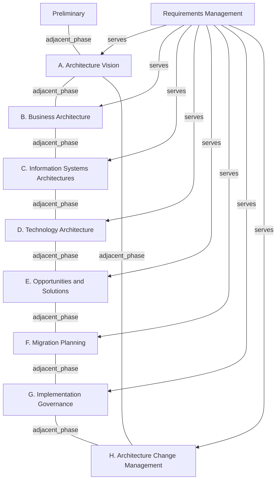

# G20F/fig3-1 · TOGAF ADM

类型：`process-or-method-model`。第 3 章开篇用来引出 ADM。作者先承认这张“标志性图形”会让人以为企业架构是漫长的瀑布过程，随即用三条“ADM 并不……”否定这种误读，为全书“按敏捷需要裁剪 ADM”的主张建立前提。

英文 PDF 物理页：[18]。本页为架构语义分析，原文与原图分别保留。

## 原图与可编辑图


[完整 JSON](fig3-1.json) · [可编辑 Mermaid](fig3-1.mmd) · [仅关系图](fig3-1.relations.mmd) · [层级分解图](fig3-1.hierarchy.mmd)

图形重建表达语义，不复制源图布局。虚线表示解释、矩阵映射或分组关系，不自动表示不确定性的概率。



## 架构分析

从顶部的 Preliminary 圆点出发，沿竖线向下进入 A；然后顺时针沿圆周经过 B、C、D、E、F、G、H，再回到 A 开始新一轮。中心较大的 Requirements Management 用辐射线连到每个阶段，表示它贯穿整个循环而不是一个独立阶段。

- 本图有 10 个具名或隐含元素、17 条关系和 0 条包含/分组记录。
- 本图没有可直接确认为人员直属汇报的关系；视觉上下位置、能力分解和治理职责分别读取。
- 核对Preliminary、A-H八阶段、中心Requirements Management及17条实线。
- 圆周相邻线改成无向adjacent_phase；相邻正文明确不强制顺序、不规定时长、不构成瀑布流程。

### 如何用于项目

- 按阶段/事件/行为关系读取入口、出口、责任和产物；检查循环与例外路径。
- 工作流先后不表示组织管理权；在项目中显式记录条件和完成标准。

### 结构所表达的逻辑

- 圆周上只有阶段名称与连接线：没有任何箭头、时间刻度、工期或“完成才能进入下一阶段”的闸门，所以图本身并不表达瀑布过程。
- Preliminary 画在圆周之外、位于顶端，用一条线接入 A，表示预备阶段为后续所有架构工作建立能力与语境。
- 中心的 Requirements Management 连到全部 8 个阶段，表示需求在每一阶段都被持续管理。
- 圆周闭合表示 ADM 是迭代循环：H（架构变更管理）之后回到 A 开始新一轮架构开发。
- 图中阶段 A–H 的顺序只是编号与相邻关系，正文明确说明不强制按图示顺序执行、不强制瀑布、不规定任何阶段的时长。
- 正文建议按企业需要裁剪 ADM，敏捷性就是其中一种需要；中文稿进一步把该图定位为“参考模型”而非过程模型。

## 上下级与包含

两层：外层是 Preliminary 与 A–H 共 9 个阶段，构成一个闭合环；内层中心是 Requirements Management，与 8 个阶段平级相连（不是上级）。阶段之间没有上下级，只有环形相邻关系。

|父项|子项|层级类型|依据与解释|
|---|---|---|---|
|—|—|无视觉包含|关系中明确的组成/特化见 JSON semantic_hierarchy。|

## 全部元素与角色

|元素ID|原文名称|类型|含义|直接父项|深度|
|---|---|---|---|---|---|
|preliminary|Preliminary|phase|阶段：预备阶段|—||
|phase_a|A. Architecture Vision|phase|阶段：阶段 A：架构愿景|—||
|phase_b|B. Business Architecture|phase|阶段：阶段 B：业务架构|—||
|phase_c|C. Information Systems Architectures|phase|阶段：阶段 C：信息系统架构|—||
|phase_d|D. Technology Architecture|phase|阶段：阶段 D：技术架构|—||
|phase_e|E. Opportunities and Solutions|phase|阶段：阶段 E：机会与解决方案|—||
|phase_f|F. Migration Planning|phase|阶段：阶段 F：迁移规划|—||
|phase_g|G. Implementation Governance|phase|阶段：阶段 G：实施治理|—||
|phase_h|H. Architecture Change Management|phase|阶段：阶段 H：架构变更管理|—||
|requirements_management|Requirements Management|process|贯穿 A–H 的持续活动，不是独立阶段。|—||

## 全部关系

圆周线表达ADM阶段相邻关系而非强制顺序；中心辐射线表达Requirements Management贯穿各阶段。

|主体|语义关系|客体|显式线/隐式|原文标签|依据|
|---|---|---|---|---|---|
|预备阶段|adjacent_phase|阶段 A：架构愿景|显式连线||圆周实线连接相邻ADM阶段；正文明确ADM不强制按图示顺序，也不表示瀑布式先后。|
|阶段 A：架构愿景|adjacent_phase|阶段 B：业务架构|显式连线||圆周实线连接相邻ADM阶段；正文明确ADM不强制按图示顺序，也不表示瀑布式先后。|
|阶段 B：业务架构|adjacent_phase|阶段 C：信息系统架构|显式连线||圆周实线连接相邻ADM阶段；正文明确ADM不强制按图示顺序，也不表示瀑布式先后。|
|阶段 C：信息系统架构|adjacent_phase|阶段 D：技术架构|显式连线||圆周实线连接相邻ADM阶段；正文明确ADM不强制按图示顺序，也不表示瀑布式先后。|
|阶段 D：技术架构|adjacent_phase|阶段 E：机会与解决方案|显式连线||圆周实线连接相邻ADM阶段；正文明确ADM不强制按图示顺序，也不表示瀑布式先后。|
|阶段 E：机会与解决方案|adjacent_phase|阶段 F：迁移规划|显式连线||圆周实线连接相邻ADM阶段；正文明确ADM不强制按图示顺序，也不表示瀑布式先后。|
|阶段 F：迁移规划|adjacent_phase|阶段 G：实施治理|显式连线||圆周实线连接相邻ADM阶段；正文明确ADM不强制按图示顺序，也不表示瀑布式先后。|
|阶段 G：实施治理|adjacent_phase|阶段 H：架构变更管理|显式连线||圆周实线连接相邻ADM阶段；正文明确ADM不强制按图示顺序，也不表示瀑布式先后。|
|阶段 H：架构变更管理|adjacent_phase|阶段 A：架构愿景|显式连线||圆周实线连接相邻ADM阶段；正文明确ADM不强制按图示顺序，也不表示瀑布式先后。|
|需求管理|serves|阶段 A：架构愿景|显式连线||中心需求管理与各阶段有辐射实线；线无箭头，表示贯穿/服务关系。|
|需求管理|serves|阶段 B：业务架构|显式连线||中心需求管理与各阶段有辐射实线；线无箭头，表示贯穿/服务关系。|
|需求管理|serves|阶段 C：信息系统架构|显式连线||中心需求管理与各阶段有辐射实线；线无箭头，表示贯穿/服务关系。|
|需求管理|serves|阶段 D：技术架构|显式连线||中心需求管理与各阶段有辐射实线；线无箭头，表示贯穿/服务关系。|
|需求管理|serves|阶段 E：机会与解决方案|显式连线||中心需求管理与各阶段有辐射实线；线无箭头，表示贯穿/服务关系。|
|需求管理|serves|阶段 F：迁移规划|显式连线||中心需求管理与各阶段有辐射实线；线无箭头，表示贯穿/服务关系。|
|需求管理|serves|阶段 G：实施治理|显式连线||中心需求管理与各阶段有辐射实线；线无箭头，表示贯穿/服务关系。|
|需求管理|serves|阶段 H：架构变更管理|显式连线||中心需求管理与各阶段有辐射实线；线无箭头，表示贯穿/服务关系。|

## 本轮语义修正

- 圆周实线连接相邻ADM阶段；正文明确ADM不强制按图示顺序，也不表示瀑布式先后。
- 圆周实线连接相邻ADM阶段；正文明确ADM不强制按图示顺序，也不表示瀑布式先后。
- 圆周实线连接相邻ADM阶段；正文明确ADM不强制按图示顺序，也不表示瀑布式先后。
- 圆周实线连接相邻ADM阶段；正文明确ADM不强制按图示顺序，也不表示瀑布式先后。
- 圆周实线连接相邻ADM阶段；正文明确ADM不强制按图示顺序，也不表示瀑布式先后。
- 圆周实线连接相邻ADM阶段；正文明确ADM不强制按图示顺序，也不表示瀑布式先后。
- 圆周实线连接相邻ADM阶段；正文明确ADM不强制按图示顺序，也不表示瀑布式先后。
- 圆周实线连接相邻ADM阶段；正文明确ADM不强制按图示顺序，也不表示瀑布式先后。
- 圆周实线连接相邻ADM阶段；正文明确ADM不强制按图示顺序，也不表示瀑布式先后。
- 中心需求管理与各阶段有辐射实线；线无箭头，表示贯穿/服务关系。
- 中心需求管理与各阶段有辐射实线；线无箭头，表示贯穿/服务关系。
- 中心需求管理与各阶段有辐射实线；线无箭头，表示贯穿/服务关系。
- 中心需求管理与各阶段有辐射实线；线无箭头，表示贯穿/服务关系。
- 中心需求管理与各阶段有辐射实线；线无箭头，表示贯穿/服务关系。
- 中心需求管理与各阶段有辐射实线；线无箭头，表示贯穿/服务关系。
- 中心需求管理与各阶段有辐射实线；线无箭头，表示贯穿/服务关系。
- 中心需求管理与各阶段有辐射实线；线无箭头，表示贯穿/服务关系。

## 误读检查

- 不要把圆周读成“必须按 A→H 顺序、逐个阶段完成”的瀑布流程——正文用三条“TOGAF ADM does not…”明确否定这一点。
- 不要以为图中有工期或迭代节奏信息；图中没有任何时间刻度，阶段时长未被规定。
- 不要以为 Requirements Management 是第 9 个阶段或独立于 A–H 的流程；它在中心，作用于所有阶段。
- Preliminary 不在圆周上，这表示它不属于 A–H 的循环本身，而是循环开始前的准备。

## 原文证据

### [PDF 第 18 页](../../../documents/G20F.md#page-18)

> The core of the TOGAF framework is the TOGAF ADM. At first sight, the iconic graphic of the TOGAF ADM reinforces the perception that Enterprise Architecture is a lengthy, “waterfall” process; see Figure 3-1.
### [PDF 第 19 页](../../../documents/G20F.md#page-19)

> The TOGAF framework shows how the ADM provides a tested and repeatable process for developing architectures. Rather than viewing the ADM graphic as a process model, it is helpful to view it as a reference model, which defines what has to be done in order to deliver solutions with a rational structure and to identify the interactions and relationships between components across the enterprise. Understanding these interactions and relationships is critical to reducing risk and optimizing the approach.
> The core concepts of Enterprise Architecture shown in the ADM graphic are applicable in the most Agile of environments. Phases A-H around the circumference show how architecture is progressively developed and applied to the downstream delivery activities.

## 来源与分析状态

所有元素/关系均有来源定位；未把历史解释重命名为本轮逐线视觉确认。源图与语义图是两种视图，布局不证明汇报或因果。

源 PDF SHA-256：`a8fe6569c7d6045ce4ac8d5320c09a3abdc556a0fc1cbcd584bd76a75f3f84be`。

源图记录：[原始解释与转录](../../../figures/G20F/fig3-1.json)。

```json
{
  "quality": {
    "graph_integrity": "checked",
    "semantic_analysis": "typed-graph-and-context-analysis",
    "visual_review": "source-content-audited",
    "notice_zh": "所有元素/关系均有来源定位；未把历史解释重命名为本轮逐线视觉确认。源图与语义图是两种视图，布局不证明汇报或因果。"
  },
  "source_uncertainty": {
    "confidence": "high",
    "uncertainties_zh": [
      "中文稿没有引用图 3-1，也没有给出中文图题，标题按英文 Figure 3-1 直译。",
      "中心辐射线是否表示“服务”而非单纯的关联，属于依据 TOGAF 惯例的解读（图中无文字说明）。"
    ],
    "analyzed_from": [
      "英文 PDF 第 18 页原图截图（figctx GT crop，含 2x2 放大块）",
      "英文 PDF 第 18 页正文",
      "中文稿 G20Fe_赋能企业敏捷性.md 第 152–179 行"
    ],
    "date": "2026-10-31"
  },
  "source_conflicts": []
}
```
