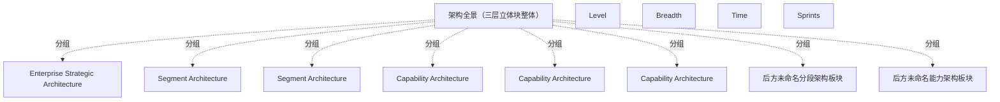

# G20F/fig4-1 · 架构全景的分级分类模型

类型：`architecture-evolution-or-plan`。为 4.1 节建立“按详细程度分层”的模型：企业战略架构铺满整个广度与时间，分段架构在其下沿时间并列出现，能力架构再向下细分且以冲刺为节奏。作者同时提醒不要把这个层级划分与业务/数据/应用/技术四个架构域混淆。

英文 PDF 物理页：[20]。本页为架构语义分析，原文与原图分别保留。

## 原图与可编辑图


[完整 JSON](fig4-1.json) · [可编辑 Mermaid](fig4-1.mmd) · [仅关系图](fig4-1.relations.mmd) · [层级分解图](fig4-1.hierarchy.mmd)

图形重建表达语义，不复制源图布局。虚线表示解释、矩阵映射或分组关系，不自动表示不确定性的概率。



## 架构分析

先看三个轴：向左下的 LEVEL 箭头由高到低，斜向上的 BREADTH 箭头由窄到宽，水平向右的 TIME 箭头表示时间推进。再按颜色读三层：最上方一整块黄色是企业战略架构；其下一列绿色块是分段架构，沿时间轴重复出现；最下方一排排紫色小块是能力架构。底部红色大箭头 Sprints 说明能力层按冲刺节奏交付。

- 本图有 13 个具名或隐含元素、0 条关系和 8 条包含/分组记录。
- 包含/分组树最大深度为 1；根节点为 架构全景（三层立体块整体）、层级（Level）、广度（Breadth）、时间（Time）、冲刺。
- 本图没有可直接确认为人员直属汇报的关系；视觉上下位置、能力分解和治理职责分别读取。
- 原图靠嵌套表达结构，没有连线；新语义图将包含单独显式化，不补造流程、数据流或依赖。
- 包含分组后有 5 个连通分量；分离可能源于图例、并列分类或独立示例，未自动补边。
- 核对6个有名架构块、三个坐标轴及红色Sprints方向箭头。其后有无名重复绿色/紫色板块，表示多个架构片段/迭代，不将遮挡层数当成项目数量。
- 三轴及Sprints箭头不是到单个框的连线；上下堆叠也不建立具体分段对具体能力的治理关系。
- 正文明确冲刺可在各层发生，也可并行；底层每能力可能需多个冲刺。

### 如何用于项目

- 为每个演进状态/工作包登记前置条件、交付物、依赖和实际决策人。
- 时间轴表达计划顺序；架构范围、已批准计划和资源承诺须另有项目证据。

### 结构所表达的逻辑

- 三个层级由高到低：企业战略架构（黄）→ 分段架构（绿）→ 能力架构（紫），对应 LEVEL 轴的向下箭头。
- 黄色的企业战略架构是一整块，横跨全部广度与时间，表示它为企业整体提供语境与约束，本身不再按分段切分。
- 绿色的分段架构在时间轴上重复出现多块，表示分段可以多个并行、逐个交付；正文补充其通常位于组合/项目群/产品层并沿功能自然边界划分。
- 紫色能力架构是最小、数量最多的块，位于最低层，表示对业务能力增量的详细描述，可直接交给开发团队。
- BREADTH 轴表示覆盖广度：越往上覆盖越宽（整个企业），越往下覆盖越窄（单个能力）。
- 底部红色 Sprints 箭头表示冲刺沿时间持续推进；中文稿说明冲刺可发生在任何层级，但最常与能力或能力增量的交付相关，且可并行。
- 正文特别强调：这三个层级不是架构域；业务、数据、应用、技术架构可能存在于所有详细层级，二者是正交的。
- 自下而上，能力增量的实施会反馈并影响更高层级，各层架构因部署经验而演进。

## 上下级与包含

三层视觉层级：企业战略架构（L1，最上层、最宽）包含/约束其下的多个分段架构（L2），分段架构再向下由多个能力架构（L3）支撑。图中的“上下”同时表示详细程度与覆盖广度，而不是组织上的汇报关系。

|父项|子项|层级类型|依据与解释|
|---|---|---|---|
|架构全景（三层立体块整体）|企业战略架构|visual_grouping|框、泳道、域或分类组的成员归属；没有额外证据不提升为业务组合或管理关系。|
|架构全景（三层立体块整体）|分段架构|visual_grouping|框、泳道、域或分类组的成员归属；没有额外证据不提升为业务组合或管理关系。|
|架构全景（三层立体块整体）|分段架构|visual_grouping|框、泳道、域或分类组的成员归属；没有额外证据不提升为业务组合或管理关系。|
|架构全景（三层立体块整体）|能力架构|visual_grouping|框、泳道、域或分类组的成员归属；没有额外证据不提升为业务组合或管理关系。|
|架构全景（三层立体块整体）|能力架构|visual_grouping|框、泳道、域或分类组的成员归属；没有额外证据不提升为业务组合或管理关系。|
|架构全景（三层立体块整体）|能力架构|visual_grouping|框、泳道、域或分类组的成员归属；没有额外证据不提升为业务组合或管理关系。|
|架构全景（三层立体块整体）|后方未命名分段架构板块|visual_grouping|框、泳道、域或分类组的成员归属；没有额外证据不提升为业务组合或管理关系。|
|架构全景（三层立体块整体）|后方未命名能力架构板块|visual_grouping|框、泳道、域或分类组的成员归属；没有额外证据不提升为业务组合或管理关系。|

## 全部元素与角色

|元素ID|原文名称|类型|含义|直接父项|深度|
|---|---|---|---|---|---|
|arch_landscape|架构全景（三层立体块整体）|group|原图没有总标题，此元素代表被三个轴度量的整个板块群。|—||
|lvl_enterprise|Enterprise Strategic Architecture|architecture|架构：企业战略架构|架构全景（三层立体块整体）|1|
|lvl_segment_1|Segment Architecture|architecture|架构：分段架构|架构全景（三层立体块整体）|1|
|lvl_segment_2|Segment Architecture|architecture|同一层级沿时间轴的第二个分段；其后还有未标注的重复块。|架构全景（三层立体块整体）|1|
|lvl_capability_1|Capability Architecture|architecture|架构：能力架构|架构全景（三层立体块整体）|1|
|lvl_capability_2|Capability Architecture|architecture|架构：能力架构|架构全景（三层立体块整体）|1|
|lvl_capability_3|Capability Architecture|architecture|架构：能力架构|架构全景（三层立体块整体）|1|
|axis_level|Level|concept|概念：层级（Level）|—||
|axis_breadth|Breadth|concept|概念：广度（Breadth）|—||
|axis_time|Time|concept|概念：时间（Time）|—||
|sprints|Sprints|time|表示能力架构按冲刺节奏持续交付。|—||
|segment_repetition|后方未命名分段架构板块|group|绿色板块在后方重复，部分遮挡，不补造其名称或固定数量。|架构全景（三层立体块整体）|1|
|capability_repetition|后方未命名能力架构板块|group|紫色块在后方重复，部分遮挡；前排三块有标签，其他未命名。|架构全景（三层立体块整体）|1|

## 全部关系

Level向下、Breadth右上、Time向右、Sprints向右；均为全图方向注记，没有架构块间连接线。

|主体|语义关系|客体|显式线/隐式|原文标签|依据|
|---|---|---|---|---|---|

## 本轮否定的历史关系

以下旧解释保留用于追溯，不进入当前关系图、层级或知识图谱的有效边。

|旧记录|主体|旧关系|客体|否定依据|
|---|---|---|---|---|
||层级（Level）|association|架构全景（三层立体块整体）|图中只有坐标轴/全图方向箭头及上下堆叠，无该实体端点对之间的连接；具体治理/能力归属不能由投影位置推出。|
|1|广度（Breadth）|association|架构全景（三层立体块整体）|图中只有坐标轴/全图方向箭头及上下堆叠，无该实体端点对之间的连接；具体治理/能力归属不能由投影位置推出。|
|2|时间（Time）|association|架构全景（三层立体块整体）|图中只有坐标轴/全图方向箭头及上下堆叠，无该实体端点对之间的连接；具体治理/能力归属不能由投影位置推出。|
|3|冲刺|flow|能力架构|图中只有坐标轴/全图方向箭头及上下堆叠，无该实体端点对之间的连接；具体治理/能力归属不能由投影位置推出。|
|4|企业战略架构|governs|分段架构|图中只有坐标轴/全图方向箭头及上下堆叠，无该实体端点对之间的连接；具体治理/能力归属不能由投影位置推出。|
|5|企业战略架构|governs|分段架构|图中只有坐标轴/全图方向箭头及上下堆叠，无该实体端点对之间的连接；具体治理/能力归属不能由投影位置推出。|
|6|分段架构|governs|能力架构|图中只有坐标轴/全图方向箭头及上下堆叠，无该实体端点对之间的连接；具体治理/能力归属不能由投影位置推出。|
|7|分段架构|governs|能力架构|图中只有坐标轴/全图方向箭头及上下堆叠，无该实体端点对之间的连接；具体治理/能力归属不能由投影位置推出。|
|8|分段架构|governs|能力架构|图中只有坐标轴/全图方向箭头及上下堆叠，无该实体端点对之间的连接；具体治理/能力归属不能由投影位置推出。|

## 本轮语义修正

- 图中只有坐标轴/全图方向箭头及上下堆叠，无该实体端点对之间的连接；具体治理/能力归属不能由投影位置推出。
- 图中只有坐标轴/全图方向箭头及上下堆叠，无该实体端点对之间的连接；具体治理/能力归属不能由投影位置推出。
- 图中只有坐标轴/全图方向箭头及上下堆叠，无该实体端点对之间的连接；具体治理/能力归属不能由投影位置推出。
- 图中只有坐标轴/全图方向箭头及上下堆叠，无该实体端点对之间的连接；具体治理/能力归属不能由投影位置推出。
- 图中只有坐标轴/全图方向箭头及上下堆叠，无该实体端点对之间的连接；具体治理/能力归属不能由投影位置推出。
- 图中只有坐标轴/全图方向箭头及上下堆叠，无该实体端点对之间的连接；具体治理/能力归属不能由投影位置推出。
- 图中只有坐标轴/全图方向箭头及上下堆叠，无该实体端点对之间的连接；具体治理/能力归属不能由投影位置推出。
- 图中只有坐标轴/全图方向箭头及上下堆叠，无该实体端点对之间的连接；具体治理/能力归属不能由投影位置推出。
- 图中只有坐标轴/全图方向箭头及上下堆叠，无该实体端点对之间的连接；具体治理/能力归属不能由投影位置推出。

## 误读检查

- 图示层级不是业务/数据/应用/技术域；各域可在所有层级存在。
- 同名板块和重复块表达多个片段，不能按投影推导具体治理隶属或固定冲刺数量。
- 冲刺不只限能力层，正文允许在各层及并行发生。

## 原文证据

### [PDF 第 20 页](../../../documents/G20F.md#page-20)

> The TOGAF framework presents a model identifying three levels of detail that can be used for partitioning architecture development:
> This model must not be confused with the architecture domains; Business, Data, Application, and Technology Architectures may exist at all levels of detail.
### [PDF 第 21 页](../../../documents/G20F.md#page-21)

> The middle layer, the Segment Architectures, typically provide direction at the portfolio, program, or product level. These large-scale segments are often aligned to natural boundaries of functionality.
> The bottom layer, the Capability Architectures, are detailed descriptions of (increments of) business capabilities [G193]. These may align to delivery sprints, or multiple sprints may be needed to deliver a capability. They are sufficiently detailed to be handed to developers for action. Sprints may occur at any level, but are most commonly associated with the delivery of capabilities or increments of capability. Sprints can occur in parallel.

## 来源与分析状态

所有元素/关系均有来源定位；未把历史解释重命名为本轮逐线视觉确认。源图与语义图是两种视图，布局不证明汇报或因果。

源 PDF SHA-256：`a8fe6569c7d6045ce4ac8d5320c09a3abdc556a0fc1cbcd584bd76a75f3f84be`。

源图记录：[原始解释与转录](../../../figures/G20F/fig4-1.json)。

```json
{
  "quality": {
    "graph_integrity": "checked",
    "semantic_analysis": "typed-graph-and-context-analysis",
    "visual_review": "source-content-audited",
    "notice_zh": "所有元素/关系均有来源定位；未把历史解释重命名为本轮逐线视觉确认。源图与语义图是两种视图，布局不证明汇报或因果。"
  },
  "source_uncertainty": {
    "confidence": "high",
    "uncertainties_zh": [
      "原图中绿色与紫色块有明显重复（后方还有未标注的块），具体块数在缩略图中不易精确计数，只标注了带文字的三类块。",
      "三个轴分别度量的是“层级/广度/时间”，但图中未说明轴的取值刻度，只能按方向解读。"
    ],
    "analyzed_from": [
      "英文 PDF 第 20 页原图截图（figctx GT crop + 2x2 放大块）",
      "英文 PDF 第 20 页正文",
      "中文稿 G20Fe_赋能企业敏捷性.md 第 184–206 行",
      "figs/g20f_fig4-1.svg 源码与文本"
    ],
    "date": "2026-10-31"
  },
  "source_conflicts": []
}
```
