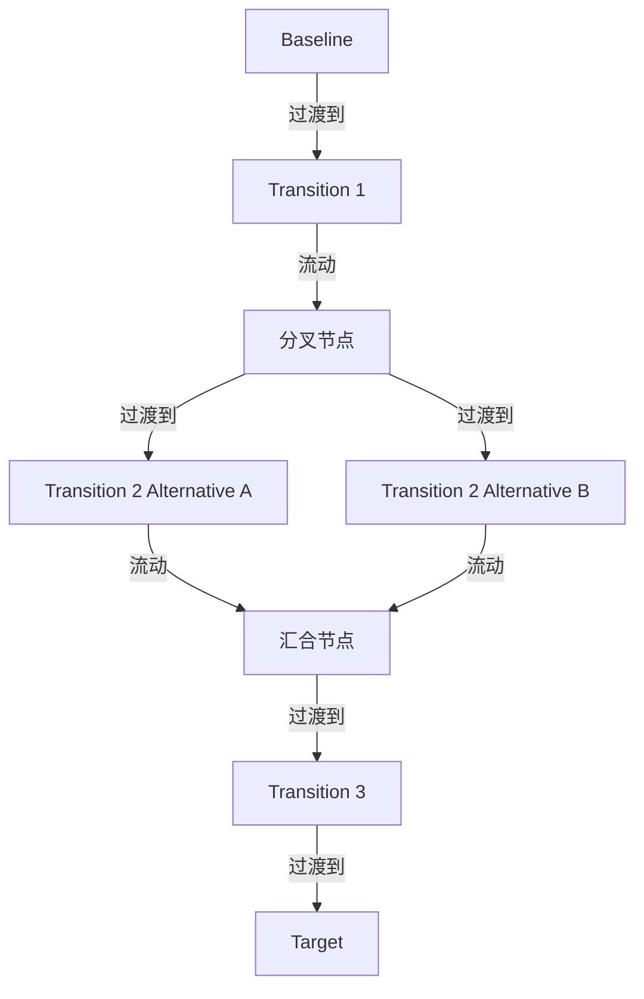

# G20F/fig4-2 · 过渡架构

类型：`process-or-method-model`。为 4.2 节定义过渡架构：架构在“架构上有意义的时点”的一个正式状态，通常包含若干能力增量；图中用一条带分支的链说明路线可以有多个备选过渡状态，且每段实施后系统整体保持稳定。

英文 PDF 物理页：[22]。本页为架构语义分析，原文与原图分别保留。

## 原图与可编辑图


[完整 JSON](fig4-2.json) · [可编辑 Mermaid](fig4-2.mmd) · [仅关系图](fig4-2.relations.mmd) · [层级分解图](fig4-2.hierarchy.mmd)

图形重建表达语义，不复制源图布局。虚线表示解释、矩阵映射或分组关系，不自动表示不确定性的概率。



## 架构分析

从左到右读：Baseline（基线）→ Transition 1 → 黑点处分为上下两条备选（Transition 2 Alternative A / B）→ 黑点汇合 → Transition 3 → Target。每个框右上角的小图标表示“这是一份架构描述”。黑点不是架构状态，只是路线的分叉与汇合。

- 本图有 8 个具名或隐含元素、8 条关系和 0 条包含/分组记录。
- 本图没有可直接确认为人员直属汇报的关系；视觉上下位置、能力分解和治理职责分别读取。
- 完整核对6个架构状态文字、2个黑色拓扑结点、8条左到右箭头。
- 两个Transition 2为备选路线；分叉/汇合不表示必须同时交付两个备选，图中未给出选择条件或基数。

### 如何用于项目

- 按阶段/事件/行为关系读取入口、出口、责任和产物；检查循环与例外路径。
- 工作流先后不表示组织管理权；在项目中显式记录条件和完成标准。

### 结构所表达的逻辑

- 过渡架构是介于基线与目标之间的“架构上有意义的时点”状态，不是项目里程碑或发布本身。
- 路线允许存在备选：第 2 个过渡架构给出 Alternative A 与 Alternative B 两条并行选项，说明过渡状态可以被选择而非唯一确定。
- 分支在汇合点重新收拢，之后还有 Transition 3，说明过渡架构可以有多个、逐步逼近目标。
- 正文指出每个过渡架构通常包含若干能力增量；在敏捷中这些增量通常通过冲刺实现，过渡架构因此与向利益相关者释放业务价值相对应。
- 过渡架构也是风险管理手段：把交付拆成可理解的增量状态，逐段确认系统整体仍然稳定。

## 上下级与包含

平级序列，没有上下级：Baseline、Transition 1、Alternative A/B、Transition 3、Target 都是同一抽象层级的架构状态；分支与汇合用两个不带文字的黑色圆点表示。

|父项|子项|层级类型|依据与解释|
|---|---|---|---|
|—|—|无视觉包含|关系中明确的组成/特化见 JSON semantic_hierarchy。|

## 全部元素与角色

|元素ID|原文名称|类型|含义|直接父项|深度|
|---|---|---|---|---|---|
|baseline|Baseline|architecture|架构：基线架构|—||
|transition_1|Transition 1|architecture|架构：过渡架构 1|—||
|split_node|分叉节点|junction|无文字的连接节点，仅表示路线在此分为两条。|—||
|transition_2_alt_a|Transition 2 Alternative A|architecture|架构：过渡架构 2 备选 A|—||
|transition_2_alt_b|Transition 2 Alternative B|architecture|架构：过渡架构 2 备选 B|—||
|merge_node|汇合节点|junction|无文字的连接节点，表示两条路线在此并为一条。|—||
|transition_3|Transition 3|architecture|架构：过渡架构 3|—||
|target|Target|architecture|架构：目标架构|—||

## 全部关系

黑色实线箭头表示演进方向（从左到右）；分叉点把一个箭头分成两条，汇合点把两条并回一条，因此“箭头”表达的是时间上的先后而非因果。框右侧的小图标（三条横线加斜线）表示该框承载架构描述/交付物，不是连接线。

|主体|语义关系|客体|显式线/隐式|原文标签|依据|
|---|---|---|---|---|---|
|基线架构|过渡到|过渡架构 1|显式连线||过渡到|
|过渡架构 1|流动|分叉节点|显式连线||流动|
|分叉节点|过渡到|过渡架构 2 备选 A|显式连线||分叉出的上支（备选 A）|
|分叉节点|过渡到|过渡架构 2 备选 B|显式连线||分叉出的下支（备选 B）|
|过渡架构 2 备选 A|流动|汇合节点|显式连线||流动|
|过渡架构 2 备选 B|流动|汇合节点|显式连线||流动|
|汇合节点|过渡到|过渡架构 3|显式连线||过渡到|
|过渡架构 3|过渡到|目标架构|显式连线||过渡到|

## 误读检查

- 不要把 Alternative A/B 理解为“两个阶段”；它们是同一时点的两个可选过渡状态，最终只走其中一条。
- 不要把过渡架构等同于发布或冲刺：正文说能力增量通常用冲刺实现，过渡架构对应的是向利益相关者释放业务价值的时点。
- 中文稿引用的 figs/g20f_fig4-2.svg 把图压成了无分支的直线且只有 2 个过渡架构，据此会误以为路线唯一且只有两段。

## 原文证据

### [PDF 第 22 页](../../../documents/G20F.md#page-22)

> A Transition Architecture is a formal description of one state of the architecture at an architecturally significant point in time (see Figure 4-2), usually including a number of capability increments. It describes the roadmap to the desired outcome and ensures the stability of the complete system after its implementation. In Agile, the capability increments are usually implemented using sprints. Transition Architectures also provide a way of managing risk by helping to understand the incremental states of delivery. Transition Architectures are related to releases of business value to the stakeholders.

## 来源与分析状态

所有元素/关系均有来源定位；未把历史解释重命名为本轮逐线视觉确认。源图与语义图是两种视图，布局不证明汇报或因果。

源 PDF SHA-256：`a8fe6569c7d6045ce4ac8d5320c09a3abdc556a0fc1cbcd584bd76a75f3f84be`。

源图记录：[原始解释与转录](../../../figures/G20F/fig4-2.json)。

```json
{
  "quality": {
    "graph_integrity": "checked",
    "semantic_analysis": "typed-graph-and-context-analysis",
    "visual_review": "source-content-audited",
    "notice_zh": "所有元素/关系均有来源定位；未把历史解释重命名为本轮逐线视觉确认。源图与语义图是两种视图，布局不证明汇报或因果。"
  },
  "source_uncertainty": {
    "confidence": "high",
    "uncertainties_zh": [
      "两个黑色圆点在原图中没有文字，标注为“分叉/汇合节点”属版式推断。",
      "框内右上角小图标的含义（架构描述/交付物）由形状推断，原文未在图注中说明。"
    ],
    "analyzed_from": [
      "英文 PDF 第 22 页原图截图（figctx GT crop + 2x2 放大块）",
      "英文 PDF 第 22 页正文",
      "中文稿 G20Fe_赋能企业敏捷性.md 第 219–221 行",
      "figs/g20f_fig4-2.svg 源码与文本"
    ],
    "date": "2026-10-31"
  },
  "source_conflicts": []
}
```
