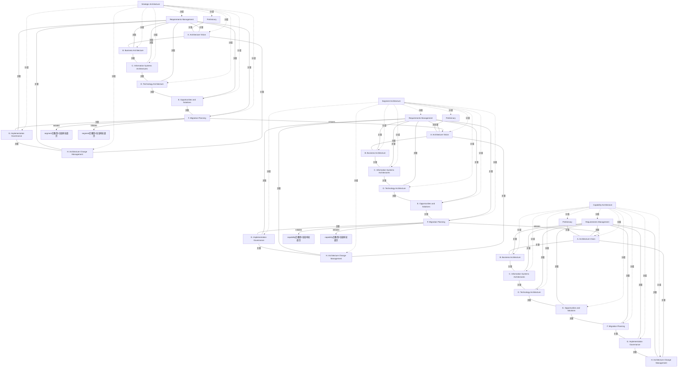

# G20F/fig4-3 · ADM 过程层级示例

类型：`decomposition-or-organization-model`。回答 4.3 节的问题：多层级架构方法在实践中怎么落地。答案是“ADM 循环的层级”——每一层都完整跑一遍 A–H，上层轮盘的产出成为下层轮盘的输入，从而既能并行又能保持对齐。

英文 PDF 物理页：[23]。本页为架构语义分析，原文与原图分别保留。

## 原图与可编辑图


[完整 JSON](fig4-3.json) · [可编辑 Mermaid](fig4-3.mmd) · [仅关系图](fig4-3.relations.mmd) · [层级分解图](fig4-3.hierarchy.mmd)

图形重建表达语义，不复制源图布局。虚线表示解释、矩阵映射或分组关系，不自动表示不确定性的概率。



## 架构分析

三个面板是战略、分段、能力架构，各有完整ADM轮盘；轮盘内17条线无箭头。战略F向分段前页A及两张后页各有一弯箭头，分段F到能力的三个终点同理，共六条跨层箭头。

- 本图有 37 个具名或隐含元素、57 条关系和 30 条包含/分组记录。
- 包含/分组树最大深度为 1；根节点为 战略架构、分段架构、能力架构、segment后叠第1张架构轮盘页、segment后叠第2张架构轮盘页、capability后叠第1张架构轮盘页、capability后叠第2张架构轮盘页。
- 本图没有可直接确认为人员直属汇报的关系；视觉上下位置、能力分解和治理职责分别读取。
- 核对三组完整ADM标签及内部51条无箭头连线。
- 每组跨层实际有3条弯箭头：上层F→下一层前页A与两张后叠页边，共6条；原记录只存4条且合并层级端点，现已拆分补齐。
- 正文允许下层在已明确范围开始，并行推进；弯线不是必须等待全部上层完成的门禁。

### 如何用于项目

- 按父项展开所有直接子项，检查同层粒度、重叠和缺项。
- 保留组成、分类、能力分解与组织汇报的区别；将示例名称替换为已确认的项目对象。

### 结构所表达的逻辑

- 三个层级各自跑一个完整 ADM：图中三份轮盘都含 Preliminary、A–H 与中心的 Requirements Management。
- 战略架构轮圆盘最大、在最外层，分段与能力轮盘依次缩小并向内/向下排布，表示详细程度递增、覆盖范围递减。
- 一个战略架构可以驱动多个分段架构：分段面板带层叠阴影，且正文说不同分段与能力的工作可并行推进。
- 能力架构同样可有多份并行（面板带层叠阴影），对应正文“多个能力架构可并行开发”。
- 跨层每组三条箭头均从上层F发出：一条指向下层前页的A，另外两条指向两张后叠页边缘，不能把三个终点全等同于前页A。
- 正文强调阶段不必按序推进：分段架构活动一旦在战略架构中识别出相关领域即可开始，能力架构也不必等所有分段架构完成。
- 反向的经验反馈在图中没有画成箭头，只在正文说明：能力架构的经验应影响分段架构，分段架构的经验应影响战略架构。

## 上下级与包含

三层：Strategic Architecture（最高、最概括）→ Segment Architecture（中层，可多份并行）→ Capability Architecture（最低、最细，可多份并行）。每层内部是一个 ADM 环：Preliminary 在环外顶部，A–H 在圆周上，Requirements Management 在中心并连到 A–H。

|父项|子项|层级类型|依据与解释|
|---|---|---|---|
|战略架构|预备阶段|visual_grouping|框、泳道、域或分类组的成员归属；没有额外证据不提升为业务组合或管理关系。|
|战略架构|阶段 A：架构愿景|visual_grouping|框、泳道、域或分类组的成员归属；没有额外证据不提升为业务组合或管理关系。|
|战略架构|阶段 B：业务架构|visual_grouping|框、泳道、域或分类组的成员归属；没有额外证据不提升为业务组合或管理关系。|
|战略架构|阶段 C：信息系统架构|visual_grouping|框、泳道、域或分类组的成员归属；没有额外证据不提升为业务组合或管理关系。|
|战略架构|阶段 D：技术架构|visual_grouping|框、泳道、域或分类组的成员归属；没有额外证据不提升为业务组合或管理关系。|
|战略架构|阶段 E：机会与解决方案|visual_grouping|框、泳道、域或分类组的成员归属；没有额外证据不提升为业务组合或管理关系。|
|战略架构|阶段 F：迁移规划|visual_grouping|框、泳道、域或分类组的成员归属；没有额外证据不提升为业务组合或管理关系。|
|战略架构|阶段 G：实施治理|visual_grouping|框、泳道、域或分类组的成员归属；没有额外证据不提升为业务组合或管理关系。|
|战略架构|阶段 H：架构变更管理|visual_grouping|框、泳道、域或分类组的成员归属；没有额外证据不提升为业务组合或管理关系。|
|战略架构|需求管理|visual_grouping|框、泳道、域或分类组的成员归属；没有额外证据不提升为业务组合或管理关系。|
|分段架构|预备阶段|visual_grouping|框、泳道、域或分类组的成员归属；没有额外证据不提升为业务组合或管理关系。|
|分段架构|阶段 A：架构愿景|visual_grouping|框、泳道、域或分类组的成员归属；没有额外证据不提升为业务组合或管理关系。|
|分段架构|阶段 B：业务架构|visual_grouping|框、泳道、域或分类组的成员归属；没有额外证据不提升为业务组合或管理关系。|
|分段架构|阶段 C：信息系统架构|visual_grouping|框、泳道、域或分类组的成员归属；没有额外证据不提升为业务组合或管理关系。|
|分段架构|阶段 D：技术架构|visual_grouping|框、泳道、域或分类组的成员归属；没有额外证据不提升为业务组合或管理关系。|
|分段架构|阶段 E：机会与解决方案|visual_grouping|框、泳道、域或分类组的成员归属；没有额外证据不提升为业务组合或管理关系。|
|分段架构|阶段 F：迁移规划|visual_grouping|框、泳道、域或分类组的成员归属；没有额外证据不提升为业务组合或管理关系。|
|分段架构|阶段 G：实施治理|visual_grouping|框、泳道、域或分类组的成员归属；没有额外证据不提升为业务组合或管理关系。|
|分段架构|阶段 H：架构变更管理|visual_grouping|框、泳道、域或分类组的成员归属；没有额外证据不提升为业务组合或管理关系。|
|分段架构|需求管理|visual_grouping|框、泳道、域或分类组的成员归属；没有额外证据不提升为业务组合或管理关系。|
|能力架构|预备阶段|visual_grouping|框、泳道、域或分类组的成员归属；没有额外证据不提升为业务组合或管理关系。|
|能力架构|阶段 A：架构愿景|visual_grouping|框、泳道、域或分类组的成员归属；没有额外证据不提升为业务组合或管理关系。|
|能力架构|阶段 B：业务架构|visual_grouping|框、泳道、域或分类组的成员归属；没有额外证据不提升为业务组合或管理关系。|
|能力架构|阶段 C：信息系统架构|visual_grouping|框、泳道、域或分类组的成员归属；没有额外证据不提升为业务组合或管理关系。|
|能力架构|阶段 D：技术架构|visual_grouping|框、泳道、域或分类组的成员归属；没有额外证据不提升为业务组合或管理关系。|
|能力架构|阶段 E：机会与解决方案|visual_grouping|框、泳道、域或分类组的成员归属；没有额外证据不提升为业务组合或管理关系。|
|能力架构|阶段 F：迁移规划|visual_grouping|框、泳道、域或分类组的成员归属；没有额外证据不提升为业务组合或管理关系。|
|能力架构|阶段 G：实施治理|visual_grouping|框、泳道、域或分类组的成员归属；没有额外证据不提升为业务组合或管理关系。|
|能力架构|阶段 H：架构变更管理|visual_grouping|框、泳道、域或分类组的成员归属；没有额外证据不提升为业务组合或管理关系。|
|能力架构|需求管理|visual_grouping|框、泳道、域或分类组的成员归属；没有额外证据不提升为业务组合或管理关系。|

## 全部元素与角色

|元素ID|原文名称|类型|含义|直接父项|深度|
|---|---|---|---|---|---|
|strategic_arch|Strategic Architecture|group|单张面板（无层叠阴影），代表企业级的一次 ADM 迭代。 面板内是一个完整的 ADM 轮盘。|—||
|strategic_prelim|Preliminary|phase|阶段：预备阶段|战略架构|1|
|strategic_a|A. Architecture Vision|phase|阶段：阶段 A：架构愿景|战略架构|1|
|strategic_b|B. Business Architecture|phase|阶段：阶段 B：业务架构|战略架构|1|
|strategic_c|C. Information Systems Architectures|phase|阶段：阶段 C：信息系统架构|战略架构|1|
|strategic_d|D. Technology Architecture|phase|阶段：阶段 D：技术架构|战略架构|1|
|strategic_e|E. Opportunities and Solutions|phase|阶段：阶段 E：机会与解决方案|战略架构|1|
|strategic_f|F. Migration Planning|phase|阶段：阶段 F：迁移规划|战略架构|1|
|strategic_g|G. Implementation Governance|phase|阶段：阶段 G：实施治理|战略架构|1|
|strategic_h|H. Architecture Change Management|phase|阶段：阶段 H：架构变更管理|战略架构|1|
|strategic_rm|Requirements Management|process|橙色大圆，辐射线连到本轮的 A–H。|战略架构|1|
|segment_arch|Segment Architecture|group|面板右下带两层灰色阴影，表示可有多份分段架构并行。 面板内是一个完整的 ADM 轮盘。|—||
|segment_prelim|Preliminary|phase|阶段：预备阶段|分段架构|1|
|segment_a|A. Architecture Vision|phase|阶段：阶段 A：架构愿景|分段架构|1|
|segment_b|B. Business Architecture|phase|阶段：阶段 B：业务架构|分段架构|1|
|segment_c|C. Information Systems Architectures|phase|阶段：阶段 C：信息系统架构|分段架构|1|
|segment_d|D. Technology Architecture|phase|阶段：阶段 D：技术架构|分段架构|1|
|segment_e|E. Opportunities and Solutions|phase|阶段：阶段 E：机会与解决方案|分段架构|1|
|segment_f|F. Migration Planning|phase|阶段：阶段 F：迁移规划|分段架构|1|
|segment_g|G. Implementation Governance|phase|阶段：阶段 G：实施治理|分段架构|1|
|segment_h|H. Architecture Change Management|phase|阶段：阶段 H：架构变更管理|分段架构|1|
|segment_rm|Requirements Management|process|橙色大圆，辐射线连到本轮的 A–H。|分段架构|1|
|capability_arch|Capability Architecture|group|面板右下带两层灰色阴影，表示可有多份能力架构并行。 面板内是一个完整的 ADM 轮盘。|—||
|capability_prelim|Preliminary|phase|阶段：预备阶段|能力架构|1|
|capability_a|A. Architecture Vision|phase|阶段：阶段 A：架构愿景|能力架构|1|
|capability_b|B. Business Architecture|phase|阶段：阶段 B：业务架构|能力架构|1|
|capability_c|C. Information Systems Architectures|phase|阶段：阶段 C：信息系统架构|能力架构|1|
|capability_d|D. Technology Architecture|phase|阶段：阶段 D：技术架构|能力架构|1|
|capability_e|E. Opportunities and Solutions|phase|阶段：阶段 E：机会与解决方案|能力架构|1|
|capability_f|F. Migration Planning|phase|阶段：阶段 F：迁移规划|能力架构|1|
|capability_g|G. Implementation Governance|phase|阶段：阶段 G：实施治理|能力架构|1|
|capability_h|H. Architecture Change Management|phase|阶段：阶段 H：架构变更管理|能力架构|1|
|capability_rm|Requirements Management|process|橙色大圆，辐射线连到本轮的 A–H。|能力架构|1|
|segment_back_1|segment后叠第1张架构轮盘页|group|源图只露出后叠页边；跨层箭头落在该页边，未见其内部阶段，不臆定为前页A。|—||
|segment_back_2|segment后叠第2张架构轮盘页|group|源图只露出后叠页边；跨层箭头落在该页边，未见其内部阶段，不臆定为前页A。|—||
|capability_back_1|capability后叠第1张架构轮盘页|group|源图只露出后叠页边；跨层箭头落在该页边，未见其内部阶段，不臆定为前页A。|—||
|capability_back_2|capability后叠第2张架构轮盘页|group|源图只露出后叠页边；跨层箭头落在该页边，未见其内部阶段，不臆定为前页A。|—||

## 全部关系

轮盘内部无向连接不规定序列。每组跨层3条弯箭头从F发出至下一层前页A及两张后叠页，分别建模，不把后页端点合并到前页A。

|主体|语义关系|客体|显式线/隐式|原文标签|依据|
|---|---|---|---|---|---|
|预备阶段|关联|阶段 A：架构愿景|显式连线||ADM轮盘内部无箭头连接：圆周为阶段相邻，辐射为需求管理交互；旁文明确不强制阶段顺序。|
|阶段 A：架构愿景|关联|阶段 B：业务架构|显式连线||ADM轮盘内部无箭头连接：圆周为阶段相邻，辐射为需求管理交互；旁文明确不强制阶段顺序。|
|阶段 B：业务架构|关联|阶段 C：信息系统架构|显式连线||ADM轮盘内部无箭头连接：圆周为阶段相邻，辐射为需求管理交互；旁文明确不强制阶段顺序。|
|阶段 C：信息系统架构|关联|阶段 D：技术架构|显式连线||ADM轮盘内部无箭头连接：圆周为阶段相邻，辐射为需求管理交互；旁文明确不强制阶段顺序。|
|阶段 D：技术架构|关联|阶段 E：机会与解决方案|显式连线||ADM轮盘内部无箭头连接：圆周为阶段相邻，辐射为需求管理交互；旁文明确不强制阶段顺序。|
|阶段 E：机会与解决方案|关联|阶段 F：迁移规划|显式连线||ADM轮盘内部无箭头连接：圆周为阶段相邻，辐射为需求管理交互；旁文明确不强制阶段顺序。|
|阶段 F：迁移规划|关联|阶段 G：实施治理|显式连线||ADM轮盘内部无箭头连接：圆周为阶段相邻，辐射为需求管理交互；旁文明确不强制阶段顺序。|
|阶段 G：实施治理|关联|阶段 H：架构变更管理|显式连线||ADM轮盘内部无箭头连接：圆周为阶段相邻，辐射为需求管理交互；旁文明确不强制阶段顺序。|
|阶段 H：架构变更管理|关联|阶段 A：架构愿景|显式连线||ADM轮盘内部无箭头连接：圆周为阶段相邻，辐射为需求管理交互；旁文明确不强制阶段顺序。|
|需求管理|关联|阶段 A：架构愿景|显式连线||ADM轮盘内部无箭头连接：圆周为阶段相邻，辐射为需求管理交互；旁文明确不强制阶段顺序。|
|需求管理|关联|阶段 B：业务架构|显式连线||ADM轮盘内部无箭头连接：圆周为阶段相邻，辐射为需求管理交互；旁文明确不强制阶段顺序。|
|需求管理|关联|阶段 C：信息系统架构|显式连线||ADM轮盘内部无箭头连接：圆周为阶段相邻，辐射为需求管理交互；旁文明确不强制阶段顺序。|
|需求管理|关联|阶段 D：技术架构|显式连线||ADM轮盘内部无箭头连接：圆周为阶段相邻，辐射为需求管理交互；旁文明确不强制阶段顺序。|
|需求管理|关联|阶段 E：机会与解决方案|显式连线||ADM轮盘内部无箭头连接：圆周为阶段相邻，辐射为需求管理交互；旁文明确不强制阶段顺序。|
|需求管理|关联|阶段 F：迁移规划|显式连线||ADM轮盘内部无箭头连接：圆周为阶段相邻，辐射为需求管理交互；旁文明确不强制阶段顺序。|
|需求管理|关联|阶段 G：实施治理|显式连线||ADM轮盘内部无箭头连接：圆周为阶段相邻，辐射为需求管理交互；旁文明确不强制阶段顺序。|
|需求管理|关联|阶段 H：架构变更管理|显式连线||ADM轮盘内部无箭头连接：圆周为阶段相邻，辐射为需求管理交互；旁文明确不强制阶段顺序。|
|预备阶段|关联|阶段 A：架构愿景|显式连线||ADM轮盘内部无箭头连接：圆周为阶段相邻，辐射为需求管理交互；旁文明确不强制阶段顺序。|
|阶段 A：架构愿景|关联|阶段 B：业务架构|显式连线||ADM轮盘内部无箭头连接：圆周为阶段相邻，辐射为需求管理交互；旁文明确不强制阶段顺序。|
|阶段 B：业务架构|关联|阶段 C：信息系统架构|显式连线||ADM轮盘内部无箭头连接：圆周为阶段相邻，辐射为需求管理交互；旁文明确不强制阶段顺序。|
|阶段 C：信息系统架构|关联|阶段 D：技术架构|显式连线||ADM轮盘内部无箭头连接：圆周为阶段相邻，辐射为需求管理交互；旁文明确不强制阶段顺序。|
|阶段 D：技术架构|关联|阶段 E：机会与解决方案|显式连线||ADM轮盘内部无箭头连接：圆周为阶段相邻，辐射为需求管理交互；旁文明确不强制阶段顺序。|
|阶段 E：机会与解决方案|关联|阶段 F：迁移规划|显式连线||ADM轮盘内部无箭头连接：圆周为阶段相邻，辐射为需求管理交互；旁文明确不强制阶段顺序。|
|阶段 F：迁移规划|关联|阶段 G：实施治理|显式连线||ADM轮盘内部无箭头连接：圆周为阶段相邻，辐射为需求管理交互；旁文明确不强制阶段顺序。|
|阶段 G：实施治理|关联|阶段 H：架构变更管理|显式连线||ADM轮盘内部无箭头连接：圆周为阶段相邻，辐射为需求管理交互；旁文明确不强制阶段顺序。|
|阶段 H：架构变更管理|关联|阶段 A：架构愿景|显式连线||ADM轮盘内部无箭头连接：圆周为阶段相邻，辐射为需求管理交互；旁文明确不强制阶段顺序。|
|需求管理|关联|阶段 A：架构愿景|显式连线||ADM轮盘内部无箭头连接：圆周为阶段相邻，辐射为需求管理交互；旁文明确不强制阶段顺序。|
|需求管理|关联|阶段 B：业务架构|显式连线||ADM轮盘内部无箭头连接：圆周为阶段相邻，辐射为需求管理交互；旁文明确不强制阶段顺序。|
|需求管理|关联|阶段 C：信息系统架构|显式连线||ADM轮盘内部无箭头连接：圆周为阶段相邻，辐射为需求管理交互；旁文明确不强制阶段顺序。|
|需求管理|关联|阶段 D：技术架构|显式连线||ADM轮盘内部无箭头连接：圆周为阶段相邻，辐射为需求管理交互；旁文明确不强制阶段顺序。|
|需求管理|关联|阶段 E：机会与解决方案|显式连线||ADM轮盘内部无箭头连接：圆周为阶段相邻，辐射为需求管理交互；旁文明确不强制阶段顺序。|
|需求管理|关联|阶段 F：迁移规划|显式连线||ADM轮盘内部无箭头连接：圆周为阶段相邻，辐射为需求管理交互；旁文明确不强制阶段顺序。|
|需求管理|关联|阶段 G：实施治理|显式连线||ADM轮盘内部无箭头连接：圆周为阶段相邻，辐射为需求管理交互；旁文明确不强制阶段顺序。|
|需求管理|关联|阶段 H：架构变更管理|显式连线||ADM轮盘内部无箭头连接：圆周为阶段相邻，辐射为需求管理交互；旁文明确不强制阶段顺序。|
|预备阶段|关联|阶段 A：架构愿景|显式连线||ADM轮盘内部无箭头连接：圆周为阶段相邻，辐射为需求管理交互；旁文明确不强制阶段顺序。|
|阶段 A：架构愿景|关联|阶段 B：业务架构|显式连线||ADM轮盘内部无箭头连接：圆周为阶段相邻，辐射为需求管理交互；旁文明确不强制阶段顺序。|
|阶段 B：业务架构|关联|阶段 C：信息系统架构|显式连线||ADM轮盘内部无箭头连接：圆周为阶段相邻，辐射为需求管理交互；旁文明确不强制阶段顺序。|
|阶段 C：信息系统架构|关联|阶段 D：技术架构|显式连线||ADM轮盘内部无箭头连接：圆周为阶段相邻，辐射为需求管理交互；旁文明确不强制阶段顺序。|
|阶段 D：技术架构|关联|阶段 E：机会与解决方案|显式连线||ADM轮盘内部无箭头连接：圆周为阶段相邻，辐射为需求管理交互；旁文明确不强制阶段顺序。|
|阶段 E：机会与解决方案|关联|阶段 F：迁移规划|显式连线||ADM轮盘内部无箭头连接：圆周为阶段相邻，辐射为需求管理交互；旁文明确不强制阶段顺序。|
|阶段 F：迁移规划|关联|阶段 G：实施治理|显式连线||ADM轮盘内部无箭头连接：圆周为阶段相邻，辐射为需求管理交互；旁文明确不强制阶段顺序。|
|阶段 G：实施治理|关联|阶段 H：架构变更管理|显式连线||ADM轮盘内部无箭头连接：圆周为阶段相邻，辐射为需求管理交互；旁文明确不强制阶段顺序。|
|阶段 H：架构变更管理|关联|阶段 A：架构愿景|显式连线||ADM轮盘内部无箭头连接：圆周为阶段相邻，辐射为需求管理交互；旁文明确不强制阶段顺序。|
|需求管理|关联|阶段 A：架构愿景|显式连线||ADM轮盘内部无箭头连接：圆周为阶段相邻，辐射为需求管理交互；旁文明确不强制阶段顺序。|
|需求管理|关联|阶段 B：业务架构|显式连线||ADM轮盘内部无箭头连接：圆周为阶段相邻，辐射为需求管理交互；旁文明确不强制阶段顺序。|
|需求管理|关联|阶段 C：信息系统架构|显式连线||ADM轮盘内部无箭头连接：圆周为阶段相邻，辐射为需求管理交互；旁文明确不强制阶段顺序。|
|需求管理|关联|阶段 D：技术架构|显式连线||ADM轮盘内部无箭头连接：圆周为阶段相邻，辐射为需求管理交互；旁文明确不强制阶段顺序。|
|需求管理|关联|阶段 E：机会与解决方案|显式连线||ADM轮盘内部无箭头连接：圆周为阶段相邻，辐射为需求管理交互；旁文明确不强制阶段顺序。|
|需求管理|关联|阶段 F：迁移规划|显式连线||ADM轮盘内部无箭头连接：圆周为阶段相邻，辐射为需求管理交互；旁文明确不强制阶段顺序。|
|需求管理|关联|阶段 G：实施治理|显式连线||ADM轮盘内部无箭头连接：圆周为阶段相邻，辐射为需求管理交互；旁文明确不强制阶段顺序。|
|需求管理|关联|阶段 H：架构变更管理|显式连线||ADM轮盘内部无箭头连接：圆周为阶段相邻，辐射为需求管理交互；旁文明确不强制阶段顺序。|
|阶段 F：迁移规划|initiates|segment后叠第1张架构轮盘页|显式连线||跨层弯线从上层F Migration Planning出发，分别指向下一层A或后叠轮盘页边；不是从整个范围框到整个范围框。|
|阶段 F：迁移规划|initiates|阶段 A：架构愿景|显式连线||跨层弯线从上层F Migration Planning出发，分别指向下一层A或后叠轮盘页边；不是从整个范围框到整个范围框。|
|阶段 F：迁移规划|initiates|capability后叠第1张架构轮盘页|显式连线||跨层弯线从上层F Migration Planning出发，分别指向下一层A或后叠轮盘页边；不是从整个范围框到整个范围框。|
|阶段 F：迁移规划|initiates|阶段 A：架构愿景|显式连线||跨层弯线从上层F Migration Planning出发，分别指向下一层A或后叠轮盘页边；不是从整个范围框到整个范围框。|
|阶段 F：迁移规划|initiates|segment后叠第2张架构轮盘页|显式连线||第三条弯箭头至后叠第二页；内部阶段被遮挡，端点记录为页边。|
|阶段 F：迁移规划|initiates|capability后叠第2张架构轮盘页|显式连线||第三条弯箭头至后叠第二页；内部阶段被遮挡，端点记录为页边。|

## 本轮语义修正

- ADM轮盘内部无箭头连接：圆周为阶段相邻，辐射为需求管理交互；旁文明确不强制阶段顺序。
- ADM轮盘内部无箭头连接：圆周为阶段相邻，辐射为需求管理交互；旁文明确不强制阶段顺序。
- ADM轮盘内部无箭头连接：圆周为阶段相邻，辐射为需求管理交互；旁文明确不强制阶段顺序。
- ADM轮盘内部无箭头连接：圆周为阶段相邻，辐射为需求管理交互；旁文明确不强制阶段顺序。
- ADM轮盘内部无箭头连接：圆周为阶段相邻，辐射为需求管理交互；旁文明确不强制阶段顺序。
- ADM轮盘内部无箭头连接：圆周为阶段相邻，辐射为需求管理交互；旁文明确不强制阶段顺序。
- ADM轮盘内部无箭头连接：圆周为阶段相邻，辐射为需求管理交互；旁文明确不强制阶段顺序。
- ADM轮盘内部无箭头连接：圆周为阶段相邻，辐射为需求管理交互；旁文明确不强制阶段顺序。
- ADM轮盘内部无箭头连接：圆周为阶段相邻，辐射为需求管理交互；旁文明确不强制阶段顺序。
- ADM轮盘内部无箭头连接：圆周为阶段相邻，辐射为需求管理交互；旁文明确不强制阶段顺序。
- ADM轮盘内部无箭头连接：圆周为阶段相邻，辐射为需求管理交互；旁文明确不强制阶段顺序。
- ADM轮盘内部无箭头连接：圆周为阶段相邻，辐射为需求管理交互；旁文明确不强制阶段顺序。
- ADM轮盘内部无箭头连接：圆周为阶段相邻，辐射为需求管理交互；旁文明确不强制阶段顺序。
- ADM轮盘内部无箭头连接：圆周为阶段相邻，辐射为需求管理交互；旁文明确不强制阶段顺序。
- ADM轮盘内部无箭头连接：圆周为阶段相邻，辐射为需求管理交互；旁文明确不强制阶段顺序。
- ADM轮盘内部无箭头连接：圆周为阶段相邻，辐射为需求管理交互；旁文明确不强制阶段顺序。
- ADM轮盘内部无箭头连接：圆周为阶段相邻，辐射为需求管理交互；旁文明确不强制阶段顺序。
- ADM轮盘内部无箭头连接：圆周为阶段相邻，辐射为需求管理交互；旁文明确不强制阶段顺序。
- ADM轮盘内部无箭头连接：圆周为阶段相邻，辐射为需求管理交互；旁文明确不强制阶段顺序。
- ADM轮盘内部无箭头连接：圆周为阶段相邻，辐射为需求管理交互；旁文明确不强制阶段顺序。
- ADM轮盘内部无箭头连接：圆周为阶段相邻，辐射为需求管理交互；旁文明确不强制阶段顺序。
- ADM轮盘内部无箭头连接：圆周为阶段相邻，辐射为需求管理交互；旁文明确不强制阶段顺序。
- ADM轮盘内部无箭头连接：圆周为阶段相邻，辐射为需求管理交互；旁文明确不强制阶段顺序。
- ADM轮盘内部无箭头连接：圆周为阶段相邻，辐射为需求管理交互；旁文明确不强制阶段顺序。
- ADM轮盘内部无箭头连接：圆周为阶段相邻，辐射为需求管理交互；旁文明确不强制阶段顺序。
- ADM轮盘内部无箭头连接：圆周为阶段相邻，辐射为需求管理交互；旁文明确不强制阶段顺序。
- ADM轮盘内部无箭头连接：圆周为阶段相邻，辐射为需求管理交互；旁文明确不强制阶段顺序。
- ADM轮盘内部无箭头连接：圆周为阶段相邻，辐射为需求管理交互；旁文明确不强制阶段顺序。
- ADM轮盘内部无箭头连接：圆周为阶段相邻，辐射为需求管理交互；旁文明确不强制阶段顺序。
- ADM轮盘内部无箭头连接：圆周为阶段相邻，辐射为需求管理交互；旁文明确不强制阶段顺序。
- ADM轮盘内部无箭头连接：圆周为阶段相邻，辐射为需求管理交互；旁文明确不强制阶段顺序。
- ADM轮盘内部无箭头连接：圆周为阶段相邻，辐射为需求管理交互；旁文明确不强制阶段顺序。
- ADM轮盘内部无箭头连接：圆周为阶段相邻，辐射为需求管理交互；旁文明确不强制阶段顺序。
- ADM轮盘内部无箭头连接：圆周为阶段相邻，辐射为需求管理交互；旁文明确不强制阶段顺序。
- ADM轮盘内部无箭头连接：圆周为阶段相邻，辐射为需求管理交互；旁文明确不强制阶段顺序。
- ADM轮盘内部无箭头连接：圆周为阶段相邻，辐射为需求管理交互；旁文明确不强制阶段顺序。
- ADM轮盘内部无箭头连接：圆周为阶段相邻，辐射为需求管理交互；旁文明确不强制阶段顺序。
- ADM轮盘内部无箭头连接：圆周为阶段相邻，辐射为需求管理交互；旁文明确不强制阶段顺序。
- ADM轮盘内部无箭头连接：圆周为阶段相邻，辐射为需求管理交互；旁文明确不强制阶段顺序。
- ADM轮盘内部无箭头连接：圆周为阶段相邻，辐射为需求管理交互；旁文明确不强制阶段顺序。
- ADM轮盘内部无箭头连接：圆周为阶段相邻，辐射为需求管理交互；旁文明确不强制阶段顺序。
- ADM轮盘内部无箭头连接：圆周为阶段相邻，辐射为需求管理交互；旁文明确不强制阶段顺序。
- ADM轮盘内部无箭头连接：圆周为阶段相邻，辐射为需求管理交互；旁文明确不强制阶段顺序。
- ADM轮盘内部无箭头连接：圆周为阶段相邻，辐射为需求管理交互；旁文明确不强制阶段顺序。
- ADM轮盘内部无箭头连接：圆周为阶段相邻，辐射为需求管理交互；旁文明确不强制阶段顺序。
- ADM轮盘内部无箭头连接：圆周为阶段相邻，辐射为需求管理交互；旁文明确不强制阶段顺序。
- ADM轮盘内部无箭头连接：圆周为阶段相邻，辐射为需求管理交互；旁文明确不强制阶段顺序。
- ADM轮盘内部无箭头连接：圆周为阶段相邻，辐射为需求管理交互；旁文明确不强制阶段顺序。
- ADM轮盘内部无箭头连接：圆周为阶段相邻，辐射为需求管理交互；旁文明确不强制阶段顺序。
- ADM轮盘内部无箭头连接：圆周为阶段相邻，辐射为需求管理交互；旁文明确不强制阶段顺序。
- ADM轮盘内部无箭头连接：圆周为阶段相邻，辐射为需求管理交互；旁文明确不强制阶段顺序。
- 跨层弯线从上层F Migration Planning出发，分别指向下一层A或后叠轮盘页边；不是从整个范围框到整个范围框。
- 跨层弯线从上层F Migration Planning出发，分别指向下一层A或后叠轮盘页边；不是从整个范围框到整个范围框。
- 跨层弯线从上层F Migration Planning出发，分别指向下一层A或后叠轮盘页边；不是从整个范围框到整个范围框。
- 跨层弯线从上层F Migration Planning出发，分别指向下一层A或后叠轮盘页边；不是从整个范围框到整个范围框。
- 第三条弯箭头至后叠第二页；内部阶段被遮挡，端点记录为页边。
- 第三条弯箭头至后叠第二页；内部阶段被遮挡，端点记录为页边。

## 误读检查

- 不要以为三个轮盘是“三个不同的方法”；它们是同一 ADM 在不同架构层级上的重复实例。
- 不要把面板的层叠阴影当作装饰：它表示同一层级可以有多份架构（多个分段、多个能力）并行。
- 不要以为层间只有单向驱动：正文明确说下层经验应反馈影响上层，只是图中没画反馈箭头。
- 中文稿引用的 figs/g20f_fig4-3.svg 已换成卡片式示意，看不到三个 ADM 轮盘，也读不出“每层都跑完整 ADM”。

## 原文证据

### [PDF 第 22 页](../../../documents/G20F.md#page-22)

> A practical and proven approach to applying the multi-level approach through a hierarchy of ADM cycles is illustrated in Figure 4-3.
### [PDF 第 23 页](../../../documents/G20F.md#page-23)

> As described in the previous section, TOGAF ADM phases do not have to proceed in sequence. The activities around defining Segment Architectures can start as soon as the relevant areas have been identified in the Strategic Architecture. Even if not all of these segments have been defined, architecture work can start in those that had already been identified. In a similar way, work on defining Capability Architectures need not wait until all Segment Architectures have been defined. Work on different segments and capabilities may proceed in parallel. The Strategic, Segment, and Capability Architectures are explained in more detail in Section 4.4.
### [PDF 第 24 页](../../../documents/G20F.md#page-24)

> Experience gained when developing a Capability Architecture should influence the higher-level Segment Architecture. Experience gained when developing a Segment Architecture should influence the higher-level Strategic Architecture.
> Agile delivery teams should collaborate closely with architects to ensure that the sprint teams understand and comply with architecture specifications (which may be expressed as guardrails or runways), and to enable rapid feedback to future architecture iterations.

## 来源与分析状态

所有元素/关系均有来源定位；未把历史解释重命名为本轮逐线视觉确认。源图与语义图是两种视图，布局不证明汇报或因果。

源 PDF SHA-256：`a8fe6569c7d6045ce4ac8d5320c09a3abdc556a0fc1cbcd584bd76a75f3f84be`。

源图记录：[原始解释与转录](../../../figures/G20F/fig4-3.json)。

```json
{
  "quality": {
    "graph_integrity": "checked",
    "semantic_analysis": "typed-graph-and-context-analysis",
    "visual_review": "source-content-audited",
    "notice_zh": "所有元素/关系均有来源定位；未把历史解释重命名为本轮逐线视觉确认。源图与语义图是两种视图，布局不证明汇报或因果。"
  },
  "source_uncertainty": {
    "confidence": "high",
    "uncertainties_zh": [
      "三条曲线每层的确切条数（1 条指向 A + 2 条指向面板边缘）在缩略图分辨率下按像素判断，若原文实际为 2 条也不影响语义。",
      "战略轮是否也只表示一份架构（无层叠阴影）依画面判断。"
    ],
    "analyzed_from": [
      "英文 PDF 第 23 页原图截图（figctx GT crop + 2x2 放大块）",
      "英文 PDF 第 23 页正文与第 22 页 4.3 节引言",
      "中文稿 G20Fe_赋能企业敏捷性.md 第 225–231 行",
      "figs/g20f_fig4-3.svg 源码与文本"
    ],
    "date": "2026-10-31"
  },
  "source_conflicts": []
}
```
