# G20F/fig4-4 · ADM 层级与敏捷交付概念的映射

类型：`mapping-or-assessment-matrix`。4.5 节要回答“ADM 的层级与阶段如何落到敏捷交付概念上”。这张图把三个架构层（左列）、对应的 SAFe/Agile/Scrum 待办层次（中列）和典型团队迭代形态（右列）排成对照表，说明三层可以各自循环 A–G，但重点、待办粒度与迭代节奏不同。

英文 PDF 物理页：[28]。本页为架构语义分析，原文与原图分别保留。

## 原图与可编辑图


[完整 JSON](fig4-4.json) · [可编辑 Mermaid](fig4-4.mmd) · [仅关系图](fig4-4.relations.mmd) · [层级分解图](fig4-4.hierarchy.mmd)

图形重建表达语义，不复制源图布局。虚线表示解释、矩阵映射或分组关系，不自动表示不确定性的概率。

```mermaid
flowchart TB
  %% Semantic reconstruction; see original source image for exact layout.
  n0["TOGAF ADM – Levels"]
  n1["SAFe/Agile/Scrum Layers"]
  n2["Characteristic Agile Team Iterations"]
  n3["战略层（第一行）"]
  n4["Strategic Architecture"]
  n5["Direction-setting at an executive level"]
  n6["ADM 轮盘缩略图"]
  n7["SAFe – Strategic Themes – Enterprise Portfolio Delivery"]
  n8["规划迭代框（橙色虚线，横跨第一、二行）"]
  n9["Planning Iteration (Time-Boxed)"]
  n10["蓝色环形迭代箭头"]
  n11["ADM 轮盘（环内）"]
  n12["粗平箭头（右推）"]
  n13["Enterprise/Segment Portfolio – Epics"]
  n14["Business Team"]
  n15["Technical Team"]
  n16["Operational Team"]
  n17["团队人形图标"]
  n18["分段层（第二行）"]
  n19["Segment Architecture"]
  n20["Organizing for operational and solution change at a program or portfolio level"]
  n21["ADM 轮盘缩略图"]
  n22["Agile/SAFe – Product/Portfolio Backlog – Change Plans – Epics"]
  n23["能力层（第三行）"]
  n24["Capability Architecture"]
  n25["Organizing framework for change activity and roadmaps realizing capability increments"]
  n26["ADM 轮盘缩略图"]
  n27["Agile/SAFe – Product/Solution Backlog – Capabilities to be Delivered"]
  n28["Agile/SAFe – Product/Program Backlog – Capability Increments (Features)"]
  n29["Agile/SAFe – Program Team Backlog – Deliverable User Stories"]
  n30["Scrum – Sprint Team Backlog – Deliverable User Stories"]
  n31["Build Iteration 框（紫色虚线）"]
  n32["Build Iteration"]
  n33["Solution Team"]
  n34["Daily Stand-Up"]
  n35["紫色环形迭代箭头"]
  n36["ADM 轮盘（紫环内）"]
  n37["紫色粗箭头（右推）"]
  n38["解决方案团队人形图标"]
  n39["Solution Runway"]
  n40["Delivery Iteration 框（青色虚线）"]
  n41["Delivery Iteration"]
  n42["Delivery Team (Dev Ops)"]
  n43["Daily Stand-Up"]
  n44["青色环形迭代箭头"]
  n45["ADM 轮盘（青环内）"]
  n46["青色粗箭头（右推）"]
  n47["交付团队人形图标"]
  n48["Agile Development Continuous Integration/Delivery"]
  n49["Preliminary"]
  n50["A. Architecture Vision"]
  n51["B. Business Architecture"]
  n52["C. Information Systems Architectures"]
  n53["D. Technology Architecture"]
  n54["E. Opportunities and Solutions"]
  n55["F. Migration Planning"]
  n56["G. Implementation Governance"]
  n57["H. Architecture Change Management"]
  n58["Requirements Management"]
  n59["Preliminary"]
  n60["A. Architecture Vision"]
  n61["B. Business Architecture"]
  n62["C. Information Systems Architectures"]
  n63["D. Technology Architecture"]
  n64["E. Opportunities and Solutions"]
  n65["F. Migration Planning"]
  n66["G. Implementation Governance"]
  n67["H. Architecture Change Management"]
  n68["Requirements Management"]
  n69["Preliminary"]
  n70["A. Architecture Vision"]
  n71["B. Business Architecture"]
  n72["C. Information Systems Architectures"]
  n73["D. Technology Architecture"]
  n74["E. Opportunities and Solutions"]
  n75["F. Migration Planning"]
  n76["G. Implementation Governance"]
  n77["H. Architecture Change Management"]
  n78["Requirements Management"]
  n79["A. Architecture Vision"]
  n80["B. Business Architecture"]
  n81["C. Information Systems Architectures"]
  n82["D. Technology Architecture"]
  n83["E. Opportunities and Solutions"]
  n84["F. Migration Planning"]
  n85["G. Implementation Governance"]
  n86["H. Architecture Change Management"]
  n87["Requirements Management"]
  n88["A. Architecture Vision"]
  n89["B. Business Architecture"]
  n90["C. Information Systems Architectures"]
  n91["D. Technology Architecture"]
  n92["E. Opportunities and Solutions"]
  n93["F. Migration Planning"]
  n94["G. Implementation Governance"]
  n95["H. Architecture Change Management"]
  n96["Requirements Management"]
  n97["A. Architecture Vision"]
  n98["B. Business Architecture"]
  n99["C. Information Systems Architectures"]
  n100["D. Technology Architecture"]
  n101["E. Opportunities and Solutions"]
  n102["F. Migration Planning"]
  n103["G. Implementation Governance"]
  n104["H. Architecture Change Management"]
  n105["Requirements Management"]
  n106["未命名团队人物图标1"]
  n107["未命名团队人物图标2"]
  n108["未命名团队人物图标3"]
  n109["未命名团队人物图标4"]
  n110["未命名团队人物图标5"]
  n111["未命名团队人物图标6"]
  n112["未命名团队人物图标7"]
  n113["未命名团队人物图标8"]
  n114["未命名团队人物图标9"]
  n115["未命名团队人物图标10"]
  n116["未命名团队人物图标1"]
  n117["未命名团队人物图标2"]
  n118["未命名团队人物图标3"]
  n119["未命名团队人物图标4"]
  n120["未命名团队人物图标5"]
  n121["未命名团队人物图标1"]
  n122["未命名团队人物图标2"]
  n123["未命名团队人物图标3"]
  n124["未命名团队人物图标4"]
  n125["未命名团队人物图标5"]
  n126["上方小型顺时针循环箭头"]
  n127["上方小型顺时针循环箭头"]
  n128["上方小型顺时针循环箭头"]
  n55 -->|"initiates"| n60
  n65 -->|"initiates"| n70
  n9 -.->|"产生/交付"| n13
  n49 ---|"关联"| n50
  n50 ---|"关联"| n51
  n51 ---|"关联"| n52
  n52 ---|"关联"| n53
  n53 ---|"关联"| n54
  n54 ---|"关联"| n55
  n55 ---|"关联"| n56
  n56 ---|"关联"| n57
  n57 ---|"关联"| n50
  n58 ---|"关联"| n50
  n58 ---|"关联"| n51
  n58 ---|"关联"| n52
  n58 ---|"关联"| n53
  n58 ---|"关联"| n54
  n58 ---|"关联"| n55
  n58 ---|"关联"| n56
  n58 ---|"关联"| n57
  n59 ---|"关联"| n60
  n60 ---|"关联"| n61
  n61 ---|"关联"| n62
  n62 ---|"关联"| n63
  n63 ---|"关联"| n64
  n64 ---|"关联"| n65
  n65 ---|"关联"| n66
  n66 ---|"关联"| n67
  n67 ---|"关联"| n60
  n68 ---|"关联"| n60
  n68 ---|"关联"| n61
  n68 ---|"关联"| n62
  n68 ---|"关联"| n63
  n68 ---|"关联"| n64
  n68 ---|"关联"| n65
  n68 ---|"关联"| n66
  n68 ---|"关联"| n67
  n69 ---|"关联"| n70
  n70 ---|"关联"| n71
  n71 ---|"关联"| n72
  n72 ---|"关联"| n73
  n73 ---|"关联"| n74
  n74 ---|"关联"| n75
  n75 ---|"关联"| n76
  n76 ---|"关联"| n77
  n77 ---|"关联"| n70
  n78 ---|"关联"| n70
  n78 ---|"关联"| n71
  n78 ---|"关联"| n72
  n78 ---|"关联"| n73
  n78 ---|"关联"| n74
  n78 ---|"关联"| n75
  n78 ---|"关联"| n76
  n78 ---|"关联"| n77
  n79 ---|"关联"| n80
  n80 ---|"关联"| n81
  n81 ---|"关联"| n82
  n82 ---|"关联"| n83
  n83 ---|"关联"| n84
  n84 ---|"关联"| n85
  n85 ---|"关联"| n86
  n86 ---|"关联"| n79
  n87 ---|"关联"| n79
  n87 ---|"关联"| n80
  n87 ---|"关联"| n81
  n87 ---|"关联"| n82
  n87 ---|"关联"| n83
  n87 ---|"关联"| n84
  n87 ---|"关联"| n85
  n87 ---|"关联"| n86
  n88 ---|"关联"| n89
  n89 ---|"关联"| n90
  n90 ---|"关联"| n91
  n91 ---|"关联"| n92
  n92 ---|"关联"| n93
  n93 ---|"关联"| n94
  n94 ---|"关联"| n95
  n95 ---|"关联"| n88
  n96 ---|"关联"| n88
  n96 ---|"关联"| n89
  n96 ---|"关联"| n90
  n96 ---|"关联"| n91
  n96 ---|"关联"| n92
  n96 ---|"关联"| n93
  n96 ---|"关联"| n94
  n96 ---|"关联"| n95
  n97 ---|"关联"| n98
  n98 ---|"关联"| n99
  n99 ---|"关联"| n100
  n100 ---|"关联"| n101
  n101 ---|"关联"| n102
  n102 ---|"关联"| n103
  n103 ---|"关联"| n104
  n104 ---|"关联"| n97
  n105 ---|"关联"| n97
  n105 ---|"关联"| n98
  n105 ---|"关联"| n99
  n105 ---|"关联"| n100
  n105 ---|"关联"| n101
  n105 ---|"关联"| n102
  n105 ---|"关联"| n103
  n105 ---|"关联"| n104
  n3 -.->|"分组"| n4
  n3 -.->|"分组"| n5
  n3 -.->|"分组"| n6
  n3 -.->|"分组"| n7
  n8 -.->|"分组"| n9
  n8 -.->|"分组"| n10
  n8 -.->|"分组"| n11
  n8 -.->|"分组"| n12
  n8 -.->|"分组"| n13
  n8 -.->|"分组"| n14
  n8 -.->|"分组"| n15
  n8 -.->|"分组"| n16
  n8 -.->|"分组"| n17
  n18 -.->|"分组"| n19
  n18 -.->|"分组"| n20
  n18 -.->|"分组"| n21
  n18 -.->|"分组"| n22
  n23 -.->|"分组"| n24
  n23 -.->|"分组"| n25
  n23 -.->|"分组"| n26
  n23 -.->|"分组"| n27
  n23 -.->|"分组"| n28
  n23 -.->|"分组"| n29
  n23 -.->|"分组"| n30
  n23 -.->|"分组"| n31
  n31 -.->|"分组"| n32
  n31 -.->|"分组"| n33
  n31 -.->|"分组"| n34
  n31 -.->|"分组"| n35
  n31 -.->|"分组"| n36
  n31 -.->|"分组"| n37
  n31 -.->|"分组"| n38
  n31 -.->|"分组"| n39
  n23 -.->|"分组"| n40
  n40 -.->|"分组"| n41
  n40 -.->|"分组"| n42
  n40 -.->|"分组"| n43
  n40 -.->|"分组"| n44
  n40 -.->|"分组"| n45
  n40 -.->|"分组"| n46
  n40 -.->|"分组"| n47
  n40 -.->|"分组"| n48
  n6 -.->|"分组"| n49
  n6 -.->|"分组"| n50
  n6 -.->|"分组"| n51
  n6 -.->|"分组"| n52
  n6 -.->|"分组"| n53
  n6 -.->|"分组"| n54
  n6 -.->|"分组"| n55
  n6 -.->|"分组"| n56
  n6 -.->|"分组"| n57
  n6 -.->|"分组"| n58
  n21 -.->|"分组"| n59
  n21 -.->|"分组"| n60
  n21 -.->|"分组"| n61
  n21 -.->|"分组"| n62
  n21 -.->|"分组"| n63
  n21 -.->|"分组"| n64
  n21 -.->|"分组"| n65
  n21 -.->|"分组"| n66
  n21 -.->|"分组"| n67
  n21 -.->|"分组"| n68
  n26 -.->|"分组"| n69
  n26 -.->|"分组"| n70
  n26 -.->|"分组"| n71
  n26 -.->|"分组"| n72
  n26 -.->|"分组"| n73
  n26 -.->|"分组"| n74
  n26 -.->|"分组"| n75
  n26 -.->|"分组"| n76
  n26 -.->|"分组"| n77
  n26 -.->|"分组"| n78
  n11 -.->|"分组"| n79
  n11 -.->|"分组"| n80
  n11 -.->|"分组"| n81
  n11 -.->|"分组"| n82
  n11 -.->|"分组"| n83
  n11 -.->|"分组"| n84
  n11 -.->|"分组"| n85
  n11 -.->|"分组"| n86
  n11 -.->|"分组"| n87
  n36 -.->|"分组"| n88
  n36 -.->|"分组"| n89
  n36 -.->|"分组"| n90
  n36 -.->|"分组"| n91
  n36 -.->|"分组"| n92
  n36 -.->|"分组"| n93
  n36 -.->|"分组"| n94
  n36 -.->|"分组"| n95
  n36 -.->|"分组"| n96
  n45 -.->|"分组"| n97
  n45 -.->|"分组"| n98
  n45 -.->|"分组"| n99
  n45 -.->|"分组"| n100
  n45 -.->|"分组"| n101
  n45 -.->|"分组"| n102
  n45 -.->|"分组"| n103
  n45 -.->|"分组"| n104
  n45 -.->|"分组"| n105
  n17 -.->|"分组"| n106
  n17 -.->|"分组"| n107
  n17 -.->|"分组"| n108
  n17 -.->|"分组"| n109
  n17 -.->|"分组"| n110
  n17 -.->|"分组"| n111
  n17 -.->|"分组"| n112
  n17 -.->|"分组"| n113
  n17 -.->|"分组"| n114
  n17 -.->|"分组"| n115
  n38 -.->|"分组"| n116
  n38 -.->|"分组"| n117
  n38 -.->|"分组"| n118
  n38 -.->|"分组"| n119
  n38 -.->|"分组"| n120
  n47 -.->|"分组"| n121
  n47 -.->|"分组"| n122
  n47 -.->|"分组"| n123
  n47 -.->|"分组"| n124
  n47 -.->|"分组"| n125
  n8 -.->|"分组"| n126
  n31 -.->|"分组"| n127
  n40 -.->|"分组"| n128
```



## 架构分析

左列是三个架构层级及三个完整ADM，中列是待办层次，右侧规划、构建、交付三面板各有一个无Preliminary的ADM小轮盘和团队图符。左侧虚线从上层F到下层A；右侧大/小回环和右向箭头为迭代图符，未直接连接具体团队、轮盘阶段或说明文字。

- 本图有 129 个具名或隐含元素、102 条关系和 122 条包含/分组记录。
- 包含/分组树最大深度为 3；根节点为 TOGAF ADM——层级、SAFe/敏捷/Scrum 层、特征性的敏捷团队迭代、战略层（第一行）、规划迭代框（橙色虚线，横跨第一、二行）、分段层（第二行）、能力层（第三行）。
- 本图没有可直接确认为人员直属汇报的关系；视觉上下位置、能力分解和治理职责分别读取。
- 包含分组后有 5 个连通分量；分离可能源于图例、并列分类或独立示例，未自动补边。
- 核对3×3映射表全部文字、规划跨两行/构建和交付独立框、三种团队全部20人物图标。
- 放大核对左侧3个带Preliminary轮盘与右侧3个不带Preliminary轮盘，补57个阶段/需求节点和99条无箭头内部线；六轮盘不得按同名阶段合并。
- 左侧F→下一层A虚线明确端点；右侧大小循环和直行箭头是迭代推进图符，无图符→人员的连接。

### 如何用于项目

- 先固定行、列所代表的维度及单元格含义，再登记有证据的映射或评分。
- 空白、无关系、未测量和不适用分别处理；颜色不自动等于优先级。

### 结构所表达的逻辑

- 同一个 ADM 在三个层级重复：左列三个轮盘都含完整 A–H，说明每层都可循环经历全部阶段，只是重点不同。
- 战略层（第一行）重点是方向设定（Direction-setting at an executive level），对应 SAFe 的战略主题与企业组合交付，迭代是时间盒的规划迭代（Planning Iteration）。
- 分段层（第二行）重点是按项目群/组合组织运营与解决方案变更，对应 Product/Portfolio Backlog – Change Plans – Epics；它与战略层共用右上那个大的规划迭代框，说明两层共用企业/分段组合与 Epic 这一层待办。
- 能力层（第三行）重点是变更活动与路线图、实现能力增量，对应四条更细的待办：Product/Solution Backlog（Capabilities to be Delivered）、Product/Program Backlog（Capability Increments / Features）、Program Team Backlog（Deliverable User Stories）、Scrum Sprint Team Backlog（Deliverable User Stories）。
- 能力层内部还有 Build Iteration 与 Delivery Iteration 两条并行迭代线：前者由 Solution Team 做每日站会并维护 Solution Runway，后者由 Delivery Team (Dev Ops) 做每日站会并负责持续集成/交付。
- 团队构成随层级变化：规划迭代由 Business Team、Technical Team、Operational Team 混合组成（人形图标蓝橙相间），能力层则按 Solution Team / Delivery Team 分工。
- 正文补充：三层也可以由一个跨层集成团队在连贯冲刺中推进，具体编排取决于企业复杂度与敏捷实施方式，图只是“典型”形态。

## 上下级与包含

三架构层级与待办/团队迭代形成交叉对照。左侧三个ADM各10标签，右侧三个各9标签（无Preliminary）；规划面板跨战略/分段行，构建与交付面板位于能力层。人物是20个独立图符（规划10、构建5、交付5），仅为示意人数。

|父项|子项|层级类型|依据与解释|
|---|---|---|---|
|战略层（第一行）|战略架构|visual_grouping|框、泳道、域或分类组的成员归属；没有额外证据不提升为业务组合或管理关系。|
|战略层（第一行）|高管层级的定方向|visual_grouping|框、泳道、域或分类组的成员归属；没有额外证据不提升为业务组合或管理关系。|
|战略层（第一行）|ADM 轮盘缩略图|visual_grouping|框、泳道、域或分类组的成员归属；没有额外证据不提升为业务组合或管理关系。|
|战略层（第一行）|SAFe——战略主题——企业组合交付|visual_grouping|框、泳道、域或分类组的成员归属；没有额外证据不提升为业务组合或管理关系。|
|规划迭代框（橙色虚线，横跨第一、二行）|规划迭代（时间盒）|visual_grouping|框、泳道、域或分类组的成员归属；没有额外证据不提升为业务组合或管理关系。|
|规划迭代框（橙色虚线，横跨第一、二行）|蓝色环形迭代箭头|visual_grouping|框、泳道、域或分类组的成员归属；没有额外证据不提升为业务组合或管理关系。|
|规划迭代框（橙色虚线，横跨第一、二行）|ADM 轮盘（环内）|visual_grouping|框、泳道、域或分类组的成员归属；没有额外证据不提升为业务组合或管理关系。|
|规划迭代框（橙色虚线，横跨第一、二行）|粗平箭头（右推）|visual_grouping|框、泳道、域或分类组的成员归属；没有额外证据不提升为业务组合或管理关系。|
|规划迭代框（橙色虚线，横跨第一、二行）|企业/分段组合——史诗（Epics）|visual_grouping|框、泳道、域或分类组的成员归属；没有额外证据不提升为业务组合或管理关系。|
|规划迭代框（橙色虚线，横跨第一、二行）|业务团队|visual_grouping|框、泳道、域或分类组的成员归属；没有额外证据不提升为业务组合或管理关系。|
|规划迭代框（橙色虚线，横跨第一、二行）|技术团队|visual_grouping|框、泳道、域或分类组的成员归属；没有额外证据不提升为业务组合或管理关系。|
|规划迭代框（橙色虚线，横跨第一、二行）|运营团队|visual_grouping|框、泳道、域或分类组的成员归属；没有额外证据不提升为业务组合或管理关系。|
|规划迭代框（橙色虚线，横跨第一、二行）|团队人形图标|visual_grouping|框、泳道、域或分类组的成员归属；没有额外证据不提升为业务组合或管理关系。|
|分段层（第二行）|分段架构|visual_grouping|框、泳道、域或分类组的成员归属；没有额外证据不提升为业务组合或管理关系。|
|分段层（第二行）|在项目群或组合层级组织运营与解决方案变更|visual_grouping|框、泳道、域或分类组的成员归属；没有额外证据不提升为业务组合或管理关系。|
|分段层（第二行）|ADM 轮盘缩略图|visual_grouping|框、泳道、域或分类组的成员归属；没有额外证据不提升为业务组合或管理关系。|
|分段层（第二行）|敏捷/SAFe——产品/组合待办——变更计划——史诗|visual_grouping|框、泳道、域或分类组的成员归属；没有额外证据不提升为业务组合或管理关系。|
|能力层（第三行）|能力架构|visual_grouping|框、泳道、域或分类组的成员归属；没有额外证据不提升为业务组合或管理关系。|
|能力层（第三行）|组织变更活动与路线图、实现能力增量的框架|visual_grouping|框、泳道、域或分类组的成员归属；没有额外证据不提升为业务组合或管理关系。|
|能力层（第三行）|ADM 轮盘缩略图|visual_grouping|框、泳道、域或分类组的成员归属；没有额外证据不提升为业务组合或管理关系。|
|能力层（第三行）|敏捷/SAFe——产品/解决方案待办——待交付的能力|visual_grouping|框、泳道、域或分类组的成员归属；没有额外证据不提升为业务组合或管理关系。|
|能力层（第三行）|敏捷/SAFe——产品/项目群待办——能力增量（特性）|visual_grouping|框、泳道、域或分类组的成员归属；没有额外证据不提升为业务组合或管理关系。|
|能力层（第三行）|敏捷/SAFe——项目群团队待办——可交付的用户故事|visual_grouping|框、泳道、域或分类组的成员归属；没有额外证据不提升为业务组合或管理关系。|
|能力层（第三行）|Scrum——冲刺团队待办——可交付的用户故事|visual_grouping|框、泳道、域或分类组的成员归属；没有额外证据不提升为业务组合或管理关系。|
|能力层（第三行）|Build Iteration 框（紫色虚线）|visual_grouping|框、泳道、域或分类组的成员归属；没有额外证据不提升为业务组合或管理关系。|
|Build Iteration 框（紫色虚线）|构建迭代|visual_grouping|框、泳道、域或分类组的成员归属；没有额外证据不提升为业务组合或管理关系。|
|Build Iteration 框（紫色虚线）|解决方案团队|visual_grouping|框、泳道、域或分类组的成员归属；没有额外证据不提升为业务组合或管理关系。|
|Build Iteration 框（紫色虚线）|每日站会|visual_grouping|框、泳道、域或分类组的成员归属；没有额外证据不提升为业务组合或管理关系。|
|Build Iteration 框（紫色虚线）|紫色环形迭代箭头|visual_grouping|框、泳道、域或分类组的成员归属；没有额外证据不提升为业务组合或管理关系。|
|Build Iteration 框（紫色虚线）|ADM 轮盘（紫环内）|visual_grouping|框、泳道、域或分类组的成员归属；没有额外证据不提升为业务组合或管理关系。|
|Build Iteration 框（紫色虚线）|紫色粗箭头（右推）|visual_grouping|框、泳道、域或分类组的成员归属；没有额外证据不提升为业务组合或管理关系。|
|Build Iteration 框（紫色虚线）|解决方案团队人形图标|visual_grouping|框、泳道、域或分类组的成员归属；没有额外证据不提升为业务组合或管理关系。|
|Build Iteration 框（紫色虚线）|解决方案跑道|visual_grouping|框、泳道、域或分类组的成员归属；没有额外证据不提升为业务组合或管理关系。|
|能力层（第三行）|Delivery Iteration 框（青色虚线）|visual_grouping|框、泳道、域或分类组的成员归属；没有额外证据不提升为业务组合或管理关系。|
|Delivery Iteration 框（青色虚线）|交付迭代|visual_grouping|框、泳道、域或分类组的成员归属；没有额外证据不提升为业务组合或管理关系。|
|Delivery Iteration 框（青色虚线）|交付团队（DevOps）|visual_grouping|框、泳道、域或分类组的成员归属；没有额外证据不提升为业务组合或管理关系。|
|Delivery Iteration 框（青色虚线）|每日站会|visual_grouping|框、泳道、域或分类组的成员归属；没有额外证据不提升为业务组合或管理关系。|
|Delivery Iteration 框（青色虚线）|青色环形迭代箭头|visual_grouping|框、泳道、域或分类组的成员归属；没有额外证据不提升为业务组合或管理关系。|
|Delivery Iteration 框（青色虚线）|ADM 轮盘（青环内）|visual_grouping|框、泳道、域或分类组的成员归属；没有额外证据不提升为业务组合或管理关系。|
|Delivery Iteration 框（青色虚线）|青色粗箭头（右推）|visual_grouping|框、泳道、域或分类组的成员归属；没有额外证据不提升为业务组合或管理关系。|
|Delivery Iteration 框（青色虚线）|交付团队人形图标|visual_grouping|框、泳道、域或分类组的成员归属；没有额外证据不提升为业务组合或管理关系。|
|Delivery Iteration 框（青色虚线）|敏捷开发持续集成/交付|visual_grouping|框、泳道、域或分类组的成员归属；没有额外证据不提升为业务组合或管理关系。|
|ADM 轮盘缩略图|预备阶段|visual_grouping|框、泳道、域或分类组的成员归属；没有额外证据不提升为业务组合或管理关系。|
|ADM 轮盘缩略图|阶段 A：架构愿景|visual_grouping|框、泳道、域或分类组的成员归属；没有额外证据不提升为业务组合或管理关系。|
|ADM 轮盘缩略图|阶段 B：业务架构|visual_grouping|框、泳道、域或分类组的成员归属；没有额外证据不提升为业务组合或管理关系。|
|ADM 轮盘缩略图|阶段 C：信息系统架构|visual_grouping|框、泳道、域或分类组的成员归属；没有额外证据不提升为业务组合或管理关系。|
|ADM 轮盘缩略图|阶段 D：技术架构|visual_grouping|框、泳道、域或分类组的成员归属；没有额外证据不提升为业务组合或管理关系。|
|ADM 轮盘缩略图|阶段 E：机会与解决方案|visual_grouping|框、泳道、域或分类组的成员归属；没有额外证据不提升为业务组合或管理关系。|
|ADM 轮盘缩略图|阶段 F：迁移规划|visual_grouping|框、泳道、域或分类组的成员归属；没有额外证据不提升为业务组合或管理关系。|
|ADM 轮盘缩略图|阶段 G：实施治理|visual_grouping|框、泳道、域或分类组的成员归属；没有额外证据不提升为业务组合或管理关系。|
|ADM 轮盘缩略图|阶段 H：架构变更管理|visual_grouping|框、泳道、域或分类组的成员归属；没有额外证据不提升为业务组合或管理关系。|
|ADM 轮盘缩略图|需求管理|visual_grouping|框、泳道、域或分类组的成员归属；没有额外证据不提升为业务组合或管理关系。|
|ADM 轮盘缩略图|预备阶段|visual_grouping|框、泳道、域或分类组的成员归属；没有额外证据不提升为业务组合或管理关系。|
|ADM 轮盘缩略图|阶段 A：架构愿景|visual_grouping|框、泳道、域或分类组的成员归属；没有额外证据不提升为业务组合或管理关系。|
|ADM 轮盘缩略图|阶段 B：业务架构|visual_grouping|框、泳道、域或分类组的成员归属；没有额外证据不提升为业务组合或管理关系。|
|ADM 轮盘缩略图|阶段 C：信息系统架构|visual_grouping|框、泳道、域或分类组的成员归属；没有额外证据不提升为业务组合或管理关系。|
|ADM 轮盘缩略图|阶段 D：技术架构|visual_grouping|框、泳道、域或分类组的成员归属；没有额外证据不提升为业务组合或管理关系。|
|ADM 轮盘缩略图|阶段 E：机会与解决方案|visual_grouping|框、泳道、域或分类组的成员归属；没有额外证据不提升为业务组合或管理关系。|
|ADM 轮盘缩略图|阶段 F：迁移规划|visual_grouping|框、泳道、域或分类组的成员归属；没有额外证据不提升为业务组合或管理关系。|
|ADM 轮盘缩略图|阶段 G：实施治理|visual_grouping|框、泳道、域或分类组的成员归属；没有额外证据不提升为业务组合或管理关系。|
|ADM 轮盘缩略图|阶段 H：架构变更管理|visual_grouping|框、泳道、域或分类组的成员归属；没有额外证据不提升为业务组合或管理关系。|
|ADM 轮盘缩略图|需求管理|visual_grouping|框、泳道、域或分类组的成员归属；没有额外证据不提升为业务组合或管理关系。|
|ADM 轮盘缩略图|预备阶段|visual_grouping|框、泳道、域或分类组的成员归属；没有额外证据不提升为业务组合或管理关系。|
|ADM 轮盘缩略图|阶段 A：架构愿景|visual_grouping|框、泳道、域或分类组的成员归属；没有额外证据不提升为业务组合或管理关系。|
|ADM 轮盘缩略图|阶段 B：业务架构|visual_grouping|框、泳道、域或分类组的成员归属；没有额外证据不提升为业务组合或管理关系。|
|ADM 轮盘缩略图|阶段 C：信息系统架构|visual_grouping|框、泳道、域或分类组的成员归属；没有额外证据不提升为业务组合或管理关系。|
|ADM 轮盘缩略图|阶段 D：技术架构|visual_grouping|框、泳道、域或分类组的成员归属；没有额外证据不提升为业务组合或管理关系。|
|ADM 轮盘缩略图|阶段 E：机会与解决方案|visual_grouping|框、泳道、域或分类组的成员归属；没有额外证据不提升为业务组合或管理关系。|
|ADM 轮盘缩略图|阶段 F：迁移规划|visual_grouping|框、泳道、域或分类组的成员归属；没有额外证据不提升为业务组合或管理关系。|
|ADM 轮盘缩略图|阶段 G：实施治理|visual_grouping|框、泳道、域或分类组的成员归属；没有额外证据不提升为业务组合或管理关系。|
|ADM 轮盘缩略图|阶段 H：架构变更管理|visual_grouping|框、泳道、域或分类组的成员归属；没有额外证据不提升为业务组合或管理关系。|
|ADM 轮盘缩略图|需求管理|visual_grouping|框、泳道、域或分类组的成员归属；没有额外证据不提升为业务组合或管理关系。|
|ADM 轮盘（环内）|阶段 A：架构愿景|visual_grouping|框、泳道、域或分类组的成员归属；没有额外证据不提升为业务组合或管理关系。|
|ADM 轮盘（环内）|阶段 B：业务架构|visual_grouping|框、泳道、域或分类组的成员归属；没有额外证据不提升为业务组合或管理关系。|
|ADM 轮盘（环内）|阶段 C：信息系统架构|visual_grouping|框、泳道、域或分类组的成员归属；没有额外证据不提升为业务组合或管理关系。|
|ADM 轮盘（环内）|阶段 D：技术架构|visual_grouping|框、泳道、域或分类组的成员归属；没有额外证据不提升为业务组合或管理关系。|
|ADM 轮盘（环内）|阶段 E：机会与解决方案|visual_grouping|框、泳道、域或分类组的成员归属；没有额外证据不提升为业务组合或管理关系。|
|ADM 轮盘（环内）|阶段 F：迁移规划|visual_grouping|框、泳道、域或分类组的成员归属；没有额外证据不提升为业务组合或管理关系。|
|ADM 轮盘（环内）|阶段 G：实施治理|visual_grouping|框、泳道、域或分类组的成员归属；没有额外证据不提升为业务组合或管理关系。|
|ADM 轮盘（环内）|阶段 H：架构变更管理|visual_grouping|框、泳道、域或分类组的成员归属；没有额外证据不提升为业务组合或管理关系。|
|ADM 轮盘（环内）|需求管理|visual_grouping|框、泳道、域或分类组的成员归属；没有额外证据不提升为业务组合或管理关系。|
|ADM 轮盘（紫环内）|阶段 A：架构愿景|visual_grouping|框、泳道、域或分类组的成员归属；没有额外证据不提升为业务组合或管理关系。|
|ADM 轮盘（紫环内）|阶段 B：业务架构|visual_grouping|框、泳道、域或分类组的成员归属；没有额外证据不提升为业务组合或管理关系。|
|ADM 轮盘（紫环内）|阶段 C：信息系统架构|visual_grouping|框、泳道、域或分类组的成员归属；没有额外证据不提升为业务组合或管理关系。|
|ADM 轮盘（紫环内）|阶段 D：技术架构|visual_grouping|框、泳道、域或分类组的成员归属；没有额外证据不提升为业务组合或管理关系。|
|ADM 轮盘（紫环内）|阶段 E：机会与解决方案|visual_grouping|框、泳道、域或分类组的成员归属；没有额外证据不提升为业务组合或管理关系。|
|ADM 轮盘（紫环内）|阶段 F：迁移规划|visual_grouping|框、泳道、域或分类组的成员归属；没有额外证据不提升为业务组合或管理关系。|
|ADM 轮盘（紫环内）|阶段 G：实施治理|visual_grouping|框、泳道、域或分类组的成员归属；没有额外证据不提升为业务组合或管理关系。|
|ADM 轮盘（紫环内）|阶段 H：架构变更管理|visual_grouping|框、泳道、域或分类组的成员归属；没有额外证据不提升为业务组合或管理关系。|
|ADM 轮盘（紫环内）|需求管理|visual_grouping|框、泳道、域或分类组的成员归属；没有额外证据不提升为业务组合或管理关系。|
|ADM 轮盘（青环内）|阶段 A：架构愿景|visual_grouping|框、泳道、域或分类组的成员归属；没有额外证据不提升为业务组合或管理关系。|
|ADM 轮盘（青环内）|阶段 B：业务架构|visual_grouping|框、泳道、域或分类组的成员归属；没有额外证据不提升为业务组合或管理关系。|
|ADM 轮盘（青环内）|阶段 C：信息系统架构|visual_grouping|框、泳道、域或分类组的成员归属；没有额外证据不提升为业务组合或管理关系。|
|ADM 轮盘（青环内）|阶段 D：技术架构|visual_grouping|框、泳道、域或分类组的成员归属；没有额外证据不提升为业务组合或管理关系。|
|ADM 轮盘（青环内）|阶段 E：机会与解决方案|visual_grouping|框、泳道、域或分类组的成员归属；没有额外证据不提升为业务组合或管理关系。|
|ADM 轮盘（青环内）|阶段 F：迁移规划|visual_grouping|框、泳道、域或分类组的成员归属；没有额外证据不提升为业务组合或管理关系。|
|ADM 轮盘（青环内）|阶段 G：实施治理|visual_grouping|框、泳道、域或分类组的成员归属；没有额外证据不提升为业务组合或管理关系。|
|ADM 轮盘（青环内）|阶段 H：架构变更管理|visual_grouping|框、泳道、域或分类组的成员归属；没有额外证据不提升为业务组合或管理关系。|
|ADM 轮盘（青环内）|需求管理|visual_grouping|框、泳道、域或分类组的成员归属；没有额外证据不提升为业务组合或管理关系。|
|团队人形图标|未命名团队人物图标1|visual_grouping|框、泳道、域或分类组的成员归属；没有额外证据不提升为业务组合或管理关系。|
|团队人形图标|未命名团队人物图标2|visual_grouping|框、泳道、域或分类组的成员归属；没有额外证据不提升为业务组合或管理关系。|
|团队人形图标|未命名团队人物图标3|visual_grouping|框、泳道、域或分类组的成员归属；没有额外证据不提升为业务组合或管理关系。|
|团队人形图标|未命名团队人物图标4|visual_grouping|框、泳道、域或分类组的成员归属；没有额外证据不提升为业务组合或管理关系。|
|团队人形图标|未命名团队人物图标5|visual_grouping|框、泳道、域或分类组的成员归属；没有额外证据不提升为业务组合或管理关系。|
|团队人形图标|未命名团队人物图标6|visual_grouping|框、泳道、域或分类组的成员归属；没有额外证据不提升为业务组合或管理关系。|
|团队人形图标|未命名团队人物图标7|visual_grouping|框、泳道、域或分类组的成员归属；没有额外证据不提升为业务组合或管理关系。|
|团队人形图标|未命名团队人物图标8|visual_grouping|框、泳道、域或分类组的成员归属；没有额外证据不提升为业务组合或管理关系。|
|团队人形图标|未命名团队人物图标9|visual_grouping|框、泳道、域或分类组的成员归属；没有额外证据不提升为业务组合或管理关系。|
|团队人形图标|未命名团队人物图标10|visual_grouping|框、泳道、域或分类组的成员归属；没有额外证据不提升为业务组合或管理关系。|
|解决方案团队人形图标|未命名团队人物图标1|visual_grouping|框、泳道、域或分类组的成员归属；没有额外证据不提升为业务组合或管理关系。|
|解决方案团队人形图标|未命名团队人物图标2|visual_grouping|框、泳道、域或分类组的成员归属；没有额外证据不提升为业务组合或管理关系。|
|解决方案团队人形图标|未命名团队人物图标3|visual_grouping|框、泳道、域或分类组的成员归属；没有额外证据不提升为业务组合或管理关系。|
|解决方案团队人形图标|未命名团队人物图标4|visual_grouping|框、泳道、域或分类组的成员归属；没有额外证据不提升为业务组合或管理关系。|
|解决方案团队人形图标|未命名团队人物图标5|visual_grouping|框、泳道、域或分类组的成员归属；没有额外证据不提升为业务组合或管理关系。|
|交付团队人形图标|未命名团队人物图标1|visual_grouping|框、泳道、域或分类组的成员归属；没有额外证据不提升为业务组合或管理关系。|
|交付团队人形图标|未命名团队人物图标2|visual_grouping|框、泳道、域或分类组的成员归属；没有额外证据不提升为业务组合或管理关系。|
|交付团队人形图标|未命名团队人物图标3|visual_grouping|框、泳道、域或分类组的成员归属；没有额外证据不提升为业务组合或管理关系。|
|交付团队人形图标|未命名团队人物图标4|visual_grouping|框、泳道、域或分类组的成员归属；没有额外证据不提升为业务组合或管理关系。|
|交付团队人形图标|未命名团队人物图标5|visual_grouping|框、泳道、域或分类组的成员归属；没有额外证据不提升为业务组合或管理关系。|
|规划迭代框（橙色虚线，横跨第一、二行）|上方小型顺时针循环箭头|visual_grouping|框、泳道、域或分类组的成员归属；没有额外证据不提升为业务组合或管理关系。|
|Build Iteration 框（紫色虚线）|上方小型顺时针循环箭头|visual_grouping|框、泳道、域或分类组的成员归属；没有额外证据不提升为业务组合或管理关系。|
|Delivery Iteration 框（青色虚线）|上方小型顺时针循环箭头|visual_grouping|框、泳道、域或分类组的成员归属；没有额外证据不提升为业务组合或管理关系。|

## 全部元素与角色

|元素ID|原文名称|类型|含义|直接父项|深度|
|---|---|---|---|---|---|
|hdr_adm|TOGAF ADM – Levels|note|说明：TOGAF ADM——层级|—||
|hdr_agile|SAFe/Agile/Scrum Layers|note|说明：SAFe/敏捷/Scrum 层|—||
|hdr_iter|Characteristic Agile Team Iterations|note|说明：特征性的敏捷团队迭代|—||
|row_strategic|战略层（第一行）|group|分组：战略层（第一行）|—||
|r1_level|Strategic Architecture|architecture|架构：战略架构|战略层（第一行）|1|
|r1_desc|Direction-setting at an executive level|note|说明：高管层级的定方向|战略层（第一行）|1|
|r1_wheel|ADM 轮盘缩略图|group|与图 3-1 相同的 ADM 轮盘微缩图（Preliminary、A–H、Requirements Management）。|战略层（第一行）|1|
|r1_safe|SAFe – Strategic Themes – Enterprise Portfolio Delivery|note|说明：SAFe——战略主题——企业组合交付|战略层（第一行）|1|
|frame_planning|规划迭代框（橙色虚线，横跨第一、二行）|group|分组：规划迭代框（橙色虚线，横跨第一、二行）|—||
|r1_iterbox|Planning Iteration (Time-Boxed)|phase|阶段：规划迭代（时间盒）|规划迭代框（橙色虚线，横跨第一、二行）|1|
|r1_loop|蓝色环形迭代箭头|other|绕 ADM 轮盘一圈的粗蓝箭头，表示迭代循环。|规划迭代框（橙色虚线，横跨第一、二行）|1|
|r1_wheel_loop|ADM 轮盘（环内）|group|缩略的 A–H 轮盘。|规划迭代框（橙色虚线，横跨第一、二行）|1|
|r1_push|粗平箭头（右推）|other|把迭代结果推向右侧团队方向的粗箭头。|规划迭代框（橙色虚线，横跨第一、二行）|1|
|r1_portfolio|Enterprise/Segment Portfolio – Epics|artifact|制品：企业/分段组合——史诗（Epics）|规划迭代框（橙色虚线，横跨第一、二行）|1|
|r1_team_business|Business Team|organization_unit|组织单元：业务团队|规划迭代框（橙色虚线，横跨第一、二行）|1|
|r1_team_technical|Technical Team|organization_unit|组织单元：技术团队|规划迭代框（橙色虚线，横跨第一、二行）|1|
|r1_team_operational|Operational Team|organization_unit|组织单元：运营团队|规划迭代框（橙色虚线，横跨第一、二行）|1|
|r1_people|团队人形图标|group|两排共 10 个人形图标，蓝橙相间，表示跨职能混合团队。|规划迭代框（橙色虚线，横跨第一、二行）|1|
|row_segment|分段层（第二行）|group|分组：分段层（第二行）|—||
|r2_level|Segment Architecture|architecture|架构：分段架构|分段层（第二行）|1|
|r2_desc|Organizing for operational and solution change at a program or portfolio level|note|说明：在项目群或组合层级组织运营与解决方案变更|分段层（第二行）|1|
|r2_wheel|ADM 轮盘缩略图|group|分组：ADM 轮盘缩略图|分段层（第二行）|1|
|r2_safe|Agile/SAFe – Product/Portfolio Backlog – Change Plans – Epics|note|说明：敏捷/SAFe——产品/组合待办——变更计划——史诗|分段层（第二行）|1|
|row_capability|能力层（第三行）|group|分组：能力层（第三行）|—||
|r3_level|Capability Architecture|architecture|架构：能力架构|能力层（第三行）|1|
|r3_desc|Organizing framework for change activity and roadmaps realizing capability increments|note|说明：组织变更活动与路线图、实现能力增量的框架|能力层（第三行）|1|
|r3_wheel|ADM 轮盘缩略图|group|分组：ADM 轮盘缩略图|能力层（第三行）|1|
|r3_backlog_1|Agile/SAFe – Product/Solution Backlog – Capabilities to be Delivered|artifact|制品：敏捷/SAFe——产品/解决方案待办——待交付的能力|能力层（第三行）|1|
|r3_backlog_2|Agile/SAFe – Product/Program Backlog – Capability Increments (Features)|artifact|制品：敏捷/SAFe——产品/项目群待办——能力增量（特性）|能力层（第三行）|1|
|r3_backlog_3|Agile/SAFe – Program Team Backlog – Deliverable User Stories|artifact|制品：敏捷/SAFe——项目群团队待办——可交付的用户故事|能力层（第三行）|1|
|r3_backlog_4|Scrum – Sprint Team Backlog – Deliverable User Stories|artifact|制品：Scrum——冲刺团队待办——可交付的用户故事|能力层（第三行）|1|
|frame_build|Build Iteration 框（紫色虚线）|group|分组：Build Iteration 框（紫色虚线）|能力层（第三行）|1|
|r3_build|Build Iteration|phase|阶段：构建迭代|Build Iteration 框（紫色虚线）|2|
|r3_solution_team|Solution Team|organization_unit|组织单元：解决方案团队|Build Iteration 框（紫色虚线）|2|
|r3_standup_1|Daily Stand-Up|process|流程：每日站会|Build Iteration 框（紫色虚线）|2|
|r3_build_loop|紫色环形迭代箭头|other|其他：紫色环形迭代箭头|Build Iteration 框（紫色虚线）|2|
|r3_build_wheel|ADM 轮盘（紫环内）|group|分组：ADM 轮盘（紫环内）|Build Iteration 框（紫色虚线）|2|
|r3_build_push|紫色粗箭头（右推）|other|其他：紫色粗箭头（右推）|Build Iteration 框（紫色虚线）|2|
|r3_build_people|解决方案团队人形图标|group|分组：解决方案团队人形图标|Build Iteration 框（紫色虚线）|2|
|r3_runway|Solution Runway|artifact|制品：解决方案跑道|Build Iteration 框（紫色虚线）|2|
|frame_delivery|Delivery Iteration 框（青色虚线）|group|分组：Delivery Iteration 框（青色虚线）|能力层（第三行）|1|
|r3_delivery|Delivery Iteration|phase|阶段：交付迭代|Delivery Iteration 框（青色虚线）|2|
|r3_delivery_team|Delivery Team (Dev Ops)|organization_unit|组织单元：交付团队（DevOps）|Delivery Iteration 框（青色虚线）|2|
|r3_standup_2|Daily Stand-Up|process|流程：每日站会|Delivery Iteration 框（青色虚线）|2|
|r3_deliv_loop|青色环形迭代箭头|other|其他：青色环形迭代箭头|Delivery Iteration 框（青色虚线）|2|
|r3_deliv_wheel|ADM 轮盘（青环内）|group|分组：ADM 轮盘（青环内）|Delivery Iteration 框（青色虚线）|2|
|r3_deliv_push|青色粗箭头（右推）|other|其他：青色粗箭头（右推）|Delivery Iteration 框（青色虚线）|2|
|r3_deliv_people|交付团队人形图标|group|分组：交付团队人形图标|Delivery Iteration 框（青色虚线）|2|
|r3_cicd|Agile Development Continuous Integration/Delivery|capability|能力：敏捷开发持续集成/交付|Delivery Iteration 框（青色虚线）|2|
|r1_wheel_preliminary|Preliminary|phase|阶段：预备阶段|ADM 轮盘缩略图|2|
|r1_wheel_phase_a|A. Architecture Vision|phase|阶段：阶段 A：架构愿景|ADM 轮盘缩略图|2|
|r1_wheel_phase_b|B. Business Architecture|phase|阶段：阶段 B：业务架构|ADM 轮盘缩略图|2|
|r1_wheel_phase_c|C. Information Systems Architectures|phase|阶段：阶段 C：信息系统架构|ADM 轮盘缩略图|2|
|r1_wheel_phase_d|D. Technology Architecture|phase|阶段：阶段 D：技术架构|ADM 轮盘缩略图|2|
|r1_wheel_phase_e|E. Opportunities and Solutions|phase|阶段：阶段 E：机会与解决方案|ADM 轮盘缩略图|2|
|r1_wheel_phase_f|F. Migration Planning|phase|阶段：阶段 F：迁移规划|ADM 轮盘缩略图|2|
|r1_wheel_phase_g|G. Implementation Governance|phase|阶段：阶段 G：实施治理|ADM 轮盘缩略图|2|
|r1_wheel_phase_h|H. Architecture Change Management|phase|阶段：阶段 H：架构变更管理|ADM 轮盘缩略图|2|
|r1_wheel_requirements_management|Requirements Management|process|贯穿 A–H 的持续活动，不是独立阶段。|ADM 轮盘缩略图|2|
|r2_wheel_preliminary|Preliminary|phase|阶段：预备阶段|ADM 轮盘缩略图|2|
|r2_wheel_phase_a|A. Architecture Vision|phase|阶段：阶段 A：架构愿景|ADM 轮盘缩略图|2|
|r2_wheel_phase_b|B. Business Architecture|phase|阶段：阶段 B：业务架构|ADM 轮盘缩略图|2|
|r2_wheel_phase_c|C. Information Systems Architectures|phase|阶段：阶段 C：信息系统架构|ADM 轮盘缩略图|2|
|r2_wheel_phase_d|D. Technology Architecture|phase|阶段：阶段 D：技术架构|ADM 轮盘缩略图|2|
|r2_wheel_phase_e|E. Opportunities and Solutions|phase|阶段：阶段 E：机会与解决方案|ADM 轮盘缩略图|2|
|r2_wheel_phase_f|F. Migration Planning|phase|阶段：阶段 F：迁移规划|ADM 轮盘缩略图|2|
|r2_wheel_phase_g|G. Implementation Governance|phase|阶段：阶段 G：实施治理|ADM 轮盘缩略图|2|
|r2_wheel_phase_h|H. Architecture Change Management|phase|阶段：阶段 H：架构变更管理|ADM 轮盘缩略图|2|
|r2_wheel_requirements_management|Requirements Management|process|贯穿 A–H 的持续活动，不是独立阶段。|ADM 轮盘缩略图|2|
|r3_wheel_preliminary|Preliminary|phase|阶段：预备阶段|ADM 轮盘缩略图|2|
|r3_wheel_phase_a|A. Architecture Vision|phase|阶段：阶段 A：架构愿景|ADM 轮盘缩略图|2|
|r3_wheel_phase_b|B. Business Architecture|phase|阶段：阶段 B：业务架构|ADM 轮盘缩略图|2|
|r3_wheel_phase_c|C. Information Systems Architectures|phase|阶段：阶段 C：信息系统架构|ADM 轮盘缩略图|2|
|r3_wheel_phase_d|D. Technology Architecture|phase|阶段：阶段 D：技术架构|ADM 轮盘缩略图|2|
|r3_wheel_phase_e|E. Opportunities and Solutions|phase|阶段：阶段 E：机会与解决方案|ADM 轮盘缩略图|2|
|r3_wheel_phase_f|F. Migration Planning|phase|阶段：阶段 F：迁移规划|ADM 轮盘缩略图|2|
|r3_wheel_phase_g|G. Implementation Governance|phase|阶段：阶段 G：实施治理|ADM 轮盘缩略图|2|
|r3_wheel_phase_h|H. Architecture Change Management|phase|阶段：阶段 H：架构变更管理|ADM 轮盘缩略图|2|
|r3_wheel_requirements_management|Requirements Management|process|贯穿 A–H 的持续活动，不是独立阶段。|ADM 轮盘缩略图|2|
|r1_wheel_loop_phase_a|A. Architecture Vision|phase|阶段：阶段 A：架构愿景|ADM 轮盘（环内）|2|
|r1_wheel_loop_phase_b|B. Business Architecture|phase|阶段：阶段 B：业务架构|ADM 轮盘（环内）|2|
|r1_wheel_loop_phase_c|C. Information Systems Architectures|phase|阶段：阶段 C：信息系统架构|ADM 轮盘（环内）|2|
|r1_wheel_loop_phase_d|D. Technology Architecture|phase|阶段：阶段 D：技术架构|ADM 轮盘（环内）|2|
|r1_wheel_loop_phase_e|E. Opportunities and Solutions|phase|阶段：阶段 E：机会与解决方案|ADM 轮盘（环内）|2|
|r1_wheel_loop_phase_f|F. Migration Planning|phase|阶段：阶段 F：迁移规划|ADM 轮盘（环内）|2|
|r1_wheel_loop_phase_g|G. Implementation Governance|phase|阶段：阶段 G：实施治理|ADM 轮盘（环内）|2|
|r1_wheel_loop_phase_h|H. Architecture Change Management|phase|阶段：阶段 H：架构变更管理|ADM 轮盘（环内）|2|
|r1_wheel_loop_requirements_management|Requirements Management|process|贯穿 A–H 的持续活动，不是独立阶段。|ADM 轮盘（环内）|2|
|r3_build_wheel_phase_a|A. Architecture Vision|phase|阶段：阶段 A：架构愿景|ADM 轮盘（紫环内）|3|
|r3_build_wheel_phase_b|B. Business Architecture|phase|阶段：阶段 B：业务架构|ADM 轮盘（紫环内）|3|
|r3_build_wheel_phase_c|C. Information Systems Architectures|phase|阶段：阶段 C：信息系统架构|ADM 轮盘（紫环内）|3|
|r3_build_wheel_phase_d|D. Technology Architecture|phase|阶段：阶段 D：技术架构|ADM 轮盘（紫环内）|3|
|r3_build_wheel_phase_e|E. Opportunities and Solutions|phase|阶段：阶段 E：机会与解决方案|ADM 轮盘（紫环内）|3|
|r3_build_wheel_phase_f|F. Migration Planning|phase|阶段：阶段 F：迁移规划|ADM 轮盘（紫环内）|3|
|r3_build_wheel_phase_g|G. Implementation Governance|phase|阶段：阶段 G：实施治理|ADM 轮盘（紫环内）|3|
|r3_build_wheel_phase_h|H. Architecture Change Management|phase|阶段：阶段 H：架构变更管理|ADM 轮盘（紫环内）|3|
|r3_build_wheel_requirements_management|Requirements Management|process|贯穿 A–H 的持续活动，不是独立阶段。|ADM 轮盘（紫环内）|3|
|r3_deliv_wheel_phase_a|A. Architecture Vision|phase|阶段：阶段 A：架构愿景|ADM 轮盘（青环内）|3|
|r3_deliv_wheel_phase_b|B. Business Architecture|phase|阶段：阶段 B：业务架构|ADM 轮盘（青环内）|3|
|r3_deliv_wheel_phase_c|C. Information Systems Architectures|phase|阶段：阶段 C：信息系统架构|ADM 轮盘（青环内）|3|
|r3_deliv_wheel_phase_d|D. Technology Architecture|phase|阶段：阶段 D：技术架构|ADM 轮盘（青环内）|3|
|r3_deliv_wheel_phase_e|E. Opportunities and Solutions|phase|阶段：阶段 E：机会与解决方案|ADM 轮盘（青环内）|3|
|r3_deliv_wheel_phase_f|F. Migration Planning|phase|阶段：阶段 F：迁移规划|ADM 轮盘（青环内）|3|
|r3_deliv_wheel_phase_g|G. Implementation Governance|phase|阶段：阶段 G：实施治理|ADM 轮盘（青环内）|3|
|r3_deliv_wheel_phase_h|H. Architecture Change Management|phase|阶段：阶段 H：架构变更管理|ADM 轮盘（青环内）|3|
|r3_deliv_wheel_requirements_management|Requirements Management|process|贯穿 A–H 的持续活动，不是独立阶段。|ADM 轮盘（青环内）|3|
|r1_people_1|未命名团队人物图标1|actor|示意人员组成，非特定个人或编制人数；规划图有6蓝/4橙，构建5紫，交付5青。|团队人形图标|2|
|r1_people_2|未命名团队人物图标2|actor|示意人员组成，非特定个人或编制人数；规划图有6蓝/4橙，构建5紫，交付5青。|团队人形图标|2|
|r1_people_3|未命名团队人物图标3|actor|示意人员组成，非特定个人或编制人数；规划图有6蓝/4橙，构建5紫，交付5青。|团队人形图标|2|
|r1_people_4|未命名团队人物图标4|actor|示意人员组成，非特定个人或编制人数；规划图有6蓝/4橙，构建5紫，交付5青。|团队人形图标|2|
|r1_people_5|未命名团队人物图标5|actor|示意人员组成，非特定个人或编制人数；规划图有6蓝/4橙，构建5紫，交付5青。|团队人形图标|2|
|r1_people_6|未命名团队人物图标6|actor|示意人员组成，非特定个人或编制人数；规划图有6蓝/4橙，构建5紫，交付5青。|团队人形图标|2|
|r1_people_7|未命名团队人物图标7|actor|示意人员组成，非特定个人或编制人数；规划图有6蓝/4橙，构建5紫，交付5青。|团队人形图标|2|
|r1_people_8|未命名团队人物图标8|actor|示意人员组成，非特定个人或编制人数；规划图有6蓝/4橙，构建5紫，交付5青。|团队人形图标|2|
|r1_people_9|未命名团队人物图标9|actor|示意人员组成，非特定个人或编制人数；规划图有6蓝/4橙，构建5紫，交付5青。|团队人形图标|2|
|r1_people_10|未命名团队人物图标10|actor|示意人员组成，非特定个人或编制人数；规划图有6蓝/4橙，构建5紫，交付5青。|团队人形图标|2|
|r3_build_people_1|未命名团队人物图标1|actor|示意人员组成，非特定个人或编制人数；规划图有6蓝/4橙，构建5紫，交付5青。|解决方案团队人形图标|3|
|r3_build_people_2|未命名团队人物图标2|actor|示意人员组成，非特定个人或编制人数；规划图有6蓝/4橙，构建5紫，交付5青。|解决方案团队人形图标|3|
|r3_build_people_3|未命名团队人物图标3|actor|示意人员组成，非特定个人或编制人数；规划图有6蓝/4橙，构建5紫，交付5青。|解决方案团队人形图标|3|
|r3_build_people_4|未命名团队人物图标4|actor|示意人员组成，非特定个人或编制人数；规划图有6蓝/4橙，构建5紫，交付5青。|解决方案团队人形图标|3|
|r3_build_people_5|未命名团队人物图标5|actor|示意人员组成，非特定个人或编制人数；规划图有6蓝/4橙，构建5紫，交付5青。|解决方案团队人形图标|3|
|r3_deliv_people_1|未命名团队人物图标1|actor|示意人员组成，非特定个人或编制人数；规划图有6蓝/4橙，构建5紫，交付5青。|交付团队人形图标|3|
|r3_deliv_people_2|未命名团队人物图标2|actor|示意人员组成，非特定个人或编制人数；规划图有6蓝/4橙，构建5紫，交付5青。|交付团队人形图标|3|
|r3_deliv_people_3|未命名团队人物图标3|actor|示意人员组成，非特定个人或编制人数；规划图有6蓝/4橙，构建5紫，交付5青。|交付团队人形图标|3|
|r3_deliv_people_4|未命名团队人物图标4|actor|示意人员组成，非特定个人或编制人数；规划图有6蓝/4橙，构建5紫，交付5青。|交付团队人形图标|3|
|r3_deliv_people_5|未命名团队人物图标5|actor|示意人员组成，非特定个人或编制人数；规划图有6蓝/4橙，构建5紫，交付5青。|交付团队人形图标|3|
|frame_planning_small_loop|上方小型顺时针循环箭头|annotation|与大循环/向前箭头一起表示迭代与增量推进，不作为连接轮盘和团队的线。|规划迭代框（橙色虚线，横跨第一、二行）|1|
|frame_build_small_loop|上方小型顺时针循环箭头|annotation|与大循环/向前箭头一起表示迭代与增量推进，不作为连接轮盘和团队的线。|Build Iteration 框（紫色虚线）|2|
|frame_delivery_small_loop|上方小型顺时针循环箭头|annotation|与大循环/向前箭头一起表示迭代与增量推进，不作为连接轮盘和团队的线。|Delivery Iteration 框（青色虚线）|2|

## 全部关系

左侧两条浅蓝虚线从F指向下一轮盘A；六个小轮盘内部都是无箭头线（左17×3、右16×3）。右侧独立大/小回环、右向箭头表示迭代和推进的图符，没有具体文字或人物端点，不建立图符到团队/ADM的假连线。

|主体|语义关系|客体|显式线/隐式|原文标签|依据|
|---|---|---|---|---|---|
|阶段 F：迁移规划|initiates|阶段 A：架构愿景|显式连线||左侧细虚线实际由上轮盘F连接下轮盘A，不是整体轮盘→整体轮盘。|
|阶段 F：迁移规划|initiates|阶段 A：架构愿景|显式连线||左侧细虚线实际由上轮盘F连接下轮盘A，不是整体轮盘→整体轮盘。|
|规划迭代（时间盒）|产生/交付|企业/分段组合——史诗（Epics）|implicit||规划迭代的产出是企业/分段组合与 Epic|
|预备阶段|关联|阶段 A：架构愿景|显式连线||已放大核对该微型ADM轮盘的无箭头环线或需求管理辐射线。|
|阶段 A：架构愿景|关联|阶段 B：业务架构|显式连线||已放大核对该微型ADM轮盘的无箭头环线或需求管理辐射线。|
|阶段 B：业务架构|关联|阶段 C：信息系统架构|显式连线||已放大核对该微型ADM轮盘的无箭头环线或需求管理辐射线。|
|阶段 C：信息系统架构|关联|阶段 D：技术架构|显式连线||已放大核对该微型ADM轮盘的无箭头环线或需求管理辐射线。|
|阶段 D：技术架构|关联|阶段 E：机会与解决方案|显式连线||已放大核对该微型ADM轮盘的无箭头环线或需求管理辐射线。|
|阶段 E：机会与解决方案|关联|阶段 F：迁移规划|显式连线||已放大核对该微型ADM轮盘的无箭头环线或需求管理辐射线。|
|阶段 F：迁移规划|关联|阶段 G：实施治理|显式连线||已放大核对该微型ADM轮盘的无箭头环线或需求管理辐射线。|
|阶段 G：实施治理|关联|阶段 H：架构变更管理|显式连线||已放大核对该微型ADM轮盘的无箭头环线或需求管理辐射线。|
|阶段 H：架构变更管理|关联|阶段 A：架构愿景|显式连线||已放大核对该微型ADM轮盘的无箭头环线或需求管理辐射线。|
|需求管理|关联|阶段 A：架构愿景|显式连线||已放大核对该微型ADM轮盘的无箭头环线或需求管理辐射线。|
|需求管理|关联|阶段 B：业务架构|显式连线||已放大核对该微型ADM轮盘的无箭头环线或需求管理辐射线。|
|需求管理|关联|阶段 C：信息系统架构|显式连线||已放大核对该微型ADM轮盘的无箭头环线或需求管理辐射线。|
|需求管理|关联|阶段 D：技术架构|显式连线||已放大核对该微型ADM轮盘的无箭头环线或需求管理辐射线。|
|需求管理|关联|阶段 E：机会与解决方案|显式连线||已放大核对该微型ADM轮盘的无箭头环线或需求管理辐射线。|
|需求管理|关联|阶段 F：迁移规划|显式连线||已放大核对该微型ADM轮盘的无箭头环线或需求管理辐射线。|
|需求管理|关联|阶段 G：实施治理|显式连线||已放大核对该微型ADM轮盘的无箭头环线或需求管理辐射线。|
|需求管理|关联|阶段 H：架构变更管理|显式连线||已放大核对该微型ADM轮盘的无箭头环线或需求管理辐射线。|
|预备阶段|关联|阶段 A：架构愿景|显式连线||已放大核对该微型ADM轮盘的无箭头环线或需求管理辐射线。|
|阶段 A：架构愿景|关联|阶段 B：业务架构|显式连线||已放大核对该微型ADM轮盘的无箭头环线或需求管理辐射线。|
|阶段 B：业务架构|关联|阶段 C：信息系统架构|显式连线||已放大核对该微型ADM轮盘的无箭头环线或需求管理辐射线。|
|阶段 C：信息系统架构|关联|阶段 D：技术架构|显式连线||已放大核对该微型ADM轮盘的无箭头环线或需求管理辐射线。|
|阶段 D：技术架构|关联|阶段 E：机会与解决方案|显式连线||已放大核对该微型ADM轮盘的无箭头环线或需求管理辐射线。|
|阶段 E：机会与解决方案|关联|阶段 F：迁移规划|显式连线||已放大核对该微型ADM轮盘的无箭头环线或需求管理辐射线。|
|阶段 F：迁移规划|关联|阶段 G：实施治理|显式连线||已放大核对该微型ADM轮盘的无箭头环线或需求管理辐射线。|
|阶段 G：实施治理|关联|阶段 H：架构变更管理|显式连线||已放大核对该微型ADM轮盘的无箭头环线或需求管理辐射线。|
|阶段 H：架构变更管理|关联|阶段 A：架构愿景|显式连线||已放大核对该微型ADM轮盘的无箭头环线或需求管理辐射线。|
|需求管理|关联|阶段 A：架构愿景|显式连线||已放大核对该微型ADM轮盘的无箭头环线或需求管理辐射线。|
|需求管理|关联|阶段 B：业务架构|显式连线||已放大核对该微型ADM轮盘的无箭头环线或需求管理辐射线。|
|需求管理|关联|阶段 C：信息系统架构|显式连线||已放大核对该微型ADM轮盘的无箭头环线或需求管理辐射线。|
|需求管理|关联|阶段 D：技术架构|显式连线||已放大核对该微型ADM轮盘的无箭头环线或需求管理辐射线。|
|需求管理|关联|阶段 E：机会与解决方案|显式连线||已放大核对该微型ADM轮盘的无箭头环线或需求管理辐射线。|
|需求管理|关联|阶段 F：迁移规划|显式连线||已放大核对该微型ADM轮盘的无箭头环线或需求管理辐射线。|
|需求管理|关联|阶段 G：实施治理|显式连线||已放大核对该微型ADM轮盘的无箭头环线或需求管理辐射线。|
|需求管理|关联|阶段 H：架构变更管理|显式连线||已放大核对该微型ADM轮盘的无箭头环线或需求管理辐射线。|
|预备阶段|关联|阶段 A：架构愿景|显式连线||已放大核对该微型ADM轮盘的无箭头环线或需求管理辐射线。|
|阶段 A：架构愿景|关联|阶段 B：业务架构|显式连线||已放大核对该微型ADM轮盘的无箭头环线或需求管理辐射线。|
|阶段 B：业务架构|关联|阶段 C：信息系统架构|显式连线||已放大核对该微型ADM轮盘的无箭头环线或需求管理辐射线。|
|阶段 C：信息系统架构|关联|阶段 D：技术架构|显式连线||已放大核对该微型ADM轮盘的无箭头环线或需求管理辐射线。|
|阶段 D：技术架构|关联|阶段 E：机会与解决方案|显式连线||已放大核对该微型ADM轮盘的无箭头环线或需求管理辐射线。|
|阶段 E：机会与解决方案|关联|阶段 F：迁移规划|显式连线||已放大核对该微型ADM轮盘的无箭头环线或需求管理辐射线。|
|阶段 F：迁移规划|关联|阶段 G：实施治理|显式连线||已放大核对该微型ADM轮盘的无箭头环线或需求管理辐射线。|
|阶段 G：实施治理|关联|阶段 H：架构变更管理|显式连线||已放大核对该微型ADM轮盘的无箭头环线或需求管理辐射线。|
|阶段 H：架构变更管理|关联|阶段 A：架构愿景|显式连线||已放大核对该微型ADM轮盘的无箭头环线或需求管理辐射线。|
|需求管理|关联|阶段 A：架构愿景|显式连线||已放大核对该微型ADM轮盘的无箭头环线或需求管理辐射线。|
|需求管理|关联|阶段 B：业务架构|显式连线||已放大核对该微型ADM轮盘的无箭头环线或需求管理辐射线。|
|需求管理|关联|阶段 C：信息系统架构|显式连线||已放大核对该微型ADM轮盘的无箭头环线或需求管理辐射线。|
|需求管理|关联|阶段 D：技术架构|显式连线||已放大核对该微型ADM轮盘的无箭头环线或需求管理辐射线。|
|需求管理|关联|阶段 E：机会与解决方案|显式连线||已放大核对该微型ADM轮盘的无箭头环线或需求管理辐射线。|
|需求管理|关联|阶段 F：迁移规划|显式连线||已放大核对该微型ADM轮盘的无箭头环线或需求管理辐射线。|
|需求管理|关联|阶段 G：实施治理|显式连线||已放大核对该微型ADM轮盘的无箭头环线或需求管理辐射线。|
|需求管理|关联|阶段 H：架构变更管理|显式连线||已放大核对该微型ADM轮盘的无箭头环线或需求管理辐射线。|
|阶段 A：架构愿景|关联|阶段 B：业务架构|显式连线||已放大核对该微型ADM轮盘的无箭头环线或需求管理辐射线。|
|阶段 B：业务架构|关联|阶段 C：信息系统架构|显式连线||已放大核对该微型ADM轮盘的无箭头环线或需求管理辐射线。|
|阶段 C：信息系统架构|关联|阶段 D：技术架构|显式连线||已放大核对该微型ADM轮盘的无箭头环线或需求管理辐射线。|
|阶段 D：技术架构|关联|阶段 E：机会与解决方案|显式连线||已放大核对该微型ADM轮盘的无箭头环线或需求管理辐射线。|
|阶段 E：机会与解决方案|关联|阶段 F：迁移规划|显式连线||已放大核对该微型ADM轮盘的无箭头环线或需求管理辐射线。|
|阶段 F：迁移规划|关联|阶段 G：实施治理|显式连线||已放大核对该微型ADM轮盘的无箭头环线或需求管理辐射线。|
|阶段 G：实施治理|关联|阶段 H：架构变更管理|显式连线||已放大核对该微型ADM轮盘的无箭头环线或需求管理辐射线。|
|阶段 H：架构变更管理|关联|阶段 A：架构愿景|显式连线||已放大核对该微型ADM轮盘的无箭头环线或需求管理辐射线。|
|需求管理|关联|阶段 A：架构愿景|显式连线||已放大核对该微型ADM轮盘的无箭头环线或需求管理辐射线。|
|需求管理|关联|阶段 B：业务架构|显式连线||已放大核对该微型ADM轮盘的无箭头环线或需求管理辐射线。|
|需求管理|关联|阶段 C：信息系统架构|显式连线||已放大核对该微型ADM轮盘的无箭头环线或需求管理辐射线。|
|需求管理|关联|阶段 D：技术架构|显式连线||已放大核对该微型ADM轮盘的无箭头环线或需求管理辐射线。|
|需求管理|关联|阶段 E：机会与解决方案|显式连线||已放大核对该微型ADM轮盘的无箭头环线或需求管理辐射线。|
|需求管理|关联|阶段 F：迁移规划|显式连线||已放大核对该微型ADM轮盘的无箭头环线或需求管理辐射线。|
|需求管理|关联|阶段 G：实施治理|显式连线||已放大核对该微型ADM轮盘的无箭头环线或需求管理辐射线。|
|需求管理|关联|阶段 H：架构变更管理|显式连线||已放大核对该微型ADM轮盘的无箭头环线或需求管理辐射线。|
|阶段 A：架构愿景|关联|阶段 B：业务架构|显式连线||已放大核对该微型ADM轮盘的无箭头环线或需求管理辐射线。|
|阶段 B：业务架构|关联|阶段 C：信息系统架构|显式连线||已放大核对该微型ADM轮盘的无箭头环线或需求管理辐射线。|
|阶段 C：信息系统架构|关联|阶段 D：技术架构|显式连线||已放大核对该微型ADM轮盘的无箭头环线或需求管理辐射线。|
|阶段 D：技术架构|关联|阶段 E：机会与解决方案|显式连线||已放大核对该微型ADM轮盘的无箭头环线或需求管理辐射线。|
|阶段 E：机会与解决方案|关联|阶段 F：迁移规划|显式连线||已放大核对该微型ADM轮盘的无箭头环线或需求管理辐射线。|
|阶段 F：迁移规划|关联|阶段 G：实施治理|显式连线||已放大核对该微型ADM轮盘的无箭头环线或需求管理辐射线。|
|阶段 G：实施治理|关联|阶段 H：架构变更管理|显式连线||已放大核对该微型ADM轮盘的无箭头环线或需求管理辐射线。|
|阶段 H：架构变更管理|关联|阶段 A：架构愿景|显式连线||已放大核对该微型ADM轮盘的无箭头环线或需求管理辐射线。|
|需求管理|关联|阶段 A：架构愿景|显式连线||已放大核对该微型ADM轮盘的无箭头环线或需求管理辐射线。|
|需求管理|关联|阶段 B：业务架构|显式连线||已放大核对该微型ADM轮盘的无箭头环线或需求管理辐射线。|
|需求管理|关联|阶段 C：信息系统架构|显式连线||已放大核对该微型ADM轮盘的无箭头环线或需求管理辐射线。|
|需求管理|关联|阶段 D：技术架构|显式连线||已放大核对该微型ADM轮盘的无箭头环线或需求管理辐射线。|
|需求管理|关联|阶段 E：机会与解决方案|显式连线||已放大核对该微型ADM轮盘的无箭头环线或需求管理辐射线。|
|需求管理|关联|阶段 F：迁移规划|显式连线||已放大核对该微型ADM轮盘的无箭头环线或需求管理辐射线。|
|需求管理|关联|阶段 G：实施治理|显式连线||已放大核对该微型ADM轮盘的无箭头环线或需求管理辐射线。|
|需求管理|关联|阶段 H：架构变更管理|显式连线||已放大核对该微型ADM轮盘的无箭头环线或需求管理辐射线。|
|阶段 A：架构愿景|关联|阶段 B：业务架构|显式连线||已放大核对该微型ADM轮盘的无箭头环线或需求管理辐射线。|
|阶段 B：业务架构|关联|阶段 C：信息系统架构|显式连线||已放大核对该微型ADM轮盘的无箭头环线或需求管理辐射线。|
|阶段 C：信息系统架构|关联|阶段 D：技术架构|显式连线||已放大核对该微型ADM轮盘的无箭头环线或需求管理辐射线。|
|阶段 D：技术架构|关联|阶段 E：机会与解决方案|显式连线||已放大核对该微型ADM轮盘的无箭头环线或需求管理辐射线。|
|阶段 E：机会与解决方案|关联|阶段 F：迁移规划|显式连线||已放大核对该微型ADM轮盘的无箭头环线或需求管理辐射线。|
|阶段 F：迁移规划|关联|阶段 G：实施治理|显式连线||已放大核对该微型ADM轮盘的无箭头环线或需求管理辐射线。|
|阶段 G：实施治理|关联|阶段 H：架构变更管理|显式连线||已放大核对该微型ADM轮盘的无箭头环线或需求管理辐射线。|
|阶段 H：架构变更管理|关联|阶段 A：架构愿景|显式连线||已放大核对该微型ADM轮盘的无箭头环线或需求管理辐射线。|
|需求管理|关联|阶段 A：架构愿景|显式连线||已放大核对该微型ADM轮盘的无箭头环线或需求管理辐射线。|
|需求管理|关联|阶段 B：业务架构|显式连线||已放大核对该微型ADM轮盘的无箭头环线或需求管理辐射线。|
|需求管理|关联|阶段 C：信息系统架构|显式连线||已放大核对该微型ADM轮盘的无箭头环线或需求管理辐射线。|
|需求管理|关联|阶段 D：技术架构|显式连线||已放大核对该微型ADM轮盘的无箭头环线或需求管理辐射线。|
|需求管理|关联|阶段 E：机会与解决方案|显式连线||已放大核对该微型ADM轮盘的无箭头环线或需求管理辐射线。|
|需求管理|关联|阶段 F：迁移规划|显式连线||已放大核对该微型ADM轮盘的无箭头环线或需求管理辐射线。|
|需求管理|关联|阶段 G：实施治理|显式连线||已放大核对该微型ADM轮盘的无箭头环线或需求管理辐射线。|
|需求管理|关联|阶段 H：架构变更管理|显式连线||已放大核对该微型ADM轮盘的无箭头环线或需求管理辐射线。|

## 本轮否定的历史关系

以下旧解释保留用于追溯，不进入当前关系图、层级或知识图谱的有效边。

|旧记录|主体|旧关系|客体|否定依据|
|---|---|---|---|---|
|2|蓝色环形迭代箭头|iteration|ADM 轮盘（环内）|图中循环/推进箭头是迭代符号，不以旁边团队、轮盘或说明文字为连线端点。|
|3|粗平箭头（右推）|flow|团队人形图标|图中循环/推进箭头是迭代符号，不以旁边团队、轮盘或说明文字为连线端点。|
|5|紫色环形迭代箭头|iteration|ADM 轮盘（紫环内）|图中循环/推进箭头是迭代符号，不以旁边团队、轮盘或说明文字为连线端点。|
|6|紫色粗箭头（右推）|flow|解决方案跑道|图中循环/推进箭头是迭代符号，不以旁边团队、轮盘或说明文字为连线端点。|
|7|青色环形迭代箭头|iteration|ADM 轮盘（青环内）|图中循环/推进箭头是迭代符号，不以旁边团队、轮盘或说明文字为连线端点。|
|8|青色粗箭头（右推）|flow|敏捷开发持续集成/交付|图中循环/推进箭头是迭代符号，不以旁边团队、轮盘或说明文字为连线端点。|
|9|Scrum——冲刺团队待办——可交付的用户故事|consumes|构建迭代|Sprint Team Backlog与Build Iteration处于同一行，没有连接线或明确的单一consumes方向；分类映射保存于表格。|

## 三层 × 三列对照（按原图逐格转录）

```json
{
  "id": "t_levels",
  "title_zh": "三层 × 三列对照（按原图逐格转录）",
  "columns": [
    "TOGAF ADM – Levels",
    "SAFe/Agile/Scrum Layers",
    "Characteristic Agile Team Iterations"
  ],
  "rows": [
    [
      "Strategic Architecture；Direction-setting at an executive level（附 ADM 轮盘缩略图）",
      "SAFe – Strategic Themes – Enterprise Portfolio Delivery",
      "Planning Iteration (Time-Boxed)；环形迭代箭头 + ADM 轮盘；Enterprise/Segment Portfolio – Epics；Business Team / Technical Team / Operational Team；团队人形图标（10 个）"
    ],
    [
      "Segment Architecture；Organizing for operational and solution change at a program or portfolio level（附 ADM 轮盘缩略图）",
      "Agile/SAFe – Product/Portfolio Backlog – Change Plans – Epics",
      "（与战略层共用同一个橙色虚线规划迭代框，本行右列无独立内容）"
    ],
    [
      "Capability Architecture；Organizing framework for change activity and roadmaps realizing capability increments（附 ADM 轮盘缩略图）",
      "Agile/SAFe – Product/Solution Backlog – Capabilities to be Delivered；Agile/SAFe – Product/Program Backlog – Capability Increments (Features)；Agile/SAFe – Program Team Backlog – Deliverable User Stories；Scrum – Sprint Team Backlog – Deliverable User Stories",
      "Build Iteration：Solution Team / Daily Stand-Up / 紫色环形箭头 + ADM 轮盘 / 5 个人形图标 / Solution Runway；Delivery Iteration：Delivery Team (Dev Ops) / Daily Stand-Up / 青色环形箭头 + ADM 轮盘 / 5 个人形图标 / Agile Development Continuous Integration/Delivery"
    ]
  ],
  "notes_zh": "列标题取自原图三列表头；单元格内多行文字按原图自上而下顺序合并。"
}
```

## 本轮语义修正

- 左侧细虚线实际由上轮盘F连接下轮盘A，不是整体轮盘→整体轮盘。
- 左侧细虚线实际由上轮盘F连接下轮盘A，不是整体轮盘→整体轮盘。
- 图中循环/推进箭头是迭代符号，不以旁边团队、轮盘或说明文字为连线端点。
- 图中循环/推进箭头是迭代符号，不以旁边团队、轮盘或说明文字为连线端点。
- 图中循环/推进箭头是迭代符号，不以旁边团队、轮盘或说明文字为连线端点。
- 图中循环/推进箭头是迭代符号，不以旁边团队、轮盘或说明文字为连线端点。
- 图中循环/推进箭头是迭代符号，不以旁边团队、轮盘或说明文字为连线端点。
- 图中循环/推进箭头是迭代符号，不以旁边团队、轮盘或说明文字为连线端点。
- Sprint Team Backlog与Build Iteration处于同一行，没有连接线或明确的单一consumes方向；分类映射保存于表格。
- 已放大核对该微型ADM轮盘的无箭头环线或需求管理辐射线。
- 已放大核对该微型ADM轮盘的无箭头环线或需求管理辐射线。
- 已放大核对该微型ADM轮盘的无箭头环线或需求管理辐射线。
- 已放大核对该微型ADM轮盘的无箭头环线或需求管理辐射线。
- 已放大核对该微型ADM轮盘的无箭头环线或需求管理辐射线。
- 已放大核对该微型ADM轮盘的无箭头环线或需求管理辐射线。
- 已放大核对该微型ADM轮盘的无箭头环线或需求管理辐射线。
- 已放大核对该微型ADM轮盘的无箭头环线或需求管理辐射线。
- 已放大核对该微型ADM轮盘的无箭头环线或需求管理辐射线。
- 已放大核对该微型ADM轮盘的无箭头环线或需求管理辐射线。
- 已放大核对该微型ADM轮盘的无箭头环线或需求管理辐射线。
- 已放大核对该微型ADM轮盘的无箭头环线或需求管理辐射线。
- 已放大核对该微型ADM轮盘的无箭头环线或需求管理辐射线。
- 已放大核对该微型ADM轮盘的无箭头环线或需求管理辐射线。
- 已放大核对该微型ADM轮盘的无箭头环线或需求管理辐射线。
- 已放大核对该微型ADM轮盘的无箭头环线或需求管理辐射线。
- 已放大核对该微型ADM轮盘的无箭头环线或需求管理辐射线。
- 已放大核对该微型ADM轮盘的无箭头环线或需求管理辐射线。
- 已放大核对该微型ADM轮盘的无箭头环线或需求管理辐射线。
- 已放大核对该微型ADM轮盘的无箭头环线或需求管理辐射线。
- 已放大核对该微型ADM轮盘的无箭头环线或需求管理辐射线。
- 已放大核对该微型ADM轮盘的无箭头环线或需求管理辐射线。
- 已放大核对该微型ADM轮盘的无箭头环线或需求管理辐射线。
- 已放大核对该微型ADM轮盘的无箭头环线或需求管理辐射线。
- 已放大核对该微型ADM轮盘的无箭头环线或需求管理辐射线。
- 已放大核对该微型ADM轮盘的无箭头环线或需求管理辐射线。
- 已放大核对该微型ADM轮盘的无箭头环线或需求管理辐射线。
- 已放大核对该微型ADM轮盘的无箭头环线或需求管理辐射线。
- 已放大核对该微型ADM轮盘的无箭头环线或需求管理辐射线。
- 已放大核对该微型ADM轮盘的无箭头环线或需求管理辐射线。
- 已放大核对该微型ADM轮盘的无箭头环线或需求管理辐射线。
- 已放大核对该微型ADM轮盘的无箭头环线或需求管理辐射线。
- 已放大核对该微型ADM轮盘的无箭头环线或需求管理辐射线。
- 已放大核对该微型ADM轮盘的无箭头环线或需求管理辐射线。
- 已放大核对该微型ADM轮盘的无箭头环线或需求管理辐射线。
- 已放大核对该微型ADM轮盘的无箭头环线或需求管理辐射线。
- 已放大核对该微型ADM轮盘的无箭头环线或需求管理辐射线。
- 已放大核对该微型ADM轮盘的无箭头环线或需求管理辐射线。
- 已放大核对该微型ADM轮盘的无箭头环线或需求管理辐射线。
- 已放大核对该微型ADM轮盘的无箭头环线或需求管理辐射线。
- 已放大核对该微型ADM轮盘的无箭头环线或需求管理辐射线。
- 已放大核对该微型ADM轮盘的无箭头环线或需求管理辐射线。
- 已放大核对该微型ADM轮盘的无箭头环线或需求管理辐射线。
- 已放大核对该微型ADM轮盘的无箭头环线或需求管理辐射线。
- 已放大核对该微型ADM轮盘的无箭头环线或需求管理辐射线。
- 已放大核对该微型ADM轮盘的无箭头环线或需求管理辐射线。
- 已放大核对该微型ADM轮盘的无箭头环线或需求管理辐射线。
- 已放大核对该微型ADM轮盘的无箭头环线或需求管理辐射线。
- 已放大核对该微型ADM轮盘的无箭头环线或需求管理辐射线。
- 已放大核对该微型ADM轮盘的无箭头环线或需求管理辐射线。
- 已放大核对该微型ADM轮盘的无箭头环线或需求管理辐射线。
- 已放大核对该微型ADM轮盘的无箭头环线或需求管理辐射线。
- 已放大核对该微型ADM轮盘的无箭头环线或需求管理辐射线。
- 已放大核对该微型ADM轮盘的无箭头环线或需求管理辐射线。
- 已放大核对该微型ADM轮盘的无箭头环线或需求管理辐射线。
- 已放大核对该微型ADM轮盘的无箭头环线或需求管理辐射线。
- 已放大核对该微型ADM轮盘的无箭头环线或需求管理辐射线。
- 已放大核对该微型ADM轮盘的无箭头环线或需求管理辐射线。
- 已放大核对该微型ADM轮盘的无箭头环线或需求管理辐射线。
- 已放大核对该微型ADM轮盘的无箭头环线或需求管理辐射线。
- 已放大核对该微型ADM轮盘的无箭头环线或需求管理辐射线。
- 已放大核对该微型ADM轮盘的无箭头环线或需求管理辐射线。
- 已放大核对该微型ADM轮盘的无箭头环线或需求管理辐射线。
- 已放大核对该微型ADM轮盘的无箭头环线或需求管理辐射线。
- 已放大核对该微型ADM轮盘的无箭头环线或需求管理辐射线。
- 已放大核对该微型ADM轮盘的无箭头环线或需求管理辐射线。
- 已放大核对该微型ADM轮盘的无箭头环线或需求管理辐射线。
- 已放大核对该微型ADM轮盘的无箭头环线或需求管理辐射线。
- 已放大核对该微型ADM轮盘的无箭头环线或需求管理辐射线。
- 已放大核对该微型ADM轮盘的无箭头环线或需求管理辐射线。
- 已放大核对该微型ADM轮盘的无箭头环线或需求管理辐射线。
- 已放大核对该微型ADM轮盘的无箭头环线或需求管理辐射线。
- 已放大核对该微型ADM轮盘的无箭头环线或需求管理辐射线。
- 已放大核对该微型ADM轮盘的无箭头环线或需求管理辐射线。
- 已放大核对该微型ADM轮盘的无箭头环线或需求管理辐射线。
- 已放大核对该微型ADM轮盘的无箭头环线或需求管理辐射线。
- 已放大核对该微型ADM轮盘的无箭头环线或需求管理辐射线。
- 已放大核对该微型ADM轮盘的无箭头环线或需求管理辐射线。
- 已放大核对该微型ADM轮盘的无箭头环线或需求管理辐射线。
- 已放大核对该微型ADM轮盘的无箭头环线或需求管理辐射线。
- 已放大核对该微型ADM轮盘的无箭头环线或需求管理辐射线。
- 已放大核对该微型ADM轮盘的无箭头环线或需求管理辐射线。
- 已放大核对该微型ADM轮盘的无箭头环线或需求管理辐射线。
- 已放大核对该微型ADM轮盘的无箭头环线或需求管理辐射线。
- 已放大核对该微型ADM轮盘的无箭头环线或需求管理辐射线。
- 已放大核对该微型ADM轮盘的无箭头环线或需求管理辐射线。
- 已放大核对该微型ADM轮盘的无箭头环线或需求管理辐射线。
- 已放大核对该微型ADM轮盘的无箭头环线或需求管理辐射线。
- 已放大核对该微型ADM轮盘的无箭头环线或需求管理辐射线。
- 已放大核对该微型ADM轮盘的无箭头环线或需求管理辐射线。
- 已放大核对该微型ADM轮盘的无箭头环线或需求管理辐射线。
- 已放大核对该微型ADM轮盘的无箭头环线或需求管理辐射线。
- 已放大核对该微型ADM轮盘的无箭头环线或需求管理辐射线。
- 已放大核对该微型ADM轮盘的无箭头环线或需求管理辐射线。
- 已放大核对该微型ADM轮盘的无箭头环线或需求管理辐射线。
- 已放大核对该微型ADM轮盘的无箭头环线或需求管理辐射线。
- 已放大核对该微型ADM轮盘的无箭头环线或需求管理辐射线。
- 已放大核对该微型ADM轮盘的无箭头环线或需求管理辐射线。
- 已放大核对该微型ADM轮盘的无箭头环线或需求管理辐射线。

## 误读检查

- 不要把三行读成“先后三个阶段”：它们是三个并行存在的架构层级，可以同时进行。
- 不要以为战略层的规划迭代框只属于第一行：橙色虚线框横跨战略与分段两行，右下的“Enterprise/Segment Portfolio – Epics”同时服务这两层。
- 不要把 Build 与 Delivery 当作严格先后：图中两者并列，正文说它们由不同团队（Solution Team / Delivery Team）分别推进。
- 不要把人形图标当作精确人数统计，它只是表示跨职能混合团队。
- 中文稿引用的 figs/g20f_fig4-4.svg 只剩三张概括卡片，看不到三列对照、三层轮盘、两个能力层迭代框，不能据它理解本图。

## 原文证据

### [PDF 第 28 页](../../../documents/G20F.md#page-28)

> Agile techniques consider that development and delivery work can progress based on one integrated team across all levels (business, technical, solution, build, and delivery) working in single connected sprints or across the types of boundaries shown in Figure 4-4[1] that may have connected but distinctly separate styles of sprints. The exact arrangement will depend on the complexity and scale of each enterprise and the implementation of the Agile approach.
### [PDF 第 29 页](../../../documents/G20F.md#page-29)

> In the Segment level, the focus is on partitioning the courses of action across the relevant organization units (based on an understanding of the desired business capabilities and value streams and following each enterprise’s chosen approach to partitioning — capability/product, service/process, or function etc.) such that the work of delivering the change can be effectively and efficiently organized. Where the information acquired by performing Phases A and B is insufficient for this activity there may be more emphasis on further exploring Phases B, C, and D in greater detail.
> Work can be approached by factoring work to self-organizing teams at various levels (in line with the chosen organization unit structure) along with a high-level iteration through Phases C and D, that provides more detailed information for the product or solution delivery, going deeper into smaller organization areas (segments). Outputs of this iteration are the Epics that reflect large or long-running user stories, and the segment-based initial portfolio and/or backlog. The output from this level can be used to test and experiment with new products (if necessary), delivering descriptions for prototypes to test ideas into the relevant segment market.
### [PDF 第 30 页](../../../documents/G20F.md#page-30)

> There may be pressure to move forward beyond the end of the runway defined by the Capability Architecture at a given point in time. This can store up problems in the management of poorly documented or architecturally dislocated products/solutions/services in the future. This is a type of technical debt, and like any debt, needs careful management to ensure that the debt does not get out of control. This should be addressed in Phase H, Architecture Change Management.
> Set-Based Concurrent Engineering (SBCE) from Lean Product and Process Development [LEI] can be accommodated by adapting the TOGAF framework. Both the Open Agile Architecture™ Standard [C208] and SAFe® promote the practice of SBCE. In SBCE, the overall solution is divided into a number of sub- systems, broad targets are established for each sub-system, and multiple alternatives for reaching those targets are identified and developed concurrently. The set of alternative designs is evaluated iteratively over time, eliminating weaker options in each iteration, until the final, strongest design is selected. For each alternative, enough architecture is done to properly assess the competing alternatives, ensuring that good decisions are made. Architectural alternatives and elaborations are done using ADM iteration cycles and sprints. An ADM iteration is done for each alternative, with only enough architecture done within the iteration to evaluate the trade-offs for that alternative. When an alternative is selected, ADM iterations and sprints are done to further elaborate the architecture for the selected approach. Further explanation on how to handle alternatives using the TOGAF Standard can be found in The Open Group TOGAF Standard — ADM Techniques [C220], Chapter 9, “Architecture Alternatives”.

## 来源与分析状态

所有元素/关系均有来源定位；未把历史解释重命名为本轮逐线视觉确认。源图与语义图是两种视图，布局不证明汇报或因果。

源 PDF SHA-256：`a8fe6569c7d6045ce4ac8d5320c09a3abdc556a0fc1cbcd584bd76a75f3f84be`。

源图记录：[原始解释与转录](../../../figures/G20F/fig4-4.json)。

```json
{
  "quality": {
    "graph_integrity": "checked",
    "semantic_analysis": "typed-graph-and-context-analysis",
    "visual_review": "source-content-audited",
    "notice_zh": "所有元素/关系均有来源定位；未把历史解释重命名为本轮逐线视觉确认。源图与语义图是两种视图，布局不证明汇报或因果。"
  },
  "source_uncertainty": {
    "confidence": "high",
    "uncertainties_zh": [
      "人形图标数量按像素计为 10 个（两排各 5 个）与 5 个（能力层两个框各 5 个），仅作团队规模示意。",
      "橙色虚线规划迭代框横跨第一、二行的判断依据框线走向，原文未明说。",
      "左列轮盘内的 A–H 缩略标签极小，按与图 3-1 一致的轮盘结构识别，未逐字转录。"
    ],
    "analyzed_from": [
      "英文 PDF 第 28 页原图截图（figctx GT crop + 2x2 放大块 + 400dpi 局部）",
      "英文 PDF 第 28 页与第 29 页正文",
      "中文稿 G20Fe_赋能企业敏捷性.md 第 306–320 行",
      "figs/g20f_fig4-4.svg 源码与文本"
    ],
    "date": "2026-10-31"
  },
  "source_conflicts": []
}
```
