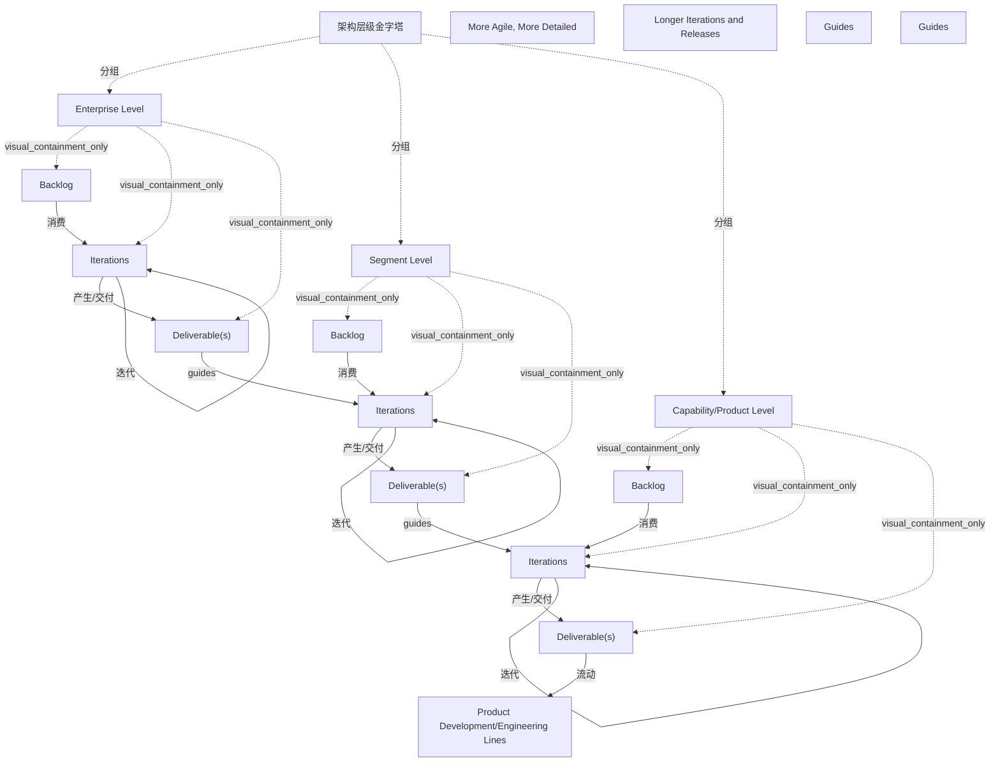

# G20F/fig4-5 · 不同架构层级上的敏捷性

类型：`process-or-method-model`。说明敏捷性在不同架构层级上的表现不同：越往下越敏捷、越细化；越往上迭代与发布周期越长、变更越少。图同时给出层间的衔接机制——上一层的交付物通过“指导”约束下一层的待办。

英文 PDF 物理页：[34]。本页为架构语义分析，原文与原图分别保留。

## 原图与可编辑图


[完整 JSON](fig4-5.json) · [可编辑 Mermaid](fig4-5.mmd) · [仅关系图](fig4-5.relations.mmd) · [层级分解图](fig4-5.hierarchy.mmd)

图形重建表达语义，不复制源图布局。虚线表示解释、矩阵映射或分组关系，不自动表示不确定性的概率。



## 架构分析

先看两根竖轴：左侧向下箭头写“More Agile, More Detailed”，表示越往下越敏捷、越细；右侧向上箭头写“Longer Iterations and Releases”，表示越往上迭代与发布周期越长。然后看金字塔的三层（Enterprise / Segment / Capability-Product），每层右侧都重复同一组符号：Backlog（条纹清单）→ 弯曲小箭头 → Iterations（一对弧形箭头）→ 粗箭头 → Deliverable(s)（绿色块）。再看层间的“Guides”大箭头：上层的 Deliverable(s) 指向下层的 Iterations 区域。最下方 Deliverable(s) 向下汇入 Product Development/Engineering Lines。

- 本图有 18 个具名或隐含元素、12 条关系和 12 条包含/分组记录。
- 包含/分组树最大深度为 2；根节点为 架构层级金字塔、更敏捷、更细化、迭代与发布周期更长、指导、指导、产品开发/工程线。
- 本图没有可直接确认为人员直属汇报的关系；视觉上下位置、能力分解和治理职责分别读取。
- 包含分组后有 5 个连通分量；分离可能源于图例、并列分类或独立示例，未自动补边。
- 核对三层金字塔文字、三组Backlog/Iterations/Deliverable、两条Guides及工程交付线。
- 修正Guides端点为下层迭代区域，补每层围绕Iterations的双弧循环；左右尺度箭头不作为实体关系。

### 如何用于项目

- 按阶段/事件/行为关系读取入口、出口、责任和产物；检查循环与例外路径。
- 工作流先后不表示组织管理权；在项目中显式记录条件和完成标准。

### 结构所表达的逻辑

- 三个层级都遵循同样的“待办→迭代→交付物”机制，差别在节奏与粒度，而不在流程形态。
- 左侧向下箭头表示越靠下层越敏捷、越细化；右侧向上箭头表示越靠上层迭代与发布周期越长。
- 层间不是松耦合：上层交付物用“Guides”箭头直接约束下一层的迭代区域，形成自顶向下的指导链。
- 最底层交付物向下进入“Product Development/Engineering Lines”，说明能力/产品层的交付物直接喂给产品开发与工程线。
- 正文指出企业层的架构愿景与战略是长期、愿景性、概念性的，其发布可跨越很长时间；组织敏捷性的一个指标正是愿景与战略改变的速度。
- 正文强调最高层架构的变更频率与数量应低于低层；变革影响越大，越要评估对已导出或在建架构的涓滴效应。
- 每个过渡状态都应提供增量业务价值——这是架构师与业务伙伴持续协作的目标。

## 上下级与包含

三层自上而下：Enterprise Level（最上层、橙色金字塔尖）、Segment Level（中层、蓝灰）、Capability/Product Level（底层、浅灰，面积最大）。每层内部有并列的 Backlog、Iterations、Deliverable(s) 三个环节，构成层内的小流程。

|父项|子项|层级类型|依据与解释|
|---|---|---|---|
|架构层级金字塔|企业层|visual_grouping|框、泳道、域或分类组的成员归属；没有额外证据不提升为业务组合或管理关系。|
|架构层级金字塔|分段层|visual_grouping|框、泳道、域或分类组的成员归属；没有额外证据不提升为业务组合或管理关系。|
|架构层级金字塔|能力/产品层|visual_grouping|框、泳道、域或分类组的成员归属；没有额外证据不提升为业务组合或管理关系。|
|企业层|待办列表|visual_containment_only|保存原图解释中的包含；业务关系类型需要图例或正文进一步限定。|
|企业层|迭代|visual_containment_only|保存原图解释中的包含；业务关系类型需要图例或正文进一步限定。|
|企业层|交付物|visual_containment_only|保存原图解释中的包含；业务关系类型需要图例或正文进一步限定。|
|分段层|待办列表|visual_containment_only|保存原图解释中的包含；业务关系类型需要图例或正文进一步限定。|
|分段层|迭代|visual_containment_only|保存原图解释中的包含；业务关系类型需要图例或正文进一步限定。|
|分段层|交付物|visual_containment_only|保存原图解释中的包含；业务关系类型需要图例或正文进一步限定。|
|能力/产品层|待办列表|visual_containment_only|保存原图解释中的包含；业务关系类型需要图例或正文进一步限定。|
|能力/产品层|迭代|visual_containment_only|保存原图解释中的包含；业务关系类型需要图例或正文进一步限定。|
|能力/产品层|交付物|visual_containment_only|保存原图解释中的包含；业务关系类型需要图例或正文进一步限定。|

## 全部元素与角色

|元素ID|原文名称|类型|含义|直接父项|深度|
|---|---|---|---|---|---|
|pyramid|架构层级金字塔|group|分组：架构层级金字塔|—||
|lvl_enterprise|Enterprise Level|architecture|架构：企业层|架构层级金字塔|1|
|lvl_segment|Segment Level|architecture|架构：分段层|架构层级金字塔|1|
|lvl_capability|Capability/Product Level|architecture|架构：能力/产品层|架构层级金字塔|1|
|axis_left|More Agile, More Detailed|concept|概念：更敏捷、更细化|—||
|axis_right|Longer Iterations and Releases|concept|概念：迭代与发布周期更长|—||
|backlog_1|Backlog|artifact|制品：待办列表|企业层|2|
|iterations_1|Iterations|process|流程：迭代|企业层|2|
|deliverable_1|Deliverable(s)|artifact|制品：交付物|企业层|2|
|backlog_2|Backlog|artifact|制品：待办列表|分段层|2|
|iterations_2|Iterations|process|流程：迭代|分段层|2|
|deliverable_2|Deliverable(s)|artifact|制品：交付物|分段层|2|
|backlog_3|Backlog|artifact|制品：待办列表|能力/产品层|2|
|iterations_3|Iterations|process|流程：迭代|能力/产品层|2|
|deliverable_3|Deliverable(s)|artifact|制品：交付物|能力/产品层|2|
|guides_1|Guides|note|说明：指导|—||
|guides_2|Guides|note|说明：指导|—||
|product_dev|Product Development/Engineering Lines|organization_unit|组织单元：产品开发/工程线|—||

## 全部关系

蓝色竖线箭头（左、右）是量纲轴：左轴向下=更敏捷更细化，右轴向上=迭代与发布周期更长。层内黑色细弯箭头：待办进入迭代。层内白色粗箭头：迭代产出交付物。层间白色粗箭头（标“Guides”）：上层的交付物指导下层的迭代区域。最底层向下的白色箭头：交付物进入产品开发/工程线。青色背景区分“工作区”，金字塔区分“层级”。

|主体|语义关系|客体|显式线/隐式|原文标签|依据|
|---|---|---|---|---|---|
|待办列表|消费|迭代|显式连线||黑色细弯箭头：待办进入迭代|
|迭代|产生/交付|交付物|显式连线||白色粗箭头：迭代产出交付物|
|交付物|guides|迭代|显式连线|Guides|Guides粗箭头从上层交付物落向下一层迭代循环区域，没有落到Backlog条目图标。|
|待办列表|消费|迭代|显式连线||消费|
|迭代|产生/交付|交付物|显式连线||产生/交付|
|交付物|guides|迭代|显式连线|Guides|Guides粗箭头从上层交付物落向下一层迭代循环区域，没有落到Backlog条目图标。|
|待办列表|消费|迭代|显式连线||消费|
|迭代|产生/交付|交付物|显式连线||产生/交付|
|交付物|流动|产品开发/工程线|显式连线||最底层交付物向下的白色箭头，汇入产品开发/工程线|
|迭代|迭代|迭代|显式连线||围绕Iterations的上/下两弧箭头构成循环；没有固定次数或时长。|
|迭代|迭代|迭代|显式连线||围绕Iterations的上/下两弧箭头构成循环；没有固定次数或时长。|
|迭代|迭代|迭代|显式连线||围绕Iterations的上/下两弧箭头构成循环；没有固定次数或时长。|

## 本轮否定的历史关系

以下旧解释保留用于追溯，不进入当前关系图、层级或知识图谱的有效边。

|旧记录|主体|旧关系|客体|否定依据|
|---|---|---|---|---|
|9|更敏捷、更细化|association|架构层级金字塔|两侧方向箭头是全图尺度注记，不连接金字塔节点。|
|10|迭代与发布周期更长|association|架构层级金字塔|两侧方向箭头是全图尺度注记，不连接金字塔节点。|

## 本轮语义修正

- Guides粗箭头从上层交付物落向下一层迭代循环区域，没有落到Backlog条目图标。
- Guides粗箭头从上层交付物落向下一层迭代循环区域，没有落到Backlog条目图标。
- 两侧方向箭头是全图尺度注记，不连接金字塔节点。
- 两侧方向箭头是全图尺度注记，不连接金字塔节点。
- 围绕Iterations的上/下两弧箭头构成循环；没有固定次数或时长。
- 围绕Iterations的上/下两弧箭头构成循环；没有固定次数或时长。
- 围绕Iterations的上/下两弧箭头构成循环；没有固定次数或时长。

## 误读检查

- 不要把金字塔读成组织规模或预算；它表示架构层级与覆盖范围，越往下越细。
- 不要以为“Guides”箭头是数据流：它是指导/约束关系（上层交付物 → 下层迭代区域）。
- 不要以为三层是先后阶段：三层同时存在，只是节奏不同。
- 中文稿正文引用的是 figs/zh/g20fe_fig4-5_zh.svg（属于较好的重绘）；同目录下的 g20fe_fig4-5_zh.png 已把左右两根轴的标签压坏，不可用于理解本图。
- 中文稿图注写作“图 4-5：架构层级与迭代节奏”，与原英文标题“Agility at Different Levels of Architecture”措辞不同，但指同一张图。

## 原文证据

### [PDF 第 34 页](../../../documents/G20F.md#page-34)

> As Figure 4-5 shows, the highest level of architecture begins with an architecture vision and strategy at the enterprise level, which provides a long-term view of the target state and surrounding business landscape. The development of the vision and strategy can be done in an Agile style, through multiple iterations as architects collaborate with their business partners. Typically, architecture delivered at this level is visionary and conceptual, and often provides a lot of flexibility to architects who use this vision to prepare more detailed architectures. The release of such high-level deliverables can span a long duration, and an indicator of organizational agility is the speed with which vision and strategy can change.

## 来源与分析状态

所有元素/关系均有来源定位；未把历史解释重命名为本轮逐线视觉确认。源图与语义图是两种视图，布局不证明汇报或因果。

源 PDF SHA-256：`a8fe6569c7d6045ce4ac8d5320c09a3abdc556a0fc1cbcd584bd76a75f3f84be`。

源图记录：[原始解释与转录](../../../figures/G20F/fig4-5.json)。

```json
{
  "quality": {
    "graph_integrity": "checked",
    "semantic_analysis": "typed-graph-and-context-analysis",
    "visual_review": "source-content-audited",
    "notice_zh": "所有元素/关系均有来源定位；未把历史解释重命名为本轮逐线视觉确认。源图与语义图是两种视图，布局不证明汇报或因果。"
  },
  "source_uncertainty": {
    "confidence": "high",
    "uncertainties_zh": [
      "三个层级的青色工作区连成一片，层内“Backlog/Iterations/Deliverable(s)”三组符号靠水平分隔线区分，未画框；层级归属按分隔线判断。",
      "右侧轴“Longer Iterations and Releases”箭头向上，其含义（越往上周期越长）依文字与箭头方向推断。",
      "中文稿未引用英文原图 PNG，标题按英文标题直译；中文稿图注为“架构层级与迭代节奏”。"
    ],
    "analyzed_from": [
      "英文 PDF 第 34 页原图截图（figctx GT crop + 2x2 放大块）",
      "英文 PDF 第 34 页正文",
      "中文稿 G20Fe_赋能企业敏捷性.md 第 408–418 行",
      "figs/g20fe_fig4-5_en.png、figs/zh/g20fe_fig4-5_zh.png 与 figs/zh/g20fe_fig4-5_zh.svg"
    ],
    "date": "2026-10-31"
  },
  "source_conflicts": []
}
```
