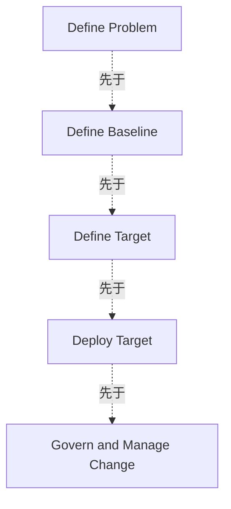

# G20F/fig5-1 · 企业架构的传统阶段

类型：`process-or-method-model`。作为 5.2 节的出发点：先用一张“传统、概括性”的图说明企业架构通常被理解为五个前后相继的阶段，再用图 5-2 说明敏捷环境中这些阶段如何并行与持续。

英文 PDF 物理页：[36]。本页为架构语义分析，原文与原图分别保留。

## 原图与可编辑图


[完整 JSON](fig5-1.json) · [可编辑 Mermaid](fig5-1.mmd) · [仅关系图](fig5-1.relations.mmd) · [层级分解图](fig5-1.hierarchy.mmd)

图形重建表达语义，不复制源图布局。虚线表示解释、矩阵映射或分组关系，不自动表示不确定性的概率。



## 架构分析

从左到右读取五个彩色阶段箭头。该图示传统概括，下一图对比Agile环境中持续并行推进的活动。

- 本图有 5 个具名或隐含元素、4 条关系和 0 条包含/分组记录。
- 本图没有可直接确认为人员直属汇报的关系；视觉上下位置、能力分解和治理职责分别读取。
- 原图只有5个首尾相接的彩色阶段箭头：Define Problem、Define Baseline、Define Target、Deploy Target、Govern and Manage Change。
- 历史记录误复制fig5-2的20个A/B/C/省略号子项，本图完全没有这些内容；已排除并保留拒绝证据。
- 五色箭头可表达传统阶段顺序；正文紧接说明Agile环境可并行，不能把传统图解释为ADM硬性规则。

### 如何用于项目

- 按阶段/事件/行为关系读取入口、出口、责任和产物；检查循环与例外路径。
- 工作流先后不表示组织管理权；在项目中显式记录条件和完成标准。

### 结构所表达的逻辑

- 只有五阶段，无20个历史误复制子项。
- 正文映射Phase A定义问题、B-D定义基线和目标、E-G部署、H管理变更。
- 不可将该传统活动概括读成ADM必须串行。

## 上下级与包含

五个同级阶段，不含子阶段框或A/B/C。

|父项|子项|层级类型|依据与解释|
|---|---|---|---|
|—|—|无视觉包含|关系中明确的组成/特化见 JSON semantic_hierarchy。|

## 全部元素与角色

|元素ID|原文名称|类型|含义|直接父项|深度|
|---|---|---|---|---|---|
|st_problem|Define Problem|phase|阶段：定义问题|—||
|st_baseline|Define Baseline|phase|阶段：定义基线|—||
|st_target|Define Target|phase|阶段：定义目标|—||
|st_deploy|Deploy Target|phase|阶段：部署目标|—||
|st_govern|Govern and Manage Change|phase|阶段：治理与管理变更|—||

## 全部关系

图中没有任何连接线。V 形箭头的形状本身表示方向（从左向右推进），箭头右端的缺口/尖角是 chevron 造型。阶段之间的先后完全由自上而下的堆叠顺序隐含，没有箭头或连线把它们串起来。

|主体|语义关系|客体|显式线/隐式|原文标签|依据|
|---|---|---|---|---|---|
|定义问题|先于|定义基线|implicit||无连线，先后由上下位置隐含|
|定义基线|先于|定义目标|implicit||先于|
|定义目标|先于|部署目标|implicit||先于|
|部署目标|先于|治理与管理变更|implicit||先于|

## 本轮否定的历史元素

源图未出现的旧元素保留供追溯，不进入当前节点、关系或层级。

|旧元素|旧标签|否定依据|
|---|---|---|
|sp_a|Sub-Problem A|该子项只出现在下一张图5-2，图5-1只有五个阶段标签。|
|sp_b|Sub-Problem B|该子项只出现在下一张图5-2，图5-1只有五个阶段标签。|
|sp_c|Sub-Problem C|该子项只出现在下一张图5-2，图5-1只有五个阶段标签。|
|sp_etc|…|该子项只出现在下一张图5-2，图5-1只有五个阶段标签。|
|bl_a|Baseline A|该子项只出现在下一张图5-2，图5-1只有五个阶段标签。|
|bl_b|Baseline B|该子项只出现在下一张图5-2，图5-1只有五个阶段标签。|
|bl_c|Baseline C|该子项只出现在下一张图5-2，图5-1只有五个阶段标签。|
|bl_etc|…|该子项只出现在下一张图5-2，图5-1只有五个阶段标签。|
|tg_a|Target A|该子项只出现在下一张图5-2，图5-1只有五个阶段标签。|
|tg_b|Target B|该子项只出现在下一张图5-2，图5-1只有五个阶段标签。|
|tg_c|Target C|该子项只出现在下一张图5-2，图5-1只有五个阶段标签。|
|tg_etc|…|该子项只出现在下一张图5-2，图5-1只有五个阶段标签。|
|dp_a|Target A|该子项只出现在下一张图5-2，图5-1只有五个阶段标签。|
|dp_b|Target B|该子项只出现在下一张图5-2，图5-1只有五个阶段标签。|
|dp_c|Target C|该子项只出现在下一张图5-2，图5-1只有五个阶段标签。|
|dp_etc|…|该子项只出现在下一张图5-2，图5-1只有五个阶段标签。|
|ch_a|Change A|该子项只出现在下一张图5-2，图5-1只有五个阶段标签。|
|ch_b|Change B|该子项只出现在下一张图5-2，图5-1只有五个阶段标签。|
|ch_c|Change C|该子项只出现在下一张图5-2，图5-1只有五个阶段标签。|
|ch_etc|…|该子项只出现在下一张图5-2，图5-1只有五个阶段标签。|

## 误读检查

- 不要以为五个阶段之间画了箭头：图中没有任何阶段间连线，顺序仅由上下位置表达。
- 不要把同一阶段内的 A/B/C 当作阶段步骤，它们是并列的子项（例如三个子问题）。
- 不要把这张图当作 TOGAF 推荐的流程：正文称它是“传统的、概括性的”视图，紧接着用图 5-2 说明敏捷环境下应并行推进。
- 中文稿引用的 figs/zh/g20fe_fig5-1_zh.png 在“部署目标”行的第一个子框排版损坏（“目标 A”溢出），看图时不要误以为那是标题。

## 原文证据

### [PDF 第 35 页](../../../documents/G20F.md#page-35)

> As shown in Figure 5-1, a traditional, generalized view of Enterprise Architecture contains a number of stages.
### [PDF 第 36 页](../../../documents/G20F.md#page-36)

> In an Agile environment it is likely that these activities will be a continuously managed process with activities proceeding in parallel, as shown in Figure 5-2.
> It is not necessary to complete the problem definition before starting other activities. Enough of the problem needs to be defined to provide context for other activities. As other activities are initiated, work can proceed to further elaborate and extend the problem definition.

## 来源与分析状态

所有元素/关系均有来源定位；未把历史解释重命名为本轮逐线视觉确认。源图与语义图是两种视图，布局不证明汇报或因果。

源 PDF SHA-256：`a8fe6569c7d6045ce4ac8d5320c09a3abdc556a0fc1cbcd584bd76a75f3f84be`。

源图记录：[原始解释与转录](../../../figures/G20F/fig5-1.json)。

```json
{
  "quality": {
    "graph_integrity": "checked",
    "semantic_analysis": "typed-graph-and-context-analysis",
    "visual_review": "source-content-audited",
    "notice_zh": "所有元素/关系均有来源定位；未把历史解释重命名为本轮逐线视觉确认。源图与语义图是两种视图，布局不证明汇报或因果。"
  },
  "source_uncertainty": {
    "confidence": "high",
    "uncertainties_zh": [
      "子项 A/B/C 的语义（三个并列的子问题/基线/目标/变更）依图与正文推断，原文未逐项解释。",
      "“Deploy Target”行内部仍标 Target A/B/C，是否应与上一行区分（例如 Deployment A）原图未作区分，照原样转录。"
    ],
    "analyzed_from": [
      "英文 PDF 第 36 页原图截图（figctx GT crop + 2x2 放大块）",
      "英文 PDF 第 35–36 页正文",
      "中文稿 G20Fe_赋能企业敏捷性.md 第 441–452 行",
      "figs/g20fe_fig5-1_en.png 与 figs/zh/g20fe_fig5-1_zh.png"
    ],
    "date": "2026-10-31"
  },
  "source_conflicts": []
}
```
