# G20F/fig5-2 · 敏捷环境中的企业架构阶段

类型：`process-or-method-model`。紧接图 5-1，用完全相同的五阶段布局说明：阶段划分没有变，变的是它们之间的关系——不再串行，而是持续管理、并行推进；同时给出“足够即可”的问题定义原则和阶段间的真实依赖。

英文 PDF 物理页：[36]。本页为架构语义分析，原文与原图分别保留。

## 原图与可编辑图


[完整 JSON](fig5-2.json) · [可编辑 Mermaid](fig5-2.mmd) · [仅关系图](fig5-2.relations.mmd) · [层级分解图](fig5-2.hierarchy.mmd)

图形重建表达语义，不复制源图布局。虚线表示解释、矩阵映射或分组关系，不自动表示不确定性的概率。

```mermaid
flowchart TB
  %% Semantic reconstruction; see original source image for exact layout.
  n0["Define Problem"]
  n1["Sub-Problem A"]
  n2["Sub-Problem B"]
  n3["Sub-Problem C"]
  n4["…"]
  n5["Define Baseline"]
  n6["Baseline A"]
  n7["Baseline B"]
  n8["Baseline C"]
  n9["…"]
  n10["Define Target"]
  n11["Target A"]
  n12["Target B"]
  n13["Target C"]
  n14["…"]
  n15["Deploy Target"]
  n16["Target A"]
  n17["Target B"]
  n18["Target C"]
  n19["…"]
  n20["Govern and Manage Change"]
  n21["Change A"]
  n22["Change B"]
  n23["Change C"]
  n24["…"]
  n0 -.->|"visual_containment_only"| n1
  n0 -.->|"visual_containment_only"| n2
  n0 -.->|"visual_containment_only"| n3
  n0 -.->|"visual_containment_only"| n4
  n5 -.->|"visual_containment_only"| n6
  n5 -.->|"visual_containment_only"| n7
  n5 -.->|"visual_containment_only"| n8
  n5 -.->|"visual_containment_only"| n9
  n10 -.->|"visual_containment_only"| n11
  n10 -.->|"visual_containment_only"| n12
  n10 -.->|"visual_containment_only"| n13
  n10 -.->|"visual_containment_only"| n14
  n15 -.->|"visual_containment_only"| n16
  n15 -.->|"visual_containment_only"| n17
  n15 -.->|"visual_containment_only"| n18
  n15 -.->|"visual_containment_only"| n19
  n20 -.->|"visual_containment_only"| n21
  n20 -.->|"visual_containment_only"| n22
  n20 -.->|"visual_containment_only"| n23
  n20 -.->|"visual_containment_only"| n24
```



## 架构分析

本图五条持续活动带与fig5-1的五个阶段名称对应，但本图额外展开每条的A/B/C子项及省略号；fig5-1没有这些子项。五带彼此没有连接线，正文将其解释为持续并行管理并按需要细化。

- 本图有 25 个具名或隐含元素、0 条关系和 20 条包含/分组记录。
- 包含/分组树最大深度为 1；根节点为 定义问题、定义基线、定义目标、部署目标、治理与管理变更。
- 本图没有可直接确认为人员直属汇报的关系；视觉上下位置、能力分解和治理职责分别读取。
- 原图靠嵌套表达结构，没有连线；新语义图将包含单独显式化，不补造流程、数据流或依赖。
- 包含分组后有 5 个连通分量；分离可能源于图例、并列分类或独立示例，未自动补边。
- 核对五条错开开始位置的横向持续活动带，每条含3个A/B/C框和一个省略号，共25标签。
- 所有带持续向右，彼此没有连接线；正文强调可并行，但某部分部署前仍需该部分基线/目标充分定义。

### 如何用于项目

- 按阶段/事件/行为关系读取入口、出口、责任和产物；检查循环与例外路径。
- 工作流先后不表示组织管理权；在项目中显式记录条件和完成标准。

### 结构所表达的逻辑

- 五个阶段名称与图 5-1 完全相同（Define Problem / Define Baseline / Define Target / Deploy Target / Govern and Manage Change），说明敏捷没有取消阶段划分。
- 变化在关系：正文说这些活动在敏捷环境中是“持续管理的过程”，并行推进，而不是一条条顺序完成。
- 问题定义不必一次做完：定义到足以给其他活动提供语境即可，其他活动启动后再回来细化和扩展问题定义。
- 依赖仍然存在：在描述目标某部分的基线与目标被充分定义之前，无法部署该目标的任何部分——这是图中唯一被正文强调的硬约束。
- 每条箭头内的 A/B/C 与省略号表示每个阶段内部仍然分区、可枚举，可分批推进。

## 上下级与包含

五条并列活动带，每条包含三个子项标签和省略号。共5个活动名+15个子项+5个省略号=25处标签；不存在带间关系边。

|父项|子项|层级类型|依据与解释|
|---|---|---|---|
|定义问题|子问题 A|visual_containment_only|保存原图解释中的包含；业务关系类型需要图例或正文进一步限定。|
|定义问题|子问题 B|visual_containment_only|保存原图解释中的包含；业务关系类型需要图例或正文进一步限定。|
|定义问题|子问题 C|visual_containment_only|保存原图解释中的包含；业务关系类型需要图例或正文进一步限定。|
|定义问题|……（后续子问题省略）|visual_containment_only|保存原图解释中的包含；业务关系类型需要图例或正文进一步限定。|
|定义基线|基线 A|visual_containment_only|保存原图解释中的包含；业务关系类型需要图例或正文进一步限定。|
|定义基线|基线 B|visual_containment_only|保存原图解释中的包含；业务关系类型需要图例或正文进一步限定。|
|定义基线|基线 C|visual_containment_only|保存原图解释中的包含；业务关系类型需要图例或正文进一步限定。|
|定义基线|……（后续基线省略）|visual_containment_only|保存原图解释中的包含；业务关系类型需要图例或正文进一步限定。|
|定义目标|目标 A|visual_containment_only|保存原图解释中的包含；业务关系类型需要图例或正文进一步限定。|
|定义目标|目标 B|visual_containment_only|保存原图解释中的包含；业务关系类型需要图例或正文进一步限定。|
|定义目标|目标 C|visual_containment_only|保存原图解释中的包含；业务关系类型需要图例或正文进一步限定。|
|定义目标|……（后续目标省略）|visual_containment_only|保存原图解释中的包含；业务关系类型需要图例或正文进一步限定。|
|部署目标|目标 A（部署）|visual_containment_only|保存原图解释中的包含；业务关系类型需要图例或正文进一步限定。|
|部署目标|目标 B（部署）|visual_containment_only|保存原图解释中的包含；业务关系类型需要图例或正文进一步限定。|
|部署目标|目标 C（部署）|visual_containment_only|保存原图解释中的包含；业务关系类型需要图例或正文进一步限定。|
|部署目标|……（后续部署项省略）|visual_containment_only|保存原图解释中的包含；业务关系类型需要图例或正文进一步限定。|
|治理与管理变更|变革 A|visual_containment_only|保存原图解释中的包含；业务关系类型需要图例或正文进一步限定。|
|治理与管理变更|变革 B|visual_containment_only|保存原图解释中的包含；业务关系类型需要图例或正文进一步限定。|
|治理与管理变更|变革 C|visual_containment_only|保存原图解释中的包含；业务关系类型需要图例或正文进一步限定。|
|治理与管理变更|……（后续变更省略）|visual_containment_only|保存原图解释中的包含；业务关系类型需要图例或正文进一步限定。|

## 全部元素与角色

|元素ID|原文名称|类型|含义|直接父项|深度|
|---|---|---|---|---|---|
|st_problem|Define Problem|phase|阶段：定义问题|—||
|sp_a|Sub-Problem A|requirement|需求：子问题 A|定义问题|1|
|sp_b|Sub-Problem B|requirement|需求：子问题 B|定义问题|1|
|sp_c|Sub-Problem C|requirement|需求：子问题 C|定义问题|1|
|sp_etc|…|note|说明：……（后续子问题省略）|定义问题|1|
|st_baseline|Define Baseline|phase|阶段：定义基线|—||
|bl_a|Baseline A|artifact|制品：基线 A|定义基线|1|
|bl_b|Baseline B|artifact|制品：基线 B|定义基线|1|
|bl_c|Baseline C|artifact|制品：基线 C|定义基线|1|
|bl_etc|…|note|说明：……（后续基线省略）|定义基线|1|
|st_target|Define Target|phase|阶段：定义目标|—||
|tg_a|Target A|artifact|制品：目标 A|定义目标|1|
|tg_b|Target B|artifact|制品：目标 B|定义目标|1|
|tg_c|Target C|artifact|制品：目标 C|定义目标|1|
|tg_etc|…|note|说明：……（后续目标省略）|定义目标|1|
|st_deploy|Deploy Target|phase|阶段：部署目标|—||
|dp_a|Target A|artifact|原图该行三个子框同样标为 Target A/B/C。|部署目标|1|
|dp_b|Target B|artifact|制品：目标 B（部署）|部署目标|1|
|dp_c|Target C|artifact|制品：目标 C（部署）|部署目标|1|
|dp_etc|…|note|说明：……（后续部署项省略）|部署目标|1|
|st_govern|Govern and Manage Change|phase|阶段：治理与管理变更|—||
|ch_a|Change A|requirement|需求：变革 A|治理与管理变更|1|
|ch_b|Change B|requirement|需求：变革 B|治理与管理变更|1|
|ch_c|Change C|requirement|需求：变革 C|治理与管理变更|1|
|ch_etc|…|note|说明：……（后续变更省略）|治理与管理变更|1|

## 全部关系

五条V形活动带本身表示持续推进，没有带间连接线。图5-1只列五阶段，本图增加子项；不能把两图的子项结构混为一谈。

|主体|语义关系|客体|显式线/隐式|原文标签|依据|
|---|---|---|---|---|---|

## 本轮否定的历史关系

以下旧解释保留用于追溯，不进入当前关系图、层级或知识图谱的有效边。

|旧记录|主体|旧关系|客体|否定依据|
|---|---|---|---|---|
||定义问题|association|定义基线|两活动带之间没有关系连线；垂直排版不产生相邻活动的关联边。|
|1|定义基线|association|定义目标|两活动带之间没有关系连线；垂直排版不产生相邻活动的关联边。|
|2|定义目标|association|部署目标|两活动带之间没有关系连线；垂直排版不产生相邻活动的关联边。|
|3|部署目标|association|治理与管理变更|两活动带之间没有关系连线；垂直排版不产生相邻活动的关联边。|

## 本轮语义修正

- 两活动带之间没有关系连线；垂直排版不产生相邻活动的关联边。
- 两活动带之间没有关系连线；垂直排版不产生相邻活动的关联边。
- 两活动带之间没有关系连线；垂直排版不产生相邻活动的关联边。
- 两活动带之间没有关系连线；垂直排版不产生相邻活动的关联边。

## 误读检查

- 不要因为五条仍然自上而下排列就认为它们必须依次完成：本图正是要说明它们可以并行、持续进行。
- 不要把 A/B/C 子项当作先后步骤，它们是同一阶段内的并列事项。
- 不要以为“并行”等于没有依赖：正文明确说在基线与目标充分定义前无法部署目标。
- 中文稿引用的 figs/g20f_fig5-2.svg 被改写成“传统 vs 敏捷”两行对照，看不到五条阶段箭头与子项，不能据它理解本图。

## 原文证据

### [PDF 第 36 页](../../../documents/G20F.md#page-36)

> In an Agile environment it is likely that these activities will be a continuously managed process with activities proceeding in parallel, as shown in Figure 5-2.

## 来源与分析状态

所有元素/关系均有来源定位；未把历史解释重命名为本轮逐线视觉确认。源图与语义图是两种视图，布局不证明汇报或因果。

源 PDF SHA-256：`a8fe6569c7d6045ce4ac8d5320c09a3abdc556a0fc1cbcd584bd76a75f3f84be`。

源图记录：[原始解释与转录](../../../figures/G20F/fig5-2.json)。

```json
{
  "quality": {
    "graph_integrity": "checked",
    "semantic_analysis": "typed-graph-and-context-analysis",
    "visual_review": "source-content-audited",
    "notice_zh": "所有元素/关系均有来源定位；未把历史解释重命名为本轮逐线视觉确认。源图与语义图是两种视图，布局不证明汇报或因果。"
  },
  "source_uncertainty": {
    "confidence": "high",
    "uncertainties_zh": [
      "原图与图 5-1 在视觉上几乎相同（仅标题不同），五条箭头之间没有任何连线；并行关系完全依赖正文，图中未用图形表示。",
      "“Deploy Target”行子框仍标 Target A/B/C，照原样转录。"
    ],
    "analyzed_from": [
      "英文 PDF 第 36 页原图截图（figctx GT crop + 2x2 放大块）",
      "英文 PDF 第 36 页正文",
      "中文稿 G20Fe_赋能企业敏捷性.md 第 454–460 行",
      "figs/g20f_fig5-2.svg 源码与文本"
    ],
    "date": "2026-10-31"
  },
  "source_conflicts": []
}
```
