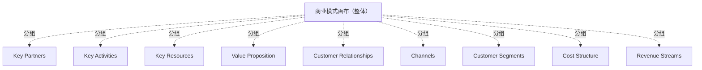

# G20F/fig5-3 · 商业模式画布（BMC）模板

类型：`business-model-canvas`。在 5.2.1“定义问题”阶段，把商业模式画布列为刻画问题的敏捷工具之一：先用九个区块把业务的基本特征摊开，再据此定义要处理的需求。图中只给模板，不含任何示例内容，细节指向《TOGAF 系列指南：业务模型》[G18A]。

英文 PDF 物理页：[38]。本页为架构语义分析，原文与原图分别保留。

## 原图与可编辑图


[完整 JSON](fig5-3.json) · [可编辑 Mermaid](fig5-3.mmd) · [仅关系图](fig5-3.relations.mmd) · [层级分解图](fig5-3.hierarchy.mmd)

图形重建表达语义，不复制源图布局。虚线表示解释、矩阵映射或分组关系，不自动表示不确定性的概率。



## 架构分析

这是一张空白模板，没有箭头也没有数据。按“价值创造—价值交付—价值获取”的顺序读：左列 Key Partners 提供 Key Activities，Key Activities 消耗 Key Resources，三者共同支撑中间最大的 Value Proposition；价值主张通过 Customer Relationships 与 Channels 触达右侧的 Customer Segments。底部一行是结果面：左边 Cost Structure 记录成本，右边 Revenue Streams 记录收入。

- 本图有 10 个具名或隐含元素、0 条关系和 9 条包含/分组记录。
- 包含/分组树最大深度为 1；根节点为 商业模式画布（整体）。
- 本图没有可直接确认为人员直属汇报的关系；视觉上下位置、能力分解和治理职责分别读取。
- 原图靠嵌套表达结构，没有连线；新语义图将包含单独显式化，不补造流程、数据流或依赖。
- 核对9个Business Model Canvas分区和总画布；Key Activities/Key Resources上下分区、Customer Relationships/Channels上下分区及Cost/Revenue底行正确。
- 源图是空白模板，没有经营数据或关系箭头。

### 如何用于项目

- 先明确受益方和价值主张，再把各画布要素关联到能力、价值流及所需资源。
- 画布用于假设和共同理解；不能替代细化的实现架构或已验证经营数据。

### 结构所表达的逻辑

- 画布分为九个区块：Key Partners、Key Activities、Key Resources、Value Proposition、Customer Relationships、Channels、Customer Segments、Cost Structure、Revenue Streams。
- Layout 体现商业逻辑：左侧是供给与成本侧（伙伴、活动、资源），中间是价值主张，右侧是需求与收入侧（关系、渠道、客户），底部是财务结果（成本/收入）。
- Value Proposition 占中部整列、Customer Segments 占右端整列，说明二者是画布的两个核心锚点。
- 图中没有任何填写内容，它是模板而非案例；正文用它来说明“用什么框架刻画问题”，具体填写方法见 G18A。
- 在本文语境中，画布属于“定义问题”可用的敏捷工具之一，与业务需求、客户旅程、设计思维、Epic 并列。

## 上下级与包含

没有上下级，只有版式分区：画布是一个大框，内部被切成 5 列 + 2 个底部横格；Key Activities 与 Key Resources 上下叠在同一列，Customer Relationships 与 Channels 上下叠在同一列。

|父项|子项|层级类型|依据与解释|
|---|---|---|---|
|商业模式画布（整体）|关键合作伙伴|visual_grouping|框、泳道、域或分类组的成员归属；没有额外证据不提升为业务组合或管理关系。|
|商业模式画布（整体）|关键活动|visual_grouping|框、泳道、域或分类组的成员归属；没有额外证据不提升为业务组合或管理关系。|
|商业模式画布（整体）|关键资源|visual_grouping|框、泳道、域或分类组的成员归属；没有额外证据不提升为业务组合或管理关系。|
|商业模式画布（整体）|价值主张|visual_grouping|框、泳道、域或分类组的成员归属；没有额外证据不提升为业务组合或管理关系。|
|商业模式画布（整体）|客户关系|visual_grouping|框、泳道、域或分类组的成员归属；没有额外证据不提升为业务组合或管理关系。|
|商业模式画布（整体）|渠道|visual_grouping|框、泳道、域或分类组的成员归属；没有额外证据不提升为业务组合或管理关系。|
|商业模式画布（整体）|客户细分|visual_grouping|框、泳道、域或分类组的成员归属；没有额外证据不提升为业务组合或管理关系。|
|商业模式画布（整体）|成本结构|visual_grouping|框、泳道、域或分类组的成员归属；没有额外证据不提升为业务组合或管理关系。|
|商业模式画布（整体）|收入来源|visual_grouping|框、泳道、域或分类组的成员归属；没有额外证据不提升为业务组合或管理关系。|

## 全部元素与角色

|元素ID|原文名称|类型|含义|直接父项|深度|
|---|---|---|---|---|---|
|canvas|商业模式画布（整体）|group|分组：商业模式画布（整体）|—||
|key_partners|Key Partners|group|分组：关键合作伙伴|商业模式画布（整体）|1|
|key_activities|Key Activities|group|分组：关键活动|商业模式画布（整体）|1|
|key_resources|Key Resources|group|分组：关键资源|商业模式画布（整体）|1|
|value_proposition|Value Proposition|group|分组：价值主张|商业模式画布（整体）|1|
|customer_relationships|Customer Relationships|group|分组：客户关系|商业模式画布（整体）|1|
|channels|Channels|group|分组：渠道|商业模式画布（整体）|1|
|customer_segments|Customer Segments|group|分组：客户细分|商业模式画布（整体）|1|
|cost_structure|Cost Structure|group|分组：成本结构|商业模式画布（整体）|1|
|revenue_streams|Revenue Streams|group|分组：收入来源|商业模式画布（整体）|1|

## 全部关系

图中只有分隔区块的直线，没有箭头或连线；任何“伙伴→活动→价值主张→客户”的流向都由区块位置隐含，属阅读惯例而非图中绘制的关系。

|主体|语义关系|客体|显式线/隐式|原文标签|依据|
|---|---|---|---|---|---|

## 误读检查

- 不要以为图中有任何案例数据：九个区块全是空的，它只是模板。
- 不要把相邻区块的边界线读成流程箭头；画布没有表达顺序或因果。
- 不要把 Key Activities 与 Key Resources 读成两个独立列：它们同属第二列，上下分割。
- 中文稿引用的 figs/zh/g20fe_fig5-3_zh.svg 是可用的重绘版；同目录下的 g20fe_fig5-3_zh.png 文字层错位严重（多处中英重叠、标签跑出框外），不要使用。

## 原文证据

### [PDF 第 38 页](../../../documents/G20F.md#page-38)

> of the business; see the template in Figure 5-3. For more details, refer to the TOGAF® Series Guide: Business Models [G18A].

## 来源与分析状态

所有元素/关系均有来源定位；未把历史解释重命名为本轮逐线视觉确认。源图与语义图是两种视图，布局不证明汇报或因果。

源 PDF SHA-256：`a8fe6569c7d6045ce4ac8d5320c09a3abdc556a0fc1cbcd584bd76a75f3f84be`。

源图记录：[原始解释与转录](../../../figures/G20F/fig5-3.json)。

```json
{
  "quality": {
    "graph_integrity": "checked",
    "semantic_analysis": "typed-graph-and-context-analysis",
    "visual_review": "source-content-audited",
    "notice_zh": "所有元素/关系均有来源定位；未把历史解释重命名为本轮逐线视觉确认。源图与语义图是两种视图，布局不证明汇报或因果。"
  },
  "source_uncertainty": {
    "confidence": "high",
    "uncertainties_zh": [
      "原图内没有标题，中文图题“商业模式画布（BMC）模板”取自中文稿图注。",
      "画布本身无内容，各区块应填什么只能引用 Osterwalder 画布的通行定义，图中未作说明。"
    ],
    "analyzed_from": [
      "英文 PDF 第 38 页原图截图（figctx GT crop + 2x2 放大块）",
      "英文 PDF 第 38 页正文（5.2.1 工具清单）",
      "中文稿 G20Fe_赋能企业敏捷性.md 第 476–489 行",
      "figs/g20fe_fig5-3_en.png、figs/zh/g20fe_fig5-3_zh.png 与 figs/zh/g20fe_fig5-3_zh.svg"
    ],
    "date": "2026-10-31"
  },
  "source_conflicts": []
}
```
